# Module 2: 索引系统 (TSI Index + SeriesFile) - 深度审计报告

> **小白导读**: 索引就像一本书的**目录**。没有目录，找内容只能一页一页翻（全表扫描）。
> 有了目录，直接翻到对应页码（O(1) 查找）。
>
> InfluxDB 的索引系统有两层：
> - **SeriesFile**: 记录所有"series"（如 `cpu,host=web`）的唯一编号。就像图书馆的**书号系统**。
> - **TSI Index**: 记录每个 measurement 下有哪些 series，每个 tag 值对应哪些 series。就像图书馆的**分类目录**。
>
> 为什么需要两层？因为 SeriesFile 是每个数据库独立的（所有 Shard 共享同一数据库的 SeriesFile），TSI Index 是每个 Shard 独立的。

> **范围声明（先读这一条）**: 本文讲的是 **TSI 索引**（`tsi1`），它在 1.x 中**不是默认索引**。
> - 默认索引是 **inmem**：`tsdb/config.go:17` `DefaultIndex = InmemIndexName`。
> - 启用 TSI 需要在配置里显式设置 `index-version = "tsi1"`（或 `[data] index-version`）。
> - `tsdb/index/index.go:1-6` 只是一个 blank import 的注册桩，把 `inmem` 与 `tsi1` 两套实现注册进
>   `tsdb.RegisterIndex`；`tsdb/index/inmem` 是另一套完全不同的实现，二者**共用同一个 SeriesFile**。
> - TSI 的分区数默认 8（`tsdb/index/tsi1/index.go:58` `DefaultPartitionN`），可用环境变量
>   `INFLUXDB_EXP_TSI_PARTITIONS` 在进程启动时覆盖（`index.go:34-42`），且必须是 2 的幂、建库后不可更改。

## 1. Series 创建全链路

### 1.1 从写入到 Series 注册的完整路径

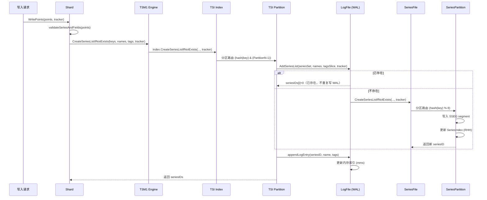

### 1.2 每一步的代码实现

#### 步骤 1: Shard.validateSeriesAndFields — 验证 Series 和 Fields

> 全仓不存在 `FieldValidator` 类型或方法。真实实现由 `tsdb/shard.go:613-760` 的
> `validateSeriesAndFields` 与 `tsdb/field_validator.go` 的 `ValidateAndCreateFields`
> 共同完成；失败通过**非 nil** 的 `PartialWriteError` 返回，有效点仍然会被写入。

```go
// tsdb/shard.go:613 — validateSeriesAndFields（按源码重写）
func (s *Shard) validateSeriesAndFields(points []models.Point, tracker StatsTracker) ([]models.Point, []*FieldCreate, error) {
    var (
        createdFieldsToSave []*FieldCreate
        err                 error
        dropped             int
        reason              string // 只保留第一条原因
    )

    keys := make([][]byte, len(points))
    names := make([][]byte, len(points))
    tagsSlice := make([]models.Tags, len(points))
    validateKeys := s.options.Config.ValidateKeys

    // 1a) 过滤 time tag / 非法 unicode，并原地压缩 points
    var j int
    for i, p := range points {
        tags := p.Tags()
        if v := tags.Get(TimeBytes); v != nil {
            dropped++
            if reason == "" {
                reason = fmt.Sprintf("invalid tag key: input tag %q on measurement %q is invalid", "time", string(p.Name()))
            }
            continue
        }
        if validateKeys && !models.ValidKeyTokens(string(p.Name()), tags) {
            dropped++
            if reason == "" {
                reason = fmt.Sprintf("key contains invalid unicode: %q", makePrintable(string(p.Key())))
            }
            continue
        }
        keys[j], names[j], tagsSlice[j] = p.Key(), p.Name(), tags
        points[j] = points[i]          // 原地压缩，避免额外分配
        j++
    }
    points, keys, names, tagsSlice = points[:j], keys[:j], names[:j], tagsSlice[:j]

    engine, err := s.engineNoLock()
    if err != nil {
        return nil, nil, err
    }

    // 1b) 批量建 series。PartialWriteError 表示"部分 key 被丢弃"，不是引擎故障。
    var droppedKeys [][]byte
    if err := engine.CreateSeriesListIfNotExists(keys, names, tagsSlice, tracker); err != nil {
        switch err := err.(type) {
        case PartialWriteError:      // 值类型
            reason, droppedKeys = err.Reason, err.DroppedKeys
            dropped += err.Dropped
            atomic.AddInt64(&s.stats.WritePointsDropped, int64(err.Dropped))
        case *PartialWriteError:     // 指针类型
            reason, droppedKeys = err.Reason, err.DroppedKeys
            dropped += err.Dropped
            atomic.AddInt64(&s.stats.WritePointsDropped, int64(err.Dropped))
        default:
            return nil, nil, err     // 真正的引擎错误
        }
    }

    // 1c) 逐点 field 校验：同时完成"类型冲突检测 + time field 剥离 + 超长检查 + 新 field 创建"
    j = 0
    for i, p := range points {
        // 只有 time field（或没有 field）的点整点丢弃
        iter := p.FieldIterator()
        validField := false
        for iter.Next() {
            if bytes.Equal(iter.FieldKey(), TimeBytes) {
                continue
            }
            validField = true
            break
        }
        if !validField {
            if reason == "" {
                reason = fmt.Sprintf("invalid field name: input field %q on measurement %q is invalid", "time", string(p.Name()))
            }
            dropped++
            continue
        }

        // series 创建阶段已被丢弃的 key 跳过（dropped 已计过）
        if len(droppedKeys) > 0 && bytesutil.Contains(droppedKeys, keys[i]) {
            continue
        }

        mf := engine.MeasurementFields(p.Name())
        newFields, partialWriteError := ValidateAndCreateFields(mf, p, s.options.Config.SkipFieldSizeValidation)
        createdFieldsToSave = append(createdFieldsToSave, newFields...)

        if partialWriteError != nil && partialWriteError.Dropped > 0 {
            // 整点丢弃：类型冲突、field 超过 1 MiB 等
            if reason == "" {
                reason = partialWriteError.Reason
            }
            dropped += partialWriteError.Dropped
            atomic.AddInt64(&s.stats.WritePointsDropped, int64(partialWriteError.Dropped))
            continue
        } else if partialWriteError != nil {
            // 只剥离了 time field：点保留，但把"发生过丢弃"告诉上层
            partialWriteError.Database = s.Database()
            partialWriteError.RetentionPolicy = s.RetentionPolicy()
            err = *partialWriteError
        }

        points[j] = points[i]
        j++
    }

    // 1d) 有任何丢弃 → 返回非 nil 的 PartialWriteError；points[:j] 仍会被写入
    if dropped > 0 {
        err = PartialWriteError{Reason: reason, Dropped: dropped, Database: s.database, RetentionPolicy: s.retentionPolicy}
    }
    return points[:j], createdFieldsToSave, err
}
```

**PartialWriteError 的来源**（前 5 条是"丢点"，最后 1 条只丢 field、不丢点）：

| 来源 | 丢弃粒度 | 源码 |
|------|---------|------|
| tag key 为 `time` | 整点 | `shard.go:633-643` |
| key 含非法 unicode（`ValidateKeys=true`） | 整点 | `shard.go:644-651` |
| series 创建失败（`DroppedKeys`） | 整点 | `shard.go:666-687` |
| 只有 `time` field / 没有有效 field | 整点 | `shard.go:688-706` |
| field 类型冲突 / 字符串 field > 1 MiB | 整点 | `field_validator.go:27-72` |
| 仅剥离 `time` field（`Dropped=0`） | 不丢点，但返回错误提示 | `field_validator.go:44-54` |

`MaxFieldValueLength = 1048576`（1 MiB，`field_validator.go:12`）；
`SkipFieldSizeValidation=true` 时跳过超长检查。`Shard.WritePoints` 收到
`PartialWriteError` 后仍调用引擎写入有效点，只有引擎错误才计入 `WritePointsErr`
（`shard.go:574-605`）。

新 field（`fieldsToCreate`）由 `Shard.saveFieldsAndMeasurements` 在调用引擎前落盘
（`shard.go:585`），详见 06 §8.4。

#### 步骤 2: Engine.CreateSeriesListIfNotExists — 委托给 Index

```go
// tsdb/engine/tsm1/engine.go:1945 — CreateSeriesListIfNotExists
func (e *Engine) CreateSeriesListIfNotExists(keys, names [][]byte, tagsSlice []models.Tags, tracker tsdb.StatsTracker) error {
    return e.index.CreateSeriesListIfNotExists(keys, names, tagsSlice, tracker)
}
```

#### 步骤 3: Index.CreateSeriesListIfNotExists — 分区路由

```go
// tsdb/index/tsi1/index.go:646 — Index.CreateSeriesListIfNotExists
func (i *Index) CreateSeriesListIfNotExists(keys [][]byte, names [][]byte, tagsSlice []models.Tags, tracker tsdb.StatsTracker) error {
    // 按分区分组: 将 names 和 tags 按分区拆分为 pNames/pTags
    pNames := make([][][]byte, i.PartitionN)
    pTags := make([][]models.Tags, i.PartitionN)

    for ki, key := range keys {
        pidx := i.partitionIdx(key)
        pNames[pidx] = append(pNames[pidx], names[ki])
        pTags[pidx] = append(pTags[pidx], tagsSlice[ki])
    }

    // 并发处理各分区 (goroutine 池 + atomic 计数器)
    n := i.availableThreads()
    errC := make(chan error, i.PartitionN)

    var pidx uint32
    for k := 0; k < n; k++ {
        go func() {
            for {
                idx := int(atomic.AddUint32(&pidx, 1) - 1)
                if idx >= len(i.partitions) {
                    return
                }
                ids, err := i.partitions[idx].createSeriesListIfNotExists(pNames[idx], pTags[idx], tracker)
                // ... 更新 tagValueCache ...
                errC <- err
            }
        }()
    }

    for i := 0; i < cap(errC); i++ {
        if err := <-errC; err != nil {
            return err
        }
    }
}
```

**分区路由** (index.go:371):

```go
func (i *Index) partitionIdx(key []byte) int {
    return int(xxhash.Sum64(key) & (i.PartitionN - 1))
}
```

**注意**: 使用位运算 `& (PartitionN - 1)` 而非取模 `%`，因为 PartitionN 始终是 2 的幂（默认 8），位运算更快。

**PartitionN 默认值**: 8 (可通过 `INFLUXDB_EXP_TSI_PARTITIONS` 环境变量配置)

**TagValueSeriesIDCache** (index.go:131): Index 级别的 tag value 查询缓存 (`*TagValueSeriesIDCache`)，缓存 tag key+value 到 SeriesIDSet 的映射，避免重复的 IndexFile mmap 访问。大小通过 `tagValueCacheSize` 配置。

#### 步骤 4: Partition.createSeriesListIfNotExists — LogFile + SeriesFile

```go
// tsdb/index/tsi1/partition.go:720 — createSeriesListIfNotExists
func (p *Partition) createSeriesListIfNotExists(names [][]byte, tagsSlice []models.Tags, tracker tsdb.StatsTracker) ([]uint64, error) {
    // 0. 空批 / 长度不一致守卫（分区 fan-out 后某一分区可能分不到 key）
    if len(names) == 0 {
        return nil, nil
    } else if len(names) != len(tagsSlice) {
        return nil, fmt.Errorf("uneven batch, partition %s sent %d names and %d tags", p.id, len(names), len(tagsSlice))
    }

    // 1. 获取 FileSet 引用，失败必须返回而不是继续
    fs, err := p.RetainFileSet()
    if err != nil {
        return nil, err
    }
    defer fs.Release()

    // 2. 持读锁调用 LogFile.AddSeriesList
    //    AddSeriesList 内部会调用 f.sfile.CreateSeriesListIfNotExists 创建 series
    //    然后写入 WAL entry 并更新内存索引
    p.mu.RLock()
    ids, err := p.activeLogFile.AddSeriesList(p.seriesIDSet, names, tagsSlice, tracker)
    if err != nil {
        p.mu.RUnlock()          // 失败路径必须手动解锁（没有 defer）
        return nil, err
    }
    p.mu.RUnlock()

    // 3. 检查是否需要轮转 LogFile
    if err := p.CheckLogFile(); err != nil {
        return nil, err
    }
    return ids, nil
}
```

**控制流说明**: Partition 并不直接调用 SeriesFile，而是委托给 `LogFile.AddSeriesList`，后者在内部调用 `f.sfile.CreateSeriesListIfNotExists` 完成 series 注册。

**加锁说明**: `AddSeriesList` 同时持有 `f.mu.Lock()`（LogFile 写锁）和 `seriesSet.Lock()`（SeriesIDSet 写锁），在写锁下 double-check 避免重复写入，然后追加 entry、更新内存索引、并将新 series ID 注册到 SeriesIDSet

**统计说明**: `tracker tsdb.StatsTracker` 不是可省略的装饰参数。它从 `Shard.WritePoints` 一直传到 `SeriesPartition.CreateSeriesListIfNotExists`，用于记录新增 series / measurement-series 统计；测试中通常传 `tsdb.NoopStatsTracker()`。

#### 步骤 5: SeriesFile.CreateSeriesListIfNotExists — 8 分区 SeriesFile

```go
// tsdb/series_file.go:182 — SeriesFile.CreateSeriesListIfNotExists
func (f *SeriesFile) CreateSeriesListIfNotExists(names [][]byte, tagsSlice []models.Tags, tracker tsdb.StatsTracker) ([]uint64, error) {
    // 构建 key
    keys := GenerateSeriesKeys(names, tagsSlice)

    // 按分区分组
    keyPartitionIDs := f.SeriesKeysPartitionIDs(keys)

    ids := make([]uint64, len(keys))

    // 使用 errgroup 并发处理所有分区
    var g errgroup.Group
    for i := range f.partitions {
        p := f.partitions[i]
        g.Go(func() error {
            return p.CreateSeriesListIfNotExists(keys, keyPartitionIDs, ids, tracker)
        })
    }
    if err := g.Wait(); err != nil {
        return nil, err
    }

    return ids, nil
}
```

**SeriesFile 8 分区路由** — 两种分区方式:

SeriesFile 使用两种不同的分区映射，分别用于不同场景：

```go
// tsdb/series_file.go:32 — SeriesFilePartitionN
const SeriesFilePartitionN = 8

// 方式 1: key → 分区 (写入/查找时使用)
// 使用 xxhash 取模，将 series key 路由到某个分区
// tsdb/series_file.go:299
func (f *SeriesFile) SeriesKeyPartitionID(key []byte) int {
    return int(xxhash.Sum64(key) % SeriesFilePartitionN)
}

// 方式 2: seriesID → 分区 (通过 ID 反查时使用)
// 使用 (id-1) 取模，因为 ID 分配规则保证了 ID 与分区的固定映射
// tsdb/series_file.go:279
func (f *SeriesFile) SeriesIDPartitionID(id uint64) int {
    return int((id - 1) % SeriesFilePartitionN)
}
```

> **两种方式的关系**: 写入时通过 `SeriesKeyPartitionID(key)` 确定分区，
> 分区内的 `insert()` 函数分配 ID（`p.seq += SeriesFilePartitionN`）。
> 由于 ID 分配规则（分区 0 获得 1,9,17,...；分区 1 获得 2,10,18,...），
> `(id-1) % 8` 一定等于分配该 ID 的分区号。
> 因此两种方式的结果一致，但用途不同：方式 1 用于写入路径（key 已知），
> 方式 2 用于查询路径（只有 ID，需要反查 key）。
>
> **注意**: SeriesFile 使用**取模** `%`，而 TSI Index 的 `partitionIdx` 使用**位运算** `& (PartitionN - 1)`。
> 两者都要求 PartitionN 为 2 的幂，但位运算更快。这是一个实现上的不一致。

#### 步骤 6: SeriesPartition.CreateSeriesListIfNotExists — SSEG + RHH

```go
// tsdb/series_partition.go:200 — CreateSeriesListIfNotExists
func (p *SeriesPartition) CreateSeriesListIfNotExists(keys [][]byte, keyPartitionIDs []int, ids []uint64, tracker tsdb.StatsTracker) error {
    var writeRequired bool

    // 阶段 1: 读锁快速路径 — 检查已存在的 series
    p.mu.RLock()
    if p.closed {
        p.mu.RUnlock()
        return ErrSeriesPartitionClosed
    }
    for i := range keys {
        if keyPartitionIDs[i] != p.id {
            continue  // 不属于此分区
        }
        id := p.index.FindIDBySeriesKey(p.segments, keys[i])
        if id == 0 {
            writeRequired = true  // 需要写入
            continue
        }
        ids[i] = id
    }
    p.mu.RUnlock()

    // 提前退出: 所有 series 已存在
    if !writeRequired {
        return nil
    }

    type keyRange struct {
        id     uint64
        offset int64
    }
    newKeyRanges := make([]keyRange, 0, len(keys))

    // 阶段 2: 写锁 — 创建新 series (双重检查)
    p.mu.Lock()
    defer p.mu.Unlock()

    if p.closed {
        return ErrSeriesPartitionClosed
    }

    // 跟踪批量内的重复 key
    newIDs := make(map[string]uint64, len(ids))

    for i := range keys {
        if keyPartitionIDs[i] != p.id || ids[i] != 0 {
            continue
        }

        // 写锁下再次检查 (可能其他 goroutine 已创建)
        key := keys[i]
        // 先查批量内去重 map
        if ids[i] = newIDs[string(key)]; ids[i] != 0 {
            continue
        } else if ids[i] = p.index.FindIDBySeriesKey(p.segments, key); ids[i] != 0 {
            continue
        }

        // 分配新 ID 并写入 SSEG segment
        id, offset, err := p.insert(key)
        if err != nil {
            return err
        }

        ids[i] = id
        newIDs[string(key)] = id
        newKeyRanges = append(newKeyRanges, keyRange{id, offset})
    }

    // 刷盘使 mmap 可读
    if segment := p.activeSegment(); segment != nil {
        if err := segment.Flush(); err != nil {
            return err
        }
    }

    // 将新 key 添加到 RHH hash map
    for _, keyRange := range newKeyRanges {
        p.index.Insert(p.seriesKeyByOffset(keyRange.offset), keyRange.id, keyRange.offset)
    }
}
```

**insert 函数** (series_partition.go:445):

```go
func (p *SeriesPartition) insert(key []byte) (id uint64, offset int64, err error) {
    id = p.seq
    offset, err = p.writeLogEntry(AppendSeriesEntry(nil, SeriesEntryInsertFlag, id, key))
    if err != nil {
        return 0, 0, err
    }
    p.seq += SeriesFilePartitionN  // 不是 p.seq++
    return id, offset, nil
}
```

**Series ID 分配**: 分区 0 获得 1, 9, 17, ...; 分区 1 获得 2, 10, 18, ...; 以此类推。

```go
// tsdb/series_partition.go:62 — seq 初始化
p.seq = uint64(p.id + 1)  // 分区 0 → seq=1, 分区 1 → seq=2, ...

// 恢复时: p.seq = seq + SeriesFilePartitionN (series_partition.go:126)
// 确保 seq 总是跳到下一个属于本分区的 ID
```

**SeriesPartitionCompactor**（`series_partition.go:537`）：运行时压缩**只重建 SIDX**，不合并、不删除 SSEG。`Compact`（`:547-585`）在快照 `CloneSeriesSegments` + `index.Clone()` 后用 RHH 重建索引，写到 `<index>.compacting`，再按 `Close`→`Rename`→`Open`→`Recover` 交换；SSEG 始终 append-only。触发量是 `index.InMemCount()`（重启后新增、尚未落盘 SIDX 的 entry 数）达到 `CompactThreshold`（默认 `1<<17`），不存在"碎片率"概念（详见 §4.3）。

#### 步骤 7: SeriesSegment — SSEG 文件格式

**Segment 大小增长** (series_segment.go:366): `1 << (id + 22)`，从 4MB (id=0) 增长到 256MB (id>=6)。后续 segment 固定为 256MB。

```go
func SeriesSegmentSize(id uint16) uint32 {
    const min = 22 // 4MB
    const max = 28 // 256MB
    shift := id + min
    if shift >= max {
        shift = max
    }
    return 1 << shift
}
```

```go
// tsdb/series_segment.go:17-31 — SSEG 格式常量
const (
    SeriesSegmentVersion = 1
    SeriesSegmentMagic   = "SSEG"

    SeriesSegmentHeaderSize = 4 + 1 // magic + version
)

// Series entry constants.
const (
    SeriesEntryFlagSize   = 1
    SeriesEntryHeaderSize = 1 + 8 // flag + id

    SeriesEntryInsertFlag    = 0x01
    SeriesEntryTombstoneFlag = 0x02
)
```

**SSEG Entry 格式** (ReadSeriesEntry, series_segment.go:415):

```
┌──────┬────────┬──────────────┐
│ Flag │  ID    │     Key      │
│1 byte│8 bytes │ N bytes (变长)│
└──────┴────────┴──────────────┘
```

- **Flag**: `0x01` = Insert, `0x02` = Tombstone
- **ID**: Series ID (uint64, BigEndian)
- **Key**: series key 的**二进制编码**（`AppendSeriesKey`，`tsdb/series_file.go:347-395`）：
  uvarint 总长（不含自身）+ uint16 measurement 长度 + measurement + uvarint tagN +
  每个 tag 的 uint16 key 长度与字节、uint16 value 长度与字节。
  示例 `cpu,host=web` 编码为 18 字节（2+3+1+2+4+2+3=17，加 1B 总长），不是文本的 12 字节。
  读取入口：`ReadSeriesKeyLen` / `ReadSeriesKeyMeasurement` / `ReadSeriesKeyTagN` / `ReadSeriesKeyTag`
  （`tsdb/series_file.go:403-433`；与 D14 §3.1 一致）

#### 步骤 8: SeriesIndex — Robin Hood Hash

```go
// tsdb/series_index.go:36 — SeriesIndex
type SeriesIndex struct {
    path string

    count    uint64
    capacity int64
    mask     int64          // RHH 掩码 (capacity - 1)

    maxSeriesID uint64
    maxOffset   int64

    data         []byte     // mmap 的 SIDX 整体数据
    keyIDData    []byte     // key→ID 的 mmap 区域 (磁盘上的 RHH hash table)
    idOffsetData []byte     // ID→offset 的 mmap 区域 (磁盘上的 hash table)

    // 重启后重建的内存索引 (maxOffset 之后的增量数据)
    keyIDMap    *rhh.HashMap       // key → seriesID 映射 (Robin Hood Hash)
    idOffsetMap map[uint64]int64   // seriesID → SSEG offset 映射 (标准 Go map)
    tombstones  map[uint64]struct{} // 已删除的 seriesID 集合
}
```

> **关键区分**: `keyIDMap` 使用 `pkg/rhh.HashMap`（Robin Hood Hashing），而 `idOffsetMap` 使用标准 Go `map[uint64]int64`。
> 磁盘上的 SIDX 文件存储了完整的 RHH hash table（通过 mmap 映射到 `keyIDData` 和 `idOffsetData`），
> 内存中的 `keyIDMap`/`idOffsetMap` 只存储重启后 `maxOffset` 之后的增量数据。
> 查询时先查内存 map，未命中再查 mmap 的磁盘数据。

**SeriesIndex.Recover()** (series_index.go:110): 启动时重建内存索引。遍历 SIDX 文件中 `maxOffset` 之后的所有 SSEG entry，重新构建 `keyIDMap`、`idOffsetMap` 和 `tombstones`。这确保了崩溃后未持久化到 SIDX 的 entry 不会丢失。

**SIDX 文件格式**（`tsdb/series_index.go:21-31`、`:359-372`；与 D14 §6.1 一致）：

| 偏移 | 大小 | 字段 |
|------|------|------|
| 0 | 4 | Magic `"SIDX"`（0x53 0x49 0x44 0x58） |
| 4 | 1 | Version（=1） |
| 5 | 8 | MaxSeriesID |
| 13 | 8 | MaxOffset |
| 21 | 8 | Count |
| 29 | 8 | Capacity |
| 37 | 8 | KeyIDMap.Offset |
| 45 | 8 | KeyIDMap.Size |
| 53 | 8 | IDOffsetMap.Offset |
| 61 | 8 | IDOffsetMap.Size |

`SeriesIndexHeaderSize = 4 + 1 + 8×6 = 69` 字节。文件体只有两张 RHH 表，每元素
16 字节（`SeriesIndexElemSize = 16`）：

- KeyIDMap：`[offset 8B][id 8B]`，共 `Capacity × 16B`
- IDOffsetMap：`[id 8B][offset 8B]`，共 `Capacity × 16B`

没有独立的 Data Section，也没有 Entries 区；SIDX 不存 series key，key 只能从 SSEG 读
（`series_index.go:204`）。所有字段 BigEndian。

**RHH (Robin Hood Hashing)**:

> **小白解释**: 想象一个停车场（哈希表），每辆车（数据）根据车牌号（hash）分配车位。
> 但如果两个车牌号算出同一个车位怎么办？（哈希冲突）
> - **普通哈希**: 后来的车往前找空位，可能找很远
> - **Robin Hood**: "劫富济贫"——如果新车找的车位比已经在位的车更远，就把旧车挪走，新车停进去。
>   这样所有车的"寻找距离"更均匀，查找效率更高。
>
> 为什么用 RHH？因为 InfluxDB 需要快速查找 series ID → offset 的映射，RHH 的查找时间方差很小。

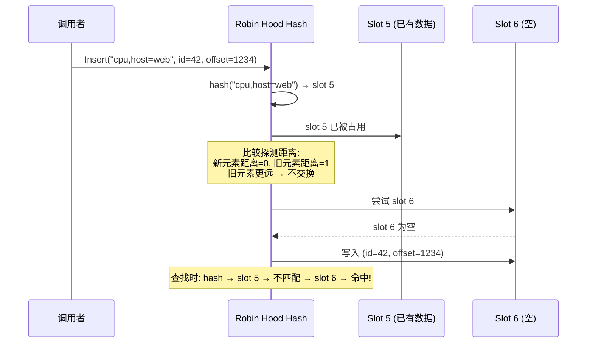

#### 步骤 9: LogFile.AddSeriesList — 写入 WAL Entry

```go
// tsdb/index/tsi1/log_file.go:525 — AddSeriesList
func (f *LogFile) AddSeriesList(seriesSet *tsdb.SeriesIDSet, names [][]byte, tagsSlice []models.Tags, tracker tsdb.StatsTracker) ([]uint64, error) {
    // 1. 先通过 SeriesFile 创建/查找 series ID
    seriesIDs, err := f.sfile.CreateSeriesListIfNotExists(names, tagsSlice, tracker)
    if err != nil {
        return nil, err
    }

    var writeRequired bool
    entries := make([]LogEntry, 0, len(names))

    // 2. 读锁快速路径: 过滤已存在的 series
    seriesSet.RLock()
    for i := range names {
        if seriesSet.ContainsNoLock(seriesIDs[i]) {
            seriesIDs[i] = 0  // 已存在，跳过
            continue
        }
        writeRequired = true
        entries = append(entries, LogEntry{SeriesID: seriesIDs[i], name: names[i], tags: tagsSlice[i], cached: true, batchidx: i})
    }
    seriesSet.RUnlock()

    // 3. 全部已存在时提前退出
    if !writeRequired {
        return seriesIDs, nil
    }

    // 4. 写锁阶段: 同时持有 LogFile 写锁 + SeriesIDSet 写锁
    f.mu.Lock()
    defer f.mu.Unlock()

    seriesSet.Lock()
    defer seriesSet.Unlock()

    // 5. 在写锁下再次检查 (double-check)，追加 entry 并更新索引
    for i := range entries {
        entry := &entries[i]
        if seriesSet.ContainsNoLock(entry.SeriesID) {
            seriesIDs[entry.batchidx] = 0  // 其他 goroutine 已创建
            continue
        }
        if err := f.appendEntry(entry); err != nil {
            return nil, err
        }
        f.execEntry(entry)
        seriesSet.AddNoLock(entry.SeriesID)  // 注册到 seriesSet
    }

    // 6. 刷盘同步
    if err := f.FlushAndSync(); err != nil {
        return nil, err
    }
    return seriesIDs, nil
}
```

**LogEntry 线上格式**（`appendLogEntry`，`log_file.go:1198-1232`，按写入顺序）：

| 字段 | 编码 | 说明 |
|------|------|------|
| Flag | 1 byte | 互斥枚举，见下表 |
| SeriesID | uvarint | 1–10 字节，**不是固定 8 字节**（`log_file.go:1205-1207`） |
| Name Len + Name | uvarint + N | |
| Key Len + Key | uvarint + N | |
| Value Len + Value | uvarint + N | |
| CRC32 | 4 bytes，BigEndian | 覆盖 flag..value |

**Flag 是互斥枚举，不是位图**（`log_file.go:651-661`、`:714`）：

| 常量 | 值 | 分派目标与语义 |
|------|-----|---------------|
| （普通插入） | 0x00 | `default → execSeriesEntry`，`deleted=false`（add） |
| LogEntrySeriesTombstoneFlag | 0x01 | `default → execSeriesEntry`，`deleted=true`（remove） |
| LogEntryMeasurementTombstoneFlag | 0x02 | `execDeleteMeasurementEntry` |
| LogEntryTagKeyTombstoneFlag | 0x04 | `execDeleteTagKeyEntry` |
| LogEntryTagValueTombstoneFlag | 0x08 | `execDeleteTagValueEntry` |

`execEntry` 用 `switch e.Flag` 精确匹配，`deleted := e.Flag == LogEntrySeriesTombstoneFlag`。
任何组合值（如 0x03、0x0A）或未知值（如 0x10）都会落入 `default`，且因不等于 0x01 被当作
一次 **series 插入**（写入 mm/tag value 和 `f.seriesIDSet`）。常量按 2 的幂取值只是风格，
不表示可按位或组合。

**execSeriesEntry — 更新内存索引**（按 `log_file.go:692-762` 重写）：

```go
func (f *LogFile) execSeriesEntry(e *LogEntry) {
    // 1) 取 key：cached=true 用 LogEntry 自带 name/tags 重建；
    //    否则按 SeriesID 从 SeriesFile 读（删除+重启后可能返回 nil，#9444）
    var seriesKey []byte
    if e.cached {
        sz := tsdb.SeriesKeySize(e.name, e.tags)
        if len(f.keyBuf) < sz {
            f.keyBuf = make([]byte, 0, sz)
        }
        seriesKey = tsdb.AppendSeriesKey(f.keyBuf[:0], e.name, e.tags)
    } else {
        seriesKey = f.sfile.SeriesKey(e.SeriesID)
    }
    if seriesKey == nil {
        return
    }

    deleted := e.Flag == LogEntrySeriesTombstoneFlag

    // 2) 解析二进制 key（总长 / measurement / tagN / tags）
    _, remainder := tsdb.ReadSeriesKeyLen(seriesKey)
    if len(remainder) == 0 {
        return
    }
    name, remainder := tsdb.ReadSeriesKeyMeasurement(remainder)
    mm := f.createMeasurementIfNotExists(name)
    mm.deleted = false                 // 插入和删除都会重置 measurement tombstone
    if !deleted {
        mm.addSeriesID(e.SeriesID)
    } else {
        mm.removeSeriesID(e.SeriesID)
    }

    tagN, remainder := tsdb.ReadSeriesKeyTagN(remainder)
    for i := 0; i < tagN; i++ {
        var k, v []byte
        k, v, remainder = tsdb.ReadSeriesKeyTag(remainder)
        ts := mm.createTagSetIfNotExists(k)
        tv := ts.createTagValueIfNotExists(v)
        if !deleted {
            tv.addSeriesID(e.SeriesID)      // map→roaring 提升在内部完成
        } else {
            tv.removeSeriesID(e.SeriesID)
        }
        ts.tagValues[string(v)] = tv
        mm.tagSet[string(k)] = ts
    }

    // 3) LogFile 级两个集合必须对称更新
    if !deleted {
        f.seriesIDSet.Add(e.SeriesID)
        f.tombstoneSeriesIDSet.Remove(e.SeriesID)
    } else {
        f.seriesIDSet.Remove(e.SeriesID)
        f.tombstoneSeriesIDSet.Add(e.SeriesID)
    }
}
```

### 1.3 Series / Measurement 删除全链路

写入链路讲完后必须讲清删除：InfluxDB 1.x 有**两条互相独立**的删除链路，各写各的日志、各维护各的集合。

| 链路 | 追加什么 | 谁消费 | 证据 |
|------|---------|--------|------|
| TSI 删除 | LogFile entry：`0x01`(series) / `0x02`(measurement) / `0x04`(tag key) / `0x08`(tag value) | TSI 的 mm/tag value/`seriesIDSet` | `tsdb/index/tsi1/index.go:797-830`、`partition.go:751-765`、`log_file.go:578-590` |
| SeriesFile 删除 | SSEG 追加 9B 的 `0x02` tombstone entry | `SeriesIndex.tombstones`（读侧 `IsDeleted`） | `tsdb/series_file.go:204-211`、`tsdb/series_partition.go:334-364`、`tsdb/series_index.go:152-180` |

#### 1.3.1 TSI 侧删除

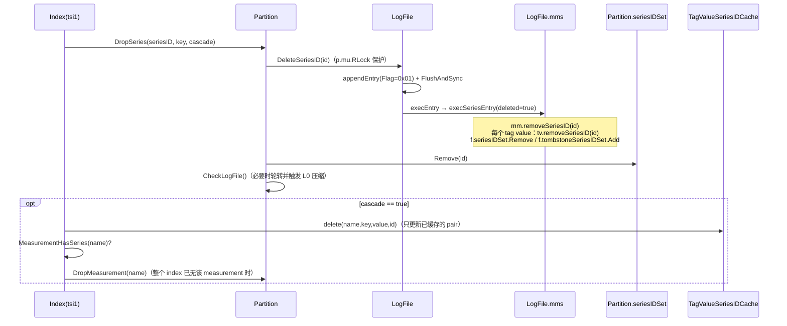

逐步骤说明：

1. **Index 层**（`index.go:797-838`）：`DropSeries(seriesID, key, cascade)` 先按 key 路由分区
   `i.partition(key).DropSeries(seriesID)`；随后在 `i.mu` 下执行 `i.sTSketch.Add(key)`（统计 sketch）。
   `cascade=false` 时到此为止。
2. **Partition 层**（`partition.go:751-765`）：持 `p.mu.RLock()` 调 `p.activeLogFile.DeleteSeriesID(id)`；
   成功后 `p.seriesIDSet.Remove(id)`，最后 `CheckLogFile()` 检查 WAL 是否需要轮转/压缩。
3. **LogFile 层**（`log_file.go:578-590`）：`DeleteSeriesID` 持 `f.mu.Lock()`，构造
   `LogEntry{Flag: LogEntrySeriesTombstoneFlag, SeriesID: id}` → `appendEntry` → `execEntry` →
   `FlushAndSync()`。**WAL 先落盘、内存索引后更新**。
4. **内存索引**（`execSeriesEntry`，`log_file.go:692-762`）：`deleted=true` 分支会
   `mm.removeSeriesID(id)`、逐个 tag value `tv.removeSeriesID(id)`，并对称更新
   `f.seriesIDSet.Remove` / `f.tombstoneSeriesIDSet.Add`。注意 `mm.deleted = false` 在删除时也会执行
   （`log_file.go:725`），即删除单条 series 会清除该 measurement 的 tombstone 标记。
5. **cascade 分支**（`index.go:812-830`）：对每个 tag pair 调 `tagValueCache.delete(name,key,value,id)`；
   再 `MeasurementHasSeries(name)`，只有**整个 Index 的所有分区**都没有该 measurement 的存活 series 时
   才 `DropMeasurement(name)`。
6. **DropMeasurement**（`partition.go:656-720`）：枚举 `fs.TagKeyIterator`/`TagValueIterator`，为每个未删除的
   tag key 写 `0x04`、每个未删除的 tag value 写 `0x08`，再为该 measurement 的每条存活 series 写 `0x01`，
   最后写一条 `0x02`（measurement tombstone）。`execDeleteMeasurementEntry` 直接把 mm 的
   `tagSet/series/seriesSet` 清空并置 `deleted=true`。

#### 1.3.2 SeriesFile 侧删除（另一条链路）

`SeriesFile.DeleteSeriesID(id, flush)`（`series_file.go:204-211`）→ `SeriesIDPartitionID(id)` 定位分区 →
`SeriesPartition.DeleteSeriesID(id, flush)`（`series_partition.go:334-364`）：

```go
// tsdb/series_partition.go:334 — DeleteSeriesID
func (p *SeriesPartition) DeleteSeriesID(id uint64, flush bool) error {
    p.mu.Lock()
    defer p.mu.Unlock()
    if p.closed { return ErrSeriesPartitionClosed }
    if p.index.IsDeleted(id) { return nil }            // 幂等

    // 9 字节：flag(1) + id(8)，不带 key
    _, err := p.writeLogEntry(AppendSeriesEntry(nil, SeriesEntryTombstoneFlag, id, nil))
    if err != nil { return err }
    if flush {
        if segment := p.activeSegment(); segment != nil { segment.Flush() }
    }
    p.index.Delete(id)                                  // 只写 tombstones[id]
    return nil
}
```

关键点：`SeriesIndex.Delete(id)`（`series_index.go:152-155`）只执行 `tombstones[id] = struct{}{}`，
**不会**从 `idOffsetMap`、`keyIDMap` 或磁盘 SIDX 中移除任何 insert。因此：

- `IsDeleted(id)` = `tombstones` 命中 **或** `FindOffsetByID(id)==0`（`series_index.go:157-163`）；
- `FindOffsetByID` **不查 tombstones**（`series_index.go:239-260`），所以已 tombstone 但 SIDX 尚未重写时，
  `SeriesKey(id)` 仍然返回原 key（详见 D14 §8.5）。

#### 1.3.3 `Partition.seriesIDSet` 生命周期

它是 TSI 分区"哪些 seriesID 仍然存活"的唯一权威集合，也是 `LogFile.AddSeriesList` O(1) 去重的前提
（`log_file.go:529-545` 用 `seriesSet.ContainsNoLock` 判断是否要写 WAL）。

| 阶段 | 操作 | 源码 |
|------|------|------|
| 启动/压缩后重建 | 从最新文件到最旧：先 `Diff(TombstoneSeriesIDSet)` 再 `Merge(SeriesIDSet)` | `partition.go:324-349` |
| 新建 series | `LogFile.AddSeriesList` 写 entry 后 `seriesSet.AddNoLock(id)` | `log_file.go:551-565` |
| 删除 series | `Partition.DropSeries` 中 `p.seriesIDSet.Remove(id)` | `partition.go:762` |
| 多分区汇总 | `Index.SeriesIDSet()` 把所有分区的集合 `Merge` 到一起 | `index.go:244-251` |
| 存在性检查 | `Index.MeasurementHasSeries` 遍历分区；分区内再与 `p.seriesIDSet` 取交 | `index.go:515-526`、`partition.go:583-596`、`log_file.go:285-301` |

#### 1.3.4 读侧如何把删除"藏起来"

1. `IndexSet.MeasurementSeriesByExprIterator` 的两条路径都会在出口包
   `FilterUndeletedSeriesIDIterator(is.SeriesFile, itr)`（`tsdb/index.go:2298-2331`）；过滤器对每个 id 调
   `SeriesFile.IsDeleted(id)`（`tsdb/index.go:410-432`）。
2. tag 值路径 `FileSet.TagValueSeriesIDIterator` 从**最新文件向最旧文件**遍历：每轮先用更新文件的
   `TombstoneSeriesIDSet` 对累计结果 `AndNot`，再 `Merge` 当前文件的 tag value 集合
   （`tsdb/index/tsi1/file_set.go:341-371`）。

#### 1.3.5 必背案例：删除 id=5

假设 `cpu,host=db` 的 seriesID=5 同时存在于 SeriesFile、LogFile 与一个 L1 IndexFile 中，执行
`DROP SERIES WHERE host='db'` 后：

1. **TSI 查询仍可能"看到"5**：旧 IndexFile 里的 tag value 集合仍含 5；但 active LogFile 里的 `0x01`
   tombstone 使 `FileSet` 的 `AndNot` 去掉它，且 `FilterUndeleted` 还会用 SeriesFile 再兜底一次。
   所以最终结果里没有 5。
2. **`SeriesFile.SeriesKey(5)` 仍然返回 `cpu,host=db`**：`SeriesIndex.Delete` 只写 `tombstones`，
   SIDX/`idOffsetMap` 里的 insert 还在；`FindOffsetByID(5)` 仍非 0。
3. **只有 SIDX 重写之后才真正"消失"**：`compactIndexTo` 扫描时 `index.IsDeleted(5)` 为真，跳过该 insert，
   新 SIDX 里没有 5；`p.index.Recover` 只重放 `maxOffset` 之后的增量（tombstone entry 不会重建 offset）。
   此后再查 `FindOffsetByID(5)==0`、`SeriesKey(5)==nil`（`series_partition.go:589-690`、
   `series_index.go:157-163`、`series_partition.go:381-394`）。

> 注意：不要写成"deleted 之后 `SeriesKey(id)` 立即返回 nil"——这是上一轮审查被否掉的结论。

## 2. 查询路径 — MeasurementSeriesByExprIterator

### 2.1 从查询到 Series 集合

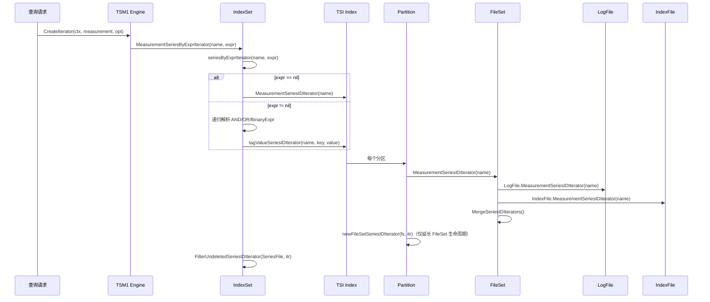

#### IndexFile mmap 访问路径 — 详细序列图

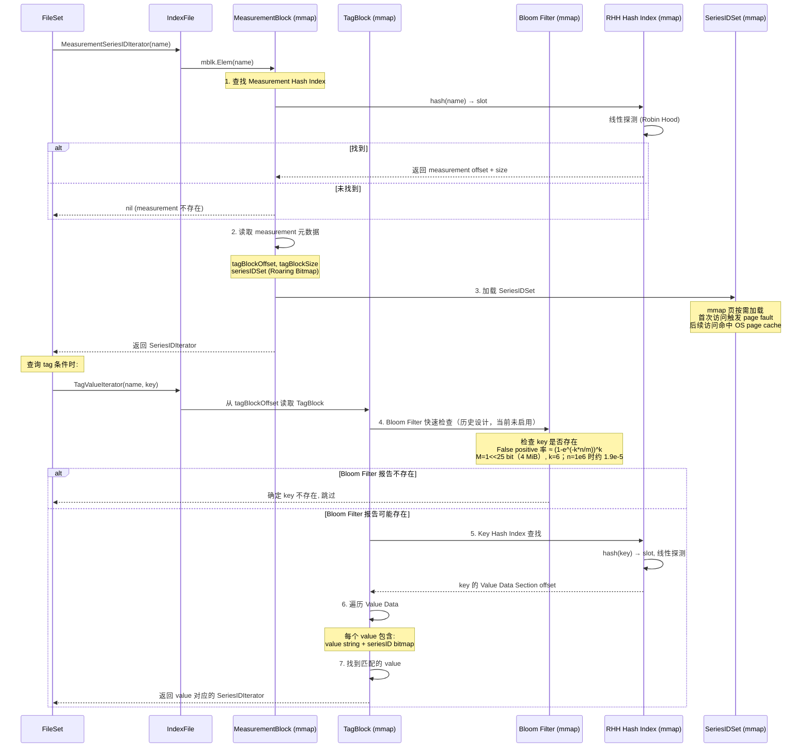

#### Bloom Filter 在 IndexFile 中的作用

> **源码校准**: 当前查询路径不要理解成“先查 Bloom Filter 再决定是否访问
> IndexFile”。源码里可以看到 compaction level 的 Bloom 参数配置，但
> `IndexFile` 的 measurement/tag 查询路径直接访问对应 block/iterator。下面说明
> Bloom 参数的设计背景，不应当作当前查询热路径伪代码。

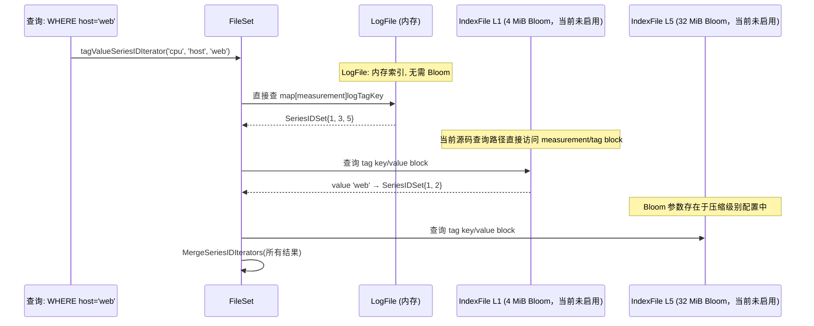

**Bloom Filter 参数配置** (按压缩级别递增):

| Level | M（bit 数） | K（哈希函数数） | 适用场景 |
|-------|-------------|---------------|---------|
| L0 | 无 | 无 | LogFile, 内存索引 |
| L1 | `1<<25` bit = 4 MiB | 6 | 小型 IndexFile |
| L2 | `1<<25` bit = 4 MiB | 6 | 中型 IndexFile |
| L3 | `1<<26` bit = 8 MiB | 6 | 合并后的 IndexFile |
| L4 | `1<<27` bit = 16 MiB | 6 | 大型 IndexFile |
| L5 | `1<<28` bit = 32 MiB | 6 | 大型 IndexFile |
| L6 | `1<<29` bit = 64 MiB | 6 | 超大型 IndexFile |
| L7 | `1<<30` bit = 128 MiB | 6 | 最大 IndexFile |

**性能影响**: 不能在当前文档中声称查询会通过 Bloom 将 O(files) 降到
O(files_with_match)。如果未来代码接入 Bloom 查询短路，应以具体调用点更新本节。

**Bloom Filter 误判案例 (False Positive)**:

> **具体案例**: 查询 `SELECT value FROM cpu WHERE host='web'`，分区有 5 个 IndexFile
>
> ```
> IndexFile L1: 包含 tag key 'host'，值有 [web, db, api]
> IndexFile L2: 不包含 tag key 'host'（已删除或从未写入）
> IndexFile L3: 包含 tag key 'host'，值有 [web, cache]
>
> 不要把当前源码理解为:
>   L1: Bloom('host') → true → RHH 查找
>   L2: Bloom('host') → false → 跳过
>
> 实际核对查询行为时，应从 `IndexFile` 的 measurement/tag block 查询函数入手。
> ```
>
> **误判率**: 对于 `M = 1<<25` bit（4 MiB）、k=6 的配置，当 IndexFile 包含 n = 1e6 个 tag key 时，
> false positive 率约为 `(1 - e^(-6×1e6/2^25))^6 ≈ 1.93e-5`（约十万分之二）。
> 注意 M 的单位是 **bit**（`partition.go:1563-1572` 注释 "Bloom filter bit size"），不是 byte。
> 实际影响极小——一次误判只多读一个磁盘页面，而正确跳过的收益是数十次 I/O 节省。

### 2.1a Index 层 fan-out 与 tag value 缓存

`IndexSet` 不是单个索引，而是"一个数据库在多个 Shard 上的 TSI Index 集合"。一次 tag 查询要经过
**三层 fan-out**，最后才落到文件层：

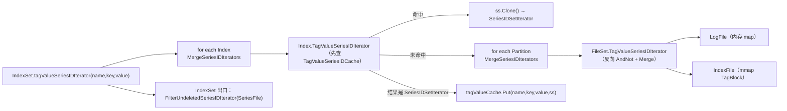

1. **IndexSet → Index**：`measurementSeriesIDIterator`（`tsdb/index.go:2176-2190`）、
   `tagKeySeriesIDIterator`（`:2252-2264`）、`tagValueSeriesIDIterator`（`:2281-2293`）都是遍历 `is.Indexes`
   后 `MergeSeriesIDIterators`。
2. **Index → Partition**：`Index.MeasurementSeriesIDIterator`（`tsdb/index/tsi1/index.go:584-596`）与
   `TagValueSeriesIDIterator`（`:1066-1095`）遍历 `i.partitions` 再 Merge。
3. **Partition → FileSet**：`Partition.MeasurementSeriesIDIterator`（`partition.go:646-651`）把
   `fs.MeasurementSeriesIDIterator` 包进 `newFileSetSeriesIDIterator(fs, itr)`——目的只是**延长 FileSet 的
   生命周期**，不是过滤。

**TagValueSeriesIDCache 语义**（`tsdb/index/tsi1/index.go:1066-1095`）：

| 行为 | 细节 |
|------|------|
| 键 | `(measurement name, tag key, tag value)` 三元组 |
| 默认容量 | 100 个 SeriesIDSet（`DefaultSeriesIDSetCacheSize`，`tsdb/config.go:77-78`） |
| 命中 | 返回 `ss.Clone()`，防止调用方改动共享集合 |
| 未命中 | 逐分区查询并 Merge；**只有结果是 `tsdb.SeriesIDSetIterator` 时才 `Put`**（迭代器型结果不缓存） |
| 关闭 | `tagValueCacheSize == 0` 时完全不读不写缓存 |

**写后一致性**：

- 新建 series 时，只对"已经存在于缓存中的 measurement"更新对应 tag pair 的集合：
  `i.tagValueCache.measurementContainsSets(name)` 为真才 `addToSet(name,key,value,id)`
  （`index.go:686-721`）。没被缓存过的 pair 不需要更新。
- `DropSeries(cascade=true)` 时对每个 tag pair 调 `tagValueCache.delete(...)`（`index.go:817-823`）；
  `cascade=false` 不碰缓存（`index.go:808-810`）。
- 删除 measurement 时不遍历缓存条目，靠 measurement 级判断+后续 `Contains` 失效。

**为什么仍需要 `FilterUndeletedSeriesIDIterator`**：缓存里可能存着 SeriesFile 层已删除、但 TSI 还没写墓碑的 ID；
`IndexFile` 里的 bitmaps 也可能包含这样的 ID。所以无论缓存命中与否，`IndexSet` 出口都要用
`SeriesFile.IsDeleted` 再过滤一次（`tsdb/index.go:410-432`）。

**案例**：查询 `host='web'` 两次。

1. 第一次：缓存未命中 → 8 个 Partition → FileSet（1 个 LogFile + 2 个 IndexFile）→ Merge 得到
   `SeriesIDSet{1,2,5}`，因为结果是 `SeriesIDSetIterator`，写入缓存；出口过滤掉 SeriesFile 已删的 5，返回 `{1,2}`。
2. 第二次：命中缓存，`Clone()` 出一份再过滤，不再访问任何 mmap。
3. 此时写入 `cpu,host=web,region=us`（新 series id=9）：该 measurement 已有缓存，`addToSet('host','web',9)`，
   同一查询立刻能看到 9。

### 2.2 MeasurementSeriesByExprIterator — 表达式解析

```go
// tsdb/index.go:2298 — IndexSet.MeasurementSeriesByExprIterator
func (is IndexSet) MeasurementSeriesByExprIterator(name []byte, expr influxql.Expr) (SeriesIDIterator, error) {
    release := is.SeriesFile.Retain()
    defer release()
    return is.measurementSeriesByExprIterator(name, expr)
}

// tsdb/index.go:2309 — 注意：expr==nil 与 expr!=nil 两条路径都要包删除过滤
func (is IndexSet) measurementSeriesByExprIterator(name []byte, expr influxql.Expr) (SeriesIDIterator, error) {
    if expr == nil {
        itr, err := is.measurementSeriesIDIterator(name)
        if err != nil {
            return nil, err
        }
        return FilterUndeletedSeriesIDIterator(is.SeriesFile, itr), nil
    }
    itr, err := is.seriesByExprIterator(name, expr)
    if err != nil {
        return nil, err
    }
    return FilterUndeletedSeriesIDIterator(is.SeriesFile, itr), nil
}
```

```go
// tsdb/index.go:2470 — seriesByExprIterator：先按表达式类型分派
func (is IndexSet) seriesByExprIterator(name []byte, expr influxql.Expr) (SeriesIDIterator, error) {
    switch expr := expr.(type) {
    case *influxql.BinaryExpr:
        switch expr.Op {
        case influxql.AND, influxql.OR:
            litr, err := is.seriesByExprIterator(name, expr.LHS)
            if err != nil {
                return nil, err
            }
            ritr, err := is.seriesByExprIterator(name, expr.RHS)
            if err != nil {
                if litr != nil {
                    litr.Close()
                }
                return nil, err
            }
            if expr.Op == influxql.AND {
                return IntersectSeriesIDIterators(litr, ritr), nil
            }
            return UnionSeriesIDIterators(litr, ritr), nil
        default:
            return is.seriesByBinaryExprIterator(name, expr)
        }
    case *influxql.ParenExpr:
        return is.seriesByExprIterator(name, expr.Expr)
    case *influxql.BooleanLiteral:
        if expr.Val {
            return is.measurementSeriesIDIterator(name)
        }
        return nil, nil
    default:
        return nil, nil // 不是 tag 表达式，交给查询引擎
    }
}
```

```go
// tsdb/index.go:2517 — seriesByBinaryExprIterator
func (is IndexSet) seriesByBinaryExprIterator(name []byte, n *influxql.BinaryExpr) (SeriesIDIterator, error) {
    // 1) 操作数里还有 BinaryExpr：说明是表达式运算，返回全部 series 并附带表达式下推
    if _, ok := n.LHS.(*influxql.BinaryExpr); ok {
        itr, err := is.measurementSeriesIDIterator(name)
        if err != nil {
            return nil, err
        }
        return newSeriesIDExprIterator(itr, n), nil
    } else if _, ok := n.RHS.(*influxql.BinaryExpr); ok {
        itr, err := is.measurementSeriesIDIterator(name)
        if err != nil {
            return nil, err
        }
        return newSeriesIDExprIterator(itr, n), nil
    }

    // 2) 双侧探测 VarRef：支持 'web' = host 这种操作数交换
    key, ok := n.LHS.(*influxql.VarRef)
    value := n.RHS
    if !ok {
        key, ok = n.RHS.(*influxql.VarRef)
        if !ok {
            itr, err := is.measurementSeriesIDIterator(name)
            if err != nil {
                return nil, err
            }
            return newSeriesIDExprIterator(itr, n), nil
        }
        value = n.LHS
    }

    // 3) field / _name：不能下推到 tag 索引
    if key.Val != "_name" && ((key.Type == influxql.Unknown && is.HasField(name, key.Val)) ||
        key.Type == influxql.AnyField || (key.Type != influxql.Tag && key.Type != influxql.Unknown)) {
        itr, err := is.measurementSeriesIDIterator(name)
        if err != nil {
            return nil, err
        }
        return newSeriesIDExprIterator(itr, n), nil
    } else if v, ok := value.(*influxql.VarRef); ok {
        if v.Val != "_name" && ((v.Type == influxql.Unknown && is.HasField(name, v.Val)) ||
            key.Type == influxql.AnyField || (v.Type != influxql.Tag && v.Type != influxql.Unknown)) {
            itr, err := is.measurementSeriesIDIterator(name)
            if err != nil {
                return nil, err
            }
            return newSeriesIDExprIterator(itr, n), nil
        }
    }

    // 4) 按 value 的具体类型分派；REGEX 必须传 *regexp.Regexp（value.Val）
    switch value := value.(type) {
    case *influxql.StringLiteral:
        return is.seriesByBinaryExprStringIterator(name, []byte(key.Val), []byte(value.Val), n.Op)
    case *influxql.RegexLiteral:
        return is.seriesByBinaryExprRegexIterator(name, []byte(key.Val), value.Val, n.Op)
    case *influxql.VarRef:
        return is.seriesByBinaryExprVarRefIterator(name, []byte(key.Val), value, n.Op)
    default:
        itr, err := is.measurementSeriesIDIterator(name)
        if err != nil {
            return nil, err
        }
        return newSeriesIDExprIterator(itr, n), nil
    }
}
```

**String 比较的语义**（`tsdb/index.go:2588-2640`）：

| 表达式 | 实现 |
|--------|------|
| `_name = 'cpu'` / `_name != 'cpu'` | 命中/不命中则返回 measurement 全部 series，否则 nil |
| `tag = 'v'`（v 非空） | `tagValueSeriesIDIterator(name,key,v)` |
| `tag = ''` | `DifferenceSeriesIDIterators(measurement, tagKey)`：没有该 tag key 的 series |
| `tag != 'v'`（v 非空） | `DifferenceSeriesIDIterators(measurement, tagValue)` |
| `tag != ''` | `tagKeySeriesIDIterator`：所有带该 tag key 的 series |
| `tag =~ /re/` / `!~` | `matchTagValueSeriesIDIterator`，参数是 `*regexp.Regexp` |
| `tag = otherTag` | EQ 取两个 `tagKeySeriesIDIterator` 的交集；NEQ 取差集 |

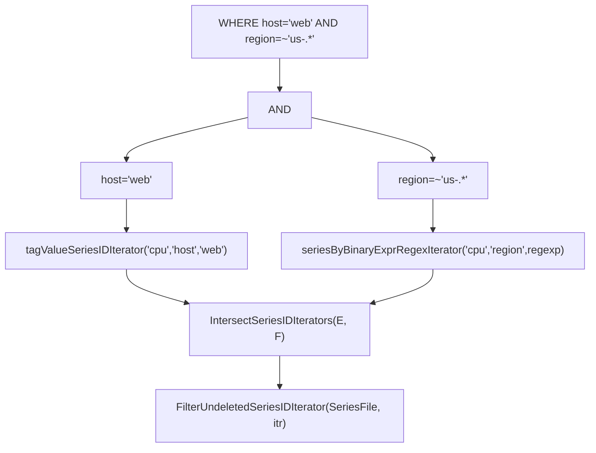

### 2.3 MeasurementSeriesIDIterator — FileSet 层

```go
// tsdb/index/tsi1/file_set.go — MeasurementSeriesIDIterator
func (fs *FileSet) MeasurementSeriesIDIterator(name []byte) SeriesIDIterator {
    // 收集所有文件的迭代器
    a := make([]SeriesIDIterator, 0, len(fs.files))
    for _, f := range fs.files {
        itr := f.MeasurementSeriesIDIterator(name)
        if itr != nil {
            a = append(a, itr)
        }
    }
    return MergeSeriesIDIterators(a...)
}
```

**LogFile.MeasurementSeriesIDIterator**:

> **具体案例**: 查询 `SELECT value FROM cpu WHERE host='web'`
>
> ```
> 1. 收集所有文件的迭代器:
>    - LogFile (内存): cpu 下有 series [1, 3, 5, 7, 9]
>    - IndexFile L1 (mmap): cpu 下有 series [1, 2, 3, 4, 5]
>    - IndexFile L2 (mmap): cpu 下有 series [1, 2, 3, 4, 5, 6, 7, 8]
>
> 2. 合并去重: series ID = {1, 2, 3, 4, 5, 6, 7, 8, 9}
>
> 3. 过滤 host='web'（FileSet.TagValueSeriesIDIterator，file_set.go:341-371）:
>    - LogFile 中 host=web 的 series: {1, 3, 5}
>    - IndexFile L1 中 host=web 的 series: {1, 3, 5}
>    - 不是"求交集"，而是从最新文件向最旧文件逐文件 Merge；
>      遇到更新的文件的 tombstone 集时先 AndNot 掉这些 id
>
> 4. 排除已删除的 series（不是本地的 SeriesIDSet.Tombstone，而是 SeriesFile 层）:
>    - FilterUndeletedSeriesIDIterator 用 SeriesFile.IsDeleted(id) 过滤（tsdb/index.go:410-432）
>    - 假设 id=5 已在 SeriesFile 中 tombstone，最终结果: {1, 3}
>
> 5. 用 series ID 去 TSM 文件中读取实际数据
> ```

```go
// tsdb/index/tsi1/log_file.go:819 — MeasurementSeriesIDIterator
func (f *LogFile) MeasurementSeriesIDIterator(name []byte) tsdb.SeriesIDIterator {
    f.mu.RLock()
    defer f.mu.RUnlock()

    mm := f.mms[string(name)]
    if mm == nil || mm.cardinality() == 0 {
        return nil
    }
    // 直接返回 measurement 的 SeriesIDSet（小集合内部仍是 map，cardinality 判断已覆盖）
    return tsdb.NewSeriesIDSetIterator(mm.seriesIDSet())
}
```

**IndexFile.MeasurementSeriesIDIterator**:

```go
// tsdb/index/tsi1/index_file.go:390 — MeasurementSeriesIDIterator
func (f *IndexFile) MeasurementSeriesIDIterator(name []byte) tsdb.SeriesIDIterator {
    // MeasurementBlock.SeriesIDIterator 内部做 Elem(name) 查找，未命中返回空迭代器
    return f.mblk.SeriesIDIterator(name)
}
```

## 3. Tag 值迭代

### 3.1 TagValueIterator — 合并多文件

```go
// tsdb/index/tsi1/file_set.go:331 — TagValueIterator
func (fs *FileSet) TagValueIterator(name, key []byte) TagValueIterator {
    a := make([]TagValueIterator, 0, len(fs.files))
    for _, f := range fs.files {
        itr := f.TagValueIterator(name, key)
        if itr != nil {
            a = append(a, itr)
        }
    }
    return MergeTagValueIterators(a...)
}
```

**MergeTagValueIterators — K-way 归并**:

```go
// tsdb/index/tsi1/tsi1.go:323 — MergeTagValueIterators
func MergeTagValueIterators(itrs ...TagValueIterator) TagValueIterator {
    if len(itrs) == 0 {
        return nil          // 空入参必须返回 nil，调用方据此跳过
    }
    return &tagValueMergeIterator{
        e:    make(tagValueMergeElem, 0, len(itrs)),
        buf:  make([]TagValueElem, len(itrs)),
        itrs: itrs,
    }
}

// tsdb/index/tsi1/tsi1.go:345 — tagValueMergeIterator.Next
// 缓冲槽位初始为 nil 接口；必须先 next 再取 Value()，否则 nil.Value() 会 panic
func (itr *tagValueMergeIterator) Next() TagValueElem {
    // 1. 一趟遍历：填缓冲区并同时找最小 Value
    var value []byte
    for i, buf := range itr.buf {
        if buf == nil {
            if buf = itr.itrs[i].Next(); buf != nil {
                itr.buf[i] = buf
            } else {
                continue
            }
        }
        if value == nil || bytes.Compare(buf.Value(), value) == -1 {
            value = buf.Value()
        }
    }

    if value == nil {
        return nil
    }

    // 2. 收集所有相同 Value 的元素，并清空对应缓冲槽位
    itr.e = itr.e[:0]
    for i, buf := range itr.buf {
        if buf == nil || !bytes.Equal(buf.Value(), value) {
            continue
        }
        itr.e = append(itr.e, buf)
        itr.buf[i] = nil  // 下次重新填充
    }

    return itr.e
}
```

**合并语义**: FileSet 中文件的顺序很重要。LogFile 在前（prepend），IndexFile 在后。LogFile 中的 tombstone 会覆盖 IndexFile 中的条目。

## 4. TSI 压缩

### 4.0 TSI 启动与 MANIFEST 恢复

Partition 的目录里没有"索引元数据文件"，只有 `MANIFEST` + 一组 `L<level>-<id>.tsi` / `L0-<id>.tsl`。
启动流程就是"读 MANIFEST → 按清单打开文件 → 清理孤儿 → 重建内存集合"。

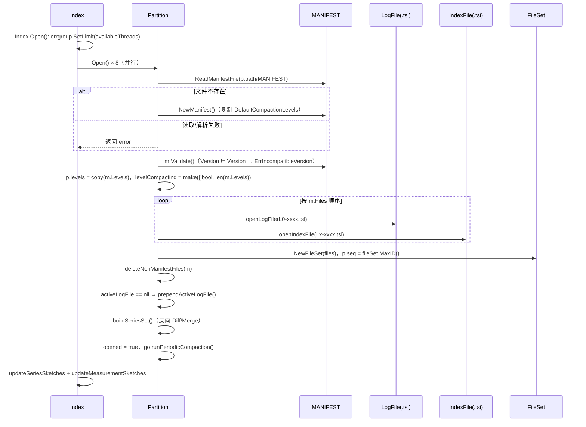

逐步骤说明（`tsdb/index/tsi1/index.go:255-313`、`partition.go:163-270`）：

1. **Index.Open**：先 `os.MkdirAll` 根目录，创建 8 个 `Partition`，用 `errgroup.Group` +
   `SetLimit(availableThreads())` 并行 `p.Open`。`defer i.cleanUpFail(&rErr)` 保证任一失败时
   关闭整个 Index（不能只回滚单个分区）。
2. **读 MANIFEST**：`ReadManifestFile` 返回 `(*Manifest, size, err)`；`os.IsNotExist` 时用
   `NewManifest` 建默认清单（8 个压缩级别），其他错误直接返回。
3. **版本校验**：`m.Validate()` 只比较 `m.Version != Version`，不匹配返回
   `ErrIncompatibleVersion`（`partition.go:1471-1480`）。
4. **按清单打开文件**：遍历 `m.Files`，按扩展名分派 `.tsl` / `.tsi`；**第一个 `sz < maxLogFileSize`
   的 LogFile 成为 `activeLogFile`**（`partition.go:225-231`）。文件名格式为
   `L0-%08d.tsl` / `L%d-%08d.tsi`（`log_file.go:1543-1545`、`index_file.go:528-530`）。
5. **收尾**：`p.fileSet = NewFileSet(files)`、`p.seq = p.fileSet.MaxID()`；
   `deleteNonManifestFiles(m)` 删除目录里不在清单中的孤儿文件（`partition.go:297-320`）；
   没有 active log 则 `prependActiveLogFile()`（`partition.go:528`）。
6. **重建内存集合**：`buildSeriesSet()` 从最新文件到最旧文件做 `Diff(TombstoneSeriesIDSet)` +
   `Merge(SeriesIDSet)`（`partition.go:324-349`）；随后 `p.opened = true`，
   `go p.runPeriodicCompaction()`——**启动立即压缩一次**，之后每小时 `NeedsCompaction(true)` 巡检
   （`partition.go:979-1001`）。
7. **失败路径**：`defer func(){ if rErr != nil { Files(files).Close() } }()` 关闭已打开的文件；
   读坏的 MANIFEST 或版本不符直接返回，分区保持未打开状态。

**案例**：MANIFEST 的 `files` 为 `["L1-00000001.tsi","L1-00000002.tsi","L0-00000003.tsl"]`，
目录里还多一个 `L1-00000004.tsi`：

- 打开 3 个清单文件；`L0-00000003.tsl` 大小 800KB < 1MB → 成为 `activeLogFile`；
- `deleteNonManifestFiles` 删除 `L1-00000004.tsi`；
- `p.seq = MaxID()`（取三个文件 id 的最大值，本例为 3）；
- 若 `L0-00000003.tsl` 是 1.2MB（≥ 1MB），则没有 active log，`prependActiveLogFile()` 新建 `L0-00000004.tsl`。

### 4.1 LogFile → IndexFile 压缩 (L0 → L1)

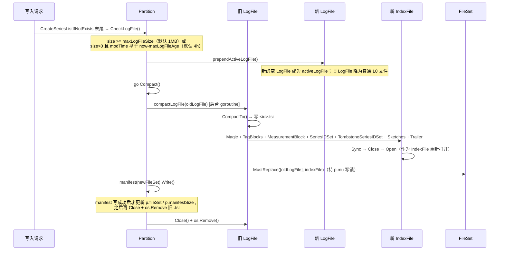

**LogFile.CompactTo — 序列化为 IndexFile 格式**:

```go
// tsdb/index/tsi1/log_file.go:831 — CompactTo（m/k 形参当前未使用）
func (f *LogFile) CompactTo(w io.Writer, m, k uint64, cancel <-chan struct{}) (n int64, err error) {
    f.mu.RLock()
    defer f.mu.RUnlock()

    // 1. 写入 Magic: "TSI1"
    bw := bufio.NewWriterSize(w, indexFileBufferSize) // 128K
    writeTo(bw, []byte(FileSignature), &n)

    // 2. 按 measurement 名称顺序写 TagBlocks，并记下每个 block 的 offset/size
    names := f.measurementNames()
    for _, name := range names {
        mm := f.mms[name]
        enc := NewTagBlockEncoder(bw)
        for _, k := range mm.keys() {
            tag := mm.tagSet[k]
            enc.EncodeKey(tag.name, tag.deleted)
            if tag.deleted {
                continue
            }
            for _, v := range sortedValues(tag) {   // 值按字典序
                value := tag.tagValues[v]
                enc.EncodeValue(value.name, value.deleted, value.seriesIDSet())
            }
        }
        offset := n
        enc.Close()                 // 写 TagBlockTrailer(58B) 并 flush
        n += enc.N()
        info.mms[name] = &logFileMeasurementCompactInfo{offset: offset, size: n - offset}
    }

    // 3. 写入 MeasurementBlock（真正的 Add 签名是 5 个参数）
    mw := NewMeasurementBlockWriter()
    for _, name := range names {
        mm := f.mms[name]
        mmInfo := info.mms[name]
        mw.Add(mm.name, mm.deleted, mmInfo.offset, mmInfo.size, mm.seriesIDs())
    }
    mw.WriteTo(bw)

    // 4. SeriesIDSet
    f.seriesIDSet.WriteTo(bw)

    // 5. TombstoneSeriesIDSet（LogFile 级删除集合）
    f.tombstoneSeriesIDSet.WriteTo(bw)

    // 6. Series Sketch / Tombstone Series Sketch (HLL)
    sSketch, sTSketch, _ := f.seriesSketches()
    // ... MarshalBinary + 写入

    // 7. Trailer（82 字节，Version 最后写）
    t.WriteTo(bw)
    return n, bw.Flush()
}
```

**压缩触发条件**（`partition.go:1008-1026` 的 `NeedsCompaction` 与 `:1247-1252` 的 `needsLogCompaction`）：

| 条件 | 说明 | 源码 |
|------|------|------|
| `size >= maxLogFileSize` | active LogFile 达到 1MB（`DefaultMaxIndexLogFileSize`，`tsdb/config.go:72`） | `partition.go:1250` |
| `size > 0 && modTime < now-maxLogFileAge` | 非空且 4 小时未变（`DefaultCompactFullWriteColdDuration`，`tsdb/config.go:38`） | `partition.go:1250` |
| 同层连续文件 ≥ 2 | L0 之外，`NeedsCompaction` 先按同层计数 > 1 判定（`:1021-1024`），`compact()` 再取该层末尾连续文件，≥2 才合并（`:1086`） | `partition.go:1021-1024`、`:1086` |
| 启动时立即执行一次 | `runPeriodicCompaction` 先 `Compact()` 再进入 ticker | `partition.go:979-999` |
| 每 1 小时巡检 | `time.Tick(time.Hour)` 检查 `NeedsCompaction(true)` | `partition.go:979-999` |
| active LogFile 不参与 L0 压缩 | `if logFile == p.activeLogFile { continue }` | `partition.go:1051-1054` |

**并发保护**（`partition.go:1029-1122`）：

| 机制 | 作用 | 源码 |
|------|------|------|
| `levelCompacting[level]` | 同一层同时只允许一个压缩；压缩结束的 defer 里复位并再次 `p.Compact()` | `partition.go:1081`、`:1097-1113` |
| `currentCompactionN` | 统计在跑的压缩数（等待/诊断用） | `partition.go:1060`、`:1102-1109` |
| `compactionInterrupt` | 关闭分区时 `close()`，压缩 goroutine 在检查点退出 | `partition.go:1036`、`:1124-1136` |
| `Retain()/Release()` | 压缩期间把源 IndexFile 的引用计数加一，避免被删 | `partition.go:1094`、`:1126-1128`、`:1242-1249` |
| `MaxIndexMergeCount = 2` | 一次最多合并 2 个文件 | `partition.go:1089-1091` |
| `maxLevel = len(p.levels)-2` | 最高层不再向上压缩 | `partition.go:1015`、`:1078` |

### 4.2 IndexFile 合并压缩 (L1 → L2, L2 → L3, ...)

```go
// tsdb/index/tsi1/partition.go:1030 — compact
func (p *Partition) compact() {
    if p.isClosing() {
        return
    } else if !p.compactionsEnabled() {
        return
    }
    interrupt := p.compactionInterrupt  // 捕获中断信号

    fs := p.retainFileSet()             // 引用计数 +1
    defer fs.Release()

    // 先滚动 active log file，再压缩所有非 active 的 L0 LogFile
    if p.needsLogCompaction() {
        p.prependActiveLogFile()
    }
    for _, f := range p.fileSet.files {
        if f.Level() != 0 {
            continue
        }
        logFile := f.(*LogFile)
        if logFile == p.activeLogFile {
            continue
        }
        if p.levelCompacting[0] {
            break
        }
        p.levelCompacting[0] = true
        p.currentCompactionN.Add(1)
        go func() {
            defer func() {
                p.mu.Lock()
                p.currentCompactionN.Add(-1)
                p.levelCompacting[0] = false
                p.mu.Unlock()
                p.Compact() // 检查是否还有新的压缩
            }()
            p.compactLogFile(logFile)
        }()
    }

    // L1..maxLevel：每层最多合并 MaxIndexMergeCount 个连续文件
    minLevel, maxLevel := 1, len(p.levels)-2
    for level := minLevel; level <= maxLevel; level++ {
        if p.levelCompacting[level] {
            continue
        }
        files := fs.LastContiguousIndexFilesByLevel(level)
        if len(files) < 2 {
            continue
        } else if len(files) > MaxIndexMergeCount {
            files = files[len(files)-MaxIndexMergeCount:]
        }
        IndexFiles(files).Retain()
        p.levelCompacting[level] = true
        go func(files []*IndexFile, level int) {
            defer func() {
                p.mu.Lock()
                p.levelCompacting[level] = false
                p.currentCompactionN.Add(-1)
                p.mu.Unlock()
                p.Compact()
            }()
            p.compactToLevel(files, level+1, interrupt)
        }(files, level)
    }
}
```

**两种压缩的提交顺序不同**（`partition.go:1291-1375` 与 `:1124-1245`）：

- L0（`compactLogFile`）：`os.Create` → `CompactTo` → `Sync` → `Close` → `Open` →
  持 `p.mu` 执行 `MustReplace` → `manifest.Write` 成功 → 更新 `p.fileSet/manifestSize` →
  **最后**才 `logFile.Close()` + `os.Remove()`。
- L1+（`compactToLevel`）：`os.Create` → `IndexFiles.CompactTo` → `Sync` → `Close` → `Open` →
  持 `p.mu` 执行 `MustReplace` → `manifest.Write` 成功 → 更新 `manifestSize/fileSet` →
  `Release()` 旧文件 → 逐个 `Close()` + `os.Remove()`。

> **注意**: manifest 是提交点。manifest 写失败时新文件被 `file.Close()` 关闭但不会删除；
> 旧文件保持原样（源文件在被删除前一直是 `Retain` 状态）。

**MANIFEST 文件**（`partition.go:1437-1526`、`:1529-1542`）：每个 TSI Partition 目录下有一个 `MANIFEST` 文件，记录当前分区包含的所有文件列表和压缩级别配置。格式为 JSON，包含 `levels`（压缩级别配置）、`files`（文件名列表）和 `version`（TSI 格式版本）。启动时通过 `ReadManifestFile` 加载，不在 MANIFEST 中的文件会被自动删除。

**CompactionLevel — Bloom Filter 配置**（结构体 `partition.go:1558-1560`，默认值见 §4.3）：M 是 Bloom 的 bit 数，K 是哈希函数个数。

### 4.3 SeriesPartition 压缩（SIDX 重建 / reindex）

SeriesFile 的每个分区独立管理 append-only 的 SSEG segment 和一份 SIDX 索引。
`SeriesPartitionCompactor.Compact` **只重建 SIDX**：它把快照里的存活 insert 重新写进一份新
SIDX，SSEG 文件一个字节都不改、不删除。运行时不存在"合并 segment"或"删除旧 segment"的
路径；唯一会重写 SSEG 的是离线工具 `influx_inspect buildtsi` 调用的
`SeriesSegment.CompactToPath`（`tsdb/series_segment.go:280`，调用方只有
`cmd/influx_inspect/buildtsi/buildtsi.go:204` 与测试）。

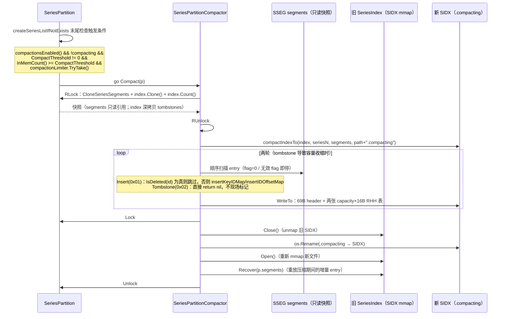

**关键事实**：

| 事实 | 源码 |
|------|------|
| 产物只有 SIDX；SSEG 是 append-only，运行时永不回收/删除 | `series_partition.go:547-587`；`p.segments` 仅在 `Close()` 释放（`:145-169`） |
| `keyIDMap`/`idOffsetMap` 存的是 SSEG 复合偏移 `JoinSeriesOffset(segmentID,pos)`，不是"SIDX 中的位置" | `series_segment.go:353-356`；`series_index.go:203` |
| 是否已删除由快照 index 的 `IsDeleted(id)` 判定（tombstones 命中或 offset==0） | `series_partition.go:645`；`series_index.go:157-163` |
| 扫描到 Tombstone entry 时直接 `return nil`，不会把 id 写进 tombstones | `series_partition.go:632-636` |
| 交换失败（`Close`/`Rename`/`Open` 任一失败）：`index` 保持关闭，`keyIDMap`/`idOffsetMap`/`tombstones` 全为 nil，`FindIDBySeriesKey` 会 panic，分区不能继续写入；进程内不会自动重新 Open | `series_partition.go:566-573`；`series_index.go:95-106` |
| `Recover` 失败：`Open()` 已成功，索引仍可读，只是缺少压缩期间新增的内存映射增量 | `series_partition.go:575-578` |

**触发条件**（5 个条件同时成立，`series_partition.go:294-297`）：

```go
if p.compactionsEnabled() && !p.compacting &&
    p.CompactThreshold != 0 && p.index.InMemCount() >= uint64(p.CompactThreshold) &&
    p.compactionLimiter.TryTake() {
```

`CompactThreshold` 默认 `1<<17`（128K，`series_partition.go:26`）；`p.index.InMemCount()` 是
"重启后新增、尚未落进 SIDX 的 entry 数"，不是文件碎片率。代码里没有"碎片率"概念。

```go
// tsdb/index/tsi1/partition.go:1564 — DefaultCompactionLevels（M 的单位是 bit）
var DefaultCompactionLevels = []CompactionLevel{
    {M: 0, K: 0},       // L0: Log files, 无 filter
    {M: 1 << 25, K: 6}, // L1: 4 MiB Bloom, 6 hash
    {M: 1 << 25, K: 6}, // L2: 4 MiB Bloom, 6 hash
    {M: 1 << 26, K: 6}, // L3: 8 MiB Bloom, 6 hash
    {M: 1 << 27, K: 6}, // L4: 16 MiB Bloom, 6 hash
    {M: 1 << 28, K: 6}, // L5: 32 MiB Bloom, 6 hash
    {M: 1 << 29, K: 6}, // L6: 64 MiB Bloom, 6 hash
    {M: 1 << 30, K: 6}, // L7: 128 MiB Bloom, 6 hash
}
```

> 注意：`LogFile.CompactTo(w, m, k, cancel)` 与 `IndexFiles.CompactTo(..., m, k, ...)` 虽然接收
> `m/k`，但函数体从未使用；当前 TSI 查询路径也没有 Bloom 短路。压缩级别里的 Bloom 参数
> 目前只是配置占位（`tsdb/index/tsi1/log_file.go:831`）。

### 4.4 LogFile 重放与崩溃截断

LogFile 既是内存索引的 WAL，也是崩溃恢复的唯一依据。理解 `open()` 的截断规则，才能解释
"为什么进程被 kill 后还能正常启动"。

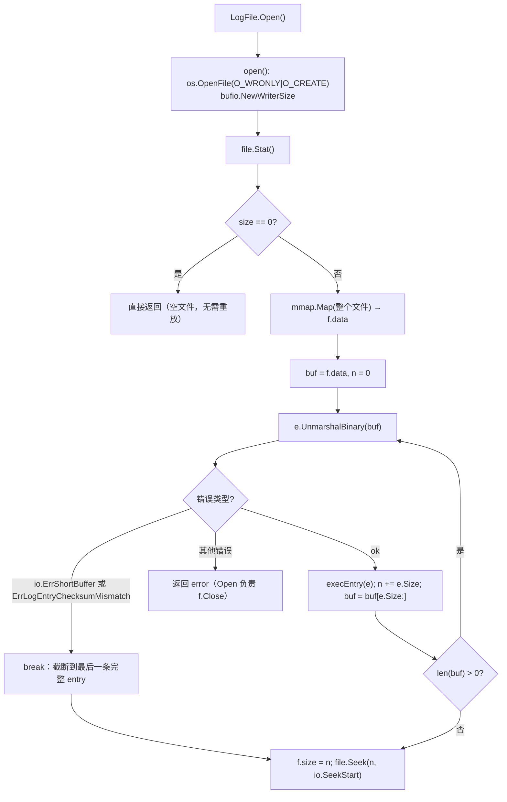

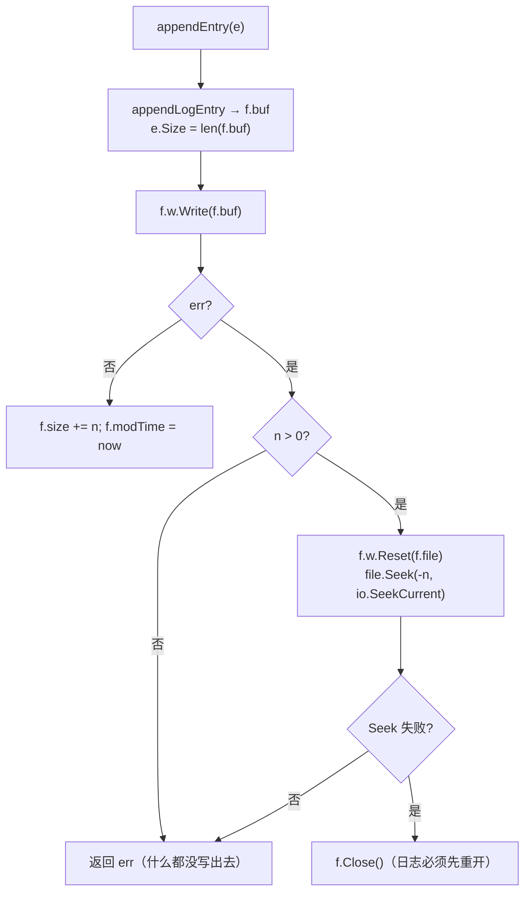

**逐步骤说明**（`tsdb/index/tsi1/log_file.go:119-175`）：

1. `os.OpenFile(O_WRONLY|os.O_CREATE)` 以**只写**方式打开，再包 `bufio.Writer`（默认 4096B）。
2. `Stat()`：`size==0` 直接返回——新日志不 mmap、不重放。
3. `mmap.Map` 整个文件；`for buf := f.data; len(buf) > 0` 逐条 `e.UnmarshalBinary(buf)`。
4. 两种"可截断"错误：`io.ErrShortBuffer`（尾部半条）与 `ErrLogEntryChecksumMismatch`（CRC 不符）。
   遇到即 `break`，保留前面所有完整 entry。
5. 其他错误（版本/长度异常）向上返回；`LogFile.Open` 会 `f.Close()` 后返回错误（`:110-117`）。
6. 每条 entry 执行后 `n += e.Size`；循环结束 `f.size = n` 并把文件句柄 `Seek` 到 n，后续 append
   从这里覆盖掉尾部半条记录。

**`appendEntry` 的部分写回退**（`log_file.go:621-650`）：`f.w.Write` 返回错误且 `n > 0` 时，
`f.w.Reset(f.file)` 丢掉缓冲，再 `file.Seek(-n, io.SeekCurrent)` 退回到本条起点；若 Seek 也失败，
`f.Close()`（调用方必须重开日志）。这保证"要么整条 entry，要么没有"。

**谁负责 flush**：`appendEntry` 只写 bufio 缓冲；`FlushAndSync()`（`log_file.go:201`）由
`AddSeriesList`、`DeleteSeriesID`、`DeleteMeasurement`、`DeleteTagKey`、`DeleteTagValue` 这些显式路径在结尾调用
（`log_file.go:571`、`:331`、`:452`、`:521`、`:589`、`:606`；批量 `Writes` 在 `:1090-1102`）。

**案例**：文件尾是 100B 完整 entry + 100B 完整 entry + 50B 半条（进程在写第 3 条时被 kill）。

- 重放第 1 条：`n=100`；第 2 条：`n=200`；第 3 条 `UnmarshalBinary` 返回 `io.ErrShortBuffer` → `break`。
- 结束后 `f.size=200`、`file.Seek(200, io.SeekStart)`；下一次 append 从 offset 200 开始，把那 50B 覆盖掉。
- 若第 2 条本身 CRC 校验失败，则只保留第 1 条，`f.size=100`，第 2 条之后（包括第 3 条）全部视为尾部垃圾。

## 5. IndexFile 内部结构

### 5.1 文件布局

```
┌──────────────────────────────────────────────────────────────────────────┐
│ Magic: "TSI1" (4 bytes)                                                 │
├──────────────────────────────────────────────────────────────────────────┤
│ TagBlock[0] (measurement[0] 的 tag 数据，inline 写入)                   │
│ TagBlock[1] (measurement[1] 的 tag 数据，inline 写入)                   │
│ ...                                                                      │
│ (TagBlocks 按 measurement 名称排序 inline 写入；各 TagBlock 的 offset/size 记在 MeasurementBlock 元素里) │
├──────────────────────────────────────────────────────────────────────────┤
│ MeasurementBlock (所有 measurement 的元数据)                            │
├──────────────────────────────────────────────────────────────────────────┤
│ SeriesIDSet (Roaring Bitmap)                                            │
├──────────────────────────────────────────────────────────────────────────┤
│ TombstoneSeriesIDSet                                                    │
├──────────────────────────────────────────────────────────────────────────┤
│ Series Sketch (HLL)                                                     │
├──────────────────────────────────────────────────────────────────────────┤
│ Tombstone Series Sketch (HLL)                                           │
├──────────────────────────────────────────────────────────────────────────┤
│ Trailer (82 bytes)                                                      │
└──────────────────────────────────────────────────────────────────────────┘
```

### 5.2 TagBlock 格式

`TagBlockTrailerSize = 6×8B + 8B + 2B = 58` 字节（`tsdb/index/tsi1/tag_block.go:437-445`）：
value 数据 offset/size、key 数据 offset/size、hash index offset/size 各 8B（共 48B），
再加 size(8B) 与 version(2B)。MeasurementBlock 的 trailer 才是 66 字节。

```
┌──────────────────────────────────────────────────────┐
│ Value Data Section                                   │
│ (tag value 数据，按 key 分组)                        │
├──────────────────────────────────────────────────────┤
│ Key Data Section                                     │
│ (tag key 元数据: offset, size, count)               │
├──────────────────────────────────────────────────────┤
│ Key Hash Index (Robin Hood Hashing)                  │
│ (key → Key Data Section 的映射)                     │
├──────────────────────────────────────────────────────┤
│ TagBlockTrailer (58 bytes)                           │
└──────────────────────────────────────────────────────┘
```

### 5.3 MeasurementBlock 格式

```
┌──────────────────────────────────────────────────────┐
│ Measurement Data Section                             │
│ (每个 measurement: name, tag block offset, series IDs)│
├──────────────────────────────────────────────────────┤
│ Measurement Hash Index (Robin Hood Hashing)          │
├──────────────────────────────────────────────────────┤
│ MeasurementBlockTrailer (66 bytes)                   │
└──────────────────────────────────────────────────────┘
```

### 5.4 IndexFileTrailer (82 字节)

```go
// tsdb/index/tsi1/index_file.go:26 — IndexFileTrailerSize
const IndexFileTrailerSize = 0 +
    8 + 8 + // MeasurementBlock offset + size
    8 + 8 + // SeriesIDSet offset + size
    8 + 8 + // TombstoneSeriesIDSet offset + size
    8 + 8 + // SeriesSketch offset + size
    8 + 8 + // TombstoneSeriesSketch offset + size
    2 +     // Version (写在最后)
    0       // = 82 bytes
```

**注意**: WriteTo 方法 (index_file.go:483) 中 Version 字段是**最后写入**的，不是第一个。写入顺序为: MeasurementBlock → SeriesIDSet → TombstoneSeriesIDSet → SeriesSketch → TombstoneSeriesSketch → Version。

### 5.5 IndexFile 读取流程与元素编码

IndexFile 是 mmap 的只读块文件。`UnmarshalBinary` 只做"切分"，不做深拷贝：所有 `[]byte` 都指向 mmap。

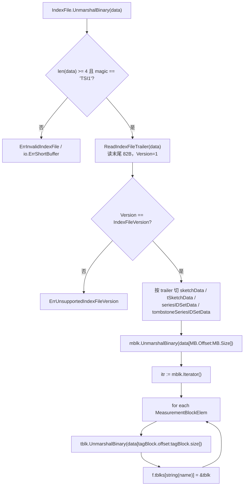

**元素级字节布局**（全部 BigEndian，长度大多用 uvarint）：

| 元素 | 布局 | 源码 |
|------|------|------|
| `MeasurementBlockElem` | flag(1B) + tagBlock.offset(8B) + tagBlock.size(8B) + name(uvarint len + N) + seriesN(uvarint) + seriesDataSize(uvarint) + series data | `measurement_block.go:430-475` |
| `MeasurementBlockTrailer` | version(2B) + data offset/size(16B) + hash offset/size(16B) + sketch offset/size(16B) + tSketch offset/size(16B) = 66B | `measurement_block.go:32-40` |
| `TagBlockKeyElem` | flag(1B) + data.offset/size(8+8) + hashIndex.offset/size(8+8) + key(uvarint len + N) | `tag_block.go:282-315` |
| `TagBlockValueElem` | flag(1B) + value(uvarint len + N) + seriesN(uvarint) + dataSize(uvarint) + data/bitmap | `tag_block.go:406-430` |
| `TagBlockTrailer` | 6×8B offset/size + size(8B) + version(2B) = 58B | `tag_block.go:437-445` |

series data 有两种编码，由 flag 位区分：`MeasurementSeriesIDSetFlag = 0x02`（measurement 块）与
`TagValueSeriesIDSetFlag = 0x02`（tag value 块，见 `tag_block.go:24-25`）。未置位时是 **uvarint delta 累加**
（`ForEachSeriesID` 用 `prev += delta` 还原）；置位时是 roaring bitmap 的裸字节，可直接
`UnmarshalBinaryUnsafe` 指向 mmap。

**hash index 的物理结构**（`measurement_block.go:76-115`、`tag_block.go:102-150`）：

- `hashData` 前 8B 是槽数 `N`，随后是 `N × 8B` 的 offset 数组；
- `offset == 0` 表示空槽；否则从 `data[offset:]` 解析元素并比较 key；
- 探测用线性探测 `pos = (pos+1) % N`，用 `rhh.Dist(hash, pos, N)` 判断"已经超过该元素应有的探测距离"
  来提前终止（Robin Hood 性质）。

**失败路径**：

| 情况 | 结果 | 源码 |
|------|------|------|
| 文件长度 < 4 或 magic 不是 `TSI1` | `io.ErrShortBuffer` / `ErrInvalidIndexFile` | `index_file.go:170-178` |
| trailer 的 Version != 1 | `ErrUnsupportedIndexFileVersion`（在 `ReadIndexFileTrailer` 里就返回） | `index_file.go:414-422` |
| TagBlock 的 `Size` 与实际长度不符 | `ErrTagBlockSizeMismatch` | `tag_block.go:61-73` |
| Measurement/TagBlock 的 offset/size 越界 | **没有显式校验**，直接切片；损坏文件可能 panic（1.x 的已知薄弱点） | `index_file.go:200-215`、`measurement_block.go:119-140` |

**案例**：手工定位 `cpu` 的 `host=web`。

1. 读文件末尾 82B trailer，得到 `MeasurementBlock.Offset/Size`；
2. `MeasurementBlock.Elem("cpu")`：`hashData` 前 8B 得 N，`hash % N` 起线性探测，比较元素 name，
   命中后返回 `tagBlock.offset/size`；
3. `data[tagBlock.offset:tagBlock.offset+tagBlock.size]` 交给 `TagBlock.UnmarshalBinary`，按 58B trailer
   切出 valueData/keyData/hashData；
4. `TagBlock.TagKeyElem("host")` 用同样的 RHH 探测找到 key 元素，再在其 `data.buf` 里线性找 `value=="web"`；
5. 该元素的 series data 若是 legacy 编码，则 `prev += uvarint(delta)` 累加得到 `{1,3,5}`；若是 roaring，
   直接解出 bitmap 后 `Slice()`。

## 6. Series 存在性检查

### 6.1 MeasurementHasSeries — 快速检查

```go
// tsdb/index/tsi1/partition.go:583 — MeasurementHasSeries
func (p *Partition) MeasurementHasSeries(name []byte) (bool, error) {
    fs, err := p.RetainFileSet()
    if err != nil {
        return false, err
    }
    defer fs.Release()

    for _, f := range fs.files {
        if f.MeasurementHasSeries(p.seriesIDSet, name) {
            return true, nil  // 短路: 任一文件有 series 即返回
        }
    }
    return false, nil
}
```

**LogFile.MeasurementHasSeries**:

```go
// tsdb/index/tsi1/log_file.go:285
func (f *LogFile) MeasurementHasSeries(ss *tsdb.SeriesIDSet, name []byte) bool {
    f.mu.RLock()
    defer f.mu.RUnlock()

    mm, ok := f.mms[string(name)]
    if !ok { return false }

    // 遍历 measurement 下的 series ID
    for _, id := range mm.seriesIDs() {
        if ss.Contains(id) {
            return true  // 在 partition 级别的 SeriesIDSet 中存在
        }
    }
    return false
}
```

## 7. 内存中的 LogFile 索引结构

### 7.1 层次结构

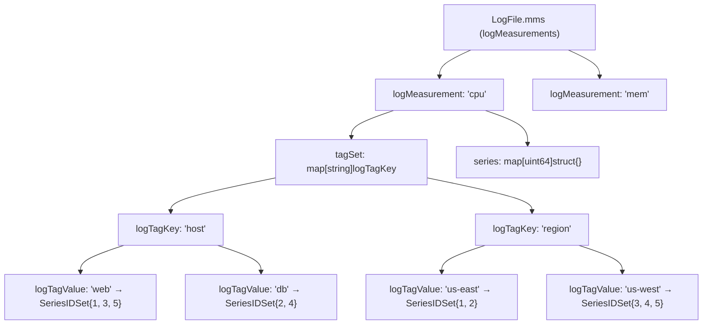

### 7.2 关键结构体

```go
// tsdb/index/tsi1/log_file.go:1235 — logMeasurements
type logMeasurements map[string]*logMeasurement

// tsdb/index/tsi1/log_file.go:1248 — logMeasurement
type logMeasurement struct {
    name      []byte
    tagSet    map[string]logTagKey  // tagSet 是 logMeasurement 上的字段，不是独立类型
    deleted   bool
    series    map[uint64]struct{}  // series ID 集合
    seriesSet *tsdb.SeriesIDSet    // 当 len(series) > 25 时提升为 roaring bitmap
}

// tsdb/index/tsi1/log_file.go:1385 — logTagKey
type logTagKey struct {
    name      []byte
    deleted   bool
    tagValues map[string]logTagValue  // 字段名是 tagValues，不是 vals
}

// tsdb/index/tsi1/log_file.go:1429 — logTagValue
type logTagValue struct {
    name      []byte
    deleted   bool
    series    map[uint64]struct{}   // 小集合用 map
    seriesSet *tsdb.SeriesIDSet     // 当 len(series) > 25 时提升为 roaring bitmap
}
```

**Series 集合的优化**: 当 `len(m.series) > 25` 时，从 `map[uint64]struct{}` 提升为 `*tsdb.SeriesIDSet`（roaring bitmap），减少内存占用。

## 8. 架构设计意图

### 8.1 为什么用 LogFile + IndexFile 两层结构

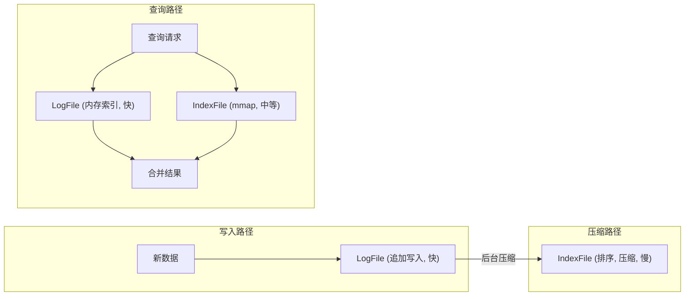

- **LogFile**: 追加写入，内存索引，写入性能最优
- **IndexFile**: 排序压缩，mmap 映射，查询性能最优
- **后台压缩**: LogFile 达到阈值后压缩为 IndexFile

### 8.2 为什么用 8 分区 SeriesFile

- **并发**: 8 个分区可以并发创建 series
- **锁粒度**: 每个分区独立的 Mutex
- **ID 分配**: 分区 0 获得 1, 9, 17, ...; 分区 1 获得 2, 10, 18, ...

### 8.3 为什么用 Robin Hood Hashing

- **缓存友好**: 探测距离短，cache miss 少
- **负载因子高**: 90% 负载因子，空间利用率高
- **确定性**: 相同输入总是产生相同的布局

### 8.4 为什么用 Roaring Bitmap

- **稀疏集合**: 当 series ID 稀疏时，内存占用小
- **密集集合**: 当 series ID 密集时，位打包效率高
- **集合操作**: AND/OR/NOT 操作高效

> **上限（必读）**: `SeriesIDSet` 底层是 `roaring.Bitmap`（uint32）。`AddNoLock/ContainsNoLock/RemoveNoLock`
> 都直接执行 `uint32(id)` 截断，没有越界检查（`tsdb/series_set.go:47-95`）。按 8 分区交错分配 ID，
> 第 2^32 个 ID 大约出现在 5.36e8 个 series 之后，此后 ID 会静默别名（alias）成同一个 bit。
>
> 另外 RHH 的 `pow2()` 在 `v > 2^61` 时走完循环并 `panic("unreachable")`（`pkg/rhh/rhh.go:262-271`），
> 阈值不是 2^63——因为循环上界写死为 `i < 1<<62`。

## 9. 架构收益

| 维度 | 收益 |
|------|------|
| **写入性能** | LogFile 追加写入 + 内存索引，O(1) 注册 |
| **查询性能** | IndexFile mmap + RHH，O(1) 查找 |
| **压缩比** | TagBlock 两层 RHH，空间效率高 |
| **并发安全** | 8 分区 SeriesFile + 8 分区 TSI Index |
| **崩溃恢复** | LogFile 是 WAL，重启后自动重建内存索引 |
| **空间管理** | 后台压缩 LogFile → IndexFile，减少文件数量 |

## 10. 潜在隐患与瓶颈

### 10.1 LogFile 内存无限增长

LogFile 的内存索引没有上限：每个 measurement 一个 `logMeasurement`，其中有
`name`、`tagSet map[string]logTagKey`、`deleted`、`series map[uint64]struct{}`、`seriesSet *tsdb.SeriesIDSet`
五个字段（`tsdb/index/tsi1/log_file.go:1248-1254`）。series 超过 25 个后 `series` 会提升为 roaring
`seriesSet`（`log_file.go:1269-1285`），但 tag key/tag value 的条目数仍随基数线性增长
（`logTagKey`/`logTagValue` 各一份 map）。只有 LogFile 被压缩成 IndexFile 并删除后，这部分内存才释放。

### 10.2 IndexFile 压缩在后台 goroutine 中执行，但交换阶段持有 Partition 写锁

`compactLogFile()` / `compactToLevel()` 的编码阶段在后台 goroutine 中执行；只有 `MustReplace` +
`manifest.Write` 这一段持有 `p.mu` 写锁，期间该分区的写入与查询会短暂阻塞（`partition.go:1346-1375`）。

### 10.3 SeriesFile 的 mmap 段文件

SSEG 文件使用 mmap 映射，大文件可能导致虚拟内存压力。

### 10.4 MeasurementHasSeries 的线性扫描

遍历所有文件检查 series 存在性，文件数量多时性能下降。

### 10.5 TagValueIterator 的 K-way 归并

多个文件的 TagValueIterator 归并，文件数量多时开销增大。

### 10.6 IndexFileTrailer 固定 82 字节

8 字节偏移/大小字段对超大索引无溢出检查。
