# Module 3: 查询引擎 (Iterator 模型 + 聚合算子 + Cache/TSM 归并 + LIMIT/OFFSET + 子查询) - 深度审计报告

> **小白导读**: 查询引擎就像一个**流水线工厂**。你输入一条 SQL，它经过多个"工位"加工，最终输出结果。
>
> 流水线上的每个工位（Iterator）做一件简单的事：
> 1. **存储层 Iterator**: 从 Cache + TSM 文件读取原始数据
> 2. **Merge Iterator**: 把多个 Shard 的数据合并成一条有序流
> 3. **Call Iterator**: 执行聚合函数（mean, count, sum...）
> 4. **Interval Iterator**: 把时间对齐到窗口起点（如每分钟的起点）
> 5. **Fill Iterator**: 填充空窗口（没有数据的时间段填 0 或 NULL）
> 6. **Limit Iterator**: 截取前 N 条
> 7. **Emitter**: 按 series 分组输出最终结果
>
> 关键设计：每个工位都是**惰性的**——只有下游需要数据时，上游才开始工作（Pull 模型）。

## 1. 查询全链路总览

### 1.1 从 InfluxQL 到结果输出的完整路径

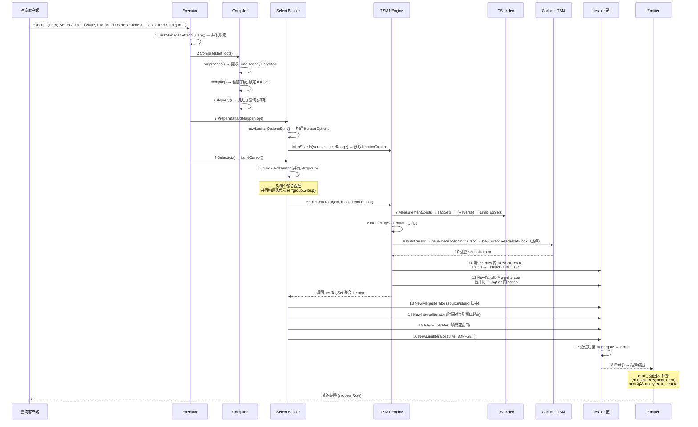

**Emitter Partial 语义**: `Emitter.Emit()` 返回的第二个 `bool` 由 `StatementExecutor`
调用方写入 `query.Result.Partial`（emitter.go 本身不设置 `query.Result.Partial`），
表示后续还会继续发送同一查询的结果批次。`models.Row.Partial` 是另一层含义：只有同一个
series 因 `chunkSize` 被切开时，`Emitter` 才会把当前 row 标记为 partial (emitter.go:61)。

### 1.2 每一步的代码实现

#### 步骤 1: TaskManager — 并发限流

```go
// query/task_manager.go — TaskManager
type TaskManager struct {
    QueryTimeout         time.Duration
    LogQueriesAfter      time.Duration
    LogTimedoutQueries   bool
    MaxConcurrentQueries int
    Logger               *zap.Logger

    queries  map[uint64]*Task
    nextID   uint64
    mu       sync.RWMutex
    shutdown bool
}
```

**限流机制**: 当并发查询数超过 `MaxConcurrentQueries` 时，`AttachQuery` 立即返回错误 `ErrMaxConcurrentQueriesLimitExceeded`（非阻塞）。

#### 步骤 2: Compile — 查询编译

```go
// query/compile.go:106 — Compile
func Compile(stmt *influxql.SelectStatement, opt CompileOptions) (_ Statement, err error) {
    c := newCompiler(opt)
    c.stmt = stmt.Clone()
    if err := c.preprocess(c.stmt); err != nil {   // 1. 条件/时间范围/维度/FILL
        return nil, err
    }
    if err := c.compile(c.stmt); err != nil {      // 2. 字段/类型/子查询
        return nil, err
    }
    c.stmt.TimeAlias = c.TimeFieldName
    c.stmt.Condition = c.Condition

    // 3. recover 兜底: 某些畸形语句会在重写阶段 panic
    defer func() {
        if e := recover(); e != nil && err == nil {
            var ok bool
            err, ok = e.(error)
            if !ok {
                err = fmt.Errorf("panic: %v", e)
            }
            err = fmt.Errorf("likely malformed statement, unable to rewrite: %w", err)
        }
    }()

    c.stmt.RewriteDistinct()        // DISTINCT → 内部调用
    c.stmt.RewriteTimeFields()      // 从字段列表移除 "time"
    c.stmt.RewriteRegexConditions() // 重写正则条件以利用索引
    return c, nil
}
```

**`preprocess`（`compile.go:135-183`）只做五件事**:

1. `influxql.ConditionExpr(stmt.Condition, &NowValuer{...})`：一次遍历同时拆出
   条件表达式与 `TimeRange`（`now()` 在这里被替换为固定时间）；
2. `validateCondition`（`compile.go:1031`）拒绝非法条件；
3. `compileDimensions`（`compile.go:922`）：校验并规范化 `GROUP BY time/tag`，
   写回 `stmt.Dimensions`，同时设置 `Interval.Duration/Offset`；
4. `c.FillOption = stmt.Fill`；
5. 补默认时间范围：`TimeRange.Min` 为零 → `influxql.MinTime`；`TimeRange.Max`
   为零时，**聚合查询**（`Interval != 0`）用 `Options.Now`，**raw 查询**用
   `influxql.MaxTime`。

**`compile`（`compile.go:184-205`）只做三件事**: `compileFields` →
`validateFields`（`compile.go:994`）→ 遍历 sources 对每个 `*influxql.SubQuery`
调用 `c.subquery`（子查询的 `OmitTime = true`）。它**不**负责时间范围、FILL 或
`ExtraIntervals`。

**`ExtraIntervals` 是 warmup 语义**（`compile.go:42-50`）: 为了让
`derivative` / `difference` / `cumulative_sum` / `moving_average` /
`exponential_moving_average` 等在第一个输出窗口就有前值，编译期会把映射到 shard
的时间范围向前（降序时向后）扩展若干窗口：

```go
// compile.go:1154-1170
if !c.Interval.IsZero() && c.ExtraIntervals > 0 {
    newTime := timeRange.Min.Add(time.Duration(-c.ExtraIntervals) * c.Interval.Duration)
    // 升序: StartTime -= ExtraIntervals * Interval; 降序: EndTime += ExtraIntervals * Interval
}
```

各函数对 `ExtraIntervals` 的贡献：`derivative`/`non_negative_derivative` = 1
（`compile.go:472`）、`elapsed` = 1（`508`）、`difference` = 1（`537`）、
`moving_average` = 窗口大小 N（`592`）、EMA/DEMA/TEMA/RSI 等 = warmup N（`651`）、
`chande_momentum_oscillator` = N（`735`）。

#### 步骤 3: Prepare — 构建 IteratorOptions

```go
// query/iterator.go:638 — newIteratorOptionsStmt
func newIteratorOptionsStmt(stmt *influxql.SelectStatement, sopt SelectOptions) (opt IteratorOptions, err error) {
    valuer := &influxql.NowValuer{Location: stmt.Location}
    condition, timeRange, err := influxql.ConditionExpr(stmt.Condition, valuer)
    if err != nil {
        return IteratorOptions{}, err
    }

    // 时间默认值: 缺省 Min → influxql.MinTime, 缺省 Max → influxql.MaxTime
    if !timeRange.Min.IsZero() {
        opt.StartTime = timeRange.Min.UnixNano()
    } else {
        opt.StartTime = influxql.MinTime
    }
    if !timeRange.Max.IsZero() {
        opt.EndTime = timeRange.Max.UnixNano()
    } else {
        opt.EndTime = influxql.MaxTime
    }
    opt.Location = stmt.Location

    // 负 interval 归零; 只有正 interval 才读取 GROUP BY offset
    interval, err := stmt.GroupByInterval()
    if interval < 0 {
        interval = 0
    } else if interval > 0 {
        opt.Interval.Offset, err = stmt.GroupByOffset()
    }
    opt.Interval.Duration = interval

    opt.Ordered = true // 顶层 iterator 始终有序

    // Dimensions 与 GroupBy 同时构建: GroupBy 是集合, 供分组判断使用
    opt.GroupBy = make(map[string]struct{}, len(opt.Dimensions))
    for _, d := range stmt.Dimensions {
        if d, ok := d.Expr.(*influxql.VarRef); ok {
            opt.Dimensions = append(opt.Dimensions, d.Val)
            opt.GroupBy[d.Val] = struct{}{}
        }
    }

    opt.Condition = condition
    opt.Ascending = stmt.TimeAscending()
    opt.Dedupe = stmt.Dedupe
    opt.StripName = stmt.StripName
    opt.Fill, opt.FillValue = stmt.Fill, stmt.FillValue
    if opt.Fill == influxql.NullFill && stmt.Target != nil {
        // 写 target 时 NULL 会被忽略, fill(null) 没有意义 → 降为 NoFill
        opt.Fill = influxql.NoFill
    }
    opt.Limit, opt.Offset = stmt.Limit, stmt.Offset
    opt.SLimit, opt.SOffset = stmt.SLimit, stmt.SOffset
    opt.MaxSeriesN = sopt.MaxSeriesN
    opt.Authorizer = sopt.Authorizer
    return opt, nil
}
```

> **注意**: 函数名里的参数是 `sopt SelectOptions`，不是 `opt`；旧文档
> `opt := IteratorOptions{...}` 的写法会遮蔽返回值。`StartTime/EndTime` 的默认值
> 不是 0，而是 `influxql.MinTime` / `influxql.MaxTime`（`iterator.go:640-657`）。

#### 步骤 3b: IteratorOptions — 查询层与存储层的唯一契约

`query/iterator.go:579-636` 的 `IteratorOptions` 是 select.go 与 TSM1 Engine
之间**唯一**的参数契约（`<T>` 表示 float/integer/unsigned/string/boolean 五套生成代码）。

| 字段 | 生产者 | 消费者 | 默认值 | 不设的后果 |
|---|---|---|---|---|
| `Expr` | `buildFieldIterator` | Engine 的 `createCallIterator`/`createVarRefIterator` | nil | 无法判断 Call/VarRef，first/last 快路径失效 |
| `Aux` | `buildCursor`（valueMapper.refs） | `IteratorScanner` | nil | `SELECT value, host` 丢失 host 列 |
| `Sources` | `Select` | 仅 RPC 编码（OSS 不再使用） | nil | OSS 无影响 |
| `Interval` | `newIteratorOptionsStmt` | `Window()`、`IntervalIterator`、`FillIterator` | 零值 | 视为 raw 查询，不切窗口 |
| `Dimensions` | 同上（`stmt.Dimensions`） | reduce/merge 的 `Tags.Subset` | nil | 不按 tag 分组 |
| `GroupBy` | 同上（集合） | per-series limit、merge 分组判断 | 空 map | `len(Dimensions) != len(GroupBy)` 判断失真 |
| `Location` | `stmt.Location` | `Window()` 的时区修正 | nil | 按 UTC 切窗 |
| `Fill` / `FillValue` | `newIteratorOptionsStmt` | `FillIterator` | NoFill / nil | 空窗口不填充 |
| `Condition` | `preprocess` → `opt.Condition` | `filterIterator`、索引 | nil | 不过滤 |
| `StartTime` / `EndTime` | `ConditionExpr` 或默认 | `SeekTime`/`StopTime`/`Window` | MinTime/MaxTime | 全时间范围扫描 |
| `Ascending` | `stmt.TimeAscending()` | 所有 iterator 的方向 | false | 默认降序，与预期相反 |
| `Limit` / `Offset` | `stmt` | `newLimitIterator` | 0 | 不限制 |
| `SLimit` / `SOffset` | `stmt` | `LimitTagSets` | 0 | 不限制 series |
| `StripName` / `Dedupe` | `stmt` | emitter / DedupeIterator | false | 保留 measurement 名 / 不去重 |
| `Ordered` | 恒 true（顶层） | `MergeSorted()`、reduce | false | 归并走无序路径 |
| `MaxSeriesN` | `sopt` | `createSeriesIterator` | 0 | 不限制 series 数 |
| `InterruptCh` | `sopt` | `InterruptIterator` | nil | 无法中断 |
| `Authorizer` | `sopt` | `createSeriesIterator` 等 | nil | 不做权限过滤 |

**三个时间函数**（`iterator.go:784-888`）:

- `SeekTime()`：升序返回 `StartTime`，降序返回 `EndTime`（`iterator.go:790-797`）；
- `StopTime()`：升序返回 `EndTime`，降序返回 `StartTime`（`iterator.go:801-808`）；
- `Window(t)`：`Interval` 为零 → `[StartTime, EndTime+1)`（右开是为了包含
  `EndTime`）；否则先 `t -= Offset`、按 `Location` 求 zone、对负模做
  `dt += Duration` 修正、用 `influxql.MinTime/MaxTime` 夹取，再在 start/end
  两处做 DST 二次 zone 修正（`iterator.go:811-888`）。

**数值例**: `StartTime=10:00, EndTime=12:00, Ascending=false` →
`SeekTime()=12:00`、`StopTime()=10:00`。这正好解释了 08 号文档里
`reset(seek, end)` 的实参顺序，以及"降序裁掉 `< StartTime`"的边界
（`end` 参数就是 `StopTime()`）。

**DST 例**: `Interval=1h, Offset=30m, Location=Asia/Shanghai` 跨夏令时切换日时，
`t` 与 `start` 可能落在不同的 zone offset 上；源码在算出 `start` 后用
`opt.Zone(start)` 再查一次，仅当偏移差 `< Interval.Duration` 时才修正，避免产生
倒流窗口（`iterator.go:842-853`）。

**`MergeSorted() == Ordered`**（`iterator.go:784-786`）: raw 查询走
`SortedMergeIterator`，聚合查询走 `MergeIterator`。

**`Dimensions` vs `GroupBy`**: 三处判断依据——子查询（`newIteratorOptionsSubstatement`）、
per-series limit（`engine.go:3050-3056`）、merge 分组（`createCallIterator` 的
`len(opt.Dimensions)==0` 快路径）。

#### 步骤 4: buildCursor — 构建查询游标

```go
// query/select.go:622 — buildCursor
func buildCursor(ctx context.Context, stmt *influxql.SelectStatement, ic IteratorCreator, opt IteratorOptions) (Cursor, error) {
    // 0. Tracing: 如果有 span，记录 build_cursor 调用
    span := tracing.SpanFromContext(ctx)
    if span != nil {
        span = span.StartSpan("build_cursor")
        defer span.Finish()
        span.SetLabels("statement", stmt.String())
    }

    // 1. 处理 FILL 选项
    switch opt.Fill {
    case influxql.NumberFill:
        if v, ok := opt.FillValue.(int); ok {
            opt.FillValue = int64(v)
        }
    case influxql.PreviousFill:
        opt.FillValue = SkipDefault
    }

    // 2. 构造输出字段；未 OMIT TIME 时先注入 time 列
    fields := make([]*influxql.Field, 0, len(stmt.Fields)+1)
    if !stmt.OmitTime {
        fields = append(fields, &influxql.Field{Expr: &influxql.VarRef{
            Val: "time", Type: influxql.Time,
        }})
    }

    // 3. 使用 valueMapper 进行字段去重映射
    valueMapper := newValueMapper()
    for _, f := range stmt.Fields {
        fields = append(fields, valueMapper.Map(f))
        // top/bottom 需要额外的辅助变量
        if stmt.Target != nil {
            continue
        }
        if expr, ok := f.Expr.(*influxql.Call); ok && (expr.Name == "top" || expr.Name == "bottom") {
            for i := 1; i < len(expr.Args)-1; i++ {
                nf := influxql.Field{Expr: expr.Args[i]}
                fields = append(fields, valueMapper.Map(&nf))
            }
        }
    }

    // ColumnNames() 决定最终列名/别名，必须回填到 fields。
    columns := stmt.ColumnNames()
    for i, f := range fields {
        f.Alias = columns[i]
    }

    // 4. 构造辅助字段 refs，并把 ref.String() 映射回 valueMapper 的符号名。
    var auxKeys []influxql.VarRef
    if len(valueMapper.refs) > 0 {
        opt.Aux = make([]influxql.VarRef, 0, len(valueMapper.refs))
        for ref := range valueMapper.refs {
            opt.Aux = append(opt.Aux, *ref)
        }
        sort.Sort(influxql.VarRefs(opt.Aux))
        auxKeys = make([]influxql.VarRef, len(opt.Aux))
        for i, ref := range opt.Aux {
            auxKeys[i] = valueMapper.symbols[ref.String()]
        }
    }

    // 5. 无聚合函数时: 构建辅助游标
    if len(valueMapper.calls) == 0 {
        if !hasValidType(auxKeys) {
            return newNullCursor(fields), nil
        }
        itr, err := buildAuxIterator(ctx, ic, stmt.Sources, opt)
        if err != nil { return nil, err }
        keys := []influxql.VarRef{{}}
        keys = append(keys, auxKeys...)
        scanner := NewIteratorScanner(itr, keys, opt.FillValue)
        return newScannerCursor(scanner, fields, opt), nil
    }

    // 6. 判断是否为 selector 查询
    selector := len(valueMapper.calls) == 1
    if selector {
        for call := range valueMapper.calls {
            if !influxql.IsSelector(call) {
                selector = false
            }
        }
    }

    // 7. 有聚合函数时: 并行构建迭代器
    var g errgroup.Group
    var mu sync.Mutex
    scanners := make([]IteratorScanner, 0, len(valueMapper.calls))
    for call := range valueMapper.calls {
        call := call
        driver := valueMapper.table[call]
        if driver.Type == influxql.Unknown {
            continue
        }
        g.Go(func() error {
            itr, err := buildFieldIterator(ctx, call, ic, stmt.Sources, opt, selector, stmt.Target != nil)
            if err != nil { return err }
            keys := make([]influxql.VarRef, 0, len(auxKeys)+1)
            keys = append(keys, driver)
            keys = append(keys, auxKeys...)
            scanner := NewIteratorScanner(itr, keys, opt.FillValue)
            mu.Lock()
            scanners = append(scanners, scanner)
            mu.Unlock()
            return nil
        })
    }
    if err := g.Wait(); err != nil {
        for _, s := range scanners {
            s.Close()
        }
        return nil, err
    }

    // 8. 创建 Cursor
    if len(scanners) == 0 {
        return newNullCursor(fields), nil
    }
    if len(scanners) == 1 {
        return newScannerCursor(scanners[0], fields, opt), nil
    }
    return newMultiScannerCursor(scanners, fields, opt), nil
}
```

#### 步骤 5: buildCallIterator — 聚合函数分发

```go
// query/select.go:214 — buildCallIterator
func (b *exprIteratorBuilder) buildCallIterator(ctx context.Context, expr *influxql.Call) (Iterator, error) {
    // 关键: 剥离 LIMIT/OFFSET (由外层处理)
    opt := b.opt
    opt.Limit, opt.Offset = 0, 0

    switch expr.Name {
    // ── 外层 switch: 直接处理的函数 (不经过 callIterator) ──

    case "distinct":
        // distinct 需要有序输入
        opt.Ordered = true
        input, _ := buildExprIterator(ctx, expr.Args[0].(*influxql.VarRef), ...)
        input, _ = NewDistinctIterator(input, opt)
        return NewIntervalIterator(input, opt), nil

    case "sample":
        // sample 使用流式 reduce (newFloatReduceFloatIterator)
        opt.Ordered = true
        input, _ := buildExprIterator(ctx, expr.Args[0], ...)
        size := expr.Args[1].(*influxql.IntegerLiteral)
        return newSampleIterator(input, opt, int(size.Val))

    case "holt_winters", "holt_winters_with_fit":
        // 需要无界时间范围来捕获所有聚合结果
        opt.StartTime, opt.EndTime = influxql.MinTime, influxql.MaxTime
        opt.Interval = Interval{}
        return newHoltWintersIterator(input, opt, h, m, includeFitData, interval)

    case "count_hll", "derivative", "non_negative_derivative",
         "difference", "non_negative_difference",
         "moving_average", "exponential_moving_average",
         "double_exponential_moving_average", "triple_exponential_moving_average",
         "relative_strength_index", "triple_exponential_derivative",
         "kaufmans_efficiency_ratio", "kaufmans_adaptive_moving_average",
         "chande_momentum_oscillator", "elapsed":
        // 这些函数需要有序输入，可能需要扩展 StartTime
        opt.Ordered = true
        input, _ := buildExprIterator(ctx, expr.Args[0], ...)
        switch expr.Name {
        case "count_hll":
            return NewCountHllIterator(input, opt)
        case "derivative", "non_negative_derivative":
            return newDerivativeIterator(input, opt, interval, isNonNegative)
        case "elapsed":
            return newElapsedIterator(input, opt, interval)
        case "difference", "non_negative_difference":
            return newDifferenceIterator(input, opt, isNonNegative)
        case "moving_average":
            return newMovingAverageIterator(input, int(n.Val), opt)
        case "exponential_moving_average", ...:
            return newExponentialMovingAverageIterator(input, ...)
        case "kaufmans_efficiency_ratio", ...:
            return newKaufmansEfficiencyRatioIterator(input, ...)
        case "chande_momentum_oscillator":
            return newChandeMomentumOscillatorIterator(input, ...)
        }

    case "cumulative_sum":
        return newCumulativeSumIterator(input, opt)

    case "integral":
        return newIntegralIterator(input, opt, interval)

    case "top":
        // top 使用最小堆 + 可选的 max 预聚合
        n := expr.Args[len(expr.Args)-1].(*influxql.IntegerLiteral)
        return newTopIterator(input, opt, int(n.Val), b.writeMode)

    case "bottom":
        // bottom 使用最大堆 + 可选的 min 预聚合
        n := expr.Args[len(expr.Args)-1].(*influxql.IntegerLiteral)
        return newBottomIterator(input, b.opt, int(n.Val), b.writeMode)

    // ── 内层 block: 经过 callIterator 的简单聚合 ──

    default:
        itr, err := func() (Iterator, error) {
            switch expr.Name {
            case "count":
                // count(distinct(...)) 特殊路径
                if arg0, ok := expr.Args[0].(*influxql.Call); ok && arg0.Name == "distinct" {
                    return newCountIterator(input, opt)
                }
                fallthrough
            case "min", "max", "sum", "first", "last", "mean", "sum_hll", "merge_hll":
                return b.callIterator(ctx, expr, opt)  // → 创建 Reducer
            case "median":
                // median 需要有序输入，使用独立迭代器
                opt.Ordered = true
                return newMedianIterator(input, opt)
            case "mode":
                return NewModeIterator(input, opt)
            case "stddev":
                return newStddevIterator(input, opt)
            case "spread":
                return newSpreadIterator(input, opt)
            case "percentile":
                opt.Ordered = true
                return newPercentileIterator(input, opt, percentile)
            }
        }()

        // 后处理: IntervalIterator + FillIterator
        if !b.selector || !opt.Interval.IsZero() {
            itr = NewIntervalIterator(itr, opt)
            if !opt.Interval.IsZero() && opt.Fill != influxql.NoFill {
                itr = NewFillIterator(itr, expr, opt)
            }
        }
        return itr, nil
    }
}
```

#### 步骤 5b: callIterator — 构建聚合迭代器

```go
// query/select.go:579 — callIterator
func (b *exprIteratorBuilder) callIterator(ctx context.Context, expr *influxql.Call, opt IteratorOptions) (Iterator, error) {
    inputs := make([]Iterator, 0, len(b.sources))
    if err := func() error {
        for _, source := range b.sources {
            switch source := source.(type) {
            case *influxql.Measurement:
                input, err := b.ic.CreateIterator(ctx, source, opt)
                if err != nil {
                    return err
                }
                inputs = append(inputs, input)

            case *influxql.SubQuery:
                // 子查询源不要求底层 iterator 保持全局有序；先为子查询表达式构建输入。
                opt.Ordered = false
                input, err := buildExprIterator(ctx, expr.Args[0], b.ic, []influxql.Source{source}, opt, b.selector, false)
                if err != nil {
                    return err
                }

                // 当前源码在 callIterator 内显式包一层 NewCallIterator。
                i, err := NewCallIterator(input, opt)
                if err != nil {
                    input.Close()
                    return err
                }
                inputs = append(inputs, i)
            }
        }
        return nil
    }(); err != nil {
        Iterators(inputs).Close()
        return nil, err
    }

    itr, err := Iterators(inputs).Merge(opt)
    if err != nil {
        Iterators(inputs).Close()
        return nil, err
    } else if itr == nil {
        itr = &nilFloatIterator{}
    }
    return itr, nil
}
```

**注意**: measurement 源直接交给 `IteratorCreator.CreateIterator`；`*influxql.SubQuery`
源会在 `callIterator` 内通过 `buildExprIterator` 构建子查询输入，然后显式调用
`NewCallIterator(input, opt)` 包装。任一构建步骤失败时，源码会调用
`Iterators(inputs).Close()` 清理已创建输入；`Iterators(inputs).Merge(opt)` 失败时也会关闭 inputs。
count() 在多 shard 合并时改用 sum() 的逻辑仍在 `Iterators.Merge()` 中
（`iterator.go:145-164`，`count` → `sum`、`sum_hll` → `merge_hll`）。层级关系是：

1. TSM1 `Engine.createCallIterator` 对每个 series iterator 先包一层 `NewCallIterator`
   （`engine.go:2985`），再用 `NewParallelMergeIterator` 合并同一 TagSet——这是**第一级聚合**；
2. `select.go` 的 `Iterators(inputs).Merge(opt)`（`select.go:612`）在最外层再包一级
   `NewCallIterator`（`iterator.go:162`）做跨 source/shard 的**二次聚合**
   （count→sum；mean 按 `Aggregated` 加权求和后再除以总点数，等价全局 mean），然后才接 Interval、Fill、Limit。

所以 select.go 外层确实会包 `CallIterator`，但宾语不是 `ArrayCursor`（`ArrayCursor` 只属于
storage/reads 路径，见 §1.2 末与 §1.3）。详见第 4.1 节。

#### 步骤 5c: 后处理 — IntervalIterator + FillIterator

```go
// query/select.go:565 — 后处理
if !b.selector || !opt.Interval.IsZero() {
    // IntervalIterator: 将时间对齐到窗口起点
    itr = NewIntervalIterator(itr, opt)

    // FillIterator: 填充空窗口
    if !opt.Interval.IsZero() && opt.Fill != influxql.NoFill {
        itr = NewFillIterator(itr, expr, opt)
    }
}

// InterruptIterator: 查询取消支持
if opt.InterruptCh != nil {
    itr = NewInterruptIterator(itr, opt.InterruptCh)
}
```

**迭代器链的组装顺序**:

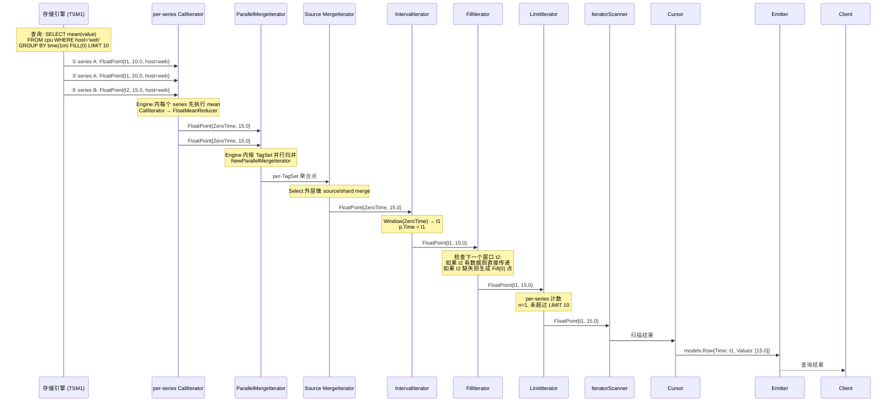

#### 两条读取路径：InfluxQL 逐点 cursor vs storage/reads 批量 Array Cursor

这两条路径**互不经过对方**，唯一共享的 **cursor 组件**是 `KeyCursor`（此外两条路径都读 `Cache.Values`，也共用 `FileStore` 的 locations / tombstone 辅助函数）。`arrayCursorIterator`
**只服务 storage/reads（Flux）**，InfluxQL 的 `query` 包从不调用
`Engine.CreateCursorIterator`。

| 维度 | InfluxQL（模块 3） | storage/reads（Flux，模块 8/9） |
|---|---|---|
| 入口 | `Engine.CreateIterator` → `createVarRefIterator` / `createCallIterator` → `Engine.buildCursor` | `Engine.CreateCursorIterator` → `arrayCursorIterator.Next` |
| 逐 series 构造 | `buildFloatCursor` → `newFloatCursor` → `newFloatAscendingCursor` | `buildFloatArrayCursor` → `newFloatArrayAscendingCursor()` + `reset(...)` |
| 读 block | `KeyCursor.ReadFloatBlock`（逐点） | `KeyCursor.ReadFloatArrayBlock`（批量） |
| 每次返回 | 1 个 point | 最多 1000 点（`DefaultMaxPointsPerBlock`） |
| 消费者 | `query.Iterator` 链 | `storage/reads` → Flux Table |

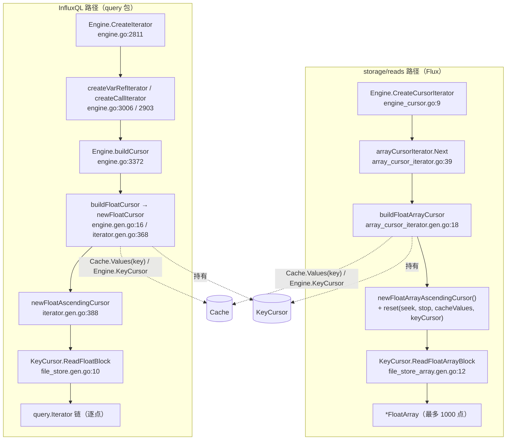

**关键设计点**:
- Cache 在 cursor **内部**（`c.cache.values`），`KeyCursor` 完全不持有 Cache；
  `Next()` 只读 cursor 自有的 `c.cache.values` / `c.tsm.values`，不会在 `Next()` 中回访 Cache。
- TSM 候选 block 的顺序由 `ascLocations`（MinTime 升序）或 `descLocations`
  （MaxTime 升序，重叠时按 path 稳定排序）决定，不是「文件按时间倒序」。
- 每次 `Read*Block` 会先 `Exclude(readMin, readMax)` 去掉已读区间、按
  `TombstoneRange` 剔除删除点，再把时间窗口重叠的后续 block `Include`+`Merge`
  （详见 16 号文档 §3.8/§3.9）。
- InfluxQL 每次只前进一个点（`peekCache`/`peekTSM` 双指针，时间戳相同 Cache 优先）；
  storage/reads 一次最多返回 1000 点。

### 1.3 存储侧 iterator 树与 InfluxQL 逐点 cursor

§1.2 的 `buildCursor` 只是查询层的入口；真正把 `SELECT` 变成数据流的是
TSM1 `Engine.CreateIterator` 向下构建的存储侧 iterator 树。它与 storage/reads
的 array cursor 是**两套并行实现**。

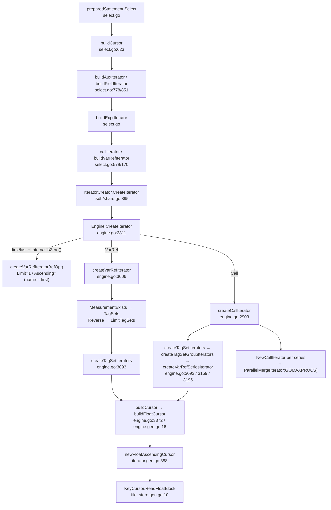

**1. `Engine.CreateIterator` 的三条分叉**（`engine.go:2811-2850`）:

- `opt.Expr` 是 `*influxql.Call` 且 `opt.Interval.IsZero()` 且函数名为 `first`/`last` 时，
  构造 `refOpt`：`Limit=1`、`Ascending = (call.Name == "first")`、`Ordered=true`、
  `Expr=call.Args[0]`，然后走 `createVarRefIterator`。这就是 `first`/`last` 只读 1 个点的原因。
- 其他 Call 走 `createCallIterator`；`inputs` 为空时返回 `nil, nil`。
- VarRef 直接走 `createVarRefIterator`。
- 两条路径最后都包 `newMergeFinalizerIterator`，由 finalizer 在 GC 时兜底 `Close()`。

**2. `createCallIterator`**（`engine.go:2903-3004`）: 先 `MeasurementExists`(2906)；
TSI 索引下若命中 `createSeriesIterator` 快路径（被聚合的字段必须是内部字段 `_seriesKey`，
且 `count`/`sum_hll`、`len(opt.Aux)==0`、无 Dimensions、`SLimit==SOffset==0`、`!StripName`、
`Ordered=false` 时），直接返回 `NewCallIterator(seriesIterator, opt)`(2925)。
否则取 `TagSets`(2941/2944) → 降序 `Reverse`(2954) → `LimitTagSets`(2959)；
对每个 TagSet：先 `select <-opt.InterruptCh`(2966-2972) 检查一次，
`createTagSetIterators`(2972) 后对每个 series 包 `NewCallIterator`(2985)，
再用 `NewParallelMergeIterator(inputs, opt, GOMAXPROCS(0))`(2993) 合并同一 TagSet。

**3. `createVarRefIterator`**（`engine.go:3006-3085`）: `MeasurementExists`(3009) →
`TagSets`(3021/3024) → 降序 `TagSet.Reverse`(3034) → `LimitTagSets`(3039) →
`createTagSetIterators`(3043) → per-series limit（`Dimensions != GroupBy` 时用
`newLimitIterator`，3050-3056）→ `Iterators.Merge`(3059) → 分组 limit
（`newLimitIterator` vs `query.NewLimitIterator`，3062-3073）。

**4. 逐点 cursor 的结构与读取**（`tsdb/engine/tsm1/iterator.gen.go`）:

```go
// iterator.gen.go:375 — floatAscendingCursor
type floatAscendingCursor struct {
    cache struct {
        values Values   // Cache.Values(key)，接口切片 []Value
        pos    int
    }
    tsm struct {
        values    []FloatValue  // ReadFloatBlock 解码出的逐点切片
        pos       int
        keyCursor *KeyCursor
    }
}
```

- `peekCache()`（406-414）与 `peekTSM()`（416-440）分别返回两个数据源当前位置的时间戳/值；
- `nextFloat()`（442-476）双指针推进：`ckey == tkey` 时 **Cache 优先**并同时前进两个指针，
  `ckey < tkey` 取 Cache，否则取 TSM；
- `nextTSM()`（478 起）调用 `KeyCursor.Next()` + `ReadFloatBlock`（`file_store.gen.go:10`），
  把 TSM 数据补齐到 `c.tsm.values`。

**5. `ReadFloatBlock` vs `ReadFloatArrayBlock`**:

| 维度 | `ReadFloatBlock`（InfluxQL） | `ReadFloatArrayBlock`（storage/reads） |
|---|---|---|
| 实现文件 | `file_store.gen.go:10` | `file_store_array.gen.go:12` |
| 返回 | `[]FloatValue`（逐点接口切片） | `*tsdb.FloatArray`（时间戳/值两个并行数组） |
| 重叠处理 | `Exclude`/`TombstoneRange`/`Include`/`Merge`，逻辑相同 | 同左 |
| 消费方式 | `peekTSM`/`nextFloat` 每次取 1 点 | 数组游标双指针批量归并 |

两者都以 `c.current[0]` 为首块，都对 tombstone 和已读区间做同样处理；差别只在
结果的表示与消费粒度。

**6. 案例**: 2 个 series（`host=web01`、`host=web02`）落在 1 个 shard 上，查询
`SELECT mean(value) FROM cpu GROUP BY time(1m)`。每个 series 的
`KeyCursor.ReadFloatBlock` 逐点读出原始值，`NewCallIterator`（`FloatMeanReducer`）
把整段数据压成 `(windowStart, mean, Aggregated=n)`；同一 TagSet 的 2 个 series 由
`NewParallelMergeIterator` 并行归并；select.go 外层再做一次 `CallIterator` 聚合
（按 `Aggregated` 加权求和后再除，等价全局 mean），最后 `IntervalIterator` 对齐窗口。若查询是
`SELECT first(value) ...`，`Engine.CreateIterator` 直接 `Limit=1`，每个 series 只读 1 点。

**7. 并发与生命周期**: Engine 侧 goroutine 数约为 `min(GOMAXPROCS, series 数)`
（`NewParallelMergeIterator`）；`InterruptCh` 在 `createCallIterator` 中每个 TagSet
检查一次；`newMergeFinalizerIterator` 用 `runtime.SetFinalizer`
（`tsdb/engine/tsm1/iterator.gen.go:131-160`）兜底关闭，正常情况下仍由
`Iterators.Close()` 显式释放（见 §4.5）。

## 2. 聚合算子详解

> **具体案例**: 执行 `SELECT mean(value) FROM cpu WHERE time >= '10:00' AND time < '10:03' GROUP BY time(1m)`
>
> 假设原始数据（每秒一个点）：
> ```
> 时间      value
> 10:00:00  10.0
> 10:00:30  20.0
> 10:01:00  30.0
> 10:01:30  40.0
> 10:02:00  50.0
> 10:02:30  60.0
> ```
>
> Iterator 链处理过程：
> ```
> 1. 存储层 Iterator: 读取 6 个原始点
> 2. Merge Iterator: 多 Shard 归并（假设只有 1 个 Shard，直接传递）
> 3. Call Iterator (mean):
>    - 窗口 [10:00, 10:01): 点 [10.0, 20.0] → mean = 15.0
>    - 窗口 [10:01, 10:02): 点 [30.0, 40.0] → mean = 35.0
>    - 窗口 [10:02, 10:03): 点 [50.0, 60.0] → mean = 55.0
> 4. Interval Iterator: 时间对齐到窗口起点
>    - (ZeroTime, 15.0) → (10:00:00, 15.0)
>    - (ZeroTime, 35.0) → (10:01:00, 35.0)
>    - (ZeroTime, 55.0) → (10:02:00, 55.0)
> 5. Fill Iterator: 无空窗口，不填充
> 6. Emitter: 输出结果
> ```
>
> 最终结果：
> ```
> time                 mean
> 2024-01-01T10:00:00Z 15.0
> 2024-01-01T10:01:00Z 35.0
> 2024-01-01T10:02:00Z 55.0
> ```

### 2.1 聚合算子分类

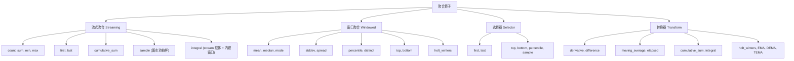

### 2.2 Reducer 接口

```go
// query/functions.gen.go — 聚合器接口
type FloatPointAggregator interface {
    AggregateFloat(p *FloatPoint)
}

type FloatPointEmitter interface {
    Emit() []FloatPoint
}
```

**两种 Reducer 模式**:

| 模式 | 结构 | 适用场景 | 内存 |
|------|------|----------|------|
| **FuncReducer** (流式) | `(prev, curr) -> result` | count, sum, min, max, first, last | O(1) |
| **SliceFuncReducer** (窗口) | `[]points -> result` | stddev, percentile, median, mode | O(N) |

### 2.3 流式聚合 — FloatFuncReducer

```go
// query/functions.gen.go:39 — FloatFuncReducer
type FloatFuncReducer struct {
    prev *FloatPoint
    fn   FloatReduceFunc  // func(prev, curr *FloatPoint) (int64, float64, []interface{})
}

func (r *FloatFuncReducer) AggregateFloat(p *FloatPoint) {
    // 调用具体的 reduce 函数
    t, v, aux := r.fn(r.prev, p)

    // 更新 prev
    if r.prev == nil {
        r.prev = &FloatPoint{}
    }
    r.prev.Time = t
    r.prev.Value = v
    r.prev.Aux = aux

    // 累加 Aggregated 计数
    if p.Aggregated > 1 {
        r.prev.Aggregated += p.Aggregated
    } else {
        r.prev.Aggregated++
    }
}

func (r *FloatFuncReducer) Emit() []FloatPoint {
    return []FloatPoint{*r.prev}
}
```

### 2.4 窗口聚合 — FloatSliceFuncReducer

```go
// query/functions.gen.go:76 — FloatSliceFuncReducer
type FloatSliceFuncReducer struct {
    points []FloatPoint
    fn     FloatReduceSliceFunc  // func(a []FloatPoint) []FloatPoint
}

func (r *FloatSliceFuncReducer) AggregateFloat(p *FloatPoint) {
    // 克隆并追加到缓冲区
    r.points = append(r.points, *p.Clone())
}

func (r *FloatSliceFuncReducer) Emit() []FloatPoint {
    // 在整个窗口的数据上调用 reduce 函数
    return r.fn(r.points)
}
```

### 2.5 所有聚合算子的详细实现

#### COUNT — 计数

> **小白解释**: COUNT 就是数数——数一数有多少个数据点。
> 注意：NULL 值不算！就像数苹果时，空篮子不算一个苹果。
>
> 多 Shard 合并时的巧妙设计：每个 Shard 先各自数一遍（count=3, count=5），
> 然后把结果**相加**（sum=8）。这就是为什么 count 在多 Shard 合并时用 sum。

```go
// query/call_iterator.go:106 — FloatCountReduce
func FloatCountReduce(prev *IntegerPoint, curr *FloatPoint) (int64, int64, []interface{}) {
    if prev == nil {
        return ZeroTime, 1, nil  // 第一个点: count = 1
    }
    return ZeroTime, prev.Value + 1, nil  // 后续: count++
}
```

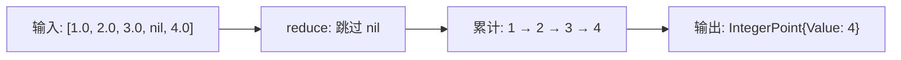

**关键细节**:
- COUNT 计算的是**点数**，不是值
- NULL 值在 `reduce()` 方法中被跳过（`if p.Nil { continue }`）
- COUNT 的结果类型是 Integer，不是 Float
- 多 shard 合并时，每个 shard 的 count 通过 **sum** 汇总

**多 shard COUNT 合并**:

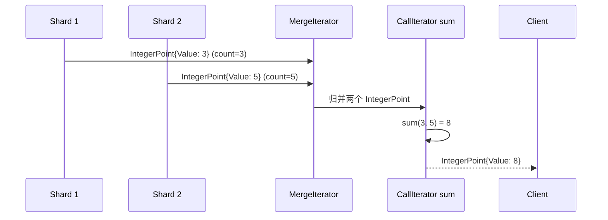

**count(distinct(x))** 走的是另一条路：`select.go:500-513` 先为
`distinct(x)` 构建 `buildExprIterator`，再对它调用 `newCountIterator`。即
distinct 负责去重产点，count 只数这些点；多 shard 合并时仍按 count→sum 汇总。

**为什么 count 改用 sum？** 每个 shard 已经独立执行了 count，得到的是部分计数。最终结果需要将所有部分计数相加，这就是 sum 的语义。代码在 `query/iterator.go:146`：

```go
if call.Name == "count" {
    opt.Expr = &influxql.Call{Name: "sum", Args: call.Args}
}
```

#### SUM — 求和

```go
// query/call_iterator.go:300 — FloatSumReduce
func FloatSumReduce(prev, curr *FloatPoint) (int64, float64, []interface{}) {
    if prev == nil {
        return ZeroTime, curr.Value, nil  // 第一个点: sum = value
    }
    return prev.Time, prev.Value + curr.Value, nil  // 后续: sum += value
}
```

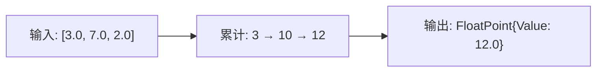

#### MIN / MAX — 最小值 / 最大值

```go
// query/call_iterator.go:178 — FloatMinReduce
func FloatMinReduce(prev, curr *FloatPoint) (int64, float64, []interface{}) {
    if prev == nil || curr.Value < prev.Value ||
       (curr.Value == prev.Value && curr.Time < prev.Time) {
        return curr.Time, curr.Value, cloneAux(curr.Aux)
    }
    return prev.Time, prev.Value, prev.Aux
}

// query/call_iterator.go:242 — FloatMaxReduce
func FloatMaxReduce(prev, curr *FloatPoint) (int64, float64, []interface{}) {
    if prev == nil || curr.Value > prev.Value ||
       (curr.Value == prev.Value && curr.Time < prev.Time) {
        return curr.Time, curr.Value, cloneAux(curr.Aux)
    }
    return prev.Time, prev.Value, prev.Aux
}
```

**相同值时的平局处理**: 选择**时间戳更早**的点。这意味着 min/max 是确定性的——相同的输入总是产生相同的输出。

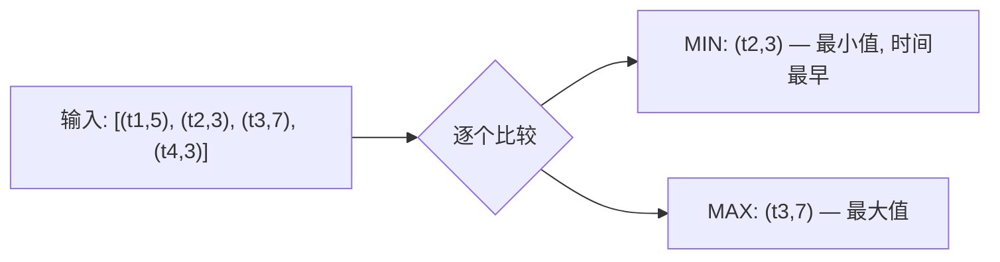

#### FIRST / LAST — 最早 / 最晚

```go
// query/call_iterator.go:362 — FloatFirstReduce
func FloatFirstReduce(prev, curr *FloatPoint) (int64, float64, []interface{}) {
    if prev == nil || curr.Time < prev.Time ||
       (curr.Time == prev.Time && curr.Value > prev.Value) {
        return curr.Time, curr.Value, cloneAux(curr.Aux)
    }
    return prev.Time, prev.Value, prev.Aux
}

// query/call_iterator.go:440 — FloatLastReduce
func FloatLastReduce(prev, curr *FloatPoint) (int64, float64, []interface{}) {
    if prev == nil || curr.Time > prev.Time ||
       (curr.Time == prev.Time && curr.Value > prev.Value) {
        return curr.Time, curr.Value, cloneAux(curr.Aux)
    }
    return prev.Time, prev.Value, prev.Aux
}
```

**FIRST**: 选择时间戳最小的点。相同时间戳时选择值更大的。
**LAST**: 选择时间戳最大的点。相同时间戳时选择值更大的。

**FIRST/LAST 是选择器 (Selector)**: 它们返回的是原始点的时间和值，而不是计算结果。这意味着 `SELECT first(value) FROM cpu GROUP BY time(1m)` 返回的是每个窗口中最早的那个实际数据点。

#### MEAN — 均值

> **小白解释**: MEAN 就是算平均值——把所有数加起来，除以个数。
> 但多 Shard 合并时有个巧妙设计：每个 Shard 先算出自己的均值，但同时记录"我算了几个数"（Aggregated 字段）。
> 合并时，用 `均值 × 个数` 还原出总和，再把所有 Shard 的总和相加，除以总个数。
> 就像两个班的平均分：一班平均 80 分 30 人，二班平均 90 分 20 人，总平均 = (80×30 + 90×20) / 50 = 84。

```go
// query/functions.go:104 — FloatMeanReducer
type FloatMeanReducer struct {
    sum   float64
    count uint32
}

func (r *FloatMeanReducer) AggregateFloat(p *FloatPoint) {
    if p.Aggregated >= 2 {
        // 已经是聚合结果 (来自其他 shard 的 count)
        r.sum += p.Value * float64(p.Aggregated)
        r.count += p.Aggregated
    } else {
        r.sum += p.Value
        r.count++
    }
}

func (r *FloatMeanReducer) Emit() []FloatPoint {
    return []FloatPoint{{
        Time:       ZeroTime,  // 由 IntervalIterator 替换为窗口起点
        Value:      r.sum / float64(r.count),
        Aggregated: r.count,
    }}
}
```

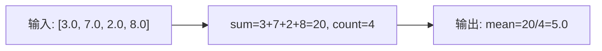

**Aggregated 字段的作用**: 当多个 shard 合并时，每个 shard 的 mean 已经被转换为 sum (通过 `p.Value * p.Aggregated`)。合并层的 mean reducer 可以正确地加权计算总均值。

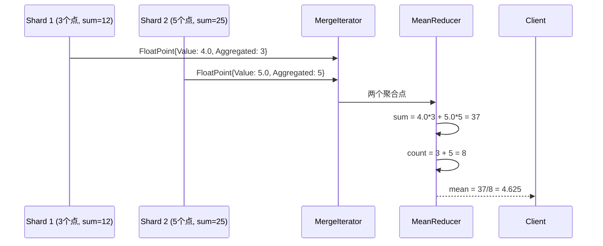

#### MEDIAN — 中位数

`newMedianIterator`（`call_iterator.go:549-575`）用 `SliceFuncReducer`：
对窗口内所有点按值排序；奇数个取正中间，偶数个取中间两个的均值
（`FloatMedianReduceSlice`）。它需要缓冲整个窗口（O(N) 内存），并把结果时间设为
`ZeroTime`（由 reduce 回填窗口起点）。

#### MODE — 众数

`newModeIterator`（`call_iterator.go:629-655`）同样用 `SliceFuncReducer`：
统计窗口内出现次数最多的值；**并列时取最小的值**（源码按值排序后扫描，先出现的
最小值获胜）。结果时间同样是 `ZeroTime`，支持 float/integer/unsigned/string/boolean
五种类型。

#### STDDEV — 标准差

```go
// query/call_iterator.go:853 — FloatStddevReduceSlice
func FloatStddevReduceSlice(a []FloatPoint) []FloatPoint {
    if len(a) < 2 {
        return []FloatPoint{{Time: ZeroTime, Value: math.NaN()}}
    }

    // 第一遍: 计算均值 (Welford 在线算法)
    var mean float64
    var count int
    for _, p := range a {
        if math.IsNaN(p.Value) { continue }
        count++
        mean += (p.Value - mean) / float64(count)
    }

    // 第二遍: 计算方差
    var variance float64
    for _, p := range a {
        if math.IsNaN(p.Value) { continue }
        variance += math.Pow(p.Value-mean, 2)
    }

    // 返回样本标准差 (Bessel 修正)
    return []FloatPoint{{
        Time:  ZeroTime,
        Value: math.Sqrt(variance / float64(count-1)),
    }}
}
```

**STDDEV 是窗口聚合**: 需要缓冲整个窗口的所有点（O(N) 内存），使用两遍算法。返回**样本标准差**（除以 N-1），不是总体标准差（除以 N）。

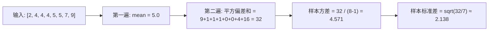

#### PERCENTILE — 百分位数

```go
// query/call_iterator.go:1054 — NewFloatPercentileReduceSliceFunc
func NewFloatPercentileReduceSliceFunc(percentile float64) FloatReduceSliceFunc {
    return func(a []FloatPoint) []FloatPoint {
        length := len(a)
        // 最近排名法 (Nearest-Rank Method)
        i := int(math.Floor(float64(length)*percentile/100.0+0.5)) - 1
        if i < 0 || i >= length {
            return nil
        }
        // 按值排序
        sort.Sort(floatPointsByValue(a))
        // 返回排名第 i 的点
        return []FloatPoint{{
            Time:  a[i].Time,
            Value: a[i].Value,
            Aux:   cloneAux(a[i].Aux),
        }}
    }
}
```

**PERCENTILE 算法**: 最近排名法。对窗口内所有点按值排序，然后取第 `floor(N * percentile/100 + 0.5)` 个点。

**示例**: `percentile(value, 95)` 在 100 个点的窗口中，取第 `floor(100*95/100+0.5) - 1 = 94` 个点（0-indexed）。

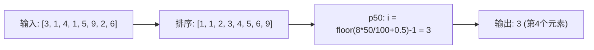

#### SPREAD — 极差

```go
// query/functions.go:196 — FloatSpreadReducer
type FloatSpreadReducer struct {
    min, max float64
    count    uint32
}

func (r *FloatSpreadReducer) AggregateFloat(p *FloatPoint) {
    r.min = math.Min(r.min, p.Value)
    r.max = math.Max(r.max, p.Value)
    r.count++
}

func (r *FloatSpreadReducer) Emit() []FloatPoint {
    return []FloatPoint{{
        Time:       ZeroTime,
        Value:      r.max - r.min,
        Aggregated: r.count,
    }}
}
```

初始化: `min = math.Inf(1)` (+Inf), `max = math.Inf(-1)` (-Inf)。结果 = max - min。

#### DISTINCT — 去重

```go
// query/functions.gen.go:412 — FloatDistinctReducer
type FloatDistinctReducer struct {
    m map[float64]FloatPoint  // 用 map 去重
}

func (r *FloatDistinctReducer) AggregateFloat(p *FloatPoint) {
    if _, ok := r.m[p.Value]; !ok {
        r.m[p.Value] = *p  // 只保留第一次出现的
    }
}

func (r *FloatDistinctReducer) Emit() []FloatPoint {
    points := make([]FloatPoint, 0, len(r.m))
    for _, p := range r.m {
        points = append(points, FloatPoint{Time: p.Time, Value: p.Value})
    }
    sort.Sort(floatPoints(points))  // 按时间排序
    return points
}
```

**DISTINCT 返回多个点**: 与其他聚合不同，DISTINCT 在一个窗口内可能返回多个点（每个唯一值一个）。

#### TOP / BOTTOM — 前 N / 后 N

```go
// query/functions.go:1884 — FloatTopReducer
type FloatTopReducer struct {
    h *floatPointsByFunc  // 最小堆
}

func NewFloatTopReducer(n int) *FloatTopReducer {
    return &FloatTopReducer{
        h: floatPointsSortBy(make([]FloatPoint, 0, n), func(a, b *FloatPoint) bool {
            if a.Value != b.Value {
                return a.Value < b.Value  // 堆顶是最小值
            }
            return a.Time > b.Time  // 相同值时时间晚的在堆顶
        }),
    }
}

func (r *FloatTopReducer) AggregateFloat(p *FloatPoint) {
    if r.h.Len() == cap(r.h.points) {
        // 堆已满: 如果新点比堆顶大，替换堆顶
        if !r.h.cmp(&r.h.points[0], p) {
            return
        }
        p.CopyTo(&r.h.points[0])
        heap.Fix(r.h, 0)  // 重新调整堆
        return
    }
    // 堆未满: 直接加入
    var clone FloatPoint
    p.CopyTo(&clone)
    heap.Push(r.h, clone)
}

func (r *FloatTopReducer) Emit() []FloatPoint {
    points := make([]FloatPoint, len(r.h.points))
    // 重置每个点的 Aggregated 计数 (top/bottom 不是聚合结果)
    for i, p := range r.h.points {
        p.Aggregated = 0
        points[i] = p
    }
    // 按值降序排列
    sort.Sort(sort.Reverse(&floatPointsByFunc{points: points, cmp: r.h.cmp}))
    return points
}
```

**TOP 使用最小堆**: 维护一个大小为 N 的最小堆。堆顶是当前 Top N 中的最小值。当新点比堆顶大时，替换堆顶并重新调整。时间复杂度 O(M log N)，其中 M 是总点数。

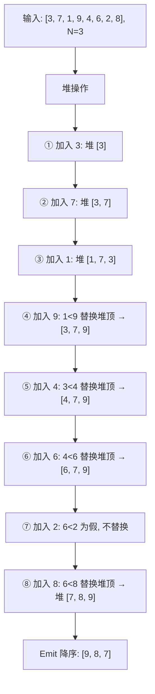

#### SAMPLE — 蓄水池抽样

```go
// query/functions.gen.go:472 — FloatSampleReducer
type FloatSampleReducer struct {
    count  int
    rng    *rand.Rand
    points floatPoints  // 蓄水池
}

func (r *FloatSampleReducer) AggregateFloat(p *FloatPoint) {
    r.count++
    if r.count-1 < len(r.points) {
        // 蓄水池未满: 直接填入
        p.CopyTo(&r.points[r.count-1])
        return
    }
    // 蓄水池已满: 以 size/count 的概率替换
    rnd := r.rng.Intn(r.count)
    if rnd < len(r.points) {
        p.CopyTo(&r.points[rnd])
    }
}
```

**蓄水池抽样算法 (Reservoir Sampling)**: 保证每个点被选中的概率相等，均为 `size/count`。对于流式数据，这是最优的随机抽样算法。

#### DERIVATIVE — 导数

```go
// query/functions.go:283 — FloatDerivativeReducer
type FloatDerivativeReducer struct {
    interval      Interval
    prev          FloatPoint
    curr          FloatPoint
    isNonNegative bool
    ascending     bool
}

// NewFloatDerivativeReducer 构造函数: 接受 interval, isNonNegative, ascending 三个参数
// prev 和 curr 初始化为 Nil: true，表示尚未收到任何点
func NewFloatDerivativeReducer(interval Interval, isNonNegative, ascending bool) *FloatDerivativeReducer {
    return &FloatDerivativeReducer{
        interval:      interval,
        isNonNegative: isNonNegative,
        ascending:     ascending,
        prev:          FloatPoint{Nil: true},
        curr:          FloatPoint{Nil: true},
    }
}

func (r *FloatDerivativeReducer) AggregateFloat(p *FloatPoint) {
    // 跳过相同时间戳的点
    if !r.curr.Nil && r.curr.Time == p.Time {
        return
    }
    r.prev = r.curr
    r.curr = *p
}

func (r *FloatDerivativeReducer) Emit() []FloatPoint {
    if r.prev.Nil {
        return nil  // 第一个点: 无导数
    }

    diff := r.curr.Value - r.prev.Value
    elapsed := r.curr.Time - r.prev.Time
    if !r.ascending {
        elapsed = -elapsed  // 降序查询时取反
    }

    // 归一化到指定间隔
    value := diff / (float64(elapsed) / float64(r.interval.Duration))

    r.prev.Nil = true  // 重置

    // 非负导数: 丢弃负值
    if r.isNonNegative && diff < 0 {
        return nil
    }

    return []FloatPoint{{Time: r.curr.Time, Value: value}}
}
```

**DERIVATIVE 公式**: `(curr.Value - prev.Value) / ((curr.Time - prev.Time) / interval)`

**示例**: `DERIVATIVE(value, 1s)` 计算每秒的变化率。如果两个点间隔 10 秒，值差 50，则导数为 50 / (10s / 1s) = 5.0/s。

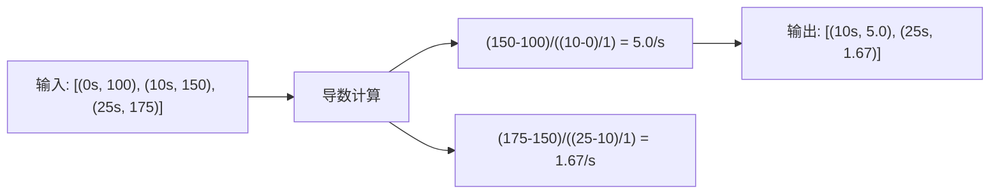

#### DIFFERENCE — 差分

```go
// query/functions.go:460 — FloatDifferenceReducer
type FloatDifferenceReducer struct {
    isNonNegative bool
    prev          FloatPoint
    curr          FloatPoint
}

func (r *FloatDifferenceReducer) Emit() []FloatPoint {
    if r.prev.Nil {
        return nil
    }
    value := r.curr.Value - r.prev.Value
    if r.isNonNegative && value < 0 {
        return nil  // 非负差分: 丢弃负值
    }
    r.prev.Nil = true
    return []FloatPoint{{Time: r.curr.Time, Value: value}}
}
```

**DIFFERENCE**: 简单的 `curr - prev`，不归一化到时间间隔。

#### MOVING_AVERAGE — 移动平均

```go
// query/functions.go:609 — FloatMovingAverageReducer
type FloatMovingAverageReducer struct {
    pos  int       // 环形缓冲区当前位置
    sum  float64   // 当前窗口的和
    time int64     // 最后一个点的时间
    buf  []float64 // 环形缓冲区
}

func (r *FloatMovingAverageReducer) AggregateFloat(p *FloatPoint) {
    if len(r.buf) != cap(r.buf) {
        // 缓冲区未满: 追加
        r.buf = append(r.buf, p.Value)
    } else {
        // 缓冲区已满: 替换最旧的值
        r.sum -= r.buf[r.pos]
        r.buf[r.pos] = p.Value
    }
    r.sum += p.Value
    r.time = p.Time
    r.pos++
    if r.pos >= cap(r.buf) {
        r.pos = 0  // 环形
    }
}

func (r *FloatMovingAverageReducer) Emit() []FloatPoint {
    // 缓冲区未满时不输出 (需要前 N 个点预热)
    if len(r.buf) != cap(r.buf) {
        return []FloatPoint{}  // 空切片 (不是 nil!)
    }
    return []FloatPoint{{
        Value:      r.sum / float64(len(r.buf)),
        Time:       r.time,
        Aggregated: uint32(len(r.buf)),
    }}
}
```

**MOVING_AVERAGE 使用环形缓冲区**: 固定大小 N 的环形缓冲区，O(1) 更新。前 N-1 个点不输出（预热期）。

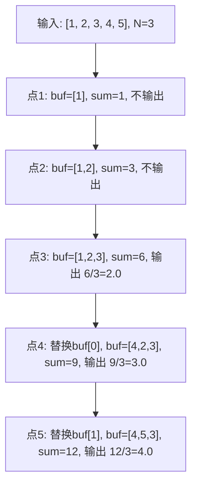

#### CUMULATIVE_SUM — 累积和

```go
// query/functions.go:1136 — FloatCumulativeSumReducer
type FloatCumulativeSumReducer struct {
    curr FloatPoint
}

func (r *FloatCumulativeSumReducer) AggregateFloat(p *FloatPoint) {
    r.curr.Value += p.Value
    r.curr.Time = p.Time
    r.curr.Nil = false
}

func (r *FloatCumulativeSumReducer) Emit() []FloatPoint {
    if !r.curr.Nil {
        return []FloatPoint{r.curr}
    }
    return nil
}
```

**CUMULATIVE_SUM**: 每个点都输出，值是到当前为止所有点的和。

#### ELAPSED — 时间间隔

```go
// query/functions.gen.go:439 — FloatElapsedReducer
type FloatElapsedReducer struct {
    unitConversion int64
    prev           FloatPoint
    curr           FloatPoint
}

func (r *FloatElapsedReducer) Emit() []IntegerPoint {
    if !r.prev.Nil {
        elapsed := (r.curr.Time - r.prev.Time) / r.unitConversion
        return []IntegerPoint{{Time: r.curr.Time, Value: elapsed}}
    }
    return nil
}
```

**ELAPSED**: 返回相邻两点的时间差（除以单位转换因子）。结果类型是 Integer。

#### HOLT_WINTERS — Holt-Winters 预测

```go
// query/functions.go:1217 — FloatHoltWintersReducer
type FloatHoltWintersReducer struct {
    m              int       // 季节周期
    seasonal       bool      // 是否季节性
    h              int       // 预测步数
    interval       int64     // 时间间隔
    halfInterval   int64     // 半间隔 (用于边界插值)
    includeFitData bool      // 是否包含拟合数据
    optim          *neldermead.Optimizer  // Nelder-Mead 优化器
    epsilon        float64   // 收敛阈值
    y              []float64 // 输入数据
    points         []FloatPoint
}
```

**HOLT_WINTERS 算法**:
1. 收集所有输入点到 `r.y` 数组
2. 在 `Emit()` 时，使用 Nelder-Mead 优化器搜索最优的 alpha, beta, gamma, phi 参数
3. 使用最优参数进行 h 步预测
4. 如果 `includeFitData`，也输出拟合值

#### EMA / DEMA / TEMA — 指数移动平均

```go
// query/functions.go:749 — ExponentialMovingAverageReducer
type ExponentialMovingAverageReducer struct {
    ema        gota.EMA  // EMA 计算器
    holdPeriod uint32    // 预热期
    count      uint32
    v          float64
    t          int64
}

func (r *ExponentialMovingAverageReducer) aggregate(v float64) {
    r.v = r.ema.Add(v)
    r.count++
}

func (r *ExponentialMovingAverageReducer) Emit() []FloatPoint {
    if r.count <= r.holdPeriod {
        return nil  // 预热期不输出
    }
    return []FloatPoint{{Value: r.v, Time: r.t, Aggregated: r.count}}
}
```

**DEMA (双重 EMA)**: `DEMA = 2 * EMA(x) - EMA(EMA(x))`
**TEMA (三重 EMA)**: `TEMA = 3*EMA(x) - 3*EMA(EMA(x)) + EMA(EMA(EMA(x)))`

#### 其他技术指标函数

| 函数 | 说明 | 构造函数 |
|------|------|----------|
| `relative_strength_index` | RSI 相对强弱指标 | `newRelativeStrengthIndexIterator()` |
| `triple_exponential_derivative` | TRIX 三重指数导数 | `newTripleExponentialDerivativeIterator()` |
| `kaufmans_efficiency_ratio` | KER 考夫曼效率比 | `newKaufmansEfficiencyRatioIterator()` |
| `kaufmans_adaptive_moving_average` | KAMA 考夫曼自适应均线 | `newKaufmansAdaptiveMovingAverageIterator()` |
| `chande_momentum_oscillator` | CMO 钱德动量振荡器 | `newChandeMomentumOscillatorIterator()` |
| `mode` | 众数 (出现频率最高的值) | `NewModeIterator()` |

这些函数都在 `buildCallIterator` 的外层 switch 中处理，使用 `gota` 库进行技术指标计算。

#### INTEGRAL — 积分

```go
// query/functions.go:1563 — FloatIntegralReducer
type FloatIntegralReducer struct {
    interval Interval        // 时间间隔
    sum      float64         // 累积积分值
    prev     FloatPoint      // 上一个点 (Nil: true 初始状态)
    window   struct {
        start int64
        end   int64
    }
    ch  chan FloatPoint       // 用于 Emit 的通道
    opt IteratorOptions
}

func NewFloatIntegralReducer(interval Interval, opt IteratorOptions) *FloatIntegralReducer {
    return &FloatIntegralReducer{
        interval: interval,
        prev:     FloatPoint{Nil: true},
        ch:       make(chan FloatPoint, 1),
        opt:      opt,
    }
}

// 注意: FloatIntegralReducer 使用通道 (ch) 进行 Emit，
// 因为积分可能产生多个输出点 (每个窗口一个)。
```

**积分算法**: 梯形法则 (Trapezoidal Rule)，并按 `interval.Duration` 归一化。
对于相邻两点 (t1, v1) 和 (t2, v2)：

```
elapsed = (t2 - t1) / interval.Duration
sum    += 0.5 * (v1 + v2) * elapsed
```

`interval` 来自 `IteratorOptions.IntegralInterval()`（`iterator.go:915-922`）：
优先取 `integral(value, <duration>)` 的第二参数，否则固定为 **1s**
（注意它不继承 `GROUP BY time()` 的 interval）。`FloatIntegralReducer` 是
**stream 载体**（`call_iterator.go:1512-1519` 的 `newFloatStreamFloatIterator`），
内部自行按 `opt.Window` 切窗，并在 `Close()`（`functions.go:1655-1663`）刷出最后
一个窗口。

#### 默认 interval 与 warmup 扩展量

部分函数在用户没给 interval 时有默认值，编译期还会据此扩展读取范围：

| 函数 | interval 来源 | 默认值 | 额外读取（ExtraIntervals） |
|---|---|---|---|
| `derivative` / `non_negative_derivative` | 第 2 参数 → `GROUP BY` interval → 1s | 1s | 1 个窗口（`compile.go:472`） |
| `elapsed` | 第 2 参数 | 1ns（`iterator.go:906-912`） | 1 个窗口（`compile.go:508`） |
| `difference` / `non_negative_difference` | `GROUP BY` interval | — | 1 个窗口（`compile.go:537`） |
| `cumulative_sum` | `GROUP BY` interval | — | 1 个窗口（`compile.go:556-563`） |
| `moving_average` | 第 2 参数（窗口大小 N） | — | N 个窗口（`compile.go:592`） |
| `integral` | 第 2 参数 | 1s（`iterator.go:915-922`） | — |
| EMA/DEMA/TEMA/RSI | 第 2 参数（warmup N） | — | N 个窗口（`compile.go:651`） |
| `chande_momentum_oscillator` | 第 2 参数 | — | N 个窗口（`compile.go:735`） |

`ExtraIntervals` 只影响**映射到 shard 的时间范围**（`Prepare` 里把
`StartTime -= ExtraIntervals*Interval`，降序时 `EndTime += ...`），不会多输出点；
这样第一个输出窗口也能拿到前值（见 §1.2 步骤 3b）。

### 2.6 Reduce Iterator — 窗口聚合的核心

```go
// query/iterator.gen.go:998 — floatReduceFloatIterator
type floatReduceFloatIterator struct {
    input    *bufFloatIterator
    create   func() (FloatPointAggregator, FloatPointEmitter)
    dims     []string
    opt      IteratorOptions
    points   []FloatPoint
    keepTags bool
}
```

**reduce() 方法 — 窗口聚合的核心逻辑**（`iterator.gen.go:1047-1160`）:

```go
// query/iterator.gen.go:1049 — floatReduceFloatIterator.reduce
func (itr *floatReduceFloatIterator) reduce() ([]FloatPoint, error) {
    // 1. 用 Next()+unread() 取第一个非 Nil 点并确定窗口
    //    不能先 peek() 再 NextInWindow(): buf 只有一个槽, 连续 unread 会丢点
    var (
        startTime, endTime int64
        window             struct {
            name string
            tags string   // 注意是 string, 来自 Tags.Subset(...).ID()
        }
    )
    for {
        p, err := itr.input.Next()
        if err != nil || p == nil {
            return nil, err
        } else if p.Nil {
            continue
        }
        itr.input.unread(p)
        startTime, endTime = itr.opt.Window(p.Time)
        window.name, window.tags = p.Name, p.Tags.Subset(itr.opt.Dimensions).ID()
        break
    }

    // 2. 逐点聚合; 每个 name/tag 组合一个 Aggregator
    m := make(map[string]*floatReduceFloatPoint)
    for {
        curr, err := itr.input.NextInWindow(startTime, endTime)
        if err != nil {
            return nil, err
        } else if curr == nil {
            break
        } else if curr.Nil {
            continue
        } else if curr.Name != window.name {
            itr.input.unread(curr)   // 跨 series 必须先 unread 再 break
            break
        }
        if tags := curr.Tags.Subset(itr.opt.Dimensions); tags.ID() != window.tags {
            itr.input.unread(curr)   // 同一窗口内跨 tags 同样要回退
            break
        }

        tags := curr.Tags.Subset(itr.dims) // 分组维度可能比桶维度更细
        id := tags.ID()
        rp := m[id]
        if rp == nil {
            aggregator, emitter := itr.create()
            rp = &floatReduceFloatPoint{
                Name:       curr.Name,
                Tags:       tags,
                Aggregator: aggregator,
                Emitter:    emitter,
            }
            m[id] = rp
        }
        rp.Aggregator.AggregateFloat(curr)
    }

    // 3. 先按 key 排序, 保证多 series 输出顺序稳定
    keys := make([]string, 0, len(m))
    for k := range m {
        keys = append(keys, k)
    }
    if len(keys) > 0 {
        var sorted sort.Interface = sort.StringSlice(keys)
        if itr.opt.Ascending {
            sorted = sort.Reverse(sorted)
        }
        sort.Sort(sorted)
    }

    // 4. 逐个 Emit; 只有 emitter 返回非 ZeroTime 时才可能乱序
    sortedByTime := true
    a := make([]FloatPoint, 0, len(m))
    for _, k := range keys {
        rp := m[k]
        points := rp.Emitter.Emit()
        for i := len(points) - 1; i >= 0; i-- {
            points[i].Name = rp.Name
            if !itr.keepTags {          // keepTags=true 时保留原标签(子查询路径)
                points[i].Tags = rp.Tags
            }
            if points[i].Time == ZeroTime {
                points[i].Time = startTime
            } else {
                sortedByTime = false
            }
            a = append(a, points[i])
        }
    }

    // 5. 仅当可能乱序且要求有序时才做稳定排序
    if !sortedByTime && itr.opt.Ordered {
        var sorted sort.Interface = floatPointsByTime(a)
        if itr.opt.Ascending {
            sorted = sort.Reverse(sorted)
        }
        sort.Stable(sorted)
    }
    return a, nil
}
```

> **易错点**:
> - `window.tags` 是 `string`，赋值来自 `Tags.Subset(...).ID()`；不是 `Tags` 对象，
>   所以比较时直接 `!= window.tags`。
> - 跨 series 或跨 tags 时**必须 `unread(curr)` 再 `break`**，否则当前窗口的边界点
>   被永久吞掉，下一个窗口会少一个数据点。
> - 首点用的是 `Next()` + `unread()`，不是 `peek()`：`bufFloatIterator` 只有一个
>   `buf` 槽，`peek()` 内部就是 `Next()+unread`；如果再对另一个点 `unread`，前一个
>   缓冲点会被覆盖（`iterator.gen.go:56-125`）。`reduce` 里最多只缓存一个点，正是
>   因为这个单槽契约。
> - `keepTags` 控制是否覆写 `Tags`：子查询路径需要保留原始标签，普通聚合才裁剪为
>   `dims` 子集。
> - 输出顺序先按 key 排序（升序时 `sort.Reverse`，因为随后是逆序弹出），只有
>   emitter 产出非 `ZeroTime` 且 `opt.Ordered` 时才 `sort.Stable` 按时间稳定排序。

> **小白解释**: reduce() 就像一个"分组计票站"。
> 数据流进来后，先按时间窗口分组（每分钟一组），再按 series 分组（每个 host 一组）。
> 每组有一个计票员（Aggregator），负责统计这组的数据。
> 窗口结束后，计票员交出结果（Emit），所有结果合并排序后输出。

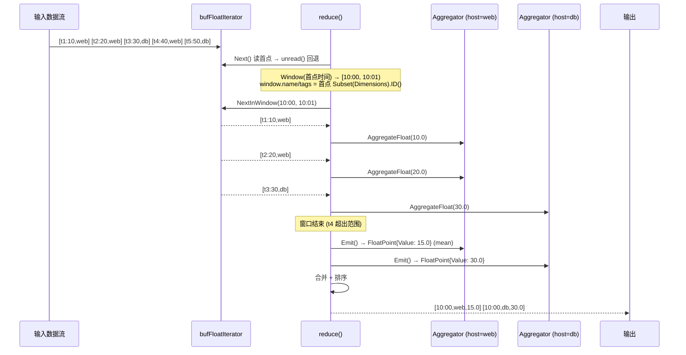

**NextInWindow — 窗口边界检测**:

```go
// query/iterator.gen.go:96 — bufFloatIterator.NextInWindow
func (itr *bufFloatIterator) NextInWindow(startTime, endTime int64) (*FloatPoint, error) {
    v, err := itr.Next()
    if v == nil || err != nil {
        return nil, err
    }
    // 如果点超出窗口范围，unread 并返回 nil
    if t := v.Time; t >= endTime || t < startTime {
        itr.unread(v)
        return nil, nil
    }
    return v, nil
}
```

### 2.7 Stream Iterator — 流式聚合

```go
// query/iterator.gen.go:1166 — floatStreamFloatIterator
type floatStreamFloatIterator struct {
    input    *bufFloatIterator
    create   func() (FloatPointAggregator, FloatPointEmitter)
    dims     []string
    opt      IteratorOptions
    m        map[string]*floatReduceFloatPoint
    points   []FloatPoint
}
```

**流式迭代器 vs 窗口迭代器**:

| 特性 | 窗口迭代器 (Reduce) | 流式迭代器 (Stream) |
|------|---------------------|---------------------|
| 分组 | 按时间窗口 | 不分组 |
| Aggregate 调用 | 窗口内所有点 | 每个点 |
| Emit 时机 | 窗口结束时 | 每次 Aggregate 后 |
| 适用 | count, mean, stddev | derivative, difference, moving_average |

## 3. LIMIT / OFFSET / SLIMIT / SOFFSET

### 3.1 LIMIT / OFFSET — 点级限制

```go
// query/iterator.gen.go:651 — floatLimitIterator
type floatLimitIterator struct {
    input FloatIterator
    opt   IteratorOptions
    n     int  // 当前 series 的点计数

    prev struct {
        name string
        tags Tags
    }
}

func (itr *floatLimitIterator) Next() (*FloatPoint, error) {
    for {
        p, err := itr.input.Next()
        if p == nil || err != nil {
            return nil, err
        }

        // 新 series: 重置计数器
        if p.Name != itr.prev.name || !p.Tags.Equals(&itr.prev.tags) {
            itr.prev.name = p.Name
            itr.prev.tags = p.Tags
            itr.n = 0
        }

        itr.n++

        // 跳过 offset 之前的点
        if itr.n <= itr.opt.Offset {
            continue
        }

        // 超过 limit 后跳过
        if itr.opt.Limit > 0 && (itr.n - itr.opt.Offset) > itr.opt.Limit {
            continue
        }

        return p, nil
    }
}
```

**关键: LIMIT/OFFSET 是 per-series 的**，不是全局的。每个 series 独立计数。

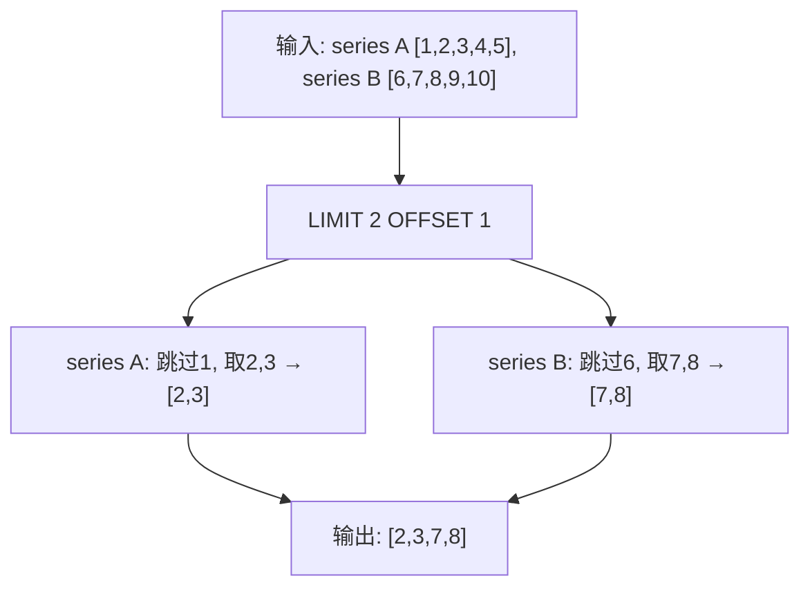

**示例**: `SELECT value FROM cpu LIMIT 2 OFFSET 1`

| 输入点 | series | n | n <= Offset? | n-Offset > Limit? | 输出? |
|--------|--------|---|-------------|-------------------|-------|
| (t1, 1) | A | 1 | 1 <= 1: 是 | - | 跳过 |
| (t2, 2) | A | 2 | 2 <= 1: 否 | 2-1=1 > 2: 否 | 输出 |
| (t3, 3) | A | 3 | 3 <= 1: 否 | 3-1=2 > 2: 否 | 输出 |
| (t4, 4) | A | 4 | 4 <= 1: 否 | 4-1=3 > 2: 是 | 跳过 |
| (t5, 5) | A | 5 | 5 <= 1: 否 | 5-1=4 > 2: 是 | 跳过 |
| (t6, 6) | B | 1 | 1 <= 1: 是 | - | 跳过 |
| (t7, 7) | B | 2 | 2 <= 1: 否 | 2-1=1 > 2: 否 | 输出 |
| (t8, 8) | B | 3 | 3 <= 1: 否 | 3-1=2 > 2: 否 | 输出 |

### 3.2 SLIMIT / SOFFSET — Series 级限制

```go
// query/result.go:48 — LimitTagSets
func LimitTagSets(a []*TagSet, slimit, soffset int) []*TagSet {
    if slimit == 0 && soffset == 0 {
        return a  // 无限制
    }
    if soffset > len(a) {
        return nil  // offset 超出范围
    }
    if soffset+slimit > len(a) {
        slimit = len(a) - soffset  // clamp
    }
    return a[soffset : soffset+slimit]
}
```

**SLIMIT/SOFFSET 在存储层应用**: 在 TSM 引擎创建迭代器之前，通过 `LimitTagSets` 过滤整个 TagSet 组。

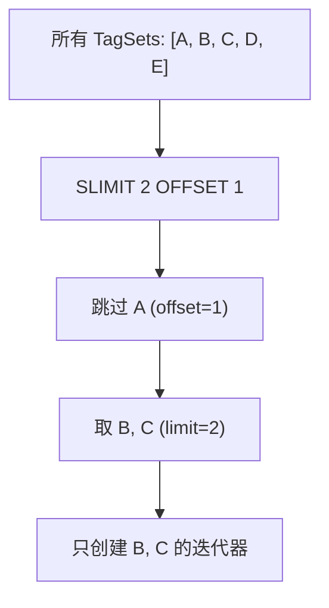

**SLIMIT vs LIMIT 的区别**:

| 维度 | LIMIT | SLIMIT |
|------|-------|--------|
| 限制对象 | 每个 series 的点数 | series 的数量 |
| 应用位置 | Iterator 链中 | 存储引擎层 |
| 计数单位 | 点 | TagSet 组 |
| 重置条件 | 切换 series 时 | 无 |

### 3.3 LIMIT 在聚合查询中的行为

**关键**: 聚合查询中的 LIMIT/OFFSET 会被**剥离**：

```go
// query/select.go:214 — buildCallIterator
func (b *exprIteratorBuilder) buildCallIterator(ctx context.Context, expr *influxql.Call, opt IteratorOptions) (Iterator, error) {
    opt := b.opt
    // 剥离 LIMIT/OFFSET (由外层处理)
    opt.Limit, opt.Offset = 0, 0
    ...
}
```

这意味着 `SELECT mean(value) FROM cpu GROUP BY time(1m) LIMIT 10` 中，LIMIT 10 应用于聚合结果，而不是原始数据。

## 4. Merge Iterator — 多 Iterator 归并

### 4.1 MergeIterator vs SortedMergeIterator

```go
// query/iterator.go:122 — Iterators.Merge
func (a Iterators) Merge(opt IteratorOptions) (Iterator, error) {
    call, ok := opt.Expr.(*influxql.Call)

    if !ok && opt.MergeSorted() {
        // 有序归并: 用于非聚合查询
        itr := NewSortedMergeIterator(a, opt)
        if itr != nil && opt.InterruptCh != nil {
            itr = NewInterruptIterator(itr, opt.InterruptCh)
        }
        return itr, nil
    }

    // 窗口归并: 用于聚合查询
    itr := NewMergeIterator(a, opt)
    if itr == nil {
        return nil, nil
    }

    // InterruptCh 包装: 当查询超时或用户取消时中断迭代
    if opt.InterruptCh != nil {
        itr = NewInterruptIterator(itr, opt.InterruptCh)
    }

    // 非 call 表达式: 不需要 CallIterator 包装
    if !ok {
        return itr, nil
    }

    // count 特殊处理: 多 shard 的 count 用 sum 合并
    if call.Name == "count" {
        opt.Expr = &influxql.Call{Name: "sum", Args: call.Args}
    }
    return NewCallIterator(itr, opt)
}
```

**注意**: 实际代码中 `Iterators.Merge()` 还包含以下省略路径：
- **InterruptCh 处理**: 当 `opt.InterruptCh != nil` 时，用 `NewInterruptIterator` 包装，支持查询超时和用户取消
- **Nil 检查**: `NewMergeIterator` 返回 nil 时直接返回 `nil, nil`
- **非 call 表达式提前返回**: 当 `!ok`（非聚合表达式）时，直接返回未包装的 merge iterator

| 特性 | MergeIterator | SortedMergeIterator |
|------|---------------|---------------------|
| 用途 | 聚合查询 | 非聚合查询 (raw) |
| 分组 | 按时间窗口 | 按原始时间 |
| 输出 | 同一窗口的点连续输出 | 全局有序输出 |
| 堆排序 | name > tags > time_window | name > tags > time > aux |

### 4.2 MergeIterator 的堆实现

```go
// query/iterator.gen.go:261 — floatMergeHeap
type floatMergeHeap struct {
    items []*floatMergeHeapItem
    opt   IteratorOptions
}

func (h *floatMergeHeap) Less(i, j int) bool {
    x, _ := h.items[i].itr.peek()
    y, _ := h.items[j].itr.peek()

    if h.opt.Ascending {
        if x.Name != y.Name { return x.Name < y.Name }
        xTags := x.Tags.Subset(h.opt.Dimensions)
        yTags := y.Tags.Subset(h.opt.Dimensions)
        if xTags.ID() != yTags.ID() { return xTags.ID() < yTags.ID() }
        xWindow, _ := h.opt.Window(x.Time)
        yWindow, _ := h.opt.Window(y.Time)
        return xWindow < yWindow
    } else {
        // 降序: 反转比较
        if x.Name != y.Name { return x.Name > y.Name }
        ...
        return xWindow > yWindow
    }
}
```

### 4.3 MergeIterator.Next — 窗口归并逻辑

`floatMergeIterator` 不是"每点 Pop/Push"：它维护一个 **当前 iterator**（`itr.curr`），
只要当前 iterator 还在同一窗口就持续从它取点；只有越窗时才 `unread` + `Push` 回去。

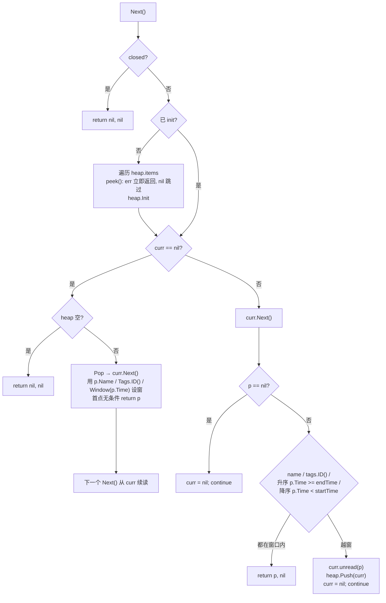

```go
// query/iterator.gen.go:177-257 — floatMergeIterator.Next
func (itr *floatMergeIterator) Next() (*FloatPoint, error) {
    itr.mu.RLock()
    defer itr.mu.RUnlock()
    if itr.closed {
        return nil, nil
    }

    // 1. 惰性初始化: 这里才 peek 每个输入并建堆
    //    (Select() 返回前不做重活, 以便中断能生效)
    if !itr.init {
        items := itr.heap.items
        itr.heap.items = make([]*floatMergeHeapItem, 0, len(items))
        for _, item := range items {
            if p, err := item.itr.peek(); err != nil {
                return nil, err        // peek 错误立即上抛, 不吞
            } else if p == nil {
                continue
            }
            itr.heap.items = append(itr.heap.items, item)
        }
        heap.Init(itr.heap)
        itr.init = true
    }

    for {
        // 2. 没有当前 iterator: Pop 一个, 读首点并"无条件"设置窗口后返回
        if itr.curr == nil {
            if len(itr.heap.items) == 0 {
                return nil, nil
            }
            itr.curr = heap.Pop(itr.heap).(*floatMergeHeapItem)
            p, err := itr.curr.itr.Next()
            if err != nil {
                return nil, err
            }
            tags := p.Tags.Subset(itr.heap.opt.Dimensions)
            itr.window.name, itr.window.tags = p.Name, tags.ID()
            itr.window.startTime, itr.window.endTime = itr.heap.opt.Window(p.Time)
            return p, nil
        }

        // 3. 继续从当前 iterator 读
        p, err := itr.curr.itr.Next()
        if err != nil {
            return nil, err
        }
        if p == nil {           // 该输入耗尽
            itr.curr = nil
            continue
        }

        // 4. 四个越窗条件: name / tags.ID() / 升序 p.Time >= endTime /
        //    降序 p.Time < startTime
        inWindow := true
        if window := itr.window; window.name != p.Name {
            inWindow = false
        } else if tags := p.Tags.Subset(itr.heap.opt.Dimensions); window.tags != tags.ID() {
            inWindow = false
        } else if opt := itr.heap.opt; opt.Ascending && p.Time >= window.endTime {
            inWindow = false
        } else if !opt.Ascending && p.Time < window.startTime {
            inWindow = false
        }

        // 5. 越窗: 回退该点, 把 iterator 推回堆, 下次重新选
        if !inWindow {
            itr.curr.itr.unread(p)
            heap.Push(itr.heap, itr.curr)
            itr.curr = nil
            continue
        }
        return p, nil
    }
}
```

> **易错点**:
> - `itr.window` 的首点设置是**无条件**的：新的 `curr` 一 Pop 出来就设窗并立即返回，
>   首窗不是靠空串哨兵判断的：每次 Pop 出新 curr 都会直接设窗并返回。
> - `next` 点严格按"当前 iterator 优先"，不是每个点都 Pop/Push；只有越窗才换。
> - `floatMergeHeap.Less`（`iterator.gen.go:268-275`）对 `peek()` 错误返回
>   `true`/`false`，**错误被吞**；真正的错误只能等某个 `Next()` 暴露。
> - `Close()` 用 `mu.Lock()` 并 `errors.Join` 聚合所有输入错误
>   （`iterator.gen.go:161-173`）。

### 4.4 其他重要迭代器

#### ParallelMergeIterator — 并行归并 (iterator.go:182)

```go
// query/iterator.go:200 — NewParallelMergeIterator
func NewParallelMergeIterator(inputs []Iterator, opt IteratorOptions, parallelism int) Iterator
```

将输入迭代器分成 `parallelism` 组，每组内部先 Merge，再将所有组的结果 Merge。用于大量 shard 时提升并行度。

#### InterruptIterator — 中断迭代器 (iterator.go:393)

```go
// query/iterator.go:411 — NewInterruptIterator
func NewInterruptIterator(input Iterator, closing <-chan struct{}) Iterator
```

当 `closing` 通道关闭时，停止产生输出。用于查询超时或用户取消。

#### CloseInterruptIterator — 关闭中断迭代器 (iterator.go:412)

```go
// query/iterator.go:430 — NewCloseInterruptIterator
func NewCloseInterruptIterator(input Iterator, closing <-chan struct{}) Iterator
```

与 InterruptIterator 类似，但会在中断时调用底层迭代器的 `Close()` 方法释放资源。

#### DedupeIterator — 去重迭代器 (iterator.go:334)

```go
// query/iterator.go:352 — NewDedupeIterator
func NewDedupeIterator(input Iterator) Iterator
```

输出唯一的点。维护每个已见行的序列化副本，因此不适合大数据集。主要用于元数据查询。

#### TagSubsetIterator — 标签子集迭代器 (iterator.go:310)

```go
// query/iterator.go:328 — NewTagSubsetIterator
func NewTagSubsetIterator(input Iterator, opt IteratorOptions) Iterator
```

将每个点的标签裁剪为 `opt.Dimensions` 的子集。用于 GROUP BY 部分标签时。

### 4.5 Iterator 生命周期与错误传播

`Iterator` 接口只有两个方法（`query/iterator.go:28-31`）：

```go
type Iterator interface {
    Stats() IteratorStats
    Close() error
}
```

**1. 所有权与 Close 语义**。`Iterators.Close`（`query/iterator.go:52-60`）忽略 nil，
只保留**第一个**错误；生成的 merge iterator 用 `errors.Join` 聚合所有输入错误
（`query/iterator.gen.go:161-173`）。谁创建谁负责 Close：`buildCursor` 失败时
`Iterators(inputs).Close()`；查询正常结束时由 Emitter/Executor 关闭最外层。

**2. reduce vs stream 的刷尾差异**。`floatReduceFloatIterator.Close` 只
`return itr.input.Close()`（`query/iterator.gen.go:1020`），**不 flush**；reduce 的
输出在 `reduce()` 返回时已经 Emit。stream 则在输入耗尽时，对实现 `io.Closer` 的
aggregator 先 `Close()` 再 `Emit()`（`query/iterator.gen.go:1226-1245`）。
`FloatIntegralReducer.Close`（`query/functions.go:1655-1663`）负责送出最后一个窗口；
若提前 Close，最后一个窗口会丢。

**3. 提前终止的代价**。`InterruptIterator` 每 256 点检查一次通道
（`if itr.count&0xFF == 0xFF`，`query/iterator.gen.go:925-941`），中断时
`return nil, itr.Close()`；`CloseInterruptIterator` 用 goroutine + `sync.Once`
（`951-980`）。`Iterators.Merge` 在 `opt.InterruptCh != nil` 时自动包一层
`NewInterruptIterator`（`query/iterator.go:140-142`）。案例：
`SELECT integral(value) ... LIMIT 1` 在 `LIMIT` 满足后提前 Close，integral 的最后
一个窗口可能来不及 `Close()` 刷出——这是 stream 载体 + 提前终止的固有代价。

**4. 错误传播**。`mergeHeap.Less` 吞 `peek` 错误（见 §4.3），只有 `Next()` 会暴露；
`bufIterator.peek` 会把 `Next` 的错误原样返回。因此"初始化阶段"的错误可能被延迟到
第一次 `Next`。

**5. Finalizer 兜底**。`tsdb/engine/tsm1/iterator.gen.go:131-160` 的
`newFloatFinalizerIterator` 用 `runtime.SetFinalizer` 在 GC 时异步 `Close()` 并打
error 日志；代价是对象至少多活一个 GC 周期，且 finalizer 不保证及时执行。

**6. 谁 Close 谁**:

| 对象 | 创建者 | 持有者 | 释放者 | 提前 Close 的后果 |
|---|---|---|---|---|
| `KeyCursor`（InfluxQL） | `buildFloatCursor` | point cursor | `cursor.Close()` | TSM 引用泄漏（无 Unref） |
| per-series `CallIterator` | `Engine.createCallIterator` | `ParallelMergeIterator` | 上层 Merge 的 Close | stream 聚合最后一窗丢失 |
| `MergeIterator` | `Iterators.Merge` | select.go | Emitter/Executor | 输入未关闭，资源泄漏 |
| `FillIterator` | `buildExprIterator` | 外层链 | 外层 Close | 无（无内部状态需刷） |
| `FinalizerIterator` | `Engine.CreateIterator` | 调用方 | 显式 Close 或 GC | 延迟释放，日志噪声 |

## 5. Fill Iterator — 空窗口填充

### 5.1 四种填充模式

```go
// query/iterator.gen.go:708 — floatFillIterator
type floatFillIterator struct {
    input     *bufFloatIterator
    prev      FloatPoint      // 上一个非 nil 点 (用于 PreviousFill 和 LinearFill)
    startTime int64
    endTime   int64
    auxFields []interface{}   // 辅助字段缓存
    init      bool            // 是否已初始化窗口
    opt       IteratorOptions

    window struct {
        name   string
        tags   Tags
        time   int64       // 当前期望的时间
        offset int64       // DST 偏移
    }
}
```

| Fill 模式 | 实现 | 空窗口值 |
|-----------|------|---------|
| `NoFill` | 不生成 FillIterator | 无输出 |
| `NullFill` | `p.Nil = true` | NULL |
| `NumberFill` | `p.Value = opt.FillValue` | 指定数值 |
| `PreviousFill` | `p.Value = prev.Value` | 前一个非 nil 值 |
| `LinearFill` | `linearFloat(prev, next, ratio)` | 线性插值 |

### 5.2 FillIterator.Next — 填充逻辑

```go
// query/iterator.gen.go:760 — floatFillIterator.Next
func (itr *floatFillIterator) Next() (*FloatPoint, error) {
    // 1. 惰性初始化: 用首点确定 series 与起始窗口
    if !itr.init {
        p, err := itr.input.peek()
        if p == nil || err != nil {
            return nil, err
        }
        itr.window.name, itr.window.tags = p.Name, p.Tags
        itr.window.time = itr.startTime
        if itr.startTime == influxql.MinTime {
            itr.window.time, _ = itr.opt.Window(p.Time)
        }
        if itr.opt.Location != nil {
            _, itr.window.offset = itr.opt.Zone(itr.window.time)
        }
        itr.init = true
    }

    p, err := itr.input.Next()
    if err != nil {
        return nil, err
    }

    // 2. 跨 series: 先 unread, 再重置 window/prev
    if p == nil || p.Name != itr.window.name || p.Tags.ID() != itr.window.tags.ID() {
        if itr.opt.Ascending && itr.window.time <= itr.endTime {
            itr.input.unread(p)
            p = nil
            goto CONSTRUCT
        } else if !itr.opt.Ascending && itr.window.time >= itr.endTime && itr.endTime != influxql.MinTime {
            itr.input.unread(p)
            p = nil
            goto CONSTRUCT
        }
        if p == nil {
            return nil, nil
        }
        itr.window.name, itr.window.tags = p.Name, p.Tags
        itr.window.time = itr.startTime
        if itr.window.time == influxql.MinTime {
            itr.window.time, _ = itr.opt.Window(p.Time)
        }
        if itr.opt.Location != nil {
            _, itr.window.offset = itr.opt.Zone(itr.window.time)
        }
        itr.prev = FloatPoint{Nil: true}   // 新 series 的 PreviousFill 从 NULL 开始
    }

CONSTRUCT:
    // 3. 真实点超前(升序)或落后(降序)于期望窗口 → 造合成点
    if p == nil || (itr.opt.Ascending && p.Time > itr.window.time) ||
        (!itr.opt.Ascending && p.Time < itr.window.time) {
        if p != nil {
            itr.input.unread(p)
        }

        p = &FloatPoint{
            Name: itr.window.name,
            Tags: itr.window.tags,
            Time: itr.window.time,
            Aux:  itr.auxFields,   // 与 itr 共享底层数组, 不能长期持有
        }

        switch itr.opt.Fill {
        case influxql.LinearFill:
            if !itr.prev.Nil {
                next, err := itr.input.peek()
                if err != nil {
                    return nil, err
                } else if next != nil && next.Name == itr.window.name &&
                    next.Tags.ID() == itr.window.tags.ID() {
                    interval := int64(itr.opt.Interval.Duration)
                    start := itr.window.time / interval
                    p.Value = linearFloat(start, itr.prev.Time/interval,
                        next.Time/interval, itr.prev.Value, next.Value)
                } else {
                    p.Nil = true
                }
            } else {
                p.Nil = true
            }
        case influxql.NullFill:
            p.Nil = true
        case influxql.NumberFill:
            // FillValue 在 select.go:634-636 已被转成 int64,
            // 直接断言 float64 会 panic; 必须走 castToFloat (query/cast.go:33)
            p.Value, _ = castToFloat(itr.opt.FillValue)
        case influxql.PreviousFill:
            if !itr.prev.Nil {
                p.Value = itr.prev.Value
                p.Nil = itr.prev.Nil   // 连 Nil 一起复制, prev 是 NULL 则填充点也是 NULL
            } else {
                p.Nil = true
            }
        }
    } else {
        itr.prev = *p
    }

    // 4. 推进窗口: 升序 +=, 降序 -=
    if itr.opt.Ascending {
        itr.window.time += int64(itr.opt.Interval.Duration)
    } else {
        itr.window.time -= int64(itr.opt.Interval.Duration)
    }

    // 5. 跨 DST zone offset 变化时平移窗口
    if itr.opt.Location != nil {
        if _, offset := itr.opt.Zone(itr.window.time - 1); offset != itr.window.offset {
            diff := itr.window.offset - offset
            if abs(diff) < int64(itr.opt.Interval.Duration) {
                itr.window.time += diff
            }
            itr.window.offset = offset
        }
    }
    return p, nil
}
```

> **易错点**:
> - 初始化用 `peek()` 只读不消费；但跨 series 时必须 `input.unread(p)` 后
>   `goto CONSTRUCT`，否则新 series 的首点丢失。
> - `NumberFill` 的 `FillValue` 在 `buildCursor` 里已从 `int` 转成 `int64`
>   （`select.go:634-636`），所以填充时必须 `castToFloat`，不能 `.(float64)`。
> - 升序/降序的窗口推进方向相反（`+=` / `-=`），且降序的 `endTime` 是
>   `StopTime()`（即 `StartTime`）。
> - `PreviousFill` 复制 `prev.Nil`：前一个点是 NULL 时填充点也应是 NULL。
> - `p.Aux = itr.auxFields` 是与 iterator 共享的底层数组，返回给上层后不能跨
>   `Next()` 持久化。

**特殊处理**: `count()` + `NullFill` 自动转换为 `NumberFill(0)`，因为空窗口的计数应该是 0 而不是 NULL。

```go
// query/iterator.gen.go:725
if itr.opt.Fill == influxql.NullFill {
    if call, ok := itr.opt.Expr.(*influxql.Call); ok && call.Name == "count" {
        itr.opt.Fill = influxql.NumberFill
        itr.opt.FillValue = float64(0)
    }
}
```

```mermaid
flowchart TD
    A["输入: [t1:10, t3:30, t5:50]"] --> B["窗口: [t1,t2,t3,t4,t5]"]
    B --> C["Fill(None): [t1:10, t3:30, t5:50]"]
    B --> D["Fill(NULL): [t1:10, t2:nil, t3:30, t4:nil, t5:50]"]
    B --> E["Fill(0): [t1:10, t2:0, t3:30, t4:0, t5:50]"]
    B --> F["Fill(previous): [t1:10, t2:10, t3:30, t4:30, t5:50]"]
    B --> G["Fill(linear): [t1:10, t2:20, t3:30, t4:40, t5:50]"]
```

## 6. Interval Iterator — 时间对齐

```go
// query/iterator.gen.go:885 — floatIntervalIterator
type floatIntervalIterator struct {
    input FloatIterator
    opt   IteratorOptions
}

func (itr *floatIntervalIterator) Next() (*FloatPoint, error) {
    p, err := itr.input.Next()
    if p == nil || err != nil {
        return nil, err
    }

    // 将时间对齐到窗口起点
    startTime, _ := itr.opt.Window(p.Time)
    if startTime == influxql.MinTime {
        startTime = 0
    }
    p.Time = startTime

    return p, nil
}
```

**IntervalIterator 的作用**: 聚合函数的 Emit 返回 `Time: ZeroTime`，IntervalIterator 将其替换为窗口的起始时间。

## 7. ORDER BY time DESC — 降序查询

### 7.1 降序影响的五个层级

> **小白解释**: `ORDER BY time DESC` 不是简单地把结果倒过来——它需要在**每一层**都反转处理方向。
> 就像你要倒着走一条路，不是走到头再倒回来，而是每一步都往反方向走。
>
> 为什么要这么复杂？因为 InfluxDB 的 Iterator 是**流式处理**的——数据像流水一样经过每个工位。
> 如果只在最后反转，就需要缓存所有数据（内存爆炸）。所以在每一层都反转，保证流式处理不中断。

```mermaid
sequenceDiagram
    participant Client as 查询客户端
    participant Storage as 存储层
    participant Merge as Merge Iterator
    participant Fill as Fill Iterator
    participant Cursor as Cursor

    Client->>Storage: SELECT value FROM cpu ORDER BY time DESC

    Note over Storage: 层级1: TagSet.Reverse()<br>series 顺序反转
    Storage->>Merge: 从最大时间戳开始读取

    Note over Merge: 层级2: 堆 Less 反转<br>堆顶是时间最大的点
    Merge->>Fill: 时间从大到小输出

    Note over Fill: 层级3: 窗口边界反转<br>从 endTime 向 startTime 推进
    Fill->>Cursor: 填充方向也反转

    Note over Cursor: 层级4: 选择最大时间戳<br>每个窗口取最晚的点
    Cursor-->>Client: 结果按时间降序排列

    Note over Storage,Cursor: 降序影响的 5 个层级:<br>1. TagSet 内的 series 顺序反转<br>2. 堆顶是时间最大的点<br>3. 窗口从 endTime 向 startTime 推进<br>4. Fill 点从后向前生成<br>5. multiScannerCursor 选择 max(time)
```

### 7.2 存储层 — TagSet.Reverse()

```go
// tsdb/engine/tsm1/engine.go:2951-2956
if !opt.Ascending {
    for _, t := range tagSets {
        t.Reverse()
    }
}

// query/result.go:40 — TagSet.Reverse
func (t *TagSet) Reverse() {
    for i, j := 0, len(t.Filters)-1; i < j; i, j = i+1, j-1 {
        t.Filters[i], t.Filters[j] = t.Filters[j], t.Filters[i]
        t.SeriesKeys[i], t.SeriesKeys[j] = t.SeriesKeys[j], t.SeriesKeys[i]
    }
}
```

### 7.3 Merge 堆 — 反转比较

> **简化视图**: 下面只展示时间维度的反转比较，便于理解降序语义。完整的 `floatMergeHeap.Less`
> 实现以 §4.2 为准 (权威版本)：先比 `Name`，再比 `Tags.Subset(Dimensions).ID()`，
> 最后比 `Window(time)`；升序/降序在每个维度上都反转比较方向。

```go
// query/iterator.gen.go:268 — floatMergeHeap.Less (简化视图，仅展示时间维度)
func (h *floatMergeHeap) Less(i, j int) bool {
    if h.opt.Ascending {
        return x.Time < y.Time  // 升序: 时间小的在堆顶
    } else {
        return x.Time > y.Time  // 降序: 时间大的在堆顶
    }
}
```

### 7.4 Fill 迭代器 — 时间方向

```go
// query/iterator.gen.go:862
if itr.opt.Ascending {
    itr.window.time += int64(itr.opt.Interval.Duration)  // 向未来推进
} else {
    itr.window.time -= int64(itr.opt.Interval.Duration)  // 向过去推进
}
```

## 8. Cursor 抽象层 (query/cursor.go)

### 8.0 Cursor 接口与实现

```go
// query/cursor.go:70 — Cursor 接口
type Cursor interface {
    Scan(row *Row) bool
    Stats() IteratorStats
    Err() error
    Columns() []influxql.VarRef
    Close() error
}
```

**Cursor 实现类型**:

| 类型 | 用途 | 位置 |
|------|------|------|
| `scannerCursor` | 单个 `IteratorScanner` 的 Cursor | `cursor.go:231` |
| `multiScannerCursor` | 多个 `IteratorScanner`（多聚合/多字段） | `cursor.go:269` |
| `nullCursor` | 无有效字段时 | `cursor.go` |
| `filterCursor` | 包在 Cursor 外层做条件过滤（子查询路径） | `cursor.go:349` |
| `RowCursor` | 把 `[]Row` 包成 Cursor，**仅测试使用**（`iterator_mapper_test.go:13`） | `cursor.go:92` |

```mermaid
flowchart LR
    A["buildCursor<br/>select.go:622"] --> B["buildAuxIterator / buildFieldIterator"]
    B --> C["scannerCursor / multiScannerCursor"]
    C --> D["IteratorScanner<br/>NewIteratorScanner(itr, keys, fill)"]
    D --> E["Iterator<br/>Float/Integer/..."]
    C -. "子查询条件" .-> F["filterCursor<br/>valuer 无 IntegerFloatDivision"]
    D -. "ScanAt 写入 m" .-> G["map[string]interface{}"]
    C --> H["Row.Values"]
```

### 8.1 IteratorScanner / ScanAt — 行装配的位置

`IteratorScanner` 是把 `Iterator` 的 point 流转换成 `map[string]interface{}` 的适配器，
`scannerCursorBase` 再从该 map 求值表达式并写入 `Row.Values`。

```go
// query/iterator.gen.go:496-578 — floatIteratorScanner
type floatIteratorScanner struct {
    input        *bufFloatIterator
    err          error
    keys         []influxql.VarRef   // keys[0]=主值, keys[i+1]=Aux[i]
    defaultValue interface{}         // FillValue 或 SkipDefault
}

func (s *floatIteratorScanner) ScanAt(ts int64, name string, tags Tags, m map[string]interface{}) {
    p, err := s.input.Next()
    if err != nil {
        s.err = err
        return
    } else if p == nil {
        s.useDefaults(m)
        return
    } else if p.Time != ts || p.Name != name || !p.Tags.Equals(&tags) {
        s.useDefaults(m)
        s.input.unread(p)   // 该 scanner 没有这个 (ts,name,tags), 回退
        return
    }

    // keys[0] 写主值; Nil 点按 FillValue 处理
    if k := s.keys[0]; k.Val != "" {
        if p.Nil {
            if s.defaultValue != SkipDefault {
                m[k.Val] = castToType(s.defaultValue, k.Type)
            }
        } else {
            m[k.Val] = p.Value
        }
    }
    // keys[i+1] 写 Aux[i]
    for i, v := range p.Aux {
        k := s.keys[i+1]
        switch v.(type) {
        case float64, int64, uint64, string, bool:
            m[k.Val] = v
        default:
            if s.defaultValue != SkipDefault {
                m[k.Val] = castToType(s.defaultValue, k.Type)
            }
        }
    }
}
```

> **契约**: `keys[0]` 对应 `p.Value`，`keys[i+1]` 对应 `p.Aux[i]`；`keys[0].Val == ""`
> 表示本次查询没有主值（raw 查询把所有字段都放在 Aux 里）。`SkipDefault` 表示
> `PreviousFill` 的哨兵值，缺失时**不写** map，让上层保留 NULL。

### 8.2 scannerCursor 与 multiScannerCursor

- `scannerCursor`（`cursor.go:231-244`）只持有一个 scanner；`Scan` 调
  `scannerCursorBase.Scan`，后者用 `valuer.Eval` 逐列求值（见 §9.2）。
- `multiScannerCursor.scan`（`cursor.go:285-324`）先让每个 scanner `Peek()`，按
  `(name, tags.ID(), time)` 选出最小（升序）或最大（降序）的 series/时间戳；
  选定后对该 `(ts,name,tags)` 调用**所有** scanner 的 `ScanAt`（没有该行的 scanner
  会 `useDefaults`/`unread`）。series 变化时 `clear(m)` 清空 map，避免上一行残留。
- `scannerCursorBase.Scan`（`cursor.go:184-230`）：`time` 列特判为
  `time.Unix(0, row.Time)`；其他列 `valuer.Eval(expr)`；`NaN` 转 `NullFloat`；
  series 变化时 `row.Series.id++`。

### 8.3 filterCursor 与 RowCursor

- `filterCursor`（`cursor.go:349-405`）在 Cursor 外层做条件过滤：`Scan` 先让内层
  Cursor 产出一行，再用 `IteratorMap.Value(row)` 把条件涉及的名字填进 map，
  `valuer.EvalBool(filter)` 为真才放行。它的 `ValuerEval` **没有**设置
  `IntegerFloatDivision`（`cursor.go:359-365`），所以这里的 int/int 除法是整数除法——
  这是子查询条件与 SELECT 结果表达式求值的一个细微差异。
- `RowCursor`（`cursor.go:92`）只是把现成的 `[]Row` 包装成 Cursor，仓库内只有
  `iterator_mapper_test.go` 使用。

## 9. 数学运算 — BinaryExpr

### 9.1 运算在 Cursor 层执行

```go
// query/cursor.go:139 — scannerCursorBase
type scannerCursorBase struct {
    valuer influxql.ValuerEval
}

// 初始化时设置 MathValuer
cur.valuer = influxql.ValuerEval{
    Valuer: influxql.MultiValuer(
        MathValuer{},           // 数学函数: sin, cos, sqrt, ...
        influxql.MapValuer(m),  // 字段值映射
    ),
    IntegerFloatDivision: true,  // 整数除法结果为浮点
}
```

### 9.2 查询结果表达式求值（influxql.ValuerEval）

查询结果里的表达式（`SELECT a/b`、`SELECT sin(value)`）在 **Cursor 层**求值。
求值器在 `query/cursor.go:173-179` 构造，求值点是 `query/cursor.go:207`
（`scannerCursorBase.Scan` 内 `cur.valuer.Eval(expr)`）：

```go
valuer: influxql.ValuerEval{
    Valuer: influxql.MultiValuer(
        MathValuer{},           // query/math.go:85 — sin/cos/sqrt/...
        influxql.MapValuer(m),  // 当前行的列值
    ),
    IntegerFloatDivision: true,
},
```

**两份同名实现，不可混用**:

| 语义 | 查询结果（本节，`influxql.ValuerEval`） | 存储读谓词（09 §5.5，`storage/reads.evalBinaryExpr`） |
|---|---|---|
| int64/int64 `/` | **恒为 float64**；除零返回 `float64(0)` | 整数除法；除零返回 `float64(0)` |
| int64%int64 除零 | `int64(0)` | `int64(0)` |
| uint64 | 有 float64/uint64 提升分支（`ast.go:4691/4772`） | **无 `case uint64`，二元运算落到 `nil`** |
| `[]byte` | 无 case | 有（`influxql_eval.go:250`，按 string 比较） |
| bool AND/OR | 先求值两侧，再 `ok && ...`（非短路） | 相同（非短路） |
| nil 与 bool | nil 隐式转 false（`ast.go:4479-4490`） | 相同（`influxql_eval.go:44-54`） |
| 类型不符 | 返回 `nil` | 返回 `nil` |

**案例**:

```sql
SELECT int_value / 0 FROM cpu   -- float64(0)，不报错
SELECT int_value / 2 FROM cpu   -- 运行时 float64；列声明类型仍是 Integer
```

列声明类型由 `influxql.TypeValuerEval.EvalType`（`ast.go:4915`）推断，它**没有**
设置 `IntegerFloatDivision`，所以 `int/2` 被推断为 Integer，而运行期值是 float64。
这才是真正存在的类型不一致；「`/0` 与普通整数除法不一致」的旧结论不成立
（本路径下普通 int/int 除法同样是 float64，见 `ast.go:4617-4628`）。

存储读谓词的求值语义（DIV/MOD 除零、unsigned 缺失、`EvalBool` 非 bool 视为 false）
见 **09 号文档 §5.5**，不要写在本节。

### 9.3 数学函数

```go
// query/math.go:85 — MathValuer
type MathValuer struct{}

func (v MathValuer) Call(name string, args []interface{}) (interface{}, bool) {
    if len(args) == 1 {
        arg0 := args[0]
        switch name {
        case "abs":
            // abs 对 int64/uint64 有特殊处理，不转 float64
            switch arg0 := arg0.(type) {
            case float64: return math.Abs(arg0), true
            case int64:
                sign := arg0 >> 63
                return (arg0 ^ sign) - sign, true  // 位运算取绝对值
            case uint64: return arg0, true  // unsigned 已经非负
            default: return nil, true
            }
        case "floor", "ceil":
            // int64/uint64 直接返回，不做无意义的浮点转换
            switch arg0 := arg0.(type) {
            case float64: return math.Floor(arg0), true  // 或 math.Ceil
            case int64, uint64: return arg0, true
            default: return nil, true
            }
        case "round":
            // 使用自定义 round() 函数，而非 math.Round
            switch arg0 := arg0.(type) {
            case float64: return round(arg0), true
            case int64, uint64: return arg0, true
            default: return nil, true
            }
        case "sin", "cos", "tan", "asin", "acos", "atan", "exp", "ln",
             "log2", "log10", "sqrt":
            // 使用 asFloat() 统一处理 float64/int64/uint64
            if arg0, ok := asFloat(arg0); ok {
                return math.Sin(arg0), true  // 示例: sin
            }
            return nil, true
        }
    } else if len(args) == 2 {
        arg0, arg1 := args[0], args[1]
        switch name {
        case "atan2":
            if arg0, arg1, ok := asFloats(arg0, arg1); ok {
                return math.Atan2(arg0, arg1), true
            }
        case "log":
            // log(base, x) = ln(x) / ln(base)
            if arg0, arg1, ok := asFloats(arg0, arg1); ok {
                return math.Log(arg0) / math.Log(arg1), true
            }
        case "pow":
            if arg0, arg1, ok := asFloats(arg0, arg1); ok {
                return math.Pow(arg0, arg1), true
            }
        }
    }
    return nil, false
}

// asFloat 统一将 float64/int64/uint64 转换为 float64
func asFloat(x interface{}) (float64, bool) {
    switch v := x.(type) {
    case float64: return v, true
    case int64:   return float64(v), true
    case uint64:  return float64(v), true
    default:      return 0, false
    }
}
```

## 10. 辅助字段 — SELECT value, host

### 10.1 Aux 字段的处理

```go
// query/point.gen.go:21 — FloatPoint
type FloatPoint struct {
    Name  string
    Tags  Tags

    Time  int64
    Value float64
    Aux   []interface{}  // 辅助字段: [host, region, ...]

    // Total number of points that were combined into this point from an aggregate.
    // If this is zero, the point is not the result of an aggregate function.
    Aggregated uint32
    Nil        bool        // 标记是否为 NULL 点
}
```

**`SELECT value, host FROM cpu`** 的处理:
1. `value` 是主字段，进入 `point.Value`
2. `host` 是辅助字段，进入 `point.Aux[0]`

### 10.2 valueMapper — 字段映射

```go
// query/select.go:881-888 — valueMapper
type valueMapper struct {
    // 表达式字符串 -> 符号 (相同签名的节点共享一个 val%d)
    symbols map[string]influxql.VarRef
    // 具体表达式 -> 符号 (只对走过 Visit 的表达式生效)
    table   map[influxql.Expr]influxql.VarRef
    // 收集到的 Call / VarRef
    calls   map[*influxql.Call]struct{}
    refs    map[*influxql.VarRef]struct{}
    i       int
}
```

**三步流程**:

1. **Map/Visit 分配符号**（`select.go:904-954`）: `Map` 先 `influxql.Walk(v, expr)`，
   `Visit` 对 Call（`isMathFunction` 的除外）与 VarRef 登记，然后
   `symbolName := fmt.Sprintf("val%d", v.i)`、用 `influxql.TypeValuerEval` 推断类型，
   写入 `symbols[expr.String()]` 并 `v.i++`。
2. **rewriteExpr 替换表达式**（`select.go:956` 起）: 把原表达式整体替换成
   `VarRef{Val: "val0", Type: ...}`；`table` 保留"原表达式 → 符号"的映射。
3. **生成 Aux 与 scanner keys**（`select.go:685-691`、`712`、`752`）: `opt.Aux` 来自
   `valueMapper.refs` 排序后的 `VarRef`；`auxKeys[i] = symbols[ref.String()]`；
   `NewIteratorScanner(itr, keys, opt.FillValue)` 时，主值放 `keys[0]`，auxKeys 依次
   放后面。

**链路表**:

| 阶段 | 输入 | 输出 |
|---|---|---|
| `valueMapper.Map` | `Field{Expr: mean(value)}` | 分配 `val0` 给 `mean(value)`、`val1` 给 `host` |
| `rewriteExpr` | 原 AST | `Field{Expr: VarRef{Val:"val0"}}` |
| `opt.Aux` | `refs` 集合 | `[host]`（只含非 driver 的 VarRef） |
| scanner keys | `table[call]` + auxKeys | `[val0, val1]` |
| `ScanAt` | point | `m["val0"]=p.Value`、`m["val1"]=p.Aux[0]` |
| `Row.Values` | `valuer.Eval(VarRef{val0/val1})` | 按列顺序输出 |

**两个具体例子**:

- `SELECT value, host FROM cpu`（**无聚合**）: 两个 `VarRef` 都进 `refs`，
  `calls` 为空 → 走 `buildAuxIterator`。`opt.Aux = [host, value]`（`influxql.VarRefs`
  排序后），`keys = [{}, val_host, val_value]`；Engine 的
  `createVarRefSeriesIterator` 对每个 Aux 建 cursor（tag 用 `literalValueCursor`），
  `ScanAt` 把 `p.Aux[i]` 写到 `keys[i+1]`。注意此时 `keys[0]` 为空，**没有主值**，
  `value` 也在 Aux 里。
- `SELECT mean(value), host FROM cpu GROUP BY time(1m)`（**有聚合**）: `mean(value)`
  是 call，成为 driver（`val0`），`host` 是 Aux（`val1`）。
  `buildFieldIterator` 产出 `p.Value=mean`、`p.Aux[0]=host`，
  `keys=[val0, val1]`，`ScanAt` 分别写 `m["val0"]=p.Value`、`m["val1"]=p.Aux[0]`。

> **`floatIteratorMapper` 只出现在子查询路径**（`query/iterator_mapper.go`），
> 普通查询不使用它；不要把它当成 `valueMapper` 的替代实现。

### 9.4 Tracing 支持

`select.go` 只在三个位置创建 span，名称与 labels 都是固定的：

```go
// select.go:625 — buildCursor
span = span.StartSpan("build_cursor")
defer span.Finish()
span.SetLabels("statement", stmt.String())
ctx = tracing.NewContextWithSpan(ctx, span)   // 必须回写 ctx, 否则下游拿不到

// select.go:781 — 第二个 iterator scanner
span = span.StartSpan("iterator_scanner")
defer span.Finish()
span.SetLabels("auxiliary_fields", strings.Join(auxKeys, ","))

// select.go:854 — 第一个 iterator scanner
span = span.StartSpan("iterator_scanner")
defer span.Finish()
span.SetLabels("expr", expr.String(), "auxiliary_fields", strings.Join(auxKeys, ","))
```

> **注意**: 真实 span 名只有 `build_cursor` 与 `iterator_scanner`；旧文档的
> `build_aux_iterator` / `build_field_iterator` 并不存在。`SetLabels` 的实参是
> 交替的 key/value 字符串（可变参数），不是 map。

### 9.5 MaxBucketsN 限制 (compile.go:1199)

Prepare 阶段先在 `compile.go:1116-1151` 做**范围收缩**：当
`c.TimeRange.MinTimeNano() == influxql.MinTime`（用户没给下界）且
`MaxBucketsN > 0`、`MaxBucketsN < (last-MinNanoTime)/interval` 时，把
`timeRange.Min` 改成 `last - interval*(MaxBucketsN-1)`，只映射必要的 shard 范围。

随后才做桶数校验：

```go
// query/compile.go:1199-1220 — MaxBucketsN 检查
if sopt.MaxBucketsN > 0 && !stmt.IsRawQuery && c.TimeRange.MinTimeNano() > influxql.MinTime {
    interval, err := stmt.GroupByInterval()
    if err != nil {
        shards.Close()
        return nil, err
    }
    if interval > 0 {
        first, _ := opt.Window(opt.StartTime)
        last, _ := opt.Window(opt.EndTime - 1)
        buckets := (last - first + int64(interval)) / int64(interval)
        if int(buckets) > sopt.MaxBucketsN {
            shards.Close()   // 注意: 报错前必须释放已映射的 shard
            return nil, fmt.Errorf("max-select-buckets limit exceeded: (%d/%d)", buckets, sopt.MaxBucketsN)
        }
    }
}
```

防止 `GROUP BY time(1s)` 在大时间范围内产生过多桶导致 OOM。注意
`shards.Close()`：`MapShards` 已经持有 shard 引用，任何错误返回前都要释放，
否则会造成 shard 引用泄漏。

### 9.6 MaxPointN 监控 (select.go:128)

```go
// query/select.go:128 — MaxPointN 监控
if m := MonitorFromContext(ctx); m != nil {
    if p.maxPointN > 0 {
        monitor := PointLimitMonitor(cur, DefaultStatsInterval, p.maxPointN)
        m.Monitor(monitor)
    }
}
```

通过 Monitor 机制监控查询返回的点数，超过 `maxPointN` 时中断查询。

## 11. 子查询

### 11.1 子查询支持

```go
// query/subquery.go:9 — subqueryBuilder
type subqueryBuilder struct {
    ic   IteratorCreator
    stmt *influxql.SelectStatement
}
```

**子查询编译** (`compile.go:1075-1115`):
- 创建独立的编译器
- 时间范围取交集: `subquery.TimeRange = subquery.TimeRange.Intersect(c.TimeRange)` (单次 Intersect 调用，同时 clamp 起止时间)
- 如果子查询没有 `GROUP BY time()`，继承父查询的 Interval
- `FILL(null)` 降级规则分两处：`compile.go:1103-1106` 要求内层 `Interval` 非零；
  `iterator.go:757-767` 要求内层 `!stmt.IsRawQuery`。本示例的内层是 **raw 查询 +
  默认 NoFill**，两条规则都不触发，不会切换为 `FILL(none)`

**示例**: `SELECT mean(*) FROM (SELECT value FROM cpu WHERE time > now() - 1h) GROUP BY time(5m)`

1. 内层查询: `SELECT value FROM cpu WHERE time > now() - 1h` → 返回原始点
2. 外层查询: `SELECT mean(*) FROM ... GROUP BY time(5m)` → 对内层结果做 5 分钟聚合

**子查询执行案例**:

> **具体案例**: 假设 `cpu` 表有以下数据（host=web, 每 10 秒一个点）:
>
> ```
> 时间        value
> 10:00:00    10.0
> 10:00:10    20.0
> 10:00:20    30.0
> 10:00:30    40.0
> 10:00:40    50.0
> 10:00:50    60.0
> 10:01:00    70.0
> 10:01:10    80.0
> 10:01:20    90.0
> 10:01:30    100.0
> 10:01:40    110.0
> 10:01:50    120.0
> ```
>
> 执行: `SELECT mean(*) FROM (SELECT value FROM cpu WHERE time >= '10:00' AND time < '10:02') GROUP BY time(1m)`
>
> ```
> 步骤 1: 内层查询编译
>   - 创建独立编译器
>   - 时间范围: [10:00, 10:02)
>   - 无 GROUP BY → 返回原始点
>   - 默认 FILL(none)；raw 查询不触发 `FILL(null)→none` 降级
>
> 步骤 2: 内层查询执行
>   - subqueryBuilder.buildVarRefIterator / buildAuxIterator → buildCursor → NewIteratorMapper
>   - 返回 12 个原始点
>
> 步骤 3: 外层查询编译
>   - 时间范围: [10:00, 10:02) (继承自内层)
>   - Interval: 1m
>   - 聚合: mean
>
> 步骤 4: 外层查询执行
>   - 内层结果作为输入 → FloatIterator
>   - buildCallIterator("mean") → FloatMeanReducer
>   - IntervalIterator → 时间对齐到窗口起点
>
> 步骤 5: 窗口聚合
>   - 窗口 [10:00, 10:01): [10, 20, 30, 40, 50, 60] → mean = 35.0
>   - 窗口 [10:01, 10:02): [70, 80, 90, 100, 110, 120] → mean = 95.0
>
> 最终结果:
>   time                 mean
>   2024-01-01T10:00:00Z 35.0
>   2024-01-01T10:01:00Z 95.0
> ```

**FilterIterator 条件求值流程**:

```mermaid
sequenceDiagram
    participant Input as 上层 Iterator
    participant Filter as floatFilterIterator
    participant Eval as influxql.EvalBool
    participant Output as 下层 Iterator

    Input->>Filter: ① Next() 请求下一个点
    Filter->>Input: ② 获取 FloatPoint{t, value, tags}

    Note over Filter: 构建求值上下文
    Filter->>Filter: ③ opt.Aux[i].Val → p.Aux[i]
    Filter->>Filter: ④ p.Tags.KeyValues() → map[tagKey]tagValue

    Filter->>Eval: ⑤ EvalBool(condition, map)
    Note over Eval: 示例条件: host='web' AND region =~ /us-.*/<br>host/region 都来自 tags 或 Aux map<br>不会写入 itr.m[p.Name]=p.Value

    alt 条件满足
        Eval-->>Filter: true
        Filter-->>Output: ⑥ 返回该点
    else 条件不满足
        Eval-->>Filter: false
        Filter->>Input: ⑦ 继续获取下一个点 (跳过当前点)
        Note over Filter: 回到步骤 ② 重新循环
    end
```

**FilterIterator 代码** (`iterator.gen.go:2541`):

```go
func (itr *floatFilterIterator) Next() (*FloatPoint, error) {
    for {
        p, err := itr.input.Next()
        if p == nil || err != nil {
            return nil, err
        }

        // 构建求值上下文: SELECT 辅助列按 opt.Aux 名称注入
        for i, ref := range itr.opt.Aux {
            itr.m[ref.Val] = p.Aux[i]
        }

        // tag 条件来自 point.Tags，而不是 p.Name/p.Value
        for k, v := range p.Tags.KeyValues() {
            itr.m[k] = v
        }

        // 求值 WHERE 条件
        if !influxql.EvalBool(itr.cond, itr.m) {
            continue  // 不满足条件，跳过
        }
        return p, nil
    }
}
```

> **案例**: `SELECT mean(value) FROM cpu WHERE host='web01' AND region =~ /us-.*/`
> 的 filter map 至少包含 `host`、`region` 两个 tag 键；如果查询还需要辅助列，
> 辅助列名来自 `itr.opt.Aux[i].Val`，值来自 `p.Aux[i]`。源码不会把当前字段值
> 放入 `itr.m[p.Name]`。

**性能瓶颈**: 每次 `Next()` 都要构建 map 并求值条件表达式。对于高选择性查询（大部分点被过滤），这是 CPU 瓶颈。优化方向：预编译条件为函数闭包，避免 map 构建。

## 12. 关键文件索引

| 文件 | 行数 | 职责 |
|------|------|------|
| `query/compile.go` | ~1,100 | 查询编译: 验证字段、函数、条件; 编译子查询 |
| `query/select.go` | 993 | 查询执行入口: `Select()`, `buildCursor()`, `buildCallIterator()` |
| `query/iterator.go` | 1,423 | 核心接口: `Iterator`, `IteratorOptions`, `Window()`, `Merge()` |
| `query/iterator.gen.go` | 13,528 | 生成代码: 所有类型的迭代器 (merge, reduce, filter, fill, limit, ...) |
| `query/call_iterator.go` | 1,531 | 所有聚合函数实现: count, min, max, sum, first, last, mean, ... |
| `query/functions.go` | ~2,500 | Reducer 实现: FloatMeanReducer, FloatDerivativeReducer, ... |
| `query/functions.gen.go` | ~3,000 | 生成的 Reducer: FloatFuncReducer, FloatSliceFuncReducer, ... |
| `query/point.gen.go` | ~300 | Point 类型: FloatPoint, IntegerPoint, ...; 编解码 |
| `query/cursor.go` | ~250 | Cursor: 多迭代器合并, 数学运算求值 |
| `query/emitter.go` | 82 | Emitter: 按 series 分组输出结果 |
| `query/result.go` | 64 | TagSet, LimitTagSets |
| `query/math.go` | 247 | MathValuer: 数学函数 (sin, cos, sqrt, ...) |
| `query/subquery.go` | 127 | 子查询构建器 |

## 13. 架构收益

| 维度 | 收益 |
|------|------|
| **查询延迟** | Cache + TSM 归并，热数据无需磁盘 I/O |
| **内存效率** | ArrayCursor 批量读取 (1000 points/block)，减少分配 |
| **并发安全** | KeyCursor 去重，避免 compaction 期间的重复读取 |
| **资源安全** | FinalizerIterator 防止资源泄漏 |
| **可扩展性** | Iterator 链式设计，支持任意复杂的查询逻辑 |
| **聚合灵活性** | 30+ 聚合/转换函数，支持流式和窗口两种模式 |
| **排序正确性** | 降序查询在 5 个层级正确处理 |
| **填充策略** | 4 种填充模式，自动处理 count 的特殊语义 |

## 14. 潜在隐患与瓶颈

### 13.1 STDDEV/PERCENTILE 的 O(N) 内存

```go
// 需要缓冲整个窗口的所有点
type FloatSliceFuncReducer struct {
    points []FloatPoint  // O(N) 内存
}
```

当窗口很大（如 `GROUP BY time(1h)` 且高频写入）时，内存消耗不可控。

### 13.2 MergeIterator 的堆开销

```go
type floatMergeIterator struct {
    heap *floatMergeHeap  // 每个 input 一个 item
}
```

大量 shard 或大量 series 时，堆中同时存在多个迭代器的点，内存开销线性增长。

### 13.3 条件求值在热路径上

```go
// query/iterator.gen.go:2543 — floatFilterIterator.Next
func (itr *floatFilterIterator) Next() (*FloatPoint, error) {
    for {
        p, err := itr.input.Next()
        if err != nil || p == nil {
            return nil, err
        }
        for i, ref := range itr.opt.Aux {   // 复用 itr.m, 不新建 map
            itr.m[ref.Val] = p.Aux[i]
        }
        for k, v := range p.Tags.KeyValues() {
            itr.m[k] = v
        }
        if !influxql.EvalBool(itr.cond, itr.m) { // iterator.gen.go:2557
            continue
        }
        return p, nil
    }
}
```

这里的求值器是 **`influxql.EvalBool`**（查询层，`iterator.gen.go:2557`），
不是 `storage/reads` 的 `reads.EvalBool`（`storage/reads/influxql_eval.go:281`）。
每次 `Next()` 都要刷新 map 并求值条件表达式；对于高选择性的查询
（大部分点被过滤），这是 CPU 瓶颈。若示例涉及存储读谓词，请注明「仅谓词路径」。

### 13.4 LIMIT 是 per-series 而非全局

用户可能期望 `LIMIT 10` 返回全局 10 个点，但实际上它是 per-series 的。如果查询匹配 100 个 series，实际返回最多 1000 个点。

### 13.5 COUNT 的 NULL 处理

```go
// reduce 方法中: if p.Nil { continue }
```

NULL 值被跳过，不计入 count。这与 SQL 的 `COUNT(*)` 不同（SQL 中 `COUNT(*)` 计算所有行，`COUNT(column)` 跳过 NULL）。

### 13.6 除零返回 0 而非错误

查询结果表达式使用 `influxql.ValuerEval{IntegerFloatDivision: true}`
（`query/cursor.go:178`）：`/` 的除零分支返回 `float64(0)`，`%` 的除零分支返回
`int64(0)`（`influxql@v1.4.1/ast.go:4617-4630`）。整数除法本身也一律返回 float64，
因此不存在「除零分支破坏整数除法类型」的问题；真正需要注意的是列声明类型由
`TypeValuerEval` 推断（Integer），与运行时 float64 不一致。

### 13.7 MovingAverage 的预热期

前 N-1 个点不输出。如果窗口内的点数少于 N，整个窗口无输出。用户可能不知道需要足够的数据点。

### 13.8 Subquery 的性能

子查询会创建完整的 Cursor，然后外层查询再迭代。对于大数据量的子查询，这可能导致显著的内存和 CPU 开销。
