# Module 4: 后台任务 (CompactionPlanner + 调度器 + 错误处理) - 深度审计报告

> **小白导读**: Compaction（压缩合并）就像**仓库整理**。
>
> 想象你有一个快递仓库：
> - **Level 1**: Cache snapshot 新写出的 TSM 文件（sequence=1），写入快
> - **Level 2**: 多个 Level 1 generation 合并成更少文件
> - **Level 3**: 多个 Level 2 generation 再合并
> - **Level 4 (Full)**: 最终整理，把所有箱子合并成一个最优的大箱子
> - **Level 5 (Optimize)**: 冷 shard 的优化重写，使用最低调度权重
>
> 为什么要一层层整理？因为一次性整理所有包裹太慢了，会堵住仓库入口（阻塞写入）。
> 分层整理可以在不阻塞写入的情况下，逐步达到最优状态。
>
> **两种合并模式**（由 `tsmBatchKeyIterator.fast` 控制，`compact.go:1434-1442`）:
> - **fast = false（Level 1/2/4、Level 5 optimize）**: 解码、去重、归并重叠 block，
>   再按 `pointsPerBlock`（默认 1000；optimize 可为 10000）重新分块编码。压缩率优先。
> - **fast = true（Level 3）**: 对已满或未重叠的剩余 block 直接复用原编码字节并追加，
>   跳过解码/重编码；只有必须消除同 key 重叠时才走慢路径。速度优先，块更碎、压缩率更低。

## 1. Compaction 全链路总览

### 1.1 从 Cache Snapshot 到多级 TSM 压缩的完整路径

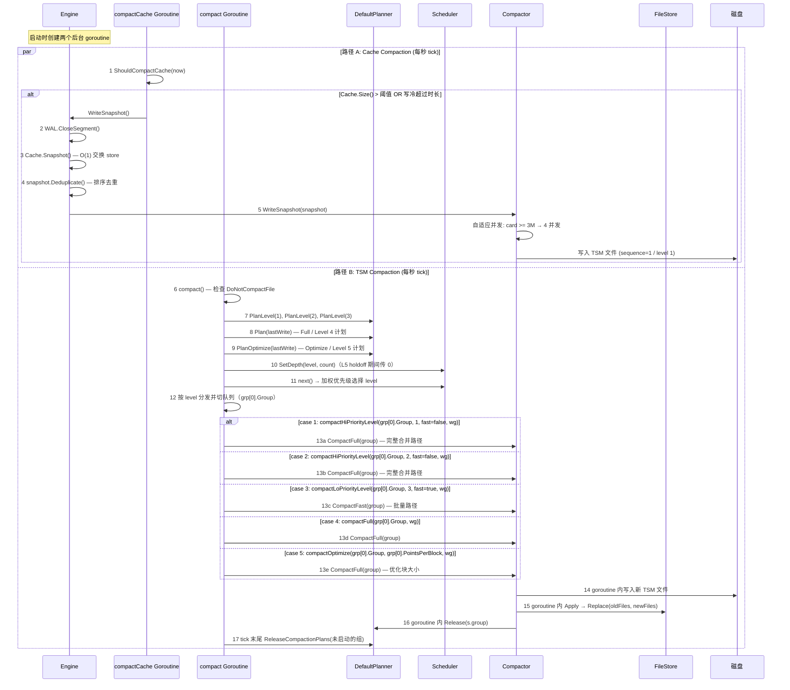

### 1.2 每一步的代码实现

#### 步骤 1: ShouldCompactCache — Cache Compaction 触发

```go
// tsdb/engine/tsm1/engine.go:2121 — ShouldCompactCache
func (e *Engine) ShouldCompactCache(t time.Time) bool {
    sz := e.Cache.Size()

    // 条件 0: Cache 为空，直接返回
    if sz == 0 {
        return false
    }

    // 条件 1: Cache 大小超过阈值 (默认 25MB)
    if sz > e.CacheFlushMemorySizeThreshold {
        return true
    }

    // 条件 2: 写入冷超过时长 (默认 10 分钟)
    // 注意: 使用 e.Cache.LastWriteTime() 而非 e.lastWriteTime
    // 源: DefaultCacheSnapshotWriteColdDuration = 10 * time.Minute (tsdb/config.go:34)
    return t.Sub(e.Cache.LastWriteTime()) > e.CacheFlushWriteColdDuration
}
```

#### 步骤 2-5: Cache Snapshot 流程

```go
// tsdb/engine/tsm1/engine.go:1957 — Engine.WriteSnapshot (关键部分)
func (e *Engine) WriteSnapshot() (err error) {
    closedFiles, snapshot, err := func() (segments []string, snapshot *Cache, err error) {
        e.mu.Lock()
        defer e.mu.Unlock()

        if e.WALEnabled {
            if err = e.WAL.CloseSegment(); err != nil { return }
            segments, err = e.WAL.ClosedSegments()
            if err != nil { return }
        }

        snapshot, err = e.Cache.Snapshot()
        return
    }()
    if err != nil { return err }

    if snapshot.Size() == 0 {
        e.Cache.ClearSnapshot(true)
        return nil
    }

    snapshot.Deduplicate()
    return e.writeSnapshotAndCommit(log, closedFiles, snapshot)
}

// tsdb/engine/tsm1/engine.go:2046 — writeSnapshotAndCommit
func (e *Engine) writeSnapshotAndCommit(log *zap.Logger, closedFiles []string, snapshot *Cache) (err error) {
    defer func() {
        if err != nil {
            e.Cache.ClearSnapshot(false)
        }
    }()

    newFiles, err := e.Compactor.WriteSnapshot(snapshot, e.logger)
    if err != nil {
        return err
    }

    // 源码在 Compactor.WriteSnapshot 之后取读锁，保护后面的
    // Replace / ClearSnapshot / WAL.Remove（engine.go:2060-2061）
    e.mu.RLock()
    defer e.mu.RUnlock()

    if err := e.FileStore.Replace(nil, newFiles); err != nil {
        for _, file := range newFiles {
            _ = os.Remove(file)
        }
        return err
    }

    e.Cache.ClearSnapshot(true)
    if e.WALEnabled {
        _ = e.WAL.Remove(closedFiles)
    }
    return nil
}

// tsdb/engine/tsm1/compact.go:888 — Compactor.WriteSnapshot
func (c *Compactor) WriteSnapshot(cache *Cache, logger *zap.Logger) ([]string, error) {
    // 只负责把已经生成并 deduplicate 的 snapshot cache 写成 TSM 文件。
    // WAL.CloseSegment、Cache.Snapshot、FileStore.Replace、Cache.ClearSnapshot、
    // WAL.Remove 都是 Engine.WriteSnapshot/writeSnapshotAndCommit 的职责。

    card := cache.Count()

    // 自适应并发: card / 2e6, 最小 1
    concurrency := card / 2e6
    if concurrency < 1 {
        concurrency = 1
    }

    // 高基数特殊处理: card >= 3M → 4 并发 + 不限速
    throttle := card < 3e6 && c.snapshotLatencies.avg() < 15*time.Second
    if card >= 3e6 {
        concurrency = 4
        throttle = false
    }

    // 将 cache 按并发数分割，每个 goroutine 写入独立的 TSM 文件
    splits := cache.Split(concurrency)
    type res struct {
        files []string
        err   error
    }
    resC := make(chan res, concurrency)
    for i := 0; i < concurrency; i++ {
        go func(sp *Cache) {
            iter := NewCacheKeyIterator(sp, tsdb.DefaultMaxPointsPerBlock, intC)
            files, err := c.writeNewFiles(c.FileStore.NextGeneration(), 0, nil, iter, throttle, logger)
            resC <- res{files: files, err: err}
        }(splits[i])
    }

    var errs []error
    files := make([]string, 0, concurrency)
    for i := 0; i < concurrency; i++ {
        result := <-resC
        if result.err != nil {
            errs = append(errs, result.err)
        }
        files = append(files, result.files...)
    }
    return files, errors.Join(errs...)
}
```

职责边界要拆清楚：`Engine.WriteSnapshot` 在持有 engine 写锁时关闭当前 WAL segment、收集 closed segments，并执行 `Cache.Snapshot()`；锁外对 snapshot 去重；`Compactor.WriteSnapshot` 只把传入的 snapshot cache 切分并写成新的 `.tsm.tmp` 文件；`Engine.writeSnapshotAndCommit` 再把新文件 `FileStore.Replace(nil, newFiles)` 进 store，成功后 `e.Cache.ClearSnapshot(true)`，最后删除已关闭 WAL segment。失败时 `writeSnapshotAndCommit` 通过 defer `ClearSnapshot(false)` 恢复 snapshot 状态，不能把 `e.Cache.ClearSnapshot` 写进 Compactor。

**提交段锁时序**（engine.go:1973-2014、2046-2086）:
1. `e.mu.Lock()`：`WAL.CloseSegment()` + `WAL.ClosedSegments()` + `Cache.Snapshot()`；
2. 解锁：`snapshot.Deduplicate()`；
3. 无锁：`Compactor.WriteSnapshot(snapshot)`；
4. `e.mu.RLock()`：`FileStore.Replace(nil, newFiles)` + `Cache.ClearSnapshot(true)` + `WAL.Remove(closedFiles)`；
5. 解锁。任一步失败时 defer `ClearSnapshot(false)`，并删除全部 `newFiles`。

#### 步骤 6-15: TSM Compaction 主循环

```go
// tsdb/engine/tsm1/engine.go:2180 — compact
const initialOptimizationHoldoff = time.Hour       // engine.go:2171
const optimizationHoldoff = 5 * time.Minute        // engine.go:2174
const tickPeriod = time.Second                     // engine.go:2178

optHoldoffStart, optHoldoffDuration := time.Time{}, time.Duration(0)
startOptHoldoff := func(d time.Duration) {         // engine.go:2186-2191
    optHoldoffStart, optHoldoffDuration = time.Now(), d
}
startOptHoldoff(initialOptimizationHoldoff)

for {
    select {
    case <-quit:
        return
    case <-t.C:
        if _, err := os.Stat(filepath.Join(e.Path(), DoNotCompactFile)); err == nil {
            continue
        }

        l1, l2, l3, l4, l5 := e.PlanCompactions()

        // holdoff 期间把 L5 深度置 0，让 Scheduler.next() 不选 L5；
        // 但 l5 组仍保留，供 tick 末尾 Release 释放文件占用。
        l5Count := 0
        if time.Since(optHoldoffStart) >= optHoldoffDuration {
            l5Count = len(l5)
        }
        e.Scheduler.SetDepth(1, len(l1))
        e.Scheduler.SetDepth(2, len(l2))
        e.Scheduler.SetDepth(3, len(l3))
        e.Scheduler.SetDepth(4, len(l4))
        e.Scheduler.SetDepth(5, l5Count)

        if level, runnable := e.Scheduler.next(); runnable {
            switch level {
            case 1:
                if e.compactHiPriorityLevel(l1[0].Group, 1, false, wg) { l1 = l1[1:] }
            case 2:
                if e.compactHiPriorityLevel(l2[0].Group, 2, false, wg) { l2 = l2[1:] }
            case 3:
                if e.compactLoPriorityLevel(l3[0].Group, 3, true, wg) { l3 = l3[1:] }
            case 4:
                if e.compactFull(l4[0].Group, wg) { l4 = l4[1:] }
            case 5:
                g := l5[0]
                err := e.compactOptimize(g.Group, g.PointsPerBlock, wg)
                switch {
                case err == nil:
                    l5 = l5[1:]
                case errors.Is(err, ErrOptimizeCompactionLimited),
                     errors.Is(err, ErrCompactionLimited):
                    // 本 tick 不再调度 optimize，避免饿死 level compaction
                default:
                    log.Error("Error during compactOptimize", zap.Error(err))
                }
                // 成功或失败都重启 5 分钟 holdoff
                startOptHoldoff(optimizationHoldoff)
            }
        }

        // 无论 next() 是否 runnable，都必须释放本 tick 未启动的计划。
        e.ReleaseCompactionPlans(l1, l2, l3, l4, l5)
    }
}
```

**三个容易漏掉的状态机要点**:

1. `PlannedCompactionGroup = {Group CompactionGroup, PointsPerBlock int}`；只有 case 5
   显式使用非默认 `PointsPerBlock`，其余四路传 `.Group`，`pointsPerBlock` 由策略构造器兜底。
2. 已启动的组由 goroutine 在 `s.Apply()` 之后释放：
   `e.CompactionPlan.Release([]CompactionGroup{s.group})`（`engine.go:2464-2468`、
   `2520-2523`、`2550-2554`）；`ReleaseCompactionPlans` 只释放“本 tick 规划了但没启动”的组
   （`engine.go:2287-2335`）。
3. 若省略 `SetDepth(5, 0)`，holdoff 形同虚设；若省略 tick 末尾 Release，
   `acquire()` 的 `filesInUse` 会永久占住文件，后续 tick 永远 plan 不到。

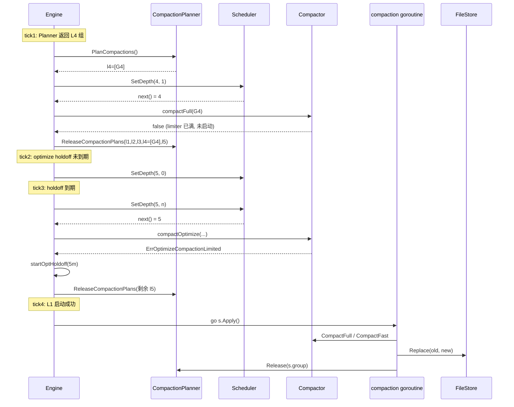

**调度数值案例**（`maxConcurrency=8`）:

```
loLimit  = 8/5 + 1 = 2
queues   = [5, 0, 0, 0, 3]
weights  = [0.4, 0.3, 0.2, 0.1, 0.01]

加权分数:
  L1: 5 * 0.40 = 2.00   ← 最大
  L5: 3 * 0.01 = 0.03
→ next() 选择 L1。

注意：源码里还有一个 `end=2` 的分支（`scheduler.go:54-59`：当 `L3+L4+L5 >= loLimit`
且 `maxConcurrency - (L1+L2 running) == 0` 时只扫描 L1/L2），但它在当前实现下**不可达**：
`8 - (L1+L2) == 0` 意味着 L1+L2 已占满 `maxConcurrency`，而入口的
`总数 >= maxConcurrency → return 0, false`（`scheduler.go:43-45`）会先返回。
因此实际参与选择的始终是 5 个 level，这段是防御性代码。
```

### 1.3 Snapshot 输出文件编号

1. `Cache.Split` 走 `ring.split(n)`：按 `i%n` 把 16 个 partition 分给 n 个 split
   (`ring.go:196-207`)。同一 series 只属于一个 partition，因此同一 split 内 key 不重叠，
   各 split 写出的文件互不重叠。
2. 每个 goroutine 内调用 `c.FileStore.NextGeneration()`（`compact.go:927`）：
   `FileStore.currentGeneration` 在 `f.mu` 下 +1（`file_store.go:413-418`），
   因此一次 snapshot 的多个 split 拿到不同 generation，顺序不确定。
3. `writeNewFiles(gen, 0, ...)` 先 `sequence++`（`compact.go:1149-1157`），
   所以每个 split 的首个文件都是 `gen-000000001.tsm`。
4. `level = min(sequence, 4)`（`compact.go:219-227`）→ 这些文件全部是 Level 1。

| series 基数 card | concurrency | throttle | 一次 snapshot 文件数 |
|---|---|---|---|
| `< 2e6` | 1 | `card < 3e6 && avg < 15s` | 1 |
| `2e6 .. 3e6` | `card / 2e6` | 同上 | `card / 2e6` |
| `>= 3e6` | 4（强制） | false | 4 |

**数值案例**: `card=4,200,000` → `concurrency=4`（`>=3e6` 强制 4）→ 4 个 goroutine 分别拿到
generation 11/12/13/14（顺序不确定）→ 输出
`000000011-000000001.tsm` ... `000000014-000000001.tsm`。
连续两次这样的 snapshot 就积累 8 个 L1 generation，才达到 `PlanLevel(1)` 的
`minGenerations=8`（`compact.go:354-357`）。

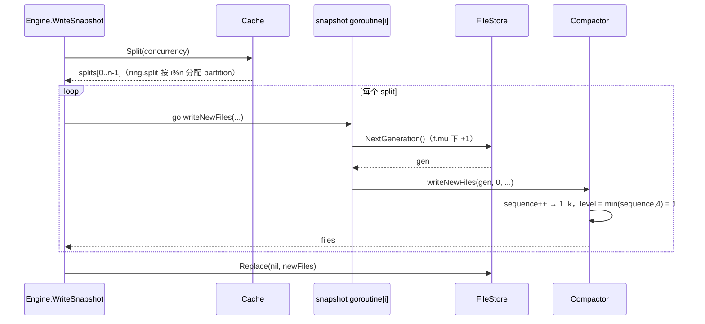

## 2. CompactionPlanner — 文件分代与级别

### 2.1 TSM 文件命名规则

```
┌─────────────────────────────────────────────────────────┐
│ TSM 文件名格式: GGGGGGGGG-SSSSSSSSS.tsm                 │
├───────────┬─────────────────────────────────────────────┤
│ GGGGGGGGG │ Generation ID（十进制，9 位零填充）          │
│ SSSSSSSSS │ Sequence Number（十进制，9 位零填充）        │
└───────────┴─────────────────────────────────────────────┘

写出：fmt.Sprintf("%09d-%09d", generation, sequence)   // file_store.go:1345

示例:
  000000001-000000001.tsm  → Generation 1, Sequence 1 (Level 1)
  000000002-000000001.tsm  → Generation 2, Sequence 1 (Level 1)
  000000003-000000002.tsm  → Generation 3, Sequence 2 (Level 2)
  000000004-000000003.tsm  → Generation 4, Sequence 3 (Level 3)
  000000005-000000004.tsm  → Generation 5, Sequence 4 (Level 4)
```

> **为什么必须零填充**：FileStore 在 Open/Replace 后用
> `sort.Sort(tsmReaders(f.files))` 按 `Path()` 字典序排序
> (`file_store.go:1067,1701-1703`)；`KeyCursor` 在 block 时间范围重叠时也按
> `Path()` 打破平局 (`file_store.go:1427-1445`)。9 位零填充保证
> “字典序 == generation 数值序 == 新旧顺序”。自定义 `FormatFileNameFunc`
> 若破坏该性质，重叠 block 的“新值覆盖旧值”前提不再成立。
>
> **解析**：`DefaultParseFileName` 先按 `.` 去掉扩展名，再按 `-` 切分，两段用
> `strconv.ParseUint(..., 10, 32)` 解析；宽度本身不参与解析
> (`file_store.go:1352-1375`)。实际写路径 `compact.go:1152`、`engine.go:1283`。

### 2.2 Compaction Level 定义

```go
// tsdb/engine/tsm1/compact.go:219 — level
func (t *tsmGeneration) level() int {
    // 源码注释提到 Level 0，但当前实现直接用 sequence 映射:
    // sequence=1 -> level 1, sequence=2 -> level 2, sequence=3 -> level 3。
    // Cache snapshot 通过 writeNewFiles(..., maxSequence=0, ...) 写出 sequence=1，
    // 因此它进入 level 1，而不是可调度的 level 0。
    if t.files[0].Sequence < 4 {
        return t.files[0].Sequence
    }
    return 4
}
```

| Level | 来源 | 触发条件 |
|-------|------|----------|
| **1** | Cache Snapshot 写出的 sequence=1 文件；多个 L1 generation 合并 | Cache.Size > 阈值 / 写冷超时；或相邻 L1 generations >= 8 / tombstone |
| **2** | 多个 Level 1 generation 合并后的 sequence=2 文件 | 相邻 L2 候选通常 >= 4，或 tombstone |
| **3** | 多个 Level 2 generation 合并后的 sequence=3 文件 | 相邻 L3 候选通常 >= 4，或 tombstone |
| **4** | Full compaction | 写冷超过 `compactFullWriteColdDuration` 或强制 full |
| **5** | Optimize compaction 调度队列 | `PlanOptimize(lastWrite)` 找到冷 shard 优化组，经过 holdoff 后调度 |

> **具体案例**: 假设每个点编码后约 30B，写入 100k points/s（≈3MB/s），Cache 阈值 25MB。
>
> ```
> 时间线:
>
> t=0s      开始写入 → 进入 Cache
> t≈8.7s    Cache 达到 25MB（25MB / 3MB/s）→ Snapshot → 000000001-000000001.tsm (Level 1)
> t≈17.4s   第二个 Snapshot → 000000002-000000001.tsm (Level 1)
> t≈26.1s   第三个 Snapshot → 000000003-000000001.tsm (Level 1)
> ...
> t≈69.6s   第 8 个 Snapshot 完成，相邻 L1 generation 达到 minGenerations=8
>           → L1 Compaction 合并 8 个 sequence=1 generation
>           → 输出 000000008-000000002.tsm (Level 2)   // generation = max(输入 generation) = 8
> ...
> L2-L4 各自每积累 4 个同级 generation（step=4）触发一次合并
> t=...     写入停止约 4 小时后（DefaultCompactFullWriteColdDuration, tsdb/config.go:38）
>           → Full Compaction (Level 4)
>           → 合并所有 Level 2/3 文件 → 写入最终的大文件
> ```
>
> 若写入速率只有 1k points/s（≈30KB/s），写满 25MB 需要约 14 分钟，而不是 25 秒。
> 演示时可把 `compact-full-write-cold-duration` 调成 10s 以快速触发 Full。
>
> 最终效果：几十个小文件合并成了 1 个大文件，查询时只需扫描 1 个文件。

### 2.3 DefaultPlanner.PlanLevel — 分级 Compaction

```go
// tsdb/engine/tsm1/compact.go:318 — PlanLevel
func (c *DefaultPlanner) PlanLevel(level int) ([]CompactionGroup, int64) {
    // 如果已请求 Full compaction，不规划 level 计划 (避免抢占文件)
    c.mu.RLock()
    if c.forceFull {
        c.mu.RUnlock()
        return nil, 0
    }
    c.mu.RUnlock()

    generations := c.findGenerations()

    // 只有一个 generation 且无 tombstones，无需 compaction
    if len(generations) <= 1 && !generations.hasTombstones() {
        return nil, 0
    }

    // 相邻同 level generation 归为一组；孤立的低 level generation
    // 如果后面跟着更高 level，也会被带入当前组，避免永久落单。
    groups := c.groupAdjacentGenerations(generations,
        func(currentLevel int, candidateLevel int) bool {
            return currentLevel == candidateLevel
        })

    // 只保留目标 level 的 groups
    var levelGroups []tsmGenerations
    levelGroupIndices := make(map[int]int)
    for i, cur := range groups {
        if cur.level() == level {
            levelGroups = append(levelGroups, cur)
            levelGroupIndices[len(levelGroups)-1] = i
        }
    }

    // minGenerations: Level 1 = 8, Level 2-3 = 4
    minGenerations := 4
    if level == 1 {
        minGenerations = 8
    }

    // 按 minGenerations 分块
    var cGroups []CompactionGroup
    for i, group := range levelGroups {
        for _, chunk := range group.chunk(minGenerations) {
            var cGroup CompactionGroup
            var hasTombstones bool
            for _, gen := range chunk {
                if gen.hasTombstones() {
                    hasTombstones = true
                }
                for _, file := range gen.files {
                    cGroup = append(cGroup, file.Path)
                }
            }
            // 跳过不足 minGenerations 且无 tombstones 的 chunk
            if len(chunk) < minGenerations && !hasTombstones {
                for j := levelGroupIndices[i] + 1; j < len(groups); j++ {
                    if groups[j].level() >= level {
                        // 后面存在同级或更高级 generation，当前落单 group 也应升级。
                        cGroups = append(cGroups, cGroup)
                        break
                    }
                }
                continue
            }
            cGroups = append(cGroups, cGroup)
        }
    }

    // acquire: 标记文件为 in-use，防止多个 plan 返回同一文件
    if !c.acquire(cGroups) {
        return nil, int64(len(cGroups))
    }

    return cGroups, int64(len(cGroups))
}
```

### 2.4 DefaultPlanner.Plan — Full Compaction

```go
// tsdb/engine/tsm1/compact.go:485 — Plan
func (c *DefaultPlanner) Plan(lastWrite time.Time) ([]CompactionGroup, int64) {
    generations := c.findGenerations()

    // 检查 forceFull 标志
    c.mu.RLock()
    forceFull := c.forceFull
    c.mu.RUnlock()

    // forceFull 或写冷超时触发 full compaction
    if forceFull || (c.compactFullWriteColdDuration > 0 &&
       time.Since(lastWrite) > c.compactFullWriteColdDuration &&
       len(generations) > 1) {

        if forceFull {
            c.mu.Lock()
            c.forceFull = false
            c.mu.Unlock()
        }

        var tsmFiles []string
        var genCount int
        for i, group := range generations {
            var skip bool

            // 正在被查询/删除等路径 Retain 的文件组不能参与本轮 compaction
            if c.isInUse(group) {
                continue
            }

            // 跳过条件: len(generations) > 2 且文件已满
            // (size > tsdb.MaxTSMFileSize 且首块已达 DefaultMaxPointsPerBlock 且无 tombstones)
            if len(generations) > 2 &&
               group.size() > uint64(tsdb.MaxTSMFileSize) &&
               group.files[0].FirstBlockCount >= tsdb.DefaultMaxPointsPerBlock &&
               !group.hasTombstones() {
                skip = true
            }

            // 覆盖: 如果下一个 generation level <= 3，不跳过
            if i < len(generations)-1 {
                if generations[i+1].level() <= 3 {
                    skip = false
                }
            }

            if skip {
                continue
            }

            for _, f := range group.files {
                tsmFiles = append(tsmFiles, f.Path)
            }
            genCount += 1
        }
        sort.Strings(tsmFiles)

        // 必须有 >1 个文件且 >1 个 generation
        if len(tsmFiles) <= 1 || genCount <= 1 {
            return nil, 0
        }

        group := []CompactionGroup{tsmFiles}
        if !c.acquire(group) {
            return nil, int64(len(group))
        }
        return group, int64(len(group))
    }

    // lastPlanCheck 优化: 如果文件未变化，不重新规划
    if c.lastPlanCheck.After(c.FileStore.LastModified()) && !generations.hasTombstones() {
        return nil, 0
    }
    c.lastPlanCheck = time.Now()

    // lastPlanCheck 优化之后
    if len(generations) <= 1 && !generations.hasTombstones() {
        return nil, 0
    }

    // 1) 反向找最后一个 Level 4 generation：它们是“最旧”的文件。
    //    反向遍历可避免较早的低 level generation 阻止较晚的高 level generation。
    end, start := 0, 0
    for i := len(generations) - 1; i >= 0; i-- {
        if generations[i].level() >= 4 {
            end = i + 1
            break
        }
    }

    // 2) 前向确定 start：跳过已压满/超大的老文件。
    //    注意 hasTombstones 是“粘性”的：一旦遇到带 tombstone 的 generation，
    //    后续不再调整 start。
    var hasTombstones bool
    for i, g := range generations[:end] {
        if g.hasTombstones() {
            hasTombstones = true
        }
        if hasTombstones {
            continue
        }
        // 超过 2GB 且首块已满：不再重压
        if g.size() > uint64(tsdb.MaxTSMFileSize) &&
            g.files[0].FirstBlockCount >= tsdb.DefaultMaxPointsPerBlock {
            start = i + 1
        }
        // 前面的文件增长得比后面的快：跳过特别大的，先压小的
        if i > 0 && g.size()*2 < generations[i-1].size() {
            start = i
            break
        }
    }

    // 3) 以 step=4 分组；in-use 或 2GB 满块 generation 会截断当前组。
    const step = 4
    generations = generations[start:end]

    var groups tsmGenerationGroups
    var currentGroup tsmGenerations
    for i := 0; i < len(generations); {
        moveToNextGroup := func() {
            if len(currentGroup) > 0 {
                i += len(currentGroup)
                groups = append(groups, currentGroup)
                currentGroup = nil
            } else {
                i++
            }
        }
        currentGroup = make(tsmGenerations, 0, step)
        for j := 0; j < step && (j+i) < len(generations); j++ {
            gen := generations[j+i]
            if c.isInUse(gen) {
                break
            }
            if gen.size() >= uint64(tsdb.MaxTSMFileSize) &&
                gen.files[0].FirstBlockCount >= tsdb.DefaultMaxPointsPerBlock &&
                !gen.hasTombstones() {
                break
            }
            currentGroup = append(currentGroup, gen)
        }
        moveToNextGroup()
    }
    if len(groups) == 0 {
        return nil, 0
    }

    // 4) 不足 4 个且无 tombstone 的组跳过。
    var compactable tsmGenerationGroups
    for _, generationGroup := range groups {
        if len(generationGroup) < 4 && !generationGroup.hasTombstones() {
            continue
        }
        compactable = append(compactable, generationGroup)
    }

    // 5) 展开为文件路径并排序，一次性 acquire（全有或全无）。
    var tsmFiles []CompactionGroup
    for _, generationGroup := range compactable {
        var cGroup CompactionGroup
        for _, generation := range generationGroup {
            for _, f := range generation.files {
                cGroup = append(cGroup, f.Path)
            }
        }
        sort.Strings(cGroup)
        tsmFiles = append(tsmFiles, cGroup)
    }
    if !c.acquire(tsmFiles) {
        return nil, int64(len(tsmFiles))
    }
    return tsmFiles, int64(len(tsmFiles))
}
```

**Level 4 分组的数值案例**:

```
案例 A: 9 个连续 L4 generation g1..g9，无 tombstone、无 in-use、无超大文件
  end   = 9（最后一个 L4 在 i=8，end=9）
  start = 0（没有触发任何跳过条件）
  分组（step=4）: [g1,g2,g3,g4]、[g5,g6,g7,g8]、[g9]
  compactable: 前两组保留；第三组 len=1 < 4 且无 tombstone → 跳过
  → 返回 2 个 CompactionGroup（共 8 个文件）

案例 B: 同上，但 g3 正在被查询使用（isInUse(g3)=true）
  第一组在 j=2 命中 g3 → break，currentGroup=[g1,g2]
  i 前进到 3，继续分组: [g4,g5,g6,g7]、[g8,g9]
  compactable: [g4..g7] 保留；[g1,g2] 与 [g8,g9] 都 <4 且无 tombstone → 跳过
  → 只返回 1 组
  这说明 in-use 会让某些 generation 在本轮永远不被选中，等下一次 tick 再试。
```

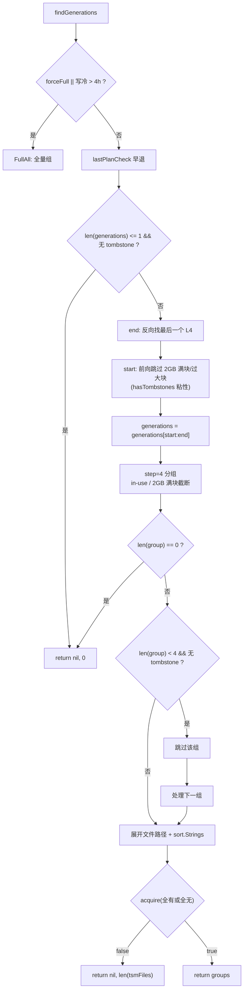

### 2.5 DefaultPlanner.PlanOptimize — Optimize Compaction

```go
// tsdb/engine/tsm1/compact.go:436 — PlanOptimize
func (c *DefaultPlanner) PlanOptimize(lastWrite time.Time) (compactGroup []CompactionGroup, compactionGroupLen int64, generationCount int64) {
    // 如果已请求 Full compaction，不规划 optimize 计划
    c.mu.RLock()
    if c.forceFull {
        c.mu.RUnlock()
        return nil, 0, 0
    }
    c.mu.RUnlock()

    generations := c.findGenerations()

    fullyCompacted, _ := c.generationsFullyCompacted(generations)
    if fullyCompacted || time.Since(lastWrite) < c.compactFullWriteColdDuration {
        return nil, 0, 0
    }

    // Optimize 用 currentLevel >= candidateLevel 分组：level 4 group 可以带上
    // 后续较低 level 的相邻 generation；level 1-3 常规情况仍交给 PlanLevel。
    groups := c.groupAdjacentGenerations(generations,
        func(currentLevel int, candidateLevel int) bool {
            return currentLevel >= candidateLevel
        })

    var cGroups []CompactionGroup
    for _, group := range groups {
        var cGroup CompactionGroup
        // 只优化 level 4 generation group；如果整个 shard 只有一个 generation，
        // 也允许单 generation optimize，后续 PlanCompactions 会用 aggressive points-per-block。
        if group.level() == 4 || len(generations) == 1 {
            for _, gen := range group {
                for _, file := range gen.files {
                    cGroup = append(cGroup, file.Path)
                }
            }
        }
        if len(cGroup) > 0 {
            cGroups = append(cGroups, cGroup)
        }
    }

    if !c.acquire(cGroups) {
        return nil, int64(len(cGroups)), int64(len(generations))
    }

    return cGroups, int64(len(cGroups)), int64(len(generations))
}
```

> **源码校准**: 当前调度器有 5 个队列。`PlanCompactions()` 会把普通
> level 1-4 compaction 与 optimize compaction 分开统计；optimize 结果进入
> 第 5 个调度队列，权重最低 (`0.01`)，并由 `compactOptimize` 执行。该路径还有
> 初始 1 小时、后续 5 分钟的 holdoff，避免频繁优化已经较冷的文件。
> `PlanOptimize` 本身返回 `generationCount = len(generations)`；`PlanCompactions`
> 若发现 level 5 计划来自单 generation（`l5GenCount == 1`），会把该组的
> `PointsPerBlock` 提升到 aggressive compaction 配置，便于把单 generation 内的
> 多个 sequence 文件进一步收敛。若 level 4 计划组里已有优化过的文件，
> `PlanCompactions` 也会把该 level 4 group 提升到 level 5 队列，避免优化等级倒退。

### 2.6 PlanCompactions — 计划分队列

```go
// tsdb/engine/tsm1/engine.go:2360 — planCompactionsInner
level1Groups := e.planCompactionsLevel(1)   // PlanLevel(1) + PointsPerBlock=1000
level2Groups := e.planCompactionsLevel(2)
level3Groups := e.planCompactionsLevel(3)
l4Groups, _ := e.CompactionPlan.Plan(e.LastModified())
l5Groups, _, l5GenCount := e.CompactionPlan.PlanOptimize(e.LastModified())

level4Groups := make([]PlannedCompactionGroup, 0, len(l4Groups))
level5Groups := make([]PlannedCompactionGroup, 0, len(l4Groups)+len(l5Groups))

// 1) L4 组里只要有一个“已优化”文件，整组提升为 L5，防止优化等级倒退。
for _, group := range l4Groups {
    if isOpt, filename, heur := e.IsGroupOptimized(group); isOpt {
        level5Groups = append(level5Groups, PlannedCompactionGroup{
            Group:          group,
            PointsPerBlock: e.CompactionPlan.GetAggressiveCompactionPointsPerBlock(), // 10000
        })
    } else {
        level4Groups = append(level4Groups, PlannedCompactionGroup{
            Group:          group,
            PointsPerBlock: tsdb.DefaultMaxPointsPerBlock, // 1000
        })
    }
}

// 2) 原生 L5 组：单 generation 时全部 aggressive；多 generation 时按 IsGroupOptimized 决定。
for _, group := range l5Groups {
    if l5GenCount == 1 {
        level5Groups = append(level5Groups, PlannedCompactionGroup{group, aggressive})
    } else if isOpt, _, _ := e.IsGroupOptimized(group); isOpt {
        level5Groups = append(level5Groups, PlannedCompactionGroup{group, aggressive})
    } else {
        level5Groups = append(level5Groups, PlannedCompactionGroup{group, 1000})
    }
}

// 3) 队列长度写入 Stats：TSMCompactionsQueue[0..2]、TSMFullCompactionsQueue、TSMOptimizeCompactionsQueue。
```

**启发式 `isFileOptimized(f)`（engine.go:2137-2159）**:

```
从 Compactor.FileStore.Stats() 找 f 的 FirstBlockCount；
找不到 → warn 并降级为 0；
FirstBlockCount >= aggressivePointsPerBlock（默认 10000）→ 认为是已优化。
IsGroupOptimized(group)（engine.go:2162-2170）: 组内任一文件命中即整组命中。

为什么用“首块点数”而不是文件大小:
  optimize 会把块压到 aggressive 上限，首块是否达到 10000 是“已优化”的廉价指纹；
  代价是 backfill 写入的大首块会造成误判，把普通 L4 组提升为 aggressive L5（多写一次）。
```

**数值案例**: L4 组含 `000000010-000000004.tsm`（首块 10000 点）与
`000000011-000000001.tsm`（首块 1000 点）→ `IsGroupOptimized=true` → 整组进入 L5，
`PointsPerBlock=10000`；`compactGroup` 内 `pointsPerBlock=10000` 传给 `CompactFull`，
输出块最多 10000 点。

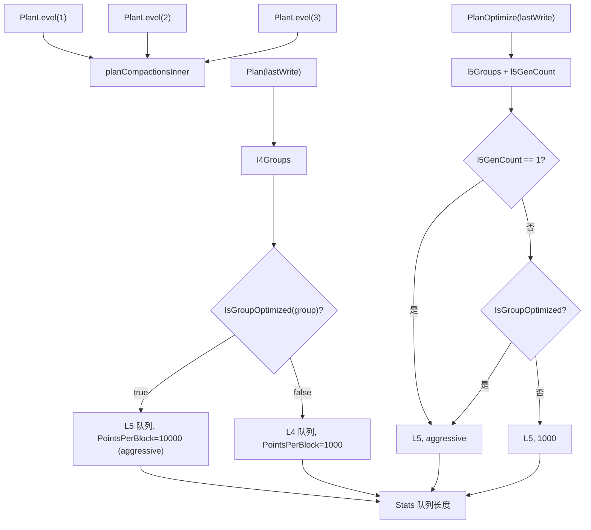

## 3. 调度器 — 优先级管理

### 3.1 Scheduler 结构

```go
// tsdb/engine/tsm1/scheduler.go — scheduler
var defaultWeights = [TotalCompactionLevels]float64{0.4, 0.3, 0.2, 0.1, 0.01}

type Scheduler struct {
    maxConcurrency int               // 最大并发 compaction 数 (由 engine 配置)
    stats          *EngineStatistics // 原子计数器: 各级别活跃 compaction 数

    // queues is the depth of work pending for each compaction level
    queues  [TotalCompactionLevels]int // TotalCompactionLevels = 5
    weights [TotalCompactionLevels]float64
}
```

> **注意**: Scheduler 本身**不包含** `limiter.Fixed` 字段。并发控制通过 `maxConcurrency` 配合
> `EngineStatistics` 中的原子计数器 (`TSMCompactionsActive[0-2]`, `TSMFullCompactionsActive`,
> `TSMOptimizeCompactionsActive`) 实现。实际的限流由 `compactionLimiter` (在 Engine 层)
> 通过 `TryTake()` 非阻塞调用完成。

Level 5 optimize 走**两级 limiter**（engine.go:2536-2560）：

```
获取顺序：compactionLimiter.TryTake() → optimizedCompactionLimiter.TryTake()
失败语义：
  - 第一个失败 → 返回 ErrCompactionLimited（本 tick 的 L5 调度结束）
  - 第二个失败 → 归还第一个，返回 ErrOptimizeCompactionLimited（本 tick 的 L5 调度结束）
释放顺序（goroutine 内 defer LIFO）：
  defer compactionLimiter.Release()          // 先注册，最后执行
  defer optimizedCompactionLimiter.Release() // 后注册，先执行

默认容量（tsdb/store.go:497-524）：
  compactionLimiter          = MaxConcurrentCompactions（0 → GOMAXPROCS/2，至少 1，且不超过 GOMAXPROCS）
  optimizedCompactionLimiter = MaxConcurrentOptimizedCompactions（<=0 → 1，且不超过上面的 lim）

调度器的 maxConcurrency 只用于“队列加权选择 + active 计数判断”；
真正的并发准入在四个分发函数里的 TryTake()。
```

### 3.2 next() — 选择执行哪个 level

```go
// tsdb/engine/tsm1/scheduler.go:36 — nextByQueueDepths
func (s *Scheduler) nextByQueueDepths(depths [TotalCompactionLevels]int) (int, bool) {
    // 读取各级正在运行的 compaction 数量 (原子操作)
    level1Running := int(atomic.LoadInt64(&s.stats.TSMCompactionsActive[0]))
    level2Running := int(atomic.LoadInt64(&s.stats.TSMCompactionsActive[1]))
    level3Running := int(atomic.LoadInt64(&s.stats.TSMCompactionsActive[2]))
    level4Running := int(atomic.LoadInt64(&s.stats.TSMFullCompactionsActive))
    level5Running := int(atomic.LoadInt64(&s.stats.TSMOptimizeCompactionsActive))

    // 如果总运行数 >= maxConcurrency，不能再调度
    if level1Running+level2Running+level3Running+level4Running+level5Running >= s.maxConcurrency {
        return 0, false
    }

    // loLimit = (maxConcurrency / 5) + 1，用于限制低优先级
    loLimit, _ := s.limits()

    end := len(s.queues)  // 默认扫描全部 5 个 level
    // 如果低优先级 (L3+L4+L5) 已占满 loLimit 个槽位且高优先级已满，只扫描 L1-L2
    if level3Running+level4Running+level5Running >= loLimit &&
        s.maxConcurrency-(level1Running+level2Running) == 0 {
        end = 2
    }

    // 加权优先级选择: queues[i] * weights[i] 最大的 level 被选中
    // 默认权重: [0.4, 0.3, 0.2, 0.1, 0.01]
    var (
        level    int
        runnable bool
        weight   float64
    )
    for i := 0; i < end; i++ {
        if float64(s.queues[i])*s.weights[i] > weight {
            level, runnable = i+1, true
            weight = float64(s.queues[i]) * s.weights[i]
        }
    }
    return level, runnable
}

func (s *scheduler) limits() (int, int) {
    hiLimit := s.maxConcurrency * 4 / 5
    loLimit := (s.maxConcurrency / 5) + 1
    if hiLimit == 0 { hiLimit = 1 }
    if loLimit == 0 { loLimit = 1 }
    return loLimit, hiLimit
}
```

> **关键设计**: 调度器不是简单的优先级扫描，而是使用**加权优先级**。
> `queues[i] * weights[i]` 最大的 level 被选中。这意味着即使 Level 1 有任务，
> 如果 Level 4 有大量积压（queues[3] 很大），Level 4 也可能被选中执行。
> loLimit/hiLimit 机制确保低优先级不会完全饿死。

### 3.3 优先级抢占

> **小白解释**: 想象一个只有 2 个手术室的医院：
> - **所有级别 (Level 1-4)**: 都是推门就进，没空就等下次（TryTake = 非阻塞）
> - 没有任何级别会阻塞等待
>
> 每次 tick（1 秒后）重新检查，如果手术室空了就进。
> 调度器通过加权优先级决定谁先尝试，但所有人都用同样的非阻塞方式获取资源。

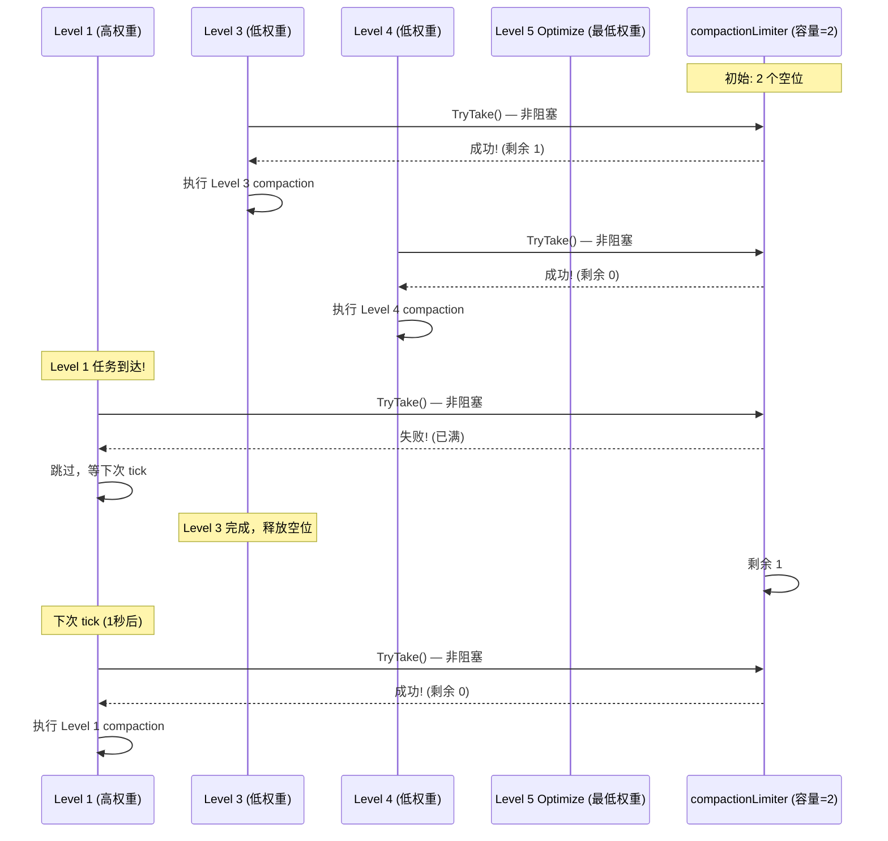

**所有级别都使用 `TryTake()`**: `compactHiPriorityLevel`、`compactLoPriorityLevel` 和 `compactFull` 全部调用 `e.compactionLimiter.TryTake()`（非阻塞）。没有任何地方使用阻塞的 `Take()`。如果 limiter 已满，所有级别都直接跳过，等下次 tick 再试。

## 4. TSM 文件读取机制 — 从磁盘到内存

### 4.1 mmap 映射 — 零拷贝读取

> **小白解释**: mmap 就像给文件开了一个"传送门"。
>
> 传统读文件：磁盘 → 内核缓冲区 → 用户缓冲区（两次拷贝）
> mmap 读文件：磁盘 → 直接映射到你的内存地址（零拷贝！）
>
> 就像你不需要把图书馆的书复印一份带回家，而是直接在图书馆里翻阅。
> 操作系统会自动把需要的页面加载到内存，不需要的页面自动回收。

Compaction 读取 TSM 文件的核心是 **mmap (内存映射文件)**。整个 TSM 文件被映射到进程的虚拟地址空间，读取操作变为直接内存访问，无需 `read()` 系统调用。

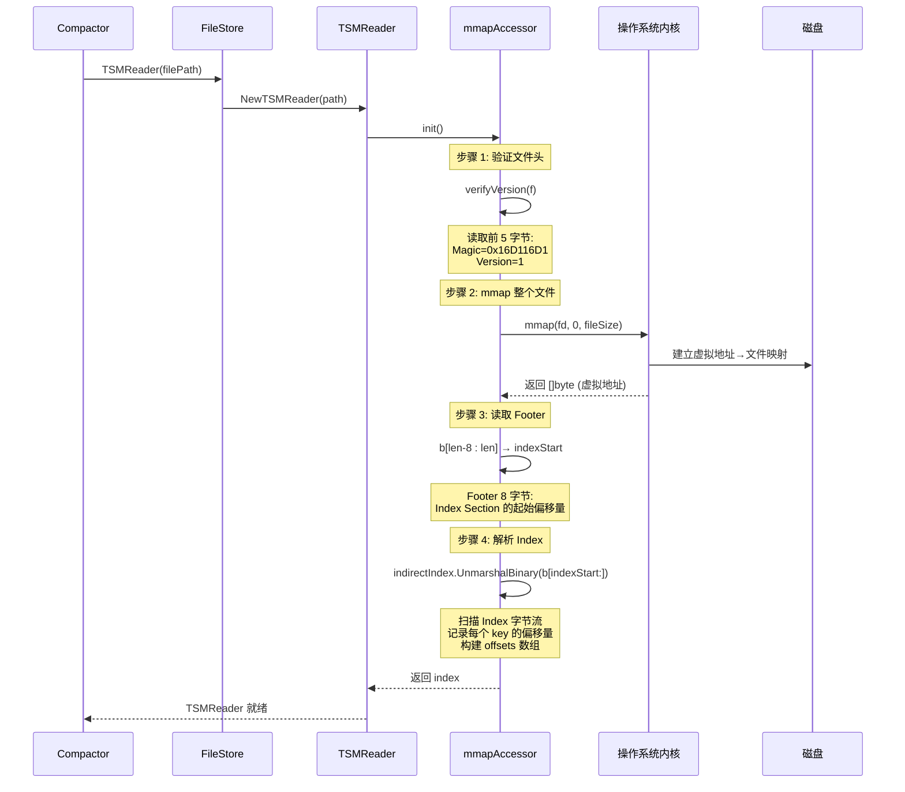

#### mmapAccessor.init() — 完整初始化流程

```go
// tsdb/engine/tsm1/reader.go:1486 — mmapAccessor.init
func (m *mmapAccessor) init() (*indirectIndex, error) {
    m.mu.Lock()
    defer m.mu.Unlock()

    // 步骤 1: 验证文件版本
    if err := verifyVersion(m.f); err != nil {
        return nil, err
    }

    // 步骤 1b: 重置文件指针到开头
    if _, err := m.f.Seek(0, 0); err != nil {
        return nil, err
    }

    // 步骤 2: 获取文件大小 (检查 Stat 错误)
    stat, err := m.f.Stat()
    if err != nil {
        return nil, err
    }

    // 步骤 3: mmap 整个文件
    m.b, err = mmap(m.f, 0, int(stat.Size()))
    if err != nil {
        return nil, err
    }

    // 步骤 3b: 边界检查 — 文件至少 8 字节 (Footer)
    if len(m.b) < 8 {
        return nil, fmt.Errorf("mmapAccessor: byte slice too small for indirectIndex")
    }

    // 步骤 4: 可选的 MADV_WILLNEED 提示
    if m.mmapWillNeed {
        if err := madviseWillNeed(m.b); err != nil {
            return nil, err
        }
    }

    // 步骤 5: 读取 Footer (最后 8 字节)
    indexOfsPos := len(m.b) - 8
    indexStart := binary.BigEndian.Uint64(m.b[indexOfsPos : indexOfsPos+8])

    // 步骤 5b: 验证 indexStart 不越界
    if indexStart >= uint64(indexOfsPos) {
        return nil, fmt.Errorf("mmapAccessor: invalid indexStart")
    }

    // 步骤 6: 解析 Index Section
    m.index = NewIndirectIndex()
    if err := m.index.UnmarshalBinary(m.b[indexStart:indexOfsPos]); err != nil {
        return nil, err
    }

    // 步骤 7: 初始化访问计数器 (允许立即释放资源)
    m.incAccess()
    atomic.StoreUint64(&m.freeCount, 1)

    return m.index, nil
}
```

**mmap 的优势**:
- **零拷贝**: 数据直接在 page cache 中，无需内核→用户空间拷贝
- **按需加载**: OS 按 4KB page 按需加载，大文件不会一次性占用内存
- **共享页**: 多个 TSMReader 共享同一文件的 page cache
- **自动回收**: 内存压力时 OS 自动回收未使用的 page

### 4.2 indirectIndex — Index 解析与二分查找

Index Section 是 TSM 文件中所有 key 和 block 元数据的索引。解析过程扫描原始字节流，记录每个 key 的偏移位置。

```go
// tsdb/engine/tsm1/reader.go:1325 — indirectIndex.UnmarshalBinary
func (d *indirectIndex) UnmarshalBinary(b []byte) error {
    d.b = b  // 保存 Index 字节引用
    if len(b) == 0 { return nil }

    var offsets []int32  // 每个 key 在 Index 中的偏移量
    var minTime, maxTime int64 = math.MaxInt64, 0
    var i int32
    iMax := int32(len(b))

    for i < iMax {
        offsets = append(offsets, i)  // 记录当前 key 的偏移

        // 边界检查: keyLen(2B) 需要至少 2 字节
        if i+2 >= iMax {
            return fmt.Errorf("indirectIndex: not enough data for key length value")
        }

        // 跳过 key 与 type: keyLen(2B) + key(NB) + type(1B)
        // i += 3 + keyLen 同时跳过 2B 长度、key 本体与 1B type
        i += 3 + int32(binary.BigEndian.Uint16(b[i:i+2]))

        // 边界检查: count(2B) 需要至少 2 字节
        if i+indexCountSize >= iMax {
            return fmt.Errorf("indirectIndex: not enough data for index entries count")
        }

        // 读取 block 条目数量
        count := int32(binary.BigEndian.Uint16(b[i : i+2]))
        i += 2

        // 边界检查: MinTime(8B) 需要至少 8 字节
        if i+8 >= iMax {
            return fmt.Errorf("indirectIndex: not enough data for min time")
        }

        // 记录最小时间戳 (第一个 block 的 MinTime)
        minT := int64(binary.BigEndian.Uint64(b[i : i+8]))
        if minT < minTime { minTime = minT }

        // 跳过中间的 block 条目
        i += (count - 1) * indexEntrySize  // indexEntrySize = 28

        // 边界检查: MaxTime 需要 16 字节
        if i+16 >= iMax {
            return fmt.Errorf("indirectIndex: not enough data for max time")
        }
        // 记录最大时间戳 (最后一个 block 的 MaxTime)
        maxT := int64(binary.BigEndian.Uint64(b[i+8 : i+16]))
        if maxT > maxTime { maxTime = maxT }

        i += indexEntrySize  // 跳过最后一个 block 条目
    }

    // 分别设置 minKey 和 maxKey (非单行赋值)
    firstOfs := offsets[0]
    _, key := readKey(b[firstOfs:])
    d.minKey = key

    lastOfs := offsets[len(offsets)-1]
    _, key = readKey(b[lastOfs:])
    d.maxKey = key

    d.minTime = minTime
    d.maxTime = maxTime

    // 将 offsets 写入 mmap 的匿名内存 (用于二分查找)
    var err error
    d.offsets, err = mmap(nil, 0, len(offsets)*4)
    if err != nil { return err }
    for i, v := range offsets {
        binary.BigEndian.PutUint32(d.offsets[i*4:i*4+4], uint32(v))
    }

    return nil
}
```

**Index Section 内部结构**:

```
Index Section 字节布局:
┌─────────────────────────────────────────────────────────────┐
│ Key[0]: keyLen(2B) + key(NB) + type(1B) + count(2B)        │
│   → IndexEntry[0]: MinTime(8B) + MaxTime(8B) + Ofs(8B) + Sz(4B) │
│   → IndexEntry[1]: ...                                      │
│   → ...                                                     │
├─────────────────────────────────────────────────────────────┤
│ Key[1]: keyLen(2B) + key(NB) + type(1B) + count(2B)        │
│   → IndexEntry[0]: ...                                      │
│   → ...                                                     │
├─────────────────────────────────────────────────────────────┤
│ ...                                                         │
└─────────────────────────────────────────────────────────────┘

读侧：
  readKey(b)     → 2B keyLen + key(NB)                        // reader.go:1775-1784
  readEntries(b) → 1B type + 2B count + count × 28B           // reader.go:1786-1813
  UnmarshalBinary 跳过 key 时用 i += 3 + keyLen（同时跳过 key 和 type） // reader.go:1354-1360

offsets 数组 (mmap 匿名内存):
┌──────┬──────┬──────┐
│  0   │  36  │  73  │  → 每个值指向 Key[N] 在 Index 中的偏移
└──────┴──────┴──────┘
  （示例三个 key 分别为 3B/4B/3B：record size = 2 + len(key) + 1 + 2 + 28 = 36/37/36）
```

**二分查找定位 key**:

```go
// tsdb/engine/tsm1/reader.go:894 — indirectIndex.Seek
func (d *indirectIndex) Seek(key []byte) int {
    d.mu.RLock()
    defer d.mu.RUnlock()
    return d.searchOffset(key)
}

func (d *indirectIndex) searchOffset(key []byte) int {
    // 使用 bytesutil.SearchBytesFixed 在 offsets 数组上二分查找
    // offsets 中每 4 字节是一个 uint32 偏移量
    i := bytesutil.SearchBytesFixed(d.offsets, 4, func(x []byte) bool {
        offset := int32(binary.BigEndian.Uint32(x))
        // 读取 key 长度 (2 字节) + key 内容
        keyLen := int32(binary.BigEndian.Uint16(d.b[offset : offset+2]))
        return bytes.Compare(d.b[offset+2:offset+2+keyLen], key) >= 0
    })

    if i < len(d.offsets) {
        return int(i / 4)
    }
    return int(len(d.offsets)) / 4
}
```

### 4.3 Block 读取 — 从 mmap 到解码

定位到 key 后，通过 IndexEntry 中的 Offset 和 Size 直接从 mmap 切片中读取 block 数据。

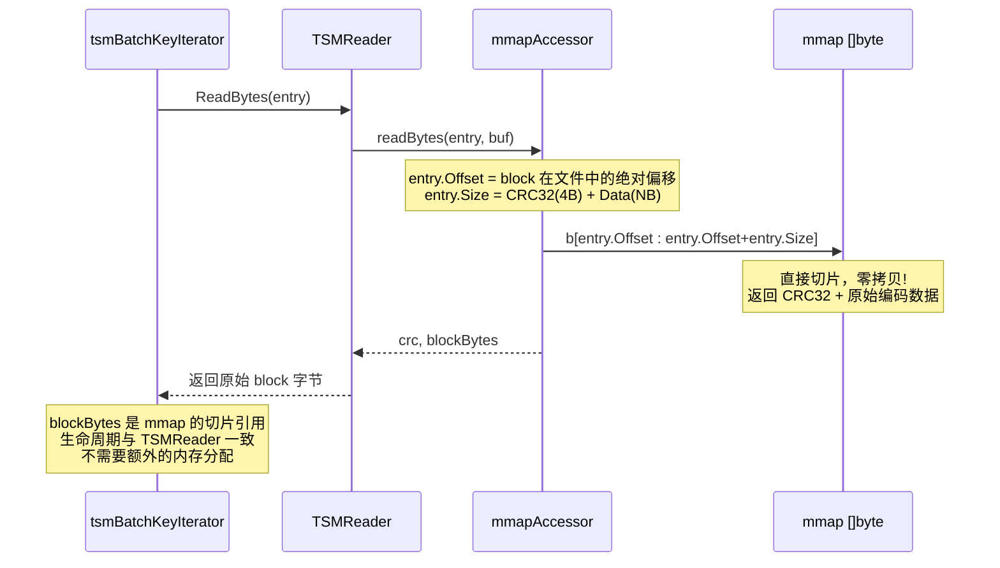

#### mmapAccessor.readBytes — 零拷贝读取

```go
// tsdb/engine/tsm1/reader.go:1649 — mmapAccessor.readBytes
func (m *mmapAccessor) readBytes(entry *IndexEntry, b []byte) (uint32, []byte, error) {
    m.incAccess()
    m.mu.RLock()

    // 边界检查 — 越界时手动释放锁并返回 (不能用 defer，因为正常路径也需要手动释放)
    if int64(len(m.b)) < entry.Offset+int64(entry.Size) {
        m.mu.RUnlock()
        return 0, nil, ErrTSMClosed
    }

    // 直接从 mmap 切片: 跳过 4 字节 CRC，返回 Data 部分
    crc, block := binary.BigEndian.Uint32(m.b[entry.Offset:entry.Offset+4]), m.b[entry.Offset+4:entry.Offset+int64(entry.Size)]
    m.mu.RUnlock()

    return crc, block, nil
}
```

**关键**: `block` 是 mmap 字节的切片，不是副本。这意味着:
- **零分配**: 读取操作不分配新内存
- **生命周期**: block 引用的有效期与 TSMReader 相同
- **并发安全**: 多个 goroutine 可以同时读取同一文件的不同 block

#### mmapAccessor.readBlock — 解码读取

```go
// tsdb/engine/tsm1/reader.go:1630 — mmapAccessor.readBlock
func (m *mmapAccessor) readBlock(entry *IndexEntry, values []Value) ([]Value, error) {
    m.incAccess()
    m.mu.RLock()
    defer m.mu.RUnlock()

    // 边界检查
    if int64(len(m.b)) < entry.Offset+int64(entry.Size) {
        return nil, ErrTSMClosed
    }

    // 跳过 4 字节 CRC，解码 Data 部分
    var err error
    values, err = DecodeBlock(m.b[entry.Offset+4:entry.Offset+int64(entry.Size)], values)
    if err != nil {
        return nil, err
    }
    return values, nil
}
```

**DecodeBlock** 根据 block 类型分发到对应的解码器:
- `BlockFloat64` → Gorilla XOR 解码 → `[]FloatValue`
- `BlockInteger` → Simple8b 解码 → `[]IntegerValue`
- `BlockUnsigned` → Simple8b 解码 → `[]UnsignedValue`
- `BlockBoolean` → 位解包 → `[]BooleanValue`
- `BlockString` → Snappy 解压 → `[]StringValue`

### 4.4 BlockIterator — 顺序遍历所有 Block

Compaction 使用 `BlockIterator` 按 key 排序顺序遍历 TSM 文件中的所有 block。

```go
// tsdb/engine/tsm1/reader.go:133 — BlockIterator
type BlockIterator struct {
    r *TSMReader

    // i is the current key index
    i int

    // n is the total number of keys
    n int

    key     []byte
    cache   []IndexEntry
    entries []IndexEntry
    err     error
    typ     byte
}
```

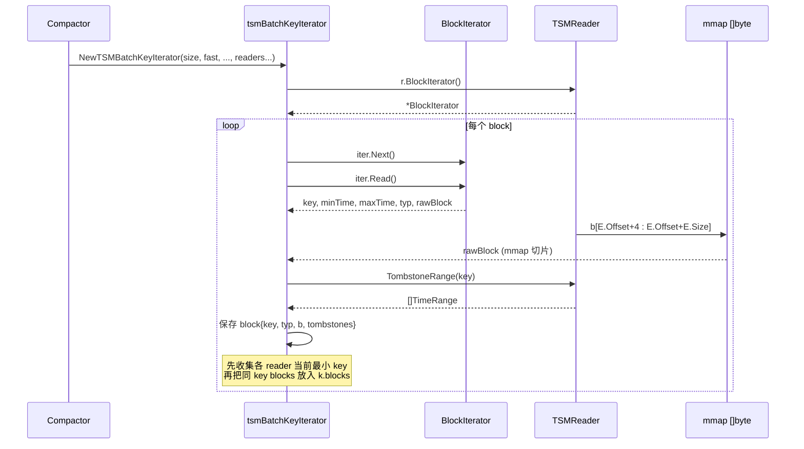

#### tsmBatchKeyIterator — Compaction 专用迭代器

```go
// tsdb/engine/tsm1/compact.go:1421 — tsmBatchKeyIterator
type tsmBatchKeyIterator struct {
    readers   []*TSMReader
    iterators []*BlockIterator
    buf       []blocks
    blocks    blocks

    key []byte
    typ byte

    // decoded values used by compact.gen.go combine*/chunk* paths
    mergedFloatValues    *tsdb.FloatArray
    mergedIntegerValues  *tsdb.IntegerArray
    mergedUnsignedValues *tsdb.UnsignedArray
    mergedBooleanValues  *tsdb.BooleanArray
    mergedStringValues   *tsdb.StringArray

    // per-key 临时缓冲：values[pos] 保存当前 key 已读到的值，
    // buf/pos 用于在同一文件内连续读取同 key 的 block。
    values map[string][]Value
    pos    []int

    // 错误累计：errs 最多保存 maxErrors 条，errSet 去重；
    // 超出上限只增加 overflowErrors，不丢弃计数。
    errs           TSMErrors
    errSet         map[string]struct{}
    maxErrors      int
    overflowErrors int

    fast       bool     // true = 未重叠 block 原样搬运（Level 3）
    size       int      // 单 block 最大点数
    tsmFiles   []string
    currentTsm string

    merged    blocks
    interrupt chan struct{}
}
```

**Next() 的 key 边界处理**:

`tsmBatchKeyIterator.Next()` 先从每个 `BlockIterator` 读取下一个 block，
再在 `k.buf` 中找当前最小 key，并把所有同 key 的 blocks 收集到 `k.blocks`。
每个 block 会携带 `iter.r.TombstoneRange(key)` 返回的 tombstone 范围。

```go
// compact.go:1577-1606, 1666-1682 — 摘要
if iter.Next() {
    key, minTime, maxTime, typ, _, b, err := iter.Read()
    tombstones := iter.r.TombstoneRange(key)
    blk := &block{key: key, typ: typ, b: b, minTime: minTime, maxTime: maxTime}
    blk.tombstones = tombstones
    k.buf[i] = append(k.buf[i], blk)
}

// 找到所有 reader 中当前最小 key，然后收集同 key blocks
for i, b := range k.buf {
    if bytes.Equal(b[0].key, k.key) {
        k.blocks = append(k.blocks, b...)
        k.buf[i] = k.buf[i][:0]
    }
}
k.merge()
```

## 5. Compactor — 文件合并

### 5.1 Compact 入口 — tsmBatchKeyIterator 路径

无论 `fast` 为 true 还是 false，都创建 `NewTSMBatchKeyIterator(...)`；`fast` 保存在
`tsmBatchKeyIterator.fast`。`fast=true` 时，combine* 对未重叠的剩余 block 直接
`k.merged = append(k.merged, k.blocks[i])`，原样搬运（`compact.gen.go:130-139`）；
`fast=false` 时才解码、按时间窗口去重合并，再按 `k.size` 重新分块编码。
Level 3 使用 fast=true（`engine.go:2241-2257` 的 `compactLoPriorityLevel(..., 3, true, ...)`）；
Level 1/2/4 与 optimize 使用 fast=false（`engine.go:2456/2485/2510/2537`）。

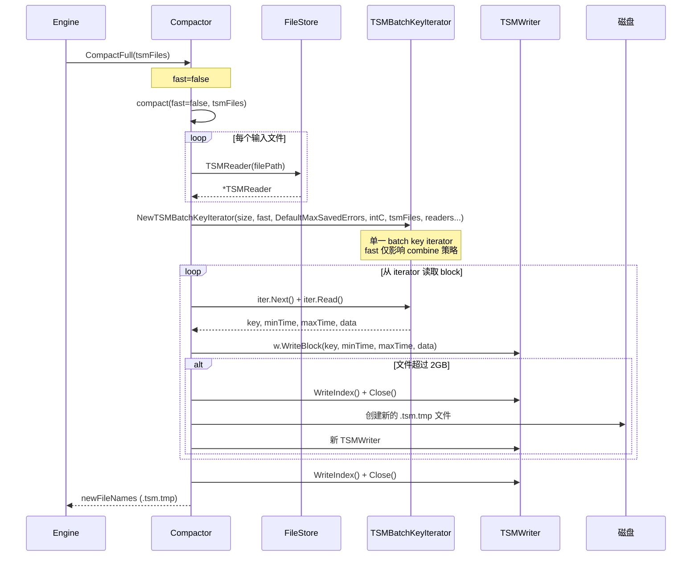

#### compact() 核心实现

```go
// tsdb/engine/tsm1/compact.go:961 — compact
func (c *Compactor) compact(fast bool, tsmFiles []string, logger *zap.Logger,
    pointsPerBlock int) ([]string, error) {
    size := pointsPerBlock

    c.mu.RLock()
    intC := c.compactionsInterrupt
    c.mu.RUnlock()

    var maxGeneration, maxSequence int
    minSeqByGen := make(map[int]int)

    if c.FileStore == nil {
        return nil, fmt.Errorf("compactor for %s has no file store: %w", c.Dir, errCompactionsDisabled)
    }
    for _, f := range tsmFiles {
        gen, seq, err := c.FileStore.ParseFileName(f)   // 不是 c.parseFileName
        if err != nil {
            return nil, err
        }
        if gen > maxGeneration {                        // 高 gen 出现时重置 seq
            maxGeneration, maxSequence = gen, seq
        }
        if gen == maxGeneration && seq > maxSequence {
            maxSequence = seq
        }
        if s, ok := minSeqByGen[gen]; !ok || seq < s {
            minSeqByGen[gen] = seq
        }
    }

    // 输入的最高 level = min(该 generation 的最小 sequence, 4)
    var maxInputLevel int
    for _, minSeq := range minSeqByGen {
        maxInputLevel = max(maxInputLevel, min(minSeq, 4))
    }
    // 输出 level = min(maxSequence+1, 4)，不得低于输入 level
    if maxSequence+1 < maxInputLevel {
        maxSequence = maxInputLevel - 1
    }

    var trs []*TSMReader
    for _, file := range tsmFiles {
        select {
        case <-intC:
            return nil, errCompactionAborted{}
        default:
        }
        tr, err := c.FileStore.TSMReader(file)
        if err != nil {
            return nil, errCompactionAborted{fmt.Errorf("error creating reader for %q: %w", file, err)}
        }
        if tr == nil { // bad plan：文件不存在或不属于本 FileStore
            return nil, errCompactionAborted{fmt.Errorf("bad plan: %s", file)}
        }
        defer tr.Unref()
        trs = append(trs, tr)
    }
    if len(trs) == 0 {
        logger.Debug("No input files")
        return nil, nil
    }

    tsm, err := NewTSMBatchKeyIterator(size, fast, DefaultMaxSavedErrors, intC, tsmFiles, trs...)
    if err != nil {
        return nil, err
    }
    return c.writeNewFiles(maxGeneration, maxSequence, tsmFiles, tsm, true, logger)
}
```

**输出 level 不回退的数值案例**:

```
输入: 000000005-000000001.tsm（gen=5, seq=1，Level 1）
      000000001-000000004.tsm（gen=1, seq=4，Level 4）

遍历:
  gen=5 > maxGeneration(0) → maxGeneration=5, maxSequence=1
  minSeqByGen[5] = 1
  gen=1 不 > 5；gen != maxGeneration → 不更新 seq
  minSeqByGen[1] = 4

maxInputLevel = max(min(1,4), min(4,4)) = 4
maxSequence+1 = 2 < 4 → maxSequence = 3（保证输出不退回 Level 2）

writeNewFiles 先 sequence++ → 4
输出文件名: 000000005-000000004.tsm（level = min(4,4) = 4）
```

### 5.2 writeNewFiles — 文件轮转写入

```go
// tsdb/engine/tsm1/compact.go:1143 — writeNewFiles
func (c *Compactor) writeNewFiles(generation, sequence int, src []string, iter KeyIterator, throttle bool, logger *zap.Logger) ([]string, error) {
    var files []string
    var eInProgress errCompactionInProgress

    for {
        sequence++
        // 文件名: GGGGGGGGG-SSSSSSSSS.tsm.tmp
        fileName := filepath.Join(c.Dir, c.formatFileName(generation, sequence)+"."+TSMFileExtension+"."+TmpTSMFileExtension)

        // write 返回 (rollToNext, err): rollToNext=true 表示文件已满，需开新文件
        rollToNext, err := c.write(fileName, iter, throttle, logger)

        if rollToNext {
            // 文件已满 (size 超 2GB 或 ErrMaxBlocksExceeded)，继续写下一个
            files = append(files, fileName)
            continue
        } else if errors.Is(err, ErrNoValues) {
            // 只有 tombstone 的空文件，删除并结束
            if err := os.RemoveAll(fileName); err != nil {
                return nil, c.RemoveTmpFilesOnErr(files, err)
            }
            break
        } else if errors.As(err, &eInProgress) {
            // errCompactionInProgress: 若底层是 fs.ErrExist 表示另一 compaction 正在使用该文件
            if !errors.Is(eInProgress.err, fs.ErrExist) {
                logger.Error("error creating compaction file", zap.String("output_file", fileName), zap.Error(err))
            } else {
                logger.Warn("file exists, compaction in progress already", zap.String("output_file", fileName))
            }
            return nil, c.RemoveTmpFilesOnErr(files, err)
        } else if err != nil {
            // 其他错误，清理已创建的临时文件 (含当前文件)
            return nil, c.RemoveTmpFilesOnErr(files, err, os.RemoveAll(fileName))
        }

        files = append(files, fileName)
        break
    }
    return files, nil
}
```

#### write() — 单文件写入

```go
// tsdb/engine/tsm1/compact.go:1198 — write
func (c *Compactor) write(path string, iter KeyIterator, throttle bool,
    logger *zap.Logger) (rollToNext bool, err error) {
    fd, err := os.OpenFile(path, os.O_CREATE|os.O_RDWR|os.O_EXCL, 0666)
    if err != nil {
        return false, errCompactionInProgress{err: err}
    }

    type syncingWriter interface {
        io.Writer
        Sync() error
    }

    var w TSMWriter
    var limitWriter syncingWriter = fd
    if c.RateLimit != nil && throttle {
        limitWriter = limiter.NewWriterWithRate(fd, c.RateLimit)
    }
    if iter.EstimatedIndexSize() > 64*1024*1024 {
        w, err = NewTSMWriterWithDiskBuffer(limitWriter)
    } else {
        w, err = NewTSMWriter(limitWriter)
    }
    if err != nil {
        return false, errors.Join(err, fd.Close())   // 不能吞掉 writer 创建错误
    }

    defer func() {
        var eInProgress errCompactionInProgress
        errs := []error{err}
        closeErr := w.Close()
        errs = append(errs, closeErr)
        inProgress := errors.As(err, &eInProgress) && errors.Is(eInProgress.err, fs.ErrExist)
        if closeErr == nil && (inProgress || rollToNext) {
            return // 保留完整文件：轮转中，或另一个 compactor 已创建同名文件
        } else if err != nil || closeErr != nil {
            errs = append(errs, w.Remove()) // 删除半成品
        }
        err = errors.Join(errs...)
    }()

    for iter.Next() {
        c.mu.RLock()
        enabled := c.snapshotsEnabled || c.compactionsEnabled
        c.mu.RUnlock()
        if !enabled {
            return false, errCompactionAborted{}
        }
        key, minTime, maxTime, block, err := iter.Read()
        if err != nil {
            return false, err
        }
        if minTime > maxTime {
            return false, fmt.Errorf("invalid index entry for block. min=%d, max=%d", minTime, maxTime)
        }
        if err := w.WriteBlock(key, minTime, maxTime, block); errors.Is(err, ErrMaxBlocksExceeded) {
            if err := w.WriteIndex(); err != nil { return false, err }
            return true, err
        } else if err != nil {
            return false, err
        }
        if w.Size() > tsdb.MaxTSMFileSize {
            if err := w.WriteIndex(); err != nil { return false, err }
            return true, errMaxFileExceeded
        }
    }

    if err := iter.Err(); err != nil {   // 迭代期间的 block 读取/解码错误
        return false, err
    }
    if err := w.WriteIndex(); err != nil { return false, err }
    return false, nil
}
```

**defer 清理决策表**:

| 条件 | 动作 | 结果 |
|---|---|---|
| `closeErr == nil && (rollToNext || inProgress(fs.ErrExist))` | 不删除 | 保留完整文件 |
| `err != nil` 或 `closeErr != nil`（其他） | `w.Remove()` | 删除半成品 |
| 正常 `WriteIndex` 成功 | 不删除 | 保留 |

**三个容易误读的点**:

- **header 是懒写的**: 源码**不调用** `w.WriteHeader()`；`NewTSMWriter` 不写头，
  `WriteBlock` 在 `t.n == 0` 时懒写 5 字节 header（`writer.go:578-589`）。
- `errMaxFileExceeded` 与 `ErrMaxBlocksExceeded` 是“换文件”信号，不是失败：
  调用方 `writeNewFiles` 看到 `rollToNext=true` 会继续写下一个文件。
- `iter.Err()` 返回 `TSMErrors`（最多 `DefaultMaxSavedErrors=100` 条，另有 dropped 计数），
  上层 `MoveTsmOnReadErr` 只处理 `errBlockRead`。

### 5.3 Compaction 的文件大小限制

```go
// tsdb/config.go:86
MaxTSMFileSize = uint32(2048 * 1024 * 1024) // 2GB
```

当输出文件超过 2GB 时，Compactor 会创建新的 TSM 文件继续写入。
compaction 路径中通过 `tsdb.MaxTSMFileSize` 引用该常量 (如 compact.go 中 `w.Size() > tsdb.MaxTSMFileSize`)。

### 5.4 FileStore.Replace — 原子替换

Compaction 完成后，新文件通过 `FileStore.Replace()` 原子替换旧文件。

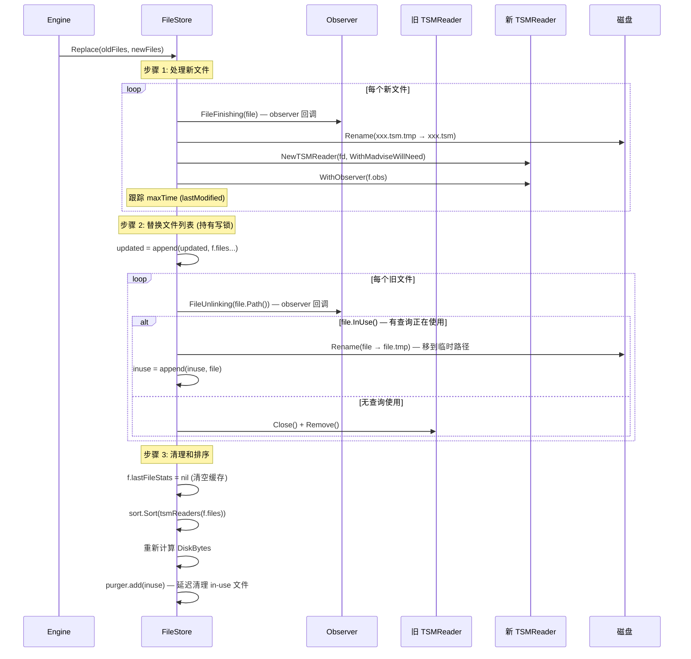

```go
// tsdb/engine/tsm1/file_store.go:896 — replace
func (f *FileStore) replace(oldFiles, newFiles []string, updatedFn func(r []TSMFile)) error {
    if len(oldFiles) == 0 && len(newFiles) == 0 {
        return nil
    }

    f.mu.RLock()
    maxTime := f.lastModified
    f.mu.RUnlock()

    updated := make([]TSMFile, 0, len(newFiles))

    // 步骤 1: 处理新文件
    for _, file := range newFiles {
        // observer 回调: FileFinishing
        if err := f.obs.FileFinishing(file); err != nil {
            return err
        }

        // 重命名 .tsm.tmp → .tsm
        var oldName, newName = file, file
        if strings.HasSuffix(oldName, ".tsm.tmp") {
            newName = file[:len(file)-4]
            if err := os.Rename(oldName, newName); err != nil {
                return err
            }
        }

        // 打开新文件 (带 WithMadviseWillNeed 选项)
        fd, err := os.Open(newName)
        if err != nil {
            // 错误回滚: 重命名回原名
            if newName != oldName {
                os.Rename(newName, oldName)
            }
            return err
        }

        // 跟踪 lastModified
        if stat, err := fd.Stat(); err == nil {
            if maxTime.IsZero() || stat.ModTime().UTC().After(maxTime) {
                maxTime = stat.ModTime().UTC()
            }
        }

        tsm, err := NewTSMReader(fd, f.readerOptions...)
        if err != nil {
            if newName != oldName {
                os.Rename(newName, oldName)
            }
            return err
        }
        tsm.WithObserver(f.obs)
        updated = append(updated, tsm)
    }

    // 步骤 2: 替换文件列表 (持有写锁)
    f.mu.Lock()
    defer f.mu.Unlock()

    updated = append(updated, f.files...)
    var active, inuse []TSMFile
    for _, file := range updated {
        keep := true
        for _, remove := range oldFiles {
            if remove == file.Path() {
                keep = false

                // observer 回调: FileUnlinking
                f.obs.FileUnlinking(file.Path())

                // 处理正在被查询使用的文件
                if file.InUse() {
                    // 重命名为临时路径，延迟清理
                    tempPath := file.Path() + ".tmp"
                    file.Rename(tempPath)
                    inuse = append(inuse, file)
                    continue
                }

                file.Close()
                file.Remove()
                break
            }
        }
        if keep {
            active = append(active, file)
        }
    }

    // 告诉 purger 延迟清理 in-use 文件
    f.purger.add(inuse)

    // 更新 lastModified (确保时间前进)
    if maxTime.Equal(f.lastModified) || maxTime.Before(f.lastModified) {
        maxTime = f.lastModified.UTC().Add(1)
    }
    f.lastModified = maxTime.UTC()

    // 清除缓存
    f.lastFileStats = nil
    f.files = active
    sort.Sort(tsmReaders(f.files))
    // 重新计算磁盘大小统计
}
```

## 6. 时间线数据合并 — tsmBatchKeyIterator 从原始 block 到归并输出

### 6.1 tsmBatchKeyIterator 路径

> **小白解释**: 合并多个 TSM 文件就像**合并多副扑克牌**。
>
> 每副牌（TSM 文件）内部已经按顺序排好了。现在要把它们合并成一副有序的大牌。
>
> **当前实现**: 牌局由 `tsmBatchKeyIterator` 统一处理。它先按 key 收集所有输入文件的 block，
> 再由 `compact.gen.go` 生成的 `merge*/combine*` 判断是否需要解码、去重、排除 tombstone 和重编码。
>
> 只有时间范围重叠、部分读取或带 tombstone 的 block 必须走解码合并；完整且无需 dedup 的 block
> 可以作为 encoded block 进入 `k.merged`，避免不必要的重编码。

`Compactor.compact()` 统一创建 `NewTSMBatchKeyIterator(...)`；不存在额外的合并迭代器。

#### 完整合并流程

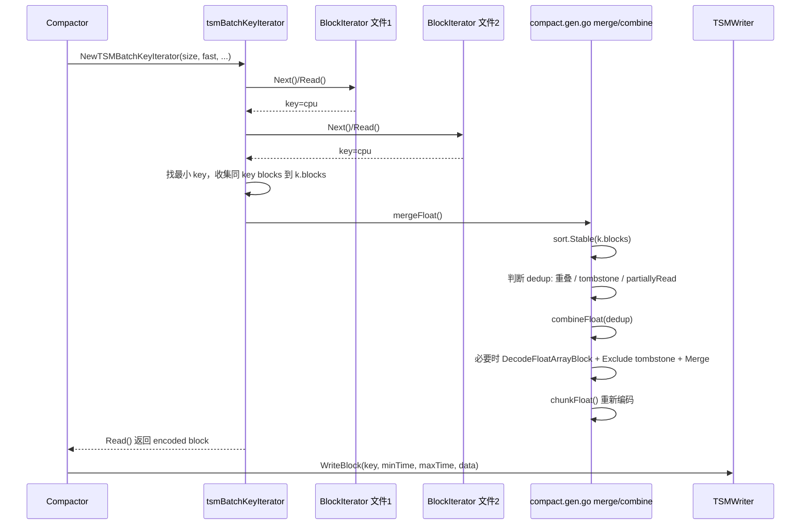

### 6.2 Next — 收集同 key blocks 与 tombstone 范围

`Next()` 是合并的入口。它从每个输入文件的 `BlockIterator` 读取 block，
将每个 block 的原始 bytes、时间范围、类型和 tombstone 范围保存到 `k.buf`。
随后在所有 reader 的当前 block 中找到最小 key，并把同 key 的 blocks 合并到 `k.blocks`。

```go
// tsdb/engine/tsm1/compact.go:1577-1606, 1666-1682 — Next 摘要
if iter.Next() {
    key, minTime, maxTime, typ, _, b, err := iter.Read()
    if err != nil { k.AppendError(errBlockRead{k.currentTsm, err}) }

    tombstones := iter.r.TombstoneRange(key)
    blk := &block{
        key: key, typ: typ, b: b,
        minTime: minTime, maxTime: maxTime,
        tombstones: tombstones,
        readMin: math.MaxInt64, readMax: math.MinInt64,
    }
    k.buf[i] = append(k.buf[i], blk)
}

// 找最小 key，再收集所有同 key blocks。
for i, b := range k.buf {
    if len(b) > 0 && bytes.Equal(b[0].key, k.key) {
        k.blocks = append(k.blocks, b...)
        k.buf[i] = k.buf[i][:0]
    }
}
```

**同一文件内同 key 的连续 block 必须一次收全**：`BlockIterator` 在一个 key 有多个
block 时会连续返回同一个 key。`PeekNext` 预读下一个 key，若仍等于当前 key 就继续
`Next()/Read()`，并用 `cap(k.buf[i]) > len(k.buf[i])` 复用已分配的 slice 容量，
避免反复扩容（`compact.go:1610-1638`）：

```go
blockKey := key
for bytes.Equal(iter.PeekNext(), blockKey) {
    iter.Next()
    key, minTime, maxTime, typ, _, b, err := iter.Read()
    if err != nil { k.AppendError(errBlockRead{k.currentTsm, err}) }
    blk := &block{key: key, typ: typ, b: b, minTime: minTime, maxTime: maxTime,
        tombstones: iter.r.TombstoneRange(key)}
    if cap(k.buf[i]) > len(k.buf[i]) {
        k.buf[i] = k.buf[i][:len(k.buf[i])+1]
        k.buf[i][len(k.buf[i])-1] = blk
    } else {
        k.buf[i] = append(k.buf[i], blk)
    }
}
```

### 6.3 mergeFloat / combineFloat — 类型化数组归并

`mergeFloat()` 先排序 block，再判断是否需要 dedup。只要存在 tombstone、部分读取或时间范围重叠，
`dedup` 就会变成 true，后续 `combineFloat(true)` 会解码、排除 tombstone、归并、重编码。

```go
// compact.gen.go:16 — mergeFloat
func (k *tsmBatchKeyIterator) mergeFloat() {
    sort.Stable(k.blocks)

    dedup := k.mergedFloatValues.Len() != 0
    if len(k.blocks) > 0 && !dedup {
        dedup = len(k.blocks[0].tombstones) > 0 || k.blocks[0].partiallyRead()
        for i := 1; !dedup && i < len(k.blocks); i++ {
            dedup = k.blocks[i].partiallyRead() ||
                k.blocks[i].overlapsTimeRange(k.blocks[i-1].minTime, k.blocks[i-1].maxTime) ||
                len(k.blocks[i].tombstones) > 0
        }
    }

    k.merged = k.combineFloat(dedup)
}
```

`combineFloat(dedup=true)` 先以第一个未读 block 的 `minTime/maxTime` 为种子，
把所有重叠的未读 block 扩进窗口，再逐个解码、裁剪、排除 tombstone、归并：

```go
// compact.gen.go:60-72 — 窗口扩张
first := k.blocks[0]
minTime := first.minTime
maxTime := first.maxTime
for i := 0; i < len(k.blocks); i++ {
    if k.blocks[i].overlapsTimeRange(minTime, maxTime) && !k.blocks[i].read() {
        if k.blocks[i].minTime < minTime {
            minTime = k.blocks[i].minTime
        }
        if k.blocks[i].maxTime > minTime && k.blocks[i].maxTime < maxTime {
            maxTime = k.blocks[i].maxTime
        }
    }
}
```

```go
// compact.gen.go:77-107 — 解码 + 裁剪 + 归并
var v tsdb.FloatArray
if err := DecodeFloatArrayBlock(k.blocks[i].b, &v); err != nil {
    k.handleDecodeError(err, "float")
    return nil
}
v.Exclude(k.blocks[i].readMin, k.blocks[i].readMax)
v.Include(minTime, maxTime)
if v.Len() > 0 {
    k.blocks[i].markRead(v.MinTime(), v.MaxTime())   // markRead 记录实际消费范围
}

for _, ts := range k.blocks[i].tombstones {
    v.Exclude(ts.Min, ts.Max)
}

k.mergedFloatValues.Merge(&v)
```

**窗口扩张数值例**: `A[100-300]` 与 `B[200-400]` 重叠：

```
种子 = A: minTime=100, maxTime=300
扫描 B: overlapsTimeRange(100,300) = true
        B.minTime(200) < 100? 否
        B.maxTime(400) > 100 且 < 300? 否
窗口仍为 [100,300]。
B 解码后 Include(100,300) 只保留 200/300；B 的 400 留在下一轮。
若 B 是 [200-250]（完全落在窗口内），B.maxTime(250) < maxTime(300) → 窗口收缩为 [100,250]。
```

`combineFloat(dedup=false)` 仍会对需要合并的小 block 解码并应用 tombstone；
完整、未读且不需要合并的单个 block 可以直接追加到 `k.merged`：

```go
// compact.gen.go:118-151 — combineFloat 非 dedup 路径：满块直接搬运
for ; i < len(k.blocks); i++ {
    if k.blocks[i].read() {
        continue
    }
    count, err := BlockCount(k.blocks[i].b)
    if err != nil {
        k.AppendError(err)
        continue
    }
    if count < k.size {
        break                      // 小块需要解码合并
    }
    k.merged = append(k.merged, k.blocks[i])   // 已满块原样复用编码字节
}

// compact.gen.go:130-139 — fast=true 的尾块路径
if k.fast {
    for i < len(k.blocks) {
        if k.blocks[i].read() {
            i++
            continue
        }
        k.merged = append(k.merged, k.blocks[i])   // 原样追加，不解码
        i++
    }
}
```

`fast=false` 的剩余小块才会解码、应用 tombstone、`markRead`、`Merge`：

```go
for i < len(k.blocks) && k.mergedFloatValues.Len() < k.size {
    var v tsdb.FloatArray
    DecodeFloatArrayBlock(k.blocks[i].b, &v)
    for _, ts := range k.blocks[i].tombstones {
        v.Exclude(ts.Min, ts.Max)
    }
    k.blocks[i].markRead(k.blocks[i].minTime, k.blocks[i].maxTime)
    k.mergedFloatValues.Merge(&v)
}
```

**tsdb.FloatArray.Merge — 原地覆盖合并**:

`Merge(b)` 把 `b` 覆盖到 `a` 之上；同一时间戳取 `b` 的值。实现在生成的
`tsdb/cursors/arrayvalues.gen.go:146`，有 4 条快路径，且**不分配 `result` 新对象**
（除中段归并时的 `NewFloatArrayLen`）：

```go
// tsdb/cursors/arrayvalues.gen.go:146 — FloatArray.Merge
func (a *FloatArray) Merge(b *FloatArray) {
    if a.Len() == 0 { *a = *b; return }
    if b.Len() == 0 { return }

    // 快路径 1: a 完全在 b 之前 → 直接 append
    if a.MaxTime() < b.MinTime() {
        a.Timestamps = append(a.Timestamps, b.Timestamps...)
        a.Values = append(a.Values, b.Values...)
        return
    }
    // 快路径 2: b 完全在 a 之前 → prepend
    if b.MaxTime() < a.MinTime() {
        var tmp FloatArray
        tmp.Timestamps = append(b.Timestamps, a.Timestamps...)
        tmp.Values = append(b.Values, a.Values...)
        *a = tmp
        return
    }

    // 慢路径: 双指针归并；相同时间戳写 b 的值（b 覆盖 a）
    out := NewFloatArrayLen(a.Len() + b.Len())
    i, j, k := 0, 0, 0
    for i < len(a.Timestamps) && j < len(b.Timestamps) {
        if a.Timestamps[i] < b.Timestamps[j] {
            out.Timestamps[k], out.Values[k] = a.Timestamps[i], a.Values[i]; i++
        } else if a.Timestamps[i] == b.Timestamps[j] {
            out.Timestamps[k], out.Values[k] = b.Timestamps[j], b.Values[j]; i++; j++
        } else {
            out.Timestamps[k], out.Values[k] = b.Timestamps[j], b.Values[j]; j++
        }
        k++
    }
    // 追加剩余元素，最后写回 a
    a.Timestamps, a.Values = out.Timestamps[:k], out.Values[:k]
}
```

**覆盖顺序的前提**: 输入文件按 generation 升序传入 → `sort.Stable(k.blocks)` 只对
“同 key、完全不重叠、且在前”的 block 返回 true（`compact.go:1406-1414` 的 `blocks.Less`），
重叠块保持入参顺序 → 后出现的（更高 generation）`Merge` 覆盖先出现的值。
若自定义文件名破坏 Path 序 == generation 序，该前提失效。

### 6.4 chunkFloat — 分块重编码

归并后的类型化数组需要按 `k.size`（通常 1000 个点）分块，重新编码为 TSM block 格式。

```go
// tsdb/engine/tsm1/compact.gen.go:194 — chunkFloat
func (k *tsmBatchKeyIterator) chunkFloat(dst blocks) blocks {
    if k.mergedFloatValues.Len() > k.size {
        var values tsdb.FloatArray
        values.Timestamps = k.mergedFloatValues.Timestamps[:k.size]
        minTime, maxTime := values.Timestamps[0], values.Timestamps[len(values.Timestamps)-1]
        values.Values = k.mergedFloatValues.Values[:k.size]

        cb, err := EncodeFloatArrayBlock(&values, nil)
        if err != nil {
            k.handleEncodeError(err, "float")
            return nil
        }
        dst = append(dst, &block{key: k.key, minTime: minTime, maxTime: maxTime, b: cb})

        k.mergedFloatValues.Timestamps = k.mergedFloatValues.Timestamps[k.size:]
        k.mergedFloatValues.Values = k.mergedFloatValues.Values[k.size:]
        return dst
    }

    if k.mergedFloatValues.Len() > 0 {
        minTime := k.mergedFloatValues.Timestamps[0]
        maxTime := k.mergedFloatValues.Timestamps[len(k.mergedFloatValues.Timestamps)-1]
        cb, err := EncodeFloatArrayBlock(k.mergedFloatValues, nil)
        if err != nil {
            k.handleEncodeError(err, "float")
            return nil
        }
        dst = append(dst, &block{key: k.key, minTime: minTime, maxTime: maxTime, b: cb})
        k.mergedFloatValues.Timestamps = k.mergedFloatValues.Timestamps[:0]
        k.mergedFloatValues.Values = k.mergedFloatValues.Values[:0]
    }
    return dst
}
```

**EncodeFloatArrayBlock** 编码过程:
1. 时间戳：自适应 TimeEncoder（Delta + 十进制 Scale + Simple8b/RLE/Raw）
   - 首字节 = 高 4 位编码类型（0=Raw, 1=PackedSimple, 2=RLE）| 低 4 位 log10(divisor)
   - 随后 8B 首个 delta；其余 delta 除以 divisor 后进 Simple8b/RLE/Raw
   - 证据: timestamp.go:46-49、165-176
2. float 值：Gorilla XOR（float.go:17-19、77-90）
   - 值段首字节 = floatCompressedGorilla << 4（0x10）
   - 以 math.NaN()（0x7FF8000000000001）作为流结束哨兵，因此 NaN 不能作为数据值
3. integer/unsigned 值：首字节高 4 位编码类型，后接首个值(8B) + Simple8b/RLE/Raw（int.go:125-134）
4. boolean 值：首字节高 4 位类型 + uvarint 数量 + 位打包（bool.go:86-96）
5. string 值：首字节高 4 位类型 + Snappy（batch_string.go:70-89）
6. packBlock: type(1B) + uvarint(tsLen) + ts + values；外层再加 CRC32(4B)

### 6.5 tsmBatchKeyIterator 总体流程

当前实现只有 batch key iterator 路径；`fast=true` 时 `combine*` 尽量原样搬运完整 block，`fast=false` 时解码去重后重新分块编码。
`mergeFloat()` 流程：

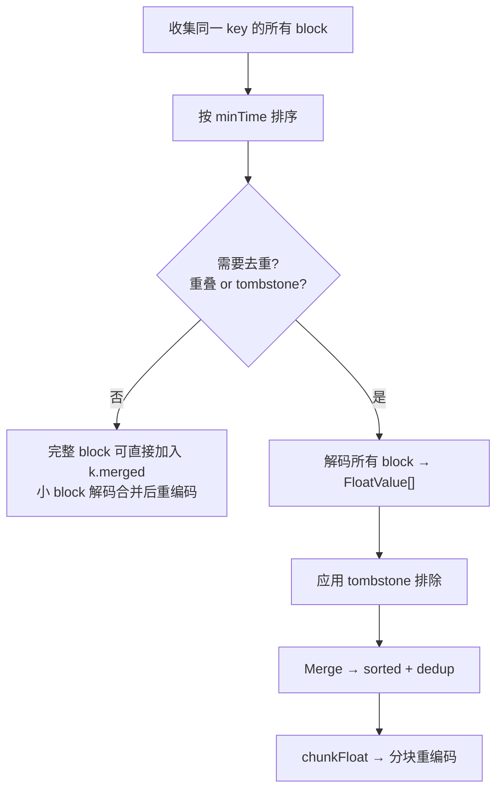

**Tombstone 与 Compaction 交互案例**:

> **具体案例**: 假设 TSM 文件 1 包含 key=`cpu,host=web#!~#value` 的以下 block:
>
> ```
> Block A: [t1=100, t2=200, t3=300]  (时间范围 100-300)
> Block B: [t4=400, t5=500, t6=600]  (时间范围 400-600)
> ```
>
> 用户执行 `DELETE FROM cpu WHERE host='web' AND time >= 200 AND time < 500`
>
> 生成 tombstone: `{Key: "cpu,host=web#!~#value", Min: 200, Max: 499}`
>
> Compaction 时 (`compact.gen.go` 生成的 `combineFloat`):
>
> ```go
> // compact.gen.go:77-107 / 167-185 — combineFloat 摘要
> var v tsdb.FloatArray
> DecodeFloatArrayBlock(k.blocks[i].b, &v)
>
> for _, ts := range k.blocks[i].tombstones {
>     v.Exclude(ts.Min, ts.Max)  // Exclude(200, 499)
> }
>
> k.mergedFloatValues.Merge(&v)
> // 后续 chunkFloat() 将 mergedFloatValues 重新编码成输出 block
> ```
>
> Block A: 解码后 `[100, 200, 300]` → tombstone 排除 `[200, 499]` → 剩余 `[100]`
> Block B: 解码后 `[400, 500, 600]` → tombstone 排除 `[200, 499]` → 剩余 `[500, 600]`
>
> 最终输出: `[100, 500, 600]` — tombstone 范围内的数据被物理删除
>
> 如果排除后同一 key 没有任何 merged block，`tsmBatchKeyIterator.Next()` 会继续读取下一个 key。

### 6.6 一次完整的 compaction 数值推演

> 场景：同一个 key（`cpu,host=web#!~#value`）分布在 3 个 TSM 文件中，另有 1 条 tombstone。

输入文件（`f.files` 按 Path 升序 = generation 升序 = 最旧→最新）:

```
000000001-000000001.tsm  gen1  block [100,450]  值 (100,1)(200,2)(300,3)(400,4)(450,45)
000000002-000000001.tsm  gen2  block [400,600]  值 (400,40)(500,50)(600,60)
000000003-000000002.tsm  gen3  block [700,900]  值 (700,700)(800,800)(900,900)
tombstone 关联 gen2 的 key: {Min:500, Max:500}
```

| 步骤 | 代码位置 | 中间结果 |
|---|---|---|
| 1. 收集 blocks | `NewTSMBatchKeyIterator.Next` | `k.blocks = [B1(100-450), B2(400-600), B3(700-900)]`，B2 携带 tombstone `{500,500}` |
| 2. 稳定排序 | `sort.Stable(k.blocks)`（compact.go:1406-1414） | B1/B2 重叠 → `blocks.Less` 不交换，保持输入顺序（generation 升序） |
| 3. 判定 dedup | `mergeFloat` | B1↔B2 重叠、B2 有 tombstone → `dedup=true` |
| 4. 第一轮窗口 | `combineFloat(true)` | `first=B1`，窗口 `[100,450]`；只解码 B1、B2 |
| 5. B1 解码 | `DecodeFloatArrayBlock` | `[(100,1),(200,2),(300,3),(400,4),(450,45)]`；`Exclude(MaxInt64,MinInt64)` 无操作；`markRead(100,450)` |
| 6. B2 解码 | 同上 | `[(400,40),(500,50),(600,60)]` → `Include(100,450)` → `[(400,40)]`；`markRead(400,400)`；tombstone `Exclude(500,500)` 对 400 无影响 |
| 7. Merge | `mergedFloatValues.Merge(&v)` | `100,200,300,400→40,450`（400 被 gen2 覆盖） |
| 8. 第二轮窗口 | B1 已读 → 前移到 B2 | 窗口 `[400,600]`；B2 `Exclude(400,400)` 去掉已读的 400 |
| 9. B2 剩余 | 同上 | `[(500,50),(600,60)]` → tombstone 删 500 → `[(600,60)]`；`markRead(500,600)` |
| 10. B3 | 与 `[400,600]` 不重叠 | 本轮跳过 |
| 11. 第三轮 | B2 已读 → B3 | 窗口 `[700,900]`；解码 B3，`markRead(700,900)`，Merge |
| 12. chunkFloat | `k.size=1000` | 9 个值 < 1000 → 单个输出 block |
| 13. writeNewFiles | `maxGeneration=max(1,2,3)=3`，`maxSequence=2` | `sequence++ → 3`，输出 `000000003-000000003.tsm` |

期望输出（一个文件、一个 block）:

```
000000003-000000003.tsm
  block [100,900]
  values: (100,1)(200,2)(300,3)(400,40)(450,45)(600,60)(700,700)(800,800)(900,900)
  说明: 500 被 tombstone 删除；400 的旧值 4 被 gen2 的 40 覆盖。
```

关键不变量:
- `first.markRead(minT, maxT)` 记录的是**本轮实际消费的窗口**，不是整个 block；
  下一轮靠 `blocks[i].read()` 跳过已读完的 block、靠 `Exclude(readMin, readMax)` 裁掉已读值。
- `markRead` 取并集（`file_store.go:1408-1420` 的语义）：第二轮 `markRead(500,600)` 与
  第一轮 `markRead(400,400)` 合并成 `{readMin:400, readMax:600}`，因此 B2 在第二轮后
  被判定为完全读完。

## 7. 错误处理

### 7.0 错误类型定义

```go
// tsdb/engine/tsm1/compact.go:50-82
type errCompactionInProgress struct { err error }  // struct 类型，类型断言比较
type errCompactionAborted struct { err error }      // struct 类型，由 interrupt channel 触发
type errBlockRead struct {                          // struct 类型，包含损坏文件路径
    file string
    err  error
}

var errCompactionsDisabled = errors.New("compactions disabled")  // error 变量，== 比较
```

> **关键区别**: `errCompactionsDisabled` 是包级 error 变量，用 `==` 比较。
> `errCompactionInProgress`、`errCompactionAborted`、`errBlockRead` 是 struct 类型，用类型断言比较。

### 7.0.1 compactCache vs compact 的退出通道

```go
// compactCache 使用 e.snapDone 通道退出
func (e *Engine) compactCache() {
    quit := e.snapDone  // snapshot 相关
    select { case <-quit: return ... }
}

// compact 使用 e.done 通道退出
func (e *Engine) compact(wg *sync.WaitGroup) {
    quit := e.done  // compaction 相关
    select { case <-quit: return ... }
}
```

### 7.0.2 compactionStrategy 结构

```go
// tsdb/engine/tsm1/engine.go:2564 — compactionStrategy
type compactionStrategy struct {
    group CompactionGroup

    fast           bool   // true = CompactFast (快速重写), false = CompactFull (完整合并)
    level          int
    pointsPerBlock int    // 每个 block 的最大点数 (通常 DefaultMaxPointsPerBlock; optimize 路径可放大)

    durationStat *int64
    activeStat   *int64
    successStat  *int64
    errorStat    *int64

    logger    *zap.Logger
    compactor *Compactor
    fileStore *FileStore

    engine *Engine
}
```

### 7.0.3 acquire/Release 机制

Planner 通过 `filesInUse` map 防止多个 plan 返回同一文件:

```go
// tsdb/engine/tsm1/compact.go:726 — acquire
func (c *DefaultPlanner) acquire(groups []CompactionGroup) bool {
    c.mu.Lock()
    defer c.mu.Unlock()
    // 检查文件是否已被其他 plan 占用
    for _, g := range groups {
        for _, f := range g {
            if _, ok := c.filesInUse[f]; ok {
                return false
            }
        }
    }
    // 标记所有文件为 in-use
    for _, g := range groups {
        for _, f := range g {
            c.filesInUse[f] = struct{}{}
        }
    }
    return true
}

// tsdb/engine/tsm1/compact.go:753 — Release
func (c *DefaultPlanner) Release(groups []CompactionGroup) {
    c.mu.Lock()
    defer c.mu.Unlock()
    for _, g := range groups {
        for _, f := range g {
            delete(c.filesInUse, f)
        }
    }
}
```

**两套互斥必须区分**（`errCompactionInProgress` 来自第二层，不是 Planner）：

| 层级 | 数据结构 | 生命周期 | 作用 |
|---|---|---|---|
| Planner `acquire/Release` | `filesInUse map[string]struct{}`（compact.go:726-760） | 跨 tick 的计划占用，tick 末尾 `ReleaseCompactionPlans` 或 goroutine 内 `Release` | 防止同一文件被两个计划（如 L4 与 L5）同时选中 |
| Compactor `add/remove` | `files map[string]struct{}`（compact.go:797、1311-1345） | 单次 `CompactFast/CompactFull` 的在途保护，`defer c.remove(tsmFiles)` | 任一文件已在集合中 → 返回 `errCompactionInProgress{}`；真正打开文件前再兜底一次 |

### 7.0.4 forceFull 机制

```go
// tsdb/engine/tsm1/compact.go:309 — ForceFull
func (c *DefaultPlanner) ForceFull() {
    c.mu.Lock()
    defer c.mu.Unlock()
    c.forceFull = true
}
```

当 `forceFull = true` 时:
- `PlanLevel()` 返回 `(nil, 0)`，`PlanOptimize()` 返回 `(nil, 0, 0)`（不抢占文件）
- `Plan()` 重置 `forceFull = false` 并执行 full compaction

### 7.0.5 Compactor 中的 Rate Limiting 和 Interrupt

```go
// tsdb/engine/tsm1/compact.go:1198 — write() 中的限速
if c.RateLimit != nil && throttle {
    limitWriter = limiter.NewWriterWithRate(fd, c.RateLimit)
}

// tsdb/engine/tsm1/compact.go:1224 — TSMWriter 磁盘缓冲
if iter.EstimatedIndexSize() > 64*1024*1024 {
    w, err = NewTSMWriterWithDiskBuffer(limitWriter)  // 索引 > 64MB 时用磁盘缓冲
}

// tsdb/engine/tsm1/compact.go:961 — compact() 中的 interrupt channel
c.mu.RLock()
intC := c.compactionsInterrupt
c.mu.RUnlock()

// 在遍历文件时检查 interrupt
for _, file := range tsmFiles {
    select {
    case <-intC:
        return nil, errCompactionAborted{}
    default:
    }
    // ...
}
```

**Compaction 中断检查点完整列表**:

Compaction 通过 `compactionsInterrupt` channel 实现优雅停止。关闭此 channel 后，所有正在执行的 compaction 会在下一个检查点返回 `errCompactionAborted{}`。

| # | 检查点位置 | 代码行 | 检查方式 |
|---|-----------|--------|---------|
| 1 | `compact()` — TSM 文件遍历循环 | compact.go:1016-1019 | `select { case <-intC: return nil, errCompactionAborted{} }` |
| 2 | `write()` — 每个 block 写入前 | compact.go:1255-1261 | `c.snapshotsEnabled \|\| c.compactionsEnabled` enabled-flag 检查 (非 intC select；中断间接经由 iterator Read 触发) |
| 3 | `tsmBatchKeyIterator.Read()` — 每次读取前 | compact.go:1721-1725 | `select { case <-k.interrupt: ... }` |
| 4 | `cacheKeyIterator.Read()` — 每次读取前 | compact.go:1910-1915 | `select { case <-c.interrupt: ... }` |

> **intC 传入路径**: `NewTSMBatchKeyIterator(size, fast, DefaultMaxSavedErrors, intC, tsmFiles, trs...)`
> (compact.go:1041) 将 `intC` 存为 `tsmBatchKeyIterator.interrupt` (`k.interrupt`)，后续由检查点 3 读取。
> 不存在 `tsmKeyIterator` 这一类型——当前实现只有 `tsmBatchKeyIterator` 与 `cacheKeyIterator` 两条 key iterator 路径。

**中断语义**: 中断不是立即停止——当前正在写入的 block 会完成，然后在下一个检查点返回错误。调用方（`compactGroup`）会清理已创建的临时文件。

```go
// tsdb/engine/tsm1/engine.go:2591 — compactGroup
func (s *compactionStrategy) compactGroup() {
    group := s.group
    log, logEnd := logger.NewOperation(s.logger, "TSM compaction", "tsm1_compact_group", logger.Shard(s.engine.id))
    defer logEnd()

    // 策略构造器可能传 0；必须兜底为 1000
    pointsPerBlock := s.pointsPerBlock
    if pointsPerBlock <= 0 {
        pointsPerBlock = tsdb.DefaultMaxPointsPerBlock
    }

    var (
        err   error
        files []string
    )
    if s.fast {
        files, err = s.compactor.CompactFast(group, log, pointsPerBlock)
    } else {
        files, err = s.compactor.CompactFull(group, log, pointsPerBlock)
    }

    if err != nil {
        // 出错时统一清理已写出的 .tsm.tmp 文件
        defer func(fs []string) {
            if removeErr := s.compactor.RemoveTmpFiles(fs); removeErr != nil {
                log.Warn("Unable to remove temporary file(s)", zap.Error(removeErr))
            }
        }(files)

        _, inProgress := err.(errCompactionInProgress)
        if err == errCompactionsDisabled || inProgress {
            log.Info("Aborted compaction", zap.Error(err))
            if _, ok := err.(errCompactionInProgress); ok {
                time.Sleep(time.Second)
            }
            return
        }

        log.Warn("Error compacting TSM files", zap.Error(err))
        MoveTsmOnReadErr(err, log, s.fileStore.Replace)

        atomic.AddInt64(s.errorStat, 1)
        time.Sleep(time.Second)
        return
    }

    if err := s.fileStore.Replace(group, files); err != nil {
        log.Error("Error replacing new TSM files", zap.Error(err))
        atomic.AddInt64(s.errorStat, 1)
        time.Sleep(time.Second)

        // 删除新文件，下次 tick 重试
        for _, file := range files {
            if err := os.Remove(file); err != nil {
                log.Error("Unable to remove file", zap.String("path", file), zap.Error(err))
            }
        }
        return
    }

    for i, f := range files {
        log.Info("Compacted file", zap.Int("tsm1_index", i), zap.String("tsm1_file", f))
    }
    atomic.AddInt64(s.successStat, 1)
}
```

> **小白解释**: Compaction 错误处理就像快递站的异常处理：
> - **Compaction 被禁用**: 使用 `==` 比较 (errCompactionsDisabled 是 error 变量)，记录日志后返回
> - **Compaction 进行中**: 使用类型断言 `err.(errCompactionInProgress)` (是 struct 类型)，sleep 1s 后返回
> - **文件损坏 (errBlockRead)**: 通过 `MoveTsmOnReadErr` 辅助函数处理，内部用 `errors.As(err, &blockReadErr)` 捕获，再调用 `s.fileStore.Replace([]string{path}, nil)` (2 参数) 移除损坏文件，`os.Rename` 标记为 `.bad`
> - **其他错误 (含 errCompactionAborted)**: errorStat++, sleep 1s 后返回
> - **成功**: `s.fileStore.Replace(group, files)` (2 参数) 替换文件，successStat++

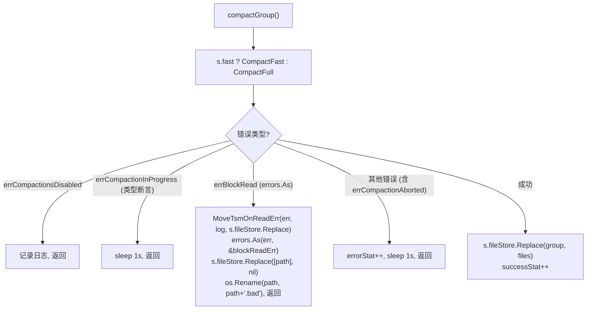

### 7.1 TSMErrors 与“部分成功”

`tsmBatchKeyIterator.AppendError` 用 `errSet`（错误字符串集合）去重，
最多保存 `DefaultMaxSavedErrors = 100` 条；超出上限时不再保存，只把
`overflowErrors++`（`compact.go:1485-1499`）。因此错误总数 = `len(errs) + overflowErrors`。

```go
// tsdb/engine/tsm1/compact.go:1485-1499 — AppendError
func (k *tsmBatchKeyIterator) AppendError(err error) bool {
    s := err.Error()
    if _, ok := k.errSet[s]; ok {
        return true                  // 重复错误：已保存过，返回 true
    }
    if k.maxErrors > len(k.errs) {
        k.errs = append(k.errs, err)
        k.errSet[s] = struct{}{}
        return true                  // 新错误且未超上限
    }
    k.overflowErrors++               // 超上限：只计数，返回 false
    return false
}
```

**部分成功语义**: 单个 block 解码失败**不会**中止整个 compaction；`write()` 的
`iter.Next()` 循环继续处理后续 key/block，循环结束后才检查 `iter.Err()`。
若 `iter.Err()` 非空，`write()` 返回错误，本次 compaction 视为失败并清理临时文件
（`compact.go:1286-1310`）；若错误可被 `errors.As(err, &errBlockRead)` 捕获，
上层 `MoveTsmOnReadErr` 会把损坏文件 rename 成 `.bad`（`engine.go:2663-2675`）。

**数值案例**: 3 个 block 解码失败，且三个错误字符串互不相同 →
`len(errs)=3`、`overflowErrors=0`、`iter.Err()` 返回 3 条错误；若同一损坏 block
被重试 150 次、错误字符串相同 → `len(errs)=1`，不会因重复而溢出。

### 7.2 损坏文件处理

`FileStore.Open()` 对每个文件启动 goroutine，通过**无缓冲** `readerC := make(chan *res)`
回传结果（`file_store.go:613`）；主循环遇到第一个错误立即 `return res.err`，
其余 goroutine 会阻塞在发送上（`file_store.go:631-670`）。

| 错误类型 | 判定 | 动作 | 结果 |
|---|---|---|---|
| mmap 系统限制 | `errors.Is(err, MmapError{})` | **不 rename** | 返回 “system limit for vm.max_map_count may be too low”；原文件保留 |
| 普通损坏 | 其他错误 | `logger.Error("Cannot read corrupt tsm file, renaming")` → `os.Rename(file.Name(), file.Name()+".bad")` | 成功则返回 “cannot read corrupt file”；rename 失败则返回 rename 错误（原文件仍在） |

```go
// tsdb/engine/tsm1/file_store.go:645-667 — 两类失败路径
if err != nil {
    if errors.Is(err, MmapError{}) {
        readerC <- &res{r: df, err: fmt.Errorf("cannot read file %s, system limit for vm.max_map_count may be too low: %w", file.Name(), err)}
        return
    }
    // 普通损坏：rename 成 .bad
    f.logger.Error("Cannot read corrupt tsm file, renaming", zap.String("path", file.Name()), zap.Int("id", idx), zap.Error(err))
    if e := os.Rename(file.Name(), file.Name()+"."+BadTSMFileExtension); e != nil {
        readerC <- &res{r: df, err: fmt.Errorf("cannot rename corrupt file %s: %w", file.Name(), e)}
        return
    }
    readerC <- &res{r: df, err: fmt.Errorf("cannot read corrupt file %s: %w", file.Name(), err)}
    return
}
```

> **重要**: 两类错误都会让 `Open()` 返回错误，而不是静默跳过。区别只在是否把原文件
> rename 成 `.bad`；mmap 限制属于部署问题，保留原文件以便调高系统限制后重试。

## 8. TSM 文件统计

### 8.1 FileStat — 文件元数据

```go
// tsdb/engine/tsm1/file_store.go:237 — FileStat
type FileStat struct {
    Path             string
    HasTombstone     bool
    Size             uint32
    LastModified     int64
    MinTime, MaxTime int64
    MinKey, MaxKey   []byte
    Generation       int
    Sequence         int
}

// tsdb/engine/tsm1/file_store.go:252 — ExtFileStat
type ExtFileStat struct {
    FileStat
    FirstBlockCount int  // 由 ExtStats() 额外计算，可能失败
}
```

### 8.2 TSMReader.Stats — 获取文件统计

```go
// tsdb/engine/tsm1/reader.go:666 — TSMReader.Stats
func (t *TSMReader) Stats() FileStat {
    minTime, maxTime := t.index.TimeRange()
    minKey, maxKey := t.index.KeyRange()
    return FileStat{
        Path:         t.Path(),
        Size:         t.Size(),
        LastModified: t.LastModified(),
        MinTime:      minTime,
        MaxTime:      maxTime,
        MinKey:       minKey,
        MaxKey:       maxKey,
        HasTombstone: t.tombstoner.HasTombstones(),
        Generation:   t.generation,
        Sequence:     t.sequence,
    }
}
```

### 8.3 FileStore.Stats — 懒缓存 (双检锁)

```go
// tsdb/engine/tsm1/file_store.go:858 — FileStore.Stats
func (f *FileStore) Stats() []ExtFileStat {
    // 第一次检查: RLock 快速路径
    f.mu.RLock()
    if len(f.lastFileStats) > 0 {
        defer f.mu.RUnlock()
        return f.lastFileStats
    }
    f.mu.RUnlock()

    // 缓存失效: 升级为写锁
    f.mu.Lock()
    defer f.mu.Unlock()

    // 第二次检查: 可能其他 goroutine 已经填充了缓存
    if len(f.lastFileStats) > 0 {
        return f.lastFileStats
    }

    // 容量检查: 如果缓存容量远小于文件数，重新分配
    if cap(f.lastFileStats) < len(f.files)/2 {
        f.lastFileStats = make([]ExtFileStat, 0, len(f.files))
    }

    for _, fd := range f.files {
        stats, err := fd.ExtStats()
        if err != nil {
            // ExtStats 出错时 embedded FileStat 仍然有效，只记录警告并继续
            f.logger.Warn("error during fd.Stats", zap.Error(err))
        }
        f.lastFileStats = append(f.lastFileStats, stats)
    }
    return f.lastFileStats
}
```

**缓存失效**: 当文件被添加、删除或替换时，`lastFileStats` 被设为 `nil` (`f.lastFileStats = nil`)，
强制下次调用重新计算。注意: Stats() 使用 `len() > 0` 检查（而非 `== nil`），使代码在两种失效方式下都能正确工作。

### 8.4 EngineStatistics — 引擎统计

```go
// tsdb/engine/tsm1/engine.go:684 — EngineStatistics
type EngineStatistics struct {
    CacheCompactions        int64
    CacheCompactionsActive  int64
    CacheCompactionErrors   int64
    CacheCompactionDuration int64

    TSMCompactions        [3]int64  // Level 1-3 的 compaction 次数
    TSMCompactionsActive  [3]int64  // Level 1-3 的活跃 compaction 数
    TSMCompactionErrors   [3]int64
    TSMCompactionDuration [3]int64
    TSMCompactionsQueue   [3]int64  // Level 1-3 的队列深度

    TSMOptimizeCompactions        int64
    TSMOptimizeCompactionsActive  int64
    TSMOptimizeCompactionErrors   int64
    TSMOptimizeCompactionDuration int64
    TSMOptimizeCompactionsQueue   int64

    TSMFullCompactions        int64
    TSMFullCompactionsActive  int64
    TSMFullCompactionErrors   int64
    TSMFullCompactionDuration int64
    TSMFullCompactionsQueue   int64
}
```

## 9. 架构设计意图

### 9.1 为什么用多级 Compaction

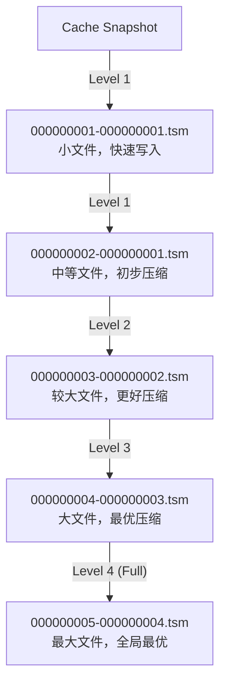

**多级 Compaction 的优势**：
1. **渐进式压缩**：L1 每积累 8 个 generation、L2-L4 每积累 4 个 generation 触发一次 compaction，避免一次性 compact 所有文件
2. **写入放大控制**：每次只 compact 同级别的文件，减少写入量
3. **查询性能**：较低级别的文件数量少，查询时需要扫描的文件更少

### 9.2 为什么用优先级调度

- **Level 1-2**: 高优先级，因为它们是新数据，查询频率高
- **Level 3**: 低优先级，因为它是中间状态
- **Level 4**: 最低优先级，因为它是冷数据优化

### 9.3 为什么用 ticker 驱动

- **简单可靠**: 不需要复杂的事件通知机制
- **自愈性**: 即使某次 compaction 失败，下次 tick 会重新检查
- **可预测**: 固定的检查间隔，便于性能调优

## 10. 架构收益

| 维度 | 收益 |
|------|------|
| **写入性能** | Cache Snapshot 快速写入 sequence=1/Level 1 文件，不阻塞查询 |
| **查询性能** | 多级 compaction 减少文件数量，提高查询效率 |
| **压缩比** | 渐进式压缩，最终达到最优压缩比 |
| **I/O 控制** | 写冷超时触发 full compaction，避免与写入竞争 |
| **内存控制** | 自适应并发，根据 series 基数调整并发度 |
| **错误恢复** | 损坏文件会尝试标记为 .bad，但 `FileStore.Open()` 返回错误，调用方需要处理后重试 |

## 11. 潜在隐患与瓶颈

### 11.1 Compaction 的写入放大

每级 compaction 都会重写数据，导致写入放大。对于写入密集的场景，这可能成为瓶颈。

### 11.2 Full Compaction 的 I/O 风暴

Full compaction 需要读取所有文件并写入一个新文件。当文件总量很大时，这会导致显著的 I/O 开销。

### 11.3 Compaction 并发控制

硬编码的 4 文件限制可能导致文件数量很多时 compaction 速度跟不上写入速度。

### 11.4 优先级抢占的不公平

高优先级可以无限制抢占低优先级，可能导致 Level 3/4 永远无法执行。

### 11.5 损坏文件会阻止 Open 成功

损坏文件会被记录日志并尝试重命名为 `.bad`，但当前 `FileStore.Open()` 会返回错误，
不是静默跳过。调用方需要处理错误、移除或修复坏文件后重试。

### 11.6 Tombstone 处理延迟

Tombstone 只有在 compaction 时才会被真正删除。如果 compaction 不频繁，tombstone 会持续占用空间。

### 11.7 常量与配置来源

| 常量 / 配置 | 值 | 来源 | 影响 |
|---|---|---|---|
| `CacheSnapshotMemorySize` | 25 MiB | `tsdb/config.go:29` | Cache 达到该大小触发 snapshot |
| `CacheSnapshotWriteColdDuration` | 10 min | `tsdb/config.go:34` | 写入停止后触发 snapshot |
| `CompactFullWriteColdDuration` | 4 h | `tsdb/config.go:38` | 写入停止后触发 Full compaction |
| `DefaultMaxPointsPerBlock` | 1000 | `tsdb/config.go:53` | 普通 compaction 的每块点数 |
| `DefaultAggressiveMaxPointsPerBlock` | 10000 | `tsdb/config.go:57` | optimize/aggressive compaction 的每块点数 |
| `MaxTSMFileSize` | 2 GiB | `tsdb/config.go:86` | 输出文件轮转阈值 |
| `DefaultMaxSavedErrors` | 100 | `compact.go:45-48` | iterator 最多保存的错误条数 |
| `fsyncEvery` | 25 MiB | `writer.go:104` | 写入过程中周期性 fsync |
| `maxKeyLength` / `maxIndexEntries` | 65535 / 65535 | `writer.go:97-100` | 2B 字段上限 |
| `indexEntrySize/indexCountSize/indexTypeSize` | 28 / 2 / 1 | `writer.go:88-94` | Index 区字节布局 |
| 调度权重 | `[0.4, 0.3, 0.2, 0.1, 0.01]` | `scheduler.go:7` | 队列加权选择 |
| optimize holdoff | 初始 1h，后续 5min | `engine.go:2171-2175` | L5 调度间隔 |
| compaction tick | 1s | `engine.go:2178` | compaction 主循环周期 |
| `compactionLimiter` 默认 | `GOMAXPROCS/2`（≥1，≤GOMAXPROCS） | `store.go:497-511` | 并发 compaction 总数 |
| `optimizedCompactionLimiter` 默认 | 1（≤ compaction limiter） | `store.go:514-524` | 并发 optimize 数 |
| 吞吐限速 | 48 MiB/s，burst 48 MiB/s | `tsdb/config.go:44,49` | compaction 写带宽 |
| purger 轮询 | 1s | `file_store.go:1676` | 延迟删除 in-use 文件 |
