# Module 5: Downsampling (CQ 窗口机制 + RESAMPLE 语义 + 资源隔离) - 深度审计报告

> **小白导读**: 降采样就像**数据摘要**。原始数据每秒一个点，存一年就是 3153 万个点。
> 但你可能只需要每分钟的平均值——一年只需要 52 万个点，少了 60 倍！
>
> **CQ (Continuous Query)** 就是自动执行的降采样任务：
> - 每隔一段时间（如每分钟），自动查询原始数据
> - 计算聚合结果（平均值、最大值、最小值等）
> - 写入到新的 measurement（如从 `cpu_raw` 写入 `cpu_1m`）
>
> 就像一个自动文摘机器人：每隔一小时，把报纸上的文章压缩成一句话摘要。

## 1. CQ 执行全链路总览

### 1.1 从定时器到降采样写入的完整路径

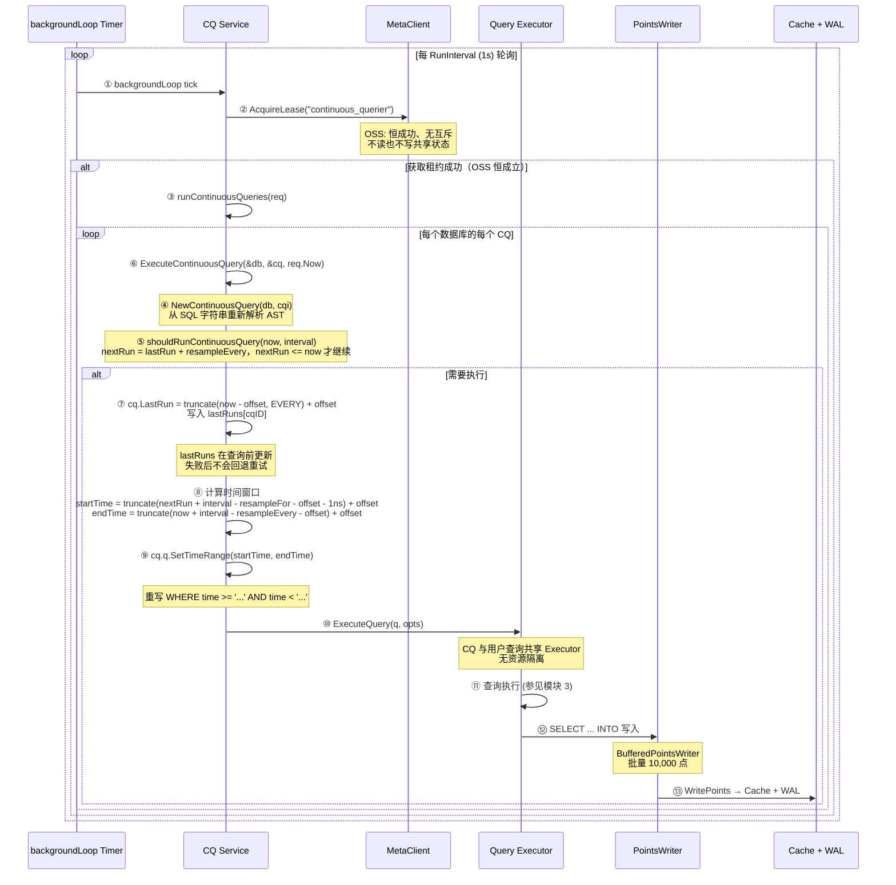

> 说明：④⑤⑦⑧ 都发生在 ⑥ `ExecuteContinuousQuery` **内部**，不是调用方步骤。时间窗口公式里的
> `-1ns` 让 `startTime` 向前多退 1 纳秒，保证它落在上一窗口的闭区间起点（否则 `truncate` 会把
> 恰好对齐的 `nextRun` 归到下一窗口）；`offset` 则把 `GROUP BY time(1m, 30s)` 的偏移同时带入
> 窗口两端（`service.go:359-360`）。

### 1.2 每一步的代码实现

#### 步骤 ①: backgroundLoop — 双触发源

```go
// services/continuous_querier/service.go:216 — backgroundLoop
func (s *Service) backgroundLoop() {
    t := time.NewTimer(s.RunInterval)  // 默认 1s
    defer t.Stop()
    defer s.wg.Done()
    for {
        select {
        case <-s.stop:
            s.Logger.Info("Terminating continuous query service")
            return

        // 触发源 1: 手动触发 (事件时间)
        case req := <-s.RunCh:
            if !s.hasContinuousQueries() {
                continue
            }
            if _, err := s.MetaClient.AcquireLease(leaseName); err == nil {
                s.runContinuousQueries(req)
            }

        // 触发源 2: 定时器 (处理时间)
        case <-t.C:
            if !s.hasContinuousQueries() {
                t.Reset(s.RunInterval)
                continue
            }
            if _, err := s.MetaClient.AcquireLease(leaseName); err == nil {
                s.runContinuousQueries(&RunRequest{Now: time.Now()})
            }
            t.Reset(s.RunInterval)
        }
    }
}
```

**select 的三个 case**:
- **停止信号** (`s.stop`)：服务关闭时退出循环
- **事件时间** (`RunCh`)：外部推送，可指定任意 `Now`（如手动触发 CQ）
- **处理时间** (`t.C`)：每秒检查，使用 `time.Now()`

#### 补充: Run() 公开方法与 RunRequest.CQs 的真实关系

```go
// services/continuous_querier/service.go:52 — RunRequest 结构体
type RunRequest struct {
    Now time.Time   // 当前时间
    CQs []string    // 指定要执行的 CQ 名称，nil 表示全部执行
}

// services/continuous_querier/service.go:61 — matches 过滤
func (rr *RunRequest) matches(cq *meta.ContinuousQueryInfo) bool {
    if rr.CQs == nil {
        return true
    }
    for _, q := range rr.CQs {
        if q == cq.Name {
            return true
        }
    }
    return false
}

// services/continuous_querier/service.go:180 — Run 公开方法
func (s *Service) Run(database, name string, t time.Time) error {
    var dbs []meta.DatabaseInfo
    if database != "" {
        db := s.MetaClient.Database(database)
        if db == nil {
            return query.ErrDatabaseNotFound(database)
        }
        dbs = append(dbs, *db)
    } else {
        dbs = s.MetaClient.Databases()
    }

    // 清除匹配 CQ 的 lastRuns，使其被视为"首次执行"
    s.mu.Lock()
    defer s.mu.Unlock()
    for _, db := range dbs {
        for _, cq := range db.ContinuousQueries {
            if name == "" || cq.Name == name {
                id := fmt.Sprintf("%s%s%s", db.Name, idDelimiter, cq.Name)
                delete(s.lastRuns, id)
            }
        }
    }

    // 通过 RunCh 触发执行
    s.RunCh <- &RunRequest{Now: t}
    return nil
}

// services/continuous_querier/service.go:248 — hasContinuousQueries 早期退出优化
func (s *Service) hasContinuousQueries() bool {
    dbs := s.MetaClient.Databases()
    for _, db := range dbs {
        if len(db.ContinuousQueries) > 0 {
            return true
        }
    }
    return false
}
```

**Run() 的真实语义**: 外部调用者（如 CLI 或 API）可传入 `database` 和 `name`，但当前 `Run()` 并不会把它们填入 `RunRequest.CQs`。它只删除匹配 CQ 的 `lastRuns` 项，然后发送 `RunRequest{Now: t}`。由于 `CQs` 仍为 `nil`，后台 `runContinuousQueries` 仍会遍历所有数据库和所有 CQ；被删除 `lastRuns` 的 CQ 会被视为首次执行，其他 CQ 如果按自己的 `resampleEvery` 已到期，也可能在同一轮被执行。

因此，`Run(database, name, t)` 不是“只执行指定 CQ”的硬过滤器，而是“让匹配 CQ 立即具备执行资格”的调度触发。

**调用约束**（`service.go:180-212`、`:121-150`）:
- 必须在 `Open()` 之后调用。`RunCh` 是**无缓冲** channel（`service.go:109`），服务未启动或已 `Close()` 时 `s.RunCh <- ...` 会永久阻塞。
- `Run()` 在发送前持有 `s.mu`（`:196-197` 的 `defer s.mu.Unlock()`）。若 `backgroundLoop` 正在执行一个耗时 CQ（同样持 `s.mu`），`Run()` 会一直阻塞并占住调用方 goroutine。
- `Close()`（`service.go:139-150`）只 `close(stop)` + `wg.Wait()`，不会中断正在执行的 CQ；若此时有 `Run()` 阻塞在 `RunCh` 上，`backgroundLoop` 已退出，该 goroutine 永远不会被唤醒。
- `Run()` 不保证立即产生写入：即使 `lastRuns` 被清除，非窗口边界的 `now` 也会让 `ExecuteContinuousQuery` 空跑（详见 12 号文档 §7.5）。

#### 步骤 ②: AcquireLease — OSS 中直接成功

```go
// services/meta/client.go:127 — AcquireLease (单节点模式)
func (c *Client) AcquireLease(name string) (*Lease, error) {
    l := Lease{
        Name:       name,
        Expiration: time.Now().Add(DefaultLeaseDuration),  // 60s
    }
    return &l, nil  // 单节点始终成功
}

// services/meta/data.go:1824 — Leases.Acquire (集群模式)
func (leases *Leases) Acquire(name string, nodeID uint64) (*Lease, error) {
    leases.mu.Lock()
    defer leases.mu.Unlock()

    l := leases.m[name]
    if l != nil {
        if time.Now().After(l.Expiration) || l.Owner == nodeID {
            l.Expiration = time.Now().Add(leases.d)
            l.Owner = nodeID
            return l, nil
        }
        return l, errors.New("another node has the lease")
    }

    l = &Lease{
        Name:       name,
        Expiration: time.Now().Add(leases.d),
        Owner:      nodeID,
    }
    leases.m[name] = l
    return l, nil
}
```

**OSS 语义校准**:
- `MetaClient.AcquireLease()`（`services/meta/client.go:127-133`）不检查 Leader，也不读写任何共享状态；它构造一个本地 `Lease` 后直接返回成功，因此**不提供任何互斥**。返回的 `Lease` 也会被调用方丢弃（`_, err :=`）。
- `services/meta/data.go` 中的 `Leases.Acquire`（`:1824-1847`）是元数据结构上的租约辅助逻辑，但 `Leases`/`NewLeases`（`data.go:1806-1821`）在 OSS 全树没有生产调用方，CQ Service 从不调用它。
- 因此本模块描述 CQ 调度时应理解为“OSS 单进程直接执行”；多进程共连同一 meta 时 CQ 可能重复执行，leader/follower 语义只存在于 Enterprise 与测试 mock。
- 租约没有显式 release，只有 60s 过期/续期（`DefaultLeaseDuration`，`services/meta/config.go:12`）；该值在 OSS 中同样不起作用。

#### 步骤 ③④: CQ 遍历与解析

```go
// services/continuous_querier/service.go:261 — runContinuousQueries
func (s *Service) runContinuousQueries(req *RunRequest) {
    dbs := s.MetaClient.Databases()
    for _, db := range dbs {
        for _, cq := range db.ContinuousQueries {
            if !req.matches(&cq) {
                continue
            }
            if ok, err := s.ExecuteContinuousQuery(&db, &cq, req.Now); err != nil {
                s.Logger.Info("Error executing query", zap.String("query", cq.Query), zap.Error(err))
                atomic.AddInt64(&s.stats.QueryFail, 1)
            } else if ok {
                atomic.AddInt64(&s.stats.QueryOK, 1)
            }
        }
    }
}

// services/continuous_querier/service.go:457 — ContinuousQuery 结构体
type ContinuousQuery struct {
    Database string
    Info     *meta.ContinuousQueryInfo  // 元数据中的 CQ 定义
    HasRun   bool                       // 是否已执行过
    LastRun  time.Time                  // 上次执行时间
    Resample ResampleOptions
    q        *influxql.SelectStatement  // 内部 SELECT AST
}

func (cq *ContinuousQuery) intoRP() string      { return cq.q.Target.Measurement.RetentionPolicy }
func (cq *ContinuousQuery) setIntoRP(rp string) { cq.q.Target.Measurement.RetentionPolicy = rp }

// services/continuous_querier/service.go:485 — NewContinuousQuery
func NewContinuousQuery(database string, cqi *meta.ContinuousQueryInfo) (*ContinuousQuery, error) {
    // 每次执行都从 SQL 字符串重新解析
    stmt, err := influxql.NewParser(strings.NewReader(cqi.Query)).ParseStatement()
    if err != nil {
        return nil, err
    }

    q, ok := stmt.(*influxql.CreateContinuousQueryStatement)
    if !ok || q.Source.Target == nil || q.Source.Target.Measurement == nil {
        return nil, errors.New("query isn't a valid continuous query")
    }

    return &ContinuousQuery{
        Database: database,
        Info:     cqi,
        Resample: ResampleOptions{
            Every: q.ResampleEvery,  // RESAMPLE EVERY
            For:   q.ResampleFor,    // RESAMPLE FOR
        },
        q: q.Source,  // 内部 SELECT 语句
    }, nil
}
```

**为什么每次执行都重新解析 SQL？**
- 配置热更新：修改 CQ 后无需重启
- 正确性：避免缓存 AST 与 meta store 不一致
- 代价：增加 CPU 开销

#### 步骤 ⑤: shouldRunContinuousQuery — 执行决策

```go
// services/continuous_querier/service.go:512 — shouldRunContinuousQuery
func (cq *ContinuousQuery) shouldRunContinuousQuery(now time.Time, interval time.Duration) (bool, time.Time, error) {
    // 1. 必须是聚合查询
    if cq.q.IsRawQuery {
        return false, cq.LastRun, errors.New("continuous queries must be aggregate queries")
    }

    // 2. RESAMPLE EVERY 覆盖 GROUP BY interval
    resampleEvery := interval
    if cq.Resample.Every != 0 {
        resampleEvery = cq.Resample.Every
    }

    // 3. 判断是否需要执行
    if cq.HasRun {
        // 获取上一窗口的时区偏移 (lastRun 前 1 纳秒)
        _, startOffset := cq.LastRun.Add(-1).Zone()
        nextRun := cq.LastRun.Add(resampleEvery)
        // 获取当前窗口结束时的时区偏移
        if _, endOffset := nextRun.Add(-1).Zone(); startOffset != endOffset {
            // DST 转换: 计算偏移差值（转为纳秒），仅在差值小于 resampleEvery 时调整
            diff := int64(startOffset-endOffset) * int64(time.Second)
            if abs(diff) < int64(resampleEvery) {
                nextRun = nextRun.Add(time.Duration(diff))
            }
        }
        if nextRun.UnixNano() <= now.UnixNano() {
            return true, nextRun, nil
        }
    } else {
        // 首次执行：使用 CQ 的时区设置
        loc := cq.q.Location
        if loc == nil {
            loc = time.UTC
        }
        return true, now.In(loc), nil
    }

    return false, cq.LastRun, nil
}
```

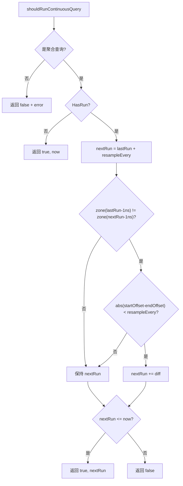

#### 步骤 ⑥⑦: 时间窗口计算

```go
// services/continuous_querier/service.go:282 — ExecuteContinuousQuery (时间窗口部分)
func (s *Service) ExecuteContinuousQuery(dbi *meta.DatabaseInfo, cqi *meta.ContinuousQueryInfo, now time.Time) (bool, error) {
    // 内部构造 ContinuousQuery（每次从 SQL 重新解析）
    cq, err := NewContinuousQuery(dbi.Name, cqi)
    if err != nil {
        return false, err
    }

    // 时区处理: 先转 UTC，再按 CQ 定义的时区转换
    now = now.UTC()
    if cq.q.Location != nil {
        now = now.In(cq.q.Location)
    }

    // 锁不是从方法入口开始；它从读取 lastRuns 前开始，并持有到方法返回。
    // 这意味着时间窗口计算、lastRuns 提前更新、查询执行和统计写入都在锁内。
    s.mu.Lock()
    defer s.mu.Unlock()

    // 获取 lastRuns 缓存
    id := fmt.Sprintf("%s%s%s", dbi.Name, idDelimiter, cqi.Name)
    cq.LastRun, cq.HasRun = s.lastRuns[id]

    // 设置默认 RP
    if cq.intoRP() == "" {
        cq.setIntoRP(dbi.DefaultRetentionPolicy)
    }

    // 获取 GROUP BY interval
    interval, err := cq.q.GroupByInterval()
    if err != nil {
        return false, err
    } else if interval == 0 {
        return false, nil
    }

    // 获取 offset (GROUP BY time(1m, 30s) 中的 30s)
    offset, err := cq.q.GroupByOffset()
    if err != nil {
        return false, err
    }

    // 判断是否需要执行
    run, nextRun, err := cq.shouldRunContinuousQuery(now, interval)
    if err != nil {
        return false, err
    } else if !run {
        return false, nil
    }

    // (a) resampleEvery 先初始化 (service.go:331-334)
    resampleEvery := interval
    if cq.Resample.Every != 0 {
        resampleEvery = cq.Resample.Every
    }

    // (b) lastRuns 在查询执行之前更新 (service.go:338-339)
    // 注意: 这里用的是上一步未 clamp 的 resampleEvery (原始 cq.Resample.Every 或 interval)
    cq.LastRun = truncate(now.Add(-offset), resampleEvery).Add(offset)
    s.lastRuns[id] = cq.LastRun

    // (c) resampleFor 计算 (service.go:345-350)
    resampleFor := interval
    if cq.Resample.For != 0 {
        resampleFor = cq.Resample.For
    } else if interval < resampleEvery {
        resampleFor = resampleEvery
    }

    // (d) 局部 clamp: 仅用于 endTime 对齐 (service.go:354-356)
    // shouldRunContinuousQuery 仍用原始 cq.Resample.Every 计算 nextRun
    if interval < resampleEvery {
        resampleEvery = interval
    }

    // 计算时间范围 [startTime, endTime)
    startTime := truncate(nextRun.Add(interval-resampleFor-offset-1), interval).Add(offset)
    endTime := truncate(now.Add(interval-resampleEvery-offset), interval).Add(offset)

    if !endTime.After(startTime) {
        return false, nil  // 无工作
    }

    // 设置 WHERE time >= startTime AND time < endTime
    cq.q.SetTimeRange(startTime, endTime)
}
```

**副作用顺序（先推进 `lastRuns`，再执行查询）**:

`cq.LastRun = truncate(now.Add(-offset), resampleEvery).Add(offset)`（`service.go:338-339`）
发生在空窗口判断（`:359-364`）**之前**。因此即使本轮是空跑，`lastRuns` 也已经被推进到
`now` 所在的桶边界。

> **数值例**：CQ Service 被 `Close()` 17 分钟后在同一进程内再次 `Open()`（`lastRuns` 是纯内存 map，`Close()`/`Open()` 都不会清空它），`interval = 1m`、无 RESAMPLE。恢复后第一个 tick
> `now = 12:17:20`，`HasRun=true`、`lastRun = 12:00:00` → `nextRun = 12:01:00 ≤ now` → 执行。
> 推进后 `lastRuns = truncate(12:17:20, 1m) = 12:17:00`，而窗口是
> `startTime = truncate(12:01:00 + 1m - 1m - 1ns) = 12:00:00`、`endTime = truncate(12:17:20) = 12:17:00`，
> 即一次补算 `[12:00, 12:17)` 共 17 个桶。可见"补算"靠的是 `nextRun` 而非 `now`，
> `lastRuns` 只负责把水位推到 12:17，避免下一轮重复扫描这 17 个桶。
> **注意**：以上只在“同进程重启服务”时成立。若整个 influxd 进程重启，`lastRuns` 为空 →
> `HasRun=false` → `shouldRunContinuousQuery` 直接返回 `(true, now)`（`service.go:540-547`），
> 首个 tick 的 `startTime = truncate(now-1ns) = 12:17:00`、`endTime = 12:17:00`，**空跑、不补算**；
> 此时只有 `RESAMPLE FOR` 能覆盖停机期间的数据（见 §5.4）。

#### 步骤 ⑦.5: 锁内的执行、统计与返回

上面的代码块只到窗口计算；真实函数在 `SetTimeRange` 之后还有约 60 行，全部在同一把
`s.mu` 内执行。按阶段拆开如下：

| 阶段 | 代码位置 | 是否持 `s.mu` | 失败后果 |
|------|----------|---------------|----------|
| `NewContinuousQuery` / 时区转换 | `service.go:287-297` | 否 | 直接返回 error，`lastRuns` 未变 → 下一 tick 重试 |
| 读 `lastRuns` / `setIntoRP` / 取 interval | `:299-324` | 是 | 解析类错误 → 每 tick 重试 |
| 推进 `lastRuns` | `:338-339` | 是 | 不失败；此后所有失败都不重试 |
| 窗口计算 + 空窗口提前返回 | `:359-364` | 是 | 返回 `(false, nil)`，水位已推进 |
| `SetTimeRange` | `:366-369` | 是 | 返回 `(false, err)`，不重试 |
| 查询 + 写回 | `:374-392` | 是 | 返回 `(false, res.Err)`，不重试 |
| 取 `written` / 日志 / 写 `cq_query` | `:394-433` | 是 | 统计写失败只记日志，仍返回 `true` |

```go
// services/continuous_querier/service.go:391-405 — 执行与点数提取
res := s.runContinuousQueryAndWriteResult(cq)
if res.Err != nil {
    return false, res.Err
}

// extract number of points written from SELECT ... INTO result
var written int64 = -1
if len(res.Series) == 1 && len(res.Series[0].Values) == 1 {
    s := res.Series[0]
    written = s.Values[0][1].(int64)   // 取自 Executor 合成的 {time, written} 行
}
```

这个 `written` 来自 `coordinator/statement_executor.go:611-626`：INTO 语句在 Flush 之后
会额外发一行 `{"result", ["time","written"], [[1970-01-01T00:00:00Z, writeN]]}`。05 §9.2 与
12 号文档 §7.5 说的是同一个值。

> **数值案例**：某 CQ 查询耗时 8s，而 `RunInterval = 1s`。这 8s 内 `s.mu` 一直被持有：
> `Run()`（`service.go:196-210`）会在同一把锁上阻塞；timer tick 在 channel 中排队，
> 不会并发执行；tick 恢复后仍按 `nextRun` 补算，不会跳窗口。

**锁域说明**：`s.mu` 只保护本 Service 的 `lastRuns` 与执行串行化，不保护 meta/存储。
`Close()` 只 `close(stop)` + `wg.Wait()`，不会中断正在执行的 CQ（`closing` channel 要等
那条语句返回后才关闭）。

**时间窗口计算示例**:

> **具体案例**: 假设你有一个温度传感器，每秒上报一次数据。
>
> ```sql
> -- 创建降采样 CQ: 每分钟计算一次平均温度
> CREATE CONTINUOUS QUERY "temp_avg_1m" ON "mydb"
>     RESAMPLE EVERY 1m FOR 5m
>     BEGIN
>         SELECT mean(temp) INTO "temp_1m" FROM "temp_raw" GROUP BY time(1m)
>     END
> ```
>
> 执行过程：
> ```
> t=12:01:00  CQ 触发
>   查询范围: [11:56:00, 12:01:00) — 回溯 5 分钟
>   结果: 5 个窗口的平均值
>   写入: temp_1m 表
>
> t=12:01:30  不触发 (EVERY=1m，nextRun=12:02:00)
>
> t=12:02:00  CQ 触发
>   查询范围: [11:57:00, 12:02:00)
>   结果: 包含了 12:01:00-12:02:00 的新数据
> ```

```
SQL: RESAMPLE EVERY 30s FOR 5m
     GROUP BY time(1m)

now = 12:05:00
lastRun = 12:04:00
nextRun = 12:04:30 (lastRun + 30s)

startTime = truncate(12:04:30 + 1m - 5m - 0, 1m)
          = truncate(12:00:30, 1m)
          = 12:00:00

endTime   = truncate(12:05:00 + 1m - 30s - 0, 1m)
          = truncate(12:05:30, 1m)
          = 12:05:00

查询范围: [12:00:00, 12:05:00) → 5 个 1 分钟窗口
```

```mermaid
gantt
    title CQ 时间窗口示例
    dateFormat HH:mm:ss
    axisFormat %H:%M

    section 窗口
    "窗口 1 (12:00-12:01)" :a1, 12:00:00, 1m
    "窗口 2 (12:01-12:02)" :a2, 12:01:00, 1m
    "窗口 3 (12:02-12:03)" :a3, 12:02:00, 1m
    "窗口 4 (12:03-12:04)" :a4, 12:03:00, 1m
    "窗口 5 (12:04-12:05)" :a5, 12:04:00, 1m

    section 标记
    lastRun :milestone, 12:04:00, 0
    nextRun :milestone, 12:04:30, 0
    now :milestone, 12:05:00, 0
```

#### 步骤 ⑧: SetTimeRange — WHERE 条件重写

```go
// influxql/ast.go — SetTimeRange
// 注意: SetTimeRange 定义在外部包 github.com/influxdata/influxql 中,
// 以下为概念性展示，实际实现可能有所不同。
func (s *SelectStatement) SetTimeRange(start, end time.Time) error {
    // 构建 time >= 'start' AND time < 'end'
    timeExpr := &BinaryExpr{
        Op: AND,
        LHS: &BinaryExpr{
            Op:  GTE,
            LHS: &VarRef{Val: "time"},
            RHS: &TimeLiteral{Val: start},
        },
        RHS: &BinaryExpr{
            Op:  LT,
            LHS: &VarRef{Val: "time"},
            RHS: &TimeLiteral{Val: end},
        },
    }

    // 与现有条件合并
    if s.Condition != nil {
        s.Condition = &BinaryExpr{
            Op:  AND,
            LHS: s.Condition,
            RHS: timeExpr,
        }
    } else {
        s.Condition = timeExpr
    }
}
```

#### 步骤 ⑨.5: 语句归一化 — `db.rp.measurement` 是如何补全的

`ExecuteContinuousQuery` 只把 `Target.Measurement.RetentionPolicy` 填好（`setIntoRP`），
`Target.Measurement.Database` 仍为空。如果直接拿这条语句去写，`writeInto` 会在
`coordinator/statement_executor.go:1302-1304` 返回 `errNoDatabaseInTarget`。真正补全目标的是
Executor 在执行前的两级归一化。

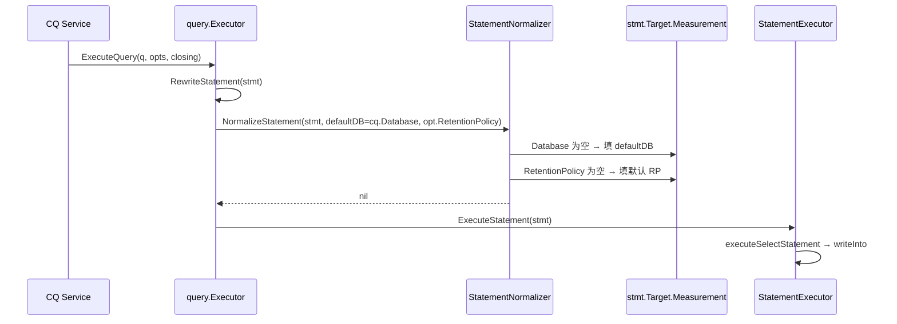

```go
// query/executor.go:373-390 — 每条语句执行前的归一化
newStmt, err := RewriteStatement(stmt)          // :373
if err != nil {
    results <- &Result{Err: err}
    break
}
stmt = newStmt

if normalizer, ok := e.StatementExecutor.(StatementNormalizer); ok {
    // defaultDB 来自 ExecutionOptions.Database（CQ 传的是 cq.Database）
    if err := normalizer.NormalizeStatement(stmt, defaultDB, opt.RetentionPolicy); err != nil {
        ...
    }
}
```

```go
// coordinator/statement_executor.go:1429-1465 — normalizeMeasurement（节选）
if m.Database == "" {
    m.Database = defaultDatabase                  // CQ 场景 = cq.Database
}
if m.RetentionPolicy == "" {
    if defaultRetentionPolicy != "" {
        m.RetentionPolicy = defaultRetentionPolicy
    } else if di.DefaultRetentionPolicy != "" {
        m.RetentionPolicy = di.DefaultRetentionPolicy
    } else {
        return fmt.Errorf("default retention policy not set for: %s", di.Name)
    }
}
```

`NormalizeStatement`（`:1384-1419`）用 `influxql.WalkFunc` 遍历整条语句，`IsTarget` 的
measurement 与普通 source 走同一个 `normalizeMeasurement`，所以 `SELECT ... INTO` 的三段式
目标名也会被补齐。

**数值案例**（`CREATE CONTINUOUS QUERY ... ON mydb BEGIN SELECT mean(v) INTO "temp_1m" FROM "raw" GROUP BY time(1m) END`）:

| 原始 INTO 目标 | `setIntoRP` 之后 | `NormalizeStatement` 之后 |
|---|---|---|
| `"temp_1m"` | `RP=""` → 改为 `autogen` | `mydb.autogen.temp_1m` |
| `"7d"."downsampled"` | `RP=7d`（保留） | `mydb.7d.downsampled` |
| `"other"."rp"."m"` | `Database=other`（保留） | `other.rp.m`（显式库不被覆盖） |

**错误边界**:
- 目标库不存在 → `influxdb.ErrDatabaseNotFound`（`statement_executor.go:1446-1449`），发生在任何点写入之前。
- 目标库 `DefaultRetentionPolicy` 为空且语句未写 RP → `default retention policy not set`。
- 目标 measurement 的 `Database` 始终为空 → `errNoDatabaseInTarget`（`:1302-1304`）。

> 逐行详解见 11 号文档 §6（`## 6. SELECT 执行路径`）与 §14（`## 14. NormalizeStatement — 语句标准化`）。

#### 步骤 ⑨⑩⑪: 查询执行与结果写入

```go
// services/continuous_querier/service.go:434 — runContinuousQueryAndWriteResult
func (s *Service) runContinuousQueryAndWriteResult(cq *ContinuousQuery) *query.Result {
    q := &influxql.Query{
        Statements: influxql.Statements([]influxql.Statement{cq.q}),
    }

    closing := make(chan struct{})
    defer close(closing)

    // 执行查询 (与用户查询共享 Executor)
    ch := s.QueryExecutor.ExecuteQuery(q, query.ExecutionOptions{
        Database: cq.Database,
    }, closing)

    // 只有一条语句，只会收到一个结果
    res, ok := <-ch
    if !ok {
        panic("result channel was closed")
    }
    return res
}

// coordinator/statement_executor.go:550-635 — executeSelectStatement (INTO 写入，节选)
func (e *StatementExecutor) executeSelectStatement(ctx *query.ExecutionContext, stmt *influxql.SelectStatement) error {
    cur, err := e.createIterators(ctx, stmt, ctx.ExecutionOptions)
    if err != nil {
        return err
    }
    // 行由 emitter 产出，不是直接调用 cur.Next()
    em := query.NewEmitter(cur, ctx.ChunkSize)
    defer em.Close()

    var writeN int64
    var pointsWriter *BufferedPointsWriter
    if stmt.Target != nil {
        pointsWriter = NewBufferedPointsWriter(e.PointsWriter,
            stmt.Target.Measurement.Database,
            stmt.Target.Measurement.RetentionPolicy,
            10000)  // 批量 10,000 点
    }

    for {
        row, partial, err := em.Emit()
        if err != nil {
            return err
        } else if row == nil {
            select {
            case <-ctx.Done():          // 查询被中断
                return ctx.Err()
            default:
            }
            break
        }

        if stmt.Target != nil {
            // 注意实参顺序：writer, stmt, row, strict；返回本行写入点数
            n, err := e.writeInto(pointsWriter, stmt, row, e.StrictErrorHandling)
            if err != nil {
                return err
            }
            writeN += n
            continue
        }

        // 非 INTO：把行（含 partial 标记）发给客户端
        if err := ctx.Send(&query.Result{Series: []*models.Row{row}, Partial: partial}); err != nil {
            return err
        }
    }

    if stmt.Target != nil {
        if err := pointsWriter.Flush(); err != nil {   // 写入剩余缓冲
            return err
        }
        // INTO 语句额外合成一行 {time, written}
        return ctx.Send(&query.Result{
            Series: []*models.Row{{
                Name:    "result",
                Columns: []string{"time", "written"},
                Values:  [][]interface{}{{time.Unix(0, 0).UTC(), writeN}},
            }},
        })
    }

    // 省略非 INTO 的收尾：源码用 `emitted` 标记是否已发送过行，
    // 未发送过时补发空 Series（statement_executor.go:627-634）。
    return nil
}
```

> 这一行 `{time, written}` 就是 CQ 的 `written` 来源（见步骤 ⑦.5 与 §9.2）：
> `res.Series[0].Values[0][1]` 即 `writeN`。

#### 步骤 ⑫: CQ 结果写入路径

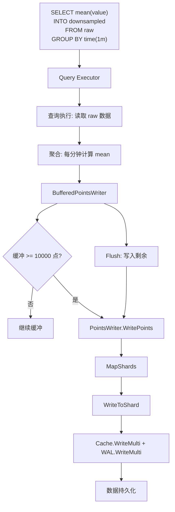

#### CQ 结果写回标准写入路径 — 详细序列图

CQ 的 INTO 结果通过标准写入路径（与用户写入完全一致）写回存储引擎，保证数据一致性。

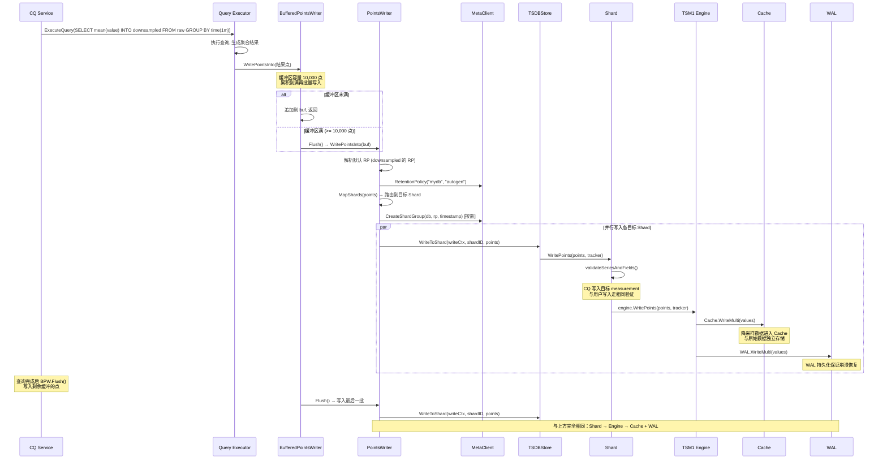

**关键设计点**:
- CQ 写回路径与用户 `INSERT` 完全一致: `PointsWriter` → `MapShards` → `WriteToShard` → `Cache + WAL`
- 降采样数据写入目标 measurement 的独立 Shard，不影响原始数据的 Shard
- `BufferedPointsWriter` 批量 10,000 点减少锁竞争和 WAL 写入次数；每次 `Flush()` 是独立写入，已成功的批次不会因为后续批次失败而回滚
- 写入目标可以是不同的 RP（如 `INTO "7d"."downsampled"`），实现多级降采样

#### 步骤 ⑬: lastRuns 更新

```go
// services/continuous_querier/service.go:338-339
cq.LastRun = truncate(now.Add(-offset), resampleEvery).Add(offset)
s.lastRuns[fmt.Sprintf("%s%s%s", dbi.Name, idDelimiter, cqi.Name)] = cq.LastRun
```

**lastRuns 的 key 格式**: `"database\x1fcqname"` （\x1f 是 ASCII Unit Separator）

**重要**: lastRuns 在查询执行**之前**更新，而非之后。这意味着如果查询失败，lastRuns 已经更新，不会自动重试。

## 2. CQ Service 配置

### 2.1 Config 结构体

```go
// services/continuous_querier/config.go — Config
type Config struct {
    LogEnabled        bool          `toml:"log-enabled"`         // 默认: true
    Enabled           bool          `toml:"enabled"`             // 默认: true
    QueryStatsEnabled bool          `toml:"query-stats-enabled"` // 默认: false
    RunInterval       toml.Duration `toml:"run-interval"`        // 默认: 1s
}
```

| 字段 | 类型 | 默认值 | 说明 |
|------|------|--------|------|
| `LogEnabled` | `bool` | `true` | 启用 CQ 执行日志，显示处理时间和写入点数 |
| `Enabled` | `bool` | `true` | 全局开关，设为 `false` 时 broker 和 data node 均忽略 CQ 处理 |
| `QueryStatsEnabled` | `bool` | `false` | 启用后将单次 CQ 执行统计写入 `cq_query` self-monitoring measurement |
| `RunInterval` | `toml.Duration` | `1s` | 轮询间隔，应设为所有 CQ GROUP BY interval 的最小公因子 |

```go
// config.go:37 — NewConfig 默认值
func NewConfig() Config {
    return Config{
        LogEnabled:        true,
        Enabled:           true,
        QueryStatsEnabled: false,
        RunInterval:       toml.Duration(DefaultRunInterval), // time.Second
    }
}
```

**配置约束**: `RunInterval` 必须为正数（`> 0`），否则 `Validate()` 返回错误。

## 3. RESAMPLE 语义详解

### 3.1 EVERY 与 FOR 的关系

```sql
CREATE CONTINUOUS QUERY "cq_1m" ON "db"
    RESAMPLE EVERY 30s FOR 5m
    BEGIN
        SELECT mean(value) INTO "downsampled" FROM "raw" GROUP BY time(1m)
    END
```

| 参数 | 含义 | 默认值 |
|------|------|--------|
| `EVERY` | CQ 执行频率 | = GROUP BY interval |
| `FOR` | 回溯窗口长度 | `max(interval, EVERY)`（显式 FOR 优先，`service.go:345-350`） |

> `EVERY > interval` 且未显式指定 `FOR` 时，一次运行覆盖 `EVERY/interval` 个 interval 桶
> （`resampleFor` 被抬到 `resampleEvery`）；`EVERY ≤ interval` 时默认只回溯一个桶。

### 3.2 EVERY 的三种模式

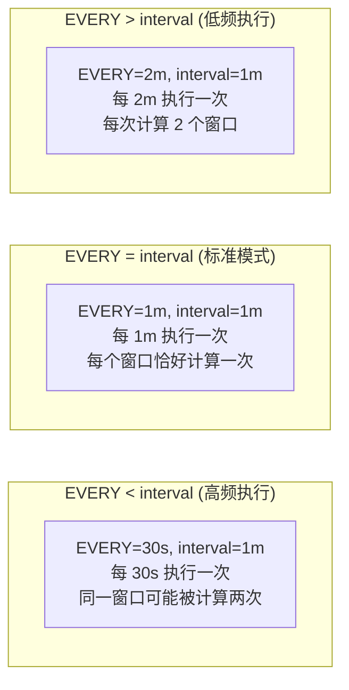

| EVERY vs interval | 行为 | 适用场景 |
|-------------------|------|---------|
| EVERY < interval | 同一窗口可能被计算多次，最后一次覆盖 | 延迟数据补算 |
| EVERY = interval | 标准行为，每个窗口恰好一次 | 大多数场景 |
| EVERY > interval | 每次计算多个窗口 | 减少执行频率 |

### 3.3 FOR 的回溯窗口

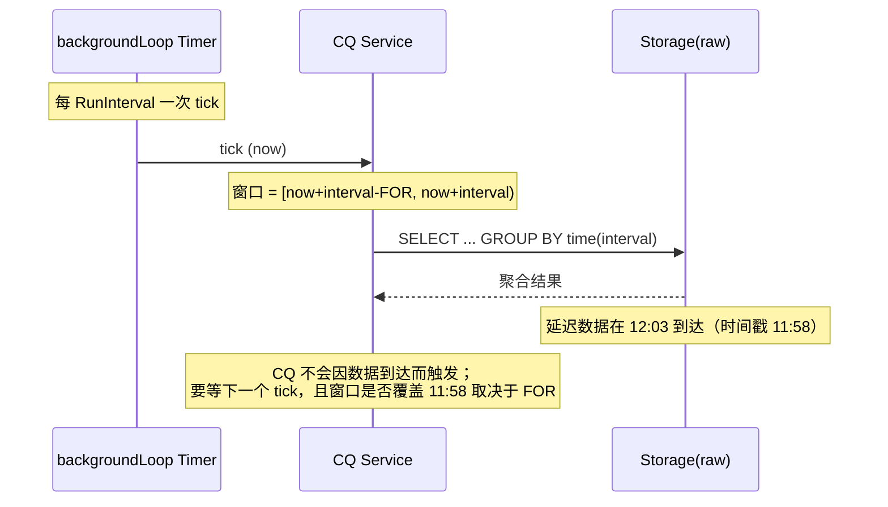

**FOR 的核心价值**：补算延迟到达的数据。当 `FOR > interval` 时，CQ 会重新计算最近 N 个窗口，覆盖之前的计算结果。

> CQ 是 **Processing-Time 轮询**，不是 Event-Time 驱动：`backgroundLoop` 只有 timer 与 `RunCh` 两个
> 触发源（`service.go:216-245`），`coordinator/points_writer.go` 不引用 CQ 包，数据到达不会触发 CQ。
> 延迟数据到达后，要等下一个 tick 才可能被重算，且是否覆盖取决于 `FOR`。

### 3.4 时间窗口参数的 clamp 逻辑

源码中 `ExecuteContinuousQuery` 对 `resampleEvery` 和 `resampleFor` 的处理顺序非常关键
(service.go:331-356)，不能笼统说"resampleFor 先设好"：

```go
// service.go:331-334 — (a) resampleEvery 先初始化 (用原始 cq.Resample.Every)
resampleEvery := interval
if cq.Resample.Every != 0 {
    resampleEvery = cq.Resample.Every
}

// service.go:338-339 — (b) lastRuns 在查询前更新 (用未 clamp 的 resampleEvery)
cq.LastRun = truncate(now.Add(-offset), resampleEvery).Add(offset)
s.lastRuns[id] = cq.LastRun

// service.go:345-350 — (c) resampleFor 计算
resampleFor := interval
if cq.Resample.For != 0 {
    resampleFor = cq.Resample.For
} else if interval < resampleEvery {
    resampleFor = resampleEvery
}

// service.go:354-356 — (d) 局部 clamp: 仅用于 endTime 对齐
if interval < resampleEvery {
    resampleEvery = interval
}
```

**为什么 clamp resampleEvery？** 这个 clamp 发生在
`shouldRunContinuousQuery()` 已经用原始 `RESAMPLE EVERY` 计算 `nextRun` 之后，
也发生在 `cq.LastRun = truncate(now, 原始 EVERY)` 更新 `lastRuns` 之后。
也就是说，`EVERY > interval` 不会被改成按 interval 频率触发；触发判断仍然是
`nextRun = LastRun + 原始 EVERY`，`lastRuns` 也按原始 EVERY 对齐。

clamp 只影响后续时间窗口计算里的 `endTime := truncate(now + interval - resampleEvery, interval)`。
如果不 clamp，`EVERY=5m, interval=1m` 会让 `endTime` 被往前推 4 分钟；源码将局部变量
`resampleEvery` 钳到 `interval`，使本次查询窗口的结束边界按 GROUP BY interval 对齐。
当没有显式 `FOR` 且 `EVERY > interval` 时，源码在 clamp 前把 `resampleFor` 设为原始
EVERY，让一次运行覆盖多个 1 分钟窗口。

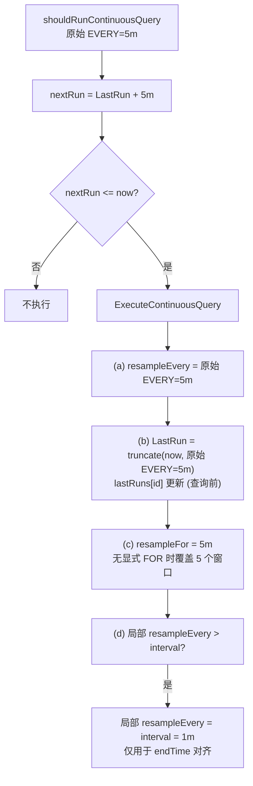

**案例**: `RESAMPLE EVERY 5m FOR 5m GROUP BY time(1m)` 若 `LastRun=12:00`，
`shouldRunContinuousQuery()` 的下一次触发时间是 12:05。12:01、12:02、12:03、12:04
不会因为 clamp 而执行。到 12:05 执行时，窗口结束边界用钳到 1m 的局部
`resampleEvery` 计算，得到 `[12:00,12:05)`；`lastRuns` 仍按原始 5m 对齐到 12:05。

## 4. 自定义 truncate 函数

### 4.1 为什么不用 Go 的 time.Truncate

```go
// services/continuous_querier/service.go:562 — 自定义 truncate
func truncate(ts time.Time, d time.Duration) time.Time {
    t := ts.UnixNano()
    offset := zone(ts)         // 时区偏移 (秒)
    dt := (t + offset) % int64(d)
    if dt < 0 {
        // 负数取模会向上取整，需要加上 duration 修正为向下取整
        dt += int64(d)
    }
    ts = time.Unix(0, t-dt).In(ts.Location())
    // DST 调整: 如果截断后的时区偏移与原始不同，需要补偿差值
    if adjustedOffset := zone(ts); adjustedOffset != offset {
        diff := offset - adjustedOffset
        if abs(diff) < int64(d) {
            ts = ts.Add(time.Duration(diff))
        }
    }
    return ts
}
```

**Go 的 `time.Truncate` 的问题**:

| 问题 | Go Truncate | 自定义 truncate |
|------|-------------|-----------------|
| 周起始日 | Monday (Go) | Thursday (Unix) |
| DST 转换 | 不处理 | 通过 offset 调整 |
| 时区 | 使用本地时区 | 使用 Unix 时间戳 |

### 4.2 DST 处理

```go
// services/continuous_querier/service.go:526-537
// 注意：Add(-1) 的参数是 time.Duration(-1)，即 -1 纳秒，
// 等价于“取上一个窗口末尾时刻”的时区偏移。
_, startOffset := cq.LastRun.Add(-1).Zone()
nextRun := cq.LastRun.Add(resampleEvery)          // 绝对时间加法，跨 DST 按物理时长推进
if _, endOffset := nextRun.Add(-1).Zone(); startOffset != endOffset {
    diff := int64(startOffset-endOffset) * int64(time.Second)  // 秒 → 纳秒
    if abs(diff) < int64(resampleEvery) {
        nextRun = nextRun.Add(time.Duration(diff))
    }
}
```

1. **外层条件**：只有当 DST 切换时刻 T 落在 `(lastRun-1ns, nextRun-1ns]` 内（两端 UTC 偏移不同）才进入。`lastRun` 恰在整点且 `EVERY=1h` 时，T 正好等于 `nextRun`，而 `nextRun-1ns` 仍在旧偏移 → 外层不成立。
2. **内层条件**：进入后也只有 `abs(diff) < resampleEvery` 才调整。US 的 1 小时跳变 `abs(diff)=1h`，因此 `EVERY ≤ 1h` 永远不补偿。
3. **分支何时才可能触发**：需要 `resampleEvery > 跳变幅度`。1h 跳变需 `EVERY > 1h`；30min 跳变时区配 `EVERY=1h` 即可。
4. **设计意图（源码无注释，属推断）**：`abs(diff) < resampleEvery` 只补偿“小于一个 resample 周期”的偏移抖动。跳变 ≥ 周期时补偿会把 `nextRun` 整体平移一个周期（`01:30 EST + 1h = 03:30 EDT` 补偿后正好退回 `01:30 EST`），节拍被破坏，因此宁可不补偿。`truncate()`（`service.go:562-583`）与 `query.IteratorOptions.Window`（`query/iterator.go:843-887`）用的是同一守卫范式。

**DST 边界情况**（数值推演见 4.3）:
- **春季跳跃**：墙上时刻不存在，但窗口网格按绝对时间推进，不会产生“物理时间不存在”的空窗口
- **秋季重复**：重复的是墙上标签，绝对时间窗口不重复，CQ 不会对同一物理窗口执行两次
- **内层守卫**：只有 `|偏移差| < resampleEvery` 才补偿；1 小时跳变配 `EVERY ≤ 1h` 永远不触发

#### 4.2.1 窗口网格如何生成（理解 4.3 的前提）

CQ 只负责给出 `[startTime, endTime)`，真正把区间切成桶的是 `query.IteratorOptions.Window`
（`query/iterator.go:807-887`）。理解它才能正确解读 4.3 的两个 DST 案例。

```go
// query/iterator.go:807-887 — IteratorOptions.Window（精简）
func (opt IteratorOptions) Window(t int64) (start, end int64) {
    t -= int64(opt.Interval.Offset)          // 先扣掉 GROUP BY 的 offset
    var zone int64
    if opt.Location != nil {
        _, zone = opt.Zone(t)                // 该时刻的时区偏移（纳秒）
    }
    dt := (t + zone) % int64(opt.Interval.Duration)
    if dt < 0 {
        dt += int64(opt.Interval.Duration)
    }
    start = t - dt
    start += int64(opt.Interval.Offset)
    // 截断后偏移变了、且变化量小于桶宽，才补偿
    if opt.Location != nil {
        _, startOffset := opt.Zone(start)
        if o := zone - startOffset; o != 0 && abs(o) < int64(opt.Interval.Duration) {
            start += o
        }
    }
    end = t + (int64(opt.Interval.Duration) - dt) + int64(opt.Interval.Offset)
    // end 的补偿带方向：o > 0（回拨）直接加；o < 0（前跳）还要确认跳变点落在桶内
    if opt.Location != nil {
        _, endOffset := opt.Zone(end)
        if o := zone - endOffset; o != 0 && abs(o) < int64(opt.Interval.Duration) {
            if o > 0 {
                end += o
            } else if _, z := opt.Zone(end + o); z == endOffset {
                end += o
            }
        }
    }
    return
}
```

**三条规则**:
1. 桶边界按“绝对时间 + 时区偏移”计算：`t + zone` 后取模，等价于按本地墙上时间对齐。
2. 偏移补偿只在 `abs(偏移差) < 桶宽` 时生效——与 `shouldRunContinuousQuery` 的内层守卫是同一范式。
3. `end` 的补偿带方向判断（`query/iterator.go:865-885`）：回拨（`o > 0`）把桶向后延长；前跳（`o < 0`）只有当跳变点确实落在本桶内才补偿。

**窗口枚举表**（案例一：`startTime = 05:00Z`、`endTime = 07:00Z`、`interval = 1h`、`Location = America/New_York`）:

| 桶序号 | `t`（UTC） | 本地墙上 | 桶区间（UTC） | 桶区间（本地） |
|---|---|---|---|---|
| 1 | 05:00Z–05:59:59Z | 00:xx EST | `[05:00Z, 06:00Z)` | `[00:00 EST, 01:00 EST)` |
| 2 | 06:00Z–06:59:59Z | 01:xx EST | `[06:00Z, 07:00Z)` | `[01:00 EST, 03:00 EDT)` |

表里没有“02:00–03:00”这一行：它对应的绝对时间是 `[07:00Z, 08:00Z)`，不在查询范围内。

#### 4.3 DST 边界案例详解

> **小白解释**: DST (夏令时) 就像一年调两次钟——春天把钟拨快一小时，秋天把钟拨慢一小时。
> 这对 CQ 的时间窗口计算是个大麻烦，因为某些时间点会"消失"或"重复"。

**案例一: 春季跳跃 (Spring Forward)**

> **场景**: America/New_York 时区，CQ 每小时执行一次
>
> ```sql
> CREATE CONTINUOUS QUERY "cpu_avg_1h" ON "mydb"
>     RESAMPLE EVERY 1h FOR 2h
>     BEGIN
>         SELECT mean(value) INTO "cpu_1h" FROM "cpu" GROUP BY time(1h)
>     END
> ```
>
> 2024年3月10日凌晨 2:00，时钟跳到 3:00（2:00-3:00 这一个小时**不存在**）

```mermaid
gantt
    title DST 春季跳跃 — CQ 窗口调整
    dateFormat HH:mm
    axisFormat %H:%M

    section 正常窗口
    "窗口 22:00-23:00" :a1, 22:00, 60min
    "窗口 23:00-00:00" :a2, 23:00, 60min
    "窗口 00:00-01:00" :a3, 00:00, 60min
    "窗口 01:00-03:00 (跨 DST)" :a4, 01:00, 120min

    section DST 跳跃
    "2:00 → 3:00 (跳跃!)" :crit, 02:00, 0

    section 跳跃后
    "窗口 03:00-04:00" :a5, 03:00, 60min
```

```
时间线 (America/New_York, 2024-03-10):
  lastRun = 01:00:00 EST = 06:00Z
  nextRun = 01:00 EST + 1h = 03:00:00 EDT = 07:00Z
  （02:00 这个墙上时刻在本地不存在，time.Add 直接按绝对时间跨过）

shouldRunContinuousQuery 的 DST 检测:
  _, startOffset := lastRun.Add(-1ns).Zone()   // -18000 (EST)
  _, endOffset   := nextRun.Add(-1ns).Zone()   // -18000 (EST) ← 跳变点正好是 nextRun
  startOffset == endOffset → 外层 if 不成立，diff 从未计算 → 不调整
  nextRun 落到 03:00 EDT 是 time.Add 的绝对时间加法结果，不是守卫补偿

查询范围 (本案例 SQL 为 RESAMPLE EVERY 1h FOR 2h):
  startTime = truncate(07:00Z + 1h - 2h - 1ns) = 00:00 EST = 05:00Z
  endTime   = truncate(07:00Z + 1h - 1h)       = 03:00 EDT = 07:00Z
  范围 [05:00Z, 07:00Z) = 2 个物理小时，两个窗口都非空:
    [00:00 EST, 01:00 EST) = [05:00Z, 06:00Z)   装 00:00–00:59 EST 的数据
    [01:00 EST, 03:00 EDT) = [06:00Z, 07:00Z)   装 01:00–01:59 EST 的数据
  不存在“物理时间不存在”的空窗口；02:00–03:00 不在查询范围内，
  FILL(0) 不会为它补 0

对照: 若没有显式 FOR（默认 FOR = max(interval, EVERY) = 1h）:
  范围 [06:00Z, 07:00Z)，只有 1 个窗口 [01:00 EST, 03:00 EDT)

分支何时才会调整:
  lastRun = 01:30 EST → nextRun = 03:30 EDT，外层成立，diff = -1h
  abs(diff) = 1h，严格 < resampleEvery(1h) 为 false → 仍不调整
  只有 |偏移差| < resampleEvery 才补偿（如 RESAMPLE EVERY 2h）
```

**案例二: 秋季重复 (Fall Back)**

> **场景**: 同样的 CQ，2024年11月3日凌晨 2:00，时钟回到 1:00（1:00-2:00 这一个小时**重复两次**）

```mermaid
gantt
    title DST 秋季重复 — CQ 窗口调整
    dateFormat HH:mm
    axisFormat %H:%M

    section 正常窗口
    "窗口 22:00-23:00" :a1, 22:00, 60min
    "窗口 23:00-00:00" :a2, 23:00, 60min
    "窗口 00:00-01:00 (第一次)" :a3, 00:00, 60min

    section DST 重复
    "窗口 01:00-02:00 (第一次, EDT)" :a4, 01:00, 60min
    "2:00 → 1:00 (回拨!)" :crit, 02:00, 0
    "窗口 01:00-02:00 (第二次, EST)" :a5, 01:00, 60min

    section 回拨后
    "窗口 02:00-03:00" :a6, 02:00, 60min
```

```
时间线 (America/New_York, 2024-11-03, 以绝对时间为准):
  lastRun = 01:00:00 EDT = 05:00Z
  nextRun = 01:00 EDT + 1h = 01:00:00 EST = 06:00Z
  （墙上时钟仍是 01:00，不是 02:00 EDT；time.Add 是绝对时间加法）

  zone(lastRun-1ns) = -14400 (EDT)
  zone(nextRun-1ns) = -14400 (EDT)   ← 06:00Z-1ns 仍是 EDT
  startOffset == endOffset → 外层不成立 → diff 不计算 → 不调整

下一次:
  lastRun = 01:00 EST = 06:00Z → nextRun = 02:00 EST = 07:00Z
  物理间隔: 1h、1h（05:00Z → 06:00Z → 07:00Z）
  不存在“实际等待 2 小时”

被“重复”的是墙上标签 01:00，不是绝对时间窗口:
  [05:00Z, 06:00Z) = 01:00 EDT → 01:00 EST
  [06:00Z, 07:00Z) = 01:00 EST → 02:00 EST
  两个窗口各自只被计算一次

若 lastRun 不在整点（如 01:30 EDT）:
  nextRun = 01:30 EST (06:30Z)，外层成立，diff = +1h
  abs(diff) == resampleEvery(1h)，严格 < 为 false → 不调整（同春季）

truncate 的 DST 补偿同理: zone(ts) 偏移变化小于桶宽才补偿，
保证窗口边界在时区转换后仍对齐。
```

**truncate 函数的 DST 补偿逻辑**:

```go
// services/continuous_querier/service.go:562 — truncate
func truncate(ts time.Time, d time.Duration) time.Time {
    t := ts.UnixNano()
    offset := zone(ts)         // 获取当前时区偏移 (秒)
    dt := (t + offset) % int64(d)
    if dt < 0 {
        dt += int64(d)  // 负数取模修正
    }
    ts = time.Unix(0, t-dt).In(ts.Location())

    // DST 补偿: 截断后时区偏移可能变化
    if adjustedOffset := zone(ts); adjustedOffset != offset {
        diff := offset - adjustedOffset
        if abs(diff) < int64(d) {
            ts = ts.Add(time.Duration(diff))
        }
    }
    return ts
}
```

> **小白解释**: `truncate` 函数就像一个"智能对齐器"——
> 它把时间戳对齐到窗口起点，同时检测对齐后是否跨越了时区边界。
> 如果跨越了（比如从 EDT 变成 EST），就补偿一个小时的差值。

## 5. 架构设计意图

### 5.1 为什么用 Processing-Time 轮询而非 Event-Time 驱动

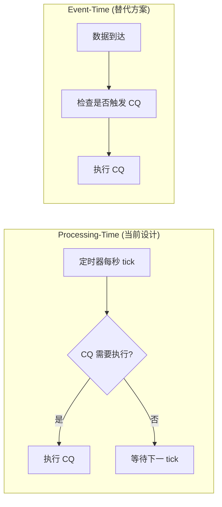

| 维度 | Processing-Time | Event-Time |
|------|-----------------|------------|
| **实现复杂度** | 简单 (一个定时器) | 复杂 (需要追踪数据时间戳) |
| **幂等性** | 天然幂等 | 需要额外保证 |
| **容错性** | RESAMPLE FOR 补算 | 需要重放机制 |
| **高频写入** | 稳定 (固定频率) | 可能事件风暴 |

### 5.2 为什么每次执行都重新解析 SQL

- **配置热更新**：修改 CQ 后无需重启服务
- **正确性**：避免缓存 AST 与 meta store 中的 SQL 不一致
- **代码简洁**：不需要维护 AST 缓存和失效逻辑

### 5.3 为什么 CQ 结果用 BufferedPointsWriter

- **批量写入**：10,000 点/批，减少锁竞争
- **分批提交**：每个 `Flush()` 独立调用底层 `PointsWriter`；没有跨批事务，前一批成功后，后一批失败不会自动回滚
- **与用户写入一致**：走相同的 Cache + WAL 路径

### 5.4 为什么 lastRuns 在执行前更新

```go
// service.go:301 — key 构造
id := fmt.Sprintf("%s%s%s", dbi.Name, idDelimiter, cqi.Name)

// service.go:338-339 (在查询执行之前)
cq.LastRun = truncate(now.Add(-offset), resampleEvery).Add(offset)
s.lastRuns[id] = cq.LastRun

// service.go:391 (之后才执行查询)
res := s.runContinuousQueryAndWriteResult(cq)
```

- **不是防重入**：串行性由“单 goroutine + `s.mu` 全程持有”保证（`service.go:299-300`），与更新时机无关
- **推进 watermark**：先写 `lastRuns` 意味着失败也会推进窗口水位，因此失败不会按原窗口重试
- **让 `Run()` 的清除立即可见**：`Run()` 删除 `lastRuns` 后，下一次 tick 会从最老未算窗口重算
- **代价**：`lastRuns` 推进之后的失败（查询错误、写回错误）被跳过，不会自动重试

`lastRuns` 的状态与生命周期：

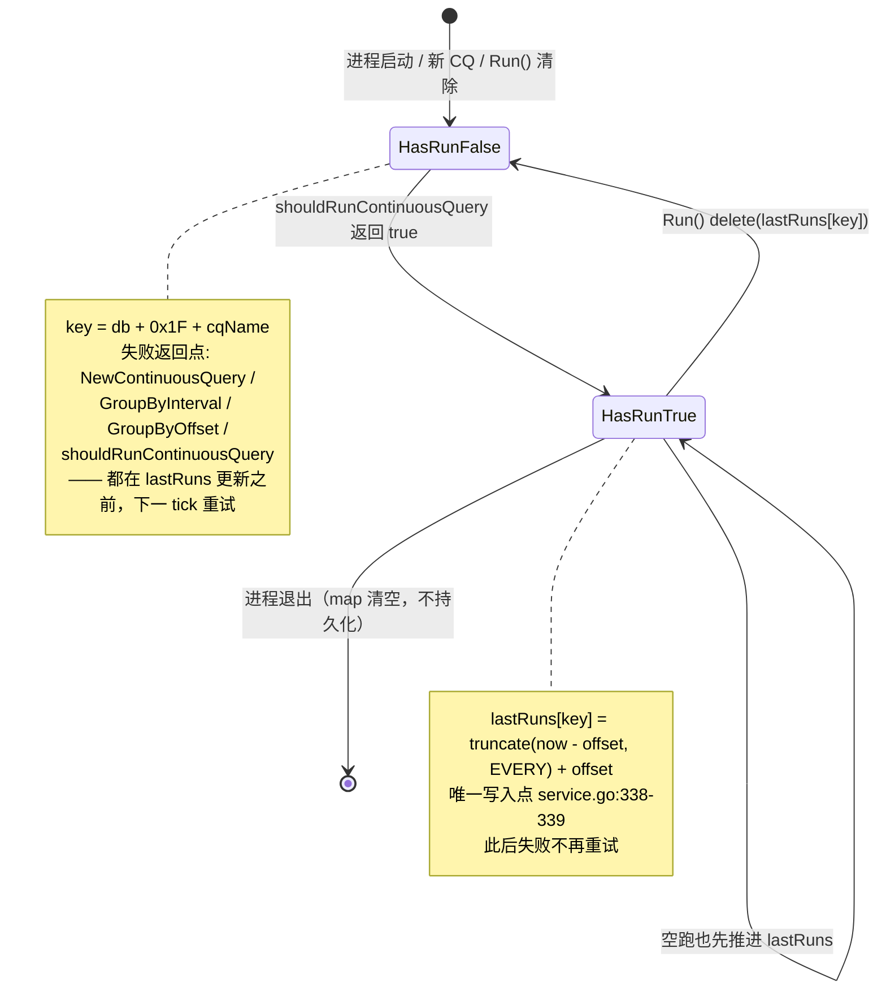

**生命周期要点**:
- key 格式 `db + "\x1f" + cqName`（`idDelimiter`，`service.go:29`、`:301`）。
- 唯一删除点：`Run()`（`service.go:204` 附近的 `delete(s.lastRuns, id)`）。
- 四个“更新前失败”返回点：`service.go:289`（`NewContinuousQuery` 解析）、`:312`（`GroupByInterval`）、`:320`（`GroupByOffset`）、`:326`（`shouldRunContinuousQuery`）。另有 `:314` 的 `interval == 0` 静默返回 `(false, nil)`——不记日志、不加 `QueryFail`。
- 空跑也会推进（`:338` 先于 `:361` 的提前返回）。
- 进程重启后 map 为空；已被删除的 CQ 会留下无人清理的 key（仅内存，无实际影响）。

## 6. 架构收益

| 维度 | 收益 |
|------|------|
| **实现简洁** | 轮询模型 + 名义租约（OSS 恒成功、无互斥），代码量小 |
| **容错性** | RESAMPLE FOR 支持补算延迟数据 |
| **灵活性** | EVERY/FOR 独立配置，支持多种降采样策略 |
| **一致性** | CQ 结果走标准写入路径，保证数据一致性 |
| **可观测性** | cq_query measurement 记录执行统计 |
| **热更新** | 每次重新解析 SQL，支持运行时修改 CQ |

## 7. 潜在隐患与瓶颈

### 7.1 CQ 与用户查询无资源隔离

```go
// service.go:444
ch := s.QueryExecutor.ExecuteQuery(q, query.ExecutionOptions{
    Database: cq.Database,
}, closing)
```

CQ 查询与用户查询共享同一个 Executor：
- **并发限制共享**：`MaxConcurrentQueries` 同时限制 CQ 和用户查询
- **CPU/内存竞争**：大量 CQ 可能饿死用户查询
- **无优先级机制**：无法保证用户查询优先于 CQ

### 7.2 lastRuns 非持久化

```go
type Service struct {
    lastRuns map[string]time.Time  // 内存中
}
```

服务重启后：
- 所有 CQ 的 `lastRuns` 清空
- 所有 CQ 被视为"首次执行"，立即触发
- 可能导致重启后的 CQ 执行风暴

### 7.3 CQ 失败的处理

```go
// service.go:391-393 — ExecuteContinuousQuery 中的错误返回
res := s.runContinuousQueryAndWriteResult(cq)
if res.Err != nil {
    return false, res.Err  // 返回错误给 runContinuousQueries
}

// service.go:271-273 — runContinuousQueries 中的日志和计数
if ok, err := s.ExecuteContinuousQuery(&db, &cq, req.Now); err != nil {
    s.Logger.Info("Error executing query", zap.String("query", cq.Query), zap.Error(err))
    atomic.AddInt64(&s.stats.QueryFail, 1)
}
```

CQ 失败分两类，运维含义完全不同：

1. `lastRuns` 更新（`service.go:338-339`）**之前**的失败——SQL 解析失败、CQ 不是聚合查询、`GroupByInterval`/`GroupByOffset` 解析失败、`shouldRunContinuousQuery` 返回 error：每一轮 `RunInterval`（默认 1s）都会重跑并记录一条 `"Error executing query"`，`QueryFail` 每秒 +1，直到 CQ 被修复或删除。**这是日志风暴与计数器虚高的来源。**
2. `lastRuns` 更新**之后**的失败——`SetTimeRange` 失败、查询执行错误（`res.Err`）、写回错误：窗口水位已经推进，本轮窗口被跳过，不会重试，也不会有告警。

**CQ 失败场景与监控**:

| 失败场景 | 错误类型 | 表现 | 是否重试 |
|----------|---------|------|----------|
| Cache 满 | `ErrCacheMemorySizeLimitExceeded` | INTO 写入被拒绝，CQ 返回错误 | 否（窗口已推进） |
| 查询超时 | `query.ErrQueryTimeoutLimitExceeded`（受服务端 `query-timeout` 约束，默认 0 = 不限） | Executor 中断查询，CQ 返回错误 | 否 |
| Field 类型冲突 | `tsdb.PartialWriteError`（`Dropped=1`） | 冲突点整点丢弃，其余点写入；HTTP/内部返回 partial write | 否 |
| 内存不足 | `runtime: out of memory` | 进程崩溃 | — |
| Shard 正在删除 | `tsdb.ErrShardDeletion` → `PartialWriteError` | 该 shard 写入失败，客户端收到 400 | 否（客户端可重试） |
| SQL 解析失败 | `influxql.ParseError` | 每 `RunInterval` 重复记录 + `QueryFail++` | **是，无限重试** |
| CQ 非聚合 / GROUP BY 解析失败 | error | 同上 | **是，无限重试** |

> 超时错误来自 `query.ErrQueryTimeoutLimitExceeded`（`query/task_manager.go:328-338`），由服务端
> `query-timeout` 控制（默认 `0` 表示不限制，`task_manager.go:17-19`）；CQ 自身不设超时、
> 也不传 `AbortCh`。`ErrShardDeletion` 在 `coordinator/points_writer.go:491-498` 被转成
> `PartialWriteError`（HTTP 400），服务端没有退避重试。

**cq_query measurement 监控查询**:

```sql
-- 监控 CQ 执行健康状态
SELECT
    count("durationNs") AS "executions",
    sum("pointsWrittenOK") AS "total_points",
    mean("durationNs") / 1e6 AS "avg_duration_ms",
    max("durationNs") / 1e6 AS "max_duration_ms"
FROM "cq_query"
WHERE time > now() - 1h
GROUP BY "db", "cq", time(5m)

-- 检测 CQ 执行失败 (QueryFail 计数器)
-- 注意: QueryFail 是内存计数器，不写入 cq_query measurement
-- 需要通过 SHOW STATS 或 /debug/vars 端点获取
SHOW STATS FOR 'cq'
-- 或
curl http://localhost:8086/debug/vars | jq '.cq'
```

### 7.4 同一 Service 内持锁串行，但失败不按原窗口自动重试

```go
// shouldRunContinuousQuery 使用 lastRun 判断
nextRun := cq.LastRun.Add(resampleEvery)
```

`ExecuteContinuousQuery` 在读取 `lastRuns` 前获取 `s.mu`（`service.go:299-300`），并持有到方法返回；时间窗口计算、`lastRuns` 提前更新、查询执行和统计写入都在同一把锁内完成。因此同一个 `Service` 内 CQ 天生串行——`backgroundLoop` 只有一个 goroutine，且整段执行持锁，不存在“同一个 CQ 被并发重入”的问题。执行前更新 `lastRuns` 的真正作用有两点：(1) 让失败也推进 watermark，因此失败不重试；(2) 让 `Run()` 清除 `lastRuns` 的动作立刻影响下一次 tick 的判定。

这个设计的代价也很直接：
- CQ 失败时，`lastRuns` 已经推进，不会按失败前的原窗口自动重试
- 一个执行很慢的 CQ 会持锁阻塞后续 CQ，导致同一轮中的其他 CQ 延迟执行

### 7.5 RESAMPLE FOR 的内存开销

```
RESAMPLE FOR 24h
GROUP BY time(1m)
→ 1440 个窗口
```

当 `FOR` 远大于 `interval` 时，一次 CQ 执行需要处理大量窗口，内存消耗不可控。

### 7.6 每次解析 SQL 的 CPU 开销

```go
stmt, err := influxql.NewParser(strings.NewReader(cqi.Query)).ParseStatement()
```

对于高频 CQ（如 `GROUP BY time(1s)`），每秒解析一次 SQL。CQ 数量多时可能成为 CPU 瓶颈。

### 7.7 CQ 数量无上限

```go
for _, dbi := range s.MetaClient.Databases() {
    for _, cqi := range dbi.ContinuousQueries {
        // 无限制
    }
}
```

大量 CQ 可能导致 `runContinuousQueries` 耗时过长，压垮 Executor。

### 7.8 无背压机制

CQ 结果写入通过 `BufferedPointsWriter`（10,000 点/批）直接写入 Cache + WAL。如果写入速度跟不上 CQ 产出速度，没有机制让 CQ 暂停或降速。

### 7.9 Lease 粒度问题

```go
s.MetaClient.AcquireLease("continuous_querier")
```

所有 CQ 共享一个 Lease。无法将部分 CQ 迁移到其他节点执行以分散负载。
不过 OSS 的 `Client.AcquireLease`（`services/meta/client.go:127-133`）恒成功、不读写共享状态，
因此这个“粒度”目前在 OSS 没有实际约束力（详见 §1.2 的 OSS 语义校准）。

### 7.10 DST 转换的边界情况

- **春季跳跃**：窗口网格按绝对时间推进，`time.Add` 直接跨过不存在的墙上时刻；1h 跳变配 `EVERY ≤ 1h` 时守卫不触发
- **秋季重复**：重复的是墙上标签，绝对时间窗口不重复，CQ 不会对同一物理窗口执行两次
- **守卫只在 `|偏移差| < resampleEvery` 时补偿**：其设计意图是只吸收小于一个 resample 周期的偏移抖动，避免把整周期跳变平移掉、破坏调度节拍

## 8. BufferedPointsWriter — 批量写入

### 8.1 结构体

```go
// coordinator/statement_executor.go:1224 — BufferedPointsWriter
type BufferedPointsWriter struct {
    w               pointsWriter  // 底层写入器 (PointsWriter)
    buf             []models.Point  // 缓冲区
    database        string
    retentionPolicy string
}
```

### 8.2 构造函数

```go
// coordinator/statement_executor.go:1232 — NewBufferedPointsWriter
func NewBufferedPointsWriter(w pointsWriter, database, retentionPolicy string, capacity int) *BufferedPointsWriter {
    return &BufferedPointsWriter{
        w:               w,
        buf:             make([]models.Point, 0, capacity),  // 预分配容量
        database:        database,
        retentionPolicy: retentionPolicy,
    }
}
```

**默认容量**: 10,000 点 (coordinator/statement_executor.go:566)

### 8.3 WritePointsInto — 批量写入逻辑

```go
// coordinator/statement_executor.go:1242 — WritePointsInto
func (w *BufferedPointsWriter) WritePointsInto(req *IntoWriteRequest) error {
    // 1. 验证目标 database/RP
    if req.Database != w.database || req.RetentionPolicy != w.retentionPolicy {
        return fmt.Errorf("writer for %s.%s can't write into %s.%s",
            w.database, w.retentionPolicy, req.Database, req.RetentionPolicy)
    }

    // 2. 分批写入
    for i := 0; i < len(req.Points); {
        avail := cap(w.buf) - len(w.buf)  // 缓冲区剩余空间
        n := len(req.Points[i:])
        if n > avail {
            n = avail
        }
        w.buf = append(w.buf, req.Points[i:n+i]...)
        i += n

        // 3. 缓冲区满时自动 Flush
        if len(w.buf) == cap(w.buf) {
            if err := w.Flush(); err != nil {
                return err
            }
        }
    }
    return nil
}
```

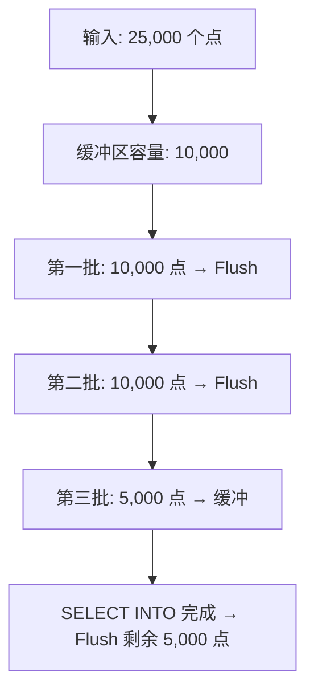

### 8.4 Flush — 清空缓冲区

```go
// coordinator/statement_executor.go:1276 — Flush
func (w *BufferedPointsWriter) Flush() error {
    if len(w.buf) == 0 {
        return nil
    }
    if err := w.w.WritePointsInto(&IntoWriteRequest{
        Database:        w.database,
        RetentionPolicy: w.retentionPolicy,
        Points:          w.buf,
    }); err != nil {
        return err  // 底层写入失败时保留 buffer，调用方可看到错误
    }

    w.buf = w.buf[:0]  // 清空缓冲区 (保留容量)
    return nil
}
```

**Flush 失败语义**: 只有底层 `WritePointsInto` 成功后才会清空 `buf`。如果底层写入失败，`Flush()` 直接返回错误并保留当前缓冲区内容；但 `BufferedPointsWriter` 不提供跨批事务，已经成功 flush 的旧批次不会被回滚。

## 9. CQ 统计追踪 — cq_query measurement

### 9.1 统计数据写入

```go
// services/continuous_querier/service.go:418 — CQ 统计记录
if s.queryStatsEnabled && s.Monitor.Enabled() {
    tags := map[string]string{
        "db": dbi.Name,      // 数据库名
        "cq": cq.Info.Name,  // CQ 名称
    }
    fields := map[string]interface{}{
        "durationNs":      int64(execDuration),  // 执行耗时 (纳秒)
        "pointsWrittenOK": written,              // 成功写入的点数
        "startTime":       startTime.UnixNano(), // 窗口起始时间
        "endTime":         endTime.UnixNano(),   // 窗口结束时间
    }
    p, _ := models.NewPoint("cq_query", models.NewTags(tags), fields, time.Now())
    s.Monitor.WritePoints(models.Points{p})
}
```

### 9.2 写入点数提取

```go
// services/continuous_querier/service.go:402 — 提取 written 值
var written int64 = -1
if len(res.Series) == 1 && len(res.Series[0].Values) == 1 {
    s := res.Series[0]
    written = s.Values[0][1].(int64)  // SELECT INTO 返回的写入点数
}
```

> 这一行由 `coordinator/statement_executor.go:611-626` 在 `Flush()` 之后合成：
> `Series[0] = {Name:"result", Columns:["time","written"], Values:[[t0, writeN]]}`。
> 12 号文档 §7.5 引用的是同一个值。

### 9.3 cq_query measurement 结构

| Tag | 含义 | 示例 |
|-----|------|------|
| `db` | 数据库名 | `mydb` |
| `cq` | CQ 名称 | `cq_1m` |

| Field | 类型 | 含义 |
|-------|------|------|
| `durationNs` | int64 | 执行耗时 (纳秒) |
| `pointsWrittenOK` | int64 | 成功写入的点数 |
| `startTime` | int64 | 窗口起始时间 (UnixNano) |
| `endTime` | int64 | 窗口结束时间 (UnixNano) |

### 9.4 查询 CQ 统计

```sql
-- 查询最近 1 小时的 CQ 执行统计
SELECT mean("durationNs") / 1e6 AS "avg_ms",
       sum("pointsWrittenOK") AS "total_points",
       count("durationNs") AS "executions"
FROM "cq_query"
WHERE time > now() - 1h
GROUP BY "db", "cq", time(5m)
```

## 10. TSM Compaction 补充：不是 CQ，但属于存储降采样式重写

本章前面聚焦 Continuous Query 的时间窗口降采样；`review_05_secondary.md`
还要求覆盖 TSM compaction。二者不是同一条业务链路：CQ 通过查询把高频点写成低频点，
TSM compaction 则在存储层重写已有 TSM 文件，减少文件数量、清理 tombstone，
并优化索引布局。

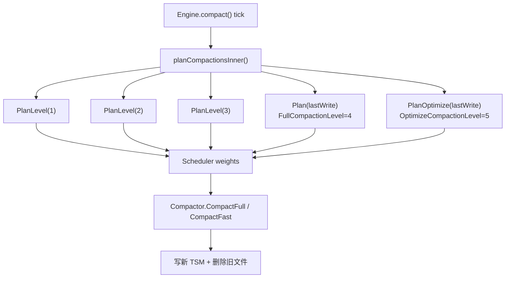

### 10.1 Compaction level 与调度权重

```go
// tsdb/engine/tsm1/engine.go:103
const (
    LevelCompactionCount  = 3
    FullCompactionLevel   = 4
    OptimizeCompactionLevel = 5
    TotalCompactionLevels = 5
)

// tsdb/engine/tsm1/scheduler.go:8
var defaultWeights = [TotalCompactionLevels]float64{0.4, 0.3, 0.2, 0.1, 0.01}
```

| Level | Planner | 作用 |
|---|---|---|
| 1 | `PlanLevel(1)` | 合并 cache snapshot 产生的小 generation；需要 8 个 generation，除非 tombstone 或后续高 level 触发 |
| 2 | `PlanLevel(2)` | 合并多个 level 2 候选；默认 4 个 generation 一组 |
| 3 | `PlanLevel(3)` | 合并多个 level 3 候选；默认 4 个 generation 一组 |
| 4 | `Plan(lastWrite)` | full compaction，处理冷 shard、强制 full、tombstone 和大文件跳过逻辑 |
| 5 | `PlanOptimize(lastWrite)` | optimize compaction，权重最低；用于冷 shard 的跨 generation 索引优化 |

### 10.2 `tsmGeneration.level()` 的实际映射

```go
// tsdb/engine/tsm1/compact.go:219
func (t *tsmGeneration) level() int {
    if t.files[0].Sequence < 4 {
        return t.files[0].Sequence
    }
    return 4
}
```

源码注释里提到的“Level 0”容易误导：当前实现直接按 TSM 文件 sequence 映射，
sequence 1/2/3 分别进入 level 1/2/3，sequence >= 4 进入 level 4。

### 10.3 `PlanLevel` 的选文件规则

下面是按源码控制流压缩后的骨架，省略了 `levelGroups` 过滤、`chunk()` 循环和
`acquire()` 的局部细节；这些细节在文字说明中展开。

```go
// tsdb/engine/tsm1/compact.go:318 — PlanLevel
func (c *DefaultPlanner) PlanLevel(level int) ([]CompactionGroup, int64) {
    if c.forceFull {
        return nil, 0
    }
    generations := c.findGenerations()
    if len(generations) <= 1 && !generations.hasTombstones() {
        return nil, 0
    }

    groups := c.groupAdjacentGenerations(generations,
        func(currentLevel, candidateLevel int) bool {
            return currentLevel == candidateLevel
        })

    minGenerations := 4
    if level == 1 {
        minGenerations = 8
    }
    var cGroups []CompactionGroup
    // 只保留目标 level；chunk 不足时，只有 tombstone 或后续更高 level 才推进。
    // 最后通过 acquire(cGroups) 防止同一组文件被并发 compaction 抢占。
    return cGroups, int64(len(cGroups))
}
```

`PlanLevel` 只看同 level 的相邻 generation。level 1 的阈值是 8，其余 level 是 4。
如果 chunk 不足且没有 tombstone，只有当后面存在不低于当前 level 的 generation
时才提前推进，避免低 level 文件长期卡住。

### 10.3.1 Scheduler 如何选层（planner 之后）

`PlanCompactions()` 只产出 5 个 level 的候选；真正决定“下一个跑谁”的是 `Scheduler`。

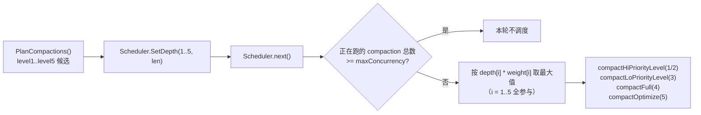

```go
// tsdb/engine/tsm1/scheduler.go:8 — 权重
var defaultWeights = [TotalCompactionLevels]float64{0.4, 0.3, 0.2, 0.1, 0.01}

// tsdb/engine/tsm1/scheduler.go:36-67 — nextByQueueDepths（精简）
func (s *Scheduler) nextByQueueDepths(depths [TotalCompactionLevels]int) (int, bool) {
    running := level1Running + level2Running + level3Running + level4Running + level5Running
    if running >= s.maxConcurrency {
        return 0, false              // ① 总数已达上限：本轮直接放弃
    }
    loLimit, _ := s.limits()
    end := len(depths)
    if level3Running+level4Running+level5Running >= loLimit &&
        s.maxConcurrency-(level1Running+level2Running) == 0 {
        end = 2                      // ② 死分支：条件成立时 ① 必然已返回
    }
    var weight float64
    for i := 0; i < end; i++ {
        if float64(depths[i])*s.weights[i] > weight {
            level, runnable = i+1, true
            weight = float64(depths[i]) * s.weights[i]
        }
    }
    return level, runnable
}

// tsdb/engine/tsm1/scheduler.go:73-85 — limits
func (s *Scheduler) limits() (int, int) {
    hiLimit := s.maxConcurrency * 4 / 5
    loLimit := (s.maxConcurrency / 5) + 1
    ...
    return loLimit, hiLimit
}
```

**要点**:
- `maxConcurrency` 来自 `opt.CompactionLimiter.Capacity()`（`engine.go:289`），即
  `MaxConcurrentCompactions`；配置为 0 时取 `GOMAXPROCS(0)/2`（至少 1，`tsdb/store.go:499-503`）。
- 权重是硬编码的，level 5 只有 0.01：`depth` 相同的条件下，level 1 永远优先。
- `limits()` 同时算出 `hiLimit = max*4/5`，但 OSS 的 `next()` 只用 `loLimit`；`hiLimit` 是死值。
  `loLimit` 也只喂给上文代码块里那个不可达的 `end = 2` 分支，在 OSS 中同样不影响选层。
- **`end = 2` 分支不可达**：第二个条件 `s.maxConcurrency-(l1+l2) == 0` 等价于 `l1+l2 == maxConcurrency`，
  而 `l3+l4+l5 >= loLimit >= 1`，两者相加必然 `>= maxConcurrency`，于是函数开头的总数守卫
  已经 `return 0, false`。源码注释里的“只剩前两层还有空位”与实际控制流相反：OSS **不存在**
  “保底只跑 level 1/2”的策略。只有将来移除或放宽开头的总数守卫，这段代码才会生效。
- level 5 在 optimize holdoff 期间被 `SetDepth(5, 0)` 强制为 0（`engine.go:2219-2235`），
  因此不会被选中，但候选组仍会走 `ReleaseCompactionPlans` 释放。

**每轮 tick 的完整顺序**（`engine.go:2180-2288`）：

1. `PlanCompactions()` → `planCompactionsInner()`（`:2360-2431`）：`PlanLevel(1..3)` + `Plan(lastWrite)`（level 4）+ `PlanOptimize(lastWrite)`（level 5）。
2. **L4 → L5 晋升**（`:2377-2395`）：level 4 候选组里只要含一个已优化文件，`IsGroupOptimized` 返回 true，整组被提升到 level 5，并改用 aggressive `PointsPerBlock`；原始 level 5 组追加在其后。
3. `Scheduler.SetDepth(1..5, len(...))`（`:2231-2235`）。
4. `Scheduler.next()` 选层，按 level 分派到 `compactHiPriorityLevel`（1/2）、`compactLoPriorityLevel`（3）、`compactFull`（4）、`compactOptimize`（5）（`:2238-2288`）。
5. 未启动的候选统一 `ReleaseCompactionPlans` 归还文件锁。

> **数值例**：`maxConcurrency = 8` → `loLimit = 2`、`hiLimit = 6`。
> ① 当前 `l1..l5 = [0,0,0,0,0]`、`depth = [20, 10, 3, 1, 0]`，加权值 `8.0 / 3.0 / 0.6 / 0.1 / 0`，选中 level 1。
> ② 当前 `l1..l5 = [0,0,0,0,0]`、`depth = [0, 12, 5, 2, 0]`，加权值 `0 / 3.6 / 1.0 / 0.2 / 0`，选中 level 2。
> ③ 当前 `l1..l5 = [2,2,2,1,1]`（总数 = 8 = `maxConcurrency`）时，无论 `depth` 为何，开头守卫
> 直接 `return 0, false`，本轮不调度。注意这不是“候选范围收缩到 level 1/2”——`end = 2` 分支永远执行不到。

### 10.4 `Plan` 与 `PlanOptimize`

这里同样只展示关键分支，真实源码还包含锁、排序、in-use 检查、`acquire()`
以及错误/空计划返回路径。

```go
// tsdb/engine/tsm1/compact.go:485 — Plan
func (c *DefaultPlanner) Plan(lastWrite time.Time) ([]CompactionGroup, int64) {
    generations := c.findGenerations()
    if forceFull ||
       c.compactFullWriteColdDuration > 0 &&
       time.Since(lastWrite) > c.compactFullWriteColdDuration &&
       len(generations) > 1 {
        // 可跨非相邻 generation 做 full compaction；
        // 跳过仍在使用的 group，以及无 tombstone、已超过 MaxTSMFileSize 且首块已满的大文件。
    }
    // 未变化且无 tombstone 时不计划；单 generation 且无 tombstone 时直接返回。
}

// tsdb/engine/tsm1/compact.go:436 — PlanOptimize
func (c *DefaultPlanner) PlanOptimize(lastWrite time.Time) ([]CompactionGroup, int64, int64) {
    if fullyCompacted || time.Since(lastWrite) < c.compactFullWriteColdDuration {
        return nil, 0, 0
    }
    // 只优化 level 4 group；如果全库只有一个 generation，则允许单 generation 优化。
}
```

### 10.5 案例：CQ 与 TSM compaction 的边界

假设 `cq_1m` 每分钟写入一批低频点。CQ 负责生成这些新点，写入路径会先进入
Cache/WAL，随后 snapshot 写出新的 TSM generation。TSM compaction 之后才会看到
这些 generation，并按 level 规则把多个小文件重写成更少的大文件。CQ 不直接调用
`PlanLevel` 或 `PlanOptimize`；compaction 也不会重新计算 CQ 的聚合结果。
