# Module 6: Cluster Communication (Shard 路由 + Subscriber 推送 + Epoch 保护) - 深度审计报告

> **小白导读**: 写入链路就像**快递分拣系统**。
>
> 你的数据点（包裹）到达后：
> 1. **MapShards**: 根据时间戳决定放到哪个"时间段仓库"（ShardGroup）
> 2. **ShardFor**: 在仓库内，根据 series 哈希决定放到哪个"货架"（Shard）
> 3. **Epoch Tracker**: 防止"正在整理货架时有人往里放东西"（写入/删除竞态保护）
> 4. **Subscriber**: 数据到了之后，自动转发给外部系统（如 Kafka、另一个 InfluxDB）
>
> 关键设计：OSS 版本每个 ShardGroup 只有 1 个 Shard，所以 ShardFor 的哈希路由实际上不起作用。
> 但 Enterprise 版本可以配置多个 Shard，实现数据水平拆分。

## 1. 写入链路全链路总览

### 1.1 从 HTTP 请求到持久化的完整路径

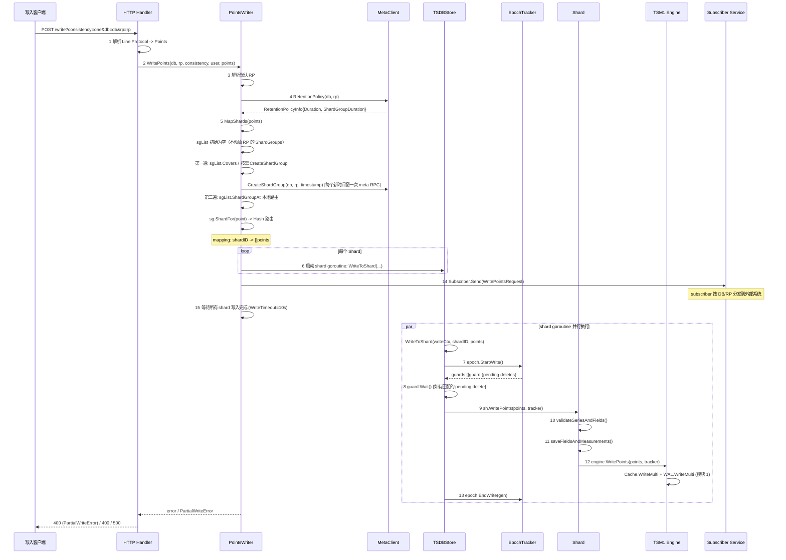

### 1.2 每一步的代码实现

#### 步骤 1: HTTP Handler — Line Protocol 解析

```go
// services/httpd/handler.go:1627,1651,1670 — serveWriteV2/V1/serveWrite
func (h *Handler) serveWrite(database, retentionPolicy, precision string, w http.ResponseWriter, r *http.Request, user meta.User) {
    atomic.AddInt64(&h.stats.WriteRequests, 1)
    atomic.AddInt64(&h.stats.ActiveWriteRequests, 1)
    defer func(start time.Time) {
        atomic.AddInt64(&h.stats.ActiveWriteRequests, -1)
        atomic.AddInt64(&h.stats.WriteRequestDuration, time.Since(start).Nanoseconds())
    }(time.Now())

    // 1. v1 从 db/rp 查询参数进入；v2 先把 bucket 映射成 database/rp
    if database == "" {
        h.httpError(w, "database is required", http.StatusBadRequest)
        return
    }
    if di := h.MetaClient.Database(database); di == nil {
        h.httpError(w, fmt.Sprintf("database not found: %q", database), http.StatusNotFound)
        return
    }

    // 2. 认证与写权限检查
    if h.Config.AuthEnabled {
        if user == nil { /* 403 */ return }
        if err := h.WriteAuthorizer.AuthorizeWrite(user.ID(), database); err != nil {
            h.httpError(w, fmt.Sprintf("%q user is not authorized to write to database %q", user.ID(), database), http.StatusForbidden)
            return
        }
    }

    // 3. 请求体读取: MaxBodySize truncateReader + gzip + bytes.Buffer.ReadFrom
    body := r.Body
    if h.Config.MaxBodySize > 0 {
        body = truncateReader(body, int64(h.Config.MaxBodySize))
    }
    if r.Header.Get("Content-Encoding") == "gzip" {
        gz, err := gzip.NewReader(r.Body)
        if err != nil { h.httpError(w, err.Error(), http.StatusBadRequest); return }
        defer gz.Close()
        body = gz
    }
    var bs []byte
    if r.ContentLength > 0 {
        if h.Config.MaxBodySize > 0 && r.ContentLength > int64(h.Config.MaxBodySize) {
            h.httpError(w, http.StatusText(http.StatusRequestEntityTooLarge), http.StatusRequestEntityTooLarge)
            return
        }
        bs = make([]byte, 0, r.ContentLength)
    }
    buf := bytes.NewBuffer(bs)
    if _, err := buf.ReadFrom(body); err != nil {
        if err == errTruncated { /* 413 */ return }
        h.httpError(w, err.Error(), http.StatusBadRequest)
        return
    }
    atomic.AddInt64(&h.stats.WriteRequestBytesReceived, int64(buf.Len()))

    if h.Config.WriteTracing {
        h.Logger.Info("Write body received by handler", zap.ByteString("body", buf.Bytes()))
    }

    // 4. 解析 Line Protocol；EOF 空 body 返回 200
    points, parseError := models.ParsePointsWithPrecision(buf.Bytes(), time.Now().UTC(), precision)
    if parseError != nil && len(points) == 0 {
        if parseError.Error() == "EOF" { h.writeHeader(w, http.StatusOK); return }
        h.httpError(w, parseError.Error(), http.StatusBadRequest)
        return
    }

    // 5. 解析一致性级别；OSS 后续接受但不执行复制/仲裁
    consistency := models.ConsistencyLevelOne
    if level := r.URL.Query().Get("consistency"); level != "" {
        var err error
        consistency, err = models.ParseConsistencyLevel(level)
        if err != nil { h.httpError(w, err.Error(), http.StatusBadRequest); return }
    }

    // 6. 调用 PointsWriter；PartialWriteError 返回 400 但有效点已经写入
    if err := h.PointsWriter.WritePoints(database, retentionPolicy, consistency, user, points); err != nil {
        // 按 client/auth/partial/server error 分支更新统计并返回对应状态码
    }
}
```

**关键细节**:
- `serveWriteV2` 先把 `bucket` 映射为 v1 的 `database/retentionPolicy`，并把 `precision=ns/us` 转为 `n/u`
- `ParsePointsWithPrecision` 支持 `n`(纳秒), `u`(微秒), `ms`(毫秒), `s`(秒), `m`(分), `h`(时)
- 请求体不是 `ioutil.ReadAll`: 源码使用 `truncateReader`、可选 gzip 解压、`bytes.Buffer.ReadFrom` 和 Content-Length 预分配
- **注意 gzip 分支绕过 `MaxBodySize`**: `body = truncateReader(...)` 先执行，但 `Content-Encoding: gzip` 时 `body` 被替换为 `gzip.NewReader(r.Body)`，`truncateReader` 被丢弃；剩余的体积上限只有 `Content-Length` 预检（`services/httpd/handler.go:1702-1724`），分块传输（无 `Content-Length`）可绕过该预检
- `WriteTracing` 开启时会记录原始 write body，便于调试但也可能暴露写入数据
- 部分写入成功（`PartialWriteError`）返回 400，但已写入的点仍被持久化
- 完全失败返回 400 或 500

#### 步骤 2: PointsWriter 结构体

```go
// coordinator/points_writer.go:44 — PointsWriter
type PointsWriter struct {
    mu           sync.RWMutex       // 保护 closing
    closing      chan struct{}       // 关闭信号
    WriteTimeout time.Duration      // 写入超时 (默认 10s)
    Logger       *zap.Logger

    Node *influxdb.Node             // 本地节点标识 (集群用)

    MetaClient interface {          // 元数据接口
        Database(name string) (di *meta.DatabaseInfo)
        RetentionPolicy(database, policy string) (*meta.RetentionPolicyInfo, error)
        CreateShardGroup(database, policy string, timestamp time.Time) (*meta.ShardGroupInfo, error)
    }

    TSDBStore interface {           // 本地存储接口
        CreateShard(database, retentionPolicy string, shardID uint64, enabled bool) error
        WriteToShard(ctx tsdb.WriteContext, shardID uint64, points []models.Point) error
    }

    Subscriber interface {
        Send(*WritePointsRequest)
    }

    subPoints chan<- *WritePointsRequest    // 订阅异步写通道（可为 nil）

    stats     *WriteStatistics             // 原子统计计数器
}
```

**WriteStatistics 结构**:

```go
// coordinator/points_writer.go:267 — WriteStatistics
type WriteStatistics struct {
    WriteReq           int64  // 写入请求总数
    PointWriteReq      int64  // 写入点总数
    PointWriteReqLocal int64  // 本地写入点数
    WriteOK            int64  // 成功写入次数
    WriteDropped       int64  // 丢弃的写入点数
    WriteTimeout       int64  // 写入超时次数
    WriteErr           int64  // 写入失败次数
    SubWriteOK         int64  // 调用 Subscriber.Send 的次数
}
```

#### 步骤 2b: WritePoints / WritePointsPrivileged — 入口方法

```go
// coordinator/points_writer.go:463 — WritePoints
func (w *PointsWriter) WritePoints(database, retentionPolicy string,
    consistencyLevel models.ConsistencyLevel, user meta.User, points []models.Point) error {
    userID := tsdb.UnknownUser
    if user != nil {
        userID = user.ID()
    }
    writeCtx := tsdb.WriteContext{UserId: userID}
    return w.WritePointsPrivileged(writeCtx, database, retentionPolicy, consistencyLevel, points)
}

// coordinator/points_writer.go:474 — WritePointsPrivileged
func (w *PointsWriter) WritePointsPrivileged(writeCtx tsdb.WriteContext, database, retentionPolicy string,
    consistencyLevel models.ConsistencyLevel, points []models.Point) error {
    // 统计: 原子递增 (在这里, 不在 WritePoints)
    atomic.AddInt64(&w.stats.WriteReq, 1)
    atomic.AddInt64(&w.stats.PointWriteReq, int64(len(points)))
    // ... 继续执行写入逻辑
}

// coordinator/points_writer.go:454 — WritePointsInto
func (w *PointsWriter) WritePointsInto(p *IntoWriteRequest) error {
    writeCtx := tsdb.WriteContext{UserId: tsdb.SelectIntoUser}
    return w.WritePointsPrivileged(writeCtx, p.Database, p.RetentionPolicy, models.ConsistencyLevelOne, p.Points)
}
```

**为什么分两层？** `WritePoints` 把 `meta.User` 转成 `tsdb.WriteContext{UserId: ...}` 后委托给 `WritePointsPrivileged`。CQ/SELECT INTO 等内部写入直接构造系统用户的 `WriteContext`，再调用 `Privileged` 版本；当前主链路没有额外的 context 变体方法名。

#### 步骤 3: 默认 RP 解析

```go
// coordinator/points_writer.go:474 — WritePointsPrivileged
if retentionPolicy == "" {
    dbi := w.MetaClient.Database(database)
    if dbi == nil {
        return influxdb.ErrDatabaseNotFound(database)
    }
    retentionPolicy = dbi.DefaultRetentionPolicy
}
```

**为什么默认 RP 为空？** HTTP API 中 `rp` 参数是可选的。用户可以只指定 `db=mydb`，系统自动使用该数据库的默认 RP。

#### 步骤 5: MapShards — Shard 路由核心

```go
// coordinator/points_writer.go:299 — MapShards
func (w *PointsWriter) MapShards(wp *WritePointsRequest) (*ShardMapping, error) {
    // 1. 获取 RetentionPolicy
    rp, err := w.MetaClient.RetentionPolicy(wp.Database, wp.RetentionPolicy)
    if err != nil {
        return nil, err
    } else if rp == nil {
        return nil, influxdb.ErrRetentionPolicyNotFound(wp.RetentionPolicy)
    }

    // 2. 计算保留策略下限与写入窗口
    min := time.Unix(0, models.MinNanoTime)
    if rp.Duration > 0 {
        min = time.Now().Add(-rp.Duration)
    }
    ww := NewWriteWindow(rp)

    // 3. 收集已覆盖的 ShardGroups (第一遍遍历)
    var list sgList
    for _, p := range wp.Points {
        withinWindow, _, _ := ww.WithinWindow(p.Time())
        if p.Time().Before(min) || list.Covers(p.Time()) || !withinWindow {
            continue  // 过期、已覆盖或超出写入窗口时不创建 ShardGroup
        }
        // 按需创建 ShardGroup
        sg, err := w.MetaClient.CreateShardGroup(wp.Database, wp.RetentionPolicy, p.Time())
        if err != nil {
            return nil, err
        }
        list.Add(*sg)
    }

    // 4. 构建 ShardMapping (第二遍遍历)
    mapping := NewShardMapping(rp, len(wp.Points))

    for _, p := range wp.Points {
        sg := list.ShardGroupAt(p.Time())  // 二分查找
        if sg == nil {
            mapping.AddDropped(p, min, RetentionPolicyBound)
            atomic.AddInt64(&w.stats.WriteDropped, 1)
            continue
        } else if withinWindow, bound, reason := ww.WithinWindow(p.Time()); !withinWindow {
            mapping.AddDropped(p, bound, reason)
            atomic.AddInt64(&w.stats.WriteDropped, 1)
            continue
        }
        sh := sg.ShardFor(p)               // Hash 路由
        mapping.MapPoint(&sh, p)           // 通过 MapPoint 方法添加
    }

    return mapping, nil
}
```

**写入窗口与 sgList 查找细节**:

- `NewWriteWindow(rp)` 使用 `rp.PastWriteLimit` 和 `rp.FutureWriteLimit` 生成允许写入的时间边界；两者的零值 `0` 表示**关闭**该方向检查（`coordinator/points_writer.go:226-233` 只在 `>0` 时启用），因此默认 RP 不做写窗口限制。
- 相关常量: `DefaultMaxBodySize = 25e6`（`services/httpd/config.go:27`）、`DefaultWriteTimeout = 10 * time.Second`（`coordinator/config.go:15`）。
- 第一遍遍历时，过期点、已被**本批已创建的** shard group 覆盖的点、超出写入窗口的点都不会触发 `CreateShardGroup`（`sgList` 初始为空，`list.Add(*sg)` 用 meta 返回的组填充）。
- 每批 N 个新时间窗 ⇒ 至少 N 次 `CreateShardGroup` meta 调用；命中已有组时走 `Client.CreateShardGroup` 的读锁快速路径（`services/meta/client.go:693-721`）。
- 第二遍构建 `ShardMapping` 时，过期点按 `RetentionPolicyBound` 计入 dropped，超出窗口的点按 `WriteWindowLowerBound` / `WriteWindowUpperBound` 计入 dropped。
- `ShardGroupAt` 先按 `EndTime` 二分查找；如果遇到重叠 shard group 导致二分结果不包含目标时间，会在 `earliest/latest` 范围内回退到线性扫描，避免误丢本应接受的点。

**sgList 结构与二分查找**:

```go
// coordinator/points_writer.go:364 — sgList
type sgList struct {
    items     meta.ShardGroupInfos  // 按 EndTime 排序
    needsSort bool                  // 延迟排序标志
    earliest  time.Time             // 最早 StartTime
    latest    time.Time             // 最晚 EndTime
}

// coordinator/points_writer.go:393 — ShardGroupAt
func (l sgList) ShardGroupAt(t time.Time) *meta.ShardGroupInfo {
    if l.items.Len() == 0 {
        return nil
    }

    // 惰性排序: 首次查找时排序
    if l.needsSort {
        sort.Sort(l.items)
        l.needsSort = false
    }

    // 二分查找: 找第一个 EndTime > t 的位置
    idx := sort.Search(l.items.Len(), func(i int) bool {
        return l.items[i].EndTime.After(t)
    })

    if idx == l.items.Len() || t.Before(l.items[idx].StartTime) {
        // 二分查找失败: 可能有重叠的 ShardGroup
        if t.Before(l.earliest) || t.After(l.latest) {
            return nil  // 超出范围
        }
        // 回退到线性扫描
        for idx = 0; idx < l.items.Len(); idx++ {
            if l.items[idx].Contains(t) {
                break
            }
        }
        if idx == l.items.Len() {
            return nil
        }
    }

    return &l.items[idx]
}
```

### 1.2a ShardGroupAt 线性回退案例 — 重叠 ShardGroup 的二分漏检

`ShardGroupAt` (points_writer.go:393-435) 先用 `sort.Search` 按 `EndTime` 二分查找
"第一个 EndTime > t 的 ShardGroup"。但 `ShardGroupInfos` 排序键是 `(EndTime, StartTime)`，
当两个 ShardGroup 的 `EndTime` 相同但时间窗口**重叠**时，二分找到的 `idx` 可能指向
那个 `StartTime > t` 的组，于是 `t.Before(l.items[idx].StartTime)` 为真，二分路径判定
"未命中"。此时函数**不会**直接返回 nil，而是回退到线性 `for idx` 扫描
(points_writer.go:421-427)，逐个 `Contains(t)` 检查，确保不会"非静默地丢弃本应接受的写入"
(源码注释原文: "we may non-silently drop writes we should have accepted")。

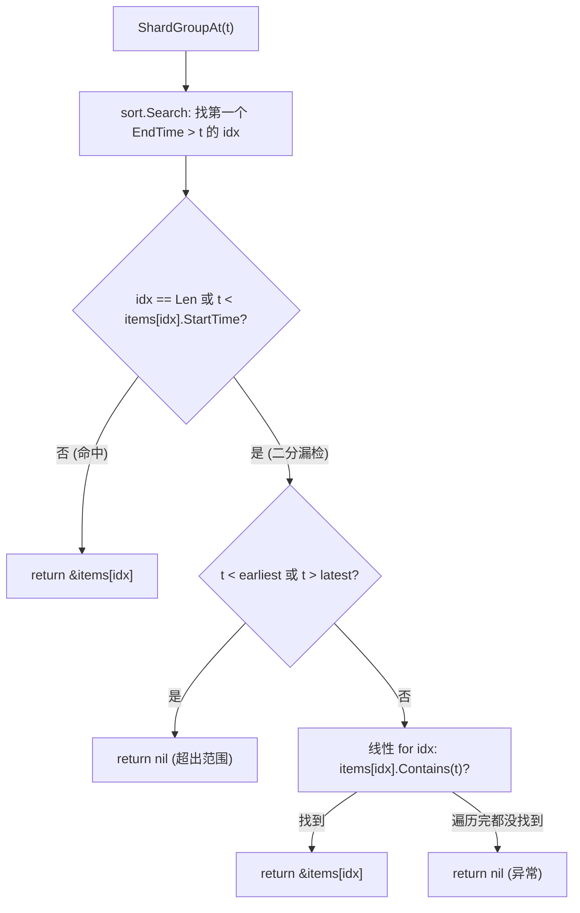

> **具体案例**: 截断组、重叠组与线性回退
>
> 排序键是**有效结束时间**：截断组取 `TruncatedAt`，否则取 `EndTime`（`services/meta/data.go:1423-1439`）；
> 而 `sgList.ShardGroupAt` 的二分键是原始 `EndTime`（`coordinator/points_writer.go:403`）。
> 两者在存在截断组时不再单调，于是需要线性回退。
>
> **(1) 截断后的真实创建路径**（`CreateShardGroup` 收缩循环，`data.go:403-430`）:
>
> ```
> SG_A: StartTime=00:00, EndTime=01:00, TruncatedAt=00:30
> 写 timestamp=00:40 → 收缩循环把新组起点抬到 TruncatedAt:
> SG_B: StartTime=00:30, EndTime=01:00
> 写 timestamp=00:20（<= TruncatedAt）→ ShardGroupByTimestamp 命中 SG_A，幂等返回，不建新组
> ```
>
> 所以正常写入路径**不可能**产生 `SG_B: StartTime=00:20` 这种组——收缩循环会先抬高起点。
>
> **(2) 写路径如何路由 `t=00:35`**: `sort.Search` 找第一个 `EndTime > 00:35` → SG_A；
> `Contains(00:35)` 用原始 `[00:00, 01:00)` → 命中 SG_A。**写路径只看原始 `StartTime/EndTime`，
> 不看 `TruncatedAt`**，因此该点会正常写入 SG_A，而不是"返回 nil / 被丢弃"。
> `TruncatedAt` 只影响 meta 侧 `ShardGroupByTimestamp` 的查找（`data.go:1263-1271`）。
> 正常 HTTP 写入路径上，过期组会先在 `MapShards` 被 `now - rp.Duration` 过滤掉
> （`coordinator/points_writer.go:309-320`），所以可达性主要取决于保留期而不是截断标记。
>
> **(3) 真正触发线性回退的构造**（EndTime 不同，但二分 idx 指向 `StartTime > t` 的组）:
>
> ```
> SG_E: StartTime=00:50, EndTime=01:00   (EndTime 早, StartTime 晚)
> SG_F: StartTime=00:00, EndTime=02:00   (EndTime 晚, StartTime 早)
> 排序 (按 EndTime 升序): [SG_E(01:00), SG_F(02:00)]
> earliest=00:00, latest=02:00
> ```
>
> 查询 `t = 00:30`:
> 1. `sort.Search` 找"第一个 EndTime > 00:30" → `idx = 0` (SG_E, EndTime=01:00 > 00:30)。
> 2. `t.Before(l.items[0].StartTime)` → `00:30.Before(00:50)` = **true**。
> 3. 二分路径判定"未命中"，进入回退分支。
> 4. `t.Before(earliest)` = false; `t.After(latest)` = false → 不返回 nil。
> 5. 线性 `for idx=0`: `SG_E.Contains(00:30)` → false，不 break。
> 6. `idx=1`: `SG_F.Contains(00:30)` → true → break。
> 7. 返回 `&SG_F`。**正确**。
>
> 如果没有线性回退，步骤 3 之后直接返回 nil，`MapShards` 会把 `t=00:30` 的点标记为
> dropped（`points_writer.go:298-301`），造成**数据丢失**。这正是源码注释强调的
> "non-silently drop writes we should have accepted" 风险。

**ShardGroupInfos 排序规则** (services/meta/data.go:1304):

```go
// services/meta/data.go:1414 — ShardGroupInfos 排序
type ShardGroupInfos []ShardGroupInfo

func (a ShardGroupInfos) Less(i, j int) bool {
    iEnd := a[i].EndTime
    if a[i].Truncated() {
        iEnd = a[i].TruncatedAt  // Truncated() 检查 TruncatedAt.IsZero()
    }

    jEnd := a[j].EndTime
    if a[j].Truncated() {
        jEnd = a[j].TruncatedAt
    }

    if iEnd.Equal(jEnd) {
        return a[i].StartTime.Before(a[j].StartTime)
    }

    return iEnd.Before(jEnd)
}
```

**ShardFor 路由**:

```go
// services/meta/data.go:1480 — ShardGroupInfo.ShardFor
func (sgi *ShardGroupInfo) ShardFor(p hashIDer) ShardInfo {
    if len(sgi.Shards) == 1 {
        return sgi.Shards[0]  // 单 shard: 直接返回 (OSS 默认)
    }
    // 多 shard: hash 取模 (Enterprise 模式)
    return sgi.Shards[p.HashID()%uint64(len(sgi.Shards))]
}
```

**ShardGroupInfo 完整结构**:

```go
// services/meta/data.go:1403 — ShardGroupInfo
type ShardGroupInfo struct {
    ID          uint64        // 全局唯一 ID (data.MaxShardGroupID++)
    StartTime   time.Time     // 窗口起始 (包含)
    EndTime     time.Time     // 窗口结束 (不包含)
    DeletedAt   time.Time     // 删除标记 (非零表示已删除)
    Shards      []ShardInfo   // 属于此 ShardGroup 的 Shard 列表
    TruncatedAt time.Time     // 截断时间 (覆盖 EndTime)
}
```

**关键方法**:

```go
// services/meta/data.go:1332
func (sgi *ShardGroupInfo) Contains(t time.Time) bool {
    return !t.Before(sgi.StartTime) && t.Before(sgi.EndTime)
}

// services/meta/data.go:1342
func (sgi *ShardGroupInfo) Deleted() bool {
    return !sgi.DeletedAt.IsZero()
}

// services/meta/data.go:1347
func (sgi *ShardGroupInfo) Truncated() bool {
    return !sgi.TruncatedAt.IsZero()
}
```

**ShardInfo 和 ShardOwner**:

```go
// services/meta/data.go:1536 — ShardInfo
type ShardInfo struct {
    ID     uint64        // 全局唯一 Shard ID
    Owners []ShardOwner  // 拥有此 Shard 的节点列表
}

// services/meta/data.go:1642 — ShardOwner
type ShardOwner struct {
    NodeID uint64  // 节点 ID
}

// services/meta/data.go:1432
func (si ShardInfo) OwnedBy(nodeID uint64) bool {
    for _, owner := range si.Owners {
        if owner.NodeID == nodeID {
            return true
        }
    }
    return false
}
```

**Protobuf 定义** (services/meta/internal/meta.proto):

```protobuf
message ShardGroupInfo {
    required uint64 ID = 1;
    required int64 StartTime = 2;
    required int64 EndTime = 3;
    required int64 DeletedAt = 4;
    repeated ShardInfo Shards = 5;
    optional int64 TruncatedAt = 6;
}

message ShardInfo {
    required uint64 ID = 1;
    repeated uint64 OwnerIDs = 2 [deprecated=true];  // 旧版兼容
    repeated ShardOwner Owners = 3;
}

message ShardOwner {
    required uint64 NodeID = 1;
}
```

> **小白解释**: MapShards 就像邮局分拣——根据信件（数据点）的时间戳，决定放到哪个邮筒（ShardGroup）。
> 第一遍：看看哪些邮筒已经存在，不存在的就创建。
> 第二遍：把每封信放到对应的邮筒里。

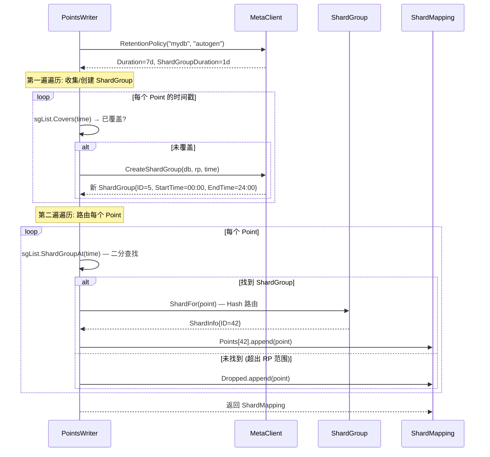

#### 步骤 6: Store.WriteToShard — Store 层入口

```go
// tsdb/store.go:1861 — WriteToShard
func (s *Store) WriteToShard(writeCtx tsdb.WriteContext, shardID uint64, points []models.Point) error {
    // 1. 查找 Shard (读锁)
    s.mu.RLock()

    select {
    case <-s.closing:
        s.mu.RUnlock()
        return tsdb.ErrStoreClosed
    default:
    }

    sh := s.shards[shardID]
    if sh == nil {
        s.mu.RUnlock()
        return tsdb.ErrShardNotFound
    }

    epoch := s.epochs[shardID]

    s.mu.RUnlock()

    // 2. Epoch 追踪: 获取 pending delete guards
    guards, gen := epoch.StartWrite()
    defer epoch.EndWrite(gen)

    // 3. 如果有匹配的 pending delete，等待完成
    for _, guard := range guards {
        if guard.Matches(points) {
            guard.Wait()
        }
    }

    // 4. 如果 Shard 空闲，重新启用压缩
    if isIdle, _ := sh.IsIdle(); isIdle {
        sh.SetCompactionsEnabled(true)
    }

    // 5. 委托给 Shard，并把 UserId 注入 stats tracker
    return sh.WritePoints(points, s.statsTracker(sh.database, sh.retentionPolicy, writeCtx.UserId))
}
```

**为什么用 RLock 而非 Lock？** 多个写入可以并发进行，只有创建/删除 Shard 需要写锁。读锁允许高并发写入。

#### 步骤 7-8: Epoch Tracker — 写入/删除序列化

```go
// tsdb/epoch_tracker.go:13 — epochTracker
type epochTracker struct {
    mu      sync.Mutex
    epoch   uint64                          // 全局 epoch 计数器
    largest uint64                          // 最大 epoch (delete 使用)
    writes  int64                           // 活跃写入计数
    deletes map[uint64]*epochDeleteState    // pending deletes
}
```

**StartWrite — 写入者注册**:

```go
// tsdb/epoch_tracker.go:63 — StartWrite
func (e *epochTracker) StartWrite() ([]*guard, uint64) {
    e.mu.Lock()
    gen := e.next()   // 先递增 epoch
    e.writes++        // 再增加活跃写入计数

    // 无 pending deletes: 手动解锁后提前返回
    if len(e.deletes) == 0 {
        e.mu.Unlock()
        return nil, gen
    }

    guards := make([]*guard, 0, len(e.deletes))
    for _, state := range e.deletes {
        guards = append(guards, state.guard)  // state.guard, 不是 state.g
    }

    e.mu.Unlock()
    return guards, gen
}
```

**EndWrite — 写入者注销**:

```go
// tsdb/epoch_tracker.go:83 — EndWrite
func (e *epochTracker) EndWrite(gen uint64) {
    e.mu.Lock()
    if gen <= e.largest {
        // 只有 gen 在删除范围内才需要遍历
        for dgen, state := range e.deletes {
            if gen > dgen {
                continue  // 跳过更早的 generation
            }
            state.done()
        }
    }
    e.writes--  // 遍历之后递减
    e.mu.Unlock()
}
```

**WaitDelete — 删除者注册**:

```go
// tsdb/epoch_tracker.go:127 — WaitDelete
func (e *epochTracker) WaitDelete(guard *guard) epochWaiter {
    e.mu.Lock()
    state := &epochDeleteState{
        pending: e.writes,                    // 当前活跃写入数
        cond:    sync.NewCond(new(sync.Mutex)),
        guard:   guard,
    }

    gen := e.next()        // 递增 epoch
    e.largest = gen
    e.deletes[gen] = state
    e.mu.Unlock()

    return epochWaiter{
        gen:     gen,
        guard:   guard,
        state:   state,
        tracker: e,
    }
}
```

**epochDeleteState 和 epochWaiter**:

```go
// tsdb/epoch_tracker.go:30 — epochDeleteState
type epochDeleteState struct {
    cond    *sync.Cond
    guard   *guard
    pending int64
}

// tsdb/epoch_tracker.go:37 — done
func (e *epochDeleteState) done() {
    e.cond.L.Lock()
    e.pending--
    if e.pending == 0 {
        e.cond.Broadcast()  // 通知 Wait()
    }
    e.cond.L.Unlock()
}

// tsdb/epoch_tracker.go:102 — epochWaiter
type epochWaiter struct {
    gen     uint64
    guard   *guard
    state   *epochDeleteState
    tracker *epochTracker
}

func (e epochWaiter) Wait() {
    if e.state == nil || e.tracker == nil {
        return
    }
    e.state.Wait()  // 使用 sync.Cond 等待
}

func (e epochWaiter) Done() {
    e.tracker.mu.Lock()
    delete(e.tracker.deletes, e.gen)  // 从 deletes map 中移除
    e.tracker.mu.Unlock()
    e.guard.Done()
}
```

**Guard — 粒度匹配**:

```go
// tsdb/guard.go:12 — guard
type guard struct {
    cond  *sync.Cond
    done  bool
    min   int64
    max   int64
    names map[string]struct{}
    expr  *exprGuard
}

func (g *guard) Matches(points []models.Point) bool {
    if g == nil {
        return true  // nil guard 匹配所有点 (写入必须等待)
    }

    for _, pt := range points {
        if t := pt.Time().UnixNano(); t < g.min || t > g.max {
            continue
        }
        if len(g.names) == 0 && g.expr.matches(pt) {
            return true
        } else if _, ok := g.names[string(pt.Name())]; ok && g.expr.matches(pt) {
            return true
        }
    }
    return false
}
```

> **具体案例**: 为什么需要 Epoch Tracker？
>
> 假设没有 Epoch Tracker，会发生什么：
> ```
> t=1: 用户执行 DELETE FROM cpu WHERE time >= '10:00' AND time < '11:00'
> t=2: 删除操作开始，正在逐个删除 TSM 文件中 10:00-11:00 的数据
> t=3: 新写入到达: cpu,host=web value=99.9 10:30:00 (时间戳在删除范围内!)
> t=4: 删除操作完成
>
> 问题: t=3 写入的数据在 t=2 开始删除时还不存在，但 t=4 删除完成时它已经存在了。
>       如果删除操作不知道这个新数据的存在，就会漏删它！
>       或者更糟：删除操作可能误删了 t=3 写入的数据！
>
> Epoch Tracker 的解决方案:
> - 删除开始时，记录当前所有活跃的写入 (guard)
> - 新写入到达时，检查是否与 guard 匹配
> - 如果匹配，新写入必须等待删除完成后再执行
> - 这样删除操作就知道哪些数据是"旧的"，哪些是"新的"
> ```

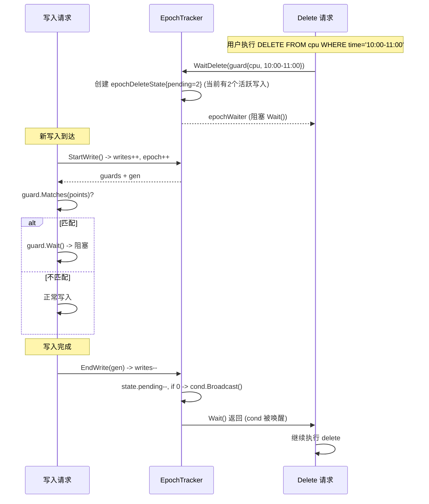

**为什么需要 Epoch Tracker？** 防止写入和删除的竞态条件：如果 delete 正在删除某个时间范围的数据，新写入的相同时间范围的数据必须等待 delete 完成，否则 delete 会误删新写入的数据。Guard 按 measurement + timeRange 匹配，不同 measurement 的写入不受影响。

#### 步骤 9-12: Shard 层写入

```go
// tsdb/shard.go:562 — WritePoints
func (s *Shard) WritePoints(points []models.Point, tracker StatsTracker) error {
    // 1. 获取读锁 (允许并发写入)
    s.mu.RLock()
    defer s.mu.RUnlock()

    // 2. 获取引擎引用 (返回 Engine, error)
    engine, err := s.engineNoLock()
    if err != nil {
        return err
    }

    // 3. 验证 series 和 fields
    var writeError error
    points, fieldsToCreate, err := s.validateSeriesAndFields(points, tracker)
    if err != nil {
        if _, ok := err.(PartialWriteError); !ok {
            return err
        }
        writeError = err
    }

    // 4. 创建新的 fields
    if _, err := s.saveFieldsAndMeasurements(fieldsToCreate); err != nil {
        return err
    }

    // 5. 写入引擎
    if err := engine.WritePoints(points, tracker); err != nil {
        atomic.AddInt64(&s.stats.WritePointsErr, int64(len(points)))
        return fmt.Errorf("engine: %w", err)
    }

    // 6. 统计
    atomic.AddInt64(&s.stats.WriteReqOK, 1)
    return writeError
}
```

**validateSeriesAndFields** 的关键检查:

```go
// tsdb/shard.go — validateSeriesAndFields
func (s *Shard) validateSeriesAndFields(points []models.Point, tracker StatsTracker) ([]models.Point, []*FieldCreate, error) {
    var (
        createdFieldsToSave []*FieldCreate
        dropped             int
        reason              string
    )

    // 1. 第一阶段: 过滤非法 series key，并准备批量建 series 的数组
    keys := make([][]byte, len(points))
    names := make([][]byte, len(points))
    tagsSlice := make([]models.Tags, len(points))
    validateKeys := s.options.Config.ValidateKeys

    var j int
    for i, p := range points {
        tags := p.Tags()
        if v := tags.Get(TimeBytes); v != nil {
            dropped++
            if reason == "" { reason = `invalid tag key: input tag "time" is invalid` }
            continue
        }
        if validateKeys && !models.ValidKeyTokens(string(p.Name()), tags) {
            dropped++
            if reason == "" { reason = fmt.Sprintf("key contains invalid unicode: %q", makePrintable(string(p.Key()))) }
            continue
        }
        keys[j], names[j], tagsSlice[j], points[j] = p.Key(), p.Name(), tags, points[i]
        j++
    }
    points, keys, names, tagsSlice = points[:j], keys[:j], names[:j], tagsSlice[:j]

    engine, err := s.engineNoLock()
    if err != nil {
        return nil, nil, err
    }

    // 2. 批量创建 series；PartialWriteError 会带回 dropped keys
    var droppedKeys [][]byte
    if err := engine.CreateSeriesListIfNotExists(keys, names, tagsSlice, tracker); err != nil {
        switch err := err.(type) {
        case PartialWriteError:
            reason, dropped, droppedKeys = err.Reason, dropped+err.Dropped, err.DroppedKeys
        case *PartialWriteError:
            reason, dropped, droppedKeys = err.Reason, dropped+err.Dropped, err.DroppedKeys
        default:
            return nil, nil, err
        }
    }

    // 3. 第二阶段: 验证 fields；不直接调用不存在的 s.fieldType()
    j = 0
    for i, p := range points {
        // field 名为 "time" 的点如果没有其他有效 field，会整点丢弃
        iter := p.FieldIterator()
        validField := false
        for iter.Next() {
            if bytes.Equal(iter.FieldKey(), TimeBytes) { continue }
            validField = true
            break
        }
        if !validField {
            dropped++
            if reason == "" { reason = `invalid field name: input field "time" is invalid` }
            continue
        }

        if len(droppedKeys) > 0 && bytesutil.Contains(droppedKeys, keys[i]) {
            continue
        }

        mf := engine.MeasurementFields(p.Name())
        newFields, partialWriteError := ValidateAndCreateFields(mf, p, s.options.Config.SkipFieldSizeValidation)
        createdFieldsToSave = append(createdFieldsToSave, newFields...)
        if partialWriteError != nil && partialWriteError.Dropped > 0 {
            if reason == "" { reason = partialWriteError.Reason }
            dropped += partialWriteError.Dropped
            continue
        }
        points[j] = points[i]
        j++
    }
    points = points[:j]

    if dropped > 0 {
        return points, createdFieldsToSave, PartialWriteError{
            Reason: reason, Dropped: dropped, Database: s.database, RetentionPolicy: s.retentionPolicy,
        }
    }
    return points, createdFieldsToSave, nil
}
```

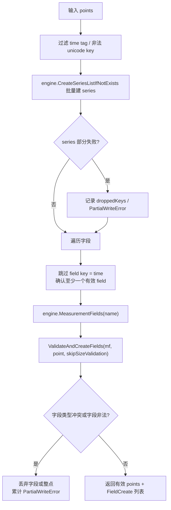

**案例**: 一个 batch 中同时包含 `cpu,time=x value=1`、`cpu value=1i`
和 `cpu value=1.2`。第一条因保留 tag `time` 在 series 阶段被丢弃；后两条进入
字段阶段，`ValidateAndCreateFields` 根据 measurement 的字段元数据判断 `value`
是否发生 int/float 类型冲突，并只把有效点继续交给 engine。

**PartialWriteError 结构**:

```go
// tsdb/shard.go:121 — PartialWriteError
type PartialWriteError struct {
    Reason  string
    Dropped int

    // A sorted slice of series keys that were dropped.
    DroppedKeys     [][]byte
    Database        string
    RetentionPolicy string
}

func (e PartialWriteError) Error() string {
    message := fmt.Sprintf("partial write: %s dropped=%d", e.Reason, e.Dropped)
    if len(e.Database) > 0 {
        message = fmt.Sprintf("%s for database: %s", message, e.Database)
    }
    if len(e.RetentionPolicy) > 0 {
        message = fmt.Sprintf("%s for retention policy: %s", message, e.RetentionPolicy)
    }
    return message
}
```

**PartialWriteError 传播路径**:
1. `Shard.validateSeriesAndFields()` → 产生 PartialWriteError
2. `Shard.WritePoints()` → 返回但继续写入有效点
3. `Store.WriteToShard()` → 透传
4. `PointsWriter.writeToShard()` → 透传
5. `HTTP Handler.serveWrite()` → 返回 400 (部分成功)

#### 步骤 12b: Engine.WritePoints — Point 到 Value 的转换

```go
// tsdb/engine/tsm1/engine.go:1346-1460 — WritePoints
func (e *Engine) WritePoints(points []models.Point, tracker tsdb.StatsTracker) error {
    values := make(map[string][]Value, len(points))
    var (
        keyBuf    []byte
        baseLen   int
        seriesErr error
        npoints   int64
        nvalues   int64
    )

    for _, p := range points {
        keyBuf = append(keyBuf[:0], p.Key()...)      // 复用缓冲，避免每点分配
        keyBuf = append(keyBuf, keyFieldSeparator...)
        baseLen = len(keyBuf)
        iter := p.FieldIterator()
        t := p.Time().UnixNano()
        npoints++
        var nValuesForPoint int64

        for iter.Next() {
            keyBuf = append(keyBuf[:baseLen], iter.FieldKey()...)

            if e.seriesTypeMap != nil {
                // 快路径: 已存在则比较类型
                if v, ok := e.seriesTypeMap.Get(keyBuf); !ok {
                    if typ, err := e.Type(keyBuf); err != nil {
                        // 磁盘类型未知，尝试插入
                    } else if typ != iter.Type() {
                        seriesErr = tsdb.ErrFieldTypeConflict
                        e.seriesTypeMap.Insert(keyBuf, int(typ))
                        continue
                    }
                    vv, ok := e.seriesTypeMap.Insert(keyBuf, int(iter.Type()))
                    if !ok || vv != int(iter.Type()) {
                        seriesErr = tsdb.ErrFieldTypeConflict
                        continue
                    }
                } else if v != int(iter.Type()) {
                    seriesErr = tsdb.ErrFieldTypeConflict
                    continue
                }
            }

            var v Value
            switch iter.Type() {
            case models.Float:
                fv, err := iter.FloatValue()
                if err != nil { return err }
                v = NewFloatValue(t, fv)
            case models.Integer:
                iv, err := iter.IntegerValue()
                if err != nil { return err }
                v = NewIntegerValue(t, iv)
            case models.Unsigned:
                uv, err := iter.UnsignedValue()
                if err != nil { return err }
                v = NewUnsignedValue(t, uv)
            case models.String:
                v = NewStringValue(t, iter.StringValue())
            case models.Boolean:
                bv, err := iter.BooleanValue()
                if err != nil { return err }
                v = NewBooleanValue(t, bv)
            default:
                return fmt.Errorf("unknown field type for %s: %s", string(iter.FieldKey()), p.String())
            }
            nValuesForPoint++
            values[string(keyBuf)] = append(values[string(keyBuf)], v)
        }
        nvalues += nValuesForPoint
    }

    e.mu.RLock()                 // 读锁覆盖 Cache/WAL 写入
    defer e.mu.RUnlock()

    if err := e.Cache.WriteMulti(values); err != nil {
        return err               // Cache 错误必须返回
    }
    if e.WALEnabled {
        if _, err := e.WAL.WriteMulti(values); err != nil {
            return err
        }
    }
    if tracker.AddedPoints != nil {
        tracker.AddedPoints(npoints, nvalues)
    }
    return seriesErr
}
```

**与旧描述的关键差异**:

1. **`keyBuf` 复用**: 循环外声明，每点 `keyBuf[:0]` 重置、每 field `keyBuf[:baseLen]` 截断；旧伪代码的 `append(p.Key(), ...)` 每点都会分配。
2. **读锁**: `e.mu.RLock()` 覆盖 `Cache.WriteMulti` 与 `WAL.WriteMulti`，不是无锁写。
3. **错误分支**: 5 种类型的 `FieldValue()` 错误都直接 `return err`；`default` 分支返回 `unknown field type ...`；`Cache.WriteMulti` 的错误也必须返回。
4. **`seriesTypeMap`**: 是 `*radix.Tree`（`engine.go:225`），不是 `sync.Map`；未命中时先 `e.Type(keyBuf)` 复核磁盘类型，冲突时把磁盘类型写回 map 再 `continue`（跳过单个 field）。
5. **Cache 先于 WAL 的失败语义**: WAL 失败时值已经在内存 Cache 中，**没有回滚**。读路径 `Cache.Values` 会去重且同一时间戳以 cache 为准（`cache.go:554-606`、`encoding.gen.go:61-90`、`array_cursor.gen.go:88-95`），因此**不会读到重复点**；代价是**持久性**——未进 WAL 的值要等 cache snapshot → TSM 才落盘，这之前进程崩溃会丢。

#### 步骤 13: Epoch EndWrite

`EndWrite(gen)` 通过 `defer` 在 `Store.WriteToShard` 返回时自动调用：

```go
// tsdb/store.go:1444
guards, gen := epoch.StartWrite()
defer epoch.EndWrite(gen)  // 函数返回时自动调用
```

每个写入的 `gen` 值保证：只有 `generation >= gen` 的 pending delete 才会被通知。这确保了 delete 等待的是它之前（或同时）开始的写入。

#### 步骤 14: Subscriber Fan-Out — 数据推送

```go
// coordinator/points_writer.go:512 — subscriber fan-out (在 WritePointsPrivileged 中)
pts := &WritePointsRequest{Database: database, RetentionPolicy: retentionPolicy, Points: points}
w.Subscriber.Send(pts)
atomic.AddInt64(&w.stats.SubWriteOK, 1)
```

这个调用发生在等待 shard goroutine 结果之前：也就是说，订阅转发可能已经入队或被 subscriber 层拒绝，而随后主写入仍可能因为 shard 错误或 `WriteTimeout` 返回失败。

**Subscriber 内部机制**:

```go
// services/subscriber/service.go:309 — Service.Send
func (s *Service) Send(request *coordinator.WritePointsRequest) {
    s.router.Send(request)
}

// services/subscriber/service.go:608 — subscriptionRouter.Send
func (s *subscriptionRouter) Send(request *coordinator.WritePointsRequest) {
    s.mu.RLock()
    defer s.mu.RUnlock()
    if !s.ready {
        return
    }
    writers := s.m[dbrp{db: request.Database, rp: request.RetentionPolicy}]
    if len(writers) == 0 {
        return
    }
    writeReq, numInvalid := NewWriteRequest(request, s.Logger)
    atomic.AddInt64(s.writeFailures, numInvalid)
    for _, w := range writers {
        w.Write(writeReq)
    }
}
```

**BalanceMode 定义**:

```go
// services/subscriber/service.go:512 — BalanceMode
type BalanceMode int

const (
    ALL BalanceMode = iota  // 写入所有目的地
    ANY                     // 轮询写入一个成功的
)
```

**balancewriter 核心逻辑**:

```go
// services/subscriber/service.go — balancewriter.WritePointsContext
type balancewriter struct {
    bm          BalanceMode
    writers     []PointsWriter
    stats       []writerStats
    defaultTags models.StatisticTags
    i           int  // 轮询索引
}

func (b *balancewriter) WritePointsContext(ctx context.Context, request WriteRequest) (string, error) {
    var lastErr error
    var lastDest string
    for range b.writers {
        idx := b.i
        w := b.writers[idx]
        b.i = (b.i + 1) % len(b.writers)  // 轮询前进

        dest, err := w.WritePointsContext(ctx, request)
        if err != nil {
            lastErr = err
            lastDest = dest
            atomic.AddInt64(&b.stats[idx].failures, 1)
        } else {
            atomic.AddInt64(&b.stats[idx].pointsWritten, int64(len(request.pointOffsets)))
            if b.bm == ANY {
                break  // ANY 模式: 后续成功后停止继续尝试
            }
            // ALL 模式: 继续写入下一个
        }
    }
    return lastDest, lastErr
}
```

**BalanceMode 语义校准**:
- `ALL` 表示尝试 fan-out 到所有目的地；它不是可靠投递协议，没有持久化队列、ack 重试或端到端确认。
- `ANY` 会按轮询顺序尝试目的地，遇到后续成功后停止继续尝试；但函数最后返回的是 `lastErr`，如果前面目的地失败、后面目的地成功，先前错误仍可能作为返回值传出。

**传输实现 — HTTP Writer**:

```go
// services/subscriber/http.go — HTTP
type HTTP struct {
    c    client.HTTPClient
    addr string
}

func (h *HTTP) WritePointsContext(ctx context.Context, request WriteRequest) (string, error) {
    bp, _ := client.NewBatchPoints(client.BatchPointsConfig{
        Database:        request.Database,
        RetentionPolicy: request.RetentionPolicy,
    })

    // WriteRequest 已经持有序列化后的 line protocol。
    return h.addr, h.c.WriteRawCtx(ctx, bp, bytes.NewReader(request.lineProtocol))
}
```

**传输实现 — UDP Writer**:

```go
// services/subscriber/udp.go — UDP
type UDP struct {
    addr        string  // host:port
    destination string  // 原始 URL
}

func (u *UDP) WritePointsContext(ctx context.Context, request WriteRequest) (string, error) {
    // 解析地址
    addr, err := net.ResolveUDPAddr("udp", u.addr)
    if err != nil {
        return u.destination, err
    }

    // 每次写入创建新连接!
    con, err := net.DialUDP("udp", nil, addr)
    if err != nil {
        return u.destination, err
    }
    defer con.Close()

    for i := range request.pointOffsets {
        // write the point without the trailing newline
        pointRaw := request.PointAt(i)
        _, err = con.Write(pointRaw[:pointRaw[len(pointRaw)-1]])
        if err != nil {
            return
        }
    }
    return
}
```

> **确认为缺陷**: 当前 OSS 源码 (services/subscriber/udp.go:42) 使用的是
> `pointRaw[:pointRaw[len(pointRaw)-1]]`。注释意图是"去掉末尾换行"
> (write the point without the trailing newline)，正确写法应是
> `pointRaw[:len(pointRaw)-1]`——即把 `len(pointRaw)-1` 作为 slice 上界索引。
> 但源码把 `pointRaw[len(pointRaw)-1]` (最后一个**字节值**)作为上界：当末尾字节是
> 换行符 `0x0a` (10) 时，`pointRaw[:10]` 只会写出前 10 个字节而不是去掉末尾一个字节；
> 当末尾字节值大于切片长度时会 panic，小于时则截断数据。这是一个 off-by-one 的
> 索引/字节值混淆缺陷。

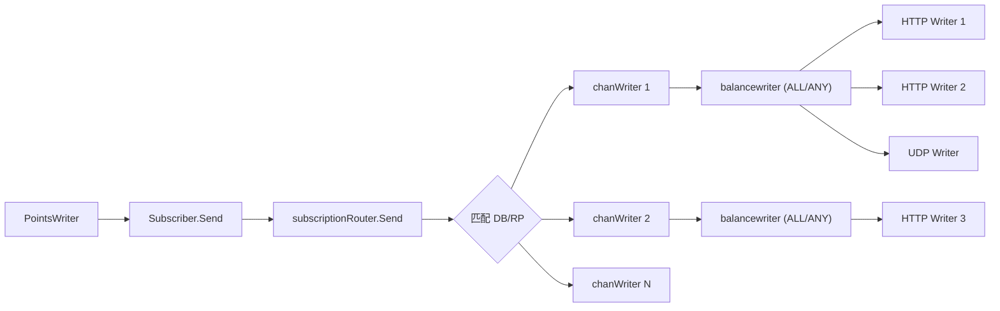

#### Subscriber Fan-Out 机制 — 详细序列图

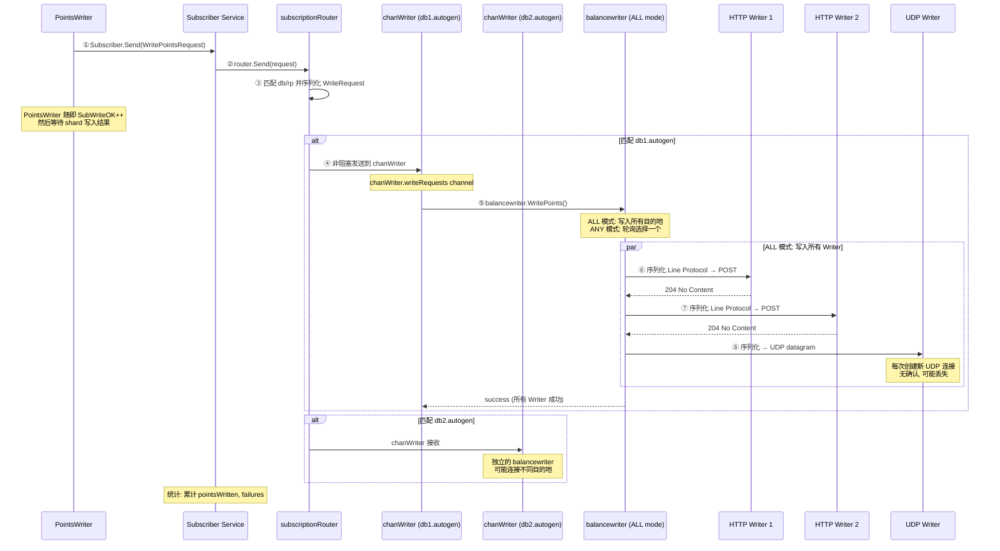

**Fan-Out 关键特性**:
- **非阻塞**: `chanWriter.Write` 写入 destination 队列时使用 `select default`，队列满或超过字节限制时拒绝，不阻塞主写入路径
- **按 DB/RP 分发**: 每个 subscription 绑定一个 database + RP 组合，只有匹配的数据才会被转发
- **ALL/ANY 模式**: ALL 尝试写入所有目的地但不提供可靠投递；ANY 轮询尝试，遇到后续成功后停止，但先前错误仍可能返回
- **背压显式化**: subscriber `writeFailures` 暴露队列满、超限或 destination 写入失败
- **WriteConcurrency**: 每个 subscription 启动 `WriteConcurrency` 个 goroutine 执行 `chanWriter.Run()`，实现并发写入

#### 步骤 15: 结果收集与超时

```go
// coordinator/points_writer.go:474-539 — WritePointsPrivileged（fan-out 与结果收集，节选）
// 省略前置：shardMappings, err := w.MapShards(...)，其错误处理见步骤 14
ch := make(chan error, len(shardMappings.Points))   // 缓冲 = shard 数，goroutine 不会泄漏
for shardID, points := range shardMappings.Points {
    go func(writeCtx tsdb.WriteContext, shard *meta.ShardInfo, database, retentionPolicy string, points []models.Point) {
        err := w.writeToShard(writeCtx, shard, database, retentionPolicy, points)
        if err == tsdb.ErrShardDeletion {
            err = tsdb.PartialWriteError{
                Reason:          fmt.Sprintf("shard %d is pending deletion", shard.ID),
                Dropped:         len(points),
                Database:        database,
                RetentionPolicy: retentionPolicy,
            }
        }
        ch <- err
    }(writeCtx, shardMappings.Shards[shardID], database, retentionPolicy, points)
}

timeout := time.NewTimer(w.WriteTimeout)
defer timeout.Stop()

// Subscriber.Send 在启动全部 goroutine 之后、等待结果之前
pts := &WritePointsRequest{Database: database, RetentionPolicy: retentionPolicy, Points: points}
w.Subscriber.Send(pts)
atomic.AddInt64(&w.stats.SubWriteOK, 1)

// 保留期/写窗口丢弃: 即使每个 shard 都成功，也整体返回 PartialWriteError
if err == nil && shardMappings.Dropped() > 0 {
    err = tsdb.PartialWriteError{
        Reason:          shardMappings.SummariseDropped(),
        Dropped:         shardMappings.Dropped(),
        Database:        database,
        RetentionPolicy: retentionPolicy,
    }
}

for range shardMappings.Points {
    select {
    case <-w.closing:
        return ErrWriteFailed
    case <-timeout.C:
        atomic.AddInt64(&w.stats.WriteTimeout, 1)
        return ErrTimeout
    case err := <-ch:
        if err != nil {
            return err            // 第一个错误立即返回
        }
    }
}
return err
```

**错误 → HTTP 状态码**（`services/httpd/handler.go:1773-1805`）:

| 错误来源 | 错误类型 | HTTP | 客户端可见信息 | 已写入? |
|---|---|---|---|---|
| 解析失败且 0 点 | parseError | 400 | 原始错误 | 否 |
| 解析部分失败 | parseError + points | 400 | 成功点已写 | 部分 |
| 保留期外/写窗口外 | `ShardMapping.Dropped()` → PartialWriteError | 400 | `partial write: dropped N points outside retention policy of duration <dur> - oldest ..., newest ... dropped=N` | 其它点写 |
| field 类型冲突 | `tsdb.PartialWriteError` | 400 | `... already exists as type ...` | 整点丢 |
| shard 正在删除 | `ErrShardDeletion` → PartialWriteError | 400 | `shard N is pending deletion` | 否（该 shard） |
| 认证/授权 | `influxdb.IsAuthorizationError` | 403 | not authorized | 否 |
| 其它底层错误 | error | 500 | 原始错误 | 未知 |
| 全部成功 | nil | 204 | — | 是 |

**三个案例**:

1. **2 个 shard，一成功一正在删除**: 删除中的 shard 返回 `ErrShardDeletion`，被转换成 `PartialWriteError{Dropped=len(points)}`；select 收到非 nil 立即返回 → 400，另一个 shard 的写入已经发生。
2. **所有点早于 `now-rp.Duration`**: `MapShards` 把全部点放进 `Dropped`，`shardMappings.Points` 为空，因此**不会启动任何 goroutine**；函数在等待结果前就把 `err` 设为 `PartialWriteError`，`for range` 循环体不执行，直接 `return err` → 400。
3. **一个 shard 磁盘错误**: 该 goroutine 返回底层 error → select 立即返回 500；其它 goroutine 继续跑完并把结果写入**带缓冲**的 `ch`，不会阻塞泄漏，但结果被丢弃。

`WritePointsPrivileged` 遇到第一个 shard 错误会立即返回给调用方，但它不会取消已经启动的其他 shard goroutine；这些 goroutine 仍会继续执行到底层 `WriteToShard` 返回。

**错误哨兵变量**:

```go
// coordinator/points_writer.go:32-42
var (
    ErrTimeout      = errors.New("timeout")
    ErrPartialWrite = errors.New("partial write")
    ErrWriteFailed  = errors.New("write failed")
)
```

**并发模型**:

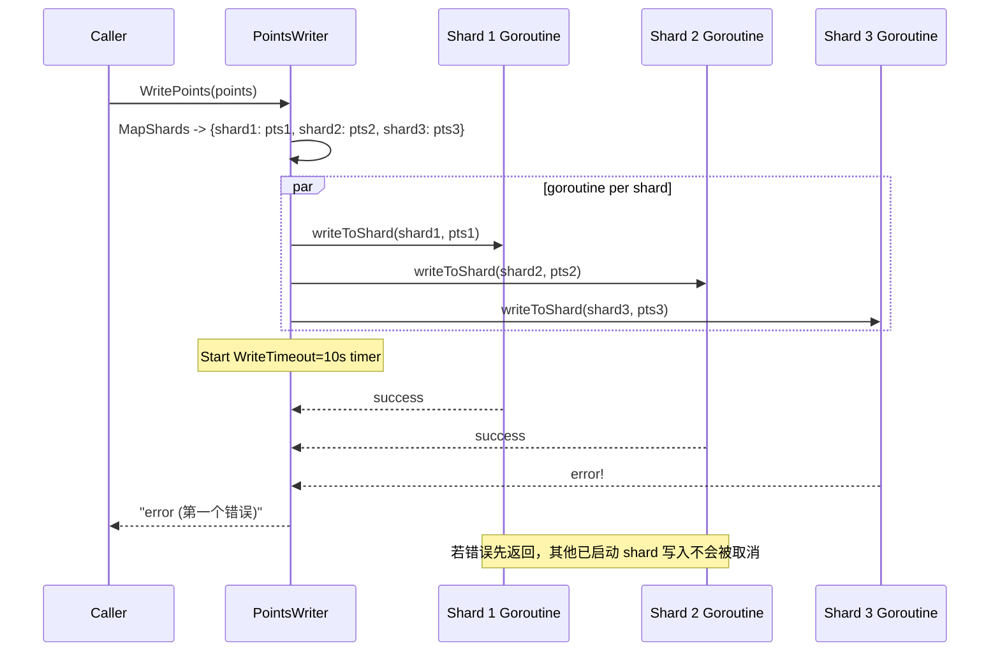

#### writeToShard — Write-Through 重试

```go
// coordinator/points_writer.go:542-569 — writeToShard
func (w *PointsWriter) writeToShard(writeCtx tsdb.WriteContext, shard *meta.ShardInfo,
    database, retentionPolicy string, points []models.Point) error {
    atomic.AddInt64(&w.stats.PointWriteReqLocal, int64(len(points)))

    // 只有 ErrShardNotFound 可以在这里处理
    if err := w.TSDBStore.WriteToShard(writeCtx, shard.ID, points); err == tsdb.ErrShardNotFound {
        if err = w.TSDBStore.CreateShard(database, retentionPolicy, shard.ID, true); err != nil {
            w.Logger.Warn("Write failed creating shard", zap.Uint64("shard", shard.ID), zap.Error(err))
            atomic.AddInt64(&w.stats.WriteErr, 1)
            return err
        }
        // 创建后重试一次
        if err := w.TSDBStore.WriteToShard(writeCtx, shard.ID, points); err != nil {
            w.Logger.Info("Write failed", zap.Uint64("shard", shard.ID), zap.Error(err))
            atomic.AddInt64(&w.stats.WriteErr, 1)
            return err
        }
    } else if err != nil {
        atomic.AddInt64(&w.stats.WriteErr, 1)
        return err
    }
    atomic.AddInt64(&w.stats.WriteOK, 1)
    return nil
}
```

**关键细节**:

1. 只有 `tsdb.ErrShardNotFound` 会触发一次 `CreateShard` + 重试；`ErrShardDeletion` 不在这里处理，而是由调用方 `WritePointsPrivileged` 的 goroutine 转换成 `PartialWriteError`（`coordinator/points_writer.go:496-503`）。
2. 日志级别不同：创建失败是 `Warn("Write failed creating shard")`，重试写失败是 `Info("Write failed")`，非 `ErrShardNotFound` 的底层错误**不在这里打日志**。
3. 每次进入都递增 `PointWriteReqLocal`（本地写入点数）；成功只递增 `WriteOK`，失败递增 `WriteErr`。
4. `CreateShard` 是幂等的；若 shard 已在 `pendingShardDeletes` 中，返回 `ErrShardDeletion`，该错误会原样上抛并被调用方转换。

## 2. ShardGroup Duration 自适应

### 2.1 shardGroupDuration 函数

```go
// services/meta/data.go:1376 — shardGroupDuration
func shardGroupDuration(d time.Duration) time.Duration {
    if d >= 180*24*time.Hour || d == 0 { // 6 个月或 0
        return 7 * 24 * time.Hour
    } else if d >= 2*24*time.Hour { // 2 天
        return 1 * 24 * time.Hour
    }
    return 1 * time.Hour
}
```

| RP Duration | ShardGroup Duration | 设计意图 |
|-------------|---------------------|----------|
| >= 6 个月 | 7 天 | 长期数据，减少 ShardGroup 数量 |
| >= 2 天 | 1 天 | 中期数据，平衡粒度 |
| < 2 天 | 1 小时 | 短期数据，细粒度过期管理 |
| 无限 (0) | 7 天 | 默认策略 |

**normalisedShardDuration** (services/meta/data.go:1386):

```go
// services/meta/data.go:1386 — normalisedShardDuration
func normalisedShardDuration(sgd, d time.Duration) time.Duration {
    // sgd=0: 未指定, 使用 shardGroupDuration 默认值
    if sgd == 0 {
        return shardGroupDuration(d)
    }
    // sgd < MinRetentionPolicyDuration: 规范化到最小值
    if sgd < MinRetentionPolicyDuration {
        return shardGroupDuration(MinRetentionPolicyDuration)
    }
    return sgd
}
```

### 2.2 ShardGroup 自动创建

```go
// services/meta/data.go:382 — CreateShardGroup
func (data *Data) CreateShardGroup(database, policy string, timestamp time.Time) error {
    rpi, err := data.RetentionPolicy(database, policy)
    if err != nil {
        return err
    } else if rpi == nil {
        return influxdb.ErrRetentionPolicyNotFound(policy)
    }

    // 幂等：已存在覆盖该时间戳且未被删除/截断的组
    if rpi.ShardGroupByTimestamp(timestamp) != nil {
        return nil
    }

    startTime := timestamp.Truncate(rpi.ShardGroupDuration).UTC()
    endTime := startTime.Add(rpi.ShardGroupDuration).UTC()
    if endTime.After(time.Unix(0, models.MaxNanoTime)) {
        // Shard group range is [start, end) so add one to the max time.
        endTime = time.Unix(0, models.MaxNanoTime+1)
    }

    // 收缩新区间，保证不与已有组重叠（data.go:403-430）
    for i := range rpi.ShardGroups {
        if rpi.ShardGroups[i].Deleted() {
            continue
        }
        startI := rpi.ShardGroups[i].StartTime
        endI := rpi.ShardGroups[i].EndTime
        if rpi.ShardGroups[i].Truncated() {
            endI = rpi.ShardGroups[i].TruncatedAt
        }
        if !timestamp.Before(endI) && endI.After(startTime) {
            startTime = endI
        }
        if startI.After(timestamp) && startI.Before(endTime) {
            endTime = startI
        }
    }

    data.MaxShardGroupID++
    sgi := ShardGroupInfo{ID: data.MaxShardGroupID, StartTime: startTime, EndTime: endTime}
    data.MaxShardID++
    sgi.Shards = []ShardInfo{{ID: data.MaxShardID}}
    rpi.ShardGroups = append(rpi.ShardGroups, sgi)
    sort.Sort(ShardGroupInfos(rpi.ShardGroups))
    return nil
}
```

**注意**: `MaxNanoTime` 钳制发生在收缩循环**之前**；收缩循环会把新组起点抬到已有组的有效结束时间（截断组取 `TruncatedAt`），因此新组不会与旧组重叠。`CreateShardGroup` 每次固定只建 1 个 Shard（`data.MaxShardID++`），这是 OSS 的退化形态。

**关键发现**: OSS 版本每个 ShardGroup 只创建 **1 个 Shard**。`ShardFor()` 的 hash 路由是 Enterprise 版本的遗留代码。

**ShardGroupByTimestamp** (services/meta/data.go:1263):

```go
// services/meta/data.go:1263 — ShardGroupByTimestamp
func (rpi *RetentionPolicyInfo) ShardGroupByTimestamp(timestamp time.Time) *ShardGroupInfo {
    for i := range rpi.ShardGroups {
        sgi := &rpi.ShardGroups[i]
        if sgi.Contains(timestamp) && !sgi.Deleted() &&
           (!sgi.Truncated() || timestamp.Before(sgi.TruncatedAt)) {
            return &rpi.ShardGroups[i]
        }
    }
    return nil
}
```

### 2.3 ShardGroup 预创建

```go
// services/meta/client.go:766-816 — PrecreateShardGroups
func (c *Client) PrecreateShardGroups(from, to time.Time) error {
    c.mu.Lock()
    defer c.mu.Unlock()
    data := c.cacheData.Clone()
    changed := false

    for _, di := range data.Databases {
        for _, rp := range di.RetentionPolicies {
            if len(rp.ShardGroups) == 0 {
                continue                                   // 从未写入过数据
            }
            g := rp.ShardGroups[len(rp.ShardGroups)-1]     // 只看最后一个组
            if !g.Deleted() && g.EndTime.Before(to) && g.EndTime.After(from) {
                nextTime := g.EndTime.Add(1 * time.Nanosecond)
                if sg, _ := data.ShardGroupByTimestamp(di.Name, rp.Name, nextTime); sg != nil {
                    continue                               // 已存在，幂等跳过
                }
                if _, err := createShardGroup(data, di.Name, rp.Name, nextTime); err != nil {
                    continue                           // 失败只记 Info 日志
                }
                changed = true
            }
        }
    }
    if changed {
        return c.commit(data)
    }
    return nil
}
```

**关键点**:

- 每个 RP 每次调用**最多创建 1 个组**，且只覆盖 `(now, now+advancePeriod]` 内的下一组。
- 条件 `g.EndTime.After(from)` 要求最后一组的结束时间仍在未来；停机后该条件恒为 false，**预创建不会追赶**缺失的组，只能等写入路径 `MapShards → CreateShardGroup` 按需建组。
- 预创建的意义是减少写入路径上的建组延迟；失败只记 `Info` 日志，不重试。

### 2.4 ShardGroup 生命周期

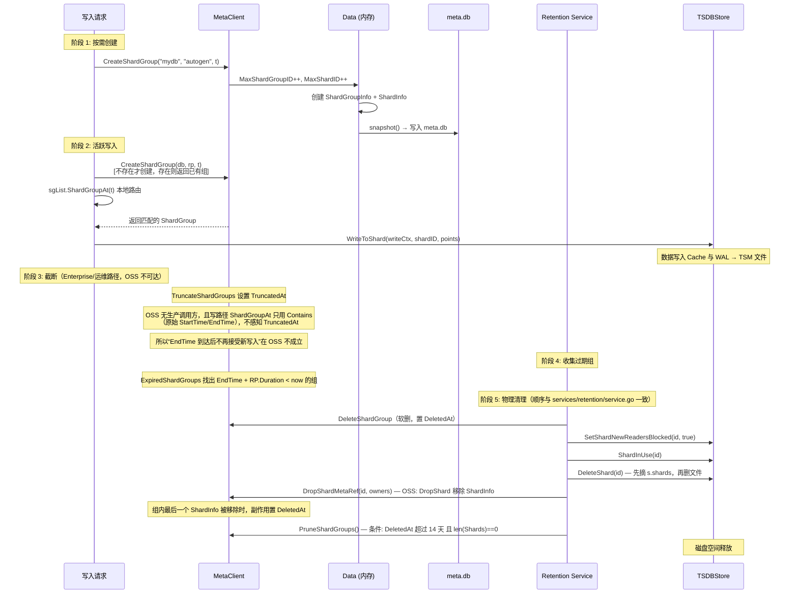

**注意**: `DeletedAt` 只影响查询过滤（`services/meta/data.go:340-352`）；没有 `DeletedAt` 的空组不会被修剪。`TruncateShardGroups` 在 OSS 只有接口声明与测试/mock 调用方（`coordinator/meta_client.go:30`），写路径 `ShardGroupAt` 用 `Contains` 看原始 `StartTime/EndTime`。

**ShardGroup 时间边界计算** (`data.go:382`):

```go
startTime := timestamp.Truncate(rpi.ShardGroupDuration).UTC()
endTime := startTime.Add(rpi.ShardGroupDuration).UTC()
```

**ShardGroupDuration 自适应** (`data.go:1376`):

| RP Duration | ShardGroup Duration | 设计意图 |
|-------------|---------------------|----------|
| >= 6 个月 (或 0) | 7 天 | 长期数据，减少 ShardGroup 数量 |
| >= 2 天 | 1 天 | 中期数据，平衡粒度 |
| < 2 天 | 1 小时 | 短期数据，细粒度过期管理 |

**PartialWriteError 传播案例**:

> **具体案例**: 写入一批数据，其中一个 field 类型冲突
>
> ```
> 输入: [
>   cpu,host=web value=3.14 1000,      // value Float
>   cpu,host=web value=42 1001,        // value Float
>   cpu,host=web status="running" 1002 // status String（新 field）
> ]
>
> 步骤 1: validateSeriesAndFields → ValidateAndCreateFields
>   - 点 1/2: value 已存在类型 Integer → ErrFieldTypeConflict → Dropped=1
>   - 点 3: status 不存在 → 创建 String field，Dropped=0
>
> 步骤 2: Dropped>0 的点不进入 points[j]（shard.go:719-726）
>   - 点 1、点 2 整点丢弃（Dropped=2）
>   - 点 3 继续交给 engine.WritePoints
>
> 步骤 3: 已识别的新 field（status）仍会被 saveFieldsAndMeasurements 落盘
>   （调用点 shard.go:585 无条件执行）→ SHOW FIELD KEYS 会出现 status
>
> 步骤 4: 传播路径
>   Shard.validateSeriesAndFields() → PartialWriteError{Dropped:2}
>   Shard.WritePoints() → 继续写点 3，返回 writeError
>   Store.WriteToShard() → 透传
>   PointsWriter.writeToShard() → 透传
>   HTTP Handler.serveWrite() → 400，PointsWrittenDropped += 2
>
> 步骤 5: HTTP 响应
>   partial write: ... dropped=2 → 400 Bad Request
>   点 1、2 未写入；点 3 已写入，status 字段已创建
> ```

## 3. Shard 层详细实现

### 3.1 Shard 结构体

```go
// tsdb/shard.go:146 — Shard
type Shard struct {
    mu      sync.RWMutex
    id      uint64
    path    string         // {store_path}/{db}/{rp}/{shardID}
    walPath string         // WAL 目录
    database        string
    retentionPolicy string
    sfile   *SeriesFile   // Series 文件 (共享)
    options EngineOptions
    _engine Engine         // TSM1 引擎
    index   Index          // 索引 (TSI/inmem)
    enabled bool
    stats       *ShardStatistics
    defaultTags models.StatisticTags
    baseLogger  *zap.Logger
    logger      *zap.Logger
    EnableOnOpen bool
    CompactionDisabled bool
}
```

### 3.2 Store.CreateShard — Shard 创建

```go
// tsdb/store.go:892-927 — Store.CreateShard
func (s *Store) CreateShard(database, retentionPolicy string, shardID uint64, enabled bool) error {
    s.mu.Lock()
    defer s.mu.Unlock()

    select {
    case <-s.closing:
        return ErrStoreClosed
    default:
    }

    // 已存在 → 幂等返回
    if _, ok := s.shards[shardID]; ok {
        return nil
    }
    // 正在删除 → 必须先等删除完成
    if _, ok := s.pendingShardDeletes[shardID]; ok {
        return ErrShardDeletion
    }

    // 创建 db/rp 目录与 WAL 目录
    if err := os.MkdirAll(filepath.Join(s.path, database, retentionPolicy), 0700); err != nil {
        return err
    }
    walPath := filepath.Join(s.EngineOptions.Config.WALDir, database, retentionPolicy, fmt.Sprintf("%d", shardID))
    if err := os.MkdirAll(walPath, 0700); err != nil {
        return err
    }

    loader := s.newShardLoader(shardID, database, retentionPolicy, enabled)
    res := loader.Load()
    s.registerShard(res)          // 总会调用；失败时只登记 badShards
    s.warnMixedIndexTypes(database)
    return res.err
}
```

**三条关键路径**:

1. `shardLoader.Load()`（`tsdb/store.go:390-419`）才做 `NewShard` + `shard.Open()`；`newShardLoader`（`:444-488`）负责 `openSeriesFile` / `createIndexIfNotExists`（真实函数名，不是 `s.createIndex`）并注入 `InmemIndex`。
2. `registerShard`（`:632-651`）在 `res.err == nil` 时才写 `s.shards[id]`、`s.epochs[id] = newEpochTracker()`、`s.databases[...]`；`res.err != nil` 时只 `s.badShards.setShardOpenError(...)` 后立即 return，**不会进入 `s.shards`**。函数本身总会被调用（失败也要登记 `badShards`）。
3. `badShards` 命中时除非 `force` 否则不再尝试打开（`:462`）；`ClearBadShardList` 可清空（`:788`）。

## 4. Consistency Level — 一致性级别

### 4.1 定义

```go
// models/consistency.go:12 — ConsistencyLevel
type ConsistencyLevel int

const (
    ConsistencyLevelAny     ConsistencyLevel = iota  // 0: 允许 hinted handoff
    ConsistencyLevelOne                               // 1: 至少 1 个节点确认
    ConsistencyLevelQuorum                            // 2: 多数节点确认
    ConsistencyLevelAll                               // 3: 所有节点确认
)

var ErrInvalidConsistencyLevel = errors.New("invalid consistency level")

func ParseConsistencyLevel(level string) (ConsistencyLevel, error) {
    switch strings.ToLower(level) {
    case "any":
        return ConsistencyLevelAny, nil
    case "one":
        return ConsistencyLevelOne, nil
    case "quorum":
        return ConsistencyLevelQuorum, nil
    case "all":
        return ConsistencyLevelAll, nil
    default:
        return 0, ErrInvalidConsistencyLevel
    }
}
```

### 4.2 OSS vs Enterprise

| 特性 | OSS 版本 | Enterprise 版本 |
|------|---------|----------------|
| ConsistencyLevel 参数 | 接受但忽略 | 实际执行 |
| Shard 数量 | 每个 ShardGroup 1 个 | 可配置多个 |
| ReplicaN | 固定为 1 | 可配置 |
| ShardOwner.Owners | 空 | 包含多个节点 |
| Hinted Handoff | 无 | 有 |
| 节点间 RPC | 无 | 有 |

**关键发现**: `WritePointsPrivileged` 接收 `consistencyLevel` 参数但**完全不使用它**。在 OSS 版本中，所有写入都是"本地写入即成功"。

## 5. 架构设计意图

### 5.1 为什么用 Hash 路由而非 Range 路由

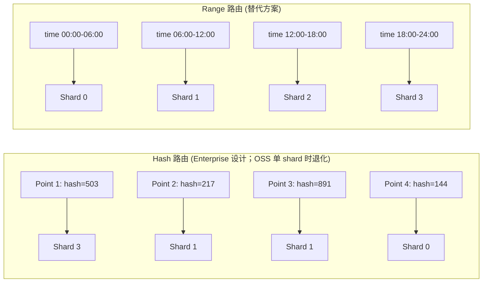

| 维度 | Hash 路由 | Range 路由 |
|------|----------|-----------|
| 数据均匀性 | 高 (hash 均匀分布) | 低 (时间倾斜) |
| 写入热点 | 无 | 时间边界热点 |
| 查询效率 | 全 shard 扫描 | 时间裁剪 |
| 范围查询 | 需合并所有 shard | 单 shard 命中 |

InfluxDB 选择 Hash 路由是因为时序数据写入模式是**时间连续**的，Range 路由会导致单个 shard 成为写入热点。

### 5.2 为什么用 ShardGroup + Shard 两级结构

```
RetentionPolicy (保留策略: 7d, 30d, ...)
  └── ShardGroup (时间窗口: 1h / 1d / 7d)
        └── Shard (数据分区: hash 路由)
```

- **时间局部性**: 同一时间窗口的数据在同一个 ShardGroup 中
- **生命周期管理**: ShardGroup 过期后整体删除（标记 DeletedAt），无需逐 shard 清理
- **查询优化**: 写路径用二分查找 O(log G)；查询路径通过 `ShardGroupsByTimeRange` 线性扫描 O(G) 且只扫元数据（见 §5.6）
- **并发写入**: OSS 每个 ShardGroup 只有 1 个 shard（`services/meta/data.go:443-447`），写入并发来自多个 ShardGroup、多个批次，而不是同一 ShardGroup 内的 hash 分片；多 shard 的 hash 路由是 Enterprise 形态

### 5.3 为什么用 Write-Through 创建 Shard

```go
// 先尝试写入
err := w.TSDBStore.WriteToShard(writeCtx, shardID, points)
if err == tsdb.ErrShardNotFound {
    // 不存在才创建
    w.TSDBStore.CreateShard(database, retentionPolicy, shardID, true)
    err = w.TSDBStore.WriteToShard(writeCtx, shardID, points)
}
```

- **延迟创建**: 避免预创建所有可能的 shard（时间无限增长）
- **Write-Through**: 写入时发现不存在才创建，减少元数据开销
- **幂等性**: `CreateShard` 是幂等操作，重复创建不会报错
- **重试安全**: 创建后立即重试写入，保证不丢失数据

### 5.4 为什么 Subscriber 写队列用非阻塞发送

```go
func (c *chanWriter) Write(wr WriteRequest) {
    sz := wr.SizeOf()
    newSize := atomic.AddInt64(&c.queueSize, int64(sz))
    limit := atomic.LoadInt64(&c.queueLimit)
    if limit > 0 && newSize > limit {
        atomic.AddInt64(c.failures, 1)
        atomic.AddInt64(&c.queueSize, -int64(sz))
        return
    }

    select {
    case c.writeRequests <- wr:
    default:
        atomic.AddInt64(c.failures, 1)
    }
}
```

- **写入优先**: Subscriber 是辅助功能，具体 destination 的队列不能阻塞主写入路径
- **背压显式化**: subscriber 的 `writeFailures` 统计暴露队列满或超出内存限制
- **入队非阻塞**: `select default` 只保证"入队"不阻塞主写入路径；`Send` 本身仍是同步调用，开销包括全批 `ValidPointStrings` 校验、line protocol 序列化（`services/subscriber/service.go:42-66`）以及每次 `Send` 一次 `router.mu.RLock`（`:608-611`，覆盖整张 destination 表）
- **at-most-once**: 队列满/超限时只递增 `writeFailures`，不重试，因此是尽力而为

### 5.5 为什么用 Epoch Tracker 而非简单的锁

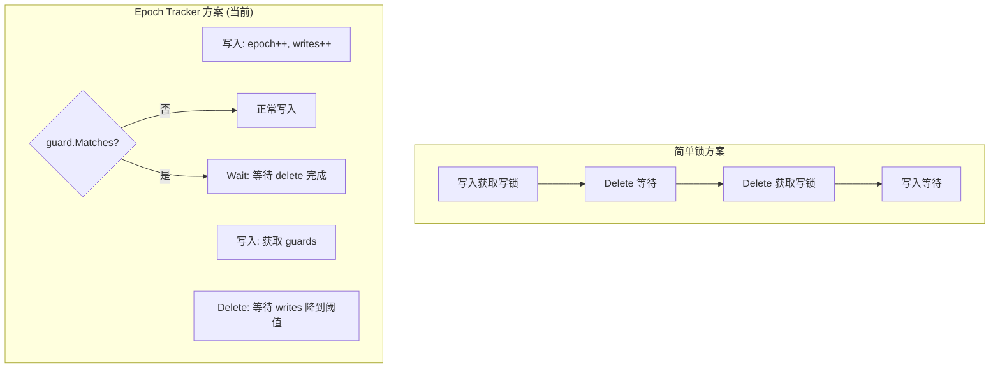

- **细粒度**: Guard 按 measurement + timeRange 匹配，只有重叠的写入才阻塞
- **非重叠写入不受影响**: 不同 measurement 的写入可以并发进行
- **无死锁风险**: Epoch 单调递增，不存在循环等待

### 5.6 查询侧路由：LocalShardMapper

写路径与读路径用的是两套完全不同的路由。`SELECT` 由 `coordinator.LocalShardMapper` 按**查询时间范围**裁剪 shard group（时序图如下）；`SHOW TAG KEYS` / `SHOW TAG VALUES` 不经过 `LocalShardMapper`，而是在 `StatementExecutor` 内直接调用同一个 `MetaClient.ShardGroupsByTimeRange` 再扁平化 shard ID（`coordinator/statement_executor.go:1041`、`:1149`），过滤语义相同：

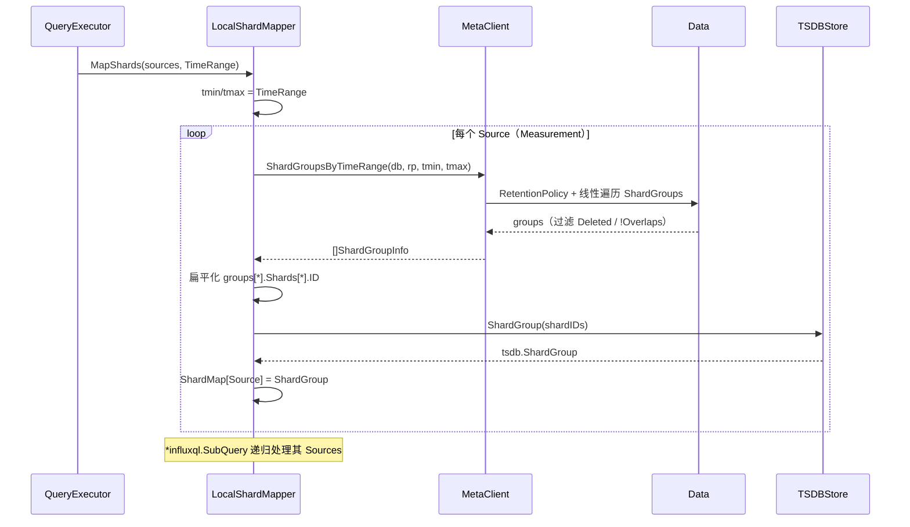

**读写路由对照**:

| 维度 | 写路径 `PointsWriter.MapShards` | 读路径 `LocalShardMapper.mapShards` |
|---|---|---|
| 入口 | `PointsWriter.MapShards` | `LocalShardMapper.MapShards`（`coordinator/shard_mapper.go:33-45`） |
| 选组依据 | 点时间戳 → `sgList.ShardGroupAt`（二分 + 重叠线性回退） | 查询时间范围 → `ShardGroupsByTimeRange`（线性 `Overlaps`） |
| 复杂度 | O(log G + R) | O(G) |
| 过滤条件 | 保留期 + 写窗口 + `Contains` | 仅 `Deleted()` + `Overlaps` |
| 是否看 `TruncatedAt` | 否 | 否 |
| 产出 | `ShardMapping{Points,Shards}` | `LocalShardMapping.ShardMap` |

**数值案例**: 某 RP 有 SG1=[10:00,11:00)、SG2=[11:00,12:00)、SG3=[12:00,13:00)（各 1h、首尾相接），SG2 已软删、SG3 已截断。查询 `[10:10, 12:20)`：`ShardGroupsByTimeRange` 过滤掉 SG2（`Deleted()`）与范围外的组，返回 SG1/SG3 两个组；扁平化得到 2 个 shard ID；SG3 虽然已截断，**仍会被扫描**——读路径不看 `TruncatedAt`。

**调用点**: `coordinator/shard_mapper.go:33-90`；`StatementExecutor.ShardMapper` 在 `coordinator/statement_executor.go:430`（`query.Prepare`）与 `:647`（`query.Select`）被使用，实例由 `cmd/influxd/run/server.go:233` 注入。过滤逻辑在 `services/meta/client.go:615-634` 与 `services/meta/data.go:1447-1459`。

## 6. 架构收益

| 维度 | 收益 |
|------|------|
| **写入吞吐** | goroutine per shard 并发写入；OSS 单 shard 时并发来自多个 ShardGroup/批次 |
| **查询性能** | ShardGroup 时间分区；写路径二分 O(log G)，查询路径线性扫元数据 O(G)（见 §5.6） |
| **存储管理** | ShardGroup 整体过期删除，生命周期管理简单 |
| **可靠性** | Epoch Tracker 防止写入/删除竞态 |
| **可扩展性** | 接口化设计 (MetaClient, TSDBStore)，支持测试和替换 |
| **数据安全** | PartialWriteError 允许部分成功，不因少量坏点丢失整批 |
| **可观测性** | 原子统计计数器，非阻塞 subscriber 丢弃计数 |
| **灵活性** | Subscriber 支持 ALL/ANY 模式，HTTP/UDP 传输 |

## 7. 潜在隐患与瓶颈

### 7.1 OSS 版本一致性级别无效

```go
// coordinator/points_writer.go:474
func (w *PointsWriter) WritePointsPrivileged(
    writeCtx tsdb.WriteContext,
    database, retentionPolicy string,
    consistencyLevel models.ConsistencyLevel,  // 接收但不使用
    points []models.Point,
) error {
    // 直接写入本地 shard，无仲裁
}
```

- API 接受 `consistency=quorum` 或 `consistency=all` 参数
- OSS 版本完全忽略，用户可能误以为数据已按指定级别写入
- 文档中的 `ConsistencyLevelAny` 注释提到 "hinted handoff"，但实际上不存在

### 7.2 无 Hinted Handoff

OSS 版本没有 Hinted Handoff 实现：
- 节点故障时写入直接失败，无重试队列
- 恢复后没有机制补写错过的数据
- `services/hh/` 目录不存在

### 7.3 写入超时的粗粒度控制

`WritePointsPrivileged` 为整批写入启动 N 个 shard goroutine，然后用**一个** `time.Timer`（`WriteTimeout`，默认 10s，`coordinator/config.go:15`）等待 N 个结果：

```go
// coordinator/points_writer.go:474-539（节选）
ch := make(chan error, len(shardMappings.Points))   // 缓冲 = shard 数
timeout := time.NewTimer(w.WriteTimeout)
defer timeout.Stop()
for range shardMappings.Points {
    select {
    case <-w.closing:
        return ErrWriteFailed
    case <-timeout.C:
        return ErrTimeout
    case err := <-ch:
        if err != nil {
            return err
        }
    }
}
```

- 所有 shard 共享同一个 10s 超时，无法为单个慢 shard 设置不同上限。
- 任何一个 shard 错误会立即返回，但**不会取消**其它已启动的 goroutine；`ch` 的缓冲等于 shard 数，其它 goroutine 仍能写入结果并退出，不会泄漏。
- 超时只约束"等待结果"的时间，不约束已经在执行的 `WriteToShard`；超时返回后已写入的数据不会回滚。
- 超时递增 `WriteTimeout` 统计。

### 7.4 Subscriber 非阻塞发送的数据丢失

```go
select {
case c.writeRequests <- wr:
default:
    // chanWriter 队列满，拒绝转发
    atomic.AddInt64(c.failures, 1)
}
```

- Subscriber 具体 writer 队列满或超出 `memoryLimit` 时会拒绝转发
- 只有 `writeFailures` 计数和日志，没有重试机制
- 对于需要可靠转发的场景（如 Kafka），这是一个问题

### 7.5 UDP Subscriber 每次创建新连接

```go
// services/subscriber/udp.go:23
func (u *UDP) WritePointsContext(_ context.Context, request WriteRequest) (destination string, err error) {
    conn, err := net.DialUDP("udp", nil, u.addr)  // 每次新建!
    defer conn.Close()
    ...
}
```

- 高频写入场景下，大量 UDP socket 创建/销毁
- 可能耗尽文件描述符
- 应使用连接池或长连接

### 7.6 ShardGroup 创建的竞态

真实代码是"两遍扫描"，不是"检查-创建-重查"：

```go
// 第一遍: 按需创建并把返回值加入 sgList（coordinator/points_writer.go:300-334）
for _, p := range wp.Points {
    if p.Time().Before(min) || list.Covers(p.Time()) || !withinWindow {
        continue
    }
    sg, err := w.MetaClient.CreateShardGroup(wp.Database, wp.RetentionPolicy, p.Time())
    if err != nil {
        return nil, err
    }
    if sg == nil {
        return nil, errors.New("nil shard group")
    }
    list.Add(*sg)
}

// 第二遍: 在本地 sgList 上二分路由
for _, p := range wp.Points {
    sg := list.ShardGroupAt(p.Time())
    if sg == nil {
        mapping.AddDropped(p, min, RetentionPolicyBound)
        continue
    }
    // ... ShardFor / MapPoint
}
```

- 竞态保护在 `Client.CreateShardGroup` 内部：`RLock` 快速路径 → 释放 → `Lock` → **double-check** `ShardGroupByTimestamp`（`services/meta/client.go:693-721`），不是"重新查询 sgList"。
- 并发写入可能同时调用 `CreateShardGroup`，但只有一个真正创建；另一个在写锁内二次检查时拿到已存在的组。
- `sgList` 初始为空，只用 meta 的返回值填充，**不会**从 `RetentionPolicyInfo.ShardGroups` 预填。
- **缓解**: Precreator 定时预创建；但它不会追赶停机期间缺失的组（见 §2.3）。

### 7.7 MapShards 每次分配新 map

```go
mapping := &ShardMapping{
    Points: make(map[uint64][]models.Point),
    Shards: make(map[uint64]*meta.ShardInfo),
}
```

- 高频写入场景下，每次 MapShards 都分配新的 map 和 slice
- map 的扩容和 GC 压力不可忽视
- **优化建议**: 使用 sync.Pool 复用 ShardMapping

### 7.8 ShardOwner 查询的线性扫描

```go
// services/meta/client.go — ShardOwner
func (c *Client) ShardOwner(shardID uint64) (database, policy string, sgi *ShardGroupInfo) {
    c.mu.RLock()        // 读锁保护
    defer c.mu.RUnlock()

    // 四层嵌套遍历: Database -> RP -> ShardGroup -> Shard
    for _, dbi := range c.cacheData.Databases {
        for _, rpi := range dbi.RetentionPolicies {
            for _, g := range rpi.ShardGroups {
                if g.Deleted() {
                    continue
                }
                for _, sh := range g.Shards {
                    if sh.ID == shardID {
                        return dbi.Name, rpi.Name, &g
                    }
                }
            }
        }
    }
    return "", "", nil
}
```

- O(D x R x G x S) 复杂度
- 数据库/RP/ShardGroup 数量多时查询变慢
- **优化建议**: 维护 shardID -> (db, rp, sg) 的反向索引
- **注意**: `Client.ShardOwner`（`services/meta/client.go:819`）在 OSS 全树**没有生产调用方**（只有 mock），且返回的 `&g` 是 `range` 迭代变量的地址——是组信息的**副本**，不是 `cacheData` 中的原对象；修改它不会影响元数据

### 7.9 全局 WriteTimeout 与 Context 超时冲突

```go
// PointsWriter 内部设置 WriteTimeout
timer := time.NewTimer(w.WriteTimeout)
```

- 当前 OSS 主链路没有请求 `context.Context` 贯穿写入路径，写入等待主要由 `PointsWriter.WriteTimeout` 控制。
- 所有 shard 写入共享同一个 10s 超时。
- 超时时返回 `ErrTimeout`，并递增 `WriteTimeout` 统计。

### 7.10 ShardGroup DeletedAt 标记与实际删除的延迟

```go
// ShardGroup 标记删除后，Shard 数据仍存在
// 需要后台任务（Module 4 的 precreator + retention）实际清理
```

- `DeletedAt` 只是元数据标记，磁盘空间不会立即释放
- 删除与实际清理之间有延迟窗口
- 查询时需要过滤已删除的 ShardGroup

## 8. MeasurementFieldSet — Field 类型管理

### 8.1 结构体

```go
// tsdb/shard.go:1657-1663
type MeasurementFieldSet struct {
    mu        sync.RWMutex
    fields    map[string]*MeasurementFields
    path      string
    changeMgr *measurementFieldSetChangeMgr   // 异步 change-log 队列
}
```

### 8.2 MeasurementFields

```go
// tsdb/shard.go:1557-1559
type MeasurementFields struct {
    fields gensyncmap.Map[string, *Field]     // 泛型并发 map，不是 atomic.Value
}
```

### 8.3 Field

```go
// tsdb/shard.go:2272-2275
type Field struct {
    Name string
    Type influxql.DataType
}
```

**并发模型**:

- `MeasurementFieldSet.mu`（`sync.RWMutex`）保护 `fields` map、`path` 与 `changeMgr`；`CreateFieldsIfNotExists` / `MeasurementFields` 分别走写锁与读锁。
- `MeasurementFields.fields` 是 `gensyncmap.Map[string, *Field]`（泛型并发 map），自身并发安全；读多写少，`FieldKeys`/`ForEachField` 只做 `Range`。
- `changeMgr` 持 `writeRequests` channel（容量 `MaxCombinedWrites=100`）与后台 `SaveWriter` goroutine（`SetMeasurementFieldSetWriter` `:1814-1825` 启动，`SaveWriter` `:1844-1858`）。`RequestSave` 对调用方**同步**（阻塞等回执），对磁盘**批量异步**：多个并发 `Save` 的变更会被合并成一次 `appendToChangesFile`。

### 8.4 saveFieldsAndMeasurements — 创建新 Field

```go
// tsdb/shard.go:765 — saveFieldsAndMeasurements
// 调用点: tsdb/shard.go:585（无论本批是否丢点都会调用）
func (s *Shard) saveFieldsAndMeasurements(fieldsToSave []*FieldCreate) (int, error) {
    if len(fieldsToSave) == 0 {
        return 0, nil
    }
    engine, err := s.engineNoLock()
    if err != nil {
        return 0, err
    }
    numCreated := 0
    changes := make([]*FieldChange, 0, len(fieldsToSave))
    for _, f := range fieldsToSave {
        numCreated++
        s.index.SetFieldName(f.Measurement, f.Field.Name)
        changes = append(changes, &FieldChange{
            FieldCreate: *f,
            ChangeType:  AddMeasurementField,
        })
    }
    return numCreated, engine.MeasurementFieldSet().Save(changes)
}
```

**注意易错点**:

1. 函数名是 `saveFieldsAndMeasurements`，返回 `(int, error)`；旧文档里的 `create…FieldsAndMeasurements` 名称并不存在。`CreateFieldIfNotExists(name string, typ influxql.DataType)` 由上一阶段的 `ValidateAndCreateFields`（`tsdb/field_validator.go:63`）调用，不在本函数内。
2. `Save(changes FieldChanges) error`（`tsdb/shard.go:1834-1836`）→ `changeMgr.RequestSave`（`:1838-1844`，阻塞等回执）→ 后台 `SaveWriter`（`:1844-1858`）→ `appendToChangesFile`（`:1915-2001`，`O_CREATE|O_APPEND|O_SYNC`，排空并合并队列中已排队的请求）。返回时变更已进 `fields.idxl`；`fields.idx` 仍是旧文件。
3. 全量落盘 `WriteToFile`（`tsdb/shard.go:1855-1911`，tmp + `O_SYNC` + rename + `SyncDir`）只在 `Close`/`ApplyChanges`（`:2243-2268`）/引擎打开时发生（`tsdb/engine/tsm1/engine.go:780-783,934`）。

### 8.5 Field 类型冲突检测

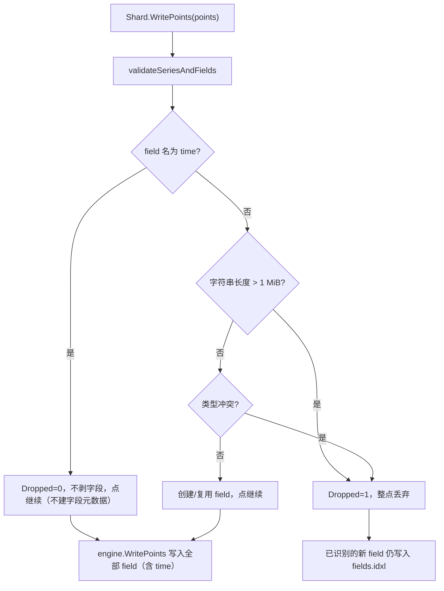

| 条件 | Dropped | 点是否继续写入 | 证据 |
|------|---------|----------------|------|
| field 名为 `time` | 0 | 是（**不剥离**；仅不创建字段元数据，field 仍随 point 写入 Cache/WAL） | `tsdb/field_validator.go:45-56`；`tsdb/engine/tsm1/engine.go:1364-1366` |
| 字符串值 > 1 MiB（`MaxFieldValueLength=1048576`） | 1 | 否，整点丢弃 | `tsdb/field_validator.go:12,27-39` |
| 类型冲突 `ErrFieldTypeConflict` | 1 | 否，整点丢弃 | `tsdb/field_validator.go:65-73`；`tsdb/shard.go:719-726` |
| 其它建 field 错误 | 1 | 否 | `tsdb/field_validator.go:74-79` |
| `dataType == influxql.Unknown` | — | 该 field 被静默跳过（不校验、不创建） | `tsdb/field_validator.go:56-58` |

**关键行为**: Field 类型冲突**不是**"只跳过冲突的 field"。`ValidateAndCreateFields` 返回 `PartialWriteError{Dropped: 1}`，`validateSeriesAndFields` 在 `Dropped > 0` 时直接 `continue`，该点不进入 `points[j]`，因此**整个 Point 被丢弃**（`tsdb/shard.go:719-726`）。只有 field 名为 `time` 时 `Dropped=0`；字段不会被删除，engine 也不再跳过它（v1.8.10 在 engine 层跳过，v1.12.3 删除该逻辑），因此该 field 会以 key `time` 写入 Cache/WAL，只是不进入 `fields.idx`——这与错误文本 "has been stripped" 不符，属于已知行为变化/待回归项。

> engine 层的 `seriesTypeMap` 冲突只跳过单个 field（`tsdb/engine/tsm1/engine.go:1372-1391`），但正常写入路径已在 shard 层拦下。被丢弃点上已识别的新 field 仍会创建并写入 `fields.idxl`（仅限排在冲突字段之前、已迭代到的 field），因此 `SHOW FIELD KEYS` 可能看到"从未成功写入过数据"的字段。

### 8.6 Field 元数据的"写—压缩—恢复"三泳道

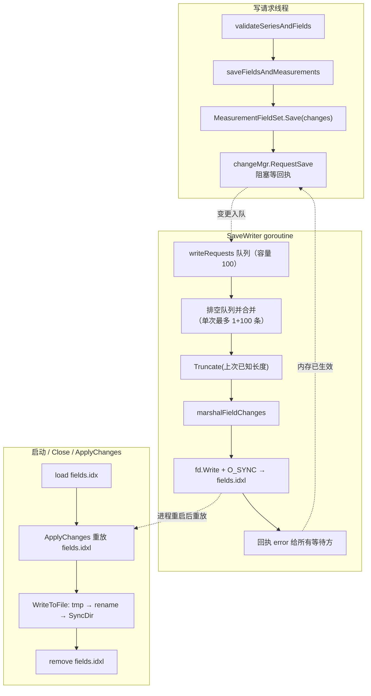

**崩溃点案例**（`fields.idxl` 追加写，`fields.idx` 全量写）:

- `Save` 返回后立刻 `kill -9`：变更已在 `fields.idxl`（`O_SYNC`），重启 `load` + `ApplyChanges` 重放后 `SHOW FIELD KEYS` 可见。
- `Save` 返回前 kill：内存已创建 field，日志可能只写了半条；重启时 `Truncate(changeFileSize)` 丢弃半条，字段不可见。
- 压缩到一半掉电：`fields.idx` 仍是旧文件（POSIX 下同目录 `rename(2)` 原子；Windows 的 `file.RenameFile` 先删目标再 rename，见 07 号文档 §7.2，存在 `fields.idx` 缺失的窗口）+ `fields.idxl` 未删除 → 下次启动重放幂等（Windows 上 `fields.idx` 缺失会从空索引开始，靠 `fields.idxl` 全量重建）。

**关键常量**: `FieldsChangeFile = "fields.idxl"`（`tsdb/shard.go:51`）、`MaxCombinedWrites = 100`（`:1667`，作为 `writeRequests` channel 容量传给 `SetMeasurementFieldSetWriter`，`:1675`、`:1818`；`appendToChangesFile` 会排空队列，单次最多合并 1+100 条请求）、change-log 打开标志 `O_CREATE|O_APPEND|O_SYNC|O_WRONLY`（`:1935`）。`SkipFieldSizeValidation` 只关闭"字符串 > 1 MiB"检查，不影响类型冲突判定。

**对比**: `fields.idx` 的 rename 之后显式调用 `file.SyncDir`（`tsdb/shard.go:2020-2032`），而 meta snapshot 的 rename 没有（见 07 号文档 §9.2、S-07-07）。


## 9. CreateSeriesListIfNotExists — 完整调用链

### 9.1 调用链

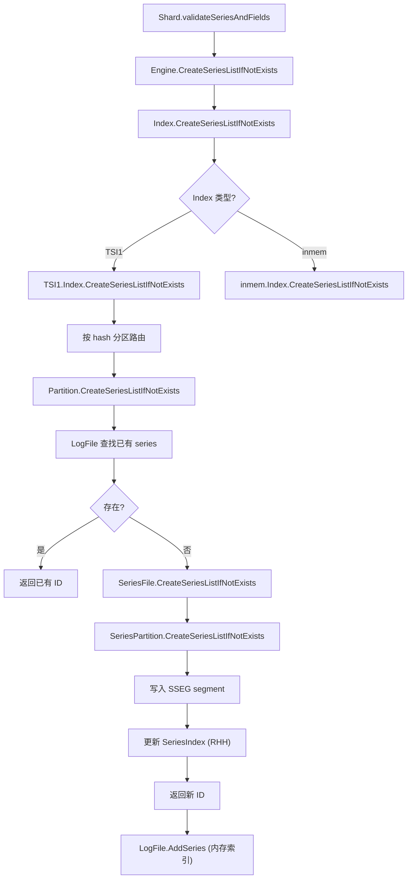

### 9.2 SeriesFile — 8 分区

```go
// tsdb/series_file.go:32 — SeriesFilePartitionN
const SeriesFilePartitionN = 8

// tsdb/series_file.go:182-199 — CreateSeriesListIfNotExists
func (f *SeriesFile) CreateSeriesListIfNotExists(names [][]byte, tagsSlice []models.Tags, tracker StatsTracker) ([]uint64, error) {
    keys := GenerateSeriesKeys(names, tagsSlice)          // 不是 models.MakeKey
    keyPartitionIDs := f.SeriesKeysPartitionIDs(keys)     // xxhash % 8
    ids := make([]uint64, len(keys))

    var g errgroup.Group                                 // 每个分区一个 goroutine
    for i := range f.partitions {
        p := f.partitions[i]
        g.Go(func() error {
            return p.CreateSeriesListIfNotExists(keys, keyPartitionIDs, ids, tracker)
        })
    }
    if err := g.Wait(); err != nil {
        return nil, err
    }
    return ids, nil
}

// tsdb/series_file.go:325 — SeriesKeysPartitionIDs
func (f *SeriesFile) SeriesKeysPartitionIDs(keys [][]byte) []int {
    partitionIDs := make([]int, len(keys))
    for i := range keys {
        partitionIDs[i] = int(xxhash.Sum64(keys[i]) % SeriesFilePartitionN)
    }
    return partitionIDs
}
```

**要点**:

- 8 个分区**并行**处理，每个 goroutine 只写 `ids` 中属于自己的下标，互不重叠。
- `tracker StatsTracker` 一路传进分区，用于 `AddedMeasurementSeries` / `AddedSeries` 统计。
- 真实函数名是 `GenerateSeriesKeys`；`SeriesKeysPartitionIDs` 用 `xxhash.Sum64(key) % 8`。

### 9.3 SeriesPartition — SSEG + RHH

`SeriesPartition.CreateSeriesListIfNotExists` 是**两阶段锁**：先读锁查已有 ID，只有发现新 key 才升级为写锁并重查，避免所有写入都抢写锁（`tsdb/series_partition.go:200-320`）。

```go
func (p *SeriesPartition) CreateSeriesListIfNotExists(keys [][]byte, keyPartitionIDs []int, ids []uint64, tracker StatsTracker) error {
    // 阶段 1: 读锁查已有 series
    var writeRequired bool
    p.mu.RLock()
    if p.closed {
        p.mu.RUnlock()
        return ErrSeriesPartitionClosed
    }
    for i := range keys {
        if keyPartitionIDs[i] != p.id {
            continue
        }
        if id := p.index.FindIDBySeriesKey(p.segments, keys[i]); id == 0 {
            writeRequired = true
            continue
        } else {
            ids[i] = id
        }
    }
    p.mu.RUnlock()
    if !writeRequired {
        return nil
    }

    // 阶段 2: 写锁重查 + 插入
    p.mu.Lock()
    defer p.mu.Unlock()
    if p.closed {
        return ErrSeriesPartitionClosed
    }

    newIDs := make(map[string]uint64, len(ids))   // 批内去重
    var newKeyRanges []keyRange
    for i := range keys {
        if keyPartitionIDs[i] != p.id || ids[i] != 0 {
            continue
        }
        key := keys[i]
        if ids[i] = newIDs[string(key)]; ids[i] != 0 {
            continue                               // 同一批里的重复 key
        }
        if ids[i] = p.index.FindIDBySeriesKey(p.segments, key); ids[i] != 0 {
            continue                               // 读锁释放后被别的 goroutine 插入
        }
        id, offset, err := p.insert(key)
        if err != nil {
            return err
        }
        ids[i] = id
        newIDs[string(key)] = id
        newKeyRanges = append(newKeyRanges, keyRange{id, offset})
    }

    // 阶段 3: flush 后把新 key 插入内存索引 (RHH)
    if segment := p.activeSegment(); segment != nil {
        if err := segment.Flush(); err != nil {
            return err
        }
    }
    for _, kr := range newKeyRanges {
        p.index.Insert(p.seriesKeyByOffset(kr.offset), kr.id, kr.offset)
    }
    return nil
}

// tsdb/series_partition.go:464-472 — insert
func (p *SeriesPartition) insert(key []byte) (id uint64, offset int64, err error) {
    id = p.seq
    offset, err = p.writeLogEntry(AppendSeriesEntry(nil, SeriesEntryInsertFlag, id, key))
    if err != nil {
        return 0, 0, err
    }
    p.seq += SeriesFilePartitionN       // 不是自增 1
    return id, offset, nil
}
```

**Series ID 分配规则**: `p.seq` 初值为 `p.id + 1`（`tsdb/series_partition.go:62`），每次插入 `+= SeriesFilePartitionN`（8）。所以分区 0 获得 1, 9, 17, ...；分区 1 获得 2, 10, 18, ...。ID 的 `id % 8` 恒等于分区号，`SeriesIDPartition(id)` 可 O(1) 定位分区。

**为什么两阶段锁**: 绝大多数写入的 series 已存在，读锁路径可以并发；只有真正需要创建新 series 时才升级写锁，并在写锁内**重查**，避免读锁释放窗口内的重复插入。`newIDs` 额外处理同一批次内重复 key。

### 9.4 SSEG Entry 格式

```go
// tsdb/series_segment.go:25-31 — SSEG 格式常量
const (
	SeriesEntryFlagSize   = 1
	SeriesEntryHeaderSize = 1 + 8 // flag + id

	SeriesEntryInsertFlag    = 0x01
	SeriesEntryTombstoneFlag = 0x02
)
```

```
┌──────┬────────┬─────────────────────────────────────┐
│ Flag │  ID    │   Key (仅 Insert entry 有此字段)     │
│1 byte│8 bytes │ N bytes (uvarint 长度前缀)           │
└──────┴────────┴─────────────────────────────────────┘
```

- **Flag**: `0x01` = Insert, `0x02` = Tombstone, `0x00` = End-of-entries
- **ID**: Series ID (uint64, BigEndian)
- **Key**: Series key，使用 uvarint 长度前缀编码（非换行符终止）

**Key 编码格式** (`series_file.go:313-366 AppendSeriesKey`):

```
┌──────────────┬───────────┬─────────┬───────────┬──────────────────┐
│ Total Size   │ Name Len  │  Name   │  Tag Count│ Tags (重复)      │
│ uvarint      │ uint16    │ N bytes │  uvarint  │ keyLen+key+valLen+val │
└──────────────┴───────────┴─────────┴───────────┴──────────────────┘
```

**ReadSeriesEntry** (`series_segment.go:415-428`):
- Flag `0x00` 被视为 end-of-entries（返回 sz=1）
- `IsValidSeriesEntryFlag` 仅接受 `0x01` 和 `0x02`
- 只有 `SeriesEntryInsertFlag` (0x01) 的 entry 携带 key；Tombstone entry (0x02) 的 key 为 nil
