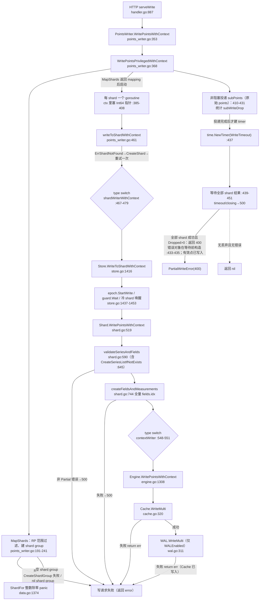
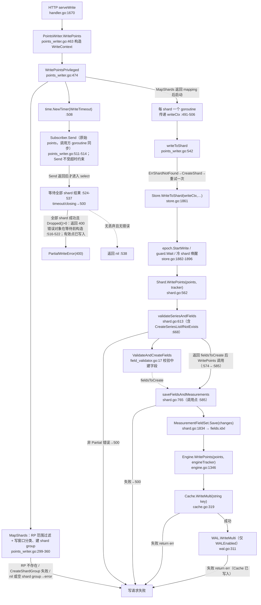
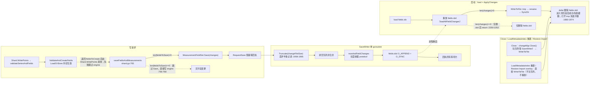
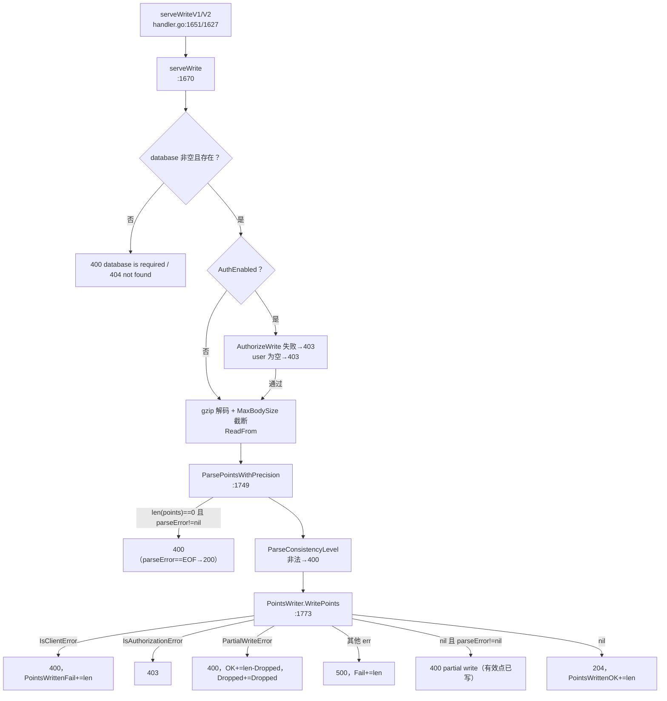
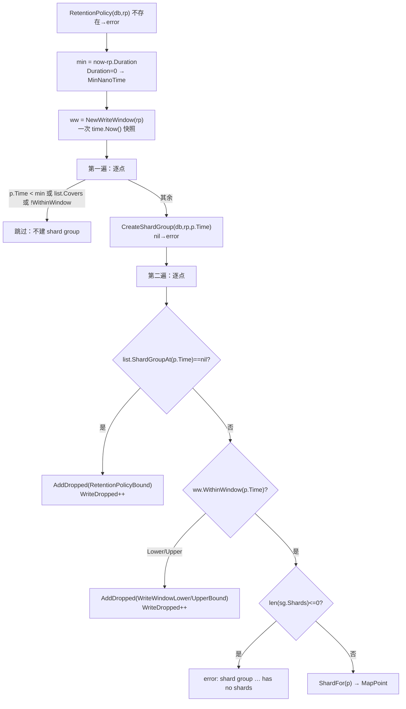

# 版本差异 1: 写入路径（v1.8.10 → v1.12.3）

> **基线**
> - OLD：`v1.8.10` = commit `688e697c51`（2021-10-11）
> - NEW：`v1.12.3` = commit `f3d5cb68ab`（`docs/specs/` 这批文档的代码基准）
> - 区间：527 commits，602 files，+79,310 / −45,239；NEW 工作树只额外包含若干 docs 提交（数量随文档演进），代码与 `f3d5cb68ab` 相同。
>
> **本文范围**：`coordinator/points_writer.go`、`tsdb/store.go`、`tsdb/shard.go`、`tsdb/field_validator.go`、
> `tsdb/engine/tsm1/{engine,cache,ring,wal,reader,file_store,compact}.go`、`tsdb/internal/fieldsindex.*`、
> `models/points.go`，以及 HTTP 写入入口与字段元数据（`fields.idx` / `fields.idxl`）的落盘。
>
> **交叉引用**：写入引擎的机制细节见 [01 写入引擎](../01_write_engine_spec.md)；Shard 路由、Epoch 与
> `MeasurementFieldSet` 的完整讲解见 [06 集群通信](../06_cluster_communication_spec.md)。本文只讲**版本差异**，
> 不复述主文档。

> **小白导读**
> 1. **写入口换了"传参方式"**：旧版靠 `context.Context` 一路把统计指针塞下去（`StatPointsWritten` /
>    `StatValuesWritten`），新版换成两个显式结构：`tsdb.WriteContext`（只装 `UserId`）和
>    `tsdb.StatsTracker`（回调函数）。调用链少了两处 `type switch`，但 Go API 全部变了。
> 2. **字段元数据从"每次重写整本书"变成"只记增量日记"**：旧版每个含新字段的写请求（按 shard）把整个 `fields.idx`
>    序列化、写临时文件、fsync、rename 一次；新版只在 `fields.idxl` 末尾追加一条 protobuf 变更记录，
>    重启/关闭时再合并回 `fields.idx`。
> 3. **类型冲突的判定位置提前了**：旧版先校验、后建字段；新版在**校验过程中就原子地创建字段**
>    （`LoadOrStore`），并发写同一字段不同类型的冲突结果被确定化。
> 4. **`time` 字段的处理反转了**：旧版静默剥掉；新版把"字段被剥离"作为 `PartialWriteError` 上抛给
>    客户端（HTTP 400），而且 engine 层不再跳过 `time` 字段（这是 #26998 的副作用，见 §7.1）。
> 5. **新增 1 MiB 字段长度上限**：旧版没有限制，超过 1 MiB 的字符串字段照收；新版默认拒绝，可用
>    `skip-field-size-validation` 关闭。
> 6. **底层数据结构基本没动**：Cache 仍是 16 分区哈希环、仍是"先写 Cache 再写 WAL"、WAL 编码/fsync
>    语义未变、`WriteSnapshot` 逻辑未变；改动集中在字符串零拷贝、TSM 文件名解析缓存和可配置段大小。

---

## 1. 结论速览

| # | 变更点 | v1.8.10 | v1.12.3 | 影响 | 证据 |
|---|--------|---------|---------|------|------|
| 1 | 写入 API 形态 | `WriteToShard(shardID, points)` + `WriteToShardWithContext(ctx,…)`；`Shard.WritePointsWithContext(ctx,…)`；`Engine.WritePointsWithContext(ctx,…)`；`PointsWriter.WritePointsWithContext` / `WritePointsPrivilegedWithContext` | `Store.WriteToShard(writeCtx tsdb.WriteContext, shardID, points)`；`Shard.WritePoints(points, tracker)`；`Engine.WritePoints(points, tracker)`；`PointsWriter.WritePointsPrivileged(writeCtx,…)` | Go API 破坏性变更（企业版/嵌入式调用方必须改）；HTTP 状态码另有 §5.1 所列变化 | `v1.8.10:tsdb/store.go:1412`；`v1.12.3:tsdb/store.go:1861` |
| 2 | 写统计传递方式 | `context.WithValue` + `Int64` 指针（`tsdb.ConetextKey`） | `tsdb.StatsTracker` 四个回调；`Store.statsTracker(db, rp, login)` | 去掉 context value 反模式；支持按 measurement / 按登录名计量 | `v1.8.10:tsdb/shard.go:504-516`；`v1.12.3:tsdb/shard.go:549-554`、`v1.12.3:tsdb/store.go:1796` |
| 3 | 请求身份 | `meta.User` 参数（OSS 不使用） | `tsdb.WriteContext{UserId}`；内置 `_systemuser_*` 假用户 | 新增 `ingress-metric-by-login-enabled` 指标维度 | `v1.8.10:coordinator/points_writer.go:357`；`v1.12.3:coordinator/points_writer.go:463-471`；`tsdb/store.go:1842-1858` |
| 4 | 字段元数据落盘 | 每个**含新字段的写请求**调用一次 `Save()`（一次请求内多字段合并为一次全量重写：tmp + fsync + rename + SyncDir） | 追加写 `fields.idxl` 变更日志（`O_APPEND|O_SYNC`），批量合并；`fields.idx` 只在 Close / ApplyChanges / LoadMetadataIndex 重建 / Restore·Import 时全量写 | 新字段密集写入时 IO 放大显著下降 | `v1.8.10:tsdb/shard.go:1786-1864`；`v1.12.3:tsdb/shard.go:1834`、`:1915-2001`、`:1855-1913` |
| 5 | protobuf 运行时 | `gogo/protobuf`（`tsdb/internal/meta.pb.go`，source `internal/meta.proto`） | `google.golang.org/protobuf`（`tsdb/internal/fieldsindex.pb.go`，protoc-gen-go v1.34.1） | 线格式兼容（字段号/类型一致），`fields.idx` 可被新旧互读 | `v1.8.10:tsdb/internal/meta.pb.go:1-15`；`v1.12.3:tsdb/internal/fieldsindex.pb.go:1-13` |
| 6 | 字段表并发结构 | `MeasurementFields{mu sync.Mutex; fields atomic.Value}`（copy-on-write map） | `MeasurementFields{fields gensyncmap.Map[string,*Field]}`（泛型 sync.Map） | 去掉整表复制；`CreateFieldIfNotExists` 原子化 | `v1.8.10:tsdb/shard.go:1557-1634`；`v1.12.3:tsdb/shard.go:1557-1603` |
| 7 | 字段校验 | `FieldValidator` 接口（可插拔）+ 先校验后建字段 | 固定函数 `ValidateAndCreateFields`，**校验时即建字段**（`LoadOrStore`），并返回 `fieldsToCreate` | 并发类型冲突竞态修复（#23756）；`EngineOptions.FieldValidator` 被删除 | `v1.8.10:tsdb/field_validator.go:12-51`；`v1.12.3:tsdb/field_validator.go:17-84`；`v1.12.3:tsdb/engine.go:165` |
| 8 | 字段长度上限 | 无 | `MaxFieldValueLength = 1048576`；超限 → `PartialWriteError{Dropped:1}`，可用 `skip-field-size-validation` 关闭 | 行为变更：>1 MiB 字符串字段由"接受"变"拒绝" | `v1.12.3:tsdb/field_validator.go:12,27-40`；`v1.12.3:tsdb/config.go:120` |
| 9 | `time` 字段 | shard 与 engine 都静默跳过，写请求成功 | shard 返回 `Dropped:0` 的 `PartialWriteError`；engine **不再跳过** | 客户端收到 400 "partial write"；engine 行为见 §7.1 风险 | `v1.8.10:tsdb/shard.go:666-671`、`v1.8.10:tsdb/engine/tsm1/engine.go:1330-1333`；`v1.12.3:tsdb/field_validator.go:45-56`、`v1.12.3:tsdb/engine/tsm1/engine.go:1366-1367` |
| 10 | 错误文本 | `partial write: %s dropped=%d` | 追加 `for database: … for retention policy: …` | 客户端日志/告警匹配规则可能失效 | `v1.8.10:tsdb/shard.go:113-123`；`v1.12.3:tsdb/shard.go:121-140` |
| 11 | 保留策略写窗口 | 无 | `PastWriteLimit` / `FutureWriteLimit`，超窗点计入 `WriteWindowDropped` 并 400（模块见 §3.6.2） | 新功能；错误原因可区分 RP 边界与写窗口边界 | `v1.8.10:coordinator/points_writer.go:191-241`；`v1.12.3:coordinator/points_writer.go:218-245,299-360` |
| 12 | 订阅分发 | `subPoints []chan<- *WritePointsRequest` + `AddWriteSubscriber`，逐 channel 非阻塞投递，统计 `subWriteDrop` | `Subscriber interface{ Send(*WritePointsRequest) }`，`SubWriteOK` 每请求 +1，`subWriteDrop` 指标删除 | 企业版接线方式变更；写入侧订阅指标语义变化 | `v1.8.10:coordinator/points_writer.go:147-149,410-431`；`v1.12.3:coordinator/points_writer.go:63-65,511-514,267-276` |
| 13 | Cache/Ring key 类型 | `[]byte`（`store.write([]byte(k), v)`，`p.store[string(key)]`） | `string`（`store.write(k, v)`，`p.store[key]`），`xxhash.Sum64String` | 每次写入少 2 次字符串/字节切片互转 | `v1.8.10:tsdb/engine/tsm1/cache.go:343`、`v1.8.10:tsdb/engine/tsm1/ring.go:99`；`v1.12.3:tsdb/engine/tsm1/cache.go:342`、`v1.12.3:tsdb/engine/tsm1/ring.go:85,98` |
| 14 | WAL 段大小 | 配置字段存在但 `rollSegment` 固定用 `DefaultSegmentSize` | 使用 `l.SegmentSize` | 该配置（企业/测试设置）终于生效 | `v1.8.10:tsdb/engine/tsm1/wal.go:467`；`v1.12.3:tsdb/engine/tsm1/wal.go:467` |
| 15 | TSM 文件名解析 | 每次用到 generation/sequence 都重新 `ParseFileName` | `TSMReader` 创建/rename 时解析一次并缓存，`FileStat` 带 `Generation/Sequence` | 降低规划/压缩时的字符串解析 CPU | `v1.8.10:tsdb/engine/tsm1/compact.go:177-185,908-912`；`v1.12.3:tsdb/engine/tsm1/reader.go:67-68,450-460`、`v1.12.3:tsdb/engine/tsm1/compact.go:219-228` |
| 16 | 分片打开失败 | 每次写重试 `shard.Open()` | `badShards` 缓存错误，`ErrPreviousShardFail`，除非 `force` | 根因修复后仍需重启（或内部 `ReopenShard(force)`）才能恢复 | `v1.8.10:tsdb/store.go:1412-1454`（无 `badShards`）；`v1.12.3:tsdb/store.go:95-120,461-466,815-847` |
| 17 | 空 shard group | `sg.ShardFor(p)` 对空 `Shards` 取模 → panic | 返回 `shard group %d … has no shards` 错误 | 崩溃变 500，可用性提升 | `v1.8.10:coordinator/points_writer.go:226-239`；`v1.12.3:coordinator/points_writer.go:351-354` |
| 18 | HTTP 指标 | `httpd.valuesWrittenOK` | 删除；改由新增的 `localStore.valuesWritten` 统计（入口模块见 §3.0.2） | 现成 dashboard/告警需改指标名 | `v1.8.10:services/httpd/handler.go:362,394,1002`；`v1.12.3:services/httpd/handler.go:422-445`、`v1.12.3:tsdb/store.go:235-242` |

---

## 2. 变更地图

### 2.1 调用链：旧版（v1.8.10）



### 2.2 调用链：新版（v1.12.3）



> **图注**：`V2`→`CF2` 只表示调用顺序（`validateSeriesAndFields` 返回后 `Shard.WritePoints` 调用 `saveFieldsAndMeasurements`，`:574`→`:585`）；`fieldsToCreate` 这一数据只由 `VC2` 产生，两条边不是并列数据源。

### 2.3 字段元数据的"双文件"数据流（新增）



### 2.4 一句话总结调用链差异

- **少了两处 `type switch`**：旧版 `points_writer` 为兼容企业版 `WriteToShardWithContext` 做了接口探测，
  `shard` 又为兼容引擎 `WritePointsWithContext` 做了一次；新版全部收敛为固定签名
  （`v1.8.10:coordinator/points_writer.go:467-479`、`v1.8.10:tsdb/shard.go:548-551` →
  `v1.12.3:coordinator/points_writer.go:545`、`v1.12.3:tsdb/shard.go:600`）。
- **统计从"反传"变"回调"**：旧版写入完成后由 engine 把 `npoints/nvalues` 写回 context 指针，再逐层累加；
  新版 `AddedMeasurementPoints` 在逐点循环内、组完 key 后立即回调（Cache/WAL 之前，Cache 写失败也已计数），
  `AddedPoints` 才在 Cache/WAL 成功后回调（`v1.12.3:tsdb/engine/tsm1/engine.go:1435-1437,1454-1456`）。
- **分片内的顺序没变**：仍然是 校验 → 保存字段元数据 → 写 Cache → 写 WAL
  （`v1.8.10:tsdb/shard.go:531-586`、`v1.12.3:tsdb/shard.go:574-609`）。

---

## 3. 逐项差异

### 3.0 模块目录与 HTTP 写入入口

#### 3.0.1 模块边界（源码子系统 → 本文落点）

本节先给"所有权"：每个源码模块在本文只有一个主落点，其余小节只写差异或交叉引用；`—` 表示该要素由主文档或其他篇承担。

| 模块（源码边界） | 主落点 | 角色 | 结构 | 流程 | 案例 | 风险 |
|---|---|---|---|---|---|---|
| HTTP 写入入口（`services/httpd`） | §3.0.2 | 解析、鉴权、状态码映射 | `Handler.PointsWriter`、`serveWriteV1/V2` | §3.0.2 图 | §3.0.2 + §6.1 | §3.0.2 |
| 写入 API 契约（coordinator/tsdb/tsm1 四层） | §3.1、§5.2 | 四层接口与破坏面 | 接口签名表 | — | §5.2 迁移清单 | §5.2 |
| 写统计与身份（`StatsTracker`/`WriteContext`） | §3.2、§5.4 | 计量与身份 | 四个回调、`UserId` | 回调时序在 §3.2 | — | §7.5 |
| 字段元数据（`fields.idx`/`fields.idxl`/校验） | §3.3–§3.5、§6.2–§6.3 | 字段类型权威与持久化 | `MeasurementFieldSet`/`FieldChange` | §3.3 | §6.2、§6.3 | §7.1–§7.3、§7.7、§7.8 |
| Coordinator 编排（`MapShards`/写窗口/丢弃） | §3.6 | 分片、建组、窗口过滤 | `ShardMapping`/`WriteWindow` | §3.6.1 图 | §3.6.2 算例、§6.1 | §3.6.2、§7.5 |
| Store/Shard 写入口（epoch/guard/`badShards`） | §3.7 | 并发门禁与分片错误 | `epoch`/`badShards` | §3.7 | §6.1 第 8–9 步 | §7.6 |
| 写路径 Series 注册（TSI→SeriesFile） | §3.7.1 | 先注册后写引擎 | `LogFile`/`SeriesPartition` | §3.7.1 图 | §3.7.1 | §3.7.1、02 §3.9.3 |
| Engine 写入（key/统计/Cache/WAL） | §3.10 | 组 key、先 Cache 后 WAL | `Engine.WritePoints` | §3.10 | §6.1 第 12–14 步 | §7.1、§7.9 |
| Cache/Ring 与 snapshot | §3.8、§3.8.1 | 未压缩点的内存层 | 16 分区 `ring`/`partition` | §3.8 | §3.8 | §7.9 |
| WAL | §3.9 | Cache 的持久化影子 | 段文件/`syncWaiters` | §3.9 | §3.9 | §3.9、§3.13 |
| `models` key/API | §3.12 | key 构建与接口破坏 | `Tags.HashKey`/`Point` | — | §5.2 | §5.2 |
| 启动/恢复（WAL replay/`fields.idxl`/坏 shard） | §3.13 | 崩溃后恢复到哪一步 | 启动顺序 + 崩溃点 | §3.13 | §3.13 | §3.13、§5.3 |
| 订阅在写路径的时序 | §3.14（owner：05 §3.16b） | 序列化位置与指标语义 | `Subscriber.Send` | §3.14 | §3.14 | §3.14 |

**阅读顺序**：3.0 HTTP → 3.1 API → 3.2 统计 → 3.3–3.5 字段元数据 → 3.6 Coordinator → 3.7 Store/Shard/Series → 3.8–3.9 Cache/WAL → 3.10 Engine → 3.12 models → 3.13 恢复；3.11 是移出到 04 的边界声明，3.14 是订阅的跨模块注记。

#### 3.0.2 HTTP 写入入口：参数、鉴权与状态码

**角色**：写路径第一层。`serveWriteV1`/`serveWriteV2` 只做 precision 与 bucket→db/rp 映射，真正的参数校验、鉴权、body 读取与解析都在 `serveWrite`（`v1.12.3:services/httpd/handler.go:1627,1651,1670`；旧版只有 v1 `:869,887`）。

**结构**：`Handler.PointsWriter` 是接口（`v1.12.3:services/httpd/handler.go:1670` 直接调用），不再为统计做 `WritePointsWithContext` 探测；错误类型仍是 `tsdb.PartialWriteError`（含 `Dropped/Database/RetentionPolicy`）。指标上，旧 `httpd.valuesWrittenOK` 删除，value 统计下移到 `localStore.valuesWritten`（`v1.12.3:tsdb/store.go:235-242`）。

```go
// v1.8.10:services/httpd/handler.go:989-1010 — 旧版探测 + context 统计
type pointsWriterWithContext interface {
	WritePointsWithContext(context.Context, string, string, models.ConsistencyLevel, meta.User, []models.Point) error
}
switch pw := h.PointsWriter.(type) {
case pointsWriterWithContext:
	var npoints, nvalues int64
	ctx := context.WithValue(context.Background(), coordinator.StatPointsWritten, &npoints)
	ctx = context.WithValue(ctx, coordinator.StatValuesWritten, &nvalues)
	err := pw.WritePointsWithContext(ctx, database, retentionPolicy, consistency, user, points)
	atomic.AddInt64(&h.stats.ValuesWrittenOK, nvalues)
	...
default:
	return h.PointsWriter.WritePoints(database, retentionPolicy, consistency, user, points)
}
```

```go
// v1.12.3:services/httpd/handler.go:1773-1800 — 新版直接调用 + 错误映射
if err := h.PointsWriter.WritePoints(database, retentionPolicy, consistency, user, points); influxdb.IsClientError(err) {
	atomic.AddInt64(&h.stats.PointsWrittenFail, int64(len(points)))
	h.httpError(w, err.Error(), http.StatusBadRequest)
} else if influxdb.IsAuthorizationError(err) {
	atomic.AddInt64(&h.stats.PointsWrittenFail, int64(len(points)))
	h.httpError(w, err.Error(), http.StatusForbidden)
} else if werr, ok := err.(tsdb.PartialWriteError); ok {
	// 注释承认：多 shard 时 PointsWrittenOK 可能高估
	atomic.AddInt64(&h.stats.PointsWrittenOK, int64(len(points)-werr.Dropped))
	atomic.AddInt64(&h.stats.PointsWrittenDropped, int64(werr.Dropped))
	h.httpError(w, werr.Error(), http.StatusBadRequest)
} else if err != nil {
	atomic.AddInt64(&h.stats.PointsWrittenFail, int64(len(points)))
	h.httpError(w, err.Error(), http.StatusInternalServerError)
}
```



**案例 A（`time` 字段，复用 §6.3）**

- 输入：`POST /write?db=mydb&rp=autogen`，body 为 `cpu,host=web01 value=1.0,time=1704067200 1704067200000000000`。
- 旧版：handler 探测到 `WritePointsWithContext`，shard 与 engine 都跳过 `time`，只写 `value=1.0`，`nvalues=1`；返回 **204**，`httpd.valuesWrittenOK += 1`。
- 新版：shard 的 `ValidateAndCreateFields` 对 `time` 返回 `Dropped:0` 的 `PartialWriteError`（见 §6.3），handler 命中 `PartialWriteError` 分支，返回 **400**；`PointsWrittenOK += (1-0) = 1`、`PointsWrittenDropped += 0`。响应体精确为：

```
partial write: invalid field name: input field "time" on measurement "cpu" is invalid. Field "time" has been stripped from point. dropped=0 for database: mydb for retention policy: autogen
```

- 依据：`v1.12.3:services/httpd/handler.go:1773-1800,1782-1787`；`v1.12.3:tsdb/field_validator.go:45-56`；`v1.8.10:services/httpd/handler.go:989-1010,1021-1025`。

**案例 B（Cache 满：整批零写入）**

- 配置：`cache-max-memory-size = "1m"`（1,048,576B），`cache-snapshot-memory-size` 调大以免第一批被快照清空。
- 第一批：800 个同 series 点，field 为 1024 字节的字符串（`value="<1024B>"`），时间戳依次递增。`Values.Size() = 8 + 1024 = 1032`，800 个值 = 825,600B；新 key `cpu,host=web01#!~#value` 长 23B，Cache 总大小 = 825,600 + 23 = **825,623B**（< 1,048,576）。
- 第二批：250 个同 series 点，增量 = 250 × 1032 = **258,000B**；`n = 825,623 + 258,000 = 1,083,623`。
- `Cache.WriteMulti` 在逐 key 写入前做整批预检查：`1,083,623 > 1,048,576` → 返回 `ErrCacheMemorySizeLimitExceeded(1083623, 1048576)`，错误文本 `cache-max-memory-size exceeded: (1083623/1048576)`；**Cache 不增加任何点**。
- HTTP：该错误不是 client error，落到 `else if err != nil` → **500**；`PointsWrittenFail += 250`，`PointsWrittenOK` 不变，`PointsWrittenDropped += 0`。旧版走 `WritePointsWithContext` 时 `nvalues=0`，`valuesWrittenOK += 0`，同样 500。
- 依据：`v1.12.3:tsdb/engine/tsm1/cache.go:317-332`、`v1.8.10:tsdb/engine/tsm1/cache.go:330-332`；`v1.12.3:services/httpd/handler.go:1794-1799`。

**风险**：① `PointsWrittenOK` 在多 shard 首错返回时高估（源码注释 `v1.12.3:services/httpd/handler.go:1782-1783`）；② `parseError != nil` 但已写入部分点时返回 400，客户端可能重试整批；③ 鉴权顺序是"database 存在→AuthEnabled→AuthorizeWrite"，database 不存在时不会先报 403。

**证据**：旧 `v1.8.10:services/httpd/handler.go:887,966,989-1010,1002,1021-1025`；新 `v1.12.3:services/httpd/handler.go:1627,1651,1670,1749,1773,1781-1800,1804-1805`；指标删除 `v1.12.3:services/httpd/handler.go:422-445`、`v1.12.3:tsdb/store.go:235-242`。

### 3.1 写入 API：`*WithContext` 系列被删除，换成 `WriteContext` + `StatsTracker`

这是本篇最"硬"的差异：**所有写入方法签名都换了**，而且不是简单改名。

**四层签名对照**（完整迁移清单见 §5.2）：

| 层 | 接口/类型 | v1.8.10 | v1.12.3 | 调用方 |
|---|---|---|---|---|
| HTTP → Coordinator | `httpd.PointsWriter` | `WritePoints(...)`；实现 `WritePointsWithContext(ctx,…)` 时由 type switch 走 context 统计 | 只调用 `WritePoints(...)` | `serveWrite`（`handler.go:1773`） |
| Coordinator | `PointsWriter` | `WritePointsPrivileged(db,rp,cl,points)` / `WritePointsPrivilegedWithContext(ctx,…)` | `WritePointsPrivileged(writeCtx WriteContext, db,rp,cl,points)` | `WritePoints`（`:463-471`） |
| Store | `Store.WriteToShard` | `WriteToShard(shardID, points)` / `WriteToShardWithContext(ctx,…)` | `WriteToShard(writeCtx WriteContext, shardID, points)` | `PointsWriter.writeToShard` |
| Shard | `Shard.WritePoints` | `WritePoints(points)` / `WritePointsWithContext(ctx,points)` | `WritePoints(points, tracker StatsTracker)` | `Store.WriteToShard` |
| Engine | `tsdb.Engine` | `WritePoints(points)` / `WritePointsWithContext(ctx,points)` | `WritePoints(points, tracker StatsTracker)` | `Shard.WritePoints` |
| 统计载体 | `context.Value` → `StatsTracker` | `ConetextKey`、`StatPointsWritten`、`StatValuesWritten` | `StatsTracker` 四回调 + `WriteContext.UserId` | 各层 |

#### 旧版（v1.8.10）

```go
// v1.8.10:tsdb/store.go:1412 — Store
func (s *Store) WriteToShard(shardID uint64, points []models.Point) error {
	return s.WriteToShardWithContext(context.Background(), shardID, points)
}

// v1.8.10:tsdb/store.go:1416
func (s *Store) WriteToShardWithContext(ctx context.Context, shardID uint64, points []models.Point) error {
	...
	return sh.WritePointsWithContext(ctx, points)
}
```

```go
// v1.8.10:tsdb/shard.go:500 — Shard
func (s *Shard) WritePoints(points []models.Point) error {
	return s.WritePointsWithContext(context.Background(), points)
}

// v1.8.10:tsdb/shard.go:504
type ConetextKey int

const (
	StatPointsWritten = ConetextKey(iota)   // 注意官方拼写错误 ConetextKey
	StatValuesWritten
)

// v1.8.10:tsdb/engine/tsm1/engine.go:1294 — Engine
func (e *Engine) WritePoints(points []models.Point) error {
	return e.WritePointsWithContext(context.Background(), points)
}
```

```go
// v1.8.10:tsdb/engine/tsm1/engine.go:1418-1425 — 统计回写
if pointsWritten, ok := ctx.Value(tsdb.StatPointsWritten).(*int64); ok {
	*pointsWritten = npoints
}
if valuesWritten, ok := ctx.Value(tsdb.StatValuesWritten).(*int64); ok {
	*valuesWritten = nvalues
}
```

#### 新版（v1.12.3）

```go
// v1.12.3:tsdb/store.go:1855-1858
type WriteContext struct {
	// Could be a system UserId, e.g. HintedHandoffUser
	UserId string
}

// v1.12.3:tsdb/store.go:1861
func (s *Store) WriteToShard(writeCtx WriteContext, shardID uint64, points []models.Point) error {
	...
	return sh.WritePoints(points, s.statsTracker(sh.database, sh.retentionPolicy, writeCtx.UserId))
}
```

```go
// v1.12.3:tsdb/shard.go:549-554
type StatsTracker struct {
	AddedPoints            func(points, values int64)
	AddedMeasurementPoints func(measurement []byte, points, values int64)
	AddedSeries            func(newSeries int64)
	AddedMeasurementSeries func(measurement []byte, newSeries int64)
}

// v1.12.3:tsdb/shard.go:562
func (s *Shard) WritePoints(points []models.Point, tracker StatsTracker) error
```

```go
// v1.12.3:coordinator/points_writer.go:463-471
func (w *PointsWriter) WritePoints(database, retentionPolicy string, consistencyLevel models.ConsistencyLevel, user meta.User, points []models.Point) error {
	userID := tsdb.UnknownUser
	if user != nil {
		userID = user.ID()
	}
	writeCtx := tsdb.WriteContext{UserId: userID}
	return w.WritePointsPrivileged(writeCtx, database, retentionPolicy, consistencyLevel, points)
}
```

> **并发合同**：`StatsTracker` 的回调不是串行调用。`PointsWriter` 在每个 shard 一个 goroutine 中调用
> `Store.WriteToShard`（`v1.12.3:coordinator/points_writer.go:493-495`），而 `Store.WriteToShard` 为每个 shard
> 单独构造 tracker（`v1.12.3:tsdb/store.go:1898`），跨 shard 的 goroutine 并不共享实例。真正的并发在 shard 内部：
> TSI `CreateSeriesListIfNotExists` 按 `availableThreads()` 分区 fan-out
> （`v1.12.3:tsdb/index/tsi1/index.go:665-679`）→ `SeriesFile` 固定 8 分区并行
> （`v1.12.3:tsdb/series_file.go:187-193`）→ `SeriesPartition` 在分区写锁内逐 key 回调
> `AddedMeasurementSeries`、最后回调 `AddedSeries`（`v1.12.3:tsdb/series_partition.go:265-291`）。
> 因此同一 `StatsTracker` 实例会收到来自多个 goroutine 的回调：当新 series 落在 ≥2 个分区时，
> `AddedMeasurementSeries`/`AddedSeries` 回调在多个 goroutine 中并发执行。自定义/企业版实现必须并发安全；
> `Store.statsTracker` 使用 `atomic.AddInt64` 与并发安全的 `ingressMetrics` 正是该合同的表现
> （`v1.12.3:tsdb/store.go:1796-1836`）。

#### 差异解释与语义影响

1. **`context.Context` 不再是写路径的一部分**。旧版虽然一路传 `ctx`，但注释明确写着"未来才检查
   `ctx.Err()`"（`v1.8.10:tsdb/engine/tsm1/engine.go:1319-1320`），实际**没有取消能力**；它的唯一用途
   是携带统计指针。新版干脆把统计拆成显式 `StatsTracker`，`WriteContext` 的注释也写明
   "Eventually it could also hold a context.Context for cancellation"
   （`v1.12.3:tsdb/store.go:1852-1854`）。所以：**旧版不是"可取消写"，新版也不是**，两者都不响应取消。
2. **企业版/嵌入式调用方必须改代码**。`TSDBStore` 接口从
   `WriteToShard(shardID, points)` 变为 `WriteToShard(ctx tsdb.WriteContext, shardID, points)`
   （`v1.8.10:coordinator/points_writer.go:59-62` → `v1.12.3:coordinator/points_writer.go:58-61`），
   `Engine` 接口的 `WritePoints` / `CreateSeries*` 也都增加了 `tracker` 参数
   （`v1.8.10:tsdb/engine.go:54-57` → `v1.12.3:tsdb/engine.go:57-60`）。coordinator 层同样破坏：`PointsWriter.WritePointsWithContext` / `WritePointsPrivilegedWithContext` 删除，`WritePointsPrivileged` 首参由 `database` 改为 `tsdb.WriteContext`（旧 `v1.8.10:coordinator/points_writer.go:353,357,368` → 新 `v1.12.3:coordinator/points_writer.go:474`）。
3. **调用链层级没变**：`PointsWriter → Store → Shard → Engine → Cache/WAL` 与旧版一致；变了的是
   每层的参数与统计出口。`PointsWriter.writeToShard` 仍然保留 `ErrShardNotFound → CreateShard → 重试一次`
   的逻辑（`v1.12.3:coordinator/points_writer.go:545-562`，旧版 `:484-501`）。
4. **写超时仍是"整体超时"，但计时起点变了**：新版在启动 shard goroutine 后先 `time.NewTimer`
   （`v1.12.3:coordinator/points_writer.go:508`），再在调用方 goroutine **同步**执行 `Subscriber.Send`
   （`:511-514`），之后才进入 `<-timeout.C` / `<-closing` / `<-ch` 的等待（`:524-537`）；旧版先把请求非阻塞投递进
   订阅 channel、再建 timer（`v1.8.10:coordinator/points_writer.go:410-437`）。因此新版把订阅序列化纳入计时窗口，
   且 `Send` 不可取消：Send 超过 `WriteTimeout` 时会先做完再返回 `ErrTimeout`。

### 3.2 写统计与身份：`StatsTracker`、`WriteContext.UserId`、按 measurement/登录名计量

```go
// v1.12.3:tsdb/store.go:1796-1836 — statsTracker
func (s *Store) statsTracker(db, rp, login string) StatsTracker {
	var tracker StatsTracker
	if s.EngineOptions.Config.IngressMetricByLogin && s.EngineOptions.Config.IngressMetricByMeasurement {
		tracker.AddedMeasurementPoints = func(measurement []byte, points, values int64) {
			atomic.AddInt64(&s.stats.ValuesWritten, values)
			atomic.AddInt64(&s.stats.PointsWritten, points)
			s.ingressMetrics.AddMetric(string(measurement), db, rp, login, points, values, 0)
		}
		...
```

差异点：

- HTTP 入口的旧版 `pointsWriterWithContext` 探测与 `httpd.valuesWrittenOK` 删除，owner 在 §3.0.2；本节只保留统计口径（旧版从 context 取 `nvalues`，`v1.8.10:services/httpd/handler.go:989-1010,1002`；新版指标删除见 `v1.12.3:services/httpd/handler.go:422-445`）。
- 旧版 `PointsWriter` 在 shard goroutine 里把 `numPoints/numValues` 累加回 context
  （`v1.8.10:coordinator/points_writer.go:388-404`）；新版 `AddedPoints` 由 engine 在**写完 Cache/WAL** 之后回调
  （`v1.12.3:tsdb/engine/tsm1/engine.go:1454-1456`），`AddedMeasurementPoints` 则在组 key 的逐点循环内回调（`:1435-1437`）。因此 `writePointsOk` / `writeValuesOk`
  的统计口径更准确：旧版只有在直接调用 `Shard.WritePoints`/`Store.WriteToShard` 且未带统计指针时才退回 `len(points)` 估算
  （`v1.8.10:tsdb/shard.go:570-578`；HTTP/UDP 的 `PointsWriter` goroutine 都会先注入指针，订阅写入走外部 writer），新版始终用 engine 实际处理的点数。
- 新增两个配置：`ingress-metric-by-measurement-enabled`、`ingress-metric-by-login-enabled`
  （`v1.12.3:tsdb/config.go:138-139`），旧版没有（`git show v1.8.10:tsdb/config.go` 全文无此键）。
- 身份来源：`WritePointsInto` 显式使用 `tsdb.SelectIntoUser`，`PointsWriter` 对匿名写使用
  `tsdb.UnknownUser`（`v1.12.3:coordinator/points_writer.go:454-460,463-471`；
  `v1.12.3:tsdb/store.go:1842-1853`）。旧版 `WritePointsInto` 直接调用
  `WritePointsPrivileged(db, rp, One, p.Points)`，没有用户概念（`v1.8.10:coordinator/points_writer.go:334-336`）。

**案例（端到端：2 点 3 value，按 measurement 与登录名计量）**

- 配置：`ingress-metric-by-measurement-enabled = true`、`ingress-metric-by-login-enabled = true`；开启认证并创建用户 `alice`，数据库 `mydb`、RP `autogen`。
- 输入（同一请求，precision=ns）：

```
cpu,host=web value=1.0,usage=2.0 1704067200000000000
mem,host=web used=3i 1704067200000000000
```

- 两条 series 的分区：`cpu,host=web` → TSI 0 / SeriesFile 4 / ID 5；`mem,host=web` → TSI 5 / SeriesFile 0 / ID 1（xxhash v2 `Sum64`，见 [02 §3.1](02_index_series_diff.md)）。
- `StatsTracker` 回调（同一 shard、同一 goroutine 发起，但 SeriesFile 8 分区并行，故回调来自多个 goroutine）：

| 回调 | 调用 | 参数 |
|---|---|---|
| `AddedMeasurementPoints` | 第 1 点 | `("cpu", 1, 2)` |
| `AddedMeasurementPoints` | 第 2 点 | `("mem", 1, 1)` |
| `AddedPoints`（Cache/WAL 成功后一次） | 1 次 | `(2, 3)` |
| `AddedMeasurementSeries` | 每个新 key 1 次 | `("cpu",1)`、`("mem",1)` |
| `AddedSeries` | 每个有新建的 SeriesFile 分区 1 次 | 两次 `(1)`，合计 2 |

- `Store.stats`：`PointsWritten=2`、`ValuesWritten=3`、`SeriesCreated=2`；`Store.Statistics()` 返回的 `localStore` 三项即为该值（`v1.12.3:tsdb/store.go:256-267`，由 monitor 服务采集到 `_internal`）。
- ingress 指标（`tsdb/ingress_metrics.go:27-42`）两行：`{measurement="cpu",db="mydb",rp="autogen",login="alice"}` = points 1 / values 2 / series 1；`{measurement="mem",...}` = 1/1/1。`AddedMeasurementSeries` 增加的 series 与 `AddedMeasurementPoints` 增加的 points/values 落在同一 `MetricKey` 上（`v1.12.3:tsdb/store.go:1797-1807`）。
- HTTP：**204**，`PointsWrittenOK += 2`；新版 handler 不再持有 value 计数，value 统计只来自 `localStore.valuesWritten`（§3.0.2）。
- 旧版对照：context 里的 `StatPointsWritten/StatValuesWritten` 在 engine 写完后回写 `npoints=2`、`nvalues=3`，没有 `SeriesCreated` 与 login/measurement 维度（`v1.8.10:tsdb/engine/tsm1/engine.go:1418-1425`）。
- 依据：`v1.12.3:tsdb/engine/tsm1/engine.go:1435-1437,1454-1456`、`tsdb/series_partition.go:265-291`、`tsdb/store.go:1796-1836`。

> **模块边界**：订阅服务不属于"写统计与身份"。`Subscriber.Send` 的调用位置、序列化开销与 `SubWriteOK/subWriteDrop` 语义见 §3.14；订阅模块本身（含字节配额、除零 panic）见 [05 §3.16b](05_meta_background_diff.md)。

### 3.3 `fields.idx` 持久化：从全量重写改为增量 change-log（含 protobuf 化）

> **模块 owner**：`fields.idx`/`fields.idxl` 的写路径、启动重放、降级窗口由本文负责（本节 + §3.13 + §5.3 + §7.3）；[02 §3.12](02_index_series_diff.md) 只保留 wire 格式、protobuf 兼容与 `DeleteMeasurement` 不落盘缺陷，不再重复全量/增量写流程。

#### 旧版：每个含新字段的写请求重写整份 `fields.idx`

```go
// v1.8.10:tsdb/shard.go:744-765 — createFieldsAndMeasurements
func (s *Shard) createFieldsAndMeasurements(fieldsToCreate []*FieldCreate) error {
	...
	for _, f := range fieldsToCreate {
		mf := engine.MeasurementFields(f.Measurement)
		if err := mf.CreateFieldIfNotExists([]byte(f.Field.Name), f.Field.Type); err != nil {
			return err
		}
		s.index.SetFieldName(f.Measurement, f.Field.Name)
	}
	return engine.MeasurementFieldSet().Save()   // 全量序列化
}
```

```go
// v1.8.10:tsdb/shard.go:1786-1864 — Save（节选）
fs.mu.Lock()
fs.memoryVersion += 1
v = fs.memoryVersion
...
return fs.marshalMeasurementFieldSetNoLock()
...
path := fs.path + "." + strconv.FormatUint(v, 10) + ".tmp"
fd, err := os.OpenFile(path, os.O_CREATE|os.O_RDWR|os.O_EXCL|os.O_SYNC, 0666)
...
fs.mu.Lock()
if fs.writtenVersion > v { return nil }       // 后来的写已覆盖，直接返回
if err := file.RenameFile(path, fs.path); err != nil { return err }
if err = file.SyncDir(filepath.Dir(fs.path)); err != nil { return err }
```

旧版虽然已经在 #20504 里做了 `memoryVersion/writtenVersion` 去重（避免并发重复 rename），但**每次调用
仍然要把整个 map 序列化成 protobuf、写一个全新临时文件、fsync、rename、再 fsync 目录**。字段数上万时，
这条路径的 IO 放大非常可观。

#### 新版：追加 `fields.idxl`，批量合并

```go
// v1.12.3:tsdb/shard.go:51
FieldsChangeFile = "fields.idxl"
```

```go
// v1.12.3:tsdb/shard.go:765-786 — saveFieldsAndMeasurements
func (s *Shard) saveFieldsAndMeasurements(fieldsToSave []*FieldCreate) (int, error) {
	...
	changes := make([]*FieldChange, 0, len(fieldsToSave))
	for _, f := range fieldsToSave {
		numCreated++
		s.index.SetFieldName(f.Measurement, f.Field.Name)
		changes = append(changes, &FieldChange{
			FieldCreate: *f,
			ChangeType:  AddMeasurementField,
		})
	}
	return numCreated, engine.MeasurementFieldSet().Save(changes)
}
```

```go
// v1.12.3:tsdb/shard.go:1915-2001 — appendToChangesFile（节选）
errorChannels := []errorChannel{first.errorReturn}
changes := []FieldChanges{first.changes}
...
fd, err := os.OpenFile(fscm.changeFilePath, os.O_CREATE|os.O_APPEND|os.O_SYNC|os.O_WRONLY, 0666)
...
// 把队列里已经排队的请求合并到一次写
for {
	select {
	case wr, ok := <-fscm.writeRequests:
		if ok { changes = append(changes, wr.changes); errorChannels = append(errorChannels, wr.errorReturn); continue }
	default:
	}
	break
}
b, err = marshalFieldChanges(changes...)
...
fd.Write(b)
```

关键机制：

1. **批量合并**：`writeRequests` channel 容量 `MaxCombinedWrites = 100`
   （`v1.12.3:tsdb/shard.go:1667,1675,1818`）。`SaveWriter` 先从 channel 取 1 个 `writeRequest` 调
   `appendToChangesFile`；后者在 `OpenFile` + `Stat` 之后用 `select/default` 排空队列
   （`v1.12.3:tsdb/shard.go:1915-1985`）。因此无并发生产者时单次合并 = 1 个首批请求 + 最多 100 个已排队请求 = **上限 101 个
   writeRequest**（每个 writeRequest 携带该次写入的全部字段变更）；若排空期间持续有生产者入队，
   `select/default` 会继续取走新请求，**没有硬上限**，直到某一瞬间队列为空。
   合并结果只执行 1 次 `fd.Write`（`O_APPEND|O_SYNC`，`:1935`），即 1 次 fsync。
2. **长度前缀 + protobuf**：`marshalFieldChanges` 用 `proto.MarshalOptions.MarshalAppend` 在缓冲区
   头部预留 8 字节，写入长度后再回填（`v1.12.3:tsdb/shard.go:2067-2098`）；读取用
   `readSizePlusBuffer`（`:2003-2016`）。
3. **半写保护**：`appendToChangesFile` 记录 `changeFileSize`，下次写之前若发现文件比记录的大，
   先 `Truncate` 掉上次的半条记录（`v1.12.3:tsdb/shard.go:1958-1965`）。
4. **合并回主文件**：`WriteToFile` 用 `defer` 删除 `fields.idxl`（`v1.12.3:tsdb/shard.go:1863-1871`），
   进入写阶段后**成功失败都删**（打开临时文件即失败时 defer 尚未注册，不会删）；失败时 `fields.idx` 仍是旧内容、变更只在内存。临时文件名固定为 `fields.idx.tmp` + `O_EXCL`（`:1856-1859`；旧版带 `memoryVersion`，见 §7.3），崩溃残留会让**同一进程内**后续全量写持续 EEXIST；重启时 `Engine.cleanup()→cleanupTempTSMFiles()` 会删除该文件，通常无需手工处理。`ApplyChanges` 重放全部变更后调用 `WriteToFile` 并删除 `fields.idxl`
   （`v1.12.3:tsdb/shard.go:2243-2268`），无变更时只删除 `fields.idxl`（`:2250-2252`）；`Close` 仅当 `fields.idxl` 存在时才 `WriteToFile`
   （`v1.12.3:tsdb/shard.go:1681-1694`）。`WriteToFile` 还有两个入口：`LoadMetadataIndex` 从 TSM 重建成功后
   （`v1.12.3:tsdb/engine/tsm1/engine.go:934`）与 Restore/Import 的 `overlay` 收尾（`:1245`）。口径统一为
   **Close / ApplyChanges / LoadMetadataIndex 重建 / Restore·Import**。启动时 `NewMeasurementFieldSet` 先 `load()`（读 `fields.idx`），
   再 `ApplyChanges()`（重放 `fields.idxl`）（`v1.12.3:tsdb/shard.go:1666-1679,2104-2129`）。

**案例（批量合并与半写截断，可手工核对字节）**

- 批量合并：暂停 SaveWriter 协程，向 `writeRequests`（容量 `MaxCombinedWrites=100`）连续入队 3 条变更：`cpu.usage:float`、`mem.used:integer`、`disk.free:boolean`，再放行。`appendToChangesFile` 排空队列后调用 `marshalFieldChanges`，三条合并为**一条**长度前缀记录：

```
35 00 00 00 00 00 00 00 0a 10 0a 03 63 70 75 12 09 0a 05 75 73 61 67 65 10 01
0a 0f 0a 03 6d 65 6d 12 08 0a 04 75 73 65 64 10 02
0a 10 0a 04 64 69 73 6b 12 08 0a 04 66 72 65 65 10 04
```

  前 8 字节 `35 00 00 00 00 00 00 00` 是 little-endian 长度 0x35=53；整条记录 **61B**。若三条分别串行写入，则是 26B + 25B + 26B = **77B** 的三条记录（每条自带 8B 长度前缀），可直接从文件长度区分是否发生了合并。`ChangeType=AddMeasurementField=0` 在 proto3 中省略，所以记录里看不到 Change 字段（`v1.12.3:tsdb/shard.go:2067-2098`）。
- 半写截断：已有 61B 记录，`changeFileSize=61`；模拟下一次 `fd.Write` 只写入 20B 后失败，文件变为 81B。下一次字段追加在打开后 `Stat` 到 `81 > 61`，先 `Truncate(61)` 再写入新记录（`v1.12.3:tsdb/shard.go:1958-1965`）；若新记录 26B，最终文件长度正好 **87B**。`Truncate` 失败会返回 `cannot truncate <path> to last known good size of 61 after incomplete write: ...`。
- 依据：`v1.12.3:tsdb/shard.go:1915-2001,2067-2098`；字段变更的队列容量与单写协程见 `:1667,1675,1818`。

#### protobuf 化：gogo → google.golang.org/protobuf

```go
// v1.8.10:tsdb/internal/meta.pb.go:1-15
// Code generated by protoc-gen-gogo. DO NOT EDIT.
// source: internal/meta.proto
package tsdb
import (
	fmt "fmt"
	proto "github.com/gogo/protobuf/proto"
	math "math"
)
```

```go
// v1.12.3:tsdb/internal/fieldsindex.pb.go:1-13
// Code generated by protoc-gen-go. DO NOT EDIT.
// versions:
// 	protoc-gen-go v1.34.1
// 	protoc        v5.29.2
// source: internal/fieldsindex.proto
package tsdb
import (
	protoreflect "google.golang.org/protobuf/reflect/protoreflect"
	protoimpl "google.golang.org/protobuf/runtime/protoimpl"
)
```

- 旧 schema（`v1.8.10:tsdb/internal/meta.proto`，33 行）只有 `Series/Tag/MeasurementFields/Field/MeasurementFieldSet`；
  新 schema（`v1.12.3:tsdb/internal/fieldsindex.proto`，48 行）保持这些 message 的**字段号完全不变**，
  追加了 `ChangeType`、`MeasurementFieldChange`、`FieldChangeSet`（`:36-49`）。
- 文件头 magic 未变：`[]byte{0, 6, 1, 3}`（`v1.8.10:tsdb/shard.go:82-83` →
  `v1.12.3:tsdb/shard.go:85-86`）。**因此 `fields.idx` 的字节格式向后兼容**，升级不需要重建。
- `tsdb.Field` 结构体删掉了 `ID uint8` 字段（旧版 `v1.8.10:tsdb/shard.go:1936-1941`，新版
  `v1.12.3:tsdb/shard.go:2272-2275`）。该字段在旧版只被赋值（`uint8(len(fields)+1)`），
  并未参与序列化或查询，属于死字段清理。

### 3.4 `MeasurementFields` 并发结构：atomic.Value → sync.Map

```go
// v1.8.10:tsdb/shard.go:1557-1561
type MeasurementFields struct {
	mu     sync.Mutex
	fields atomic.Value // map[string]*Field
}
```

```go
// v1.12.3:tsdb/shard.go:1557-1559
type MeasurementFields struct {
	fields gensyncmap.Map[string, *Field]
}
```

旧版 `CreateFieldIfNotExists` 在写锁下**复制整张 map** 再 `Store`（`v1.8.10:tsdb/shard.go:1620-1631`），
字段多时每次新建字段都是 O(n) 分配；新版用 `LoadOrStore`（`v1.12.3:tsdb/shard.go:1591-1603`），
O(1) 且天然并发安全。

**这项改动连带修复了一个数据竞争**：旧版校验时通过 `mf.FieldBytes` 读 atomic 快照，建字段在之后单独进行，
两者之间存在 TOCTOU 窗口：两个不同类型的写都通过校验后，先创建者成功，后创建者会在
`CreateFieldIfNotExists` 的锁前检查或锁内复查（`v1.8.10:tsdb/shard.go:1601-1605`、`:1611-1618`）拿到 `ErrFieldTypeConflict`，
该错误经 `createFieldsAndMeasurements` 上抛（`:757-758`）、`WritePointsWithContext` 原样返回（`:543-545`），
HTTP 入口命中 `influxdb.IsClientError`，返回 **400 裸 `field type conflict`**（`v1.8.10:errors.go:37-39`、
`services/httpd/handler.go:1013-1016`）：建字段在 engine 写之前，该 shard 整批点都不写，而不是内存里出现类型冲突字段（issue #23756）。
新版的"校验即建字段 + `LoadOrStore`"把判定与创建合成一个原子操作，类型冲突改为 `Dropped:1` 的 partial write：
只丢冲突点、同请求其余点照写，HTTP 同样 400，但带 `partial write: ... dropped=1`
（`v1.12.3:tsdb/field_validator.go:65-71`、`tsdb/shard.go:719-738`、`services/httpd/handler.go:1781-1787`）。
（commit `5a20a835a5` 先加锁，`b617eb24a7` 改为 `sync.Map`）

> `v1.8.10:tsdb/shard.go:1659-1662` 的 `FieldBytes` 注释说它"避免 string 分配"，但 map 查找本身就是
> `string(name)`，新版直接删掉了这个易误解的 API（`v1.12.3:tsdb/shard.go:1610-1613` 只保留 `Field(name string)`）。

### 3.5 字段校验重构：`FieldValidator` 接口删除，`ValidateAndCreateFields` 校验即创建

#### 旧版：两段式

```go
// v1.8.10:tsdb/field_validator.go:11-51
type FieldValidator interface {
	Validate(mf *MeasurementFields, point models.Point) error
}

type defaultFieldValidator struct{}

func (defaultFieldValidator) Validate(mf *MeasurementFields, point models.Point) error {
	iter := point.FieldIterator()
	for iter.Next() {
		if bytes.Equal(iter.FieldKey(), timeBytes) { continue }   // 静默跳过 time
		f := mf.FieldBytes(iter.FieldKey())
		if f == nil { continue }
		dataType := dataTypeFromModelsFieldType(iter.Type())
		if dataType == influxql.Unknown { continue }
		if f.Type != dataType {
			return PartialWriteError{Reason: fmt.Sprintf(...), Dropped: 1}
		}
	}
	return nil
}
```

```go
// v1.8.10:tsdb/shard.go:690-703 — 校验失败 → 整点丢弃
if err := s.options.FieldValidator.Validate(mf, p); err != nil {
	switch err := err.(type) {
	case PartialWriteError:
		if reason == "" { reason = err.Reason }
		dropped += err.Dropped
		atomic.AddInt64(&s.stats.WritePointsDropped, int64(err.Dropped))
	default:
		return nil, nil, err
	}
	continue
}
```

旧版字段创建在**校验通过之后**，由 `createFieldsAndMeasurements` 统一做
（`v1.8.10:tsdb/shard.go:708-734,744-765`）。

#### 新版：一段式，校验时创建

```go
// v1.12.3:tsdb/field_validator.go:17-84（节选）
func ValidateAndCreateFields(mf *MeasurementFields, point models.Point, skipSizeValidation bool) ([]*FieldCreate, *PartialWriteError) {
	pointSize := point.StringSize()
	iter := point.FieldIterator()
	var fieldsToCreate []*FieldCreate
	var partialWriteError *PartialWriteError

	// We return fieldsToCreate even on error, because other writes
	// in parallel may depend on these previous fields having been created in memory
	for iter.Next() {
		if !skipSizeValidation {
			if pointSize > MaxFieldValueLength && iter.Type() == models.String {
				if sz := len(iter.StringValue()); sz > MaxFieldValueLength {
					return fieldsToCreate, &PartialWriteError{Reason: ..., Dropped: 1}
				}
			}
		}
		fieldKey := iter.FieldKey()
		if bytes.Equal(fieldKey, TimeBytes) {
			if partialWriteError == nil {
				partialWriteError = &PartialWriteError{
					Reason: fmt.Sprintf("invalid field name: input field \"%[1]s\" on measurement \"%s\" is invalid. Field \"%[1]s\" has been stripped from point.", fieldKey, point.Name()),
					Dropped: 0,     // 只剥字段，不丢点
				}
			}
			continue
		}
		dataType := dataTypeFromModelsFieldType(iter.Type())
		if dataType == influxql.Unknown { continue }
		fieldName := string(fieldKey)
		f, created, err := mf.CreateFieldIfNotExists(fieldName, dataType)
		if errors.Is(err, ErrFieldTypeConflict) {
			return fieldsToCreate, &PartialWriteError{Reason: ..., Dropped: 1}
		} else if err != nil {
			return fieldsToCreate, &PartialWriteError{Reason: ..., Dropped: 1}
		} else if created {
			fieldsToCreate = append(fieldsToCreate, &FieldCreate{point.Name(), f})
		}
	}
	return fieldsToCreate, partialWriteError
}
```

```go
// v1.12.3:tsdb/shard.go:716-734 — 新分支
newFields, partialWriteError := ValidateAndCreateFields(mf, p, s.options.Config.SkipFieldSizeValidation)
createdFieldsToSave = append(createdFieldsToSave, newFields...)

if partialWriteError != nil && partialWriteError.Dropped > 0 {
	...
	dropped += partialWriteError.Dropped
	atomic.AddInt64(&s.stats.WritePointsDropped, int64(partialWriteError.Dropped))
	continue
	// Sometimes we will drop fields like 'time' but not an entire point
	// we want to inform the writer that something occurred.
} else if partialWriteError != nil {
	partialWriteError.Database = s.Database()
	partialWriteError.RetentionPolicy = s.RetentionPolicy()
	err = *partialWriteError
}
points[j] = points[i]
j++
```

#### 差异解释

| 维度 | 旧（v1.8.10） | 新（v1.12.3） | 影响 |
|------|----------------|----------------|------|
| 可插拔校验器 | `EngineOptions.FieldValidator` 接口，Enterprise 可替换 | 固定函数，`EngineOptions` 中该字段被删除 | **API 破坏**；定制校验逻辑无处挂载 |
| 字段创建时机 | 校验后、写 engine 前 | 校验中，逐个字段 `LoadOrStore` | 并发类型冲突从"竞态 + 该 shard 整批丢弃（400）"变为"只丢冲突点（400 partial write）" |
| 被丢弃点的字段 | 冲突点的新字段**不会**创建 | `ValidateAndCreateFields` 返回的 `fieldsToCreate` **仍会保存**（注释见 `v1.12.3:tsdb/field_validator.go:23-25`），`v1.12.3:tsdb/shard.go:717` 无条件 append；**仅限排在冲突字段之前、已迭代到的新字段** | `SHOW FIELD KEYS` 可能出现"从未成功写入数据"的字段（既有设计，见 [06 §8.5](../06_cluster_communication_spec.md)） |
| 字段长度 | 无限制 | >1 MiB 字符串字段 → `Dropped:1` | 行为变更，可用 `skip-field-size-validation` 关闭 |
| `time` 字段 | 静默剥离，返回 nil | 返回 `Dropped:0` 的 `PartialWriteError`，点继续写 | **HTTP 从 204 变 400**；详见 §6.3 |
| 错误包装 | `fmt.Errorf("engine: %s", err)` | `fmt.Errorf("engine: %w", err)` | `errors.Is/As` 可用（`v1.12.3:tsdb/shard.go:603`） |

> **PR #26998 的准确语义**（`1356a21321`）：标题是 "Bubble error up to writer if fields are dropped"。
> 它做了两件事：(a) `ValidateAndCreateFields` 在 `time` 字段处产生 `Dropped:0` 错误；
> (b) 同时**删除了 engine 里跳过 `time` 字段的代码**
> （`v1.8.10:tsdb/engine/tsm1/engine.go:1330-1333` 被删除，新版 `v1.12.3:tsdb/engine/tsm1/engine.go:1366-1367` 直接进入 key 构建）。
> (b) 的副作用见 §7.1。

### 3.6 Coordinator 编排：`MapShards`、RP 写窗口与部分写入

本模块的源码边界是 `coordinator/points_writer.go` 的 `MapShards`/`WritePointsPrivileged`；`Store`/`Shard`/`Engine` 只执行写入，不参与分片、建组与丢弃判定。旧版把三者混在"部分写入"一节，本节按"结构 → 两遍流程 → 写窗口 → 丢弃分类"拆开。

#### 3.6.1 `ShardMapping` 结构与两遍 `MapShards`

| 字段（v1.12.3） | 类型 | 含义 |
|---|---|---|
| `n` | `int` | 本批点数，用于 `MapPoint` 预分配 |
| `Points` | `map[uint64][]models.Point` | shard ID → 点 |
| `Shards` | `map[uint64]*meta.ShardInfo` | shard ID → 元数据 |
| `MaxDropped`/`MinDropped` | `DroppedPoint` | 最晚/最早一个丢弃点样本（`Point`/`ViolatedBound`/`Reason`） |
| `RetentionDropped` | `int` | 超出 RP 范围的点数 |
| `WriteWindowDropped` | `int` | 超出 `PAST/FUTURE LIMIT` 的点数 |
| `rpi` | `*meta.RetentionPolicyInfo` | 生成错误摘要用 |

```go
// v1.12.3:coordinator/points_writer.go:135-173 — ShardMapping
type ShardMapping struct {
	n                  int
	Points             map[uint64][]models.Point
	Shards             map[uint64]*meta.ShardInfo
	MaxDropped         DroppedPoint
	MinDropped         DroppedPoint
	RetentionDropped   int
	WriteWindowDropped int
	rpi                *meta.RetentionPolicyInfo
}

func (s *ShardMapping) AddDropped(p models.Point, t time.Time, b BoundType) {
	if s.MaxDropped.Point == nil || p.Time().After(s.MaxDropped.Point.Time()) {
		s.MaxDropped = DroppedPoint{Point: p, ViolatedBound: t, Reason: b}
	}
	if s.MinDropped.Point == nil || p.Time().Before(s.MinDropped.Point.Time()) {
		s.MinDropped = DroppedPoint{Point: p, ViolatedBound: t, Reason: b}
	}
	switch b {
	case RetentionPolicyBound:
		s.RetentionDropped++
	case WriteWindowLowerBound, WriteWindowUpperBound:
		s.WriteWindowDropped++
	}
}

func (s *ShardMapping) Dropped() int { return s.RetentionDropped + s.WriteWindowDropped }
```

旧版结构只有 `Dropped []models.Point`（`v1.8.10:coordinator/points_writer.go:96-101`），内存 O(丢弃数)；新版只留最早/最晚两个样本，O(1)。

**两遍 `MapShards`**：第一遍只决定"是否要建 shard group"——RP 范围外、已被已建组覆盖、或写窗口外的点都跳过，避免为注定丢弃的点创建元数据；第二遍才做分类与映射。



证据：`v1.12.3:coordinator/points_writer.go:299-360`（第一遍 `:313-330`、第二遍 `:332-359`）；旧版 `v1.8.10:coordinator/points_writer.go:191-241`（无写窗口、空组走 `ShardFor` panic）。

#### 3.6.2 RP 写窗口（`WriteWindow`/`BoundType`，v1.12.3 新功能）

**角色**：在分片之前按 RP 的 `PAST LIMIT`/`FUTURE LIMIT` 做时间过滤，超窗点不建 shard group、不写 shard，只计入 `WriteWindowDropped` 并最终以 400 返回。两个配置来自 `meta.RetentionPolicyInfo.PastWriteLimit/FutureWriteLimit`（`v1.12.3:services/meta/data.go:207-208,285-289`），`SetPastWriteLimit`/`SetFutureWriteLimit` 只接受非负值（`:141` 校验 `<0`）。

**结构**：

| `WriteWindow` 字段 | 含义 | 来源 |
|---|---|---|
| `before` | 下界 `now - PastWriteLimit` | `v1.12.3:coordinator/points_writer.go:218-235` |
| `checkBefore` | 是否启用下界（`PastWriteLimit>0`） | 同上 |
| `after` | 上界 `now + FutureWriteLimit` | 同上 |
| `checkAfter` | 是否启用上界（`FutureWriteLimit>0`） | 同上 |

`BoundType` 四值：`WithinBounds`、`RetentionPolicyBound`、`WriteWindowUpperBound`、`WriteWindowLowerBound`（`:100-122`）。`WithinWindow` 先判下界、再判上界，返回 `(false, 越界边界时间, 原因)`（`:237-245`）。

```go
// v1.12.3:coordinator/points_writer.go:211-245
type WriteWindow struct {
	before      time.Time
	checkBefore bool
	after       time.Time
	checkAfter  bool
}

func NewWriteWindow(rp *meta.RetentionPolicyInfo) *WriteWindow {
	w := &WriteWindow{checkAfter: false, checkBefore: false}
	if rp == nil { return w }
	now := time.Now()
	if rp.FutureWriteLimit > 0 { w.after = now.Add(rp.FutureWriteLimit); w.checkAfter = true }
	if rp.PastWriteLimit > 0 { w.before = now.Add(-rp.PastWriteLimit); w.checkBefore = true }
	return w
}

func (w *WriteWindow) WithinWindow(t time.Time) (bool, time.Time, BoundType) {
	if w.checkBefore && t.Before(w.before) { return false, w.before, WriteWindowLowerBound }
	if w.checkAfter && t.After(w.after) { return false, w.after, WriteWindowUpperBound }
	return true, time.Time{}, WithinBounds
}
```

**流程**：`NewWriteWindow` 在 `MapShards` 开头调用一次（`:314`），之后两遍循环都复用同一快照；第一遍用 `withinWindow` 跳过建组（`:317-323`），第二遍在 `sg != nil` 之后再次判定并 `AddDropped`（`:338-345`）。

**算例**：RP `autogen`，`Duration=7d`，`PastWriteLimit=1h`，`FutureWriteLimit=1h`，`now=2024-01-01T12:00:00Z`；shard group duration 为 1d，已建/将建组覆盖 `[2024-01-01T00:00Z, 2024-01-02T00:00Z)`。

| 点 | 时间 | 第一遍 | 第二遍 | 结果 |
|---|---|---|---|---|
| A | 10:00（-2h） | 在 RP 内，但 `!withinWindow` → 不建组 | 组覆盖 10:00 → `withinWindow=false` | `WriteWindowLowerBound`，`WriteWindowDropped=1` |
| B | 12:00 | 建组 | 在窗口内 | 正常映射 |
| C | 14:00（+2h） | 在 RP 内，但 `!withinWindow` → 不建组 | 组覆盖 14:00 → `withinWindow=false` | `WriteWindowUpperBound`，`WriteWindowDropped=2` |

最终 `Dropped()=2`，`RetentionDropped=0`，`MinDropped=10:00`、`MaxDropped=14:00`；HTTP 400 文本：

```
partial write: dropped 0 points outside retention policy of duration 168h0m0s and 2 points outside write window (-1h0m0s to 1h0m0s) - oldest point cpu,host=web01 at 2024-01-01T10:00:00Z dropped because it violates a Write Window Lower Bound at 2024-01-01T11:00:00Z, newest point cpu,host=web01 at 2024-01-01T14:00:00Z dropped because it violates a Write Window Upper Bound at 2024-01-01T13:00:00Z for database: mydb for retention policy: autogen
```

（格式来自 `SummariseDropped` `v1.12.3:coordinator/points_writer.go:175-203` 与 `PartialWriteError.Error` `v1.12.3:tsdb/shard.go:121-140`。）

**风险**：
1. `WriteWindow` 用一次 `time.Now()` 快照：`NewWriteWindow` 在 `MapShards` 开头只调用一次（`v1.12.3:coordinator/points_writer.go:314`），两遍循环共用同一 `before/after`。因此请求内所有点（含末尾点）都按同一快照判定，窗口在请求处理期间不会滑动。
2. **分类可能误标**：第二遍先判 `sg == nil` 再判窗口（`v1.12.3:coordinator/points_writer.go:333-341`）。若某点在 RP 内但超出窗口，且其时间不被任何已建组覆盖（例如第一遍因超窗未建该时段的组），它会被标成 `RetentionPolicyBound`，错误文本说"outside retention policy"而实际是写窗口。运维排查时要同时看 `MinDropped/MaxDropped` 的时间与 RP duration。
3. 订阅端会收到未落盘点：`Subscriber.Send(pts)` 在等待 shard 结果之前同步执行，发送的是 `MapShards` 之前的原始 `points`（`v1.12.3:coordinator/points_writer.go:513`）；请求因 RP/写窗口被全部丢弃时这些点不写入 shard，但订阅端仍会收到。
4. `SummariseDropped` 在 `PastWriteLimit/FutureWriteLimit>0` 时总会拼写窗口段，即使 `WriteWindowDropped=0`，会出现"and 0 points outside write window"。

#### 3.6.3 丢弃分类与 `PartialWriteError`

三个错误源必须分清，旧版把它们都压缩成"points beyond retention policy"：

| 错误源 | 判定层 | 是否部分写 | HTTP |
|---|---|---|---|
| RP 范围外（`p.Time < now-Duration`） | coordinator `MapShards` | 其余点继续 | 400 `RetentionDropped` |
| 写窗口外 | coordinator `MapShards` | 其余点继续 | 400 `WriteWindowDropped` |
| 字段超长 / 类型冲突 / `time` | shard `ValidateAndCreateFields` | 冲突点丢弃、其余点继续（`time` 为 `Dropped:0`，点继续写） | 400 |
| inmem series/values 上限 | inmem 索引 | 旧版该 shard 零点写入；新版其余点写入 | 400 |
| Cache 满 / WAL 失败 / shard 打开失败 | engine/store | 整批失败 | 500 |

```go
// v1.12.3:tsdb/shard.go:121-140 — 错误文本新增 db/rp 上下文
func (e PartialWriteError) Error() string {
	message := fmt.Sprintf("partial write: %s dropped=%d", e.Reason, e.Dropped)
	if len(e.Database) > 0 { message = fmt.Sprintf("%s for database: %s", message, e.Database) }
	if len(e.RetentionPolicy) > 0 { message = fmt.Sprintf("%s for retention policy: %s", message, e.RetentionPolicy) }
	return message
}
```

```go
// v1.12.3:coordinator/points_writer.go:516-522 — 等待 shard 结果前构造 400
if err == nil && shardMappings.Dropped() > 0 {
	err = tsdb.PartialWriteError{Reason: shardMappings.SummariseDropped(),
		Dropped: shardMappings.Dropped(), Database: database, RetentionPolicy: retentionPolicy}
}
```

其余语义（与旧版对比）：

1. **计数来源**：旧版 `Dropped []models.Point` 只统计 RP 范围外；新版拆 `RetentionDropped`/`WriteWindowDropped`，并只保留最早/最晚样本。错误文本从固定 `"points beyond retention policy"` 变为分类摘要，按旧字符串匹配的告警会失效。
2. **多 shard 首错返回**：两版都是第一个错误立即返回，其余 shard goroutine 不取消（旧 `v1.8.10:coordinator/points_writer.go:439-452`；新 `v1.12.3:coordinator/points_writer.go:524-537`）。`Dropped` 只反映首个错误，HTTP 的 `pointsWrittenDropped` 会低估。
3. **series/values 上限（#23091）**：inmem 返回**值类型** `tsdb.PartialWriteError`（`v1.12.3:tsdb/index/inmem/inmem.go:1238`）。旧 shard type switch 只接 `*PartialWriteError`（`v1.8.10:tsdb/shard.go:644-657`），落 `default` 后整 shard 零点写入但 HTTP 仍 400；新版同时接值/指针并在 `:708-710` 跳过 `DroppedKeys`，其余点照写。
4. **错误包装**：shard→engine 从 `fmt.Errorf("engine: %s")` 改为 `%w`（`v1.12.3:tsdb/shard.go:603`），`errors.Is/As` 可用。

#### 3.6.4 模块边界

- 订阅：只保留时序影响，见 §3.14（owner 05 §3.16b）。
- HTTP 状态码：见 §3.0.2。
- 字段校验产生的 `Dropped`：owner 在 §3.5，本节只保留错误源表。

### 3.7 `Shard.WritePoints` 与 `Store.WriteToShard`：epoch/guard 没变，统计与错误变了

```go
// v1.12.3:tsdb/store.go:1881-1898
guards, gen := epoch.StartWrite()
defer epoch.EndWrite(gen)

for _, guard := range guards {
	if guard.Matches(points) { guard.Wait() }
}

if isIdle, _ := sh.IsIdle(); isIdle {
	sh.SetCompactionsEnabled(true)
}

return sh.WritePoints(points, s.statsTracker(sh.database, sh.retentionPolicy, writeCtx.UserId))
```

对照旧版 `v1.8.10:tsdb/store.go:1436-1453`，**epoch、guard、冷 shard 唤醒三段逐行相同**；差异只有：

- 末尾调用从 `sh.WritePointsWithContext(ctx, points)` 变为 `sh.WritePoints(points, tracker)`；
- `s.statsTracker(...)` 是新增的闭包构造器。

`Shard.WritePoints` 内部的 `s.mu.RLock()`、`engineNoLock()`、`validateSeriesAndFields` →
`saveFieldsAndMeasurements` → `engine.WritePoints` 顺序也与旧版一致（engine 收到的是包装过的
`engineTracker`：先转发外层 tracker，再累加 shard 自己的 `WritePointsOK/WriteValuesOK`，`v1.12.3:tsdb/shard.go:590-600`）
（`v1.8.10:tsdb/shard.go:519-586` → `v1.12.3:tsdb/shard.go:562-605`）。**锁竞争结构没有变化**：
仍然是每个 shard 一把 RWMutex，写与写之间可并发，写与 close/delete 互斥。

新增的"分片打开失败记忆"改变了这条路径的恢复能力：

```go
// v1.12.3:tsdb/store.go:461-466 — newShardLoader
lastErr, _ := s.badShards.shardError(shardID)
if lastErr != nil && !l.force {
	l.loadErr = fmt.Errorf("not attempting to open shard %d; %w", shardID, lastErr)
	return l
}
```

旧版 `Store.CreateShard` 每次都 `shard.Open()`；新版如果该 shard 曾打开失败，`CreateShard` 会返回
包装后的 `ErrPreviousShardFail`（`fmt.Errorf("...; %w", lastErr)`，`errors.Is` 可判定；`v1.12.3:tsdb/store.go:100-120,461-466,892-929`）。因此
`PointsWriter` 的 `ErrShardNotFound → CreateShard → 重试` 逻辑（`v1.12.3:coordinator/points_writer.go:545-562`）在"坏 shard"
场景下会**快速失败而不是反复重试打开**。恢复手段是内部方法 `ReopenShard(id, true)` / `ClearBadShardList()`
（`v1.12.3:tsdb/store.go:784-798,833-847`），OSS 的 HTTP API 没有暴露它们。

**案例（坏 shard 记忆）**：shard 5 的 TSI `index/2/MANIFEST` 被截断为 **40B** 半截 JSON（即 `{` + `"levels": [` + 第一个 `{}` 的开头），写入 `cpu,host=web value=1 1704067200000000000`：

1. 第一次请求：`CreateShard` 走 `newShardLoader(force=false)`，`Partition.Open` 反序列化失败，错误被包装为 `opening shard previously failed with: failed unmarshaling ".../MANIFEST": unexpected end of JSON input`；HTTP **500**，`PointsWrittenFail += 1`。
2. 第二次请求：`badShards.shardError(5)` 命中，`newShardLoader` 在打开任何文件前返回 `not attempting to open shard 5; opening shard previously failed with: ...`（`v1.12.3:tsdb/store.go:461-466`）；**不再产生磁盘 IO**，仍为 500。
3. 手工修复 MANIFEST 后第三次请求：仍是缓存错误，500；只有重启进程（或内部 `ReopenShard(5,true)`）后才会重新打开并返回 **204**。
4. 依据：`v1.12.3:tsdb/store.go:95-120,461-466,815-847,924-928`；旧版没有 `badShards`，每次写都会重试 `shard.Open()`（`v1.8.10:tsdb/store.go:1412-1454`）。


#### 3.7.1 写路径的 Series 注册（TSI 8 分区 → SeriesFile 8 分区）

**角色**：写 shard 前先确保 series 存在；注册失败会阻止该 shard 的 engine 写入（`v1.12.3:tsdb/shard.go:668-683`）。

**结构**：TSI `Index` 维护 8 个 `Partition`（`partitionIdx` 路由，`v1.12.3:tsdb/index/tsi1/index.go:382-384`），每个 `Partition` 的 `activeLogFile` 再调用 `SeriesFile`；`SeriesFile` 固定 8 个 `SeriesPartition`（`v1.12.3:tsdb/series_file.go:31-32`），series key 的哈希决定分区。

**流程**：


**代码/差异**：调用方从 `CreateSeriesListIfNotExists(keys,names,tags)` 变为多一个 `tracker` 参数（`v1.8.10:tsdb/engine/tsm1/engine.go:1892-1894` → `v1.12.3:tsdb/engine/tsm1/engine.go:1945-1947`）；`SeriesPartition` 在写锁内逐 key 回调 `AddedMeasurementSeries`，最后回调 `AddedSeries(len(newKeyRanges))`（`v1.12.3:tsdb/series_partition.go:265-291`）。TSI 写路径没有 `max-series-per-database` 检查；该限制只在 inmem 索引（`v1.12.3:tsdb/index/inmem/inmem.go:195-197`）。

**案例（成功路径，精确到 partition/ID/entry 字节）**：一批 3 条 key：

| key | TSI 分区（`Sum64(key)&7`） | SeriesFile 分区（`Sum64(key)%8`） | 状态 | 分区内 ID |
|---|---:|---:|---|---:|
| `cpu,host=a` | 7 | 6 | 已存在 | 7 |
| `cpu,host=b` | 0 | 5 | 已存在 | 6 |
| `cpu,host=web` | 0 | 4 | 新建 | 5 |

- TSI 分区 7 只收到 `cpu,host=a`：`AddSeriesList` 先调 `SeriesFile.CreateSeriesListIfNotExists`（8 分区 fan-out），SF 6 的 `FindIDBySeriesKey` 命中，`writeRequired=false`，不 flush、不 append TSI entry。
- TSI 分区 0 收到 `cpu,host=b`、`cpu,host=web`：SF 5 命中；SF 4 新建，`p.seq` 初值 `4+1=5`，SSEG 追加 `01 00 00 00 00 00 00 00 05` + key（key hex `110003637075010004686f73740003776562`，18B，entry 共 27B），`segment.Flush()` 1 次（含 `file.Sync()`）；`seriesSet.ContainsNoLock(6)` 过滤 b，只为 web 追加 TSI entry：`00 05 00 00 00 f1 fc 07 2f`（9B），`FlushAndSync()` 1 次。
- 回调：`AddedMeasurementSeries("cpu",1)` 1 次、`AddedSeries(1)` 1 次；`localStore.seriesCreated += 1`。
- 总计 fsync：SeriesFile 1 次 + TSI `.tsl` 1 次。**64 次是 8×8 全命中时的上界，不是本例值**（纯重复写为 0，见 [02 §3.9.3](02_index_series_diff.md)）。
- 依据：`v1.12.3:tsdb/index/tsi1/index.go:646-692`、`partition.go:723-748`、`log_file.go:525-571`、`tsdb/series_file.go:182-196`、`series_partition.go:200-296`。

**失败案例（跨分区部分成功）**：同一批 5 条新 key，SF 分区 2 已关闭：

| 结果 | key | TSI 分区 | SeriesFile 分区 |
|---|---|---|---:|
| 成功 | `cpu,host=a` | 7 | 6（ID 7） |
| 成功 | `cpu,host=b` | 0 | 5（ID 6） |
| 失败 | `cpu,host=g` | 4 | 2 |
| 失败 | `mem,host=e` | 1 | 2 |
| 失败 | `mem,host=h` | 2 | 2 |

- SF 2 的 3 个 key 在 `SeriesPartition.CreateSeriesListIfNotExists` 的 `p.closed` 检查处返回 `ErrSeriesPartitionClosed`（`v1.12.3:tsdb/series_partition.go:201-206,229-231`）；`SeriesFile` 的 `errgroup.Wait` 聚合错误，`LogFile.AddSeriesList` 在 append 之前直接返回。
- 成功的 2 条：SF 6/5 有 key，TSI 7/0 各有 1 条 insert entry（`00 07 00 00 00 5b f5 cf a4`、`00 06 00 00 00 e3 49 a8 c1`，各 9B）。失败的 3 条：SF 2 无 key；TSI 4/1/2 的 `AddSeriesList` 在 SeriesFile 调用处返回，**不 append entry**。
- `engine.CreateSeriesListIfNotExists` → `shard.validateSeriesAndFields` 的 `default` 分支原样返回（`v1.12.3:tsdb/shard.go:668-683`）；该错误不是 `PartialWriteError`，HTTP **500**，`PointsWrittenFail += 5`。
- 重试（SF 2 恢复后）：a/b 命中已有 ID 7/6；g/e/h 进入 SF 2，`p.seq` 从 3 起、每次 +8，按到达顺序得到 **{3,11,19}** 三个 ID（三个 TSI 分区各发一次 SeriesFile 调用，映射顺序不保证）；TSI 4/1/2 各 append 一条 9B entry（id 分别为 3/11/19 之一）。最终 5 条全部注册，结果幂等。
- 依据：`v1.12.3:tsdb/store.go:1861-1898`、`tsdb/shard.go:613-683`、`tsdb/index/tsi1/index.go:646-692`、`tsdb/series_file.go:182-196`、`series_partition.go:200-296`。

**风险**：① 跨分区部分成功：`SeriesFile` 某个分区已插入、另一个分区返回错误时，`errgroup` 聚合错误向上抛，shard 整批写失败但已注册的 series 保留（幂等重试可恢复）；② TSI 路径不检查 series 上限，限流依赖 inmem；③ 每个产生新 series 的请求至多 64 次 fsync 且都在分区写锁内，高基数写入的延迟尖峰要单独压测（§4）。

### 3.8 Cache / Ring：内存写层（key 类型与哈希库变化）

**角色**：写路径的第一站，内存中的未压缩点；Engine 先写 Cache、再写 WAL（§3.10），Cache 满时整个 engine 写失败（§7.9）。**结构**：`Cache` 持有 16 个 `partition` 的 `ring`，每个 partition 一把 `sync.RWMutex` 和一个 `store map[string]*entry`；`entry` 以 `[]Value` 保存同一 key 的多个点。`keysHint` 在 v1.12.3 已删除。

`cache.go` 的完整 diff 只有 10 行，`ring.go` 是 63 行，**没有任何并发模型或 snapshot 语义变化**：

```go
// v1.8.10:tsdb/engine/tsm1/cache.go:342-343
for k, v := range values {
	newKey, err := store.write([]byte(k), v)
```

```go
// v1.12.3:tsdb/engine/tsm1/cache.go:341-342
for k, v := range values {
	newKey, err := store.write(k, v)
```

```go
// v1.8.10:tsdb/engine/tsm1/ring.go:99-101,237-241
func (r *ring) write(key []byte, values Values) (bool, error) {
	return r.getPartition(key).write(key, values)
}

func (p *partition) write(key []byte, values Values) (bool, error) {
	p.mu.RLock()
	e := p.store[string(key)]      // []byte → string 转换
```

```go
// v1.12.3:tsdb/engine/tsm1/ring.go:85-88,98-100,227-232
func (r *ring) getPartitionStringKey(key string) *partition {
	return r.partitions[int(xxhash.Sum64String(key)%uint64(len(r.partitions)))]
}

func (r *ring) write(key string, values Values) (bool, error) {
	return r.getPartitionStringKey(key).write(key, values)
}

func (p *partition) write(key string, values Values) (bool, error) {
	p.mu.RLock()
	e := p.store[key]
```

其他 ring 变化：

- `xxhash` v1 → `v2`（`v1.12.3:tsdb/engine/tsm1/ring.go:7`），使用 `Sum64String`，避免
  `[]byte` 拷贝（commit `45a8227ad6`，PR 描述给出的观测是"字符串转字节切片约占 3–5% CPU"）。
- 删除 `keysHint` 与 `ring.add`：`keys()` 不再预分配容量（`v1.12.3:tsdb/engine/tsm1/ring.go:110-118`），
  旧版用 `atomic.LoadInt64(&r.keysHint)` 做 hint（`v1.8.10:tsdb/engine/tsm1/ring.go:120-128`）。hint 本来就不精确，
  新版 `keys()` 以 `make([][]byte, 0)` 起步再逐个分区 `append`（`v1.12.3:tsdb/engine/tsm1/ring.go:110-118`），N 个 key 约需 `ceil(log2 N)` 次扩容（N>256 后按 1.25 倍增长）；旧版按 `keysHint` 一次预分配，稳态 0 次扩容。省掉的是每次 add/remove 的原子操作。
- `newring` 新增"必须是 2 的幂"校验（`v1.12.3:tsdb/engine/tsm1/ring.go:47-49`），旧版只检查 `n <= 0 || n > 16`
  （`v1.8.10:tsdb/engine/tsm1/ring.go:52-55`）。**分区数常量 `partitions = 16` 两版相同**——旧版注释里写的
  "256 partitions / 最多 256 members" 是错误注释，新版把它改成了 16（`v1.12.3:tsdb/engine/tsm1/ring.go:19-42`）。
  这一点常被误读为"分区数从 256 降到 16"，**并非事实**。

**Cache 的 snapshot 语义未变**：`Cache.Snapshot()` 两版实现一致（`v1.8.10:tsdb/engine/tsm1/cache.go:376` / `v1.12.3:tsdb/engine/tsm1/cache.go:375`），落盘流程见 §3.8.1 与主 01 §6.4。


**写流程（两版相同）**：`Engine.WritePoints` 组好 `map[string][]Value` → `Cache.WriteMulti` → 先按整批 `addedSize` 检查 `maxSize`（超限整批拒绝，返回 `ErrCacheMemorySizeLimitExceeded(n, limit)`，不写任何点）→ 逐 key `store.write(k,v)` → `ring.getPartitionStringKey` 用 `xxhash.Sum64String(key)%16` 选分区 → `partition.write` 读锁命中则 `entry.add(values)`，未命中升级写锁创建 entry（`v1.12.3:tsdb/engine/tsm1/cache.go:317-355`、`ring.go:85-100,227-250`）。

**案例**：`maxSize=1 MiB`，第一批两个 key 共 900 KiB → 通过，`addedSize=921600`；第二批一个 key 300 KiB → `n=1228800 > 1048576`，`WriteMulti` 在循环前返回，Cache 不增加任何点，Engine 直接上抛，HTTP 500。注意这与"逐 key 写入时某分区失败"不同：整批预检查失败是零写入，逐 key 失败只丢失败 key。

**风险**：① 16 分区写锁竞争；② `keys()` 无 `keysHint` 预分配，从 0 容量按 append 增长（约 `ceil(log2 N)` 次扩容/拷贝，见 §3.8）；③ 写入顺序是"Cache 成功、WAL 可能失败"，内存领先于 WAL，崩溃会丢最后未 fsync 的部分（§3.9）。

#### 3.8.1 Cache → TSM snapshot 落盘（模块卡）

**角色**：把 Cache 中已关闭 WAL 段的点固化成 TSM 文件，是"内存写路径"与"磁盘压缩"的桥；`Engine.WriteSnapshot` 负责取快照，`Compactor.WriteSnapshot` 负责分片写文件。**结构**：`Cache.Snapshot()` 产生 `snapshot`、`WAL.CloseSegment()` 返回已关闭段、`CacheKeyIterator` 按 `DefaultMaxPointsPerBlock` 切块。**流程**：`WAL.CloseSegment → ClosedSegments → Cache.Snapshot → snapshot.Deduplicate → Compactor.WriteSnapshot → writeNewFiles`（`v1.12.3:tsdb/engine/tsm1/engine.go:1957-2005`）。空快照 `snapshot.Size()==0` 时 `ClearSnapshot(true); return nil`（`:2000-2003`）。并发/节流公式两版逐行相同：`card/2e6`、`card>=3e6→4`、`throttle = card<3e6 && avg<15s`（`v1.12.3:tsdb/engine/tsm1/compact.go:898-916`）。

**变化**：仅 `Compactor.WriteSnapshot` 增加 `logger` 参数并用 `errors.Join(errs...)` 聚合多个并发分片的错误（`v1.12.3:tsdb/engine/tsm1/compact.go:888,957`）；`Sync/Snapshot` 顺序未变。

**案例**：Cache `Count()=2.4e6` → `concurrency=1`、`throttle=true`（`2.4e6<3e6` 且平均耗时 <15s）；`Count()=3.2e6` → `concurrency=4`、`throttle=false`（`v1.12.3:tsdb/engine/tsm1/compact.go:898-916`）。若这轮 `Snapshot()` 返回 `Size()==0`，函数直接 `ClearSnapshot(true)` 返回、不产生 TSM 文件。**风险**：并发分片任一失败只聚合错误，已写出的文件不回滚（`errors.Join` 保留全部错误）；空快照早退会清掉快照标记；snapshot 的节流与失败重试即本节内容；[04 §3.16](04_storage_compaction_diff.md) 只负责 compaction 产出的 `.tsm.tmp` 与 `writeNewFiles`，本节只保留写路径衔接。

### 3.9 WAL：编码与 fsync 未变，段大小配置开始生效

**角色**：Cache 的持久化影子；Engine 顺序是"Cache.WriteMulti 成功 → WAL.WriteMulti"，WAL 失败时 Cache 已写入（§3.10）。**结构**：当前段 `currentSegmentWriter`、段大小 `SegmentSize`（默认 10 MiB）、`syncWaiters chan chan error`（容量 1024）；一条 `WriteWALEntry` 聚合本批所有 key。**流程**：`WAL.WriteMulti → writeToLog → entry.Encode → snappy.Encode → rollSegment（按 l.SegmentSize）→ 段文件 Write → scheduleSync（CAS 保证单 goroutine）→ 等待 syncErr`（`v1.12.3:tsdb/engine/tsm1/wal.go:311,398-462,255-296`）。两版唯一实现差异是 `rollSegment` 使用 `l.SegmentSize`（旧版硬编码 `DefaultSegmentSize`）与错误串带 pattern。

`wal.go` 全文件 diff 只有 7 行：

```go
// v1.8.10:tsdb/engine/tsm1/wal.go:467
if l.currentSegmentWriter == nil || l.currentSegmentWriter.size > DefaultSegmentSize {
```

```go
// v1.12.3:tsdb/engine/tsm1/wal.go:466-467
func (l *WAL) rollSegment() error {
	if l.currentSegmentWriter == nil || l.currentSegmentWriter.size > l.SegmentSize {
```

- `WAL.SegmentSize` 字段与 `DefaultSegmentSize` 常量两版都在（`v1.8.10:tsdb/engine/tsm1/wal.go:28-29,111-112,126`），
  但旧版 `rollSegment` 硬编码常量，配置无效；新版（commit `e5f6894037`）改为读字段。OSS 默认仍是
  10 MiB，因此普通部署无感知；企业版/测试可通过该字段调整。
- 另一处是 `segmentFileNames` 的错误消息加上 pattern（`v1.12.3:tsdb/engine/tsm1/wal.go:550-557`，commit `23008e5286`）。
- **WAL 条目编码、snappy 压缩、`syncWaiters` 批量 fsync 全部未变**：
  `WriteMulti`（`v1.8.10` 与 `v1.12.3` 均见 `v1.8.10:tsdb/engine/tsm1/wal.go:311` / `v1.12.3:tsdb/engine/tsm1/wal.go:311`）、`writeToLog`
  （`v1.12.3:tsdb/engine/tsm1/wal.go:398-462`，先 `entry.Encode` 再 `snappy.Encode`，然后
  `scheduleSync` + 等 `syncErr`）逐行一致。`wal-fsync-delay` 配置也未变
  （`v1.12.3:tsdb/config.go:112-114`）。
- `Engine.Open` 里 WAL 打开失败的错误消息从裸返回变为带路径包装
  （`v1.8.10:tsdb/engine/tsm1/engine.go:743-747` → `v1.12.3:tsdb/engine/tsm1/engine.go:792-796`，commit `39c1b0ac5a` 修正了曾经误用
  `fieldPath` 的 bug）。


**案例（段滚动边界，精确到字节）**：一批两个 key，`cpu,host=web01,region=us-east#!~#value`（38B）与 `mem,host=web01#!~#used`（22B），各 1 个 float 值 `87.3`，时间戳 `1704067200000000000`：

- `WriteWALEntry.MarshalSize()` = `7×2 + 38 + 22 + 8×2 + 8×2` = **106B**；snappy 编码后 **82–83B**（取决于 Go map 迭代顺序），段头 `Type 1B + Len 4B`，因此本批使当前段增加 **87–88B**。
- 段大小 `l.SegmentSize = 10,485,760B`。**恰好等于 10,485,760B 时不会滚动**：`rollSegment` 的条件是 `currentSegmentWriter.size > l.SegmentSize`（`v1.12.3:tsdb/engine/tsm1/wal.go:466-467`），等值为 false；本批写入旧段，写后 `size = 10,485,847` 或 `10,485,848`。
- 下一批（哪怕只有 1 点）进入 `writeToLog` 时，条件变为 true，先 `newSegmentFile` 新建 `_00002.wal`（`currentSegmentID++`，命名格式 `_%05d.wal`，`wal.go:561-577`），再把新 entry 写入新段。
- 若当前段已经是 `10,485,761B`，则本批立即滚动。
- `scheduleSync` 用 CAS 合并同批并发写：两个等待者从同一 `syncErr` 收到同一 fsync 结果（`wal.go:255-296,398-462`）；旧版 `rollSegment` 硬编码 `DefaultSegmentSize`，字段值不生效（`v1.8.10:tsdb/engine/tsm1/wal.go:467`）。

**风险**：① WAL 写失败但 Cache 已写入，查询能读到、崩溃后丢失；② `scheduleSync` 用 CAS 合并并发 fsync，`syncWaiters` 满 1024 时直接返回 `error syncing wal`；③ 恢复语义（段重放、截断）见 §3.13，底层机制见主 01 §14。

### 3.10 Engine 写入：`WritePoints` 去除 `time` 跳过、统计回调

```go
// v1.8.10:tsdb/engine/tsm1/engine.go:1329-1335
for iter.Next() {
	// Skip fields name "time", they are illegal
	if bytes.Equal(iter.FieldKey(), timeBytes) {
		continue
	}
	keyBuf = append(keyBuf[:baseLen], iter.FieldKey()...)
```

```go
// v1.12.3:tsdb/engine/tsm1/engine.go:1364-1367
npoints++
var nValuesForPoint int64
for iter.Next() {
	keyBuf = append(keyBuf[:baseLen], iter.FieldKey()...)
```

- 写 Cache/WAL 的顺序与条件完全一致（`v1.8.10:tsdb/engine/tsm1/engine.go:1404-1416` → `v1.12.3:tsdb/engine/tsm1/engine.go:1440-1452`），
  仍然**先 Cache 后 WAL**，Cache 满时返回 `ErrCacheMemorySizeLimitExceeded`（`v1.12.3:tsdb/engine/tsm1/cache.go:329-332`）。
- 新增按 measurement 的统计回调（`v1.12.3:tsdb/engine/tsm1/engine.go:1435-1437`）。
- `seriesTypeMap` 特性开关（`INFLUXDB_SERIES_TYPE_CHECK_ENABLED`）两版一致
  （`v1.8.10:tsdb/engine/tsm1/engine.go:265-267` → `v1.12.3:tsdb/engine/tsm1/engine.go:296-299`）。
- `CreateSeriesListIfNotExists` 增加 `tracker` 参数并透传给 index
  （`v1.8.10:tsdb/engine/tsm1/engine.go:1892-1894` → `v1.12.3:tsdb/engine/tsm1/engine.go:1945-1947`）。

> **模块边界**：`Engine.WriteSnapshot`/`Compactor.WriteSnapshot` 的 owner 是本节 §3.8.1（触发、节流公式与失败重试）；[04 §3.16](04_storage_compaction_diff.md) 只管 compaction 产出的 `.tsm.tmp`，不放在"Engine 写路径"；本节只讲 `Engine.WritePoints` 的 key 构建、统计与 Cache/WAL 顺序。

### 3.11 移出本篇：TSM 文件名 generation/sequence 缓存（#26905）

该模块的源码边界是 `tsdb/engine/tsm1/reader.go`/`file_store.go`/`compact.go`，属于存储与压缩层，**owner 在 [04 §3.13](04_storage_compaction_diff.md)**；本节只保留它对写路径可见的衔接点，避免与 04 重复：

| 衔接点 | v1.8.10 | v1.12.3 | 对写路径的影响 |
|---|---|---|---|
| `TSMReader` 创建/rename | 每次用到 gen/seq 重新 `ParseFileName` | 创建时解析一次、rename 后重解析，`Stats()` 返回缓存值（`v1.12.3:tsdb/engine/tsm1/reader.go:65-68,276,444,450-460`） | 无；写路径不读 `FileStat` |
| `FileStat` | 无 `Generation/Sequence` | 新增两字段（`v1.12.3:tsdb/engine/tsm1/file_store.go:243-245`） | snapshot/压缩规划用，不影响 `Engine.WritePoints` |
| 压缩规划 | `t.parseFileName(...)` 逐个解析（`v1.8.10:tsdb/engine/tsm1/compact.go:177-185,908-912`） | 用 `f.Sequence/f.Generation`（`v1.12.3:tsdb/engine/tsm1/compact.go:219-228,704-710`） | 只影响后台压缩 CPU |

**风险**：该缓存的正确性边界（rename 后必须重解析、`ParseFileNameFunc` 为空时返回 0）由 04 负责；写路径唯一相关的是 snapshot 产出的文件名会立即被 `FileStore` 规划器读取，若缓存不更新会影响后续压缩而非当前写入。

### 3.12 `models/points.go` 的写入相关 API

**模块边界**：本节只保留"写路径会用到"的 key/接口变化；line protocol 解析器 owner 在 [13](../13_line_protocol_parser_spec.md)，CSV 输出 owner 在 [06 §3.20(e)](06_http_flux_diff.md)，订阅 UTF-8 校验 owner 在 [05 §3.16b](05_meta_background_diff.md)，本节只留一行交叉引用。

| 变化 | 旧 | 新 | 说明 |
|------|----|----|------|
| `Point` 接口新增 `ForEachField` | 无 | `v1.12.3:models/points.go:104,1580-1582` | **接口破坏**：任何外部实现 `models.Point` 的类型都要补方法 |
| `Tags.HashKey` 增加 `escapeTags bool` | `HashKey()`（`v1.8.10:models/points.go:2141`） | `HashKey(escapeTags bool)`（`v1.12.3:models/points.go:2211`） | **签名破坏**；`AppendHashKey(dst, true)` 保持原行为（`v1.12.3:models/points.go:1650`） |
| `Tags.sorted()` 快速判定 | 无 | `v1.12.3:models/points.go:2092-2101` | 避免 `sort.IsSorted` 的接口分配；注释称最多 50% 提升 |
| `NewTagsKeyValues` | 无 | `v1.12.3:models/points.go:1982-2020` | 批量构造 tags 并去重排序，flux 读取路径使用（`flux/stdlib/influxdata/influxdb/to.go:372`） |
| `ValidPointStrings` | 无 | `v1.12.3:models/points.go:2559-2596` | 无匹配订阅时不在写路径调用；有匹配订阅时由 `Subscriber.Send → NewWriteRequest` 在写请求 goroutine 同步调用（`v1.12.3:services/subscriber/service.go:42-67,608-627`） |
| `ErrInvalidKevValuePairs` | 无 | `v1.12.3:models/points.go:60-62` | 新 API 的错误值（注意官方拼写 `Kev`） |

**line protocol 解析本身没有变化**：`ParsePointsWithPrecision` 的签名与行为两版一致
（`v1.8.10:services/httpd/handler.go:966` → `v1.12.3:services/httpd/handler.go:1749`）。

---

### 3.13 启动与恢复（写路径侧）

**角色**：回答"崩溃后字段元数据与点数据各自恢复到哪一步"。完整机制见主 [01 写入引擎 §14/§15](../01_write_engine_spec.md)，本节只列写路径的启动顺序与崩溃点。

**启动顺序**（单个 shard；前置 `Store.Open → loadShards → openSeriesFile → Shard.openNoLock → TSI Partition.Open`，下表从 `Engine.Open` 开始）：

| 步骤 | 动作 | 代码 |
|---|---|---|
| 1 | `Engine.cleanup()` 删除 `*.tmp`（含 `fields.idx.tmp`） | `v1.12.3:tsdb/engine/tsm1/engine.go:774-777` |
| 2 | `NewMeasurementFieldSet`：先 `load()` 读 `fields.idx`，再 `ApplyChanges()` 重放 `fields.idxl`；有变更则 `WriteToFile` | `v1.12.3:tsdb/shard.go:1666-1679,2104-2129,2243-2268` |
| 3 | `WAL.Open()` → `FileStore.Open()` → `WAL.reloadCache()` 重放段文件到 Cache | `v1.12.3:tsdb/engine/tsm1/engine.go:783-810` |
| 4 | `LoadMetadataIndex`：TSI 且 fieldset 非空时**直接返回**（不扫 TSM）；否则扫 TSM 重建并 `WriteToFile` | `v1.12.3:tsdb/engine/tsm1/engine.go:863-867,934` |

**崩溃点矩阵**：

| 崩溃点 | 磁盘状态 | 恢复动作 | 是否丢数据 |
|---|---|---|---|
| `fields.idxl` 追加到一半 | 尾部半条记录 | 下次追加前 `Truncate(changeFileSize)`；重启时 `loadAllFieldChanges` 遇 `io.ErrUnexpectedEOF` 告警并跳过尾部（`v1.12.3:tsdb/shard.go:1958-1965,2205-2208`） | 丢半条变更 |
| `fields.idx.tmp` 残留 | 固定临时文件存在 | 重启 `cleanupTempTSMFiles()` 删除；同一进程内后续 `WriteToFile` 会 EEXIST | 不丢 |
| `WriteToFile` 序列化/写/rename 失败 | `fields.idx` 仍旧、`fields.idxl` 被 defer 删除 | 新字段只在内存；重启/降级丢失 | **丢新字段**（§7.3） |
| WAL 写成功但 fsync 未完成 | 段文件尾部可能不完整 | `WAL.Open`/`reloadCache` 重放到最后完整 entry | 丢最后未 fsync 的点 |
| Cache 已写、WAL 写失败 | Cache 内存有点、WAL 没有 | 进程继续时查询可见；崩溃后不可恢复 | 丢该批点（§3.9） |
| shard 打开失败 | `badShards` 缓存错误 | `CreateShard` 返回 `ErrPreviousShardFail`；修复后需重启或 `ReopenShard(true)` | 不丢，但不可写（§7.6） |

**案例**：`fields.idx` 已有 `cpu.value:float`；`fields.idxl` 含两条完整变更（`cpu.usage:float`、`mem.used:integer`）和第三条半记录（`mem.free`）。重启后 `load()` 读出 `cpu.value`，`ApplyChanges()` 重放前两条，第三条因 `io.ErrUnexpectedEOF` 跳过，随后 `WriteToFile` 重写 `fields.idx` 并删除 `fields.idxl`；`SHOW FIELD KEYS` 返回 `cpu.value/cpu.usage/mem.used`，**没有** `mem.free`，直到下一次写入重新追加。

**风险**：① `ApplyChanges` 失败时 `Engine.Open` 只告警继续，`LoadMetadataIndex` 又因 fieldset 非空早退，`changeFileSize=0` 会让下一次追加截断遗留 `fields.idxl`（§7.3 已由四处源码静态确认）；② 降级前必须确认 `WriteToFile` 成功，不能只看"进程正常退出"（§5.3）。

### 3.14 订阅在写路径的时序（跨模块注记，owner：05 §3.16b）

**角色**：订阅不是写路径的必经步骤，但它的序列化位置决定了写请求的尾延迟与指标语义。**结构**：`PointsWriter.Subscriber` 接口（`v1.12.3:coordinator/points_writer.go:63-65`）→ `subscriptionRouter.Send` → `NewWriteRequest` 拼 line protocol。

> **注意**：`SubWriteOK` 的语义变粗了。旧版对每个订阅 channel 投递成功才 `+1`，失败计 `SubWriteDrop`
> （`v1.8.10:coordinator/points_writer.go:410-431`）；新版对每个请求无条件 `+1`
> （`v1.12.3:coordinator/points_writer.go:511-514`），实际丢弃发生在
> `services/subscriber` 的 `chanWriter.Write` 内部（`v1.12.3:services/subscriber/service.go:449-470`）。
> 现有告警若基于 `subWriteOk/subWriteDrop` 会失真。

> **订阅序列化上移到写路径（`85abb3af36`）**：新版 `PointsWriter.WritePointsPrivileged` 在调用方 goroutine 同步调用
> `Subscriber.Send(pts)`（`v1.12.3:coordinator/points_writer.go:511-514`）→ `subscriptionRouter.Send`（`v1.12.3:services/subscriber/service.go:608-627`）
> → `NewWriteRequest`（`:42-67`），逐点 `ValidPointStrings` + `AppendString` 拼完整 line protocol；只有 router 尚未 ready 或该 db/rp 没有匹配 writer 时才提前返回（`service.go:612-621`）。
> 旧版只把请求指针非阻塞投递进 channel（`v1.8.10:coordinator/points_writer.go:410-431`），序列化发生在 `chanWriter.Run` 自己的 goroutine
> （`v1.8.10:services/subscriber/service.go:371-381`）。因此**有匹配订阅时，每个写请求增加一次全量序列化延迟**，不可打印/非 UTF-8 点也在这一步被丢弃并计入 `writeFailures`。

**案例（2 个订阅者 + 1 个两点请求）**

- 配置：数据库 `mydb`、RP `autogen` 各配置 2 个订阅 writer（旧版 `AddWriteSubscriber` 两次，得到 `c1/c2`；新版 `subscriptionRouter` 的 `mydb/autogen` 下挂 2 个 `chanWriter`）。请求写 2 个点。
- 旧版：`for _, ch := range w.subPoints` 对两个 channel **各投递 1 次请求指针**；两个都成功时 `ok=2`、`SubWriteOK += 2`、`SubWriteDrop += 0`（`v1.8.10:coordinator/points_writer.go:410-431`）。若 `c2` 缓冲满，`ok=1`、`dropped=1` → `SubWriteOK += 1`、`SubWriteDrop += 1`。
- 新版：调用方 goroutine 执行一次 `Subscriber.Send(pts)`，随后**无条件** `SubWriteOK += 1`（`v1.12.3:coordinator/points_writer.go:511-514`）；router 内部 `NewWriteRequest` 只序列化一次，再把同一个 `WriteRequest` 交给 2 个 `chanWriter.Write`（`v1.12.3:services/subscriber/service.go:608-627`）。`c2` 队列满时是 `chanWriter.failures += 1`（`:449-470`），**不会**增加 `SubWriteDrop`（该指标已删除）。
- 非法 UTF-8：`cpu,host=\xff value=1 1704067200000000000`（tag 值含 `0xff`）。旧版把原始点交给订阅端；新版 `NewWriteRequest` 的 `ValidPointStrings` 对 tag 值调用 `ValidKeyToken` 失败，`numInvalid=1`，该点不进入 lineProtocol，`subscriptionRouter.writeFailures += 1`（`v1.12.3:services/subscriber/service.go:42-67,608-618`、`models/points.go:2559-2596`）。注意校验的是 measurement/tag key/tag value/field **名**，不是 string field 值。
- 时序：旧版 channel 投递是 `select` + `default`，除非缓冲满否则不阻塞，且发生在建 timer 之前；新版 `Send` 在 `time.NewTimer(WriteTimeout)` 之后、进入结果 `select` 之前同步执行（`:508-524`）。若 `Send` 序列化 + 两个 `Write` 用时 200ms，该请求的尾延迟直接增加 200ms，且 `Send` 不受 `WriteTimeout` 约束。
- 依据：`v1.8.10:coordinator/points_writer.go:410-437`；`v1.12.3:coordinator/points_writer.go:508-524`；`v1.12.3:services/subscriber/service.go:42-67,449-470,608-627`。

**失败/边界**：无匹配 writer 或 router 未 ready 时提前返回；`Send` 不可取消，超过 `WriteTimeout` 也会先做完；发送的是 `MapShards` 之前的**原始 `points`**，请求因 RP/写窗口被全部丢弃时也照样发送。**风险**：订阅端收到的点未必已落盘；序列化在写请求 goroutine 内，订阅慢会直接抬高写延迟。订阅模块自身（字节配额、除零 panic）见 [05 §3.16b](05_meta_background_diff.md)。

## 4. 优化与收益

| 优化 | 机制 | 证据 | 收益/代价 |
|------|------|------|-----------|
| `fields.idx` 增量写（#23701） | 追加 `fields.idxl`，一次 append 排空队列合并（队列容量 100，排空期间新请求并入），避免全量序列化 + rename | `v1.12.3:tsdb/shard.go:1834,1915-2001`；旧 `v1.8.10:tsdb/shard.go:1786-1864` | 新字段密集写入时写放大从 O(字段总数) 降为 O(本批字段数)；代价是多一个文件与启动重放 |
| 字段表 sync.Map（#26022） | `LoadOrStore` 取代"写锁 + 整表复制" | `v1.12.3:tsdb/shard.go:1591-1603`；旧 `v1.8.10:tsdb/shard.go:1620-1631` | 新建字段 O(1)，无整表分配；同时消除 #23756 竞态 |
| 校验即创建（#25998/#26022） | 校验与创建在同一次 `LoadOrStore` 完成 | `v1.12.3:tsdb/field_validator.go:64` | 并发类型冲突不再可能"双写成功" |
| Cache 字符串 key（#25622） | `WriteMulti` 本来就有 `string` key，直接下传；ring 用 `Sum64String` | `v1.12.3:tsdb/engine/tsm1/cache.go:342`、`v1.12.3:tsdb/engine/tsm1/ring.go:85-88` | 每 key 省掉 `[]byte(k)` 与 `string(key)` 两次转换；PR 描述观测 3–5% CPU 在转换上 |
| xxhash v2 | 更新哈希库 | `v1.12.3:tsdb/engine/tsm1/ring.go:7`；旧 `v1.8.10:tsdb/engine/tsm1/ring.go:8` | arm 汇编实现 + 字符串特化 |
| 去掉 `keysHint` | 删除 add/remove 的原子加减与 keys() 预分配 | `v1.12.3:tsdb/engine/tsm1/ring.go:110-118` | 减少原子操作；`keys()` 从 0 容量按 append 增长，N 个 key 约 `ceil(log2 N)` 次扩容（N>256 后 1.25 倍） |
| TSM 文件名缓存（#26905） | reader 创建/rename 时解析一次，`FileStat` 携带 gen/seq | `v1.12.3:tsdb/engine/tsm1/reader.go:276,444,679-680`、`v1.12.3:tsdb/engine/tsm1/compact.go:219-228,704-710` | 规划/压缩热点路径不再反复 `strconv.ParseUint`；修复 #26794/#26907 |
| `WriteSnapshot` 错误聚合 | `errors.Join(errs...)` | `v1.12.3:tsdb/engine/tsm1/compact.go:933-957`；旧 `v1.8.10:tsdb/engine/tsm1/compact.go:866-890` | 多个并发 snapshot 分片失败时不再只报最后一个 |
| 丢弃点摘要 | 只保留最早/最晚样本 + 分类计数 | `v1.12.3:coordinator/points_writer.go:156-198` | 大批量超窗写入时内存 O(1) 而非 O(dropped) |
| 空 shard group 防御 | 返回错误而非 panic | `v1.12.3:coordinator/points_writer.go:351-354`（#25717） | 单点坏元数据不再拖垮进程 |
| 坏 shard 记忆 | `badShards` 缓存打开错误 | `v1.12.3:tsdb/store.go:95-120,461-466`（#23437） | 避免每次写入反复尝试打开损坏 shard（旧版会反复 IO） |
| `time` 字段报错上抛 | 让客户端知道字段被丢弃 | `v1.12.3:tsdb/field_validator.go:45-56`（#26998） | 可观测性提升；但改变了 HTTP 状态码，见 §5 |
| SSEG 建 series fsync | `Flush()` 增加 `file.Sync()`（`b4e781eff6`） | **每个产生新 series 的写请求至多 64 次 fsync**（TSI 8 分区各自向 SeriesFile 8 分区 fan-out，每个 (TSI 分区, SeriesFile 分区) 组合至多一次；跨 shard 按 shard 数叠加；纯重复写为 0；见 [02 §3.9.3](02_index_series_diff.md)）；v1.8.10 为 0 | 持久性增强；代价是写延迟，且发生在 `SeriesPartition` 写锁内 | `v1.12.3:tsdb/series_segment.go:219-227`、`tsdb/series_partition.go:219-222,232-238,278-283` |
| 订阅序列化内联 | 序列化从订阅 goroutine 移到写请求 goroutine（`85abb3af36`） | 订阅侧少一次跨 goroutine 排队；`SubWriteOK` 变为每请求 +1 | 有匹配订阅时写延迟增加一次全量 line protocol 序列化 | `v1.12.3:coordinator/points_writer.go:511-514`；`services/subscriber/service.go:42-67,608-627` |

> 没有找到可引用的基准数字（仓库内没有对应的 benchmark 结果文件）。上表的"收益"均来自代码机制或
> commit message 的定性描述，不编造吞吐数字。

---

## 5. 行为变化与兼容性

### 5.1 升级会不会坏？

| 维度 | 结论 | 说明 |
|------|------|------|
| HTTP 写入 API | **基本兼容** | URL/参数/line protocol 解析未变；变化在错误文本与两处新 400（`time` 字段、>1 MiB 字段） |
| 磁盘格式 | **兼容（单向）** | WAL/TSM 格式未变；`fields.idx` magic 与 protobuf 字段号未变。新版新增 `fields.idxl`，旧版不认识它 |
| 配置 | **向后兼容** | 新键 `skip-field-size-validation`、`ingress-metric-by-*-enabled` 旧版不存在；旧配置在新版仍有效 |
| Go API | **不兼容** | 见 §5.2 |
| 指标 | **部分改名/删除** | `httpd.valuesWrittenOK` 删除；`write.subWriteDrop` 删除；`write.subWriteOk` 语义变化 |
| 元数据行为 | **有变化** | 被丢弃点的新字段仍会创建（仅限排在冲突字段之前的）；`time` 字段返回 400；类型冲突在并发下更确定 |

### 5.2 Go API 破坏清单（影响企业版、嵌入式、工具）

1. `Store.WriteToShard(shardID, points)` → `WriteToShard(ctx WriteContext, shardID, points)`；
   `WriteToShardWithContext` 删除（`v1.12.3:tsdb/store.go:1861`）。
2. `Shard.WritePoints(points)` → `WritePoints(points, tracker)`；`WritePointsWithContext` 删除
   （`v1.12.3:tsdb/shard.go:562`）。
3. `Engine.WritePoints(points)` → `WritePoints(points, tracker)`；
   `CreateSeriesIfNotExists` / `CreateSeriesListIfNotExists` 增加 `tracker`；
   `WritePointsWithContext` 删除（`v1.12.3:tsdb/engine.go:57-60`）。同一 tracker 实例会被 shard 内的
   TSI/SeriesFile 分区 goroutine 并发回调（新 series 落在 ≥2 个分区时必然发生；跨 shard 各用独立实例），
   实现必须并发安全（见 §3.2）。
4. `tsdb.ConetextKey`（官方拼写，旧 `v1.8.10:tsdb/shard.go:504`）/ `StatPointsWritten` / `StatValuesWritten` 删除；`coordinator.ContextKey`（`v1.8.10:coordinator/points_writer.go:344`）一并删除。
5. `EngineOptions.FieldValidator` 删除（旧 `v1.8.10:tsdb/engine.go:192`）。
6. `PointsWriter.AddWriteSubscriber` 删除，改为 `PointsWriter.Subscriber` 接口
   （旧 `v1.8.10:coordinator/points_writer.go:147`；新 `v1.12.3:coordinator/points_writer.go:63-65`，接线在
   `v1.12.3:cmd/influxd/run/server.go:513`）。
7. `models.Point` 接口新增 `ForEachField`；`Tags.HashKey`/`AppendHashKey` 增加 `escapeTags` 参数
   （`v1.12.3:models/points.go:104,2211,2229`）。
8. `tsdb.MeasurementFieldSet.Save()` → `Save(changes FieldChanges)`；
   `NewMeasurementFieldSet(path)` → `NewMeasurementFieldSet(path, logger)`
   （旧 `v1.8.10:tsdb/shard.go:1696,1786`；新 `v1.12.3:tsdb/shard.go:1666,1834`）。
9. `tsdb.Field.ID` 删除（`v1.8.10:tsdb/shard.go:1936-1941`）。
10. `coordinator.PointsWriter.WritePointsWithContext` / `WritePointsPrivilegedWithContext` 删除；`WritePointsPrivileged` 首参改为 `tsdb.WriteContext`（旧 `v1.8.10:coordinator/points_writer.go:353,357,368` → 新 `v1.12.3:coordinator/points_writer.go:474`）。

### 5.3 数据与降级风险

**升级方向（v1.8.10 → v1.12.3）安全**：`fields.idx` 直接可读（magic + 相同 wire format），
没有 `fields.idxl` 时 `ApplyChanges` 遇到 `os.IsNotExist` 直接返回
（`v1.12.3:tsdb/shard.go:2135-2136,2178-2179,2250-2252`）。

**降级方向（v1.12.3 → v1.8.10）有风险**：

1. 新版把增量写在 `fields.idxl`，只在 **Close / ApplyChanges / LoadMetadataIndex 重建 / Restore·Import**
   时才合并进 `fields.idx`（`v1.12.3:tsdb/shard.go:1681-1694,2243-2268`；`tsdb/engine/tsm1/engine.go:934,1245`）。若进程被 `kill -9` 后直接降级，
   旧版只读 `fields.idx`（`v1.8.10:tsdb/engine/tsm1/engine.go:732-738`），丢失的是自上次成功 `WriteToFile` 以来
   `fields.idxl` 中的**全部未合并变更**（不只是最后一批）：`WriteToFile` 把内存字段表全量写入 `fields.idx` 后，
   在 `defer` 中删除整个 `fields.idxl`（`v1.12.3:tsdb/shard.go:1855-1871`），所以每次成功合并都会清空该日志。
2. 旧版 `LoadMetadataIndex` 在 TSI 索引且 `fields.idx` 非空时**直接返回**
   （`v1.8.10:tsdb/engine/tsm1/engine.go:810-814`），不会扫描 TSM 补字段；`fields.idx` 加载失败也只告警
   （`v1.8.10:tsdb/engine/tsm1/engine.go:732-735`），重建只在 inmem 索引或 fieldset 为空时发生。
   结果分两个分支：① 缺元数据的字段再次写入时，旧版 `defaultFieldValidator` 对 `FieldBytes==nil` 直接
   `continue`（`v1.8.10:tsdb/field_validator.go:29-32`），不会报冲突，该字段被当作新字段以本次写入的类型创建
   （`v1.8.10:tsdb/shard.go:708-735,744-766`）；② 只有之后以**不同类型**重写同一字段，才命中
   `f.Type != dataType` 返回 `field type conflict`（`v1.8.10:tsdb/field_validator.go:40-46`）。
   若设置 `INFLUXDB_SERIES_TYPE_CHECK_ENABLED`，engine 还会按 series key 拒绝类型变化
   （`v1.8.10:tsdb/engine/tsm1/engine.go:266,1369-1394`；新版 `:296-299,1369-1394`）。
3. 旧版不认识也不会删除 `fields.idxl`；它会在下次 `Save()` 时重写 `fields.idx`，
   进一步固化"缺失字段"的状态。

**建议**：降级前先正常 `SIGTERM` 关闭（触发 `MeasurementFieldSet.Close → WriteToFile`），并**确认 Close 返回 nil**。
`WriteToFile` 的 `defer` 在序列化 / `fd.Write` / rename 任一失败时仍会执行 `os.RemoveAll(fields.idxl)`
（`v1.12.3:tsdb/shard.go:1863-1871`，`err == nil` 只用于赋值错误），此时新字段只在内存，重启即丢；
所以"干净关闭"这个动作本身不足以保证可安全降级。还必须确认 `fields.idxl` 不存在**且** `fields.idx` 已含最新字段；只有 Close 返回 nil、`fields.idxl` 不存在、`fields.idx` 含新字段三项同时满足，才可降级。

**可复现案例（Close 时 ENOSPC）**：v1.12.3，`fields.idxl` 已有 26B 的 `cpu.value:float` 变更；用磁盘配额或故障注入让 `WriteToFile` 的 `fd.Write` 返回 `ENOSPC`。此时已通过 `OpenFile`（defer 已注册）、序列化成功，`fd.Write` 失败 → `fields.idx` 仍是旧内容、`fields.idxl` 被 defer 删除、`Close` 返回 `failed writing ...: no space left on device`。重启后 `load()` 只读到旧字段集，`cpu.value` 丢失。对照：若 `OpenFile` 阶段就 ENOSPC，defer 尚未注册，`fields.idxl` 保留，腾出空间后下次启动仍能重放。

### 5.4 运维可见变化

| 项 | v1.8.10 | v1.12.3 | 建议 |
|----|---------|---------|------|
| `httpd.valuesWrittenOK` | 有 | **无** | 改用 `localStore.valuesWritten`（`v1.12.3:tsdb/store.go:235-242`）；旧版没有这个测量 |
| `write.subWriteDrop` | 有 | **无** | 改用 subscriber 服务自身统计 |
| `write.subWriteOk` | 每次实际投递 +1 | 每请求 +1 | 不要再用它推算订阅吞吐 |
| 400 错误文本 | `partial write: … dropped=N` | 追加 `for database: … for retention policy: …` | 放宽匹配规则 |
| `time` 字段写入 | 204，静默剥离 | 400（点仍写入） | 客户端应修正数据 |
| >1 MiB 字符串字段 | 接受 | 400 `Dropped:1` | 需要时设 `skip-field-size-validation = true` |
| 空 shard group | 进程 panic | 500 + 明确错误 | 无需操作 |
| 坏 shard | 每次写都重试打开 | 缓存失败直到重启 | 修复磁盘后需重启节点 |
| series/values 上限错误 | 400，该 shard **零点写入**；旧文本 `max-series-per-database limit exceeded: (N)` | 400，**其余点写入**；新文本含 `database/limit/series/keys` | 检查按旧文本匹配的告警；限流场景确认"部分写"符合预期 |
| 非法 unicode key | `key contains invalid unicode: "…"`（原样回显） | `key contains invalid unicode: %q`，每段连续不可打印字符最多替换为 3 个 `?`（遇到可打印字符后计数重置；`tsdb/shard.go:648,747-763`，`0ae0bd6e2e`） | 错误文本不再原样回显不可打印字节 |

---

## 6. 具体案例

### 6.1 端到端：一条 line protocol 从 HTTP 到 WAL（新旧对照）

请求：

```
POST /write?db=mydb&rp=autogen&precision=ns
cpu,host=web01,region=us-east value=87.3 1704067200000000000
```

#### 旧版（v1.8.10）逐步推演

| 步骤 | 代码位置 | 行为 |
|------|----------|------|
| 1. HTTP 入口 | `services/httpd/handler.go:887` | 解析 `db/rp/precision`，鉴权 |
| 2. 解析行协议 | `handler.go:966` | `ParsePointsWithPrecision` → 1 个 `models.Point`，key=`cpu,host=web01,region=us-east` |
| 3. 选择写实现 | `handler.go:989-1010` | 探测 `PointsWriter` 是否实现 `WritePointsWithContext`；是 → 建 `ctx` 并塞入 `StatPointsWritten/StatValuesWritten` 指针 |
| 4. 进入 coordinator | `coordinator/points_writer.go:353` → `:368` | `WritePointsWithContext` → `WritePointsPrivilegedWithContext` |
| 5. 映射 shard | `points_writer.go:191-241` | `MapShards`：按 RP 找/建 shard group，`sg.ShardFor(p)` 得 shard ID；本批 1 个 shard |
| 6. 并发写 shard | `points_writer.go:387-407` | 每 shard 一个 goroutine，把统计指针绑到 ctx |
| 7. 订阅分发 | `points_writer.go:410-431` | 非阻塞投递 `subPoints`（原始 `points`，未按 shard/RP 过滤）；无订阅者时丢弃，不阻断主写 |
| 8. 进入 Store | `tsdb/store.go:1416-1453` | `epoch.StartWrite()` → `guard.Wait()` → 冷 shard 唤醒 → `Shard.WritePointsWithContext` |
| 9. shard 校验 | `tsdb/shard.go:519-586` | `validateSeriesAndFields`：建 series（`CreateSeriesListIfNotExists`）、`FieldValidator.Validate` 检查 `value` 类型、收集 `fieldsToCreate` |
| 10. 字段元数据 | `tsdb/shard.go:744-765` | `createFieldsAndMeasurements` 建字段 → **全量重写 `fields.idx`**（tmp+fsync+rename+SyncDir） |
| 11. 进入 engine | `tsdb/shard.go:548-566` | type-switch 到 `Engine.WritePointsWithContext` |
| 12. 组 key | `tsdb/engine/tsm1/engine.go:1322-1335` | `cpu,host=web01,region=us-east#!~#value`，`NewFloatValue(1704067200000000000, 87.3)` |
| 13. 写 Cache | `engine.go:1407-1410` → `cache.go:320-343` | xxhash%16 选分区，`p.store[string(key)]` |
| 14. 写 WAL | `engine.go:1412-1416` → `wal.go:311,398-462` | `WriteWALEntry` 编码 → snappy → 追加段文件 → `scheduleSync` 等 fsync |
| 15. 统计回写 | `engine.go:1418-1425` | `*pointsWritten=1`、`*valuesWritten=1` |
| 16. HTTP 响应 | `handler.go:1002,1039-1040` | `valuesWrittenOK += 1`，最终 204 |

#### 新版（v1.12.3）逐步推演

| 步骤 | 代码位置 | 差异 |
|------|----------|------|
| 1. HTTP 入口 | `services/httpd/handler.go:1670` | 相同 |
| 2. 解析行协议 | `handler.go:1749` | 相同 |
| 3. 选择写实现 | `handler.go:1773` | **差异**：不再有 `pointsWriterWithContext` 探测，直接 `WritePoints` |
| 4. 进入 coordinator | `points_writer.go:463-471` | **差异**：`meta.User` → `tsdb.WriteContext{UserId}`（匿名写为 `_systemuser_unknown`） |
| 5. 映射 shard | `points_writer.go:299-360` | **差异**：额外做 `WriteWindow` 判定；空 shard group 返回错误；丢弃计数分类 |
| 6. 并发写 shard | `points_writer.go:491-505` | **差异**：传 `writeCtx`，不再有 context 统计指针 |
| 7. 订阅分发 | `points_writer.go:508-514` | **差异**：先建 timer，再在调用方 goroutine 同步 `Subscriber.Send` 原始 `points`（全部丢弃仍发送）；Send 不受超时约束 |
| 8. 进入 Store | `store.go:1861-1898` | **差异**：epoch/guard 相同；末尾传 `statsTracker(db, rp, login)` |
| 9. shard 校验 | `shard.go:613-740` | **差异**：`ValidateAndCreateFields` 在校验中 `LoadOrStore` 创建 `value` 字段；`time`/超长/冲突返回 `PartialWriteError` |
| 10. 字段元数据 | `shard.go:765-786` → `:1834` | **差异**：追加一条 `FieldChange{AddMeasurementField, cpu, value, Float}` 到 `fields.idxl`，`O_SYNC` 后回执；不再重写 `fields.idx` |
| 11. 进入 engine | `shard.go:600` | **差异**：无 type-switch |
| 12. 组 key | `engine.go:1346-1432` | **差异**：不再跳过 `time` 字段；`tracker.AddedMeasurementPoints` 按点回调 |
| 13. 写 Cache | `engine.go:1440-1446` → `cache.go:319-342` | **差异**：`store.write(k, v)` 直接用 string，分区用 `Sum64String` |
| 14. 写 WAL | `engine.go:1448-1452` → `wal.go:311,398-462` | **无差异**（编码、snappy、fsync 全部相同；仅段大小判定改用 `l.SegmentSize`） |
| 15. 统计 | `engine.go:1454-1456` → `store.go:1796-1836` | **差异**：回调式；`localStore.pointsWritten/valuesWritten` 更新；可选按 measurement/登录名计量 |
| 16. HTTP 响应 | `handler.go:1804-1805` | 204（成功路径相同）；失败时错误文本带 db/rp |

**这条请求在两版磁盘/内存上留下的可核对产物**（以新版符号为准；旧版除 `fields.idxl`/统计外产物相同）：

| 层 | key / 对象 | 数值 |
|---|---|---|
| 行协议 | series key | `cpu,host=web01,region=us-east`（29B） |
| TSI 路由 | `xxhash.Sum64(key)&7` | `0`（`v1.12.3:tsdb/index/tsi1/index.go:382-384`） |
| TSI `.tsl` | insert entry，series ID 7 | `00 07 00 00 00 5b f5 cf a4`（9B），`FlushAndSync` 1 次 |
| SeriesFile 路由 | `xxhash.Sum64(AppendSeriesKey)%8` | `6`；分区 `seq=6+1` → ID **7** |
| SSEG | insert entry，ID 7 | `01 00 00 00 00 00 00 00 07` + key 37B = **46B**；`Flush()` 含 `file.Sync()` 1 次 |
| Cache | `cpu,host=web01,region=us-east#!~#value`（38B） | `Sum64String%16 = 5`；`FloatValue(1704067200000000000, 87.3)` 16B；`addedSize = 16 + 38 = 54B` |
| WAL | 1 条 `WriteWALEntry` | 编码前 **61B**；snappy **64B**；段头 5B → `_00001.wal` 增加 **69B**；`scheduleSync` 1 次 |
| fields.idx | 旧版全量重写；新版不动 | 新版 `fields.idxl` 追加 1 条 `cpu.value:float` 记录 **26B**（hex `12000000000000000a100a0363707512090a0576616c75651001`） |
| 统计 | `Store.stats` | `PointsWritten=1`、`ValuesWritten=1`、`SeriesCreated=1` |
| HTTP | 计数器 | **204**，`PointsWrittenOK += 1`、`PointsWrittenDropped += 0` |

**结论**：这条 happy path 上，磁盘产物（WAL entry 字节、TSM 块）两版一致；差异集中在
"字段元数据怎么写盘"和"统计怎么回传"，以及 `WriteContext` 带来的用户维度。

### 6.2 案例：字段类型冲突（`value` 先 integer 后 float）

数据：

```
# 第一次写入
cpu,host=web01 value=1i 1704067200000000000
# 第二次写入（同一 measurement/field，类型不同）
cpu,host=web01 value=1.0 1704067201000000000
```

#### v1.8.10

1. 第一次写：`validateSeriesAndFields` 中 `mf.FieldBytes("value")==nil`，validator 不报错；
   `fieldsToCreate=[{cpu, value, Integer}]`；`createFieldsAndMeasurements` 建字段并**全量写 `fields.idx`**；
   engine 写入。
2. 第二次写：`defaultFieldValidator.Validate` 读到 `f.Type=Integer`，与 `Float` 不同，返回：

```go
// v1.8.10:tsdb/field_validator.go:40-46
if f.Type != dataType {
	return PartialWriteError{
		Reason: fmt.Sprintf(
			"%s: input field \"%s\" on measurement \"%s\" is type %s, already exists as type %s",
			ErrFieldTypeConflict, iter.FieldKey(), point.Name(), dataType, f.Type),
		Dropped: 1,
	}
}
```

3. `validateSeriesAndFields` 把该点从 `points` 中剔除，`dropped=1`，返回
   `PartialWriteError{Reason: ..., Dropped: 1}`（`v1.8.10:tsdb/shard.go:691-703,737-739`）。
4. `Shard.WritePointsWithContext` 把 `writeError` 暂存，继续写其余点，最终返回它
   （`v1.8.10:tsdb/shard.go:528-538,586`）。
5. `points_writer` 的 goroutine 把错误送进 channel，主循环返回第一个错误
   （`v1.8.10:coordinator/points_writer.go:447-451`）。
6. HTTP：

```
HTTP/1.1 400 Bad Request
partial write: field type conflict: input field "value" on measurement "cpu" is type float, already exists as type integer dropped=1
```

（`v1.8.10:tsdb/shard.go:121-123` 的格式；HTTP 分支见 `v1.8.10:services/httpd/handler.go:1021-1025`。）

#### v1.12.3

1. 第一次写：`ValidateAndCreateFields` 里 `mf.CreateFieldIfNotExists("value", Integer)` 返回
   `(f, created=true, nil)`，`fieldsToCreate` 带出；`saveFieldsAndMeasurements` 追加
   `AddMeasurementField` 到 `fields.idxl`。
2. 第二次写：`CreateFieldIfNotExists("value", Float)` → `LoadOrStore` 命中已存在的 Integer 字段 →
   返回 `ErrFieldTypeConflict`（`v1.12.3:tsdb/shard.go:1591-1602`）：

```go
// v1.12.3:tsdb/field_validator.go:65-71
if errors.Is(err, ErrFieldTypeConflict) {
	return fieldsToCreate, &PartialWriteError{
		Reason: fmt.Sprintf(
			"%s: input field %q on measurement %q is type %s, already exists as type %s",
			err, fieldName, point.Name(), dataType, f.Type),
		Dropped: 1,
	}
}
```

3. `validateSeriesAndFields` 在 `Dropped > 0` 分支累加 `dropped` 并 `continue`
   （`v1.12.3:tsdb/shard.go:719-725`）。
4. 最终 `err = PartialWriteError{Reason: ..., Dropped: 1, Database: "mydb", RetentionPolicy: "autogen"}`
   （`v1.12.3:tsdb/shard.go:736-738`），HTTP 返回：

```
HTTP/1.1 400 Bad Request
partial write: field type conflict: input field "value" on measurement "cpu" is type float, already exists as type integer dropped=1 for database: mydb for retention policy: autogen
```

**关键差异**：

- **判定方式**：旧版读快照（`FieldBytes`）再比较；新版用 `LoadOrStore` 的返回值比较，
  并发下不会出现"两个类型都创建成功"。
- **一个易忽略的行为（依赖字段顺序）**：`FieldIterator` 按 line protocol 中字段的书写顺序迭代
  （`v1.12.3:models/points.go:2336-2349`，`parsePoint` 原样保留顺序 `:440-444`）。若新字段排在冲突字段**之前**
  （例如 `cpu,host=web01 newf=2.0,value=1.0`），新版会先创建 `newf`，随后在 `value` 处返回冲突；
  `fieldsToCreate` 仍被无条件保存（`v1.12.3:tsdb/shard.go:717`），于是 `SHOW FIELD KEYS` 出现 `newf` 但没有数据。
  若写成 `value=1.0,newf=2.0`，`value` 在第一个字段就冲突并立即 `return`（`v1.12.3:tsdb/field_validator.go:65-71`），
  `newf` **不会**被创建。旧版两种情况都不创建。
- **错误文本**：新版多了 `for database/for retention policy` 后缀。

### 6.3 案例：`time` 字段（行为反转）

数据：

```
cpu,host=web01 value=1.0,time=1704067200 1704067200000000000
```

| 版本 | 结果 |
|------|------|
| v1.8.10 | `validField` 检查发现还有 `value`，点保留；validator 与 engine 都跳过 `time`；HTTP **204**，只写 `value` |
| v1.12.3 | `ValidateAndCreateFields` 对 `time` 返回 `Dropped:0` 的 `PartialWriteError`（`field_validator.go:45-56`），点继续写；`shard.go:728-731` 把它塞进 `err` 并返回；HTTP **400** `partial write: invalid field name: input field "time" … Field "time" has been stripped from point. dropped=0 for database: mydb for retention policy: autogen` |

若点**只有** `time` 字段（`cpu time=1704067200 …`），两版都整点丢弃（旧 `v1.8.10:tsdb/shard.go:662-679`，
新 `v1.12.3:tsdb/shard.go:690-705` 的 `validField` 检查），`Dropped=1`。

**这一行的实际后果要看得更远一点**：v1.12.3 的 engine 已不再跳过 `time`（§7.1），所以上表"点继续写"意味着
这条点会以 `value` **和** `time` 两个 field 进入 Cache/WAL（旧版只写 `value`），只是 `fields.idx` 里没有 `time`。精确推演：

- 写入的 Cache/WAL key：`cpu,host=web01#!~#value`（23B）与 `cpu,host=web01#!~#time`（22B），各 1 个 `FloatValue`：
  - `value` = `FloatValue(1704067200000000000, 1.0)`
  - `time` = `FloatValue(1704067200000000000, 1704067200)`（字段值就是 line protocol 里的 `time=1704067200`）
- Cache `addedSize = (16+23) + (16+22) = 77B`；WAL `WriteWALEntry` 编码前 **91B**，snappy **69B**，段增加 **74B**（5B 头）。
- 统计：`AddedPoints(1,2)` → `PointsWritten=1`、`ValuesWritten=2`；字段元数据只有 `cpu.value`，`fields.idxl` 只有 26B 的 `cpu.value` 记录。
- 查询：`SHOW FIELD KEYS FROM cpu` 只返回 `value float`；`SELECT * FROM cpu` 返回列 `time,value`（`time` 是时间列，值 `1704067200000000000`，不是字段值 `1704067200`）；`SELECT "time" FROM cpu` 的 `time` 与保留的时间维度冲突，**不能像普通字段那样读取**那个孤儿字段。要确认它确实写进了 TSM，可用 `influx_inspect dumptsm` 看 key `cpu,host=web01#!~#time`，或让 fieldset 重建后看 `SHOW FIELD KEYS`。
- 重启：TSI + 非空 fieldset 时 `LoadMetadataIndex` 早退（§3.13），`SHOW FIELD KEYS` 仍只有 `value`。只有 fieldset 为空（inmem 索引或 `fields.idx` 缺失）时才扫 TSM，把 `#!~#time` 补成字段；此后 `SHOW FIELD KEYS` 会多出 `time`，但 InfluxQL 仍把 `time` 当保留字，写入/查询语义容易混淆。

---

## 7. 仍存在的风险

### 7.1 `time` 字段不再被 engine 跳过（源码已确认，建议运行时回归）

**模块**：Engine 写入与 Shard 字段校验（`tsdb/engine/tsm1`、`tsdb`）。

- 事实 A：`ValidateAndCreateFields` 对 `time` 只 `continue`（不创建元数据），并返回 `Dropped:0`
  （`v1.12.3:tsdb/field_validator.go:45-56`），**并没有从 point 中删除该字段**（`models.Point` 也没有删除 API）。
- 事实 B：`Dropped==0` 时 shard 把点加入待写列表（`v1.12.3:tsdb/shard.go:728-734`）。
- 事实 C：PR #26998 删除了 engine 里 `if bytes.Equal(iter.FieldKey(), timeBytes) { continue }`
  （`git show 1356a21321 -- tsdb/engine/tsm1/engine.go`；旧代码见
  `v1.8.10:tsdb/engine/tsm1/engine.go:1330-1333`）。
- 推论（已由源码确认：`Engine.WritePoints` 对所有 field 一视同仁，直接进入 key 构建，`v1.12.3:tsdb/engine/tsm1/engine.go:1364-1366`）：同时含合法字段和 `time` 字段的点，`time` 会以 `measurement#!~#time` 为 key 进入 Cache/WAL，
  与错误文本"has been stripped from point"不一致。仓库新增测试只断言了
  `mf.FieldN()==2` 和 `writePointsOk==2`（`v1.12.3:tsdb/shard_test.go:483-510`），**没有断言实际写入的 values 数**。
- 影响：数据里出现一个 `fields.idx` 中不存在的字段；重启后 `LoadMetadataIndex` **可能**把它补进字段表——仅当 inmem 索引或 fieldset 为空时才会扫 TSM（`v1.12.3:tsdb/engine/tsm1/engine.go:865`），TSI + 非空 fieldset 直接返回（`v1.12.3:tsdb/engine/tsm1/engine.go:863-867`；重建成功后的全量落盘见 `:934`）。
- 建议：对 `time` 字段混合点做一次"写入后查 `SHOW FIELD KEYS`/`SELECT *`"的回归；若确认，
  应在 engine 层恢复跳过或在 shard 层真正剥离。

### 7.2 被丢弃的点仍会创建字段

**模块**：Shard 字段校验与元数据（`tsdb/field_validator.go`、`tsdb/shard.go`）。

`ValidateAndCreateFields` 遇到冲突时返回的是**已迭代到**的 `fieldsToCreate`（`v1.12.3:tsdb/field_validator.go:23-25,65-71`），
`v1.12.3:tsdb/shard.go:717` 无条件 `append`，`saveFieldsAndMeasurements` 无条件保存；**只有排在冲突字段之前的新字段会被保存**（顺序依赖见 §6.2）。后果：

- `SHOW FIELD KEYS` 出现从未有数据的字段；
- 后续若有人用不同类型写这个字段，会得到"已存在为另一类型"的冲突，看起来"无缘无故"；
- 该行为在 [06 §8.5](../06_cluster_communication_spec.md) 有记录，但**是 v1.12.3 才有的**（旧版校验通过后才建字段）。

### 7.3 `fields.idxl` 只增不减，直到 Close/ApplyChanges/LoadMetadataIndex/Import

**模块**：Shard 字段元数据持久化（`tsdb/shard.go`）。

- `appendToChangesFile` 每次追加；全量 `WriteToFile` 只在 `Close` / `ApplyChanges`（启动时）/
  `LoadMetadataIndex` 重建 / Restore·Import 时发生（`v1.12.3:tsdb/shard.go:2243-2268,1681-1694`、
  `tsdb/engine/tsm1/engine.go:934,1245`），随后删除 `fields.idxl`。
- 长时间运行且持续新建字段（例如按天新建 measurement 的场景）会让 `fields.idxl` 持续增长；
  下次启动 `loadAllFieldChanges` 会把全部变更读进内存（`:2172-2213`）。
- **另有 v1.12.3 回归**：删除 measurement 的变更（`Field=nil` + `DeleteMeasurement`）不会被 `marshalFieldChanges` 序列化，
  崩溃后过期字段会复活（详见 [02 §7.8](02_index_series_diff.md)）。
- 半写保护只在"下次追加"时生效（`:1958-1965`）；如果进程在 `fd.Write` 中途崩溃且**不再有新字段写入**，
  文件尾部会留下半条记录，直到下次追加或 `ApplyChanges` 的 `io.ErrUnexpectedEOF` 分支处理
  （`:2205-2208` 会告警并跳过）。
- **固定临时文件名（v1.12.3 新引入）**：`WriteToFile` 的临时名从旧版 `fields.idx.<memoryVersion>.tmp`
  （`v1.8.10:tsdb/shard.go:1819-1821`，下一次 `Save()` 换名可自愈）改为固定的 `fields.idx.tmp` +
  `O_CREATE|O_RDWR|O_EXCL|O_SYNC`（`v1.12.3:tsdb/shard.go:1856-1862`）。进程若在"OpenFile 成功→rename 完成"
  窗口崩溃/掉电，会留下该文件；**同一进程内**此后 `load→ApplyChanges`、`Close`、`LoadMetadataIndex` 重建、overlay 的
  **每次** `WriteToFile` 都在打开阶段 EEXIST 失败且不注册清理 `defer`。但重启时 `Engine.cleanup()` 会调用
  `cleanupTempTSMFiles()`，以 `*.tmp` glob 删除该文件（`v1.12.3:tsdb/engine/tsm1/engine.go:2768-2803`），
  因此**重启即自愈，通常无需手工删除**。它与下一条叠加的风险限于**同一进程**：字段表非空 → 重建早退 →
  `changeFileSize` 仍为 0 → 下一次追加截断整份 `fields.idxl`，未合并字段元数据丢失；不能重启时再手工删除
  `<shard>/fields.idx.tmp`（先备份 `fields.idxl`）。上游建议改用 `os.CreateTemp`，或在打开失败时清理残留。
- **恢复/回滚缺陷（P1）**：`WriteToFile` 的 `defer` 无条件 `os.RemoveAll(changeFilePath)`（`:1863-1871`）：
  全量序列化、`fd.Write`、`rename` 任一失败后，`fields.idx` 仍是旧内容、变更日志已被删除，新字段只存在于内存，
  进程重启或随后降级即丢失；触发场景包括 ENOSPC、写入失败、rename 失败（打开临时文件失败时 defer 尚未注册，不会删）。`Close`（`:1681-1694`）与启动
  `ApplyChanges`（`:2243-2268`）都会走到这条路径。修复方向是把 `RemoveAll` 移入 `err == nil` 分支，并用 ENOSPC 或 rename 失败回归 `Close`。可复现的 ENOSPC 步骤与两阶段对比见 §5.3。
- **异常启动的边角（可静态确定，无需运行时验证）**：`changeFileSize` 初值为 0（`v1.12.3:tsdb/shard.go:1809,1821`）。
  触发需同时满足：① `load()` 返回 error 且 `fs.fields` 非空——有两种来源：(a) `fields.idx` 读取/解析成功且
  至少含 1 个 measurement（`loadParseFieldIndexPB` 返回非空 pb，`v1.12.3:tsdb/shard.go:2131-2169`），或
  (b) `fields.idx` 不存在/为空，但 `ApplyChanges()` 在重放 `fields.idxl` 时已成功创建至少 1 个字段后，
  才因后续变更冲突而返回错误（`:2243-2268`）；② 错误来自 `loadAllFieldChanges` 读到
  非 `io.EOF`/`io.ErrUnexpectedEOF` 的错误（`:2172-2213`），或重放时 `CreateFieldIfNotExists` 报冲突
  （`:2250-2262`）。此时 `load()` 返回**非空 fieldset + error**（`:2104-2128`），`Engine.Open` 只
  `Warn("error opening fields.idx: Rebuilding.")` 并继续（`v1.12.3:tsdb/engine/tsm1/engine.go:781-788`），
  `LoadMetadataIndex` 因 `!e.fieldset.IsEmpty()` 早退（`:865-868`），`changeFileSize` 仍为 0。
  下一次字段写入走 `appendToChangesFile`：`fd.Stat().Size() > 0` 成立（遗留 `fields.idxl` 非空），执行
  `fd.Truncate(fscm.changeFileSize)` = `Truncate(0)`（`v1.12.3:tsdb/shard.go:1958-1965`），**整份未合并日志
  （自上次 `WriteToFile` 以来的全部字段变更）被清空**，随后只写入当前这一批。若 `fields.idx` 打开/读取/解析失败，
  `load()` 在 `ApplyChanges` 之前返回，fieldset 保持空（`v1.12.3:tsdb/shard.go:2104-2128`），`LoadMetadataIndex`
  走 TSM 扫描重建并在成功后 `WriteToFile`（`v1.12.3:tsdb/engine/tsm1/engine.go:865,930-936`），不会走上述截断路径。

### 7.4 降级丢失字段元数据（见 §5.3）

**模块**：Shard 字段元数据 / 升级与回滚流程。

`fields.idxl` 对旧版完全不可见；且旧版只在 `fields.idx` 加载失败时才重建。属于**运维流程风险**，
不是代码 bug。

### 7.5 多 shard 部分写 + 首错返回

**模块**：Coordinator 编排（`coordinator/points_writer.go`）。

两版都保留"第一个错误立即返回、其余 goroutine 继续写"（`v1.12.3:coordinator/points_writer.go:524-537`）。
当一批点跨多个 shard 且其中一个报 `PartialWriteError` 时：

- 客户端收到 400，但其余 shard 的写入不被取消：每个 shard 独立 goroutine，首错立即返回、其他 goroutine 继续执行（`v1.12.3:coordinator/points_writer.go:491-537`）。返回时已完成的 shard 数据已写入，失败/未完成的 shard 状态未知；400 不代表所有 shard 都未写。
- `Dropped` 只反映首个错误里的点数，HTTP 的 `pointsWrittenDropped` 会低估；
- 新版在 HTTP 注释里承认 `PointsWrittenOK` 可能高估（`v1.12.3:services/httpd/handler.go:1782-1783`）。

### 7.6 坏 shard 缓存导致"修好也不恢复"

**模块**：Store/Shard 打开与坏 shard 缓存（`tsdb/store.go`）。

`newShardLoader` 在 `force=false` 时直接返回缓存错误（`v1.12.3:tsdb/store.go:461-466`），
而 `CreateShard` 走的是非 force 路径（`:924-928`）。OSS 没有 HTTP 入口调用
`ReopenShard(force=true)` 或 `ClearBadShardList()`（`:784-847`），所以磁盘故障修复后仍需重启进程。

### 7.7 `Dropped:0` 错误可能被后续丢弃覆盖

**模块**：Shard 字段校验（`tsdb/shard.go`）。

```go
// v1.12.3:tsdb/shard.go:728-738
} else if partialWriteError != nil {
	...
	err = *partialWriteError      // 例如 time 字段，Dropped=0
}
points[j] = points[i]
j++
...
if dropped > 0 {
	err = PartialWriteError{Reason: reason, Dropped: dropped, ...}   // 覆盖上面的 err
}
```

同一批里既有"只剥 time 字段"的点、又有"整点被丢弃"的点时，客户端只会看到后者的原因，
`time` 字段被剥离的事实丢失。属于可观测性缺陷，不影响数据正确性。

### 7.8 1 MiB 限制只覆盖 string 类型

**模块**：Shard 字段校验（`tsdb/field_validator.go`）。

```go
// v1.12.3:tsdb/field_validator.go:31-32
if pointSize > MaxFieldValueLength && iter.Type() == models.String {
	if sz := len(iter.StringValue()); sz > MaxFieldValueLength {
```

- 只检查 `models.String`；其它类型（理论上不可能超过 8 字节）不受影响，符合预期。
- 但 `pointSize` 是整点大小，如果一条点里有多个小 string 字段总和超 1 MiB，只要单个字段不超限就放行
  （这是有意的性能取舍，注释 `:28-30` 说明）。
- `SkipFieldSizeValidation` 只关闭长度检查，不关闭类型冲突检查（`v1.12.3:tsdb/field_validator.go:27`）。

### 7.9 Cache 满仍然直接拒绝写入

**模块**：Engine/Cache（`tsdb/engine/tsm1`）。

`Cache.WriteMulti` 在 `maxSize` 不足时返回 `ErrCacheMemorySizeLimitExceeded`
（`v1.8.10:tsdb/engine/tsm1/cache.go:330-332` / `v1.12.3:tsdb/engine/tsm1/cache.go:329-332`），engine 直接上抛，HTTP 500。
两版一致，未因本次区间改动而缓解。

---

## 8. 证据索引

| # | 主题 | v1.8.10 证据 | v1.12.3 证据 | 关键 commit / PR |
|---|------|--------------|--------------|------------------|
| 1 | PointsWriter 写入口 | `coordinator/points_writer.go:339,353,357,368` | `coordinator/points_writer.go:463,474` | `6795ec6c01` |
| 2 | Store 写入口 | `tsdb/store.go:1412,1416,1453` | `tsdb/store.go:1855,1861,1898` | `6795ec6c01` |
| 3 | Shard 写入口 | `tsdb/shard.go:500,519` | `tsdb/shard.go:562` | `6795ec6c01` |
| 4 | Engine 写入口 | `tsdb/engine/tsm1/engine.go:1294,1308` | `tsdb/engine/tsm1/engine.go:1346` | `6795ec6c01` |
| 5 | context 统计键 | `tsdb/shard.go:504-516` | 删除 | `6795ec6c01` |
| 6 | StatsTracker | 无 | `tsdb/shard.go:549-554`；`tsdb/store.go:1796-1836` | `6795ec6c01`, `eb92c997cd` |
| 6b | 订阅序列化内联 | `coordinator/points_writer.go:410-431`（仅投递指针） | `coordinator/points_writer.go:511-514`；`services/subscriber/service.go:42-67,608-627` | `85abb3af36` |
| 7 | WriteContext/UserId | 无 | `tsdb/store.go:1842-1858,1861,1898` | `dd3baf6d4a`, `6795ec6c01` |
| 8 | 值指标下移 | `services/httpd/handler.go:362,394,1002` | `services/httpd/handler.go:422-445`；`tsdb/store.go:239-241` | `117341fb0f` |
| 9 | ingress 指标配置 | 无 | `tsdb/config.go:138-139` | `dd3baf6d4a`, `eb92c997cd` |
| 10 | 订阅接口 | `coordinator/points_writer.go:147-149,410-431` | `coordinator/points_writer.go:63-65,511-514`；`services/subscriber/service.go:309,449-470` | `85abb3af36`/`ac96fd45fb` |
| 11 | fields.idx 全量写 | `tsdb/shard.go:744-765,1786-1864` | —— | `fe3af66c54`, `f64be286be` |
| 12 | fields.idxl 增量写 | 无 | `tsdb/shard.go:51,1834,1844,1915-2001` | `80c10c8c04` (#23701) |
| 13 | 变更日志合并/重放 | 无 | `tsdb/shard.go:1855-1913,2067-2098,2104-2129,2243-2268` | `80c10c8c04` |
| 14 | protobuf 运行时 | `tsdb/internal/meta.pb.go:1-15,161,207` | `tsdb/internal/fieldsindex.pb.go:1-13,234,336,399` | `8b38d0e2bf`(#22606), `d4b16dcd98` |
| 15 | proto schema | `tsdb/internal/meta.proto`（33 行） | `tsdb/internal/fieldsindex.proto:36-49`（48 行） | `80c10c8c04` |
| 16 | fields.idx magic | `tsdb/shard.go:82-83` | `tsdb/shard.go:85-86` | 未变 |
| 17 | MeasurementFields 结构 | `tsdb/shard.go:1557-1561` | `tsdb/shard.go:1557-1559` | `b617eb24a7` (#26022) |
| 18 | CreateFieldIfNotExists | `tsdb/shard.go:1597-1634` | `tsdb/shard.go:1591-1603` | `b617eb24a7` |
| 19 | Field.ID | `tsdb/shard.go:1936-1941` | `tsdb/shard.go:2272-2275` | `b617eb24a7` |
| 20 | FieldValidator 接口 | `tsdb/field_validator.go:11-51`；`tsdb/engine.go:192` | 无（函数 `field_validator.go:17`） | `6d22e69ef1` |
| 21 | 校验即创建 | 无 | `tsdb/field_validator.go:64,79-81`；`tsdb/shard.go:716-717` | `5f576331d3`, `083b679b56` |
| 22 | 字段长度上限 | 无 | `tsdb/field_validator.go:12,27-40`；`v1.12.3:tsdb/config.go:120` | `6d22e69ef1` (#21843) |
| 23 | 并发冲突修复 | `tsdb/shard.go:691`（校验）| `tsdb/field_validator.go:64`（调用）、`tsdb/shard.go:1597`（`LoadOrStore`） | `5a20a835a5`, `b617eb24a7` |
| 24 | time 字段（shard） | `tsdb/shard.go:666-671` | `tsdb/field_validator.go:45-56` | `1356a21321` (#26998) |
| 25 | time 字段（engine） | `tsdb/engine/tsm1/engine.go:1330-1333` | 删除 | `1356a21321` |
| 26 | PartialWriteError | `tsdb/shard.go:113-123` | `tsdb/shard.go:121-140` | `6795ec6c01`, `31b41a6a2d` |
| 27 | 丢弃计数/摘要 | `coordinator/points_writer.go:226-239,433-436` | `coordinator/points_writer.go:156-198,351-354,516-522` | `31b41a6a2d`, `07c261a21a` |
| 28 | 写窗口 | 无 | `coordinator/points_writer.go:218-245,299-322`；`services/meta/data.go:207-208` | `07c261a21a` (#25517), `19f65f50b7` |
| 29 | 空 shard group | `coordinator/points_writer.go:226-239`（panic 路径） | `coordinator/points_writer.go:351-354` | `694607a22c` (#25717) |
| 30 | shard 打开失败缓存 | 无 | `tsdb/store.go:95-120,139,461-466,784-847` | `54ac7e54ed` (#23437) |
| 31 | Cache key 类型 | `tsdb/engine/tsm1/cache.go:343` | `tsdb/engine/tsm1/cache.go:342` | `45a8227ad6` (#25622) |
| 32 | Ring 写路径 | `tsdb/engine/tsm1/ring.go:99,237` | `tsdb/engine/tsm1/ring.go:85,98,227` | `45a8227ad6` |
| 33 | Ring 分区常量 | `tsdb/engine/tsm1/ring.go:16`（16，注释误写 256） | `tsdb/engine/tsm1/ring.go:12-15,19-42` | `e85a10248d` |
| 34 | newring 校验 | `tsdb/engine/tsm1/ring.go:52-55` | `tsdb/engine/tsm1/ring.go:43-49` | `e85a10248d` |
| 35 | WAL 段大小 | `tsdb/engine/tsm1/wal.go:467` | `tsdb/engine/tsm1/wal.go:466-467` | `e5f6894037` (#18991) |
| 36 | WAL 编码/fsync | `tsdb/engine/tsm1/wal.go:311,398-462` | 同（未变） | —— |
| 37 | WAL 错误消息 | `tsdb/engine/tsm1/wal.go:550-556` | `tsdb/engine/tsm1/wal.go:550-557` | `23008e5286` |
| 38 | Engine.Open / fields.idx | `tsdb/engine/tsm1/engine.go:723,732-735,743-747` | `tsdb/engine/tsm1/engine.go:771,780-796` | `80c10c8c04`, `39c1b0ac5a` |
| 39 | LoadMetadataIndex 落盘 | `tsdb/engine/tsm1/engine.go:881`（`Save`） | `tsdb/engine/tsm1/engine.go:934`（`WriteToFile`） | `80c10c8c04` |
| 40 | WriteSnapshot | `v1.8.10:tsdb/engine/tsm1/engine.go:1904`；`v1.8.10:tsdb/engine/tsm1/compact.go:821-891` | `v1.12.3:tsdb/engine/tsm1/engine.go:1957`；`v1.12.3:tsdb/engine/tsm1/compact.go:888-958` | 逻辑未变，`errors.Join` 新增 |
| 41 | TSM gen/seq 缓存 | `tsdb/engine/tsm1/compact.go:177-185,908-912` | `tsdb/engine/tsm1/reader.go:65-68,276,444,450-460,679-680`；`tsdb/engine/tsm1/file_store.go:243-245` | `f0d5c73253` (#26905) |
| 42 | models 接口 | `models/points.go:2141,2159` | `models/points.go:104,1580,2211,2229` | `a08b69098e`, `f646cbc540` |
| 43 | ValidPointStrings | 无 | `models/points.go:2559-2596`；`services/subscriber/service.go:54` | `a08b69098e` (#21558) |
| 44 | HTTP 写入分支 | `services/httpd/handler.go:887,966,989-1010,1021-1025` | `services/httpd/handler.go:1670,1749,1773,1781-1800` | `117341fb0f`, `6795ec6c01` |
| 45 | 订阅接线 | `cmd/influxd/run/server.go:458`（`AddWriteSubscriber`） | `cmd/influxd/run/server.go:513`（`PointsWriter.Subscriber`） | `85abb3af36` |
| 46 | 字段创建重构 commit | —— | —— | `fe3af66c54`, `f64be286be`, `5a20a835a5`, `5f576331d3`, `083b679b56` |

> **行号核对方式**：旧版全部来自 `git show v1.8.10:<path> | nl -ba`；新版来自当前工作树
> `nl -ba <path>`。凡标"删除/无"的条目，均已用 `git show v1.8.10:<path>` 与当前文件对照确认。
> §7.1 已在源码中确认，并标注建议运行时回归验证。
