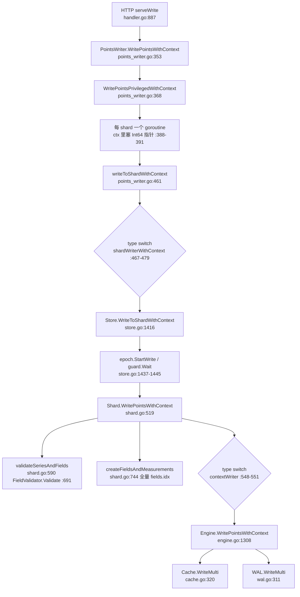
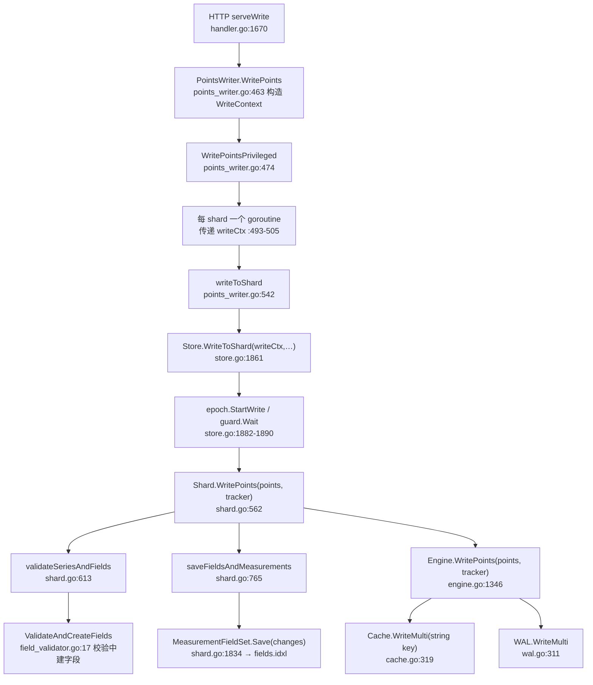
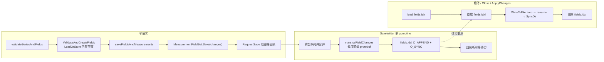

# 版本差异 1: 写入路径（v1.8.10 → v1.12.3）

> **基线**
> - OLD：`v1.8.10` = commit `688e697c51`（2021-10-11）
> - NEW：`v1.12.3` = commit `f3d5cb68ab`（`docs/specs/` 这批文档的代码基准）
> - 区间：527 commits，602 files，+79,310 / −45,239；NEW 工作树只额外包含 4 个 docs 提交，代码与 `f3d5cb68ab` 相同。
>
> **本文范围**：`coordinator/points_writer.go`、`tsdb/store.go`、`tsdb/shard.go`、`tsdb/field_validator.go`、
> `tsdb/engine/tsm1/{engine,cache,ring,wal,reader,file_store,compact}.go`、`tsdb/internal/fieldsindex.*`、
> `models/points.go`，以及 HTTP 写入入口与字段元数据（`fields.idx` / `fields.idxl`）的落盘。
>
> **交叉引用**：写入引擎的机制细节见 [01 写入引擎](../01_write_engine_spec.md)；Shard 路由、Epoch 与
> `MeasurementFieldSet` 的完整讲解见 [06 集群通信](../06_cluster_communication_spec.md)。本文只讲**版本差异**，
> 不复述主文档。

> **小白导读**
> 1. **写入口换了"传参方式"**：旧版靠 `context.Context` 一路把统计指针塞下去（`StatPointsWritten` /
>    `StatValuesWritten`），新版换成两个显式结构：`tsdb.WriteContext`（只装 `UserId`）和
>    `tsdb.StatsTracker`（回调函数）。调用链少了两处 `type switch`，但 Go API 全部变了。
> 2. **字段元数据从"每次重写整本书"变成"只记增量日记"**：旧版每创建一个新字段就把整个 `fields.idx`
>    序列化、写临时文件、fsync、rename；新版只在 `fields.idxl` 末尾追加一条 protobuf 变更记录，
>    重启/关闭时再合并回 `fields.idx`。
> 3. **类型冲突的判定位置提前了**：旧版先校验、后建字段；新版在**校验过程中就原子地创建字段**
>    （`LoadOrStore`），并发写同一字段不同类型的竞态被消除。
> 4. **`time` 字段的处理反转了**：旧版静默剥掉；新版把"字段被剥离"作为 `PartialWriteError` 上抛给
>    客户端（HTTP 400），而且 engine 层不再跳过 `time` 字段（这是 #26998 的副作用，见 §7.1）。
> 5. **新增 1 MiB 字段长度上限**：旧版没有限制，超过 1 MiB 的字符串字段照收；新版默认拒绝，可用
>    `skip-field-size-validation` 关闭。
> 6. **底层数据结构基本没动**：Cache 仍是 16 分区哈希环、仍是"先写 Cache 再写 WAL"、WAL 编码/fsync
>    语义未变、`WriteSnapshot` 逻辑未变；改动集中在字符串零拷贝、TSM 文件名解析缓存和可配置段大小。

---

## 1. 结论速览

| # | 变更点 | v1.8.10 | v1.12.3 | 影响 | 证据 |
|---|--------|---------|---------|------|------|
| 1 | 写入 API 形态 | `WriteToShard(shardID, points)` + `WriteToShardWithContext(ctx,…)`；`Shard.WritePointsWithContext(ctx,…)`；`Engine.WritePointsWithContext(ctx,…)` | `Store.WriteToShard(writeCtx tsdb.WriteContext, shardID, points)`；`Shard.WritePoints(points, tracker)`；`Engine.WritePoints(points, tracker)` | Go API 破坏性变更（企业版/嵌入式调用方必须改）；HTTP 行为不变 | `v1.8.10:tsdb/store.go:1412`；`v1.12.3:tsdb/store.go:1861` |
| 2 | 写统计传递方式 | `context.WithValue` + `Int64` 指针（`tsdb.ConetextKey`） | `tsdb.StatsTracker` 四个回调；`Store.statsTracker(db, rp, login)` | 去掉 context value 反模式；支持按 measurement / 按登录名计量 | `v1.8.10:tsdb/shard.go:504-516`；`v1.12.3:tsdb/shard.go:549-554`、`v1.12.3:tsdb/store.go:1796` |
| 3 | 请求身份 | `meta.User` 参数（OSS 不使用） | `tsdb.WriteContext{UserId}`；内置 `_systemuser_*` 假用户 | 新增 `ingress-metric-by-login-enabled` 指标维度 | `v1.8.10:coordinator/points_writer.go:357`；`v1.12.3:coordinator/points_writer.go:463-471`；`tsdb/store.go:1842-1858` |
| 4 | 字段元数据落盘 | 每个**含新字段的写请求**调用一次 `Save()`（一次请求内多字段合并为一次全量重写：tmp + fsync + rename + SyncDir） | 追加写 `fields.idxl` 变更日志（`O_APPEND|O_SYNC`），批量合并；`fields.idx` 只在 Close / ApplyChanges / LoadMetadataIndex 重建 / Restore·Import 时全量写 | 新字段密集写入时 IO 放大显著下降 | `v1.8.10:tsdb/shard.go:1786-1864`；`v1.12.3:tsdb/shard.go:1834`、`:1915-2001`、`:1855-1913` |
| 5 | protobuf 运行时 | `gogo/protobuf`（`tsdb/internal/meta.pb.go`，source `internal/meta.proto`） | `google.golang.org/protobuf`（`tsdb/internal/fieldsindex.pb.go`，protoc-gen-go v1.34.1） | 线格式兼容（字段号/类型一致），`fields.idx` 可被新旧互读 | `v1.8.10:tsdb/internal/meta.pb.go:1-15`；`v1.12.3:tsdb/internal/fieldsindex.pb.go:1-13` |
| 6 | 字段表并发结构 | `MeasurementFields{mu sync.Mutex; fields atomic.Value}`（copy-on-write map） | `MeasurementFields{fields gensyncmap.Map[string,*Field]}`（泛型 sync.Map） | 去掉整表复制；`CreateFieldIfNotExists` 原子化 | `v1.8.10:tsdb/shard.go:1557-1634`；`v1.12.3:tsdb/shard.go:1557-1603` |
| 7 | 字段校验 | `FieldValidator` 接口（可插拔）+ 先校验后建字段 | 固定函数 `ValidateAndCreateFields`，**校验时即建字段**（`LoadOrStore`），并返回 `fieldsToCreate` | 并发类型冲突竞态修复（#23756）；`EngineOptions.FieldValidator` 被删除 | `v1.8.10:tsdb/field_validator.go:12-51`；`v1.12.3:tsdb/field_validator.go:17-84`；`v1.12.3:tsdb/engine.go:165` |
| 8 | 字段长度上限 | 无 | `MaxFieldValueLength = 1048576`；超限 → `PartialWriteError{Dropped:1}`，可用 `skip-field-size-validation` 关闭 | 行为变更：>1 MiB 字符串字段由"接受"变"拒绝" | `v1.12.3:tsdb/field_validator.go:12,27-40`；`v1.12.3:tsdb/config.go:120` |
| 9 | `time` 字段 | shard 与 engine 都静默跳过，写请求成功 | shard 返回 `Dropped:0` 的 `PartialWriteError`；engine **不再跳过** | 客户端收到 400 "partial write"；engine 行为见 §7.1 风险 | `v1.8.10:tsdb/shard.go:666-671`、`v1.8.10:tsdb/engine/tsm1/engine.go:1330-1333`；`v1.12.3:tsdb/field_validator.go:45-55`、`v1.12.3:tsdb/engine/tsm1/engine.go:1366-1367` |
| 10 | 错误文本 | `partial write: %s dropped=%d` | 追加 `for database: … for retention policy: …` | 客户端日志/告警匹配规则可能失效 | `v1.8.10:tsdb/shard.go:113-123`；`v1.12.3:tsdb/shard.go:121-140` |
| 11 | 保留策略写窗口 | 无 | `PastWriteLimit` / `FutureWriteLimit`，超窗点计入 `WriteWindowDropped` 并 400 | 新功能；错误原因可区分 RP 边界与写窗口边界 | `v1.8.10:coordinator/points_writer.go:191-241`；`v1.12.3:coordinator/points_writer.go:218-245,299-360` |
| 12 | 订阅分发 | `subPoints []chan<- *WritePointsRequest` + `AddWriteSubscriber`，逐 channel 非阻塞投递，统计 `subWriteDrop` | `Subscriber interface{ Send(*WritePointsRequest) }`，`SubWriteOK` 每请求 +1，`subWriteDrop` 指标删除 | 企业版接线方式变更；写入侧订阅指标语义变化 | `v1.8.10:coordinator/points_writer.go:147-149,410-431`；`v1.12.3:coordinator/points_writer.go:63-65,511-514,267-276` |
| 13 | Cache/Ring key 类型 | `[]byte`（`store.write([]byte(k), v)`，`p.store[string(key)]`） | `string`（`store.write(k, v)`，`p.store[key]`），`xxhash.Sum64String` | 每次写入少 2 次字符串/字节切片互转 | `v1.8.10:tsdb/engine/tsm1/cache.go:343`、`v1.8.10:tsdb/engine/tsm1/ring.go:99`；`v1.12.3:tsdb/engine/tsm1/cache.go:342`、`v1.12.3:tsdb/engine/tsm1/ring.go:85,98` |
| 14 | WAL 段大小 | 配置字段存在但 `rollSegment` 固定用 `DefaultSegmentSize` | 使用 `l.SegmentSize` | 该配置（企业/测试设置）终于生效 | `v1.8.10:tsdb/engine/tsm1/wal.go:467`；`v1.12.3:tsdb/engine/tsm1/wal.go:467` |
| 15 | TSM 文件名解析 | 每次用到 generation/sequence 都重新 `ParseFileName` | `TSMReader` 创建/rename 时解析一次并缓存，`FileStat` 带 `Generation/Sequence` | 降低规划/压缩时的字符串解析 CPU | `v1.8.10:tsdb/engine/tsm1/compact.go:177-185,908-912`；`v1.12.3:tsdb/engine/tsm1/reader.go:67-68,450-460`、`v1.12.3:tsdb/engine/tsm1/compact.go:219-228` |
| 16 | 分片打开失败 | 每次写重试 `shard.Open()` | `badShards` 缓存错误，`ErrPreviousShardFail`，除非 `force` | 根因修复后仍需重启（或内部 `ReopenShard(force)`）才能恢复 | `v1.8.10:tsdb/store.go:1412-1454`（无 `badShards`）；`v1.12.3:tsdb/store.go:95-120,461-466,815-847` |
| 17 | 空 shard group | `sg.ShardFor(p)` 对空 `Shards` 取模 → panic | 返回 `shard group %d … has no shards` 错误 | 崩溃变 500，可用性提升 | `v1.8.10:coordinator/points_writer.go:226-239`；`v1.12.3:coordinator/points_writer.go:351-354` |
| 18 | HTTP 指标 | `httpd.valuesWrittenOK` | 删除；改由新增的 `localStore.valuesWritten` 统计 | 现成 dashboard/告警需改指标名 | `v1.8.10:services/httpd/handler.go:362,394,1002`；`v1.12.3:services/httpd/handler.go:422-445`、`v1.12.3:tsdb/store.go:235-242` |

---

## 2. 变更地图

### 2.1 调用链：旧版（v1.8.10）



### 2.2 调用链：新版（v1.12.3）



### 2.3 字段元数据的"双文件"数据流（新增）



### 2.4 一句话总结调用链差异

- **少了两处 `type switch`**：旧版 `points_writer` 为兼容企业版 `WriteToShardWithContext` 做了接口探测，
  `shard` 又为兼容引擎 `WritePointsWithContext` 做了一次；新版全部收敛为固定签名
  （`v1.8.10:coordinator/points_writer.go:467-479`、`v1.8.10:tsdb/shard.go:548-551` →
  `v1.12.3:coordinator/points_writer.go:545`、`v1.12.3:tsdb/shard.go:600`）。
- **统计从"反传"变"回调"**：旧版写入完成后由 engine 把 `npoints/nvalues` 写回 context 指针，再逐层累加；
  新版由 engine 在写完 Cache/WAL 后调用 `tracker.AddedPoints` / `AddedMeasurementPoints`
  （`v1.12.3:tsdb/engine/tsm1/engine.go:1435-1437,1454-1456`）。
- **分片内的顺序没变**：仍然是 校验 → 保存字段元数据 → 写 Cache → 写 WAL
  （`v1.8.10:tsdb/shard.go:543-585`、`v1.12.3:tsdb/shard.go:585-603`）。

---

## 3. 逐项差异

### 3.1 写入 API：`*WithContext` 系列被删除，换成 `WriteContext` + `StatsTracker`

这是本篇最"硬"的差异：**所有写入方法签名都换了**，而且不是简单改名。

#### 旧版（v1.8.10）

```go
// v1.8.10:tsdb/store.go:1412 — Store
func (s *Store) WriteToShard(shardID uint64, points []models.Point) error {
	return s.WriteToShardWithContext(context.Background(), shardID, points)
}

// v1.8.10:tsdb/store.go:1416
func (s *Store) WriteToShardWithContext(ctx context.Context, shardID uint64, points []models.Point) error {
	...
	return sh.WritePointsWithContext(ctx, points)
}
```

```go
// v1.8.10:tsdb/shard.go:500 — Shard
func (s *Shard) WritePoints(points []models.Point) error {
	return s.WritePointsWithContext(context.Background(), points)
}

// v1.8.10:tsdb/shard.go:504
type ConetextKey int

const (
	StatPointsWritten = ConetextKey(iota)   // 注意官方拼写错误 ConetextKey
	StatValuesWritten
)

// v1.8.10:tsdb/engine/tsm1/engine.go:1294 — Engine
func (e *Engine) WritePoints(points []models.Point) error {
	return e.WritePointsWithContext(context.Background(), points)
}
```

```go
// v1.8.10:tsdb/engine/tsm1/engine.go:1418-1425 — 统计回写
if pointsWritten, ok := ctx.Value(tsdb.StatPointsWritten).(*int64); ok {
	*pointsWritten = npoints
}
if valuesWritten, ok := ctx.Value(tsdb.StatValuesWritten).(*int64); ok {
	*valuesWritten = nvalues
}
```

#### 新版（v1.12.3）

```go
// v1.12.3:tsdb/store.go:1855-1858
type WriteContext struct {
	// Could be a system UserId, e.g. HintedHandoffUser
	UserId string
}

// v1.12.3:tsdb/store.go:1861
func (s *Store) WriteToShard(writeCtx WriteContext, shardID uint64, points []models.Point) error {
	...
	return sh.WritePoints(points, s.statsTracker(sh.database, sh.retentionPolicy, writeCtx.UserId))
}
```

```go
// v1.12.3:tsdb/shard.go:549-554
type StatsTracker struct {
	AddedPoints            func(points, values int64)
	AddedMeasurementPoints func(measurement []byte, points, values int64)
	AddedSeries            func(newSeries int64)
	AddedMeasurementSeries func(measurement []byte, newSeries int64)
}

// v1.12.3:tsdb/shard.go:562
func (s *Shard) WritePoints(points []models.Point, tracker StatsTracker) error
```

```go
// v1.12.3:coordinator/points_writer.go:463-471
func (w *PointsWriter) WritePoints(database, retentionPolicy string, consistencyLevel models.ConsistencyLevel, user meta.User, points []models.Point) error {
	userID := tsdb.UnknownUser
	if user != nil {
		userID = user.ID()
	}
	writeCtx := tsdb.WriteContext{UserId: userID}
	return w.WritePointsPrivileged(writeCtx, database, retentionPolicy, consistencyLevel, points)
}
```

#### 差异解释与语义影响

1. **`context.Context` 不再是写路径的一部分**。旧版虽然一路传 `ctx`，但注释明确写着"未来才检查
   `ctx.Err()`"（`v1.8.10:tsdb/engine/tsm1/engine.go:1319-1320`），实际**没有取消能力**；它的唯一用途
   是携带统计指针。新版干脆把统计拆成显式 `StatsTracker`，`WriteContext` 的注释也写明
   "Eventually it could also hold a context.Context for cancellation"
   （`v1.12.3:tsdb/store.go:1852-1854`）。所以：**旧版不是"可取消写"，新版也不是**，两者都不响应取消。
2. **企业版/嵌入式调用方必须改代码**。`TSDBStore` 接口从
   `WriteToShard(shardID, points)` 变为 `WriteToShard(ctx tsdb.WriteContext, shardID, points)`
   （`v1.8.10:coordinator/points_writer.go:59-62` → `v1.12.3:coordinator/points_writer.go:58-61`），
   `Engine` 接口的 `WritePoints` / `CreateSeries*` 也都增加了 `tracker` 参数
   （`v1.8.10:tsdb/engine.go:54-57` → `v1.12.3:tsdb/engine.go:57-60`）。
3. **调用链层级没变**：`PointsWriter → Store → Shard → Engine → Cache/WAL` 与旧版一致；变了的是
   每层的参数与统计出口。`PointsWriter.writeToShard` 仍然保留 `ErrShardNotFound → CreateShard → 重试一次`
   的逻辑（`v1.12.3:coordinator/points_writer.go:545-562`，旧版 `:484-501`）。
4. **写超时仍是"整体超时"**：`WritePointsPrivileged` 用 `time.NewTimer(w.WriteTimeout)` 与
   `<-w.closing` 竞争（`v1.12.3:coordinator/points_writer.go:508-537`，旧版 `:437-452`），语义未变。

### 3.2 写统计与身份：`StatsTracker`、`WriteContext.UserId`、按 measurement/登录名计量

```go
// v1.12.3:tsdb/store.go:1796-1836 — statsTracker
func (s *Store) statsTracker(db, rp, login string) StatsTracker {
	var tracker StatsTracker
	if s.EngineOptions.Config.IngressMetricByLogin && s.EngineOptions.Config.IngressMetricByMeasurement {
		tracker.AddedMeasurementPoints = func(measurement []byte, points, values int64) {
			atomic.AddInt64(&s.stats.ValuesWritten, values)
			atomic.AddInt64(&s.stats.PointsWritten, points)
			s.ingressMetrics.AddMetric(string(measurement), db, rp, login, points, values, 0)
		}
		...
```

差异点：

- 旧版 `httpd` 为了拿到 values 数，专门做了一次接口探测 `pointsWriterWithContext`，把 `nvalues` 从
  context 里取出来累加到 `h.stats.ValuesWrittenOK`
  （`v1.8.10:services/httpd/handler.go:989-1010,1002`）。新版这段整体删除，`httpd.valuesWrittenOK`
  指标也一并消失（`v1.12.3:services/httpd/handler.go:422-445`）。
- 旧版 `PointsWriter` 在 shard goroutine 里把 `numPoints/numValues` 累加回 context
  （`v1.8.10:coordinator/points_writer.go:388-404`）；新版直接由 engine 在**写完**之后回调
  （`v1.12.3:tsdb/engine/tsm1/engine.go:1454-1456`）。因此 `writePointsOk` / `writeValuesOk`
  的统计口径更准确：旧版在未传 context 的场景（如 UDP、订阅写入）退回 `len(points)` 估算
  （`v1.8.10:tsdb/shard.go:570-578`），新版始终用 engine 实际处理的点数。
- 新增两个配置：`ingress-metric-by-measurement-enabled`、`ingress-metric-by-login-enabled`
  （`v1.12.3:tsdb/config.go:138-139`），旧版没有（`git show v1.8.10:tsdb/config.go` 全文无此键）。
- 身份来源：`WritePointsInto` 显式使用 `tsdb.SelectIntoUser`，`PointsWriter` 对匿名写使用
  `tsdb.UnknownUser`（`v1.12.3:coordinator/points_writer.go:454-460,463-471`；
  `v1.12.3:tsdb/store.go:1842-1853`）。旧版 `WritePointsInto` 直接调用
  `WritePointsPrivileged(db, rp, One, p.Points)`，没有用户概念（`v1.8.10:coordinator/points_writer.go:334-336`）。

> **注意**：`SubWriteOK` 的语义变粗了。旧版对每个订阅 channel 投递成功才 `+1`，失败计 `SubWriteDrop`
> （`v1.8.10:coordinator/points_writer.go:410-431`）；新版对每个请求无条件 `+1`
> （`v1.12.3:coordinator/points_writer.go:511-514`），实际丢弃发生在
> `services/subscriber` 的 `chanWriter.Write` 内部（`v1.12.3:services/subscriber/service.go:449-470`）。
> 现有告警若基于 `subWriteOk/subWriteDrop` 会失真。

> **订阅序列化上移到写路径（`85abb3af36`）**：新版 `PointsWriter.WritePointsPrivileged` 在调用方 goroutine 同步调用
> `Subscriber.Send(pts)`（`v1.12.3:coordinator/points_writer.go:511-514`）→ `subscriptionRouter.Send`（`v1.12.3:services/subscriber/service.go:608-627`）
> → `NewWriteRequest`（`:42-67`），逐点 `ValidPointStrings` + `AppendString` 拼完整 line protocol；只有该 db/rp 没有匹配 writer 时才提前返回。
> 旧版只把请求指针非阻塞投递进 channel（`v1.8.10:coordinator/points_writer.go:410-431`），序列化发生在 `chanWriter.Run` 自己的 goroutine
> （`v1.8.10:services/subscriber/service.go:371-381`）。因此**有匹配订阅时，每个写请求增加一次全量序列化延迟**，不可打印/非 UTF-8 点也在这一步被丢弃并计入 `writeFailures`。

### 3.3 `fields.idx` 持久化：从全量重写改为增量 change-log（含 protobuf 化）

#### 旧版：每个含新字段的写请求重写整份 `fields.idx`

```go
// v1.8.10:tsdb/shard.go:744-765 — createFieldsAndMeasurements
func (s *Shard) createFieldsAndMeasurements(fieldsToCreate []*FieldCreate) error {
	...
	for _, f := range fieldsToCreate {
		mf := engine.MeasurementFields(f.Measurement)
		if err := mf.CreateFieldIfNotExists([]byte(f.Field.Name), f.Field.Type); err != nil {
			return err
		}
		s.index.SetFieldName(f.Measurement, f.Field.Name)
	}
	return engine.MeasurementFieldSet().Save()   // 全量序列化
}
```

```go
// v1.8.10:tsdb/shard.go:1786-1864 — Save（节选）
fs.mu.Lock()
fs.memoryVersion += 1
v = fs.memoryVersion
...
return fs.marshalMeasurementFieldSetNoLock()
...
path := fs.path + "." + strconv.FormatUint(v, 10) + ".tmp"
fd, err := os.OpenFile(path, os.O_CREATE|os.O_RDWR|os.O_EXCL|os.O_SYNC, 0666)
...
fs.mu.Lock()
if fs.writtenVersion > v { return nil }       // 后来的写已覆盖，直接返回
if err := file.RenameFile(path, fs.path); err != nil { return err }
if err = file.SyncDir(filepath.Dir(fs.path)); err != nil { return err }
```

旧版虽然已经在 #20504 里做了 `memoryVersion/writtenVersion` 去重（避免并发重复 rename），但**每次调用
仍然要把整个 map 序列化成 protobuf、写一个全新临时文件、fsync、rename、再 fsync 目录**。字段数上万时，
这条路径的 IO 放大非常可观。

#### 新版：追加 `fields.idxl`，批量合并

```go
// v1.12.3:tsdb/shard.go:51
FieldsChangeFile = "fields.idxl"
```

```go
// v1.12.3:tsdb/shard.go:765-786 — saveFieldsAndMeasurements
func (s *Shard) saveFieldsAndMeasurements(fieldsToSave []*FieldCreate) (int, error) {
	...
	changes := make([]*FieldChange, 0, len(fieldsToSave))
	for _, f := range fieldsToSave {
		numCreated++
		s.index.SetFieldName(f.Measurement, f.Field.Name)
		changes = append(changes, &FieldChange{
			FieldCreate: *f,
			ChangeType:  AddMeasurementField,
		})
	}
	return numCreated, engine.MeasurementFieldSet().Save(changes)
}
```

```go
// v1.12.3:tsdb/shard.go:1915-2001 — appendToChangesFile（节选）
errorChannels := []errorChannel{first.errorReturn}
changes := []FieldChanges{first.changes}
...
fd, err := os.OpenFile(fscm.changeFilePath, os.O_CREATE|os.O_APPEND|os.O_SYNC|os.O_WRONLY, 0666)
...
// 把队列里已经排队的请求合并到一次写
for {
	select {
	case wr, ok := <-fscm.writeRequests:
		if ok { changes = append(changes, wr.changes); errorChannels = append(errorChannels, wr.errorReturn); continue }
	default:
	}
	break
}
b, err = marshalFieldChanges(changes...)
...
fd.Write(b)
```

关键机制：

1. **批量合并**：`writeRequests` channel 容量 `MaxCombinedWrites = 100`
   （`v1.12.3:tsdb/shard.go:1667,1675,1819`）。`appendToChangesFile` 在真正写盘前会**排空队列**，
   单次最多合并 1+100 条请求，把 100 次 fsync 压成 1 次。
2. **长度前缀 + protobuf**：`marshalFieldChanges` 用 `proto.MarshalOptions.MarshalAppend` 在缓冲区
   头部预留 8 字节，写入长度后再回填（`v1.12.3:tsdb/shard.go:2067-2098`）；读取用
   `readSizePlusBuffer`（`:2003-2016`）。
3. **半写保护**：`appendToChangesFile` 记录 `changeFileSize`，下次写之前若发现文件比记录的大，
   先 `Truncate` 掉上次的半条记录（`v1.12.3:tsdb/shard.go:1958-1965`）。
4. **合并回主文件**：`ApplyChanges` 重放全部变更后调用 `WriteToFile` 并删除 `fields.idxl`
   （`v1.12.3:tsdb/shard.go:2243-2268`）；`Close` 同样会 `WriteToFile`
   （`v1.12.3:tsdb/shard.go:1681-1694`）。`WriteToFile` 还有两个入口：`LoadMetadataIndex` 从 TSM 重建成功后
   （`v1.12.3:tsdb/engine/tsm1/engine.go:934`）与 Restore/Import 的 `overlay` 收尾（`:1245`）。口径统一为
   **Close / ApplyChanges / LoadMetadataIndex 重建 / Restore·Import**。启动时 `NewMeasurementFieldSet` 先 `load()`（读 `fields.idx`），
   再 `ApplyChanges()`（重放 `fields.idxl`）（`v1.12.3:tsdb/shard.go:1666-1679,2104-2129`）。

#### protobuf 化：gogo → google.golang.org/protobuf

```go
// v1.8.10:tsdb/internal/meta.pb.go:1-15
// Code generated by protoc-gen-gogo. DO NOT EDIT.
// source: internal/meta.proto
package tsdb
import (
	fmt "fmt"
	proto "github.com/gogo/protobuf/proto"
	math "math"
)
```

```go
// v1.12.3:tsdb/internal/fieldsindex.pb.go:1-13
// Code generated by protoc-gen-go. DO NOT EDIT.
// versions:
// 	protoc-gen-go v1.34.1
// 	protoc        v5.29.2
// source: internal/fieldsindex.proto
package tsdb
import (
	protoreflect "google.golang.org/protobuf/reflect/protoreflect"
	protoimpl "google.golang.org/protobuf/runtime/protoimpl"
)
```

- 旧 schema（`v1.8.10:tsdb/internal/meta.proto`，33 行）只有 `Series/Tag/MeasurementFields/Field/MeasurementFieldSet`；
  新 schema（`v1.12.3:tsdb/internal/fieldsindex.proto`，48 行）保持这些 message 的**字段号完全不变**，
  追加了 `ChangeType`、`MeasurementFieldChange`、`FieldChangeSet`（`:36-48`）。
- 文件头 magic 未变：`[]byte{0, 6, 1, 3}`（`v1.8.10:tsdb/shard.go:82-83` →
  `v1.12.3:tsdb/shard.go:85-86`）。**因此 `fields.idx` 的字节格式向后兼容**，升级不需要重建。
- `tsdb.Field` 结构体删掉了 `ID uint8` 字段（旧版 `v1.8.10:tsdb/shard.go:1936-1941`，新版
  `v1.12.3:tsdb/shard.go:2272-2275`）。该字段在旧版只被赋值（`uint8(len(fields)+1)`），
  并未参与序列化或查询，属于死字段清理。

### 3.4 `MeasurementFields` 并发结构：atomic.Value → sync.Map

```go
// v1.8.10:tsdb/shard.go:1557-1560
type MeasurementFields struct {
	mu     sync.Mutex
	fields atomic.Value // map[string]*Field
}
```

```go
// v1.12.3:tsdb/shard.go:1557-1559
type MeasurementFields struct {
	fields gensyncmap.Map[string, *Field]
}
```

旧版 `CreateFieldIfNotExists` 在写锁下**复制整张 map** 再 `Store`（`v1.8.10:tsdb/shard.go:1620-1631`），
字段多时每次新建字段都是 O(n) 分配；新版用 `LoadOrStore`（`v1.12.3:tsdb/shard.go:1591-1603`），
O(1) 且天然并发安全。

**这项改动连带修复了一个数据竞争**：旧版校验时通过 `mf.FieldBytes` 读 atomic 快照，建字段在之后单独进行，
两个并发写可以为同一字段分别"校验通过"再各自创建，导致内存里出现类型冲突的字段（issue #23756）。
新版的"校验即建字段 + `LoadOrStore`"把判定与创建合成一个原子操作
（commit `5a20a835a5` 先加锁，`b617eb24a7` 改为 `sync.Map`）。

> `v1.8.10:tsdb/shard.go:1659-1662` 的 `FieldBytes` 注释说它"避免 string 分配"，但 map 查找本身就是
> `string(name)`，新版直接删掉了这个易误解的 API（`v1.12.3:tsdb/shard.go:1610-1613` 只保留 `Field(name string)`）。

### 3.5 字段校验重构：`FieldValidator` 接口删除，`ValidateAndCreateFields` 校验即创建

#### 旧版：两段式

```go
// v1.8.10:tsdb/field_validator.go:11-51
type FieldValidator interface {
	Validate(mf *MeasurementFields, point models.Point) error
}

type defaultFieldValidator struct{}

func (defaultFieldValidator) Validate(mf *MeasurementFields, point models.Point) error {
	iter := point.FieldIterator()
	for iter.Next() {
		if bytes.Equal(iter.FieldKey(), timeBytes) { continue }   // 静默跳过 time
		f := mf.FieldBytes(iter.FieldKey())
		if f == nil { continue }
		dataType := dataTypeFromModelsFieldType(iter.Type())
		if dataType == influxql.Unknown { continue }
		if f.Type != dataType {
			return PartialWriteError{Reason: fmt.Sprintf(...), Dropped: 1}
		}
	}
	return nil
}
```

```go
// v1.8.10:tsdb/shard.go:690-703 — 校验失败 → 整点丢弃
if err := s.options.FieldValidator.Validate(mf, p); err != nil {
	switch err := err.(type) {
	case PartialWriteError:
		if reason == "" { reason = err.Reason }
		dropped += err.Dropped
		atomic.AddInt64(&s.stats.WritePointsDropped, int64(err.Dropped))
	default:
		return nil, nil, err
	}
	continue
}
```

旧版字段创建在**校验通过之后**，由 `createFieldsAndMeasurements` 统一做
（`v1.8.10:tsdb/shard.go:708-734,744-765`）。

#### 新版：一段式，校验时创建

```go
// v1.12.3:tsdb/field_validator.go:17-84（节选）
func ValidateAndCreateFields(mf *MeasurementFields, point models.Point, skipSizeValidation bool) ([]*FieldCreate, *PartialWriteError) {
	pointSize := point.StringSize()
	iter := point.FieldIterator()
	var fieldsToCreate []*FieldCreate
	var partialWriteError *PartialWriteError

	// We return fieldsToCreate even on error, because other writes
	// in parallel may depend on these previous fields having been created in memory
	for iter.Next() {
		if !skipSizeValidation {
			if pointSize > MaxFieldValueLength && iter.Type() == models.String {
				if sz := len(iter.StringValue()); sz > MaxFieldValueLength {
					return fieldsToCreate, &PartialWriteError{Reason: ..., Dropped: 1}
				}
			}
		}
		fieldKey := iter.FieldKey()
		if bytes.Equal(fieldKey, TimeBytes) {
			if partialWriteError == nil {
				partialWriteError = &PartialWriteError{
					Reason: fmt.Sprintf("invalid field name: input field \"%[1]s\" on measurement \"%s\" is invalid. Field \"%[1]s\" has been stripped from point.", fieldKey, point.Name()),
					Dropped: 0,     // 只剥字段，不丢点
				}
			}
			continue
		}
		dataType := dataTypeFromModelsFieldType(iter.Type())
		if dataType == influxql.Unknown { continue }
		fieldName := string(fieldKey)
		f, created, err := mf.CreateFieldIfNotExists(fieldName, dataType)
		if errors.Is(err, ErrFieldTypeConflict) {
			return fieldsToCreate, &PartialWriteError{Reason: ..., Dropped: 1}
		} else if err != nil {
			return fieldsToCreate, &PartialWriteError{Reason: ..., Dropped: 1}
		} else if created {
			fieldsToCreate = append(fieldsToCreate, &FieldCreate{point.Name(), f})
		}
	}
	return fieldsToCreate, partialWriteError
}
```

```go
// v1.12.3:tsdb/shard.go:716-734 — 新分支
newFields, partialWriteError := ValidateAndCreateFields(mf, p, s.options.Config.SkipFieldSizeValidation)
createdFieldsToSave = append(createdFieldsToSave, newFields...)

if partialWriteError != nil && partialWriteError.Dropped > 0 {
	...
	dropped += partialWriteError.Dropped
	atomic.AddInt64(&s.stats.WritePointsDropped, int64(partialWriteError.Dropped))
	continue
	// Sometimes we will drop fields like 'time' but not an entire point
	// we want to inform the writer that something occurred.
} else if partialWriteError != nil {
	partialWriteError.Database = s.Database()
	partialWriteError.RetentionPolicy = s.RetentionPolicy()
	err = *partialWriteError
}
points[j] = points[i]
j++
```

#### 差异解释

| 维度 | 旧（v1.8.10） | 新（v1.12.3） | 影响 |
|------|----------------|----------------|------|
| 可插拔校验器 | `EngineOptions.FieldValidator` 接口，Enterprise 可替换 | 固定函数，`EngineOptions` 中该字段被删除 | **API 破坏**；定制校验逻辑无处挂载 |
| 字段创建时机 | 校验后、写 engine 前 | 校验中，逐个字段 `LoadOrStore` | 并发类型冲突从"竞态 + 整请求 500"变为"确定性 partial write" |
| 被丢弃点的字段 | 冲突点的新字段**不会**创建 | `ValidateAndCreateFields` 返回的 `fieldsToCreate` **仍会保存**（注释见 `v1.12.3:tsdb/field_validator.go:23-25`），`v1.12.3:tsdb/shard.go:717` 无条件 append；**仅限排在冲突字段之前、已迭代到的新字段** | `SHOW FIELD KEYS` 可能出现"从未成功写入数据"的字段（既有设计，见 [06 §8.5](../06_cluster_communication_spec.md)） |
| 字段长度 | 无限制 | >1 MiB 字符串字段 → `Dropped:1` | 行为变更，可用 `skip-field-size-validation` 关闭 |
| `time` 字段 | 静默剥离，返回 nil | 返回 `Dropped:0` 的 `PartialWriteError`，点继续写 | **HTTP 从 204 变 400**；详见 §6.3 |
| 错误包装 | `fmt.Errorf("engine: %s", err)` | `fmt.Errorf("engine: %w", err)` | `errors.Is/As` 可用（`v1.12.3:tsdb/shard.go:603`） |

> **PR #26998 的准确语义**（`1356a21321`）：标题是 "Bubble error up to writer if fields are dropped"。
> 它做了两件事：(a) `ValidateAndCreateFields` 在 `time` 字段处产生 `Dropped:0` 错误；
> (b) 同时**删除了 engine 里跳过 `time` 字段的代码**
> （`v1.8.10:tsdb/engine/tsm1/engine.go:1330-1333` 被删除，新版 `v1.12.3:tsdb/engine/tsm1/engine.go:1366-1367` 直接进入 key 构建）。
> (b) 的副作用见 §7.1。

### 3.6 部分写入与 `Dropped` 计数

#### 旧版

```go
// v1.8.10:tsdb/shard.go:113-123
type PartialWriteError struct {
	Reason  string
	Dropped int
	// A sorted slice of series keys that were dropped.
	DroppedKeys [][]byte
}

func (e PartialWriteError) Error() string {
	return fmt.Sprintf("partial write: %s dropped=%d", e.Reason, e.Dropped)
}
```

```go
// v1.8.10:coordinator/points_writer.go:226-239
mapping := NewShardMapping(len(wp.Points))
for _, p := range wp.Points {
	sg := list.ShardGroupAt(p.Time())
	if sg == nil {
		mapping.Dropped = append(mapping.Dropped, p)
		atomic.AddInt64(&w.stats.WriteDropped, 1)
		continue
	}
	sh := sg.ShardFor(p)
	mapping.MapPoint(&sh, p)
}
```

```go
// v1.8.10:coordinator/points_writer.go:433-436
if err == nil && len(shardMappings.Dropped) > 0 {
	err = tsdb.PartialWriteError{Reason: "points beyond retention policy", Dropped: len(shardMappings.Dropped)}
}
```

#### 新版

```go
// v1.12.3:tsdb/shard.go:121-140
type PartialWriteError struct {
	Reason  string
	Dropped int
	DroppedKeys     [][]byte
	Database        string
	RetentionPolicy string
}

func (e PartialWriteError) Error() string {
	message := fmt.Sprintf("partial write: %s dropped=%d", e.Reason, e.Dropped)
	if len(e.Database) > 0 { message = fmt.Sprintf("%s for database: %s", message, e.Database) }
	if len(e.RetentionPolicy) > 0 { message = fmt.Sprintf("%s for retention policy: %s", message, e.RetentionPolicy) }
	return message
}
```

```go
// v1.12.3:coordinator/points_writer.go:156-191 — 丢弃原因与极值
func (s *ShardMapping) AddDropped(p models.Point, t time.Time, b BoundType) {
	if s.MaxDropped.Point == nil || p.Time().After(s.MaxDropped.Point.Time()) { ... }
	if s.MinDropped.Point == nil || p.Time().Before(s.MinDropped.Point.Time()) { ... }
	switch b {
	case RetentionPolicyBound: s.RetentionDropped++
	case WriteWindowLowerBound, WriteWindowUpperBound: s.WriteWindowDropped++
	}
}

func (s *ShardMapping) Dropped() int { return s.RetentionDropped + s.WriteWindowDropped }
```

```go
// v1.12.3:coordinator/points_writer.go:516-522
if err == nil && shardMappings.Dropped() > 0 {
	err = tsdb.PartialWriteError{Reason: shardMappings.SummariseDropped(),
		Dropped:         shardMappings.Dropped(),
		Database:        database,
		RetentionPolicy: retentionPolicy,
	}
}
```

#### 语义差异

1. **计数来源**：旧版只统计"超出 RP 范围"的点，存 `[]models.Point` 切片；新版区分
   `RetentionDropped` 与 `WriteWindowDropped`，只保留最早/最晚两个丢弃点做样本
   （`SummariseDropped`，`v1.12.3:coordinator/points_writer.go:175-182`），内存占用从 O(dropped) 降到 O(1)。
2. **错误消息**：旧版无论什么原因都写 `"points beyond retention policy"`；新版会给出
   `"dropped N points outside retention policy of duration X and M points outside write window (-P to +F) - oldest …, newest …"`。
   对运维排查更友好，但**按旧字符串匹配的告警会失效**。
3. **`Dropped` 的来源增加**：新版 shard 层还会因为"字段超长 / 类型冲突 / time 字段"返回
   `PartialWriteError`，HTTP 层统一按 `Dropped` 计算 `pointsWrittenDropped`
   （`v1.12.3:services/httpd/handler.go:1781-1787`）。
4. **多 shard 部分失败**：两版都是"第一个错误即返回"，其余 shard 的 goroutine 不会被取消
   （`v1.8.10:coordinator/points_writer.go:439-452`；`v1.12.3:coordinator/points_writer.go:524-537`）。新版 HTTP 层加了一句
   注释承认 `PointsWrittenOK` 可能高估（`v1.12.3:services/httpd/handler.go:1782-1783`）。
5. **series/values 上限错误的部分写语义（#23091）**：inmem 索引下 `CreateSeriesListIfNotExists` 返回的是**值类型**
   `tsdb.PartialWriteError`（`v1.12.3:tsdb/index/inmem/inmem.go:1238`，旧版同）。旧版 shard 的 type switch 只接
   `*PartialWriteError`（`v1.8.10:tsdb/shard.go:644-657`），落 `default` 后 `validateSeriesAndFields` 返回 `(nil,nil,err)`，
   于是**该 shard 零点写入**；但 HTTP 仍是 **400**（旧 handler 对值类型 `tsdb.PartialWriteError` 也走 400，
   `v1.8.10:services/httpd/handler.go:1021-1024`，不是 500）。新版同时接值/指针（`tsdb/shard.go:667-683`），并在
   `:708-710` 跳过 `DroppedKeys`，**其余点照常写入**。`max-values-per-tag` 同样被修复（错误文本不变）；
   `max-series-per-database` 文本由 `max-series-per-database limit exceeded: (1000)`（`v1.8.10:tsdb/index/inmem/inmem.go:1368`）
   变为 `max-series-per-database exceeded database=%s limit=%d series=%d keys=%d`（`v1.12.3:tsdb/index/inmem/inmem.go:1372`，`7d182158f4`）。

### 3.7 `Shard.WritePoints` 与 `Store.WriteToShard`：epoch/guard 没变，统计与错误变了

```go
// v1.12.3:tsdb/store.go:1881-1898
guards, gen := epoch.StartWrite()
defer epoch.EndWrite(gen)

for _, guard := range guards {
	if guard.Matches(points) { guard.Wait() }
}

if isIdle, _ := sh.IsIdle(); isIdle {
	sh.SetCompactionsEnabled(true)
}

return sh.WritePoints(points, s.statsTracker(sh.database, sh.retentionPolicy, writeCtx.UserId))
```

对照旧版 `v1.8.10:tsdb/store.go:1436-1453`，**epoch、guard、冷 shard 唤醒三段逐行相同**；差异只有：

- 末尾调用从 `sh.WritePointsWithContext(ctx, points)` 变为 `sh.WritePoints(points, tracker)`；
- `s.statsTracker(...)` 是新增的闭包构造器。

`Shard.WritePoints` 内部的 `s.mu.RLock()`、`engineNoLock()`、`validateSeriesAndFields` →
`saveFieldsAndMeasurements` → `engine.WritePoints` 顺序也与旧版一致
（`v1.8.10:tsdb/shard.go:519-586` → `v1.12.3:tsdb/shard.go:562-605`）。**锁竞争结构没有变化**：
仍然是每个 shard 一把 RWMutex，写与写之间可并发，写与 close/delete 互斥。

新增的"分片打开失败记忆"改变了这条路径的恢复能力：

```go
// v1.12.3:tsdb/store.go:461-466 — newShardLoader
lastErr, _ := s.badShards.shardError(shardID)
if lastErr != nil && !l.force {
	l.loadErr = fmt.Errorf("not attempting to open shard %d; %w", shardID, lastErr)
	return l
}
```

旧版 `Store.CreateShard` 每次都 `shard.Open()`；新版如果该 shard 曾打开失败，`CreateShard` 会直接返回
缓存的 `ErrPreviousShardFail`（`v1.12.3:tsdb/store.go:100-120,892-929`）。因此
`PointsWriter` 的 `ErrShardNotFound → CreateShard → 重试` 逻辑（`v1.12.3:coordinator/points_writer.go:545-562`）在"坏 shard"
场景下会**快速失败而不是反复重试打开**。恢复手段是内部方法 `ReopenShard(id, true)` / `ClearBadShardList()`
（`v1.12.3:tsdb/store.go:784-798,833-847`），OSS 的 HTTP API 没有暴露它们。

### 3.8 Cache / Ring：只有 key 类型与哈希库变化

`cache.go` 的完整 diff 只有 10 行，`ring.go` 是 63 行，**没有任何并发模型或 snapshot 语义变化**：

```go
// v1.8.10:tsdb/engine/tsm1/cache.go:342-343
for k, v := range values {
	newKey, err := store.write([]byte(k), v)
```

```go
// v1.12.3:tsdb/engine/tsm1/cache.go:341-342
for k, v := range values {
	newKey, err := store.write(k, v)
```

```go
// v1.8.10:tsdb/engine/tsm1/ring.go:99-101,237-241
func (r *ring) write(key []byte, values Values) (bool, error) {
	return r.getPartition(key).write(key, values)
}

func (p *partition) write(key []byte, values Values) (bool, error) {
	p.mu.RLock()
	e := p.store[string(key)]      // []byte → string 转换
```

```go
// v1.12.3:tsdb/engine/tsm1/ring.go:85-88,98-100,227-232
func (r *ring) getPartitionStringKey(key string) *partition {
	return r.partitions[int(xxhash.Sum64String(key)%uint64(len(r.partitions)))]
}

func (r *ring) write(key string, values Values) (bool, error) {
	return r.getPartitionStringKey(key).write(key, values)
}

func (p *partition) write(key string, values Values) (bool, error) {
	p.mu.RLock()
	e := p.store[key]
```

其他 ring 变化：

- `xxhash` v1 → `v2`（`v1.12.3:tsdb/engine/tsm1/ring.go:7`），使用 `Sum64String`，避免
  `[]byte` 拷贝（commit `45a8227ad6`，PR 描述给出的观测是"字符串转字节切片约占 3–5% CPU"）。
- 删除 `keysHint` 与 `ring.add`：`keys()` 不再预分配容量（`v1.12.3:tsdb/engine/tsm1/ring.go:110-118`），
  旧版用 `atomic.LoadInt64(&r.keysHint)` 做 hint（`v1.8.10:tsdb/engine/tsm1/ring.go:120-128`）。hint 本来就不精确，
  删除后 `keys()` 可能多次扩容，但去掉了每次 add/remove 的原子操作。
- `newring` 新增"必须是 2 的幂"校验（`v1.12.3:tsdb/engine/tsm1/ring.go:47-49`），旧版只检查 `n <= 0 || n > 16`
  （`v1.8.10:tsdb/engine/tsm1/ring.go:52-55`）。**分区数常量 `partitions = 16` 两版相同**——旧版注释里写的
  "256 partitions / 最多 256 members" 是错误注释，新版把它改成了 16（`v1.12.3:tsdb/engine/tsm1/ring.go:19-42`）。
  这一点常被误读为"分区数从 256 降到 16"，**并非事实**。

**Cache 的 snapshot 语义未变**：`Cache.Snapshot()`（`v1.8.10:tsdb/engine/tsm1/cache.go:376` / `v1.12.3:tsdb/engine/tsm1/cache.go:375`）
两版实现一致；`WriteSnapshot` 里 `WAL.CloseSegment()` → `Cache.Snapshot()` → `snapshot.Deduplicate()`
的顺序也一致（`v1.8.10:tsdb/engine/tsm1/engine.go:1904-1952` → `v1.12.3:tsdb/engine/tsm1/engine.go:1957-2005`）。

### 3.9 WAL：编码与 fsync 未变，段大小配置开始生效

`wal.go` 全文件 diff 只有 7 行：

```go
// v1.8.10:tsdb/engine/tsm1/wal.go:467
if l.currentSegmentWriter == nil || l.currentSegmentWriter.size > DefaultSegmentSize {
```

```go
// v1.12.3:tsdb/engine/tsm1/wal.go:466-467
func (l *WAL) rollSegment() error {
	if l.currentSegmentWriter == nil || l.currentSegmentWriter.size > l.SegmentSize {
```

- `WAL.SegmentSize` 字段与 `DefaultSegmentSize` 常量两版都在（`v1.8.10:tsdb/engine/tsm1/wal.go:28-29,111-112,126`），
  但旧版 `rollSegment` 硬编码常量，配置无效；新版（commit `e5f6894037`）改为读字段。OSS 默认仍是
  10 MiB，因此普通部署无感知；企业版/测试可通过该字段调整。
- 另一处是 `segmentFileNames` 的错误消息加上 pattern（`v1.12.3:tsdb/engine/tsm1/wal.go:550-557`，commit `23008e5286`）。
- **WAL 条目编码、snappy 压缩、`syncWaiters` 批量 fsync 全部未变**：
  `WriteMulti`（`v1.8.10` 与 `v1.12.3` 均见 `v1.8.10:tsdb/engine/tsm1/wal.go:311` / `v1.12.3:tsdb/engine/tsm1/wal.go:311`）、`writeToLog`
  （`v1.12.3:tsdb/engine/tsm1/wal.go:398-462`，先 `entry.Encode` 再 `snappy.Encode`，然后
  `scheduleSync` + 等 `syncErr`）逐行一致。`wal-fsync-delay` 配置也未变
  （`v1.12.3:tsdb/config.go:112-114`）。
- `Engine.Open` 里 WAL 打开失败的错误消息从裸返回变为带路径包装
  （`v1.8.10:tsdb/engine/tsm1/engine.go:743-747` → `v1.12.3:tsdb/engine/tsm1/engine.go:792-796`，commit `39c1b0ac5a` 修正了曾经误用
  `fieldPath` 的 bug）。

### 3.10 Engine：`WritePoints` 去除 `time` 跳过、统计回调；`WriteSnapshot` 仅错误聚合变化

```go
// v1.8.10:tsdb/engine/tsm1/engine.go:1329-1335
for iter.Next() {
	// Skip fields name "time", they are illegal
	if bytes.Equal(iter.FieldKey(), timeBytes) {
		continue
	}
	keyBuf = append(keyBuf[:baseLen], iter.FieldKey()...)
```

```go
// v1.12.3:tsdb/engine/tsm1/engine.go:1364-1367
npoints++
var nValuesForPoint int64
for iter.Next() {
	keyBuf = append(keyBuf[:baseLen], iter.FieldKey()...)
```

- 写 Cache/WAL 的顺序与条件完全一致（`v1.8.10:tsdb/engine/tsm1/engine.go:1404-1416` → `v1.12.3:tsdb/engine/tsm1/engine.go:1440-1452`），
  仍然**先 Cache 后 WAL**，Cache 满时返回 `ErrCacheMemorySizeLimitExceeded`（`v1.12.3:tsdb/engine/tsm1/cache.go:329-332`）。
- 新增按 measurement 的统计回调（`v1.12.3:tsdb/engine/tsm1/engine.go:1435-1437`）。
- `seriesTypeMap` 特性开关（`INFLUXDB_SERIES_TYPE_CHECK_ENABLED`）两版一致
  （`v1.8.10:tsdb/engine/tsm1/engine.go:265-267` → `v1.12.3:tsdb/engine/tsm1/engine.go:296-299`）。
- `CreateSeriesListIfNotExists` 增加 `tracker` 参数并透传给 index
  （`v1.8.10:tsdb/engine/tsm1/engine.go:1892-1894` → `v1.12.3:tsdb/engine/tsm1/engine.go:1945-1947`）。
- `Compactor.WriteSnapshot` 只多了 `logger` 参数和 `errors.Join(errs...)`
  （`v1.12.3:tsdb/engine/tsm1/compact.go:888,957`）；并发度/节流公式与旧版逐行相同
  （`card/2e6`、`card >= 3e6 → 4`、`throttle = card < 3e6 && avg < 15s`，
  `v1.8.10:tsdb/engine/tsm1/compact.go:831-849` → `v1.12.3:tsdb/engine/tsm1/compact.go:898-916`）。

### 3.11 TSM 文件名的 generation/sequence 缓存（#26905）

```go
// v1.12.3:tsdb/engine/tsm1/reader.go:65-68
parseFileNameFunc ParseFileNameFunc
generation        int
sequence          int
...
// v1.12.3:tsdb/engine/tsm1/reader.go:450-460
func (t *TSMReader) parseAndCacheFileName(path string) error {
	if t.parseFileNameFunc != nil {
		var err error
		t.generation, t.sequence, err = t.parseFileNameFunc(path)
		return err
	}
	return nil
}
```

- 创建 reader 时解析一次（`v1.12.3:tsdb/engine/tsm1/reader.go:276`），rename 后重新解析（`v1.12.3:tsdb/engine/tsm1/reader.go:444`），
  `Stats()` 直接返回缓存值（`v1.12.3:tsdb/engine/tsm1/reader.go:679-680`），`FileStat` 新增 `Generation/Sequence`
  （`v1.12.3:tsdb/engine/tsm1/file_store.go:243-245`）。
- 压缩规划器不再对每个文件调 `ParseFileName`：`tsmGeneration.level()` 用
  `t.files[0].Sequence` 代替解析（`v1.12.3:tsdb/engine/tsm1/compact.go:219-228`），
  `findGenerations` 用 `f.Generation` 分组（`v1.12.3:tsdb/engine/tsm1/compact.go:704-710`）。
- 旧版对应位置每次解析：`v1.8.10:tsdb/engine/tsm1/compact.go:177-185`（`level()` 里 `t.parseFileName(...)`）、
  `v1.8.10:tsdb/engine/tsm1/compact.go:908-912`（compact 时逐个文件解析）。
- 旧版 `DefaultPlanner` 还自己实现了一个 `ParseFileName` 转发方法；新版删除并要求 `fileStore`
  实现 `SupportsCompactionPlanning()`，否则构造时 panic（`v1.12.3:tsdb/engine/tsm1/compact.go:173-185`）。

### 3.12 `models/points.go` 的写入相关变化

| 变化 | 旧 | 新 | 说明 |
|------|----|----|------|
| `Point` 接口新增 `ForEachField` | 无 | `v1.12.3:models/points.go:104,1580-1582` | **接口破坏**：任何外部实现 `models.Point` 的类型都要补方法 |
| `Tags.HashKey` 增加 `escapeTags bool` | `HashKey()`（`v1.8.10:models/points.go:2141`） | `HashKey(escapeTags bool)`（`v1.12.3:models/points.go:2211`） | **签名破坏**；`AppendHashKey(dst, true)` 保持原行为（`v1.12.3:models/points.go:1650`） |
| `Tags.sorted()` 快速判定 | 无 | `v1.12.3:models/points.go:2092-2101` | 避免 `sort.IsSorted` 的接口分配；注释称最多 50% 提升 |
| `NewTagsKeyValues` | 无 | `v1.12.3:models/points.go:1982-2020` | 批量构造 tags 并去重排序，flux 读取路径使用（`flux/stdlib/influxdata/influxdb/to.go:372`） |
| `ValidPointStrings` | 无 | `v1.12.3:models/points.go:2559-2596` | 无匹配订阅时不在写路径调用；有匹配订阅时由 `Subscriber.Send → NewWriteRequest` 在写请求 goroutine 同步调用（`v1.12.3:services/subscriber/service.go:42-67,608-627`） |
| `ErrInvalidKevValuePairs` | 无 | `v1.12.3:models/points.go:60-62` | 新 API 的错误值（注意官方拼写 `Kev`） |

**line protocol 解析本身没有变化**：`ParsePointsWithPrecision` 的签名与行为两版一致
（`v1.8.10:services/httpd/handler.go:966` → `v1.12.3:services/httpd/handler.go:1749`）。

---

## 4. 优化与收益

| 优化 | 机制 | 证据 | 收益/代价 |
|------|------|------|-----------|
| `fields.idx` 增量写（#23701） | 追加 `fields.idxl`，批量合并最多 101 条请求，避免全量序列化 + rename | `v1.12.3:tsdb/shard.go:1834,1915-2001`；旧 `v1.8.10:tsdb/shard.go:1786-1864` | 新字段密集写入时写放大从 O(字段总数) 降为 O(本批字段数)；代价是多一个文件与启动重放 |
| 字段表 sync.Map（#26022） | `LoadOrStore` 取代"写锁 + 整表复制" | `v1.12.3:tsdb/shard.go:1591-1603`；旧 `v1.8.10:tsdb/shard.go:1620-1631` | 新建字段 O(1)，无整表分配；同时消除 #23756 竞态 |
| 校验即创建（#25998/#26022） | 校验与创建在同一次 `LoadOrStore` 完成 | `v1.12.3:tsdb/field_validator.go:64` | 并发类型冲突不再可能"双写成功" |
| Cache 字符串 key（#25622） | `WriteMulti` 本来就有 `string` key，直接下传；ring 用 `Sum64String` | `v1.12.3:tsdb/engine/tsm1/cache.go:342`、`v1.12.3:tsdb/engine/tsm1/ring.go:85-88` | 每 key 省掉 `[]byte(k)` 与 `string(key)` 两次转换；PR 描述观测 3–5% CPU 在转换上 |
| xxhash v2 | 更新哈希库 | `v1.12.3:tsdb/engine/tsm1/ring.go:7`；旧 `v1.8.10:tsdb/engine/tsm1/ring.go:8` | arm 汇编实现 + 字符串特化 |
| 去掉 `keysHint` | 删除 add/remove 的原子加减与 keys() 预分配 | `v1.12.3:tsdb/engine/tsm1/ring.go:110-118` | 减少原子操作；`keys()` 可能多一次扩容 |
| TSM 文件名缓存（#26905） | reader 创建/rename 时解析一次，`FileStat` 携带 gen/seq | `v1.12.3:tsdb/engine/tsm1/reader.go:276,444,679-680`、`v1.12.3:tsdb/engine/tsm1/compact.go:219-228,704-710` | 规划/压缩热点路径不再反复 `strconv.ParseUint`；修复 #26794/#26907 |
| `WriteSnapshot` 错误聚合 | `errors.Join(errs...)` | `v1.12.3:tsdb/engine/tsm1/compact.go:933-957`；旧 `v1.8.10:tsdb/engine/tsm1/compact.go:866-890` | 多个并发 snapshot 分片失败时不再只报最后一个 |
| 丢弃点摘要 | 只保留最早/最晚样本 + 分类计数 | `v1.12.3:coordinator/points_writer.go:156-198` | 大批量超窗写入时内存 O(1) 而非 O(dropped) |
| 空 shard group 防御 | 返回错误而非 panic | `v1.12.3:coordinator/points_writer.go:351-354`（#25717） | 单点坏元数据不再拖垮进程 |
| 坏 shard 记忆 | `badShards` 缓存打开错误 | `v1.12.3:tsdb/store.go:95-120,461-466`（#23437） | 避免每次写入反复尝试打开损坏 shard（旧版会反复 IO） |
| `time` 字段报错上抛 | 让客户端知道字段被丢弃 | `v1.12.3:tsdb/field_validator.go:45-55`（#26998） | 可观测性提升；但改变了 HTTP 状态码，见 §5 |
| SSEG 建 series fsync | `Flush()` 增加 `file.Sync()`（`b4e781eff6`） | **每个产生新 series 的写请求 ≤8 次 fsync**（每分区一次，见 [02 §3.9(c)](02_index_series_diff.md)）；v1.8.10 为 0 | 持久性增强；代价是写延迟，且发生在 `SeriesPartition` 写锁内 | `v1.12.3:tsdb/series_segment.go:219-227`、`tsdb/series_partition.go:219-222,232-238,278-283` |
| 订阅序列化内联 | 序列化从订阅 goroutine 移到写请求 goroutine（`85abb3af36`） | 订阅侧少一次跨 goroutine 排队；`SubWriteOK` 变为每请求 +1 | 有匹配订阅时写延迟增加一次全量 line protocol 序列化 | `v1.12.3:coordinator/points_writer.go:511-514`；`services/subscriber/service.go:42-67,608-627` |

> 没有找到可引用的基准数字（仓库内没有对应的 benchmark 结果文件）。上表的"收益"均来自代码机制或
> commit message 的定性描述，不编造吞吐数字。

---

## 5. 行为变化与兼容性

### 5.1 升级会不会坏？

| 维度 | 结论 | 说明 |
|------|------|------|
| HTTP 写入 API | **基本兼容** | URL/参数/line protocol 解析未变；变化在错误文本与两处新 400（`time` 字段、>1 MiB 字段） |
| 磁盘格式 | **兼容（单向）** | WAL/TSM 格式未变；`fields.idx` magic 与 protobuf 字段号未变。新版新增 `fields.idxl`，旧版不认识它 |
| 配置 | **向后兼容** | 新键 `skip-field-size-validation`、`ingress-metric-by-*-enabled` 旧版不存在；旧配置在新版仍有效 |
| Go API | **不兼容** | 见 §5.2 |
| 指标 | **部分改名/删除** | `httpd.valuesWrittenOK` 删除；`write.subWriteDrop` 删除；`write.subWriteOk` 语义变化 |
| 元数据行为 | **有变化** | 被丢弃点的新字段仍会创建（仅限排在冲突字段之前的）；`time` 字段返回 400；类型冲突在并发下更确定 |

### 5.2 Go API 破坏清单（影响企业版、嵌入式、工具）

1. `Store.WriteToShard(shardID, points)` → `WriteToShard(ctx WriteContext, shardID, points)`；
   `WriteToShardWithContext` 删除（`v1.12.3:tsdb/store.go:1861`）。
2. `Shard.WritePoints(points)` → `WritePoints(points, tracker)`；`WritePointsWithContext` 删除
   （`v1.12.3:tsdb/shard.go:562`）。
3. `Engine.WritePoints(points)` → `WritePoints(points, tracker)`；
   `CreateSeriesIfNotExists` / `CreateSeriesListIfNotExists` 增加 `tracker`；
   `WritePointsWithContext` 删除（`v1.12.3:tsdb/engine.go:57-60`）。
4. `tsdb.ContextKey` / `StatPointsWritten` / `StatValuesWritten` 删除（旧 `v1.8.10:tsdb/shard.go:504-508`）。
5. `EngineOptions.FieldValidator` 删除（旧 `v1.8.10:tsdb/engine.go:192`）。
6. `PointsWriter.AddWriteSubscriber` 删除，改为 `PointsWriter.Subscriber` 接口
   （旧 `v1.8.10:coordinator/points_writer.go:147`；新 `v1.12.3:coordinator/points_writer.go:63-65`，接线在
   `v1.12.3:cmd/influxd/run/server.go:513`）。
7. `models.Point` 接口新增 `ForEachField`；`Tags.HashKey`/`AppendHashKey` 增加 `escapeTags` 参数
   （`v1.12.3:models/points.go:104,2211,2229`）。
8. `tsdb.MeasurementFieldSet.Save()` → `Save(changes FieldChanges)`；
   `NewMeasurementFieldSet(path)` → `NewMeasurementFieldSet(path, logger)`
   （旧 `v1.8.10:tsdb/shard.go:1696,1786`；新 `v1.12.3:tsdb/shard.go:1666,1834`）。
9. `tsdb.Field.ID` 删除（`v1.8.10:tsdb/shard.go:1936-1941`）。

### 5.3 数据与降级风险

**升级方向（v1.8.10 → v1.12.3）安全**：`fields.idx` 直接可读（magic + 相同 wire format），
没有 `fields.idxl` 时 `ApplyChanges` 遇到 `os.IsNotExist` 直接返回
（`v1.12.3:tsdb/shard.go:2135-2136,2178-2179,2250-2252`）。

**降级方向（v1.12.3 → v1.8.10）有风险**：

1. 新版把增量写在 `fields.idxl`，只在 **Close / ApplyChanges / LoadMetadataIndex 重建 / Restore·Import**
   时才合并进 `fields.idx`（`v1.12.3:tsdb/shard.go:1681-1694,2243-2268`；`tsdb/engine/tsm1/engine.go:934,1245`）。若进程被 `kill -9` 后直接降级，
   旧版只读 `fields.idx`，会**看不到最后一批新字段**。
2. 旧版 `LoadMetadataIndex` 在 TSI 索引且 `fields.idx` 非空时**直接返回**
   （`v1.8.10:tsdb/engine/tsm1/engine.go:810-814`），不会扫描 TSM 补字段；`fields.idx` 加载失败也只告警
   （`v1.8.10:tsdb/engine/tsm1/engine.go:732-735`），重建只在 inmem 索引或 fieldset 为空时发生。
   结果是：旧版对已存在但元数据缺失的字段，可能把后续写入判成"新字段"或类型冲突。
3. 旧版不认识也不会删除 `fields.idxl`；它会在下次 `Save()` 时重写 `fields.idx`，
   进一步固化"缺失字段"的状态。

**建议**：降级前先正常 `SIGTERM` 关闭（触发 `MeasurementFieldSet.Close → WriteToFile`），
或手工确认 `fields.idxl` 不存在/已合并。

### 5.4 运维可见变化

| 项 | v1.8.10 | v1.12.3 | 建议 |
|----|---------|---------|------|
| `httpd.valuesWrittenOK` | 有 | **无** | 改用 `localStore.valuesWritten`（`v1.12.3:tsdb/store.go:235-242`）；旧版没有这个测量 |
| `write.subWriteDrop` | 有 | **无** | 改用 subscriber 服务自身统计 |
| `write.subWriteOk` | 每次实际投递 +1 | 每请求 +1 | 不要再用它推算订阅吞吐 |
| 400 错误文本 | `partial write: … dropped=N` | 追加 `for database: … for retention policy: …` | 放宽匹配规则 |
| `time` 字段写入 | 204，静默剥离 | 400（点仍写入） | 客户端应修正数据 |
| >1 MiB 字符串字段 | 接受 | 400 `Dropped:1` | 需要时设 `skip-field-size-validation = true` |
| 空 shard group | 进程 panic | 500 + 明确错误 | 无需操作 |
| 坏 shard | 每次写都重试打开 | 缓存失败直到重启 | 修复磁盘后需重启节点 |
| series/values 上限错误 | 400，该 shard **零点写入**；旧文本 `max-series-per-database limit exceeded: (N)` | 400，**其余点写入**；新文本含 `database/limit/series/keys` | 检查按旧文本匹配的告警；限流场景确认"部分写"符合预期 |
| 非法 unicode key | `key contains invalid unicode: "…"`（原样回显） | `key contains invalid unicode: %q`，不可打印字符最多 3 个 `?`（`tsdb/shard.go:648,747-763`，`0ae0bd6e2e`） | 错误文本不再原样回显不可打印字节 |

---

## 6. 具体案例

### 6.1 端到端：一条 line protocol 从 HTTP 到 WAL（新旧对照）

请求：

```
POST /write?db=mydb&rp=autogen&precision=ns
cpu,host=web01,region=us-east value=87.3 1704067200000000000
```

#### 旧版（v1.8.10）逐步推演

| 步骤 | 代码位置 | 行为 |
|------|----------|------|
| 1. HTTP 入口 | `services/httpd/handler.go:887` | 解析 `db/rp/precision`，鉴权 |
| 2. 解析行协议 | `handler.go:966` | `ParsePointsWithPrecision` → 1 个 `models.Point`，key=`cpu,host=web01,region=us-east` |
| 3. 选择写实现 | `handler.go:989-1010` | 探测 `PointsWriter` 是否实现 `WritePointsWithContext`；是 → 建 `ctx` 并塞入 `StatPointsWritten/StatValuesWritten` 指针 |
| 4. 进入 coordinator | `coordinator/points_writer.go:353` → `:368` | `WritePointsWithContext` → `WritePointsPrivilegedWithContext` |
| 5. 映射 shard | `points_writer.go:191-241` | `MapShards`：按 RP 找/建 shard group，`sg.ShardFor(p)` 得 shard ID；本批 1 个 shard |
| 6. 并发写 shard | `points_writer.go:387-407` | 每 shard 一个 goroutine，把统计指针绑到 ctx |
| 7. 进入 Store | `tsdb/store.go:1416-1453` | `epoch.StartWrite()` → `guard.Wait()` → 冷 shard 唤醒 → `Shard.WritePointsWithContext` |
| 8. shard 校验 | `tsdb/shard.go:519-586` | `validateSeriesAndFields`：建 series（`CreateSeriesListIfNotExists`）、`FieldValidator.Validate` 检查 `value` 类型、收集 `fieldsToCreate` |
| 9. 字段元数据 | `tsdb/shard.go:744-765` | `createFieldsAndMeasurements` 建字段 → **全量重写 `fields.idx`**（tmp+fsync+rename+SyncDir） |
| 10. 进入 engine | `tsdb/shard.go:548-566` | type-switch 到 `Engine.WritePointsWithContext` |
| 11. 组 key | `tsdb/engine/tsm1/engine.go:1322-1335` | `cpu,host=web01,region=us-east#!~#value`，`NewFloatValue(1704067200000000000, 87.3)` |
| 12. 写 Cache | `engine.go:1407-1410` → `cache.go:320-343` | xxhash%16 选分区，`p.store[string(key)]` |
| 13. 写 WAL | `engine.go:1412-1416` → `wal.go:311,398-462` | `WriteWALEntry` 编码 → snappy → 追加段文件 → `scheduleSync` 等 fsync |
| 14. 统计回写 | `engine.go:1418-1425` | `*pointsWritten=1`、`*valuesWritten=1` |
| 15. HTTP 响应 | `handler.go:1002,1039-1040` | `valuesWrittenOK += 1`，最终 204 |

#### 新版（v1.12.3）逐步推演

| 步骤 | 代码位置 | 差异 |
|------|----------|------|
| 1. HTTP 入口 | `services/httpd/handler.go:1670` | 相同 |
| 2. 解析行协议 | `handler.go:1749` | 相同 |
| 3. 选择写实现 | `handler.go:1773` | **差异**：不再有 `pointsWriterWithContext` 探测，直接 `WritePoints` |
| 4. 进入 coordinator | `points_writer.go:463-471` | **差异**：`meta.User` → `tsdb.WriteContext{UserId}`（匿名写为 `_systemuser_unknown`） |
| 5. 映射 shard | `points_writer.go:299-360` | **差异**：额外做 `WriteWindow` 判定；空 shard group 返回错误；丢弃计数分类 |
| 6. 并发写 shard | `points_writer.go:491-505` | **差异**：传 `writeCtx`，不再有 context 统计指针 |
| 7. 进入 Store | `store.go:1861-1898` | **差异**：epoch/guard 相同；末尾传 `statsTracker(db, rp, login)` |
| 8. shard 校验 | `shard.go:613-740` | **差异**：`ValidateAndCreateFields` 在校验中 `LoadOrStore` 创建 `value` 字段；`time`/超长/冲突返回 `PartialWriteError` |
| 9. 字段元数据 | `shard.go:765-786` → `:1834` | **差异**：追加一条 `FieldChange{AddMeasurementField, cpu, value, Float}` 到 `fields.idxl`，`O_SYNC` 后回执；不再重写 `fields.idx` |
| 10. 进入 engine | `shard.go:600` | **差异**：无 type-switch |
| 11. 组 key | `engine.go:1346-1432` | **差异**：不再跳过 `time` 字段；`tracker.AddedMeasurementPoints` 按点回调 |
| 12. 写 Cache | `engine.go:1440-1446` → `cache.go:319-342` | **差异**：`store.write(k, v)` 直接用 string，分区用 `Sum64String` |
| 13. 写 WAL | `engine.go:1448-1452` → `wal.go:311,398-462` | **无差异**（编码、snappy、fsync 全部相同；仅段大小判定改用 `l.SegmentSize`） |
| 14. 统计 | `engine.go:1454-1456` → `store.go:1796-1836` | **差异**：回调式；`localStore.pointsWritten/valuesWritten` 更新；可选按 measurement/登录名计量 |
| 15. HTTP 响应 | `handler.go:1804-1805` | 204（成功路径相同）；失败时错误文本带 db/rp |

**结论**：这条 happy path 上，磁盘产物（WAL entry 字节、TSM 块）两版一致；差异集中在
"字段元数据怎么写盘"和"统计怎么回传"，以及 `WriteContext` 带来的用户维度。

### 6.2 案例：字段类型冲突（`value` 先 integer 后 float）

数据：

```
# 第一次写入
cpu,host=web01 value=1i 1704067200000000000
# 第二次写入（同一 measurement/field，类型不同）
cpu,host=web01 value=1.0 1704067201000000000
```

#### v1.8.10

1. 第一次写：`validateSeriesAndFields` 中 `mf.FieldBytes("value")==nil`，validator 不报错；
   `fieldsToCreate=[{cpu, value, Integer}]`；`createFieldsAndMeasurements` 建字段并**全量写 `fields.idx`**；
   engine 写入。
2. 第二次写：`defaultFieldValidator.Validate` 读到 `f.Type=Integer`，与 `Float` 不同，返回：

```go
// v1.8.10:tsdb/field_validator.go:40-46
if f.Type != dataType {
	return PartialWriteError{
		Reason: fmt.Sprintf(
			"%s: input field \"%s\" on measurement \"%s\" is type %s, already exists as type %s",
			ErrFieldTypeConflict, iter.FieldKey(), point.Name(), dataType, f.Type),
		Dropped: 1,
	}
}
```

3. `validateSeriesAndFields` 把该点从 `points` 中剔除，`dropped=1`，返回
   `PartialWriteError{Reason: ..., Dropped: 1}`（`v1.8.10:tsdb/shard.go:691-703,737-739`）。
4. `Shard.WritePointsWithContext` 把 `writeError` 暂存，继续写其余点，最终返回它
   （`v1.8.10:tsdb/shard.go:528-538,586`）。
5. `points_writer` 的 goroutine 把错误送进 channel，主循环返回第一个错误
   （`v1.8.10:coordinator/points_writer.go:447-451`）。
6. HTTP：

```
HTTP/1.1 400 Bad Request
partial write: field type conflict: input field "value" on measurement "cpu" is type float, already exists as type integer dropped=1
```

（`v1.8.10:tsdb/shard.go:121-123` 的格式；HTTP 分支见 `v1.8.10:services/httpd/handler.go:1021-1025`。）

#### v1.12.3

1. 第一次写：`ValidateAndCreateFields` 里 `mf.CreateFieldIfNotExists("value", Integer)` 返回
   `(f, created=true, nil)`，`fieldsToCreate` 带出；`saveFieldsAndMeasurements` 追加
   `AddMeasurementField` 到 `fields.idxl`。
2. 第二次写：`CreateFieldIfNotExists("value", Float)` → `LoadOrStore` 命中已存在的 Integer 字段 →
   返回 `ErrFieldTypeConflict`（`v1.12.3:tsdb/shard.go:1591-1602`）：

```go
// v1.12.3:tsdb/field_validator.go:65-71
if errors.Is(err, ErrFieldTypeConflict) {
	return fieldsToCreate, &PartialWriteError{
		Reason: fmt.Sprintf(
			"%s: input field %q on measurement %q is type %s, already exists as type %s",
			err, fieldName, point.Name(), dataType, f.Type),
		Dropped: 1,
	}
}
```

3. `validateSeriesAndFields` 在 `Dropped > 0` 分支累加 `dropped` 并 `continue`
   （`v1.12.3:tsdb/shard.go:719-725`）。
4. 最终 `err = PartialWriteError{Reason: ..., Dropped: 1, Database: "mydb", RetentionPolicy: "autogen"}`
   （`v1.12.3:tsdb/shard.go:736-738`），HTTP 返回：

```
HTTP/1.1 400 Bad Request
partial write: field type conflict: input field "value" on measurement "cpu" is type float, already exists as type integer dropped=1 for database: mydb for retention policy: autogen
```

**关键差异**：

- **判定方式**：旧版读快照（`FieldBytes`）再比较；新版用 `LoadOrStore` 的返回值比较，
  并发下不会出现"两个类型都创建成功"。
- **一个易忽略的行为（依赖字段顺序）**：`FieldIterator` 按 line protocol 中字段的书写顺序迭代
  （`v1.12.3:models/points.go:2336-2349`，`parsePoint` 原样保留顺序 `:440-444`）。若新字段排在冲突字段**之前**
  （例如 `cpu,host=web01 newf=2.0,value=1.0`），新版会先创建 `newf`，随后在 `value` 处返回冲突；
  `fieldsToCreate` 仍被无条件保存（`v1.12.3:tsdb/shard.go:717`），于是 `SHOW FIELD KEYS` 出现 `newf` 但没有数据。
  若写成 `value=1.0,newf=2.0`，`value` 在第一个字段就冲突并立即 `return`（`v1.12.3:tsdb/field_validator.go:65-71`），
  `newf` **不会**被创建。旧版两种情况都不创建。
- **错误文本**：新版多了 `for database/for retention policy` 后缀。

### 6.3 案例：`time` 字段（行为反转）

数据：

```
cpu,host=web01 value=1.0,time=1704067200 1704067200000000000
```

| 版本 | 结果 |
|------|------|
| v1.8.10 | `validField` 检查发现还有 `value`，点保留；validator 与 engine 都跳过 `time`；HTTP **204**，只写 `value` |
| v1.12.3 | `ValidateAndCreateFields` 对 `time` 返回 `Dropped:0` 的 `PartialWriteError`（`field_validator.go:45-55`），点继续写；`shard.go:728-731` 把它塞进 `err` 并返回；HTTP **400** `partial write: invalid field name: input field "time" … Field "time" has been stripped from point. dropped=0 for database: mydb for retention policy: autogen` |

若点**只有** `time` 字段（`cpu time=1704067200 …`），两版都整点丢弃（旧 `v1.8.10:tsdb/shard.go:662-679`，
新 `v1.12.3:tsdb/shard.go:690-705` 的 `validField` 检查），`Dropped=1`。

**这一行的实际后果要看得更远一点**：v1.12.3 的 engine 已不再跳过 `time`（§7.1），所以上表"点继续写"意味着
这条点会以 `value` **和** `time` 两个 field 进入 Cache/WAL（旧版只写 `value`），只是 `fields.idx` 里没有 `time`。

---

## 7. 仍存在的风险

### 7.1 `time` 字段不再被 engine 跳过（源码已确认，建议运行时回归）

- 事实 A：`ValidateAndCreateFields` 对 `time` 只 `continue`（不创建元数据），并返回 `Dropped:0`
  （`v1.12.3:tsdb/field_validator.go:45-56`），**并没有从 point 中删除该字段**（`models.Point` 也没有删除 API）。
- 事实 B：`Dropped==0` 时 shard 把点加入待写列表（`v1.12.3:tsdb/shard.go:728-734`）。
- 事实 C：PR #26998 删除了 engine 里 `if bytes.Equal(iter.FieldKey(), timeBytes) { continue }`
  （`git show 1356a21321 -- tsdb/engine/tsm1/engine.go`；旧代码见
  `v1.8.10:tsdb/engine/tsm1/engine.go:1330-1333`）。
- 推论（已由源码确认：`Engine.WritePoints` 对所有 field 一视同仁，直接进入 key 构建，`v1.12.3:tsdb/engine/tsm1/engine.go:1364-1366`）：同时含合法字段和 `time` 字段的点，`time` 会以 `measurement#!~#time` 为 key 进入 Cache/WAL，
  与错误文本"has been stripped from point"不一致。仓库新增测试只断言了
  `mf.FieldN()==2` 和 `writePointsOk==2`（`v1.12.3:tsdb/shard_test.go:483-510`），**没有断言实际写入的 values 数**。
- 影响：数据里出现一个 `fields.idx` 中不存在的字段；重启后 `LoadMetadataIndex` **可能**把它补进字段表——仅当 inmem 索引或 fieldset 为空时才会扫 TSM（`v1.12.3:tsdb/engine/tsm1/engine.go:865`），TSI + 非空 fieldset 直接返回（`v1.12.3:tsdb/engine/tsm1/engine.go:1310-1341,934`）。
- 建议：对 `time` 字段混合点做一次"写入后查 `SHOW FIELD KEYS`/`SELECT *`"的回归；若确认，
  应在 engine 层恢复跳过或在 shard 层真正剥离。

### 7.2 被丢弃的点仍会创建字段

`ValidateAndCreateFields` 遇到冲突时返回的是**已迭代到**的 `fieldsToCreate`（`v1.12.3:tsdb/field_validator.go:23-25,65-71`），
`v1.12.3:tsdb/shard.go:717` 无条件 `append`，`saveFieldsAndMeasurements` 无条件保存；**只有排在冲突字段之前的新字段会被保存**（顺序依赖见 §6.2）。后果：

- `SHOW FIELD KEYS` 出现从未有数据的字段；
- 后续若有人用不同类型写这个字段，会得到"已存在为另一类型"的冲突，看起来"无缘无故"；
- 该行为在 [06 §8.5](../06_cluster_communication_spec.md) 有记录，但**是 v1.12.3 才有的**（旧版校验通过后才建字段）。

### 7.3 `fields.idxl` 只增不减，直到 Close/ApplyChanges

- `appendToChangesFile` 每次追加，只有 `ApplyChanges`（启动时）和 `Close` 会 `WriteToFile` 并删除
  （`v1.12.3:tsdb/shard.go:2243-2268,1681-1694`）。
- 长时间运行且持续新建字段（例如按天新建 measurement 的场景）会让 `fields.idxl` 持续增长；
  下次启动 `loadAllFieldChanges` 会把全部变更读进内存（`:2172-2213`）。
- **另有 v1.12.3 回归**：删除 measurement 的变更（`Field=nil` + `DeleteMeasurement`）不会被 `marshalFieldChanges` 序列化，
  崩溃后过期字段会复活（详见 [02 §7.8](02_index_series_diff.md)）。
- 半写保护只在"下次追加"时生效（`:1948-1958`）；如果进程在 `fd.Write` 中途崩溃且**不再有新字段写入**，
  文件尾部会留下半条记录，直到下次追加或 `ApplyChanges` 的 `io.ErrUnexpectedEOF` 分支处理
  （`:2205-2208` 会告警并跳过）。

### 7.4 降级丢失字段元数据（见 §5.3）

`fields.idxl` 对旧版完全不可见；且旧版只在 `fields.idx` 加载失败时才重建。属于**运维流程风险**，
不是代码 bug。

### 7.5 多 shard 部分写 + 首错返回

两版都保留"第一个错误立即返回、其余 goroutine 继续写"（`v1.12.3:coordinator/points_writer.go:524-537`）。
当一批点跨多个 shard 且其中一个报 `PartialWriteError` 时：

- 客户端收到 400，但其他 shard 的数据可能已经落盘；
- `Dropped` 只反映首个错误里的点数，HTTP 的 `pointsWrittenDropped` 会低估；
- 新版在 HTTP 注释里承认 `PointsWrittenOK` 可能高估（`v1.12.3:services/httpd/handler.go:1782-1783`）。

### 7.6 坏 shard 缓存导致"修好也不恢复"

`newShardLoader` 在 `force=false` 时直接返回缓存错误（`v1.12.3:tsdb/store.go:461-466`），
而 `CreateShard` 走的是非 force 路径（`:924-928`）。OSS 没有 HTTP 入口调用
`ReopenShard(force=true)` 或 `ClearBadShardList()`（`:784-847`），所以磁盘故障修复后仍需重启进程。

### 7.7 `Dropped:0` 错误可能被后续丢弃覆盖

```go
// v1.12.3:tsdb/shard.go:728-738
} else if partialWriteError != nil {
	...
	err = *partialWriteError      // 例如 time 字段，Dropped=0
}
points[j] = points[i]
j++
...
if dropped > 0 {
	err = PartialWriteError{Reason: reason, Dropped: dropped, ...}   // 覆盖上面的 err
}
```

同一批里既有"只剥 time 字段"的点、又有"整点被丢弃"的点时，客户端只会看到后者的原因，
`time` 字段被剥离的事实丢失。属于可观测性缺陷，不影响数据正确性。

### 7.8 1 MiB 限制只覆盖 string 类型

```go
// v1.12.3:tsdb/field_validator.go:31-32
if pointSize > MaxFieldValueLength && iter.Type() == models.String {
	if sz := len(iter.StringValue()); sz > MaxFieldValueLength {
```

- 只检查 `models.String`；其它类型（理论上不可能超过 8 字节）不受影响，符合预期。
- 但 `pointSize` 是整点大小，如果一条点里有多个小 string 字段总和超 1 MiB，只要单个字段不超限就放行
  （这是有意的性能取舍，注释 `:28-30` 说明）。
- `SkipFieldSizeValidation` 只关闭长度检查，不关闭类型冲突检查（`v1.12.3:tsdb/field_validator.go:27`）。

### 7.9 Cache 满仍然直接拒绝写入

`Cache.WriteMulti` 在 `maxSize` 不足时返回 `ErrCacheMemorySizeLimitExceeded`
（`v1.8.10:tsdb/engine/tsm1/cache.go:330-332` / `v1.12.3:tsdb/engine/tsm1/cache.go:329-332`），engine 直接上抛，HTTP 500。
两版一致，未因本次区间改动而缓解。

---

## 8. 证据索引

| # | 主题 | v1.8.10 证据 | v1.12.3 证据 | 关键 commit / PR |
|---|------|--------------|--------------|------------------|
| 1 | PointsWriter 写入口 | `coordinator/points_writer.go:339,353,357,368` | `coordinator/points_writer.go:463,474` | `6795ec6c01` |
| 2 | Store 写入口 | `tsdb/store.go:1412,1416,1453` | `tsdb/store.go:1855,1861,1898` | `6795ec6c01` |
| 3 | Shard 写入口 | `tsdb/shard.go:500,519` | `tsdb/shard.go:562` | `6795ec6c01` |
| 4 | Engine 写入口 | `tsdb/engine/tsm1/engine.go:1294,1308` | `tsdb/engine/tsm1/engine.go:1346` | `6795ec6c01` |
| 5 | context 统计键 | `tsdb/shard.go:504-516` | 删除 | `6795ec6c01` |
| 6 | StatsTracker | 无 | `tsdb/shard.go:549-554`；`tsdb/store.go:1796-1836` | `6795ec6c01`, `eb92c997cd` |
| 6b | 订阅序列化内联 | `coordinator/points_writer.go:410-431`（仅投递指针） | `coordinator/points_writer.go:511-514`；`services/subscriber/service.go:42-67,608-627` | `85abb3af36` |
| 7 | WriteContext/UserId | 无 | `tsdb/store.go:1842-1858,1861,1898` | `dd3baf6d4a`, `6795ec6c01` |
| 8 | 值指标下移 | `services/httpd/handler.go:362,394,1002` | `services/httpd/handler.go:422-445`；`tsdb/store.go:239-241` | `117341fb0f` |
| 9 | ingress 指标配置 | 无 | `tsdb/config.go:138-139` | `dd3baf6d4a`, `eb92c997cd` |
| 10 | 订阅接口 | `coordinator/points_writer.go:147-149,410-431` | `coordinator/points_writer.go:63-65,511-514`；`services/subscriber/service.go:309,449-470` | `85abb3af36`/`ac96fd45fb` |
| 11 | fields.idx 全量写 | `tsdb/shard.go:744-765,1786-1864` | —— | `fe3af66c54`, `f64be286be` |
| 12 | fields.idxl 增量写 | 无 | `tsdb/shard.go:51,1834,1844,1915-2001` | `80c10c8c04` (#23701) |
| 13 | 变更日志合并/重放 | 无 | `tsdb/shard.go:1855-1913,2067-2098,2104-2129,2243-2268` | `80c10c8c04` |
| 14 | protobuf 运行时 | `tsdb/internal/meta.pb.go:1-15,161,207` | `tsdb/internal/fieldsindex.pb.go:1-13,234,336,399` | `8b38d0e2bf`(#22606), `d4b16dcd98` |
| 15 | proto schema | `tsdb/internal/meta.proto`（33 行） | `tsdb/internal/fieldsindex.proto:36-48`（48 行） | `80c10c8c04` |
| 16 | fields.idx magic | `tsdb/shard.go:82-83` | `tsdb/shard.go:85-86` | 未变 |
| 17 | MeasurementFields 结构 | `tsdb/shard.go:1557-1560` | `tsdb/shard.go:1557-1559` | `b617eb24a7` (#26022) |
| 18 | CreateFieldIfNotExists | `tsdb/shard.go:1597-1634` | `tsdb/shard.go:1591-1603` | `b617eb24a7` |
| 19 | Field.ID | `tsdb/shard.go:1936-1941` | `tsdb/shard.go:2272-2275` | `b617eb24a7` |
| 20 | FieldValidator 接口 | `tsdb/field_validator.go:11-51`；`tsdb/engine.go:192` | 无（函数 `field_validator.go:17`） | `6d22e69ef1` |
| 21 | 校验即创建 | 无 | `tsdb/field_validator.go:64,79-81`；`tsdb/shard.go:716-717` | `5f576331d3`, `083b679b56` |
| 22 | 字段长度上限 | 无 | `tsdb/field_validator.go:12,27-40`；`v1.12.3:tsdb/config.go:120` | `6d22e69ef1` (#21843) |
| 23 | 并发冲突修复 | `tsdb/shard.go:691`（校验）| `tsdb/field_validator.go:64`（调用）、`tsdb/shard.go:1597`（`LoadOrStore`） | `5a20a835a5`, `b617eb24a7` |
| 24 | time 字段（shard） | `tsdb/shard.go:666-671` | `tsdb/field_validator.go:45-56` | `1356a21321` (#26998) |
| 25 | time 字段（engine） | `tsdb/engine/tsm1/engine.go:1330-1333` | 删除 | `1356a21321` |
| 26 | PartialWriteError | `tsdb/shard.go:113-123` | `tsdb/shard.go:121-140` | `6795ec6c01`, `31b41a6a2d` |
| 27 | 丢弃计数/摘要 | `coordinator/points_writer.go:226-239,433-436` | `coordinator/points_writer.go:156-198,351-354,516-522` | `31b41a6a2d`, `07c261a21a` |
| 28 | 写窗口 | 无 | `coordinator/points_writer.go:218-245,299-322`；`services/meta/data.go:207-208` | `07c261a21a` (#25517), `19f65f50b7` |
| 29 | 空 shard group | `coordinator/points_writer.go:226-239`（panic 路径） | `coordinator/points_writer.go:351-354` | `694607a22c` (#25717) |
| 30 | shard 打开失败缓存 | 无 | `tsdb/store.go:95-120,139,461-466,784-847` | `54ac7e54ed` (#23437) |
| 31 | Cache key 类型 | `tsdb/engine/tsm1/cache.go:343` | `tsdb/engine/tsm1/cache.go:342` | `45a8227ad6` (#25622) |
| 32 | Ring 写路径 | `tsdb/engine/tsm1/ring.go:99,237` | `tsdb/engine/tsm1/ring.go:85,98,227` | `45a8227ad6` |
| 33 | Ring 分区常量 | `tsdb/engine/tsm1/ring.go:15`（16，注释误写 256） | `tsdb/engine/tsm1/ring.go:12-15,19-42` | `e85a10248d` |
| 34 | newring 校验 | `tsdb/engine/tsm1/ring.go:52-55` | `tsdb/engine/tsm1/ring.go:43-49` | `e85a10248d` |
| 35 | WAL 段大小 | `tsdb/engine/tsm1/wal.go:467` | `tsdb/engine/tsm1/wal.go:466-467` | `e5f6894037` (#18991) |
| 36 | WAL 编码/fsync | `tsdb/engine/tsm1/wal.go:311,398-462` | 同（未变） | —— |
| 37 | WAL 错误消息 | `tsdb/engine/tsm1/wal.go:550-556` | `tsdb/engine/tsm1/wal.go:550-557` | `23008e5286` |
| 38 | Engine.Open / fields.idx | `tsdb/engine/tsm1/engine.go:723,732-735,743-747` | `tsdb/engine/tsm1/engine.go:771,780-796` | `80c10c8c04`, `39c1b0ac5a` |
| 39 | LoadMetadataIndex 落盘 | `tsdb/engine/tsm1/engine.go:881`（`Save`） | `tsdb/engine/tsm1/engine.go:934`（`WriteToFile`） | `80c10c8c04` |
| 40 | WriteSnapshot | `v1.8.10:tsdb/engine/tsm1/engine.go:1904`；`v1.8.10:tsdb/engine/tsm1/compact.go:821-891` | `v1.12.3:tsdb/engine/tsm1/engine.go:1957`；`v1.12.3:tsdb/engine/tsm1/compact.go:888-958` | 逻辑未变，`errors.Join` 新增 |
| 41 | TSM gen/seq 缓存 | `tsdb/engine/tsm1/compact.go:177-185,908-912` | `tsdb/engine/tsm1/reader.go:65-68,276,444,450-460,679-680`；`tsdb/engine/tsm1/file_store.go:243-245` | `f0d5c73253` (#26905) |
| 42 | models 接口 | `models/points.go:2141,2159` | `models/points.go:104,1580,2211,2229` | `a08b69098e`, `f646cbc540` |
| 43 | ValidPointStrings | 无 | `models/points.go:2559-2596`；`services/subscriber/service.go:54` | `a08b69098e` (#21558) |
| 44 | HTTP 写入分支 | `services/httpd/handler.go:887,966,989-1010,1021-1025` | `services/httpd/handler.go:1670,1749,1773,1781-1800` | `117341fb0f`, `6795ec6c01` |
| 45 | 订阅接线 | `cmd/influxd/run/server.go:458`（`AddWriteSubscriber`） | `cmd/influxd/run/server.go:513`（`PointsWriter.Subscriber`） | `85abb3af36` |
| 46 | 字段创建重构 commit | —— | —— | `fe3af66c54`, `f64be286be`, `5a20a835a5`, `5f576331d3`, `083b679b56` |

> **行号核对方式**：旧版全部来自 `git show v1.8.10:<path> | nl -ba`；新版来自当前工作树
> `nl -ba <path>`。凡标"删除/无"的条目，均已用 `git show v1.8.10:<path>` 与当前文件对照确认。
> 对无法从代码直接断言的结论（§7.1），已在正文标注"代码推断，建议回归验证"。
