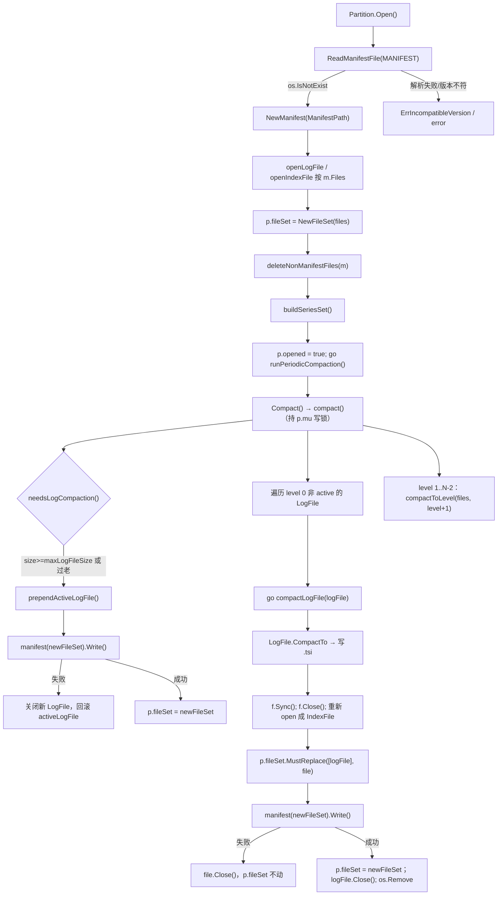
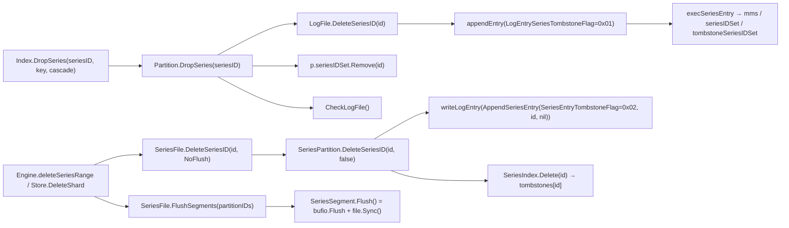
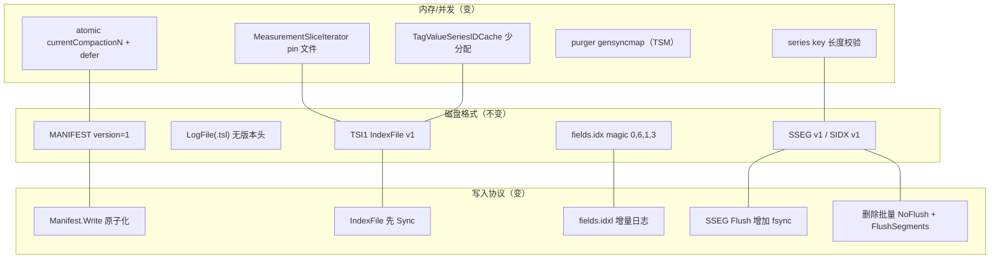

# 版本差异 2: 索引与 Series 子系统（TSI / SeriesFile / fields.idx / key 构建）（v1.8.10 → v1.12.3）

> **版本基线**
> - OLD：`v1.8.10` = commit `688e697c51`（2021-10-11）
> - NEW：`v1.12.3` = commit `f3d5cb68ab`（`docs/specs/` 这批文档的代码基准）
> - 区间：527 commits，602 files，+79,310 / −45,239
> - NEW 当前工作树只额外包含 4 个 docs 提交，代码与 `f3d5cb68ab` 相同
> - 本文范围：`tsdb/index/tsi1/*`、`tsdb/index.go`、`tsdb/series_file.go`、`series_partition.go`、`series_segment.go`、`series_index.go`、`tsdb/internal/fieldsindex.pb.go`、`models/points.go` 的 key 构建部分；并按任务要求旁及 `tsdb/shard.go` 的 `fields.idx` 持久化与 `tsdb/engine/tsm1/file_store.go` 的 purger
> - 配套阅读：[02 索引系统](../02_index_system_spec.md)、[13 Line Protocol 解析器](../13_line_protocol_parser_spec.md)、[14 SeriesFile 深度审计](../14_series_file_deep_dive_spec.md)
> - 文件对应关系：任务清单里的 `measurement.go`/`tag_key.go`/`tag_value.go`/`series.go`/`compact.go` 在两个版本中都不存在，对应逻辑分别在 `measurement_block.go`、`tag_block.go`、`file_set.go`、`index_files.go`；`tsdb/series_index.go` 区间内无代码 diff。

> **小白导读**
> 1. **磁盘格式两年一个字节都没动。** TSI 索引文件（magic `TSI1`）、MANIFEST、SSEG、SIDX、`fields.idx` 的 magic 与 version 全部原地不变。升级 v1.12.3 不需要跑 `buildtsi`，不需要重建索引，旧文件直接打开。
> 2. **变的是"别写坏、别 panic"。** MANIFEST 从"直接覆盖写"改成"临时文件 → fsync → rename"；压缩产物先 `Sync()` 再 `Close()`；manifest 写成功之后才把新文件集换进内存（失败可回滚）；损坏/截断的 series key 与段文件不再越界或 SIGBUS。
> 3. **变的是"锁与分配"。** `.tsl` 日志文件轮转从"只看大小"变成"大小 **或** 年龄（默认 4h）"，空闲分区的旧日志也会被压缩；`LogFile.TagValueIterator` 提前放读锁；series 缓存每次 `Put` 少 3 次字符串分配；删 series 时把"每条一次 flush"合并成"每分区一次 fsync"。
> 4. **fields.idx 换了持久化策略。** 仍是同一个 protobuf（wire 兼容），但字段变更先追加到 `fields.idxl` 变更日志，启动/关闭时再合并回 `fields.idx`，不再每次字段变更都重写整份索引。
> 5. **line protocol 解析器本身没改。** 改的是周边：`Tags.HashKey` 增加 `escapeTags` 参数、订阅侧新增 UTF-8 校验、CSV 输出不再二次转义、`Point` 接口新增 `ForEachField`。

**必答问题索引**

| # | 必答问题 | 结论一句话 | 详见 |
|---|---------|-----------|------|
| 1 | TSI 索引结构/文件格式是否变化（SIDX/SSEG/TSI/MANIFEST/LogFile/IndexFile） | **全部不变**（版本号均为 1），只有写入方式与错误处理变化 | §3.1、§3.2、§5.1 |
| 2 | 并发与性能优化（#26369 / #27255 / #26511 / #27146 / #27177） | TagValueIterator 提前放锁；cache 少分配；压缩记账 defer 化 + atomic；purger 换 `gensyncmap` 缩短临界区 | §3.5–§3.7、§3.14 |
| 3 | 删除/压缩/恢复语义（series 删除、tombstone、LogFile 重放、IndexFile compaction、失败回滚） | TSI 侧删除日志格式不变；删除改批量 fsync；manifest 写失败不再污染内存态；SIDX 重建改为两遍扫描修正 Count | §3.3、§3.4、§3.10、§3.11 |
| 4 | fields.idx 旧格式 → protobuf 的变化与兼容性 | protobuf 消息 wire 兼容，新增 `fields.idxl` 增量日志；`gogo/protobuf` 换成 `google.golang.org/protobuf` | §3.12 |
| 5 | line protocol 解析行为变化 | 解析状态机不变；错误信息/API 有变；订阅拒绝非 UTF-8 点；CSV 输出不转义 | §3.13 |
| 6 | 至少 1 个查询/创建案例、1 个删除案例 | 见 §6.1（创建 + `SHOW MEASUREMENTS`）与 §6.2（`DROP SERIES`/删 shard） | §6 |
| 7 | 升级后是否自动重建/兼容，需要 buildtsi 吗 | 不需要；旧 TSI/SeriesFile 直接可读；只有 inmem→tsi 转换才需要 `buildtsi` | §5.2、§5.3 |

## 1. 结论速览

| # | 变更点 | v1.8.10 | v1.12.3 | 影响 | 证据 |
|---|--------|---------|---------|------|------|
| 1 | TSI IndexFile 版本/magic | `IndexFileVersion=1`、`FileSignature="TSI1"` | 同左，逐字节相同 | 磁盘格式兼容 | `v1.8.10:tsdb/index/tsi1/index_file.go:20`、`v1.12.3:tsdb/index/tsi1/index_file.go:20` |
| 2 | MANIFEST 版本/字段 | `{"levels","files","version":1}` | 同左 | 兼容 | `v1.8.10:tsdb/index/tsi1/partition.go:27`、`v1.12.3:tsdb/index/tsi1/partition.go:28` |
| 3 | MANIFEST 写入方式 | `ioutil.WriteFile(path, buf, 0666)` 覆盖写 | 临时文件 + `Chmod(0644)` + `Write` + `Sync` + `Close` + `Rename` | 崩溃不再产生半截 MANIFEST；权限从 0666 变 0644 | `v1.8.10:tsdb/index/tsi1/partition.go:1303`、`v1.12.3:tsdb/index/tsi1/partition.go:1482-1530` |
| 4 | 压缩后内存态切换 | 先 `p.fileSet = MustReplace(...)`，再写 MANIFEST | 先构造 `newFileSet`、写 MANIFEST 成功后才赋值 `p.fileSet` | MANIFEST 写失败可回滚，不再产生"内存/磁盘不一致" | `v1.8.10:tsdb/index/tsi1/partition.go:1030`、`v1.12.3:tsdb/index/tsi1/partition.go:1195-1211` |
| 5 | 压缩产物落盘 | 直接 `Close()` | `Sync()` 后再 `Close()` | 掉电后不出现"MANIFEST 已引用、内容未落盘"的新文件 | `v1.8.10:tsdb/index/tsi1/partition.go:1011`、`v1.12.3:tsdb/index/tsi1/partition.go:1170` |
| 6 | `.tsl` 轮转条件 | 仅 `Size() < MaxLogFileSize` | `Size() >= maxLogFileSize` **或** `size>0 && modTime < now-maxLogFileAge` | 空闲分区的老日志也会被压缩 | `v1.8.10:tsdb/index/tsi1/partition.go:1072`、`v1.12.3:tsdb/index/tsi1/partition.go:1247` |
| 7 | 周期性压缩 | 启动时 `p.compact()` 一次；此后只在写入路径触发 | `go runPeriodicCompaction()`：启动一次 + 每小时 `NeedsCompaction(true)` | 无写入也会自愈 | `v1.8.10:tsdb/index/tsi1/partition.go:244`、`v1.12.3:tsdb/index/tsi1/partition.go:265,979` |
| 8 | 压缩并发计数 | `int currentCompactionN` + 手动 `++/--` | `atomic.Int32` + `defer` 释放 `levelCompacting` | 压缩 panic 不再永久占住 level | `v1.8.10:tsdb/index/tsi1/partition.go:905-960`、`v1.12.3:tsdb/index/tsi1/partition.go:1053-1073` |
| 9 | TSI 打开失败清理 | 分区并行打开，遇错即返回，已打开分区的文件泄漏 | `errgroup` + `defer i.cleanUpFail(&rErr)` 统一关闭 | 打开失败不泄漏 mmap/fd | `v1.8.10:tsdb/index/tsi1/index.go:245`、`v1.12.3:tsdb/index/tsi1/index.go:255-313` |
| 10 | `LogFile.TagValueIterator` 锁 | `defer f.mu.RUnlock()`，锁跨越整个函数 | 取到 `tk` 后立即 `RUnlock()`；但随后仍在锁外 range `tk.tagValues` | **不是安全优化**：外层查找放锁后仍遍历共享 map，与写路径并发会 fatal，见 §3.6/§7.7 | `v1.8.10:tsdb/index/tsi1/log_file.go:413-427`、`v1.12.3:tsdb/index/tsi1/log_file.go:422-437,1406-1412` |
| 11 | series 缓存 `Put` 分配 | 每个 `name/key/value` 各 `string()` 两次（元素 + map key） | 各 `string()` 一次，元素与 map key 共享底层数组 | 每次 `Put` 少 3 次分配 | `v1.8.10:tsdb/index/tsi1/cache.go:98-140`、`v1.12.3:tsdb/index/tsi1/cache.go:98-147` |
| 12 | 测量名迭代器生命周期 | 返回的 `[][]byte` 指向 mmap，迭代器已 `Close()` | 新增 `MeasurementSliceIterator`/`fileMeasurementSliceIterator`，拷贝完成前 pin 住文件 | 修掉 use-after-unmap 崩溃 | `v1.8.10:tsdb/index.go:1317-1335`、`v1.12.3:tsdb/index.go:1368-1417` |
| 13 | 非法 series key | 直接切片越界 → panic | 各处 `len(name)==0` 跳过；`CompareSeriesKeys` 增加 `nilKeyHandler` | 损坏数据不再打挂进程 | `v1.8.10:tsdb/index.go:135-150`、`v1.12.3:tsdb/index.go:137-145` |
| 14 | SSEG 读取边界 | 按 mmap 长度扫描（可能超过文件真实大小） | `os.Stat` 得真实 `s.size`，循环按 `s.size`；`ReadSeriesEntry` 增加长度检查 | 修掉非标准/截断段文件的 SIGBUS | `v1.8.10:tsdb/series_segment.go:93-135`、`v1.12.3:tsdb/series_segment.go:93-135,426` |
| 15 | SSEG 落盘 | `Flush()` 只 flush bufio | `Flush()` 后 `file.Sync()` | 掉电不丢 series insert/tombstone | `v1.8.10:tsdb/series_segment.go:211`、`v1.12.3:tsdb/series_segment.go:219` |
| 16 | SIDX 重建 | 单遍，`Count=seriesN`（含墓碑），容量按含墓碑数算 | 两遍：先算存活数，若与 `seriesN` 不同则按新容量重建 | SIDX `Count` 变准确；有墓碑时多一遍扫描 | `v1.8.10:tsdb/series_partition.go:568-660`、`v1.12.3:tsdb/series_partition.go:589-665` |
| 17 | SeriesFile 删除落盘 | 每条 `DeleteSeriesID(id)` 都 flush 分段 | `DeleteSeriesID(id, NoFlush)` 批量 + `FlushSegments(partitionIDs)` | 删 shard/删 series 从 O(N) 次 flush 降到 O(分区数) 次 fsync | `v1.8.10:tsdb/store.go:786`、`v1.12.3:tsdb/store.go:1083,1108` |
| 18 | fields.idx 持久化 | 每次 `Save()` 全量重写 `fields.idx` | 追加 `fields.idxl`（size 前缀 + `FieldChangeSet`），启动/关闭时合并 | 字段创建从"重写整份索引"变成"追加一条记录" | `v1.8.10:tsdb/shard.go:1786-1870`、`v1.12.3:tsdb/shard.go:1834-2000` |
| 19 | fields protobuf | `gogo/protobuf` + `internal/meta.proto` | `google.golang.org/protobuf` + `internal/fieldsindex.proto`（新增 `ChangeType`/`MeasurementFieldChange`/`FieldChangeSet`） | 已有消息 wire 兼容；Go 类型生成器变了 | `v1.8.10:tsdb/internal/meta.pb.go:1`、`v1.12.3:tsdb/internal/fieldsindex.pb.go:1` |
| 20 | `_seriesKey` 查询 | 走 `IndexSet.TagSets`，把每个 series 的 key 物化进 `[]*query.TagSet` | `MeasurementSeriesKeyByExprIterator` 流式迭代 | 大 measurement 的 `count(_seriesKey)` 不再一次性占内存 | `v1.8.10:tsdb/engine/tsm1/engine.go:2534`、`v1.12.3:tsdb/index.go:2397` |
| 21 | `SHOW TAG KEYS/VALUES` 授权钩子 | 逐 series 调 `AuthorizeSeriesRead` | 先 `OptimizeSeriesRead`（企业版钩子）+ `AuthorizerIsOpen` 快速路径 | OSS 行为不变，企业版可下推 | `v1.8.10:tsdb/index.go:2774`、`v1.12.3:tsdb/index.go:2974-3001` |
| 22 | 写入统计 | 无 `seriesCreated` | `StatsTracker` 一路传到 `SeriesPartition`，新增 `seriesCreated` 指标 | 可观测性增强 | `v1.8.10:tsdb/series_partition.go:199`、`v1.12.3:tsdb/series_partition.go:200,265-292` |
| 23 | purger 锁 | 单个 `RWMutex` + `map`，持锁执行 `Close/Remove` | `gensyncmap.Map` + 短锁 `running` 标志 | 删除 TSM 文件不再阻塞 `add()` | `v1.8.10:tsdb/engine/tsm1/file_store.go:1376-1435`、`v1.12.3:tsdb/engine/tsm1/file_store.go:1599-1695` |
| 24 | line protocol 周边 | `Tags.HashKey()`/`AppendHashKey(dst)` | 增加 `escapeTags bool`；新增 `NewTagsKeyValues`/`ValidPointStrings`/`ForEachField` | 解析行为不变，Go API 破坏性变更 | `v1.8.10:models/points.go:2141`、`v1.12.3:models/points.go:2211` |

## 2. 变更地图

### 2.1 一个 Partition 的文件生命周期（新版本真实符号）



### 2.2 删除链路（TSI 侧 + SeriesFile 侧）



### 2.3 影响面分层



## 3. 逐项差异

### 3.1 磁盘格式：所有 magic / version 原地不动

先把最容易误判的一点钉死：**v1.8.10 → v1.12.3 没有改任何索引文件的字节布局**。所有"版本号"都还是 1，所有 magic 都还是老值。

| 文件 | 关键常量（新旧相同） | 新旧证据 |
|------|---------------------|----------|
| TSI IndexFile | `IndexFileVersion = 1`、`FileSignature = "TSI1"` | `v1.8.10:tsdb/index/tsi1/index_file.go:20,23`；`v1.12.3:tsdb/index/tsi1/index_file.go:20,23` |
| TSI IndexFile 尾部 | `IndexFileTrailerSize = 82`，最后 2 字节是 `Version`（BigEndian uint16） | `v1.8.10:tsdb/index/tsi1/index_file.go:28-31,418`；`v1.12.3:tsdb/index/tsi1/index_file.go:28-31,418` |
| MeasurementBlock | `MeasurementBlockVersion = 1` | `v1.8.10:tsdb/index/tsi1/measurement_block.go:18`；`v1.12.3:tsdb/index/tsi1/measurement_block.go:18` |
| TagBlock | `TagBlockVersion = 1` | `v1.8.10:tsdb/index/tsi1/tag_block.go:15`；`v1.12.3:tsdb/index/tsi1/tag_block.go:15` |
| MANIFEST | `Version = 1`、`ManifestFileName = "MANIFEST"` | `v1.8.10:tsdb/index/tsi1/partition.go:27,38`；`v1.12.3:tsdb/index/tsi1/partition.go:28,39` |
| LogFile `.tsl` | **没有版本头**，只有 entry 序列；flag `0x01/0x02/0x04/0x08` | `v1.8.10:tsdb/index/tsi1/log_file.go:32-38`；`v1.12.3:tsdb/index/tsi1/log_file.go:32-38` |
| SSEG | `SeriesSegmentVersion = 1`、`SeriesSegmentMagic = "SSEG"`、头 5 字节 | `v1.8.10:tsdb/series_segment.go:18-20`；`v1.12.3:tsdb/series_segment.go:18-20` |
| SIDX | `SeriesIndexVersion = 1`、`SeriesIndexMagic = "SIDX"`、头 69 字节 | `v1.8.10:tsdb/series_index.go:16-17,24-30`；`v1.12.3:tsdb/series_index.go:16-17,24-30` |
| fields.idx | magic `{0,6,1,3}` + `MeasurementFieldSet` protobuf | `v1.8.10:tsdb/shard.go:83,1909`；`v1.12.3:tsdb/shard.go:86,2156` |

具体字节布局（两版一致）：

```text
TSI IndexFile (.tsi)
┌────────────┬──────────────┬──────────────────┬───────────────┬──────────────────────┬──────────────┬─────────┐
│ "TSI1" 4B  │ TagBlock × M │ MeasurementBlock │ SeriesIDSet   │ TombstoneSeriesIDSet │ Sketches     │ Trailer │
│            │              │                  │ (roaring)     │ (roaring)            │ (HLL)        │ 82B     │
└────────────┴──────────────┴──────────────────┴───────────────┴──────────────────────┴──────────────┴─────────┘
                                                                                                        末 2B: Version=1

TSI LogFile (.tsl) —— 无文件头，纯 entry 序列
┌────────┬──────────────────┬────────────────┬───────────────┬────────────────┬──────────────┬───────────────┬──────────────┬──────────────┬───────────────┬─────────────────┐
│ Flag 1B│ SeriesID uvarint │ Name len uvar │ Name          │ Key len uvar   │ Key          │ Value len uvar│ Value        │ CRC32 4B (BE) │ 下一条 entry…  │
└────────┴──────────────────┴────────────────┴───────────────┴────────────────┴──────────────┴───────────────┴──────────────┴──────────────┴───────────────┴─────────────────┘
Flag: 0x01 series tombstone / 0x02 measurement tombstone / 0x04 tag-key tombstone / 0x08 tag-value tombstone

SSEG (series segment)
┌──────────┬─────────┬──────────────────────┬──────────────────────┬─────┐
│ "SSEG" 4B│ Ver 1B  │ Entry: Flag 1B       │ (insert) ID 8B BE    │ …   │
│          │         │                      │ + KeyLen uvar + Key  │     │
│          │         │ (tombstone) ID 8B BE │ 无 key（共 9B）      │     │
└──────────┴─────────┴──────────────────────┴──────────────────────┴─────┘
```

代码上唯一"看起来像格式变化"的，是 `IndexFile.UnmarshalBinary` 的两个错误从裸 `io.ErrShortBuffer` / `ErrInvalidIndexFile` 变成带路径的 `fmt.Errorf("%q: %w", f.path, err)`（`v1.8.10:tsdb/index/tsi1/index_file.go:170-213`；`v1.12.3:tsdb/index/tsi1/index_file.go:170-213`）；另外 `bytes()`/`Compacting()` 改用 `defer` 释放，避免中途 panic 漏 `Done`/`Unlock`（旧版已手动 `wg.Done()`，`v1.8.10:tsdb/index/tsi1/index_file.go:104`；新版 `v1.12.3:tsdb/index/tsi1/index_file.go:85-86`）。

> 结论：**升级不触发任何索引重建**。这也是 §5 兼容性结论的基础。

### 3.2 MANIFEST：从"覆盖写"到"临时文件 + fsync + rename"

MANIFEST 是分区唯一的元数据文件。旧版用 `ioutil.WriteFile` 直接截断目标文件再写：

```go
// v1.8.10:tsdb/index/tsi1/partition.go:1296-1310 — (*Manifest).Write
buf, err := json.MarshalIndent(m, "", "  ")
if err != nil {
    return 0, err
}
buf = append(buf, '\n')

if err := ioutil.WriteFile(m.path, buf, 0666); err != nil {
    return 0, err
}

return int64(len(buf)), nil
```

新版改成写临时文件，`fsync` 后原子 `rename`：

```go
// v1.12.3:tsdb/index/tsi1/partition.go:1482-1530 — (*Manifest).Write
f, err := os.CreateTemp(filepath.Dir(m.path), ManifestFileName)
if err != nil {
    return 0, err
}
defer os.Remove(tmp)          // ← 注意：此处 tmp 仍为 ""，见 §7.1

err = func() (rErr error) {
    defer errors2.Capture(&rErr, f.Close)()   // Windows 要求 rename 前先 close
    tmp = f.Name()
    if err = f.Chmod(0644); err != nil {      // 旧版是 0666
        return fmt.Errorf("failed setting permissions on manifest file %q: %w", tmp, err)
    }
    if _, err = f.Write(buf); err != nil { … }
    if err = f.Sync(); err != nil { … }
    return nil
}()
if err != nil {
    return 0, err
}
if err = os.Rename(tmp, m.path); err != nil {
    return 0, err
}
```

要点：

1. **原子性**：`rename` 之前目标路径始终是旧 MANIFEST（完整可读）。旧版在写一半时崩溃会留下截断的 JSON，下次 `ReadManifestFile` 反序列化失败，分区直接打不开。
2. **权限收紧**：`0666`（受 umask 影响通常 0644/0664）→ 显式 `0644`。对应提交 #24235 "prevent world-writable MANIFEST files"。
3. **Windows 兼容**：先 `Close` 再 `Rename`。
4. 未变：`ReadManifestFile` 的 JSON 解码、`Validate()` 的 `Version != 1 → ErrIncompatibleVersion`（新版只是把路径塞进错误串，`v1.12.3:tsdb/index/tsi1/partition.go:1471-1480`）。

顺带一个**行为变化**：`Manifest()` 不再从 `p.fileSet` 现取，而是新增 `p.manifest(newFileSet)`，允许用"尚未安装的新文件集"生成清单。这正是下一节回滚机制的基础。

### 3.3 压缩失败回滚：内存态与磁盘 MANIFEST 的先后顺序反了

旧版在写 MANIFEST **之前**就把新文件集换进内存：

```go
// v1.8.10:tsdb/index/tsi1/partition.go:1027-1042 — compactToLevel 收尾
p.mu.Lock()
defer p.mu.Unlock()

// Replace previous files with new index file.
p.fileSet = p.fileSet.MustReplace(IndexFiles(files).Files(), file)

// Write new manifest.
manifestSize, err := p.Manifest().Write()
if err != nil {
    // TODO: Close index if write fails.
    return err
}
p.manifestSize = manifestSize
```

新版把顺序倒过来，并用 `newFileSet` 暂存：

```go
// v1.12.3:tsdb/index/tsi1/partition.go:1192-1212 — compactToLevel 收尾
p.mu.Lock()
defer p.mu.Unlock()

newFileSet := p.fileSet.MustReplace(IndexFiles(files).Files(), file)

manifestSize, err := p.manifest(newFileSet).Write()
defer errors2.Capture(&rErr, func() error {
    if rErr != nil {
        file.Close()          // manifest 写失败：关掉新产物，内存态保持旧文件集
    }
    return rErr
})()
if err != nil {
    return fmt.Errorf("manifest file write failed compacting index %q: %w", p.ManifestPath(), err)
}
p.manifestSize = manifestSize
p.fileSet = newFileSet       // 只有这里之后，新文件集才生效
```

同一模式复制到三条路径：

| 路径 | v1.8.10 | v1.12.3 |
|------|---------|---------|
| 轮转 active log | `p.fileSet = PrependLogFile(f)` 后写 MANIFEST（`tsdb/index/tsi1/partition.go:473-480`） | 先 `newFileSet := p.fileSet.PrependLogFile(f)`，MANIFEST 成功后才 `p.fileSet = newFileSet`，失败恢复 `p.activeLogFile = oldActiveFile` 并 `f.Close()`（`tsdb/index/tsi1/partition.go:528-557`） |
| LogFile → IndexFile | 先 `MustReplace` 再 `Manifest().Write()`（`tsdb/index/tsi1/partition.go:1175-1182`） | 先 `manifest(newFileSet).Write()`，失败 `file.Close()`（`tsdb/index/tsi1/partition.go:1352-1370`） |
| IndexFile → IndexFile | 见上（`tsdb/index/tsi1/partition.go:1030`） | 见上（`tsdb/index/tsi1/partition.go:1195-1211`） |

另外新版在两处产物关闭前补了 `Sync()`：

```go
// v1.12.3:tsdb/index/tsi1/partition.go:1170-1176 （IndexFile 压缩）
if err = f.Sync(); err != nil {
    log.Error("Error sync index file", zap.Error(err))
    return
}
// v1.12.3:tsdb/index/tsi1/partition.go:1327-1332 （LogFile 压缩）
if err = f.Sync(); err != nil {
    log.Error("Cannot sync index file", zap.Error(err))
    return
}
```

旧版对应的 `v1.8.10:tsdb/index/tsi1/partition.go:995-1015` / `:1145-1160` 只有 `defer f.Close()` + `Close()`，没有 `Sync`。

**语义影响**：崩溃恢复时"MANIFEST 引用的文件一定已经把内容刷到盘上"这条不变式，从"依赖文件系统运气"变成"显式保证"。失败的压缩不再需要人工介入——内存仍然指向旧文件，旧文件也没被删除（删除发生在 MANIFEST 成功之后，见 `v1.12.3:tsdb/index/tsi1/partition.go:1227-1243`）。

### 3.4 LogFile 轮转：从"只看大小"到"大小或年龄"，并新增周期性巡检

这是运维体感最明显的一条。旧版只在写入路径检查 `.tsl` 大小：

```go
// v1.8.10:tsdb/index/tsi1/partition.go:1072-1110 — CheckLogFile / checkLogFile
// CheckLogFile：RLock 读 activeLogFile.Size()，size < p.MaxLogFileSize 即返回 nil（唯一条件）
// checkLogFile（持 p.mu 写锁）：再次判大小 → prependActiveLogFile()
//   → currentCompactionN++ → go func(){ compactLogFile(logFile); 计数-1; p.Compact() }()
```

新版把判定抽成 `needsLogCompaction()`，条件变成"超过大小 **或** 文件非空且年龄超过阈值"：

```go
// v1.12.3:tsdb/index/tsi1/partition.go:1247-1251
func (p *Partition) needsLogCompaction() bool {
    size := p.activeLogFile.Size()
    modTime := p.activeLogFile.ModTime()
    return size >= p.maxLogFileSize || (size > 0 && modTime.Before(time.Now().Add(-p.maxLogFileAge)))
}
```

`maxLogFileAge` 从哪来？直接复用 TSM 的 `compact-full-write-cold-duration`（默认 4h）：

```go
// v1.12.3:tsdb/index/tsi1/index.go:44-48 — newIndexFuncs["tsi1"]
idx := NewIndex(sfile, db,
    WithPath(path),
    WithMaximumLogFileSize(int64(opt.Config.MaxIndexLogFileSize)),
    WithMaximumLogFileAge(time.Duration(opt.Config.CompactFullWriteColdDuration)),
    WithSeriesIDCacheSize(opt.Config.SeriesIDSetCacheSize),
)
// v1.12.3:tsdb/config.go:38
DefaultCompactFullWriteColdDuration = time.Duration(4 * time.Hour)
```

旧版没有 `maxLogFileAge` 字段（`v1.8.10:tsdb/index/tsi1/index.go:136,164` 只有 `maxLogFileSize`）。

更关键的是**触发时机**：

```go
// v1.8.10:tsdb/index/tsi1/partition.go:241-244 — Open 收尾
p.opened = true
p.compact()
```

```go
// v1.12.3:tsdb/index/tsi1/partition.go:262-265,979-1001
p.opened = true
go p.runPeriodicCompaction()   // 启动先 Compact()；之后每小时 t.C 时若 NeedsCompaction(true) 才 Compact()

func (p *Partition) NeedsCompaction(checkRunning bool) bool {
    if p.needsLogCompaction() { return true }        // 大小或年龄
    // 否则：L0..Lmax 任一 level 的文件数 > 1，且该 level 未在压缩中
}
```

配合 `compact()` 新增的 level-0 扫描，旧版"只有刚被轮转的那一个 log 文件会被压缩"变成"所有非 active 的 L0 文件都会被压缩"：

```go
// v1.12.3:tsdb/index/tsi1/partition.go:1043-1073 — compact() 的 L0 分支
if p.needsLogCompaction() {
    if err := p.prependActiveLogFile(); err != nil {
        p.logger.Error("failed to retire active log file", zap.Error(err))
    }
}
for _, f := range p.fileSet.files {
    if f.Level() == 0 {
        logFile := f.(*LogFile)      // 不变式：level 0 ⟺ LogFile
        if logFile == p.activeLogFile { continue }
        if p.levelCompacting[0] { break }
        p.levelCompacting[0] = true
        p.currentCompactionN.Add(1)
        go func() {
            defer func() {
                p.mu.Lock()
                p.currentCompactionN.Add(-1)
                p.levelCompacting[0] = false
                p.mu.Unlock()
                p.Compact()
            }()
            p.compactLogFile(logFile)
        }()
    }
}
```

对应的两个 PR 分工不同：#21943（`b64c2c3dcf`）= 年龄/大小阈值 + 每小时巡检 + `needsLogCompaction` 里的 `size > 0`；#22006（`e62efaf751`，+8 行）= `compact()` 启动时也轮转 active log，并补 manifest 写失败日志。

**语义影响**：
- 一个长时间没有写入的 shard，其 `.tsl` 最多 1 小时后（巡检周期）开始按 4h 冷阈值被压缩成 `.tsi`，查询不再需要合并越来越大的内存 LogFile。
- 升级后短期内会看到一批"TSI level compaction"日志和磁盘写入，这是预期行为，不是损坏。
- 反方向：`compact-full-write-cold-duration` 从此同时影响 TSM 与 TSI；把它调小会同时增加两类压缩压力。

### 3.5 压缩记账：`atomic.Int32` + `defer` 释放（#26511）

旧版在 goroutine 尾部手动递减计数并清 `levelCompacting`；一旦 `compactToLevel` / `compactLogFile` 内部 panic（例如 mmap 数据异常），`levelCompacting[level]` 永远为 true，该 level 从此再也不压缩。

```go
// v1.8.10:tsdb/index/tsi1/partition.go:940-955 — compact() 里的 level 循环
p.currentCompactionN++
go func() {
    p.compactToLevel(files, level+1, interrupt)

    // Ensure compaction lock for the level is released.
    p.mu.Lock()
    p.levelCompacting[level] = false
    p.currentCompactionN--
    p.mu.Unlock()

    p.Compact()
}()
```

```go
// v1.12.3:tsdb/index/tsi1/partition.go:1102-1118
p.currentCompactionN.Add(1)
go func() {
    defer func() {                       // ← panic 也会执行
        p.mu.Lock()
        p.levelCompacting[level] = false
        p.currentCompactionN.Add(-1)
        p.mu.Unlock()
        p.Compact()
    }()
    p.compactToLevel(files, level+1, interrupt)
}()
```

同时：

| 变化 | v1.8.10 | v1.12.3 |
|------|---------|---------|
| 计数器类型 | `int`，读写都靠 `p.mu`（`tsdb/index/tsi1/partition.go:62`） | `atomic.Int32`，`CurrentCompactionN()` 无锁读（`tsdb/index/tsi1/partition.go:66,352-354`） |
| `Wait()` | 每 10ms 轮询，无任何诊断（`:335-345`） | 超过 24h 打 `Warn`，打印卡住的压缩数与文件列表（`:358-386`） |
| `Compact()` 前置条件 | 注释未声明 | 注释明确"requires mu write-locked"（`:1030`） |

注意 `Wait()` 只是**加日志**，并不会解除阻塞；如果压缩真的卡死，`Close()` 仍然会挂住。见 §7.4。

### 3.6 `LogFile.TagValueIterator` 提前释放读锁（#26369）

旧版把 `RUnlock` 交给 `defer`，读锁一直持有到函数返回（包括构造迭代器的过程）：

```go
// v1.8.10:tsdb/index/tsi1/log_file.go:413-425
func (f *LogFile) TagValueIterator(name, key []byte) TagValueIterator {
    f.mu.RLock()
    defer f.mu.RUnlock()

    mm, ok := f.mms[string(name)]
    if !ok { return nil }
    tk, ok := mm.tagSet[string(key)]
    if !ok { return nil }
    return tk.TagValueIterator()
}
```

```go
// v1.12.3:tsdb/index/tsi1/log_file.go:422-437
func (f *LogFile) TagValueIterator(name, key []byte) TagValueIterator {
    f.mu.RLock()
    mm, ok := f.mms[string(name)]
    if !ok {
        f.mu.RUnlock()
        return nil
    }
    tk, ok := mm.tagSet[string(key)]
    if !ok {
        f.mu.RUnlock()
        return nil
    }
    f.mu.RUnlock()
    return tk.TagValueIterator()
}
```

语义上（**这是 v1.12.3 的并发回归，不能称为"安全优化"**）：

- `logTagKey` 是值类型，但内含 `tagValues map[string]logTagValue`（`v1.12.3:tsdb/index/tsi1/log_file.go:1385-1389`）。`tk := mm.tagSet[key]` 只复制 map header，`tk.tagValues` 与 `mm.tagSet[key].tagValues` 是**同一个 hmap**。
- `tk.TagValueIterator()` 的实现是 `for _, v := range tk.tagValues`（`:1406-1412`），而调用点已在 `:436` 处 `RUnlock`、`:437` 才调用；遍历因此发生在锁外。
- 写路径 `Writes` 持 `f.mu.Lock()`（`:1090-1102`），`execSeriesEntry` 执行 `ts.tagValues[string(v)] = tv`（`:749`）；`AddSeriesList` 同样持写锁。两者并发时 runtime 直接抛 `fatal error: concurrent map iteration and map write`（不可 recover，见 §7.7）。
- 结论：本次改动只缩短了 `f.mms`/`mm.tagSet` 外层查找的锁持有时间，`tagValues` 的 range 仍在锁外。上游修复方向：把 `TagValueIterator()` 移回 `RLock` 内，或新增锁内 `[]logTagValue` 拷贝后再解锁。

### 3.7 series 缓存字符串分配（#27255 / #27257）

`TagValueSeriesIDCache.Put` 的 key 是 `(name,key,value)` 三元组。旧版在"判断是否已存在"和"插入 map"两处分别做 `string(name)` 等转换，Go 编译器只能在**查找**时省掉分配，插入时仍要各分配一次：

```go
// v1.8.10:tsdb/index/tsi1/cache.go:98-140
func (c *TagValueSeriesIDCache) Put(name, key, value []byte, ss *tsdb.SeriesIDSet) {
    c.Lock()
    if c.exists(name, key, value) {          // exists 内部 string(name)/string(key)/string(value)
        c.Unlock()
        return
    }
    ...
    listElement := c.evictor.PushFront(&seriesIDCacheElement{
        name:        string(name),           // 分配 1
        key:         string(key),            // 分配 2
        value:       string(value),          // 分配 3
        SeriesIDSet: ss,
    })
    if mmap, ok := c.cache[string(name)]; ok {          // 插入时再分配 4
        if tkmap, ok := mmap[string(key)]; ok {         // 分配 5
            tkmap[string(value)] = listElement          // 分配 6
            ...
```

新版先转换一次，map key 与 LRU 元素共享同一份字符串底层数组：

```go
// v1.12.3:tsdb/index/tsi1/cache.go:98-147
func (c *TagValueSeriesIDCache) Put(name, key, value []byte, ss *tsdb.SeriesIDSet) {
    c.Lock()
    // Convert once; the same string backing array is shared between
    // the cache element (used during eviction) and the map keys.
    nameStr := string(name)
    keyStr := string(key)
    valueStr := string(value)
    if c.exists(nameStr, keyStr, valueStr) {   // 签名改为 string，零转换
        c.Unlock()
        return
    }
    ...
    listElement := c.evictor.PushFront(&seriesIDCacheElement{
        name: nameStr, key: keyStr, value: valueStr, SeriesIDSet: ss,
    })
    ...
    tkmap[valueStr] = listElement
```

调用点没有变，仍是 `Index.TagValueSeriesIDIterator` 未命中缓存且结果是 `SeriesIDSetIterator` 时写入：

```go
// v1.12.3:tsdb/index/tsi1/index.go:1087-1095
if i.tagValueCacheSize == 0 { return itr, nil }
if ssitr, ok := itr.(tsdb.SeriesIDSetIterator); ok {
    ss := ssitr.SeriesIDSet()
    i.tagValueCache.Put(name, key, value, ss)
}
```

**收益**：每次 `Put` 少 3 次 `string([]byte)` 分配（`exists` 一侧的转换在查找时本就可被编译器优化掉），在"新 tag value 第一次被查询"的高基数场景里直接减少 GC 压力。没有改变缓存语义（容量、命中 clone、未命中 Merge 全部照旧，见 [02 索引系统 §2.1a](../02_index_system_spec.md)）。

### 3.8 测量名迭代器生命周期：修掉 use-after-unmap（#22040）

这是本范围里最"惊险"的一个正确性修复。旧版 `MeasurementNamesByExpr` 的调用链是：

1. `measurementNamesByTagFilter` 在内部 `defer mitr.Close()`，把 `e.Name()`（指向 `IndexFile` mmap 的切片）追加进 `names` 后返回；
2. 返回时 `mitr.Close()` 执行 → `IndexFile.Close()` → `mmap.Unmap`；
3. 外层 `MeasurementNamesByExpr` 这时才 `slices.CopyChunkedByteSlices(names, 1000)` 去读那些指针。

```go
// v1.8.10:tsdb/index.go:1317-1335 — MeasurementNamesByExpr
if expr != nil {
    names, err := is.measurementNamesByExpr(auth, expr)
    if err != nil {
        return nil, err
    }
    return slices.CopyChunkedByteSlices(names, 1000), nil   // 此时 mmap 已被 Unmap
}
```

```go
// v1.8.10:tsdb/index.go:1572-1697 — measurementNamesByTagFilter
mitr, err := is.measurementIterator()
...
defer mitr.Close()           // ← 函数返回即 Unmap
var names [][]byte
for {
    me, err := mitr.Next()
    ...
    names = append(names, me)   // me 指向 mmap
}
return names, nil
```

新版引入 `MeasurementSliceIterator` 与 `fileMeasurementSliceIterator`，把"底层文件迭代器"和"名字切片"绑在同一个对象上，**拷贝完成之后**才 `Close`：

```go
// v1.12.3:tsdb/index.go:961-1015
type MeasurementSliceIterator interface {
    MeasurementIterator
    UnderlyingSlice() [][]byte
}

type fileMeasurementSliceIterator struct {
    measurementSliceIterator
    fileIterators MeasurementIterators
}

func (itr *fileMeasurementSliceIterator) Close() error {
    e1 := itr.fileIterators.Close()
    e2 := itr.measurementSliceIterator.Close()
    ...
}
```

```go
// v1.12.3:tsdb/index.go:1368-1417 — MeasurementNamesByExpr
itr, returnErr := is.measurementNamesByExpr(auth, expr)
...
defer func() {
    if e := itr.Close(); err == nil { err = e }   // 注意：defer 在 return 值算完之后执行
}()
return slices.CopyChunkedByteSlices(itr.UnderlyingSlice(), 1000), nil
```

细节：`return slices.CopyChunkedByteSlices(...)` 会先求值返回值，再执行 `defer`，所以拷贝一定发生在 `Close()`（Unmap）之前。同一修复覆盖 `MeasurementNamesByExpr`、`MeasurementNamesByPredicate`、`measurementNamesByNameFilter`、`measurementNamesByTagFilter`、`measurementNamesByTagPredicate`；`measurementNamesByTagFilter` 还加了 `failed` 标志，只有失败路径才提前 `Close`（`v1.12.3:tsdb/index.go:1648-1662`）。

**触发场景**：`SHOW MEASUREMENTS WITH MEASUREMENT =~ /.../` 或 `SHOW MEASUREMENTS WHERE tag='v'` 命中一个正在被压缩/关闭的 shard 时，旧版可能读到已 `munmap` 的地址 → SIGSEGV 或读到垃圾名字。新版不会。

### 3.9 series key / SSEG 的边界防御（#24565、#24509）

**(a) 非法 series key 不再 panic。** `ParseSeriesKey` 的返回值如果 `name` 为空，旧版后续 `models.MakeKey(name, tags)` / 授权检查会踩空。新版在 `index.go` 的多个消费点跳过（`tsdb/series_cursor.go:115-118` 返回 error，`tsdb/series_partition.go:265-275` 为 `continue`）：

```go
// v1.12.3:tsdb/index.go:137-145 — seriesIteratorAdapter.Next
name, tags := ParseSeriesKey(key)
if len(name) == 0 {
    continue
}
```

同类检查出现在 `seriesQueryAdapterIterator.Next`（`:384-390`）、`seriesPointIterator.Next`（`:873-879`）、`measurementSeriesKeyByExprIterator.Next`（`:2349-2355`）、`MeasurementSeriesKeysByExpr`（`:2454-2460`）；`parseSeriesKey` 自身也加了空 buffer 保护：

```go
// v1.12.3:tsdb/series_file.go:448-455
_, data = ReadSeriesKeyLen(data)
if len(data) == 0 {
    return nil, dst
}
name, data = ReadSeriesKeyMeasurement(data)
```

`CompareSeriesKeys` 则把"空 key / key 长度字段 ≤1"统一交给 `nilKeyHandler`：

```go
// v1.12.3:tsdb/series_file.go:474-497
nilKeyHandler := func(a, b int) int {
    if a == 0 && b == 0 { return 0 }
    else if a == 0 { return -1 }
    else if b == 0 { return 1 }
    return a + b
}
keyValidity := nilKeyHandler(len(a), len(b))
if keyValidity <= 1 { return keyValidity }
szA, a := ReadSeriesKeyLen(a)
szB, b := ReadSeriesKeyLen(b)
keySizeValidity := nilKeyHandler(szA, szB)
if keySizeValidity <= 1 { return keySizeValidity }
```

旧版只有最外层的 `len(a)==0` 判断，然后直接 `ReadSeriesKeyLen`（`v1.8.10:tsdb/series_file.go:437-455`）。

**(b) 截断的 SSEG 不再 SIGBUS。** 这是 #24509 的核心。`mmap.Map(path, SeriesSegmentSize(id))` 会按"该 segment 应有的容量"（4MB→256MB）映射，即使文件实际比它短；访问超出 EOF 的页会触发 SIGBUS。旧版用 `len(s.data)`（= 映射长度）做循环上界：

```go
// v1.8.10:tsdb/series_segment.go:122-135 — InitForWrite
for s.size = uint32(SeriesSegmentHeaderSize); s.size < uint32(len(s.data)); {
    flag, _, _, sz := ReadSeriesEntry(s.data[s.size:])
    ...
}
// v1.8.10:tsdb/series_segment.go:243-250 — ForEachEntry
for pos := uint32(SeriesSegmentHeaderSize); pos < uint32(len(s.data)); {
```

新版先用 `os.Stat` 拿到真实大小，循环按 `s.size` 截断：

```go
// v1.12.3:tsdb/series_segment.go:93-101
st, err := os.Stat(s.path)
if err != nil {
    return fmt.Errorf("cannot stat %s: %w", s.path, err)
}
s.size = uint32(st.Size())
...
// v1.12.3:tsdb/series_segment.go:128-140
var size uint32
for size = uint32(SeriesSegmentHeaderSize); size < s.size; {
    flag, _, _, sz := ReadSeriesEntry(s.data[size:s.size])
```

`ReadSeriesEntry` 也补了最小长度检查：

```go
// v1.12.3:tsdb/series_segment.go:426-440
func ReadSeriesEntry(data []byte) (flag uint8, id uint64, key []byte, sz int64) {
    if len(data) <= 0 { return 0, 0, nil, 1 }
    flag, data = uint8(data[0]), data[1:]
    if !IsValidSeriesEntryFlag(flag) { return 0, 0, nil, 1 }
    if len(data) < 8 { return 0, 0, nil, 1 }
    ...
```

**残留问题**：`ReadSeriesEntry` 仍然直接用 `ReadSeriesKey(data)`，而 `ReadSeriesKey` 是无边界检查的 `data[:int(sz)+n]`（`v1.12.3:tsdb/series_file.go:403-406`）。如果 SSEG 里的 key 长度字段本身被写坏（而不是文件被截短），仍会 slice out of range。见 §7.2。

**(c) 段文件落盘。** `SeriesSegment.Flush()` 从"只 flush bufio"变成"flush + fsync"：

```go
// v1.12.3:tsdb/series_segment.go:219-227
if err := s.w.Flush(); err != nil { return err }
return s.file.Sync()
```

对应 #22566 "sync series segment to disk after writing"（`b4e781eff6`）。影响：`FlushSegments` 之后的 tombstone/insert 真正持久化。代价**同时**落在删除与写入两条路径：

- 删除：每个涉及删除的分区在批末 fsync 一次（≤8），见 §3.11.1。
- 写入：`SeriesFile.CreateSeriesListIfNotExists` 对 8 个分区全部下发（`tsdb/series_file.go:181-197`），`SeriesPartition.CreateSeriesListIfNotExists` 在"本分区确有新 series"时于写锁内 `segment.Flush()`（`tsdb/series_partition.go:219-222,232-238,278-283`）；v1.12.3 的 `Flush` 含 `file.Sync()`（`tsdb/series_segment.go:219-227`）。因此**每个创建了新 series 的写请求**最多产生 8 次 fsync（每个收到新 series 的分区一次），纯重复写为 0。§3.11 的 `NoFlush + FlushSegments` 只优化删除路径，**无法抵消写路径**。

### 3.10 LogFile 重放、写入原子性与 TSI 打开失败清理

**(a) 重放语义完全不变。** 新版 `LogFile.open()` 与旧版逐行等价：顺序读 entry → `execEntry` → 遇到 `io.ErrShortBuffer` 或 `ErrLogEntryChecksumMismatch` 停止 → `f.size = n` 并 `Seek(n)`（即逻辑截断到最后一条完整 entry）。唯一变化是错误比较用 `errors.Is` 且错误串带路径：

```go
// v1.8.10:tsdb/index/tsi1/log_file.go:150-170
if err := e.UnmarshalBinary(buf); err == io.ErrShortBuffer || err == ErrLogEntryChecksumMismatch {
    break
} else if err != nil {
    return err
}
```

```go
// v1.12.3:tsdb/index/tsi1/log_file.go:153-165
if err := e.UnmarshalBinary(buf); errors.Is(err, io.ErrShortBuffer) || errors.Is(err, ErrLogEntryChecksumMismatch) {
    break
} else if err != nil {
    return fmt.Errorf("%q: %w", f.path, err)
}
```

`execSeriesEntry` 额外加了空 buffer 保护（`v1.12.3:tsdb/index/tsi1/log_file.go:715-719`），避免损坏 entry 让重放 panic。

**(b) 写入 + flush 在同一把锁内（#25182）。** 旧版 `Writes` 调用 `ExecEntries`（锁内追加），返回后再 `FlushAndSync()`（锁外），与另一写入者的 `appendEntry` 存在竞态：

```go
// v1.8.10:tsdb/index/tsi1/log_file.go:1076-1097
func (f *LogFile) ExecEntries(entries []LogEntry) error {
    f.mu.Lock()
    defer f.mu.Unlock()
    for i := range entries { ... f.appendEntry(entry); f.execEntry(entry) }
    return nil
}

func (f *LogFile) Writes(entries []LogEntry) error {
    if err := f.ExecEntries(entries); err != nil {
        return err
    }
    // Flush buffer and sync to disk.
    return f.FlushAndSync()
}
```

```go
// v1.12.3:tsdb/index/tsi1/log_file.go:1090-1106
func (f *LogFile) Writes(entries []LogEntry) error {
    f.mu.Lock()
    defer f.mu.Unlock()

    for i := range entries {
        entry := &entries[i]
        if err := f.appendEntry(entry); err != nil { return err }
        f.execEntry(entry)
    }
    // Flush buffer and sync to disk.
    return f.FlushAndSync()
}
```

`ExecEntries` 被合并回 `Writes`（两版都是生产路径：v1.8.10 的 `Writes` 内部就是调它），外部调用者需改用 `Writes`。

**(c) 打开失败要能完整回收（#23430 / #23462）。** 旧版 `Index.Open` 用自建 worker 池 + `errC`，任一分区失败就立即返回，已打开的分区不会被关闭：

```go
// v1.8.10:tsdb/index/tsi1/index.go:270-300 — 自建 worker 池 + errC
for i := 0; i < partitionN; i++ {
    if err := <-errC; err != nil {
        return err        // ← 其余分区可能已经打开并持有 mmap，无人关闭
    }
}

// v1.12.3:tsdb/index/tsi1/index.go:284-313 — errgroup + 统一回收
g := new(errgroup.Group); g.SetLimit(n)
for idx := 0; idx < partitionN; idx++ { g.Go(i.partitions[idx].Open) }
err := g.Wait()
defer i.cleanUpFail(&rErr)     // 失败 → i.close() 关闭所有已打开分区
```

分区内部也加了同样的保护：`Partition.Open` 用 `defer func(){ if rErr != nil { Files(files).Close() } }()`（`v1.12.3:tsdb/index/tsi1/partition.go:206-214`）；`TagValueSeriesIDIterator` 在分区查询出错时先关掉已收集的迭代器（`v1.12.3:tsdb/index/tsi1/index.go:1076-1082`，即 #23462）。

### 3.11 删除与 SIDX 重建

#### 3.11.1 SeriesFile 删除：从"每条都 bufio flush"到"批量写 + 每分区一次 fsync"

旧版 `SeriesFile.DeleteSeriesID(id)` 没有 flush 参数，`SeriesPartition.DeleteSeriesID` 每次都会 `segment.Flush()`：

```go
// v1.8.10:tsdb/series_file.go:198-204
func (f *SeriesFile) DeleteSeriesID(id uint64) error {
    p := f.SeriesIDPartition(id)
    if p == nil { return ErrInvalidSeriesPartitionID }
    return p.DeleteSeriesID(id)
}

// v1.8.10:tsdb/series_partition.go:317-345
if segment := p.activeSegment(); segment != nil {
    if err := segment.Flush(); err != nil { return err }
}
p.index.Delete(id)
```

新版把 flush 决策上移：

```go
// v1.12.3:tsdb/series_file.go:203-211
func (f *SeriesFile) DeleteSeriesID(id uint64, flush bool) (*SeriesPartition, error) {
    p := f.SeriesIDPartition(id)
    if p == nil { return nil, ErrInvalidSeriesPartitionID }
    return p, p.DeleteSeriesID(id, flush)
}

// v1.12.3:tsdb/series_file.go:214-242 — FlushSegments
for id := range partitionIDs {          // 只有本次涉及删除的分区
    p := f.partitions[id]
    go func() { p.mu.Lock(); defer p.mu.Unlock()
        if segment := p.activeSegment(); segment != nil { segment.Flush() }  // 含 file.Sync()
    }()
}
return errors.Join(errs...)
```

调用方全部改成批量：

| 调用点 | v1.8.10 | v1.12.3 |
|--------|---------|---------|
| 删除 shard | `sfile.DeleteSeriesID(id)`（返回值被忽略，`tsdb/store.go:786`） | `p, err := sfile.DeleteSeriesID(id, NoFlush)` 收集 `partitionIDs`，最后 `sfile.FlushSegments(partitionIDs)`（`tsdb/store.go:1083,1108`） |
| `DROP SERIES`/`DELETE` 清空 shard | `e.sfile.DeleteSeriesID(id)`（`tsdb/engine/tsm1/engine.go:1814`） | `e.sfile.DeleteSeriesID(id, tsdb.NoFlush)` + `FlushSegments`（`tsdb/engine/tsm1/engine.go:1858,1878`） |

语义影响：
- tombstone 仍然"先写 SSEG、再改内存 `SeriesIndex.tombstones`"（`v1.12.3:tsdb/series_partition.go:334-364`），只是 fsync 推迟到批末。
- 旧版 `SeriesSegment.Flush()` 只有 `s.w.Flush()`（`v1.8.10:tsdb/series_segment.go:211-216`），删除路径 **fsync = 0**；新版在 `FlushSegments` 批末对每个涉及删除的分区 fsync 一次（`tsdb/series_file.go:214-242`，≤8）→ **0 → ≤8**，是持久性增强，代价是批末同步延迟。
- 崩溃窗口从旧版的"所有尚未回写磁盘的 tombstone"缩小到"最后一批未 fsync 的 tombstone"。这是**有意的取舍**（#27114/#27129 "fsync delay for retention deletion"）：删 shard 时整个目录随后会被 `os.RemoveAll`，单条删除是幂等的。若业务要求"删除立即持久"，不能依赖默认路径。

#### 3.11.2 SIDX 重建：两遍扫描修正 Count 与容量（#23916）

旧版 `compactIndexTo` 用调用方传入的 `seriesN` 直接定 `hdr.Count` 与 `hdr.Capacity`，但 `seriesN` 含墓碑：

```go
// v1.8.10:tsdb/series_partition.go:568-600
hdr := NewSeriesIndexHeader()
hdr.Count = seriesN
hdr.Capacity = pow2((int64(hdr.Count) * 100) / SeriesIndexLoadFactor)
keyIDMap := make([]byte, (hdr.Capacity * SeriesIndexElemSize))
idOffsetMap := make([]byte, (hdr.Capacity * SeriesIndexElemSize))
...
if index.IsDeleted(id) {
    return nil       // 跳过墓碑，但 hdr.Count 已经把它算进去了
}
```

新版用"先数、再按真实数量重建"的两遍循环：

```go
// v1.12.3:tsdb/series_partition.go:589-665
hdr.Count = math.MaxUint64
seriesCount := seriesN
for {
    seriesN = seriesCount
    seriesCount = uint64(0)
    hdr.Capacity = pow2((int64(seriesN) * 100) / SeriesIndexLoadFactor)
    keyIDMap = make([]byte, hdr.Capacity*SeriesIndexElemSize)
    idOffsetMap = make([]byte, hdr.Capacity*SeriesIndexElemSize)
    ...
            if index.IsDeleted(id) { return nil }
            seriesCount++
            c.insertIDOffsetMap(idOffsetMap, hdr.Capacity, id, offset)
            return c.insertKeyIDMap(keyIDMap, hdr.Capacity, segments, key, offset, id)
    ...
    hdr.Count = seriesCount
    if seriesN != seriesCount {
        continue        // 有墓碑 → 用真实存活数重建第二遍
    }
    break
}
```

**影响**：
- `SeriesIndex.Count()` / `SeriesFile.SeriesCount()` 在重建后不再包含已删 series（旧版每次 compaction 都按含墓碑的 `index.Count()` 重写 `hdr.Count`，**永远不会自愈**；只有新版两遍重建才修正）。
- 有墓碑的分区在 compact 时要扫描两遍、分配两遍 map —— 这是**性能代价**，换来 SIDX 尺寸与统计准确。
- `KeyIDMap` / `IDOffsetMap` 的 16B 元素布局、RHH 探测逻辑未变（`insertKeyIDMap` / `insertIDOffsetMap` 只是删掉了未使用的 `hash` 变量赋值，`v1.12.3:tsdb/series_partition.go:691-760`）。

#### 3.11.3 删除路径的锁修复（区间内回归 + 端点差异）

- v1.8.10：`Engine.deleteSeriesRange` 对 `seriesKeys` **无锁**（`v1.8.10:tsdb/engine/tsm1/engine.go:1700-1710` 直接读写切片）；`Store.DeleteSeries` 手工 `RLock/RUnlock`，多个错误分支易漏。
- 区间内 `1bc0eb4795`（#25268）引入 `seriesKeysLock`，但一条 `return nil` 路径漏 `RUnlock` → 读锁泄漏会阻塞后续写锁与 `FileStore.Apply`（compaction）。
- `81b42fd344`（#26658）用闭包 + `defer RUnlock` 修掉（`tsdb/engine/tsm1/engine.go:1720-1745`）；`21ab48416e`（#26647/#26852）把 `Store.DeleteSeries` 的锁收进 `getEpochsAndShards` 闭包 + `defer RUnlock`（`tsdb/store.go:1684-1687`）。
- 结论：两端对比是"**无锁 → 正确加锁**"；`RLock` 泄漏本身是区间内引入又修掉的回归，**不能写成"旧版有泄漏"**。另见 [05 §…](05_meta_background_diff.md)（`8ff06d5a92` #24602 修 `DeleteShard` 未检查 `walkShards` 错误导致的误删活 series）。

### 3.12 fields.idx：同一份 protobuf，新增 `fields.idxl` 增量日志（#23701）

#### 3.12.1 格式与兼容性

```proto
// v1.8.10:tsdb/internal/meta.proto
syntax = "proto3";
package tsdb;

message MeasurementFields { bytes Name = 1; repeated Field Fields = 2; }
message Field { bytes Name = 1; int32 Type = 2; }
message MeasurementFieldSet { repeated MeasurementFields Measurements = 1; }
```

```proto
// v1.12.3:tsdb/internal/fieldsindex.proto —— 前三个消息与 meta.proto 逐字段相同，新增：
enum ChangeType { AddMeasurementField = 0; DeleteMeasurement = 1; }
message MeasurementFieldChange { bytes Measurement = 1; Field Field = 2; ChangeType Change = 3; }
message FieldChangeSet { repeated MeasurementFieldChange Changes = 1; }
```

| 维度 | v1.8.10 | v1.12.3 | 兼容性 |
|------|---------|---------|--------|
| `fields.idx` magic | `{0,6,1,3}`（`tsdb/shard.go:83`） | 同左（`tsdb/shard.go:86`） | 兼容 |
| `fields.idx` 负载 | `MeasurementFieldSet` | 同消息，字段号/类型不变 | 双向 wire 兼容 |
| 生成器 | `protoc-gen-gogo`（`tsdb/internal/meta.pb.go:1`） | `protoc-gen-go v1.34.1`（`tsdb/internal/fieldsindex.pb.go:1-5`） | Go 类型 API 变化，字节不变 |
| 新文件 | 无 | `fields.idxl`（`tsdb/shard.go:51`） | 旧版不认识，忽略 |

新旧 protobuf 运行时（`gogo/protobuf` vs `google.golang.org/protobuf`）对**同一 proto3 消息**产出的 wire bytes 相同，所以 v1.12.3 能读 v1.8.10 的 `fields.idx`，v1.8.10 也能读 v1.12.3 写出的 `fields.idx`。

#### 3.12.2 写入策略：全量重写 → 追加变更

旧版 `Save()` 每次字段变更都把整个内存字段表 marshal 成新文件，再 `rename`；用 `memoryVersion/writtenVersion` 防止旧写覆盖新写：

```go
// v1.8.10:tsdb/shard.go:1786-1870
func (fs *MeasurementFieldSet) Save() (err error) {
    fs.memoryVersion += 1
    v := fs.memoryVersion
    b, err := fs.marshalMeasurementFieldSetNoLock()
    ...
    path := fs.path + "." + strconv.FormatUint(v, 10) + ".tmp"
    fd, _ := os.OpenFile(path, os.O_CREATE|os.O_RDWR|os.O_EXCL|os.O_SYNC, 0666)
    fd.Write(fieldsIndexMagicNumber)
    fd.Write(b)
    fd.Sync(); fd.Close()
    if fs.writtenVersion > v { return nil }   // 被更晚的写超越
    file.RenameFile(path, fs.path)
    file.SyncDir(filepath.Dir(fs.path))
    fs.writtenVersion = v
}
```

新版 `Save(changes FieldChanges)` 只把"变更集"交给单写协程：

```go
// v1.12.3:tsdb/shard.go:1834-1841
func (fs *MeasurementFieldSet) Save(changes FieldChanges) error {
    return fs.changeMgr.RequestSave(changes)
}
```

单写协程（`MaxCombinedWrites=100` 只是队列容量，`tsdb/shard.go:1667`）排空当前所有排队请求（1+≤100）后，序列化成"8 字节小端长度 + `FieldChangeSet`"追加到 `fields.idxl`，并处理上次的半截写：

```go
// v1.12.3:tsdb/shard.go:1915-2000 — appendToChangesFile
fd, _ := os.OpenFile(fscm.changeFilePath, os.O_CREATE|os.O_APPEND|os.O_SYNC|os.O_WRONLY, 0666)
// 上次留下半截写则 Truncate 到最后一次已知良好大小；再把队列里已排队的变更一起合并
for { select { case wr, ok := <-fscm.writeRequests: ... default: } break }
b, err = marshalFieldChanges(changes...); fd.Write(b); fscm.changeFileSize = fi.Size()
```

```go
// v1.12.3:tsdb/shard.go:2067-2100 — 8 字节小端长度前缀
mo := proto.MarshalOptions{}
var numBuf [bytesInInt64]byte
b, err := mo.MarshalAppend(numBuf[:], &fcs)
binary.LittleEndian.PutUint64(b[0:bytesInInt64], uint64(len(b)-bytesInInt64))
```

合并时机只有两处：

1. **启动**：`load()` 读完 `fields.idx` 后调 `ApplyChanges()`，逐条重放 `fields.idxl`，末尾 `WriteToFile()` 全量落盘并删除 `fields.idxl`（`v1.12.3:tsdb/shard.go:2104-2129,2243-2267`）。
2. **关闭**：`MeasurementFieldSet.Close()` 若发现 `fields.idxl` 存在则 `WriteToFile()`（`v1.12.3:tsdb/shard.go:1681-1695`）。

`WriteToFile()` 仍是"临时文件 + magic + protobuf + rename + SyncDir"（`v1.12.3:tsdb/shard.go:1855-1910`），与旧版最终产物字节一致。

**语义影响**：
- 高频建字段（高基数 measurement）时，磁盘写从 O(字段总数) 降为 O(本次变更数)。
- 崩溃恢复多了一层：`fields.idx` + `fields.idxl` 重放；半截记录靠"长度前缀 + Truncate 到上次良好大小"丢弃。
- **降级注意**：v1.8.10 不读 `fields.idxl`。若在"变更已写 idxl、尚未合并"时降级，最近的字段新增/删除会丢失；字段类型会在下次写入时重建，但删除过的 measurement 字段可能"复活"。建议降级前干净关闭（触发合并）。
- **已知缺陷（v1.12.3，`DeleteMeasurement` 变更不落盘）**：删空 measurement 时 `deleteSeriesRange` 生成 `Field=nil` + `ChangeType=DeleteMeasurement` 的变更（`tsdb/engine/tsm1/engine.go:1826-1842`；`tsdb/shard.go:1641-1653`），但 `marshalFieldChanges` 只在 `f.Field != nil` 时 append（`tsdb/shard.go:2067-2085`），删除被静默丢弃、`ApplyChanges` 的删除分支（`:2254-2266`）成为死代码；旧版是全量 `fieldset.Save()`（`v1.8.10:tsdb/engine/tsm1/engine.go:1795-1799`）。后果与修复见 §7.8。

### 3.13 line protocol / key 构建：解析器没改，周边 API 改了

`models/points.go` 在区间内只有 121 行 diff，**全部集中在 API 与输出侧，解析状态机（`scanMeasurement`/`scanTags`/`scanFields`/`scanTime`/`scanNumber`）一行未动**。因此：转义规则、tag 排序（`insertionSort`）、类型推断、错误消息文本都没有行为变化（详见 [13 Line Protocol 解析器](../13_line_protocol_parser_spec.md)）。真正的变化有五处：

| # | 变化 | v1.8.10 | v1.12.3 | 影响 |
|---|------|---------|---------|------|
| 1 | `Tags.HashKey` 增加 `escapeTags` | `HashKey()` / `AppendHashKey(dst)`（`models/points.go:2141,2159`） | `HashKey(escapeTags bool)` / `AppendHashKey(dst, escapeTags bool)`（`:2211,2229`） | **Go API 破坏**；调用方需决定是否转义 |
| 2 | `Point` 接口新增 `ForEachField` | 无 | `ForEachField(fn func(k, v []byte) bool) error`（`:1580`） | 第三方 `Point` 实现需补方法 |
| 3 | 新增 `NewTagsKeyValues` | 无 | `:1982-2015`，偶数校验 + 排序去重 | 供 flux `to()` 等内部使用 |
| 4 | 新增 `ValidPointStrings` | 无 | `:2559-2599`，校验 measurement/tag/field 的 UTF-8 可打印性 | 订阅服务用它丢弃非法点 |
| 5 | `Tags.sorted()` 快速判序 | 无 | `:2092-2099`，`NewTagsKeyValues` 避免无谓 `sort.Sort` | 纯优化 |

关键点解释：

- **`escapeTags=false` 的用途**：CSV 输出。旧版 `SHOW ... ` 的 CSV tags 列用 `HashKey()`（总是转义），值里会出现 `\,` 等；新版 `services/httpd/response_writer.go:228` 改成 `models.NewTags(row.Tags).HashKey(false)`（#24311 "do not escape CSV output"），CSV 中直接输出原始 tag 值。这是**用户可见的输出变化**：`curl .../query?format=csv` 的 tags 列不再带反斜杠转义。
- **订阅侧 UTF-8 校验**：`services/subscriber/service.go:54` 在把点重新序列化成 line protocol 前调用 `models.ValidPointStrings(p)`；非法点被丢弃并计入 `numInvalid`（#21558 "do not send non-UTF-8 characters to subscriptions"）。旧版会把非法 UTF-8 原样发给订阅端。
- **`AppendMakeKey` 仍然总是转义**：`models/points.go:1650` 调 `tags.AppendHashKey(dst, true)`，所以**写入路径生成的 series key 字节与旧版完全一致**——这是索引兼容性的前提。
- **`NewTagsKeyValues` 的重复键处理**：注释明确"保留哪一个未定义"（`:1979-1981`），依赖输入顺序的代码要小心。

### 3.14 purger：把"持锁删文件"改成"短锁 + 无锁 map"（#27146 / #27177）

虽然 purger 属于 `tsdb/engine/tsm1`，但它直接决定"压缩后的旧 TSM 文件何时能被删掉"，与索引压缩的磁盘回收节奏相关。

```go
// v1.8.10:tsdb/engine/tsm1/file_store.go:1376-1435
type purger struct {
    mu        sync.RWMutex
    fileStore *FileStore
    files     map[string]TSMFile
    running   bool
    logger    *zap.Logger
}

func (p *purger) add(files []TSMFile) {
    p.mu.Lock()
    for _, f := range files { p.files[f.Path()] = f }
    p.mu.Unlock()
    p.purge()
}

func (p *purger) purge() {
    ...
    go func() {
        for {
            p.mu.Lock()                     // ← 持写锁遍历
            for k, v := range p.files {
                if !v.InUse() {
                    if err := v.Close(); err != nil { continue }   // ← 持锁做 IO
                    if err := v.Remove(); err != nil { continue }  // ← 持锁删文件
                    delete(p.files, k)
                }
            }
            if len(p.files) == 0 { p.running = false; p.mu.Unlock(); return }
            p.mu.Unlock()
            time.Sleep(time.Second)
        }
    }()
}
```

```go
// v1.12.3:tsdb/engine/tsm1/file_store.go:1599-1695
type purger struct {
    files   gensyncmap.Map[string, TSMFile]   // 并发 map，不再需要大锁
    mu      sync.Mutex                        // 只保护 running
    running bool
    logger  *zap.Logger
}

func (p *purger) add(files []TSMFile) {
    if len(files) == 0 { return }             // #26762：空集合直接返回
    var fileNames []string
    for _, f := range files {
        fileName := f.Path()
        fileNames = append(fileNames, fileName)
        p.files.Store(fileName, f)
    }
    p.purge(fileNames)
}
```

三个实质变化：

1. **临界区**：旧版把 `Close()`/`Remove()` 放在 `p.mu` 写锁内，一次删几十个文件期间 `add()`（压缩结束路径）会被阻塞；新版只在 `running` 标志上短暂持锁。
2. **失败处理**：旧版 `continue` 会把删不掉的文件永久留在 map 里，循环每秒重试、永不退出；新版无论成功失败都 `p.files.Delete(k)`，并分别计数打日志（"Do not retry files which could not be closed or removed"）。
3. **可观测性**：新增 `filestore_purger` 操作的 added/removed/failed 日志。

> 注意：`purger.add` 的调用点没变，仍在 `FileStore.Replace` 把旧文件交给 purger（`v1.12.3:tsdb/engine/tsm1/file_store.go:1053-1054`）。

### 3.15 其余对外语义变化（查询、授权、统计、结构体精简）

#### 3.15.1 `_seriesKey` 改为流式迭代

旧版 `SELECT count(_seriesKey) FROM m` 走通用 tag-set 路径，先把所有 series 展开成 `[]*query.TagSet`（每个 TagSet 内含完整的 series key 列表）：

```go
// v1.8.10:tsdb/engine/tsm1/engine.go:2534 — createCallIterator
tagSets, err = indexSet.TagSets(e.sfile, []byte(measurement), opt)
// v1.8.10:tsdb/index.go:2879 — IndexSet.TagSets 内部逐 series 物化 key
```

新版新增 `SeriesKeyIterator` 与 `MeasurementSeriesKeyByExprIterator`，由引擎的 `createSeriesIterator` 直接消费：

```go
// v1.12.3:tsdb/index.go:181-186
type SeriesKeyIterator interface {
    Next() ([]byte, error)
    Close() error
}
// v1.12.3:tsdb/index.go:2395-2411
func (is IndexSet) MeasurementSeriesKeyByExprIterator(name []byte, expr influxql.Expr, auth query.FineAuthorizer) (SeriesKeyIterator, error)
// v1.12.3:tsdb/engine/tsm1/engine.go:2887
seriesCursor, err := is.MeasurementSeriesKeyByExprIterator([]byte(measurement), opt.Condition, opt.Authorizer)
```

旧引擎的 `buildCursor` 只是把 `_seriesKey` 当成普通 string 字段返回 `stringSliceCursor`（`v1.8.10:tsdb/engine/tsm1/engine.go:2969-2972`），series 早在 `TagSets` 阶段就全部展开，峰值内存与 series 数 × key 长度成正比。新版只在 **Call 路径**（`createCallIterator`，`v1.12.3:tsdb/engine/tsm1/engine.go:2913-2929`）且 TSI 索引时尝试流式：`createSeriesIterator` 要求 `ref.Val == "_seriesKey"`、`len(opt.Aux) == 0` 且无 `Dimensions/SLimit/SOffset/StripName/Ordered`（`:2869-2905`）；`call.Name` 只用于把 `count`/`sum_hll` 的 `seriesOpt.Ordered` 置 false。命中后按需产出 key。

#### 3.15.2 授权钩子与表达式切分

```go
// v1.8.10:tsdb/index.go:2676-2685 — TagValuesByKeyAndExpr（导出）
func (is IndexSet) TagValuesByKeyAndExpr(auth query.FineAuthorizer, name []byte, keys []string, expr influxql.Expr, fieldset *MeasurementFieldSet) ([]map[string]struct{}, error) {
    release := is.SeriesFile.Retain()
    defer release()
    return is.tagValuesByKeyAndExpr(auth, name, keys, expr)
}
```

```go
// v1.12.3:tsdb/index.go:2863-2895 — 只剩未导出版本，且改用 PartitionExpr
valueExpr, remainingExpr, err := influxql.PartitionExpr(influxql.CloneExpr(expr),
    func(e influxql.Expr) (bool, error) {   // 只切出 _value 上的 EQ/NEQ/EQREGEX/NEQREGEX
        ...; return false, nil
    })
```

| 变化 | v1.8.10 | v1.12.3 | 影响 |
|------|---------|---------|------|
| `TagValuesByKeyAndExpr` | 导出方法 | **已删除**（调用方早已不存在，`#20793` 清理） | 外部 Go 代码编译失败 |
| 表达式切分 | `RewriteExpr` + `Reduce` | `influxql.PartitionExpr` | 支持 `WITH KEY`，语义更精确 |
| 授权下推 | 无 | `auth.OptimizeSeriesRead(db, name, expr)`，失败则退回原表达式（`v1.12.3:tsdb/index.go:2985-2997`） | OSS 的 `openAuthorizer` 是 no-op（`query/executor.go:118-121`），企业版可下推 |
| 快速路径 | `if auth != nil` 逐 series 检查 | `if !query.AuthorizerIsOpen(auth)` 才检查（`v1.12.3:tsdb/index.go:2937-2943`） | OSS 少一次函数调用/series |
| void 授权 | 无 | `AuthorizerIsVoid(auth)` 直接返回空结果（`:2998-3000`） | 无权限时不再扫索引 |

#### 3.15.3 统计与结构体精简

- **`StatsTracker`**：`CreateSeriesListIfNotExists` 从 `(keys,names,tags)` 变成 `(keys,names,tags,tracker)`（`v1.12.3:tsdb/index.go:43-44`）。`SeriesPartition` 在写入成功后回调 `AddedMeasurementSeries` / `AddedSeries`（`v1.12.3:tsdb/series_partition.go:265-292`），最终落到 `Store.stats.SeriesCreated` 与 per-login/per-measurement 的 ingress 指标（`v1.12.3:tsdb/store.go:1797-1836`）。旧版没有 `seriesCreated` 这个统计项。
- **`FileSet` 精简**：旧版 `FileSet{levels, sfile, files, manifestSize}`（`v1.8.10:tsdb/index/tsi1/file_set.go:17-21`），新版只剩 `files`（`v1.12.3:tsdb/index/tsi1/file_set.go:17-19`）。删掉的是恒为 0 的 `FileSet.manifestSize` 死字段（`v1.8.10:tsdb/index/tsi1/file_set.go:21`，从未赋值）；`Index.DiskSizeBytes()` 汇总分区 manifest 的逻辑两版相同（`v1.8.10:tsdb/index/tsi1/index.go:1138-1143`）。`NewFileSet(levels, sfile, files) (*FileSet, error)` 简化为 `NewFileSet(files) *FileSet`。
- **`Partition` 字段私有化**：`MaxLogFileSize` → `maxLogFileSize` + `SetMaxLogFileSize()`（`v1.12.3:tsdb/index/tsi1/partition.go:74-75,117-122`）。`buildtsi` 改用 `tsi1.WithMaximumLogFileSize()`。
- **`Partition.IsOpen()`**：新增（`v1.12.3:tsdb/index/tsi1/partition.go:270-272`），供 `Index.close()` 判断是否需要关闭；旧版对**从未成功打开**的分区（`fileSet == nil`）调用 `Close()` 会 nil deref（第二次 `Close` 本身是 no-op），新版用 `fileSet == nil` + `IsOpen()` 双重保护（`v1.12.3:tsdb/index/tsi1/partition.go:400-402`、`index.go:352-366`）。

## 4. 优化与收益

> 本节只写机制，不编造基准数字。凡是"快多少"都需要在目标硬件上自测。

| 优化 | 机制 | 直接收益 | 代价/边界 | 证据 |
|------|------|---------|-----------|------|
| MANIFEST 原子写 | 临时文件 + `fsync` + `rename`，失败可回滚 | 消除"半截 MANIFEST 导致分区打不开"；压缩失败不再留下内存/磁盘不一致 | 每次 MANIFEST 写多一次 `fsync` + `rename`（每次压缩一次，频率低） | `v1.12.3:tsdb/index/tsi1/partition.go:1482-1530` |
| 压缩产物先 Sync | `f.Sync()` 在 `Close()` 前 | MANIFEST 引用的文件内容已落盘 | 每次压缩多一次 fsync | `v1.12.3:tsdb/index/tsi1/partition.go:1170,1327` |
| `.tsl` 年龄轮转 + 每小时巡检 | `needsLogCompaction()` + `runPeriodicCompaction()` | 无写入的 shard 也能把内存 LogFile 落成 IndexFile，查询路径变短 | 升级后短期压缩 IO 增加；`compact-full-write-cold-duration` 同时影响 TSM | `v1.12.3:tsdb/index/tsi1/partition.go:979-1026,1247` |
| L0 全量扫描压缩 | `compact()` 遍历非 active 的 L0 文件 | 历史遗留 `.tsl` 也会被回收；不再依赖"刚好又写了一次" | 同一分区 L0 串行（`levelCompacting[0]`） | `v1.12.3:tsdb/index/tsi1/partition.go:1043-1073` |
| 压缩记账 defer 化 | `atomic.Int32` + `defer` 清 `levelCompacting` | panic 不再永久封印某个 level；`CurrentCompactionN()` 无锁 | 无 | `v1.12.3:tsdb/index/tsi1/partition.go:1102-1118` |
| `TagValueIterator` 提前放锁 | 仅 `f.mms`/`tagSet` 两次外层查找提前放锁 | 缩短这两次查找的读锁持有时间 | **代价**：`tk.tagValues` 的 range 仍在锁外，与写路径并发会 `fatal error: concurrent map iteration and map write`，需上游修复（§3.6/§7.7） | `v1.12.3:tsdb/index/tsi1/log_file.go:422-437,1406-1412` |
| series 缓存少分配 | `string()` 只做一次，map key 与 LRU 元素共享 | 每次 `Put` 少 3 次分配 | 无 | `v1.12.3:tsdb/index/tsi1/cache.go:98-147` |
| 测量名迭代器 pin 文件 | `fileMeasurementSliceIterator` 持有底层 `MeasurementIterators` | 修掉 use-after-unmap（正确性 > 性能） | 索引文件释放被推迟到拷贝之后 | `v1.12.3:tsdb/index.go:992-1015,1368-1417` |
| 删除批量 fsync | `NoFlush` + `FlushSegments` | 旧版 0 次 fsync + N 次 bufio flush；新版 N 次写 + ≤8 次 fsync（每分区一次） | 持久性增强；批末同步延迟，崩溃窗口内可能丢最后一批 tombstone | `v1.12.3:tsdb/series_file.go:203-242`、`tsdb/store.go:1083-1113` |
| 写路径 SSEG fsync | `Flush()` 增加 `file.Sync()`（`b4e781eff6`） | 建新 series 的持久性增强 | **每个产生新 series 的写请求 ≤8 次 fsync**，且在分区写锁内；v1.8.10 为 0 | `v1.12.3:tsdb/series_segment.go:219-227`、`tsdb/series_partition.go:219-222,232-238,278-283`、`tsdb/series_file.go:181-197` |
| SIDX 两遍重建 | 先数存活、再按真实容量重建 | `Count` 准确、SIDX 不再为墓碑留空位 | 有墓碑时多一遍扫描/分配 | `v1.12.3:tsdb/series_partition.go:589-665` |
| fields.idxl 追加写 | 单写协程 + 批量合并 + 长度前缀 | 建字段写放大从 O(全量) 降到 O(变更) | 启动多一次重放；降级需干净关闭 | `v1.12.3:tsdb/shard.go:1915-2000` |
| `_seriesKey` 流式 | `SeriesKeyIterator` 逐条产出 | `count(_seriesKey)` 峰值内存大降 | 仅 Call 路径、TSI 索引、且无 `Aux/Dimensions/SLimit/SOffset/StripName/Ordered` 的形态 | `v1.12.3:tsdb/index.go:2397`、`tsdb/engine/tsm1/engine.go:2869-2905` |
| purger 缩短临界区 | `gensyncmap.Map` + 只锁 `running` | 删除大 TSM 文件不再阻塞压缩收尾的 `add()`；失败文件不再无限重试 | `InUse` 语义仍需调用方遵守 Ref/Unref 不变式 | `v1.12.3:tsdb/engine/tsm1/file_store.go:1599-1695` |
| 打开失败清理 | `errgroup` + `cleanUpFail` + 分区内 `Files(files).Close()` | 打开失败不泄漏 fd/mmap | 无 | `v1.12.3:tsdb/index/tsi1/index.go:284-313` |

## 5. 行为变化与兼容性

### 5.1 磁盘格式兼容矩阵

| 文件 | 读旧写新 | 读新写旧 | 需要重建？ | 依据 |
|------|---------|---------|-----------|------|
| `MANIFEST` | 兼容（version=1，JSON 字段不变） | 兼容 | 否 | §3.1 |
| `*.tsi`（IndexFile） | 兼容（`TSI1` + v1 + 82B trailer） | 兼容 | 否 | §3.1 |
| `*.tsl`（LogFile） | 兼容（无版本头） | 兼容 | 否 | §3.1 |
| SSEG | 兼容（`SSEG` v1） | 兼容 | 否 | §3.1 |
| SIDX | 兼容（`SIDX` v1，69B 头） | 兼容 | 否 | §3.1 |
| `fields.idx` | 兼容（magic + 同 protobuf） | 兼容（wire 相同） | 否 | §3.12 |
| `fields.idxl` | 新增，旧版**不读** | 旧版忽略 → 未合并的字段变更丢失 | 否（可重建） | §3.12、§5.3 |

**结论：升级不需要 `buildtsi`，也不需要 `influx_inspect` 的任何索引重建命令。** 索引目录原样打开即可。

### 5.2 升级会发生什么

1. **打开**：`Partition.Open` 读旧 MANIFEST → 打开旧 `.tsi`/`.tsl` → `buildSeriesSet()`。没有格式迁移代码路径。
2. **首次压缩**：`runPeriodicCompaction()` 启动即 `Compact()`。如果存在"很老但没超过 1MB"的 `.tsl`，升级后会被压缩成 `.tsi`（旧版永远不会）。表现为启动后一段时间内 TSI 压缩日志与磁盘写增加。
3. **MANIFEST 重写**：下一次压缩/轮转时，MANIFEST 会被原子重写，权限变为 `0644`。如果你们的监控/备份脚本依赖 group-write 权限，需要调整。
4. **fields.idx**：升级后第一次字段变更开始写 `fields.idxl`；关闭或重启时合并。
5. **`buildtsi`**：只在需要 inmem → TSI 转换时使用。新版 `buildtsi` 在收尾时额外用 `WithMaximumLogFileSize(1)` 重开索引并压缩，确保产物没有残留 `.tsl`（`v1.12.3:cmd/influx_inspect/buildtsi/buildtsi.go:460-476`）；旧版只做一次 `Compact()+Wait()`（`v1.8.10:cmd/influx_inspect/buildtsi/buildtsi.go:443-450`）。这是产物质量提升，不是升级前置条件。
6. **写入延迟**：持续创建新 series 的负载会在**每个产生新 series 的写请求**里产生最多 8 次 SSEG fsync（每个收到新 series 的分区一次，且在分区写锁内；v1.8.10 为 0）。升级压测应覆盖高基数写入。

### 5.3 降级注意

- 索引文件本身完全兼容，v1.8.10 可以直接打开 v1.12.3 的 TSI/SeriesFile。
- **唯一风险在 `fields.idxl`**：v1.8.10 不读它。如果降级发生在"变更已追加、尚未合并"的窗口内，最近的字段新增/删除会丢。字段类型会在下次写入时按需重建；但已删除 measurement 的字段可能短暂"复活"，若随后以不同类型写入会触发 `field type conflict`。
- 建议：降级前正常停进程（`Shard.Close()` → `MeasurementFieldSet.Close()` → `WriteToFile()` 合并），或手工确认 `fields.idxl` 不存在/为空。
- **v1.12.3 自身的崩溃窗口**：`DeleteMeasurement` 变更不会被 `marshalFieldChanges` 序列化（§3.12.2/§7.8），因此即使在 v1.12.3 内部，删空 measurement 后若进程被强杀，重启也会读回旧字段。升级后若依赖"删除立即持久"，应确保干净关闭。
- 反向滚动（先升后降再升）不会损坏索引，只是可能重复压缩一次。

### 5.4 配置变化

| 配置 | v1.8.10 | v1.12.3 | 说明 |
|------|---------|---------|------|
| `max-index-log-file-size` | 生效（TSI `.tsl` 轮转阈值） | 生效，语义不变 | `WithMaximumLogFileSize` |
| `compact-full-write-cold-duration` | 只影响 TSM | **同时影响 TSI**：`.tsl` 超过该年龄即轮转/压缩（默认 4h） | `v1.12.3:tsdb/index/tsi1/index.go:44-48` |
| `series-id-set-cache-size` | 生效 | 生效；默认 100，设为 0 关闭缓存 | `tsdb/config.go:77-78` |

> 运维提示：把 `compact-full-write-cold-duration` 调得很小（例如 10m）会让**每个**空闲 shard 每小时巡检时都可能触发 TSI 压缩，需评估 IO。

### 5.5 Go API / 依赖的破坏性变更

| 符号 | 旧 | 新 | 谁受影响 |
|------|----|----|---------|
| `models.Tags.HashKey` | `HashKey() []byte` | `HashKey(escapeTags bool) []byte` | 所有外部调用者（含企业版） |
| `models.Tags.AppendHashKey` | `AppendHashKey(dst []byte)` | `AppendHashKey(dst []byte, escapeTags bool)` | 同上 |
| `models.Point` 接口 | 无 `ForEachField` | 新增 `ForEachField(fn func(k,v []byte) bool) error` | 第三方 `Point` 实现 |
| `tsdb.Index` 接口 | `CreateSeriesIfNotExists(key,name,tags)` | 追加 `tracker StatsTracker` | 自定义索引实现 |
| `tsdb.IndexSet.TagValuesByKeyAndExpr` | 导出 | 删除 | 外部 Go 调用 |
| `tsdb.IndexSet.MeasurementTagKeyValuesByExpr` | 5 参数 | 追加 `log *zap.Logger`（6 参数） | 外部 Go 调用 |
| `tsdb.SeriesFile.DeleteSeriesID` | `(id) error` | `(id, flush bool) (*SeriesPartition, error)` | 外部 Go 调用 |
| `tsdb.SeriesFile.CreateSeriesListIfNotExists` | 2 参数 | 追加 `tracker` | 外部 Go 调用 |
| `tsdb/internal` protobuf 类型 | `gogo/protobuf` | `google.golang.org/protobuf` | 任何 import 该包的工具 |
| `tsi1.NewFileSet` | `(levels, sfile, files) (*FileSet, error)` | `(files) *FileSet` | 外部工具（如自研 inspect） |
| `tsi1.Partition.MaxLogFileSize` | 导出字段 | 私有 + `SetMaxLogFileSize` | 外部工具 |
| `tsdb.ReadSeriesKey` | `(data) (key, remainder)` | `(data) (key)`，不再返回剩余切片 | 外部调用者（`v1.8.10:tsdb/series_file.go:369-372`；`v1.12.3:tsdb/series_file.go:403-406`） |
| `tsdb.Store.MeasurementNames` | `(ctx, auth, database, cond)` | `(ctx, auth, database, retentionPolicy, cond)`；非 TSI 索引传非空 RP 直接报错 | 外部调用者（`v1.8.10:tsdb/store.go:1459`；`v1.12.3:tsdb/store.go:1905-1915`） |

这些是**编译期**破坏，不影响磁盘数据。

## 6. 具体案例

### 6.1 案例 A：创建 3 条 series 后执行 `SHOW MEASUREMENTS`

**写入**：

```text
cpu,host=web,region=us value=0.64 1700000000000000000
cpu,host=db,region=us  value=0.72 1700000000000000000
mem,host=web           used=1i   1700000000000000000
```

两版共用的路径：[13 Line Protocol 解析器 §2.3](../13_line_protocol_parser_spec.md) 之后 → `Shard.validateSeriesAndFields` → `Engine.CreateSeriesListIfNotExists`
→ `tsi1.Index.CreateSeriesListIfNotExists` → 由 `Index.partitionIdx`（`index.go:382-384`）路由到 8 个 TSI 分区
→ `Partition.createSeriesListIfNotExists`（`v1.12.3:tsdb/index/tsi1/partition.go:723-748`）
→ `LogFile.AddSeriesList` → `SeriesFile.CreateSeriesListIfNotExists`
→ `SeriesPartition.CreateSeriesListIfNotExists`（`v1.12.3:tsdb/series_partition.go:200-296`）。

差异点：

| 步骤 | v1.8.10 | v1.12.3 |
|------|---------|---------|
| 函数签名 | `CreateSeriesListIfNotExists(names, tags)` | 追加 `tracker StatsTracker` |
| 新 series 统计 | 无 | 每个新 key 回调 `AddedMeasurementSeries(measurement,1)`，最后 `AddedSeries(len(newKeyRanges))` |
| 落盘 | SSEG 追加 insert，`segment.Flush()`（bufio flush） | 同上 + `Flush()` 内含 `file.Sync()` |
| 触发轮转 | `size >= MaxLogFileSize` | `size >= maxLogFileSize` 或 `size>0 && 过老` |

新版本写完 3 条后：`seriesCreated += 3`（`tsdb/store.go:1805`）。

**查询**：

```sql
SHOW MEASUREMENTS WITH MEASUREMENT =~ /^(cpu|mem)$/ AND host = 'web'
```

1. `IndexSet.MeasurementNamesByExpr` → `measurementNamesByExpr` 处理 `AND`：左支 `measurementNamesByNameFilter` 正则命中 `{cpu, mem}`，右支 `measurementNamesByTagFilter` 查 `host=web` 也命中 `{cpu, mem}`，交集合 = `{cpu, mem}`。
2. **旧版**：分支函数 `defer mitr.Close()` 在返回时就把 `IndexFile` mmap 关掉，外层再 `slices.CopyChunkedByteSlices` 读的是已 unmap 的内存（§3.8）。
3. **新版**：各分支返回 `newFileMeasurementSliceIterator(..., MeasurementIterators{itr})` 把底层迭代器 pin 住，顶层 `defer itr.Close()` 在 `return slices.CopyChunkedByteSlices(...)` 的返回值求值之后才执行 → 拷贝时文件仍被 pin 住。
4. 若同时有 `SHOW TAG VALUES ... WHERE host='web'`，第一次查询会把 `(cpu,host,web)` 的 `SeriesIDSet` 写进 `TagValueSeriesIDCache`；新版这次 `Put` 比旧版少 3 次字符串分配（§3.7）。第二次查询直接 `ss.Clone()` 命中。

**可手工验证**：对同一个 shard 反复执行 `SHOW MEASUREMENTS WITH MEASUREMENT =~ /.*/` 同时触发 `influx_inspect buildtsi` 或重压，旧版有概率 panic（`fatal error: unexpected signal ...`），新版不会。

### 6.2 案例 B：`DROP SERIES` 删除 900 / 1000 条 series

场景：一个 shard 的 `cpu` measurement 有 1000 条 series（series id 1..1000），执行 `DROP SERIES FROM cpu WHERE host='web'`，命中 900 条，且这些 series 只存在于本 shard。

**TSI 侧（两版相同）**：

两版都走批量接口 `DropSeriesList → Partition.DropSeriesList → LogFile.DeleteSeriesIDList`（`v1.8.10:tsdb/engine/tsm1/engine.go:1780`、`v1.12.3:tsdb/engine/tsm1/engine.go:1822`；`tsi1/partition.go:692`/`:767`；`log_file.go:582`/`:593`），一次加锁 + 一次 `FlushAndSync` 写完 900 条墓碑：追加一条 `Flag=0x01` 的 `LogEntry`（约 1 + uvarint(id) + 3×1 + 4 ≈ 10B），`execSeriesEntry` 从内存 `mms`/`seriesIDSet` 移除，`tombstoneSeriesIDSet.Add(id)`；随后 `CheckLogFile()`。

**SeriesFile 侧（差异所在）**：

| | v1.8.10 | v1.12.3 |
|---|---------|---------|
| 每条 | `DeleteSeriesID(id)` → 写 9B tombstone entry → `segment.Flush()`（bufio flush 到内核） | `DeleteSeriesID(id, NoFlush)` → 写 9B tombstone → **不 flush**；记录 `partitionIDs` |
| 收尾 | 无 | `FlushSegments(partitionIDs)`：每个分区 `segment.Flush()`（bufio flush + `file.Sync()`） |
| 代价 | 900 次 write 系统调用级 flush，0 次 fsync | 900 次写 + ≤8 次 fsync |

**SIDX 重建（下一次 `SeriesPartition.Compact`）**：

- 旧版：`seriesN=1000` → `hdr.Count=1000`，`Capacity=pow2(1000*100/90)=pow2(1111)=2048`；扫描时跳过 900 条墓碑，但 Count 仍写 1000。两张 map 各 `2048*16=32KB`，共 64KB。
- 新版：第一遍按 `seriesN=1000` 分配 2048 容量，数出 `seriesCount=100`；因为 1000≠100，第二遍按 `Capacity=pow2(100*100/90)=pow2(111)=128` 重建，`hdr.Count=100`。最终 SIDX 从 64KB 降到 4KB，`SeriesCount()` 返回 100 而不是 1000。
- 代价：这次压缩多分配/扫描一遍（第一遍的 64KB 是临时开销）。

**读侧**：已删 id 仍可能出现在旧 IndexFile 的 tag value 位图里，由 `FileSet` 的 `AndNot(TombstoneSeriesIDSet)` + `FilterUndeletedSeriesIDIterator(SeriesFile)` 双重过滤（[02 索引系统 §1.3.4](../02_index_system_spec.md)）。这条语义两版一致。

### 6.3 案例 C：MANIFEST 写失败时两版的行为

前提：`MANIFEST` 所在磁盘满（或目录只读），此时一次 L1→L2 压缩完成。

- **旧版**：`compactToLevel` 已执行 `p.fileSet = p.fileSet.MustReplace(...)`，内存里旧 L1 文件已被移除、新 L2 文件已加入；`Manifest().Write()` 返回 ENOSPC。进程继续运行，查询走新 L2 文件；但磁盘 MANIFEST 仍列着旧 L1。重启后旧 L1 被重新打开、新 L2 成为"清单外文件"。
- **新版**：`newFileSet` 只是局部变量；`manifest(newFileSet).Write()` 失败 → `file.Close()`，`p.fileSet` 保持旧 L1。压缩相当于"什么都没发生"，下次巡检重试。

## 7. 仍存在的风险

### 7.1 MANIFEST 临时文件在失败路径上泄漏

```go
// v1.12.3:tsdb/index/tsi1/partition.go:1491-1497
f, err := os.CreateTemp(filepath.Dir(m.path), ManifestFileName)
if err != nil { return 0, err }
// In correct operation, Remove() should fail because the file was renamed
defer os.Remove(tmp)
```

Go 的 `defer` 在**注册时**求值实参，此时 `tmp` 还是 `""`，所以 `os.Remove` 删除的是空路径（必然失败），真正的临时文件 `MANIFEST123456789` 在 `Write`/`Sync`/`Rename` 任一失败后不会被清理。成功路径没问题（rename 后临时名已不存在），失败路径会在分区目录里留下垃圾文件。

叠加 §7.2 后，这些垃圾不会被自动回收。

### 7.2 `deleteNonManifestFiles` 用了相对路径（旧版已存在）

```go
// v1.12.3:tsdb/index/tsi1/partition.go:297-320
dir, err := os.Open(p.path)
...
for _, fi := range fis {
    filename := filepath.Base(fi.Name())
    if filename == ManifestFileName || m.HasFile(filename) { continue }
    if err := os.RemoveAll(filename); err != nil { return err }   // ← 相对 CWD，不是 p.path
}
```

`os.RemoveAll("L1-00000004.tsi")` 相对于进程工作目录，而不是 `p.path`。由于路径不存在时 `RemoveAll` 返回 nil，这段代码会**静默地什么也不删**。结果是：崩溃/失败留下的孤儿 `.tsi`、MANIFEST 临时文件会一直堆在分区目录里（不参与查询，只占磁盘）。旧版同样存在（`v1.8.10:tsdb/index/tsi1/partition.go:277-290`）。

### 7.3 `ReadSeriesKey` 仍然无边界检查

```go
// v1.12.3:tsdb/series_file.go:403-406
func ReadSeriesKey(data []byte) (key []byte) {
    sz, n := binary.Uvarint(data)
    return data[:int(sz)+n]
}
```

`ReadSeriesEntry`（`v1.12.3:tsdb/series_segment.go:426-445`）已经检查了 flag 与 8 字节 ID，但对 insert entry 的 key **没有**校验 `sz` 是否落在剩余 buffer 内就直接调用 `ReadSeriesKey`。如果 SSEG 内容被写坏（不是被截短），仍会 slice out of range。§3.9 的修复覆盖的是"文件变短"与"series key 为空"，不是"长度字段撒谎"。

### 7.4 `Wait()` 只报警，不解除卡死

```go
// v1.12.3:tsdb/index/tsi1/partition.go:358-386
timeoutDuration := 24 * time.Hour
...
if elapsed >= timeoutDuration {
    p.logger.Warn("Partition.Wait() timed out waiting for compactions to complete", ...)
    startTime = time.Now()
}
```

压缩若因底层 IO 永久阻塞，`Wait()` 会永远循环（每 24h 打一条 Warn），`Index.Close()` 也会跟着挂住（`Close` 需要 `p.mu`，且 `LogFile.Close()` 会 `wg.Wait()` 等所有 retain 释放）。没有超时/强制中断机制。

### 7.5 SIDX 两遍重建的瞬时内存

有墓碑的分区必然走两遍：第一遍按"含墓碑的 `seriesN`"分配 map，第二遍才按真实存活数重新分配（`v1.12.3:tsdb/series_partition.go:601-622`）。对"曾经百万级、删到几千"的 series file，第一遍仍会按百万级容量分配两张 16B/元素 的表（build 期间峰值内存接近旧版），第二遍再分配小表。这是正确性换来的代价，规划 compaction 并发时要留余量。

### 7.6 缓存别名（已确认安全，旧版同样如此）

`Index.TagValueSeriesIDIterator` 未命中缓存时会把 iterator 内部的 `SeriesIDSet` 同时返回并存入缓存（`v1.12.3:tsdb/index/tsi1/index.go:1087-1095`），但**风险不成立**：`Put` 在入缓存前先 `ss.Clone()`（`v1.12.3:tsdb/index/tsi1/cache.go:112-115`），命中路径同样 `ss.Clone()` 后才返回（`v1.12.3:tsdb/index/tsi1/index.go:1067-1071`）。缓存与调用方不共享底层 roaring 位图。

### 7.7 `TagValueIterator` 解锁后遍历共享 map（v1.12.3 回归，致命）

`logTagKey.tagValues` 是 map，`tk := mm.tagSet[key]` 只复制 hmap 头。`TagValueIterator` 在 `:436` `RUnlock` 后 `range tk.tagValues`（`:437`、`:1406-1412`），写路径在 `f.mu.Lock` 下 mapassign（`:749`，`Writes` 见 `:1090-1102`）。`SHOW TAG VALUES` 与高基数写入并发 → `fatal error: concurrent map iteration and map write`（runtime 直接退出，`recover` 无效；已用同锁范围最小程序复现）。上游应把 range 移回锁内或改为锁内拷贝。

### 7.8 `DeleteMeasurement` 变更永不落盘（v1.12.3 回归）

`marshalFieldChanges` 只写 `Field != nil` 的变更（`v1.12.3:tsdb/shard.go:2067-2085`），而删空 measurement 产生的是 `Field=nil` + `DeleteMeasurement`（`:1641-1653`），于是删除永不落盘、`ApplyChanges` 的删除分支（`:2254-2266`）成为死代码。后果：未 `Close` 的崩溃后重启会从旧 `fields.idx` 读回幽灵字段，同名 measurement 换类型写入即误报 `field type conflict`；`loadFieldChangeSet`（`:2226-2233`）读到该记录会在 `fc.Field.Name` 上 nil deref。干净关闭可避免。上游修复：两处都容忍 nil `Field`。

## 8. 证据索引

| 路径 | v1.8.10 行号 | v1.12.3 行号 | 内容 | 关键 commit / PR |
|------|-------------|-------------|------|------------------|
| `tsdb/index/tsi1/index_file.go` | 20, 23, 28-31, 418 | 20, 23, 28-31, 418 | IndexFile 版本/magic/trailer | — |
| `tsdb/index/tsi1/partition.go` | 27, 38 | 28, 39 | MANIFEST version=1 / 文件名 | — |
| `tsdb/index/tsi1/partition.go` | 1296-1310 | 1482-1530 | `Manifest.Write` 原子化、0644 | #23539、#24235 |
| `tsdb/index/tsi1/partition.go` | 473-480 | 528-557 | 轮转 log 的 manifest 先行 + 回滚 | #23552 |
| `tsdb/index/tsi1/partition.go` | 1027-1042 | 1192-1212 | 压缩收尾的顺序反转 | #23552 |
| `tsdb/index/tsi1/partition.go` | 995-1015, 1145-1160 | 1170-1176, 1327-1332 | 压缩产物先 `Sync` | #21932 |
| `tsdb/index/tsi1/partition.go` | 1072-1110 | 1247-1287 | `needsLogCompaction` / CheckLogFile | #21943、#22006 |
| `tsdb/index/tsi1/partition.go` | 244 | 265, 979-1026 | `runPeriodicCompaction` + `NeedsCompaction` | #21943 |
| `tsdb/index/tsi1/partition.go` | 905-960 | 1043-1073, 1102-1118 | L0 全量扫描 + `atomic.Int32` + defer | #26511、#26629、#26871 |
| `tsdb/index/tsi1/log_file.go` | 413-427 | 422-437, 1406-1412 | `TagValueIterator` 提前放锁，但 `tagValues` 的 range 在锁外（§7.7）；`ModTime()` 加 `RLock` | #26369、#26372、#26853、`1755b8f6d2`(#22338) |
| `tsdb/index/tsi1/log_file.go` | 1076-1097 | 1090-1106 | `Writes` 写入与 flush 同锁 | #25182 |
| `tsdb/index/tsi1/log_file.go` | 150-170 | 153-165 | 重放截断 + `errors.Is` | #23557 |
| `tsdb/index/tsi1/cache.go` | 98-140 | 98-147 | series 缓存少分配 | #27255、#27257 |
| `tsdb/index/tsi1/index.go` | 245-300 | 255-313 | errgroup + `cleanUpFail` + `IsOpen` | #23430、#23552 |
| `tsdb/index/tsi1/index.go` | 1054-1085 | 1066-1095 | `TagValueSeriesIDIterator` 错误时关闭迭代器 | #23462 |
| `tsdb/index.go` | 1317-1335, 1572-1600 | 1368-1417, 1648-1662 | 测量名迭代器 pin 文件 | #22040 |
| `tsdb/index.go` | 2879 | 2397-2411, 3096 | `_seriesKey` 流式迭代（旧版经 `TagSets`，新版走 `SeriesKeyIterator`） | `98a76a11a0` |
| `tsdb/engine/tsm1/engine.go` | 2534 | 2920 | 旧版 `indexSet.TagSets` → 新版 `createSeriesIterator` | `98a76a11a0` |
| `tsdb/index.go` | 135-150 | 137-145, 2349-2355, 2454-2460 | 非法 series key 跳过 | #24565 |
| `tsdb/index.go` | 2676-2685, 2774 | 2863-2895, 2974-3001 | `PartitionExpr` / `OptimizeSeriesRead` | #20793、#25207 |
| `tsdb/series_segment.go` | 18-20, 93-135, 211, 415 | 18-20, 93-135, 219, 426 | SSEG 版本/边界/fsync | #24509、#22566 |
| `tsdb/series_partition.go` | 317-345, 568-660 | 334-364, 589-665 | 删除 flush 参数 + SIDX 两遍重建 | #23916、#27114 |
| `tsdb/series_file.go` | 198-204 | 203-242 | `DeleteSeriesID(id, flush)` + `FlushSegments` | #27114、#27129 |
| `tsdb/series_file.go` | 437-455 | 448-453, 474-497 | `parseSeriesKey` / `CompareSeriesKeys` 防御 | #24565 |
| `tsdb/shard.go` | 83, 1786-1870, 1909 | 86, 1834-2000, 2104-2129, 2156, 2243-2267 | fields.idx / fields.idxl | #23701 |
| `tsdb/internal/meta.proto` → `fieldsindex.proto` | meta.pb.go:1 | fieldsindex.pb.go:1-5 | protobuf 生成器与消息扩展 | #23701、#24818、#24949 |
| `tsdb/store.go` | 786 | 1083, 1108 | 删 shard 的批量 tombstone + FlushSegments | #27114 |
| `tsdb/engine/tsm1/engine.go` | 1814 | 1858, 1878 | `deleteSeriesRange` 批量删除 | #27114 |
| `tsdb/engine/tsm1/file_store.go` | 1376-1435 | 1599-1695 | purger 锁与失败处理 | #27146、#27177、#26762 |
| `models/points.go` | 2141, 2159 | 2211, 2229, 1580, 1982, 2092, 2559 | HashKey/ForEachField/NewTagsKeyValues/ValidPointStrings | #24311、#21558 |
| `services/subscriber/service.go` | —（无校验） | 54 | 订阅侧 UTF-8 校验 | #21558 |
| `services/httpd/response_writer.go` | 233（`HashKey()`） | 228（`HashKey(false)`） | CSV 不转义 tags | #24311 |
| `cmd/influx_inspect/buildtsi/buildtsi.go` | 443-450 | 460-476 | buildtsi 收尾全量压缩 L0 | #21943 |

> 行号核对方式：旧版 `git show v1.8.10:<path> | nl -ba | sed -n 'a,bp'`；新版当前工作树 `rg -n` / `sed -n`。
> 若后续代码提交改动了行号，以符号名（函数/常量）为准。

---

**相关文档**：[02 索引系统](../02_index_system_spec.md) 讲述新版本 TSI/SeriesFile 的完整机制；[13 Line Protocol 解析器](../13_line_protocol_parser_spec.md) 讲述解析状态机；[14 SeriesFile 深度审计](../14_series_file_deep_dive_spec.md) 讲述 SSEG/SIDX/RHH 细节。本文只负责"两版之间到底差了什么"。
