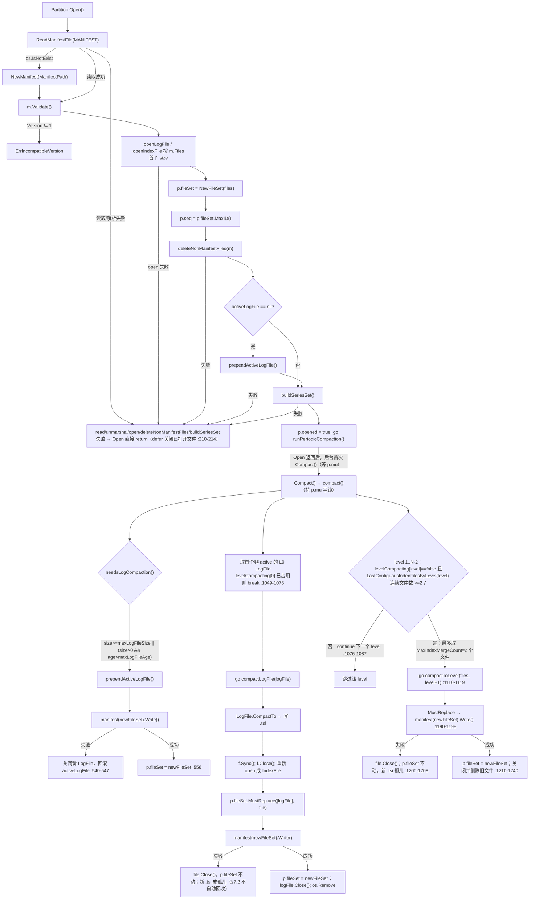
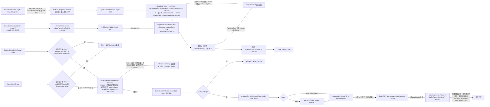
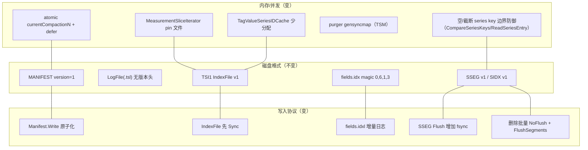
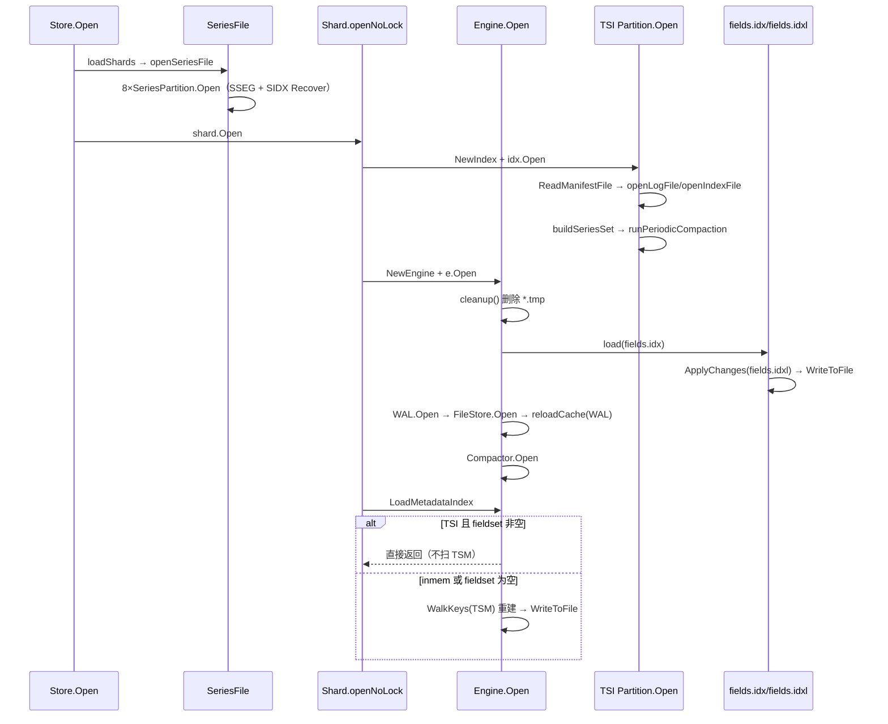
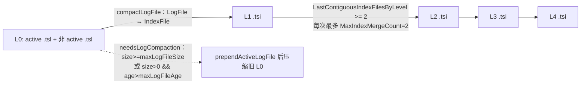
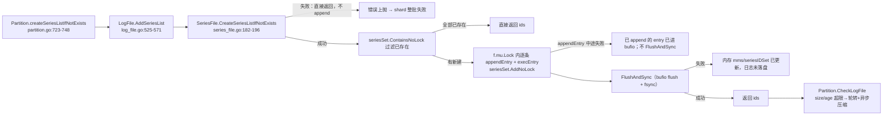

# 版本差异 2: 索引与 Series 子系统（TSI / SeriesFile / fields.idx / key 构建）（v1.8.10 → v1.12.3）

> **版本基线**
> - OLD：`v1.8.10` = commit `688e697c51`（2021-10-11）
> - NEW：`v1.12.3` = commit `f3d5cb68ab`（`docs/specs/` 这批文档的代码基准）
> - 区间：527 commits，602 files，+79,310 / −45,239
> - NEW 当前工作树只额外包含若干 docs 提交（数量随文档演进），代码与 `f3d5cb68ab` 相同
> - 本文范围：`tsdb/index/tsi1/*`、`tsdb/index.go`、`tsdb/series_file.go`、`series_partition.go`、`series_segment.go`、`series_index.go`、`tsdb/internal/fieldsindex.pb.go`、`models/points.go` 的 key 构建部分；并按任务要求旁及 `tsdb/shard.go` 的 `fields.idx` 持久化与 `tsdb/engine/tsm1/file_store.go` 的 purger
> - 配套阅读：[02 索引系统](../02_index_system_spec.md)、[13 Line Protocol 解析器](../13_line_protocol_parser_spec.md)、[14 SeriesFile 深度审计](../14_series_file_deep_dive_spec.md)
> - 文件对应关系：任务清单里的 `measurement.go`/`tag_key.go`/`tag_value.go`/`series.go`/`compact.go` 在两个版本中都不存在，对应逻辑分别在 `measurement_block.go`、`tag_block.go`、`file_set.go`、`index_files.go`；`tsdb/series_index.go` 区间内无代码 diff。

> **小白导读**
> 1. **磁盘格式两年一个字节都没动。** TSI 索引文件（magic `TSI1`）、MANIFEST、SSEG、SIDX、`fields.idx` 的 magic 与 version 全部原地不变。升级 v1.12.3 不需要跑 `buildtsi`，不需要重建索引，旧文件直接打开。
> 2. **变的是"别写坏、别 panic"。** MANIFEST 从"直接覆盖写"改成"临时文件 → fsync → rename"；压缩产物先 `Sync()` 再 `Close()`；manifest 写成功之后才把新文件集换进内存（失败可回滚）；损坏/截断的 series key 与段文件不再越界或 SIGBUS。
> 3. **变的是"锁与分配"。** `.tsl` 日志文件轮转从"只看大小"变成"大小 **或** 年龄（默认 4h）"，空闲分区的旧日志也会被压缩；`LogFile.TagValueIterator` 提前放读锁；series 缓存的插入路径每次 `Put` 少 1~3 次字符串分配；删 series 时显式 `Flush()` 次数 N→≤分区数（≤8）、fsync 0→≤8（新增持久性，代价是批末延迟）；bufio 32KB 缓冲写满时仍会内部 flush。
> 4. **fields.idx 换了持久化策略。** 仍是同一个 protobuf（wire 兼容），但字段变更先追加到 `fields.idxl` 变更日志，启动/关闭/LoadMetadataIndex 重建/Restore·Import 收尾时再合并回 `fields.idx`，不再每次字段变更都重写整份索引。
> 5. **line protocol 解析器本身没改。** 改的是周边：`Tags.HashKey` 增加 `escapeTags` 参数、订阅侧新增 UTF-8 校验、CSV 输出不再二次转义、`Point` 接口新增 `ForEachField`。

**必答问题索引**

| # | 必答问题 | 结论一句话 | 详见 |
|---|---------|-----------|------|
| 1 | TSI 索引结构/文件格式是否变化（SIDX/SSEG/TSI/MANIFEST/LogFile/IndexFile） | **全部不变**（版本号均为 1），只有写入方式与错误处理变化 | §3.1、§3.2.1、§5.1 |
| 2 | 并发与性能优化（#26369 / #27255 / #26511 / #27146 / #27177） | TagValueIterator 提前放锁；cache 少分配；压缩记账 defer 化 + atomic；purger 换 `gensyncmap` 缩短临界区 | §3.2.4、§3.6.1–§3.6.2、§3.14 |
| 3 | 删除/压缩/恢复语义（series 删除、tombstone、LogFile 重放、IndexFile compaction、失败回滚） | TSI 侧删除日志格式不变；删除改批量 fsync；manifest 写失败不再污染内存态；SIDX 重建改为两遍扫描修正 Count | §3.0、§3.2.2–§3.2.3、§3.9.4、§3.10、§3.11 |
| 4 | fields.idx 旧格式 → protobuf 的变化与兼容性 | protobuf 消息 wire 兼容，新增 `fields.idxl` 增量日志；`gogo/protobuf` 换成 `google.golang.org/protobuf` | §3.12 |
| 5 | line protocol 解析行为变化 | 解析状态机不变；错误信息/API 有变；订阅拒绝非 UTF-8 点；CSV 输出不转义 | §3.13 |
| 6 | 至少 1 个查询/创建案例、1 个删除案例 | 见 §6.1（创建 + `SHOW MEASUREMENTS`）与 §6.2（`DROP SERIES`/删 shard） | §6 |
| 7 | 升级后是否自动重建/兼容，需要 buildtsi 吗 | 不需要；旧 TSI/SeriesFile 直接可读；只有 inmem→tsi 转换才需要 `buildtsi` | §5.2、§5.3 |

## 1. 结论速览

| # | 变更点 | v1.8.10 | v1.12.3 | 影响 | 证据 |
|---|--------|---------|---------|------|------|
| 1 | TSI IndexFile 版本/magic | `IndexFileVersion=1`、`FileSignature="TSI1"` | 同左，逐字节相同 | 磁盘格式兼容 | `v1.8.10:tsdb/index/tsi1/index_file.go:20`、`v1.12.3:tsdb/index/tsi1/index_file.go:20` |
| 2 | MANIFEST 版本/字段 | `{"levels","files","version":1}` | 同左 | 兼容 | `v1.8.10:tsdb/index/tsi1/partition.go:27`、`v1.12.3:tsdb/index/tsi1/partition.go:28` |
| 3 | MANIFEST 写入方式 | `ioutil.WriteFile(path, buf, 0666)` 覆盖写 | 临时文件 + `Chmod(0644)` + `Write` + `Sync` + `Close` + `Rename` | 崩溃不再产生半截 MANIFEST；权限从 0666 变 0644 | `v1.8.10:tsdb/index/tsi1/partition.go:1303`、`v1.12.3:tsdb/index/tsi1/partition.go:1482-1530` |
| 4 | 压缩后内存态切换 | 先 `p.fileSet = MustReplace(...)`，再写 MANIFEST | 先构造 `newFileSet`、写 MANIFEST 成功后才赋值 `p.fileSet` | MANIFEST 写失败可回滚，不再产生"内存/磁盘不一致" | `v1.8.10:tsdb/index/tsi1/partition.go:1030`、`v1.12.3:tsdb/index/tsi1/partition.go:1195-1211` |
| 5 | 压缩产物落盘 | 直接 `Close()` | `Sync()` 后再 `Close()` | 掉电后不出现"MANIFEST 已引用、内容未落盘"的新文件 | `v1.8.10:tsdb/index/tsi1/partition.go:1011`、`v1.12.3:tsdb/index/tsi1/partition.go:1170` |
| 6 | `.tsl` 轮转条件 | 仅 `Size() >= MaxLogFileSize` | `Size() >= maxLogFileSize` **或** `size>0 && modTime < now-maxLogFileAge` | 空闲分区的老日志也会被压缩 | `v1.8.10:tsdb/index/tsi1/partition.go:1072`、`v1.12.3:tsdb/index/tsi1/partition.go:1247` |
| 7 | 周期性压缩 | 启动时 `p.compact()` 一次；此后只在写入路径触发 | `go runPeriodicCompaction()`：启动一次 + 每小时 `NeedsCompaction(true)` | 无写入也会自愈 | `v1.8.10:tsdb/index/tsi1/partition.go:244`、`v1.12.3:tsdb/index/tsi1/partition.go:265,979` |
| 8 | 压缩并发计数 | `int currentCompactionN` + 手动 `++/--` | `atomic.Int32` + `defer` 释放 `levelCompacting` | `defer` 统一清理路径、为未来 early return 兜底；`CurrentCompactionN()` 无锁读（旧版清理本在调用之后，不存在可观测的漏清理） | `v1.8.10:tsdb/index/tsi1/partition.go:905-960`、`v1.12.3:tsdb/index/tsi1/partition.go:1053-1073` |
| 9 | TSI 打开失败清理 | 分区并行打开，遇错即返回，已打开分区的文件泄漏 | `errgroup` + `defer i.cleanUpFail(&rErr)` 统一关闭 | MANIFEST 清单内文件可回收；`prependActiveLogFile` 新建的 LogFile 仍有漏关边角（§3.10.2） | `v1.8.10:tsdb/index/tsi1/index.go:245`、`v1.12.3:tsdb/index/tsi1/index.go:255-313` |
| 10 | `LogFile.TagValueIterator` 锁 | `defer f.mu.RUnlock()`，锁跨越整个函数 | 取到 `tk` 后立即 `RUnlock()`；但随后仍在锁外 range `tk.tagValues` | **不是安全优化**：外层查找放锁后仍遍历共享 map，与写路径并发会 fatal，见 §3.6.1/§7.7 | `v1.8.10:tsdb/index/tsi1/log_file.go:413-427`、`v1.12.3:tsdb/index/tsi1/log_file.go:422-437,1406-1412` |
| 11 | series 缓存 `Put` 分配 | 元素各 `string()` 1 次 + 0~3 处 map 赋值（新 measurement 分支多 3 次） | 各 `string()` 一次，元素与 map key 共享底层数组 | 插入路径少 1~3 次分配（新 measurement 分支最多 3 次；exists 命中早退时新版反多 3 次） | `v1.8.10:tsdb/index/tsi1/cache.go:98-140`、`v1.12.3:tsdb/index/tsi1/cache.go:98-147` |
| 12 | 测量名迭代器生命周期 | 返回的 `[][]byte` 指向 mmap，迭代器已 `Close()` | 新增 `MeasurementSliceIterator`/`fileMeasurementSliceIterator`，拷贝完成前 pin 住文件 | 修掉 use-after-unmap 崩溃 | `v1.8.10:tsdb/index.go:1317-1335`、`v1.12.3:tsdb/index.go:1368-1417` |
| 13 | 非法 series key | 直接切片越界 → panic | 各处 `len(name)==0` 跳过；`CompareSeriesKeys` 增加 `nilKeyHandler` | 损坏数据不再打挂进程 | `v1.8.10:tsdb/index.go:135-150`、`v1.12.3:tsdb/index.go:137-145` |
| 14 | SSEG 读取边界 | 按 mmap 长度扫描（可能超过文件真实大小） | `os.Stat` 得真实 `s.size`，循环按 `s.size`；`ReadSeriesEntry` 增加长度检查 | 修掉非标准/截断段文件的 SIGBUS | `v1.8.10:tsdb/series_segment.go:93-135`、`v1.12.3:tsdb/series_segment.go:93-135,426` |
| 15 | SSEG 落盘 | `Flush()` 只 flush bufio | `Flush()` 后 `file.Sync()` | Flush 被调用后不丢；删除的 last batch 需等 FlushSegments | `v1.8.10:tsdb/series_segment.go:211`、`v1.12.3:tsdb/series_segment.go:219` |
| 16 | SIDX 重建 | 单遍，`Count=seriesN`（含墓碑），容量按含墓碑数算 | 两遍：先算存活数，若与 `seriesN` 不同则按新容量重建 | SIDX `Count` 变准确；有墓碑时多一遍扫描 | `v1.8.10:tsdb/series_partition.go:568-660`、`v1.12.3:tsdb/series_partition.go:589-665` |
| 17 | SeriesFile 删除落盘 | 每条 `DeleteSeriesID(id)` 都 flush 分段 | `DeleteSeriesID(id, NoFlush)` 批量 + `FlushSegments(partitionIDs)` | 显式 Flush 次数 N→≤分区数（≤8）；fsync 0→≤8（新增持久性，代价是批末延迟）；底层 write 次数仍随批大小/32KB 缓冲变化 | `v1.8.10:tsdb/store.go:786`、`v1.12.3:tsdb/store.go:1083,1108` |
| 18 | fields.idx 持久化 | 每次 `Save()` 全量重写 `fields.idx` | 追加 `fields.idxl`（size 前缀 + `FieldChangeSet`），启动/关闭/重建/恢复收尾时合并 | 字段创建从"重写整份索引"变成"追加一条记录" | `v1.8.10:tsdb/shard.go:1786-1864`、`v1.12.3:tsdb/shard.go:1834-2000` |
| 19 | fields protobuf | `gogo/protobuf` + `internal/meta.proto` | `google.golang.org/protobuf` + `internal/fieldsindex.proto`（新增 `ChangeType`/`MeasurementFieldChange`/`FieldChangeSet`） | 已有消息 wire 兼容；Go 类型生成器变了 | `v1.8.10:tsdb/internal/meta.pb.go:1`、`v1.12.3:tsdb/internal/fieldsindex.pb.go:1` |
| 20 | `_seriesKey` 查询 | 走 `IndexSet.TagSets`，把每个 series 的 key 物化进 `[]*query.TagSet` | `MeasurementSeriesKeyByExprIterator` 流式迭代 | 大 measurement 的 `count(_seriesKey)` 不再一次性占内存 | `v1.8.10:tsdb/engine/tsm1/engine.go:2534`、`v1.12.3:tsdb/index.go:2397` |
| 21 | `SHOW TAG KEYS/VALUES` 授权钩子 | 逐 series 调 `AuthorizeSeriesRead` | 先 `OptimizeSeriesRead`（企业版钩子）+ `AuthorizerIsOpen` 快速路径 | OSS 行为不变，企业版可下推 | `v1.8.10:tsdb/index.go:2774`、`v1.12.3:tsdb/index.go:2974-3001` |
| 22 | 写入统计 | 无 `seriesCreated` | `StatsTracker` 一路传到 `SeriesPartition`，新增 `seriesCreated` 指标 | 可观测性增强 | `v1.8.10:tsdb/series_partition.go:199`、`v1.12.3:tsdb/series_partition.go:200,265-292` |
| 23 | purger 锁 | 单个 `RWMutex` + `map`，持锁执行 `Close/Remove` | `gensyncmap.Map` + 短锁 `running` 标志 | 删除 TSM 文件不再阻塞 `add()` | `v1.8.10:tsdb/engine/tsm1/file_store.go:1376-1435`、`v1.12.3:tsdb/engine/tsm1/file_store.go:1599-1695` |
| 24 | line protocol 周边 | `Tags.HashKey()`/`AppendHashKey(dst)` | 增加 `escapeTags bool`；新增 `NewTagsKeyValues`/`ValidPointStrings`/`ForEachField` | 解析行为不变，Go API 破坏性变更 | `v1.8.10:models/points.go:2141`、`v1.12.3:models/points.go:2211` |

## 2. 变更地图

### 2.1 一个 Partition 的文件生命周期（新版本真实符号）



> 图注：`runPeriodicCompaction` 启动即 `Compact()`，之后每小时 `NeedsCompaction(true)`、`<-closing` 退出（`partition.go:979-1006`）；`H→I` 是 Open 返回后的后台动作，不是 Open 内同步执行。

### 2.2 删除链路（TSI 侧 + SeriesFile 侧）



> 图注：TSI 侧 `Index.DropSeriesList` 按分区并发，任一分区出错即在 `errC` 循环处立即 `return err`（`index.go:880-885`），其后的 `sTSketch.Add` 循环（`index.go:887-892`）整批不执行；已写 tombstone 的分区不回滚（`partition.go:767-786`）。因此失败批次的 key 不会计入 sketch，重试成功后补上，重试需容忍已写 tombstone 的重复。`FlushSegments` 的错误在调用点只记日志、不阻塞删除主流程（`store.go:1108-1114`、`engine.go:1878-1883`）。

### 2.3 影响面分层



## 3. 逐项差异

### 3.0 模块目录与启动/崩溃恢复

#### 3.0.1 模块目录（源码边界 → 本文落点）

| 模块 | 源码边界 | 主落点 | 角色 | 结构 | 流程 | 案例 | 风险 |
|---|---|---|---|---|---|---|---|
| 磁盘格式基线 | TSI/SIDX/SSEG/MANIFEST/`fields.idx` | §3.1 | 兼容性前提 | 常量 + ASCII | — | — | §5.1 |
| TSI 压缩子系统 | `tsi1/partition.go`/`file_set.go` | §3.2 | L0→L4 压缩与 MANIFEST | `FileSet`/`Manifest` | §3.2.x | §6.3 | §7.1/§7.2/§7.9 |
| TSI 查询路径 | `log_file.go`/`index.go`/`cache.go` | §3.6 | 读锁、迭代器生命周期、缓存 | `TagValueIterator`/`MeasurementSliceIterator` | §3.6.1–§3.6.3 | §6.1 | §7.7 |
| SeriesFile 子系统 | `series_file.go`/`series_partition.go`/`series_segment.go`/`series_index.go` | §3.9 | series key 权威存储 + SIDX | 8 分区/SSEG/SIDX | §3.9.0 | §6.1/§6.2 | §7.3/§7.5 |
| 删除语义 | `tsi1`/`SeriesFile`/`engine`/`store` | §3.11 | TSI 墓碑 + SeriesFile 墓碑 + 跨 shard 差集 | `SeriesIDSet`/tombstone | §2.2、§3.11.1 | §6.2 | §3.11.2 |
| TSI 写路径 | `LogFile.AddSeriesList`/`Writes` | §3.10.0 | 建 series → LogFile 追加 | `LogEntry`/`activeLogFile` | §3.10.0 图 | §3.10.0 | §3.10.0 |
| fields.idx/fields.idxl | `tsdb/shard.go` | §3.12（写路径/恢复 owner：01 §3.3/§3.13） | 字段元数据 wire 兼容 | protobuf/长度前缀 | — | — | 01 §7.3 |
| key 构建 | `models/points.go` | §3.13.1 | `HashKey(escapeTags)` | `Tags` | — | §3.13.2 | §5.5 |
| 查询/授权旁路 | `tsdb/index.go` | §3.15 | `_seriesKey` 流式、授权下推 | `SeriesKeyIterator` | §3.15 | §3.15.2 | §3.15.2 |
| 启动/崩溃恢复 | Store→SeriesFile→Shard→Engine→TSI | §3.0.2–§3.0.5 | 崩溃后恢复到哪一步 | MANIFEST/SSEG/SIDX/`fields.idxl` | §3.0.2 | §3.0.4 | §3.0.4 |

**移出本篇**：purger（§3.14 → [04 §3.15](04_storage_compaction_diff.md)）、line protocol 解析器（§3.13 → [13](../13_line_protocol_parser_spec.md)）、CSV 输出（§3.13.2 → [06 §3.20(e)](06_http_flux_diff.md)）、订阅 UTF-8（§3.13.3 → [05 §3.16b](05_meta_background_diff.md)）。

#### 3.0.2 启动顺序（单个 shard）



| 顺序 | 动作 | 证据 |
|---|---|---|
| 1 | `Store.Open` → `loadShards` → `openSeriesFile`：8 个 `SeriesPartition.Open`（SSEG + SIDX `Recover`） | `v1.12.3:tsdb/store.go:304-338,455-486`、`tsdb/series_file.go:77-107`、`tsdb/series_partition.go:67-105` |
| 2 | `Shard.openNoLock` → TSI `Partition.Open`：读 MANIFEST → 打开文件 → `buildSeriesSet` → 启动周期巡检 | `v1.12.3:tsdb/shard.go:348-395`、`tsdb/index/tsi1/partition.go:163-267` |
| 3 | `Engine.Open`：`cleanup()` → `fields.idx` load + `fields.idxl` apply → WAL/FileStore → WAL replay → Compactor | `v1.12.3:tsdb/engine/tsm1/engine.go:771-810`、`tsdb/shard.go:2104-2129` |
| 4 | `LoadMetadataIndex`：TSI + 非空 fieldset 早退；否则扫 TSM 重建并 `WriteToFile` | `v1.12.3:tsdb/engine/tsm1/engine.go:863-867,934` |

#### 3.0.3 崩溃点矩阵

| # | 崩溃点 | 磁盘状态 | 恢复动作 | 结果 |
|---|---|---|---|---|
| C1 | `fields.idxl` 追加到一半 | 尾部半条记录 | 下次追加前 `Truncate(changeFileSize)`；重启时 `loadAllFieldChanges` 遇 `io.ErrUnexpectedEOF` 告警并跳过尾部 | 丢半条变更（01 §3.13） |
| C2 | `fields.idx.tmp` 残留 | 固定临时文件存在 | 重启 `cleanupTempTSMFiles()` 删除；同一进程内后续 `WriteToFile` 会 EEXIST | 不丢 |
| C3 | `WriteToFile` 写/rename 失败 | `fields.idx` 仍旧，`fields.idxl` 被 defer 删除 | 新字段只在内存 | 丢新字段（01 §7.3） |
| C4 | MANIFEST 写一半 | 旧版：目标文件被截断；新版：目标仍是旧 MANIFEST，临时文件残留 | 旧版反序列化失败→分区打不开；新版忽略临时文件 | 新版不丢；临时文件不自动回收（§7.1/§7.2） |
| C5 | MANIFEST rename 后未 `SyncDir` 即掉电 | 新 MANIFEST 可能未持久，旧 MANIFEST 又引用了已删除文件 | 分区打不开 | 掉电死角（§7.9） |
| C6 | SSEG 尾部截断 | 文件短于 `SeriesSegmentSize` | `InitForWrite` 以 `os.Stat` 真实大小扫描；`ReadSeriesEntry` 检查 flag/长度；`SeriesIndex.Recover` 只重放到最后完整 entry | 丢最后未写完的 series 记录（§3.9.2） |
| C7 | LogFile `.tsl` 尾部半条 entry | `io.ErrShortBuffer` 或 CRC 不匹配 | `LogFile.open` 停止重放并把 `f.size` 截到最后完整 entry | 丢最后半条日志（§3.10.1） |
| C8 | WAL 写后未 fsync | 段文件尾部可能不完整 | `reloadCache` 重放到最后完整 entry | 丢最后未 fsync 的点（01 §3.13） |

**C2/C3/C5 的可施工步骤**

- **C2（`fields.idx.tmp` 残留）**：在 shard 目录手工创建 `fields.idx.tmp`（26B 任意内容）。重启时 `Engine.cleanup()` → `cleanupTempTSMFiles()` 用 `filepath.Glob("<shard>/*.tmp")` 删除它（`v1.12.3:tsdb/engine/tsm1/engine.go:2790-2803`）；断言文件消失、引擎正常打开。**同一进程内**：不重启而触发 `WriteToFile`（Close/ApplyChanges/重建），`os.OpenFile(..., O_EXCL)` 返回 `EEXIST`，错误文本 `failed opening <shard>/fields.idx: file exists`，且不注册删除 defer，`fields.idxl` 保留。
- **C3（`WriteToFile` 写/rename 失败）**：`fields.idxl` 有 26B `cpu.value`；注入 `fd.Write` 返回 ENOSPC。`fields.idx` 保持旧内容、defer 仍删除 `fields.idxl`、`Close` 返回错误；重启后 `cpu.value` 丢失（01 §5.3/§7.3）。
- **C5（MANIFEST rename 后未 `SyncDir`）**：压缩成功路径 `os.Rename(tmp,"MANIFEST")` 后立即 `Close+os.Remove` 旧 `.tsi`（`v1.12.3:tsdb/index/tsi1/partition.go:1510-1527,1227-1243`）。在 rename 返回后、目录项落盘前注入掉电，重启读到的仍是旧 MANIFEST，却引用已删除的 `.tsi` → `openIndexFile` ENOENT，分区打不开。该窗口只能靠故障注入复现，不能靠正常 `kill -9`（页缓存仍包含 rename）。

#### 3.0.4 三个恢复案例

**案例 A：`fields.idxl` 半条记录。** 恢复语义、预期 `SHOW FIELD KEYS` 输出（`cpu.value/cpu.usage/mem.used`，无 `mem.free`）与源码依据见 [01 §3.13](01_write_path_diff.md)；本节只保留崩溃点矩阵里的引用（C1），不再重复同一步骤。

**案例 B：MANIFEST 写一半。** 构造 296B 的合法清单（默认 5 级 levels + 2 个 L1 文件）：

```
{
  "levels": [
    {},
    {
      "m": 33554432,
      "k": 6
    },
    {
      "m": 33554432,
      "k": 6
    },
    {
      "m": 33554432,
      "k": 6
    },
    {
      "m": 33554432,
      "k": 6
    }
  ],
  "files": [
    "L1-00000001.tsi",
    "L1-00000002.tsi"
  ],
  "version": 1
}
```

- 旧版 `ioutil.WriteFile(path, buf, 0666)` 直接以 `O_TRUNC` 打开目标；若在写到第 **40B** 时掉电，目标只剩 `{\n  "levels": [\n    {},\n    {\n      "m":`。下次 `ReadManifestFile` 的 `json.Unmarshal` 返回 `unexpected end of JSON input`，`Partition.Open` 直接返回错误（`v1.8.10:tsdb/index/tsi1/partition.go:1296-1310`）。
- 新版写临时文件 `MANIFEST<random>`（`Chmod(0644)` → `Write` → `Sync` → `Close` → `Rename`，`v1.12.3:tsdb/index/tsi1/partition.go:1482-1530`）：rename 前目标路径始终是完整的 296B 旧 MANIFEST；崩溃只留下同目录的 `MANIFEST<random>`，`ReadManifestFile` 只读固定名 `MANIFEST`，不会读它。这样**进程崩溃**不再造成分区打不开。
- **但** rename 后没有 `SyncDir`：掉电时 rename 可能未持久，旧 MANIFEST 仍指向已被压缩成功路径删除的 `.tsi`/`.tsl`，分区再次打不开（§7.9）。另外 `defer os.Remove(tmp)` 在注册时 `tmp==""`，失败路径不会删除临时文件（§7.1）。

**案例 C：SSEG 截断。** segment **id=0** 被截到 **4,089,446B**、最后一条 insert entry 只剩 **5B** 残头；新版正常打开、`SeriesCount` 少 1，旧版在页边界 **4,091,904** 触发 SIGBUS。完整字节布局、扫描过程与源码行号见 §3.9.2（本节只保留引用，避免两处数值漂移）。

**边界条件（必须说清）**：以上"不 panic"只成立于截断落在 **9B entry 头内**（flag + 8B ID 不全）。若 header 完整、key 长度字段已写入但 key 字节不足，`ReadSeriesEntry` 会调用无边界检查的 `ReadSeriesKey`，`data[:int(sz)+n]` 直接 slice out of range panic（`v1.12.3:tsdb/series_file.go:403-406`、`series_segment.go:426-445`）。例如 entry 从 offset X 开始，字节为 `01` + 8B ID + `0e`（uvarint 14）+ 3B key 后 EOF：`ReadSeriesKey` 请求 `data[:15]` 但只剩 4B → panic。这类"长度字段撒谎"不在 #24509 的修复范围内（§7.3）。

**风险**：① `ApplyChanges` 失败时 `Engine.Open` 只告警继续、`LoadMetadataIndex` 因 fieldset 非空早退，`changeFileSize=0` 会让下一次追加截断遗留 `fields.idxl`（01 §7.3 已由 `NewMeasurementFieldSet` 返回非空 fieldset+err、`Engine.Open` 告警继续、`LoadMetadataIndex` 早退、`changeFileSize=0`→`Truncate(0)` 四处源码静态确认）；② C5 是唯一会"分区打不开"的窗口；③ C6 截断后若 TSI LogFile 已引用该 series ID、SeriesFile 尾部记录却丢失，会出现 TSI 有 ID、SeriesFile 查不到 key 的短暂不一致，下一次写入会重新注册（幂等），但读路径应容忍 `SeriesKey(id)==nil`。

#### 3.0.5 LogFile 重放与截断（恢复语义）

`LogFile.open()` 是 `.tsl` 的恢复入口：顺序读 entry → `execEntry` → 遇到 `io.ErrShortBuffer` 或 `ErrLogEntryChecksumMismatch` 停止 → `f.size = n` 并 `Seek(n)`，即逻辑截断到最后一条完整 entry。两版逐行等价，唯一变化是错误比较用 `errors.Is` 且错误串带路径：

```go
// v1.8.10:tsdb/index/tsi1/log_file.go:150-170
if err := e.UnmarshalBinary(buf); err == io.ErrShortBuffer || err == ErrLogEntryChecksumMismatch {
	break
} else if err != nil {
	return err
}
```

```go
// v1.12.3:tsdb/index/tsi1/log_file.go:153-165
if err := e.UnmarshalBinary(buf); errors.Is(err, io.ErrShortBuffer) || errors.Is(err, ErrLogEntryChecksumMismatch) {
	break
} else if err != nil {
	return fmt.Errorf("%q: %w", f.path, err)
}
```

`execSeriesEntry` 额外加了空 buffer 保护（`v1.12.3:tsdb/index/tsi1/log_file.go:715-719`），避免损坏 entry 让重放 panic。**案例（字节级）**：`.tsl` 内容为 100B 完整 entry + 100B 完整 entry + 50B 半条（进程写第 3 条时被 kill）。`open()` 顺序 `UnmarshalBinary`：前两条成功，第 3 条在 `len(data)` 不足或 CRC 不完整时返回 `io.ErrShortBuffer` → `break`；`f.size = n = 200`，`file.Seek(200, io.SeekStart)`（`v1.12.3:tsdb/index/tsi1/log_file.go:153-170`）。第 3 条对应的 series 不在内存 `mms/seriesIDSet` 中；下次写入从 offset 200 开始，把那 50B 覆盖掉。变体：若第 2 条 CRC 被改坏，`ErrLogEntryChecksumMismatch` 在第 2 条处 `break`，`f.size=100`。**风险**：截断是逻辑上的（文件未 `Truncate`），后续 append 从 `Seek(n)` 继续覆盖半条记录；若 `FlushAndSync` 在覆盖前失败，旧半条仍可能被后续重放误判（CRC 会拦住）。

### 3.1 磁盘格式：所有 magic / version 原地不动

先把最容易误判的一点钉死：**v1.8.10 → v1.12.3 没有改任何索引文件的字节布局**。所有"版本号"都还是 1，所有 magic 都还是老值。

| 文件 | 关键常量（新旧相同） | 新旧证据 |
|------|---------------------|----------|
| TSI IndexFile | `IndexFileVersion = 1`、`FileSignature = "TSI1"` | `v1.8.10:tsdb/index/tsi1/index_file.go:20,23`；`v1.12.3:tsdb/index/tsi1/index_file.go:20,23` |
| TSI IndexFile 尾部 | `IndexFileTrailerSize = 82`，最后 2 字节是 `Version`（BigEndian uint16） | `v1.8.10:tsdb/index/tsi1/index_file.go:28-31,418`；`v1.12.3:tsdb/index/tsi1/index_file.go:28-31,418` |
| MeasurementBlock | `MeasurementBlockVersion = 1` | `v1.8.10:tsdb/index/tsi1/measurement_block.go:18`；`v1.12.3:tsdb/index/tsi1/measurement_block.go:18` |
| TagBlock | `TagBlockVersion = 1` | `v1.8.10:tsdb/index/tsi1/tag_block.go:15`；`v1.12.3:tsdb/index/tsi1/tag_block.go:15` |
| MANIFEST | `Version = 1`、`ManifestFileName = "MANIFEST"` | `v1.8.10:tsdb/index/tsi1/partition.go:27,38`；`v1.12.3:tsdb/index/tsi1/partition.go:28,39` |
| LogFile `.tsl` | **没有版本头**，只有 entry 序列；flag `0x01/0x02/0x04/0x08` | `v1.8.10:tsdb/index/tsi1/log_file.go:32-38`；`v1.12.3:tsdb/index/tsi1/log_file.go:32-38` |
| SSEG | `SeriesSegmentVersion = 1`、`SeriesSegmentMagic = "SSEG"`、头 5 字节 | `v1.8.10:tsdb/series_segment.go:18-20`；`v1.12.3:tsdb/series_segment.go:18-20` |
| SIDX | `SeriesIndexVersion = 1`、`SeriesIndexMagic = "SIDX"`、头 69 字节 | `v1.8.10:tsdb/series_index.go:16-17,24-30`；`v1.12.3:tsdb/series_index.go:16-17,24-30` |
| fields.idx | magic `{0,6,1,3}` + `MeasurementFieldSet` protobuf | `v1.8.10:tsdb/shard.go:83,1909`；`v1.12.3:tsdb/shard.go:86,2156` |

> 哈希库 `cespare/xxhash` 在区间内由 v1 升到 v2（`pkg/rhh/rhh.go:8`、`tsdb/series_file.go:14`、`tsdb/engine/tsm1/ring.go:7`）。SIDX 的 `KeyIDMap` 槽位与 SeriesFile 的 8 分区路由都由 `Sum64` 输出决定（`tsdb/series_partition.go:691-760`、`tsdb/series_file.go:334`）。v2 是 drop-in：只改模块路径与实现（arm 汇编、`Sum64String`），`Sum64` 输出与 v1 相同，因此旧 SIDX 槽位与分区路由保持兼容，无需重建。

**可核对的测试向量**（本机用 `github.com/cespare/xxhash v1.1.0` 与 `v2.3.0` 分别计算，输出逐位相同）：

| 输入 | v1 `Sum64` | v2 `Sum64` | `%8` |
|---|---:|---:|---:|
| `xxhash.Sum64String("cpu,host=web")` = 15,473,051,847,268,686,552 | 15,473,051,847,268,686,552 | 同左 | 0 |
| `xxhash.Sum64String("cpu,host=a")` = 5,917,624,335,819,059,215 | 5,917,624,335,819,059,215 | 同左 | 7 |
| `AppendSeriesKey("cpu", {host=web})` 18B（hex `110003637075010004686f73740003776562`） | 2,697,217,680,118,187,372 | 同左 | SeriesFile 分区 4 |

注意 TSI 用**行协议 key**（`cpu,host=web`，12B）算分区，SeriesFile 用**二进制 key**（18B）算分区，两者不是同一个哈希输入；把上面的 `%8` 混用会得到错误的分区号。

具体字节布局（两版一致，常量见上表）：

```text
TSI IndexFile: "TSI1" 4B | TagBlock × M | MeasurementBlock | SeriesIDSet | TombstoneSeriesIDSet | Sketches | Trailer 82B（末 2B Version）
TSI LogFile:   无文件头；Flag 1B | SeriesID uvarint | Name/Key/Value（len uvar + bytes）| CRC32 4B
SSEG:          "SSEG" 4B | Ver 1B | Entry（Flag 1B + ID 8B BE + [KeyLen uvar + Key]；insert flag=0x01，tombstone flag=0x02，tombstone 共 9B）
TSI LogFile Flag: 0x01 series tombstone / 0x02 measurement tombstone / 0x04 tag-key tombstone / 0x08 tag-value tombstone
SIDX:          "SIDX" 4B | Ver 1B | MaxSeriesID 8B | MaxOffset 8B | Count 8B | Capacity 8B | KeyIDMap.off/size 8B+8B | IDOffsetMap.off/size 8B+8B（header 69B；布局见主 14 §6.1）
MANIFEST:      JSON {"levels":[...],"files":[...],"version":1}（TSI 版本=1；布局见主 02 §4.2）
```

代码上唯一"看起来像格式变化"的是 `IndexFile.UnmarshalBinary` 的错误改为带路径的 `fmt.Errorf("%q: %w", f.path, err)`（`v1.8.10:tsdb/index/tsi1/index_file.go:170-213`、`v1.12.3:tsdb/index/tsi1/index_file.go:170-213`）；另 `bytes()`/`Compacting()` 改用 `defer` 释放，避免 panic 漏 `Done`/`Unlock`（旧版 `v1.8.10:tsdb/index/tsi1/index_file.go:104` 手动 `wg.Done()`，新版 `v1.12.3:tsdb/index/tsi1/index_file.go:85-86`）。

> 结论：**升级不触发任何索引重建**。这也是 §5 兼容性结论的基础。

#### 3.1.1 端到端兼容案例：v1.8.10 写、v1.12.3 直接打开

1. 用 v1.8.10 启动，配置 `index-version = "tsi1"`、`max-index-log-file-size = "1"`（1 字节，强制每次建 series 后轮转并压缩）、`mydb/autogen`（7d）。
2. 一次请求写入 3 条 series（时间戳相同）：

```
cpu,host=web,region=us value=0.64 1700000000000000000
cpu,host=db,region=us value=0.72 1700000000000000000
mem,host=web used=1i 1700000000000000000
```

3. 路由与 ID（xxhash v2 `Sum64`，源码与 §3.1 向量一致）：

| key | TSI 分区 | SeriesFile 分区 | ID |
|---|---:|---:|---:|
| `cpu,host=web,region=us` | 0 | 6 | 7 |
| `cpu,host=db,region=us` | 2 | 3 | 4 |
| `mem,host=web` | 5 | 0 | 1 |

4. v1.8.10 退出后的磁盘状态：TSI 分区 0/2/5 各有 `L1-00000001.tsi`（同 id 的 `L0-00000001.tsl` 被压缩后删除）+ 新的空 `L0-00000002.tsl`；MANIFEST 为 `{"levels":[...],"files":["L0-00000002.tsl","L1-00000001.tsi"],"version":1}`。其余 5 个分区只有空的 `L0-00000001.tsl`。SeriesFile 的 SSEG/SIDX 分别在分区 6/3/0；`fields.idx` 记录 `cpu.value:float`、`mem.used:integer` 两个字段。
5. 用 v1.12.3 以同一数据目录启动：**不执行 `buildtsi`**，不重写 `.tsi`；`Partition.Open` 读 MANIFEST → 打开文件 → `buildSeriesSet`，`p.seq = fileSet.MaxID()`（`v1.12.3:tsdb/index/tsi1/partition.go:163-267`）。断言：
   - `SHOW SERIES` 3 行，key 与上表一致；
   - `SHOW MEASUREMENTS` 2 行：`cpu`、`mem`；
   - `SHOW FIELD KEYS` 2 行：`cpu value float`、`mem used integer`；
   - shard 目录中**没有** `fields.idxl`（`ApplyChanges` 遇 `os.IsNotExist` 直接返回，`v1.12.3:tsdb/shard.go:2135-2136,2178-2179`）；
   - `LoadMetadataIndex` 因 TSI + 非空 fieldset 早退，不扫 TSM（`v1.12.3:tsdb/engine/tsm1/engine.go:863-867`）。
6. 写入新字段 `cpu,host=web,region=us temp=21.0 1700000001000000000`：`fields.idxl` 出现一条 **25B** 记录（hex `11000000000000000a0f0a0363707512080a0474656d701001`）；`fields.idx` 直到 Close/重启才更新。
7. 依据：`v1.8.10:tsdb/index/tsi1/partition.go:241-244,1072-1110`；`v1.12.3:tsdb/index/tsi1/partition.go:163-267,1247-1251`；`v1.12.3:tsdb/shard.go:2135-2136,2243-2268`。

### 3.2 TSI 压缩子系统（模块总述；原 §3.3–§3.5 并入本节，编号改为 3.2.2–3.2.4）

> **编号说明**：原 §3.3–§3.5 已并入本节，这三个编号不再使用；正文从 §3.2.x 直接到 §3.6。

**角色**：把内存/日志形态的 L0 `.tsl` 压成 `.tsi`，并逐级合并；MANIFEST 是唯一的磁盘清单。**结构**：`Partition` 持有 `fileSet`、`activeLogFile`、`levelCompacting []bool`、`currentCompactionN atomic.Int32`；`FileSet` 只剩 `files`；层级常量 `MaxIndexMergeCount=2`（`v1.12.3:tsdb/index/tsi1/partition.go:1576`）。



**触发条件**：`needsLogCompaction()`（大小或年龄，§3.2.3）与 `NeedsCompaction`（层级连续文件数 >1）共同决定；`runPeriodicCompaction` 启动即压缩、之后每小时巡检（`v1.12.3:tsdb/index/tsi1/partition.go:979-1025`）。

**三条路径与失败回滚**：轮转 active log、LogFile→IndexFile、IndexFile→IndexFile 都是"先构造 `newFileSet` → 写 MANIFEST 成功 → 才替换 `p.fileSet`"；失败只 `file.Close()`，旧文件集不变（§3.2.1、§3.2.2）。**案例**：MANIFEST 写失败见 §6.3；轮转数值算例见 §3.2.3。**风险**：临时文件泄漏（§7.1）、孤儿 `.tsi` 不自动回收（§7.2）、rename 后未 `SyncDir`（§7.9）。

**成功路径案例（L0→L1→L2，精确文件名）**

1. 全新分区只有 active `L0-00000001.tsl`。写入 1.2MiB 的 series 日志（`maxLogFileSize=1MiB`）后，`CheckLogFile → needsLogCompaction()` 为 true：
   - `prependActiveLogFile()` 先 `nextSequence()` 得到 2，创建 `L0-00000002.tsl`，MANIFEST 暂列 `["L0-00000002.tsl","L0-00000001.tsl"]`；
   - 旧 `L0-00000001.tsl` 被 `compactLogFile` 压成 `L1-00000001.tsi`（`FormatIndexFileName(id=1, level=1)`，**索引文件沿用日志文件的 id**，不是新序列号），`f.Sync(); f.Close()` 后重新 open，`MustReplace` + MANIFEST 成功才替换 `p.fileSet`；最终 MANIFEST 的 `files` 为 `["L0-00000002.tsl","L1-00000001.tsi"]`。
2. 第二个 1.2MiB 日志让 active 再次轮转：创建 `L0-00000003.tsl`，`L0-00000002.tsl` 压成 `L1-00000002.tsi`。此时 level 1 有两个连续文件，`NeedsCompaction` 为 true；`compactToLevel([L1-1,L1-2], level=2)` 用 `p.NextSequence()` 创建 `L2-00000004.tsi`，MANIFEST 成功后关闭并删除 `L1-00000001.tsi`、`L1-00000002.tsi`。最终 `files` 为 `["L0-00000003.tsl","L2-00000004.tsi"]`。
3. 每一步都能在 MANIFEST 中看到文件集切换；失败时旧文件集保留、新 `.tsi` 成为孤儿（`v1.12.3:tsdb/index/tsi1/partition.go:528-557,1043-1073,1147-1150,1190-1243,1291-1345`）。
4. 依据：`v1.12.3:tsdb/index/tsi1/index_file.go:527-533`、`partition.go:439-445,1311`、`tsi1/tsi1.go` 的 `FormatLogFileName`。

#### 3.2.1 MANIFEST：从"覆盖写"到"临时文件 + fsync + rename"

MANIFEST 是分区唯一的元数据文件。旧版用 `ioutil.WriteFile` 直接截断目标文件再写：

```go
// v1.8.10:tsdb/index/tsi1/partition.go:1296-1310 — (*Manifest).Write
buf, err := json.MarshalIndent(m, "", "  ")
if err != nil { return 0, err }
buf = append(buf, '\n')
if err := ioutil.WriteFile(m.path, buf, 0666); err != nil { return 0, err }
return int64(len(buf)), nil
```

新版改成写临时文件，`fsync` 后原子 `rename`：

```go
// v1.12.3:tsdb/index/tsi1/partition.go:1482-1530 — (*Manifest).Write
f, err := os.CreateTemp(filepath.Dir(m.path), ManifestFileName)
if err != nil { return 0, err }
defer os.Remove(tmp)          // ← 注意：此处 tmp 仍为 ""，见 §7.1

err = func() (rErr error) {
    defer errors2.Capture(&rErr, f.Close)()   // Windows 要求 rename 前先 close
    tmp = f.Name()
    if err = f.Chmod(0644); err != nil {      // 旧版是 0666
        return fmt.Errorf("failed setting permissions on manifest file %q: %w", tmp, err)
    }
    if _, err = f.Write(buf); err != nil { … }
    if err = f.Sync(); err != nil { … }
    return nil
}()
if err != nil { return 0, err }
if err = os.Rename(tmp, m.path); err != nil { return 0, err }
```

要点：

1. **原子性（仅限进程崩溃）**：`rename` 之前目标路径始终是旧 MANIFEST（完整可读）。旧版在写一半时崩溃会留下截断的 JSON，下次 `ReadManifestFile` 反序列化失败，分区直接打不开。但 `os.Rename` 后**没有 `SyncDir`**（对照 `fields.idx` 的 `renameFileNoLock` 显式 `file.SyncDir`，`tsdb/shard.go:2020-2035`）：掉电时 rename 可能未持久，而压缩成功路径随后已删除旧文件，旧 MANIFEST 会引用已不存在的文件（§7.9）。
2. **权限收紧**：`0666`（受 umask 影响通常 0644/0664）→ 显式 `0644`。对应提交 #24235 "prevent world-writable MANIFEST files"。
3. **Windows 兼容**：先 `Close` 再 `Rename`。
4. 未变：`ReadManifestFile` 的 JSON 解码、`Validate()` 的 `Version != 1 → ErrIncompatibleVersion`（新版只是把路径塞进错误串，`v1.12.3:tsdb/index/tsi1/partition.go:1471-1480`）。

顺带一个**行为变化**：`Manifest()` 改为委托给新增的 `p.manifest(newFileSet)`（`Manifest()` 本身仍传 `p.fileSet`），后者允许用"尚未安装的新文件集"生成清单。这正是下一节回滚机制的基础。

#### 3.2.2 压缩失败回滚：内存态与磁盘 MANIFEST 的先后顺序反了

旧版在写 MANIFEST **之前**就把新文件集换进内存：

```go
// v1.8.10:tsdb/index/tsi1/partition.go:1027-1042 — compactToLevel 收尾
p.mu.Lock()
defer p.mu.Unlock()

// Replace previous files with new index file.
p.fileSet = p.fileSet.MustReplace(IndexFiles(files).Files(), file)

// Write new manifest.
manifestSize, err := p.Manifest().Write()
if err != nil {
    // TODO: Close index if write fails.
    return err
}
p.manifestSize = manifestSize
```

新版把顺序倒过来，并用 `newFileSet` 暂存：

```go
// v1.12.3:tsdb/index/tsi1/partition.go:1190-1212 — compactToLevel 收尾（闭包体节选；外层为 if err := func() (rErr error) { … }()）
p.mu.Lock()
defer p.mu.Unlock()

newFileSet := p.fileSet.MustReplace(IndexFiles(files).Files(), file)

manifestSize, err := p.manifest(newFileSet).Write()
defer errors2.Capture(&rErr, func() error {
    if rErr != nil {
        file.Close()          // manifest 写失败：关掉新产物，内存态保持旧文件集
    }
    return rErr
})()
if err != nil {
    return fmt.Errorf("manifest file write failed compacting index %q: %w", p.ManifestPath(), err)
}
p.manifestSize = manifestSize
p.fileSet = newFileSet       // 只有这里之后，新文件集才生效
```

同一模式复制到三条路径：

| 路径 | v1.8.10 | v1.12.3 |
|------|---------|---------|
| 轮转 active log | `p.fileSet = PrependLogFile(f)` 后写 MANIFEST（`tsdb/index/tsi1/partition.go:473-480`） | 先 `newFileSet := p.fileSet.PrependLogFile(f)`，MANIFEST 成功后才 `p.fileSet = newFileSet`，失败恢复 `p.activeLogFile = oldActiveFile` 并 `f.Close()`（`tsdb/index/tsi1/partition.go:528-557`） |
| LogFile → IndexFile | 先 `MustReplace` 再 `Manifest().Write()`（`tsdb/index/tsi1/partition.go:1175-1182`） | 先 `manifest(newFileSet).Write()`，失败 `file.Close()`（`tsdb/index/tsi1/partition.go:1352-1370`） |
| IndexFile → IndexFile | 见上（`tsdb/index/tsi1/partition.go:1030`） | 见上（`tsdb/index/tsi1/partition.go:1195-1211`） |

另外新版在两处产物关闭前补了 `Sync()`：

```go
// v1.12.3:tsdb/index/tsi1/partition.go:1170-1176 （IndexFile 压缩）
if err = f.Sync(); err != nil {
    log.Error("Error sync index file", zap.Error(err))
    return
}
// v1.12.3:tsdb/index/tsi1/partition.go:1327-1332 （LogFile 压缩）
if err = f.Sync(); err != nil {
    log.Error("Cannot sync index file", zap.Error(err))
    return
}
```

旧版对应的 `v1.8.10:tsdb/index/tsi1/partition.go:995-1015` / `:1145-1160` 只有 `defer f.Close()` + `Close()`，没有 `Sync`。

**语义影响**：崩溃恢复时"MANIFEST 引用的文件一定已经把内容刷到盘上"这条不变式，从"依赖文件系统运气"变成"显式保证"。失败的压缩不再需要人工介入——内存仍然指向旧文件，旧文件也没被删除（删除发生在 MANIFEST 成功之后，见 `v1.12.3:tsdb/index/tsi1/partition.go:1227-1243`）；但本次写出的新 `.tsi` 只被 `Close` 不会被删除，会成为孤儿，而 §7.2 的 `deleteNonManifestFiles` 因相对路径缺陷不会自动回收它。注意"MANIFEST 引用的文件内容已落盘"只是内容侧保证，不等于"MANIFEST 更新已持久"：`Write()` 只对临时文件 `Sync()`，`Rename` 后未 `SyncDir`，掉电仍可能回退到旧 MANIFEST（§7.9）。

#### 3.2.3 LogFile 轮转：从"只看大小"到"大小或年龄"，并新增周期性巡检

这是运维体感最明显的一条。旧版只在写入路径检查 `.tsl` 大小：

```go
// v1.8.10:tsdb/index/tsi1/partition.go:1072-1110 — CheckLogFile / checkLogFile
// 轮转条件：Size() >= MaxLogFileSize（小于则直接返回）；checkLogFile 在写锁内重新判大小后
// prependActiveLogFile() → currentCompactionN++ → go compactLogFile(logFile) → p.Compact()
```

新版把判定抽成 `needsLogCompaction()`，条件变成"超过大小 **或** 文件非空且年龄超过阈值"：

```go
// v1.12.3:tsdb/index/tsi1/partition.go:1247-1251
func (p *Partition) needsLogCompaction() bool {
    size := p.activeLogFile.Size()
    modTime := p.activeLogFile.ModTime()
    return size >= p.maxLogFileSize || (size > 0 && modTime.Before(time.Now().Add(-p.maxLogFileAge)))
}
```

`maxLogFileAge` 从哪来？直接复用 TSM 的 `compact-full-write-cold-duration`（默认 4h）：

```go
// v1.12.3:tsdb/index/tsi1/index.go:43-51 — init() → tsdb.RegisterIndex("tsi1", …)
idx := NewIndex(sfile, db,
    WithPath(path),
    WithMaximumLogFileSize(int64(opt.Config.MaxIndexLogFileSize)),
    WithMaximumLogFileAge(time.Duration(opt.Config.CompactFullWriteColdDuration)),
    WithSeriesIDCacheSize(opt.Config.SeriesIDSetCacheSize),
)
// v1.12.3:tsdb/config.go:38
DefaultCompactFullWriteColdDuration = time.Duration(4 * time.Hour)
```

旧版没有 `maxLogFileAge` 字段（`v1.8.10:tsdb/index/tsi1/index.go:136,164` 只有 `maxLogFileSize`）。

更关键的是**触发时机**：

```go
// v1.8.10:tsdb/index/tsi1/partition.go:241-244 — Open 收尾
p.opened = true
p.compact()
```

```go
// v1.12.3:tsdb/index/tsi1/partition.go:262-265,979-1001,1008-1025
p.opened = true
go p.runPeriodicCompaction()   // 启动先 Compact()；之后每小时 t.C 时若 NeedsCompaction(true) 才 Compact()
// NeedsCompaction: needsLogCompaction()（大小或年龄）
//   || level <= len(levels)-2 && levelCount[level] > 1 && !(checkRunning && levelCompacting[level])
```

配合 `compact()` 新增的 level-0 扫描，旧版"只有刚被轮转的那一个 log 文件会被压缩"变成"所有非 active 的 L0 文件都会被压缩"：

```go
// v1.12.3:tsdb/index/tsi1/partition.go:1043-1073 — compact() 的 L0 分支
if p.needsLogCompaction() {
    if err := p.prependActiveLogFile(); err != nil { p.logger.Error("failed to retire active log file", zap.Error(err)) }
}
for _, f := range p.fileSet.files {
    if f.Level() == 0 && f != p.activeLogFile && !p.levelCompacting[0] {
        p.levelCompacting[0] = true; p.currentCompactionN.Add(1)
        go func() {
            defer func() { p.mu.Lock(); p.currentCompactionN.Add(-1); p.levelCompacting[0] = false; p.mu.Unlock(); p.Compact() }()
            p.compactLogFile(f.(*LogFile))   // 不变式：level 0 ⟺ LogFile
        }()
    }
}
```

PR 分工：#21943（`b64c2c3dcf`）= 阈值 + 巡检 + `size > 0`；#22006（`e62efaf751`）= `compact()` 启动时轮转 active log + manifest 失败日志。

**语义影响**：设 active `.tsl` 末次写时间为 `t0`，`needsLogCompaction()` 在 `now > t0+4h` 后首次为真（条件 `size>0 && modTime.Before(now-4h)`）。检查时机：启动时立即 `Compact()` 一次，运行期每小时巡检一次；写路径建新 series 时的 `CheckLogFile()` 也可能触发。若进程在 `t0+4h` 前已在运行，首次轮转落在 **(t0+4h, t0+5h]**；若升级启动本身晚于 `t0+4h`，启动的 `Compact()` 当场轮转（时点即启动时刻）。以上只考虑年龄路径；`size>=1MiB` 可更早触发。升级初期会看到一批 TSI compaction 日志，属预期；该配置从此同时影响 TSM 与 TSI。

**年龄轮转算例**：设 `maxLogFileSize=1MiB`、`maxLogFileAge=4h`、`.tsl` 大小 100KB、末次写时间 `t0`。`needsLogCompaction()` 的条件是 `size >= 1MiB || (size > 0 && modTime.Before(now-4h))`：

| 巡检时刻 | `now-4h` | `modTime.Before` | 结果 |
|---|---|---|---|
| `t0+1h` | `t0-3h` | false | 不轮转 |
| `t0+4h` | `t0` | false（相等不是 Before） | **不轮转**（边界） |
| `t0+4h+1ns` | `t0+1ns` | true | 轮转 |
| `t0+5h` | `t0+1h` | true | 轮转（进程在 `t0+4h` 前已运行时，首次时点的上界；区间为 `(t0+4h, t0+5h]`） |

若 `.tsl` 为空（size=0），即使年龄再大也不轮转（`size > 0` 守卫）。若 `compact-full-write-cold-duration=0`，`maxLogFileAge=0`，任何非空 `.tsl` 在 `modTime.Before(now)` 时都为 true，等价于每次建 series 都可能轮转（§5.4）。依据：`v1.12.3:tsdb/index/tsi1/partition.go:1247-1251`、`v1.12.3:tsdb/index/tsi1/index.go:43-51`。

#### 3.2.4 压缩记账：`atomic.Int32` + `defer` 释放（#26511）

旧版在 goroutine 尾部手动递减计数并清 `levelCompacting`，但清理写在 `compactToLevel` / `compactLogFile` **调用之后**，函数提前返回不会跳过它（旧版 `partition.go:943-955,1102-1111`）；只有未 `recover` 的 panic 才会跳过，而 panic 会终止进程。新版把清理统一放进 goroutine 的 `defer`，并在 `atomic.Int32` 上记账：清理路径只剩一条、为未来在 goroutine 内新增 early return 兜底，`CurrentCompactionN()` 也从"要读锁"变成无锁读（`Wait()` 每 10ms 轮询不再抢 `p.mu`）。注意两处 `defer` 都没有 `recover()`，goroutine 内未恢复的 panic 会终止进程（`index_file.go:111` 的 `recover()` 只是包装错误后重新 panic），所以收益不是"panic 后 level 自愈"。

```go
// v1.8.10:tsdb/index/tsi1/partition.go:940-955 — compact() 里的 level 循环
p.currentCompactionN++
go func() {
    p.compactToLevel(files, level+1, interrupt)

    // Ensure compaction lock for the level is released.
    p.mu.Lock()
    p.levelCompacting[level] = false
    p.currentCompactionN--
    p.mu.Unlock()

    p.Compact()
}()
```

```go
// v1.12.3:tsdb/index/tsi1/partition.go:1102-1118
p.currentCompactionN.Add(1)
go func() {
    defer func() {                       // ← 正常返回与 panic 展开都会执行
        p.mu.Lock()
        p.levelCompacting[level] = false
        p.currentCompactionN.Add(-1)
        p.mu.Unlock()
        p.Compact()
    }()
    p.compactToLevel(files, level+1, interrupt)
}()
```

同时：

| 变化 | v1.8.10 | v1.12.3 |
|------|---------|---------|
| 计数器类型 | `int`，读写都靠 `p.mu`（`tsdb/index/tsi1/partition.go:62`） | `atomic.Int32`，`CurrentCompactionN()` 无锁读（`tsdb/index/tsi1/partition.go:66,352-354`） |
| `Wait()` | 每 10ms 轮询，无任何诊断（`:335-345`） | 超过 24h 打 `Warn`，打印卡住的压缩数与文件列表（`:358-386`） |
| `Compact()` 前置条件 | 注释未声明 | 注释明确"requires mu write-locked"（`:1030`） |

注意 `Wait()` 只是**加日志**，并不会解除阻塞；如果压缩真的卡死，`Close()` 仍然会挂住。见 §7.4。

### 3.6 TSI 查询路径（模块总述；原 §3.7–§3.8 并入本节，编号改为 3.6.2–3.6.3）

> **编号说明**：原 §3.7–§3.8 已并入本节，这两个编号不再使用；正文从 §3.6.x 直接到 §3.9。

**角色**：TSI 的读侧只做三件事——在 LogFile/IndexFile 上找 tag value/series、缓存热点结果、把迭代器生命周期与文件引用绑定。**结构**：`TagValueSeriesIDCache`（`(name,key,value) → SeriesIDSet`）、`LogFile.TagValueIterator`、`MeasurementSliceIterator`/`fileMeasurementSliceIterator`。**流程**：`SHOW TAG VALUES` → `TagValueIterator`（§3.6.1）；首次查询未命中缓存 → `Put`（§3.6.2）；`SHOW MEASUREMENTS` → 迭代器 pin 文件直到拷贝完成（§3.6.3）。

| 子节 | 变化 | 正确性结论 | 案例/风险 |
|---|---|---|---|
| §3.6.1 `TagValueIterator` | 外层查找提前 `RUnlock` | **v1.12.3 回归**：`range tk.tagValues` 仍在锁外，并发写会 fatal | §7.7 |
| §3.6.2 series 缓存 | `string()` 只做一次 | 插入路径少 1–3 次分配；exists 命中反多 3 次 | §6.1 |
| §3.6.3 测量名迭代器 | 新增 `fileMeasurementSliceIterator` | 修掉 use-after-unmap | §6.1 |

#### 3.6.1 `LogFile.TagValueIterator` 提前释放读锁（#26369）

旧版把 `RUnlock` 交给 `defer`，读锁一直持有到函数返回（包括构造迭代器的过程）：

```go
// v1.8.10:tsdb/index/tsi1/log_file.go:413-425
func (f *LogFile) TagValueIterator(name, key []byte) TagValueIterator {
    f.mu.RLock()
    defer f.mu.RUnlock()

    mm, ok := f.mms[string(name)]
    if !ok { return nil }
    tk, ok := mm.tagSet[string(key)]
    if !ok { return nil }
    return tk.TagValueIterator()
}
```

```go
// v1.12.3:tsdb/index/tsi1/log_file.go:422-437
func (f *LogFile) TagValueIterator(name, key []byte) TagValueIterator {
    f.mu.RLock()
    mm, ok := f.mms[string(name)]
    if !ok {
        f.mu.RUnlock()
        return nil
    }
    tk, ok := mm.tagSet[string(key)]
    if !ok {
        f.mu.RUnlock()
        return nil
    }
    f.mu.RUnlock()
    return tk.TagValueIterator()
}
```

语义上（**这是 v1.12.3 的并发回归，不能称为"安全优化"**）：

- `logTagKey` 是值类型，但内含 `tagValues map[string]logTagValue`（`v1.12.3:tsdb/index/tsi1/log_file.go:1385-1389`）。`tk := mm.tagSet[key]` 只复制 map header，`tk.tagValues` 与 `mm.tagSet[key].tagValues` 是**同一个 hmap**。
- `tk.TagValueIterator()` 的实现是 `for _, v := range tk.tagValues`（`:1406-1412`），而调用点已在 `:436` 处 `RUnlock`、`:437` 才调用；遍历因此发生在锁外。
- 写路径 `Writes` 持 `f.mu.Lock()`（`:1090-1102`），`execSeriesEntry` 执行 `ts.tagValues[string(v)] = tv`（`:749`）；`AddSeriesList` 同样持写锁。两者并发时 runtime 直接抛 `fatal error: concurrent map iteration and map write`（不可 recover，见 §7.7）。
- 结论：本次改动只缩短了 `f.mms`/`mm.tagSet` 外层查找的锁持有时间，`tagValues` 的 range 仍在锁外。上游修复方向：把 `TagValueIterator()` 移回 `RLock` 内，或新增锁内 `[]logTagValue` 拷贝后再解锁。

#### 3.6.2 series 缓存字符串分配（#27255 / #27257）

`TagValueSeriesIDCache.Put` 的 key 是 `(name,key,value)` 三元组。旧版在元素字段和 map 赋值处分别做 `string(...)` 转换；Go 编译器只在**查找**（`m[string(b)]`）时省掉分配，**赋值**时仍按需分配 1~3 次（取决于命中哪一层）：

```go
// v1.8.10:tsdb/index/tsi1/cache.go:98-140
func (c *TagValueSeriesIDCache) Put(name, key, value []byte, ss *tsdb.SeriesIDSet) {
    c.Lock()
    if c.exists(name, key, value) {          // exists 内部 string(name)/string(key)/string(value)
        c.Unlock()
        return
    }
    ...
    listElement := c.evictor.PushFront(&seriesIDCacheElement{
        name:        string(name),           // 分配 1
        key:         string(key),            // 分配 2
        value:       string(value),          // 分配 3
        SeriesIDSet: ss,
    })
    if mmap, ok := c.cache[string(name)]; ok {          // 查找：不分配
        if tkmap, ok := mmap[string(key)]; ok {         // 查找：不分配
            tkmap[string(value)] = listElement          // map 赋值：分配 4（常见分支）
            ...
```

新版先转换一次，map key 与 LRU 元素共享同一份字符串底层数组：

```go
// v1.12.3:tsdb/index/tsi1/cache.go:98-147
func (c *TagValueSeriesIDCache) Put(name, key, value []byte, ss *tsdb.SeriesIDSet) {
    c.Lock()
    // Convert once; the same string backing array is shared between
    // the cache element (used during eviction) and the map keys.
    nameStr := string(name)
    keyStr := string(key)
    valueStr := string(value)
    if c.exists(nameStr, keyStr, valueStr) {   // 签名改为 string，零转换
        c.Unlock()
        return
    }
    ...
    listElement := c.evictor.PushFront(&seriesIDCacheElement{
        name: nameStr, key: keyStr, value: valueStr, SeriesIDSet: ss,
    })
    ...
    tkmap[valueStr] = listElement
```

调用点没有变，仍是 `Index.TagValueSeriesIDIterator` 未命中缓存且结果是 `SeriesIDSetIterator` 时写入：

```go
// v1.12.3:tsdb/index/tsi1/index.go:1087-1095
if i.tagValueCacheSize == 0 { return itr, nil }
if ssitr, ok := itr.(tsdb.SeriesIDSetIterator); ok {
    ss := ssitr.SeriesIDSet()
    i.tagValueCache.Put(name, key, value, ss)
}
```

**收益**：插入路径每次 `Put` 少 1~3 次 `string([]byte)` 分配（常见分支 measurement/tag key 已存在时旧版 4 次、新版 3 次，新 measurement 分支最多省 3 次；`exists` 与 map 查找的转换本就可被编译器优化掉）；exists 命中早退时旧版 0 次、新版先做 3 次转换，反多 3 次。在"新 tag value 第一次被查询"的高基数场景里直接减少 GC 压力。没有改变缓存语义（容量、命中 clone、未命中 Merge 全部照旧，见 [02 索引系统 §2.1a](../02_index_system_spec.md)）。

**分配分支对照**（按 `cache.go` 的 map 写入路径推导，未在本机跑基准）：

| `Put` 分支 | v1.8.10 | v1.12.3 | 说明 |
|---|---:|---:|---|
| `exists` 命中早退 | 0 | 3 | 新版 3 次 `string()` 先于 `exists`，且字符串逃逸到元素/map key；旧版只作 map 索引，编译器可零分配（`v1.12.3:tsdb/index/tsi1/cache.go:102-104`） |
| measurement + tag key 已存在、新 value（常见） | 4 | 3 | 旧版元素 3 次 + `tkmap[string(value)] =` 再 1 次；新版共享 3 份（`v1.12.3:tsdb/index/tsi1/cache.go:119-136`） |
| measurement 已存在、新 tag key | 5 | 3 | 旧版再为 tag key 与 value 各转换 1 次 |
| 新 measurement | 6 | 3 | 旧版再为 name/key/value 各转换 1 次 |
| 触发 LRU 淘汰（`evictor.Len() > capacity`） | 0 | 0 | 元素里存的已是 string；`checkEviction` 的 `string(name)` 等作用在 string 上，不分配；两版相同（`v1.12.3:tsdb/index/tsi1/cache.go:174-200`） |

上表的 0/3/4/5/6 是转换次数下界；运行 `go test ./tsdb/index/tsi1 -run '^TestDocCachePutAllocs$' -count=1 -v`（harness 见 07 §6.10）可复核 `exists` 命中分支；插入分支需每次换 value 并重建缓存。未在本机跑基准，不填 ns/op。

#### 3.6.3 测量名迭代器生命周期：修掉 use-after-unmap（#22040）

这是本范围里最"惊险"的一个正确性修复。旧版 `MeasurementNamesByExpr` 的调用链是：

1. `measurementNamesByTagFilter` 在内部 `defer mitr.Close()`，把 `me`（`Next()` 返回的 `[]byte`，指向 `IndexFile` mmap）追加进 `names` 后返回；
2. 返回时 `mitr.Close()` 只释放文件引用（`FileSet.Release` → `IndexFile.Release`/`wg.Done`）；随后并发 compaction 或分区关闭路径的 `IndexFile.Close()` 在 `wg.Wait()` 返回后才 `mmap.Unmap`（`v1.12.3:tsdb/index/tsi1/file_set.go:525-528`、`:52-56`、`index_file.go:129-137`、`partition.go:1229-1243`）；
3. 外层 `MeasurementNamesByExpr` 这时才 `slices.CopyChunkedByteSlices(names, 1000)` 去读那些指针。

```go
// v1.8.10:tsdb/index.go:1317-1335 — MeasurementNamesByExpr
if expr != nil {
    names, err := is.measurementNamesByExpr(auth, expr)
    if err != nil {
        return nil, err
    }
    return slices.CopyChunkedByteSlices(names, 1000), nil   // 此时 mmap 已被 Unmap
}
```

measurementNamesByTagFilter 里同样 `defer mitr.Close()`（`v1.8.10:tsdb/index.go:1572-1697`）。

新版引入 `MeasurementSliceIterator` 与 `fileMeasurementSliceIterator`，把"底层文件迭代器"和"名字切片"绑在同一个对象上，**拷贝完成之后**才 `Close`：

```go
// v1.12.3:tsdb/index.go:961-1015
type MeasurementSliceIterator interface {
    MeasurementIterator
    UnderlyingSlice() [][]byte
}

type fileMeasurementSliceIterator struct {
    measurementSliceIterator
    fileIterators MeasurementIterators
}

func (itr *fileMeasurementSliceIterator) Close() error {
    e1 := itr.fileIterators.Close()
    e2 := itr.measurementSliceIterator.Close()
    ...
}
```

```go
// v1.12.3:tsdb/index.go:1368-1417 — MeasurementNamesByExpr
itr, returnErr := is.measurementNamesByExpr(auth, expr)
...
defer func() {
    if e := itr.Close(); err == nil { err = e }   // 注意：defer 在 return 值算完之后执行
}()
return slices.CopyChunkedByteSlices(itr.UnderlyingSlice(), 1000), nil
```

细节：`return slices.CopyChunkedByteSlices(...)` 先求值返回值、再执行 `defer`，所以拷贝发生在 `Close()`（Unmap）之前。修复覆盖 `MeasurementNamesByExpr`/`ByPredicate`、`measurementNamesByNameFilter`/`ByTagFilter`/`ByTagPredicate`；`ByTagFilter` 的 `failed` 标志仅失败路径提前 `Close`（`v1.12.3:tsdb/index.go:1648-1662`）。

**触发场景与三种结果**：`SHOW MEASUREMENTS WITH MEASUREMENT =~ /.../` 或 `SHOW MEASUREMENTS WHERE tag='v'` 命中一个正在被压缩/关闭的 shard 时，旧版 `measurementNamesByTagFilter` 返回的 `names` 是 mmap 的**子切片**（`MeasurementBlockElem.UnmarshalBinary` 直接切片 `e.name = data[n:n+sz]`，`v1.8.10:tsdb/index/tsi1/measurement_block.go:430-445`；`v1.8.10:tsdb/index.go:1581,1690` 只 `append(names, me)`），而 `defer mitr.Close()` 在返回值求值后即释放 FileSet 引用（`v1.8.10:tsdb/index/tsi1/file_set.go:553-561`）。若并发 `IndexFile.Close()` 随后完成 `wg.Wait()` + `mmap.Unmap`（`v1.12.3:tsdb/index/tsi1/index_file.go:129-137`，两版同构）：① 拷贝前页仍映射 → 正常；② 已 unmap 且地址未复用 → SIGSEGV；③ 已 unmap 且地址被新映射复用 → 读到其他映射内容（垃圾名字）。新版在返回前先求值 `slices.CopyChunkedByteSlices(itr.UnderlyingSlice(), 1000)`、再执行 `defer itr.Close()`（`v1.12.3:tsdb/index.go:1368-1397`），拷贝期间 FileSet 引用未释放，只剩“正常”一种结果。具体命中 ①/②/③ 取决于 `Close` 与拷贝的交错，属**待实测**项：可在 `wg.Wait()` 与 `mmap.Unmap` 之间注入延迟（或在拷贝前 `runtime.Gosched()`）复现；代码路径本身可静态确认。

### 3.9 SeriesFile 子系统：总述、边界与 SIDX 重建

#### 3.9.0 模块总述

**角色**：series key 的权威存储，也是 TSI 的底层 ID 映射；TSI 只存 series ID，key 本体在 SeriesFile。**结构**：固定 8 个 `SeriesPartition`（`v1.12.3:tsdb/series_file.go:31-32`），ID 交错分配；每个分区两层——追加写的 SSEG（`SSEG` v1）与查找用的 SIDX（`SIDX` v1，RHH `KeyIDMap` + `IDOffsetMap`）。**写路径**：`SeriesFile.CreateSeriesListIfNotExists` 生成 key、按 hash 路由到 8 分区并行；分区写锁内逐 key `insert`（循环内回调 `AddedMeasurementSeries`）→`segment.Flush()`（含 fsync）→批量 `index.Insert`→循环后回调 `AddedSeries`（§3.10.0）。**删除路径**：`DeleteSeriesID(id, NoFlush)` 批量写 tombstone，批末 `FlushSegments`（§3.11.1）。**压缩**：`SeriesPartition.Compact` 重写 SIDX，两遍扫描（§3.9.4）。**交叉引用**：主 [14 SeriesFile 深度审计](../14_series_file_deep_dive_spec.md) §1/§9–§12。

#### 3.9.1 (a) 非法 series key 不再 panic（#24565）

`ParseSeriesKey` 的返回值如果 `name` 为空，旧版后续 `models.MakeKey(name, tags)` / 授权检查会踩空。新版在 `index.go` 的多个消费点跳过（`tsdb/series_cursor.go:115-118` 返回 error，`tsdb/series_partition.go:265-275` 为 `continue`）：

```go
// v1.12.3:tsdb/index.go:137-145 — seriesIteratorAdapter.Next
name, tags := ParseSeriesKey(key)
if len(name) == 0 {
    continue
}
```

同类检查出现在 `seriesQueryAdapterIterator.Next`（`:384-390`）、`seriesPointIterator.Next`（`:873-879`）、`measurementSeriesKeyByExprIterator.Next`（`:2349-2355`）、`MeasurementSeriesKeysByExpr`（`:2454-2460`）、`tagValuesByKeyAndExpr`（`:2935-2950`）；`parseSeriesKey` 自身也加了空 buffer 保护：

```go
// v1.12.3:tsdb/series_file.go:448-455
_, data = ReadSeriesKeyLen(data)
if len(data) == 0 {
    return nil, dst
}
name, data = ReadSeriesKeyMeasurement(data)
```

`CompareSeriesKeys` 则把"空 key / key 长度字段 ≤1"统一交给 `nilKeyHandler`：

```go
// v1.12.3:tsdb/series_file.go:474-497
nilKeyHandler := func(a, b int) int {
    if a == 0 && b == 0 { return 0 }
    else if a == 0 { return -1 }
    else if b == 0 { return 1 }
    return a + b
}
keyValidity := nilKeyHandler(len(a), len(b))
if keyValidity <= 1 { return keyValidity }
szA, a := ReadSeriesKeyLen(a)
szB, b := ReadSeriesKeyLen(b)
keySizeValidity := nilKeyHandler(szA, szB)
if keySizeValidity <= 1 { return keySizeValidity }
```

旧版只有最外层的 `len(a)==0` 判断，然后直接 `ReadSeriesKeyLen`（`v1.8.10:tsdb/series_file.go:437-455`）。

**案例（损坏 key 的字节布局）**：非法 key 让 measurement 长度字段为 0，但总长度与 tag 区完整：

- 正确 key `cpu,host=web`：`11 00 03 63 70 75 01 00 04 68 6f 73 74 00 03 77 65 62`（18B：总长 17，measurement `cpu`，1 个 tag `host=web`）。
- 损坏 key：`0e 00 00 01 00 04 68 6f 73 74 00 03 77 65 62`（**15B**：总长度字段 `0x0e=14`（不含 uvarint 自身 1B），**measurement 长度 0**，tag 数 1，tag `host=web`）。若把总长度字段也写成 0，`ReadSeriesKey` 会只切出 1B key；随后 `parseSeriesKey` 的 `ReadSeriesKeyLen` 拿到空 remainder，返回 `nil` 与空 tags，不符合本案例（这也是为什么必须保留正确的总长度字段）。
- 完整 SSEG entry：`01` + 8B ID（例如 `00 00 00 00 00 00 00 2a`，id=42）+ 上述 15B key = 24B。
- 输入 3 条 series：`cpu,host=web`（id 1）、损坏 key（id 42）、`mem,host=db`（id 3）。旧版 `ParseSeriesKey` 返回 `name=""`、`tags={host=web}`，`seriesIteratorAdapter.Next` 没有空 name 检查，仍把该 series 返回给上层（空 measurement、tag `host=web`）；因此旧版输出 3 条。新版在 `seriesIteratorAdapter.Next` 检查 `len(name)==0` 后 `continue`（`v1.12.3:tsdb/index.go:137-145`），输出 2 条，且不 panic。
- 依据：`v1.12.3:tsdb/series_file.go:448-455,474-497`、`tsdb/index.go:137-145,384-390,873-879,2349-2355,2454-2460,2935-2950`；旧版 `v1.8.10:tsdb/index.go:135-150`。

#### 3.9.2 (b) 截断的 SSEG 不再 SIGBUS（#24509）

**问题**： 这是 #24509 的核心。`mmap.Map(path, SeriesSegmentSize(id))` 会按"该 segment 应有的容量"（4MB→256MB）映射，即使文件实际比它短；访问超出 EOF 的页会触发 SIGBUS。旧版用 `len(s.data)`（= 映射长度）做循环上界：

```go
// v1.8.10:tsdb/series_segment.go:122-135 — InitForWrite
for s.size = uint32(SeriesSegmentHeaderSize); s.size < uint32(len(s.data)); {
    flag, _, _, sz := ReadSeriesEntry(s.data[s.size:])
    ...
}
```

新版先用 `os.Stat` 拿到真实大小，循环按 `s.size` 截断：

```go
// v1.12.3:tsdb/series_segment.go:93-101
st, err := os.Stat(s.path)
if err != nil {
    return fmt.Errorf("cannot stat %s: %w", s.path, err)
}
s.size = uint32(st.Size())
...
// v1.12.3:tsdb/series_segment.go:128-140
var size uint32
for size = uint32(SeriesSegmentHeaderSize); size < s.size; {
    flag, _, _, sz := ReadSeriesEntry(s.data[size:s.size])
    if !IsValidSeriesEntryFlag(flag) { break }   // 缺这行会把垃圾字节当 entry 扫描，ReadSeriesKey 可能越界 panic（循环仍有界：sz=1）
    size += uint32(sz)
}
```

`ReadSeriesEntry` 也补了最小长度检查：

```go
// v1.12.3:tsdb/series_segment.go:426-440
func ReadSeriesEntry(data []byte) (flag uint8, id uint64, key []byte, sz int64) {
    if len(data) <= 0 { return 0, 0, nil, 1 }
    flag, data = uint8(data[0]), data[1:]
    if !IsValidSeriesEntryFlag(flag) { return 0, 0, nil, 1 }
    if len(data) < 8 { return 0, 0, nil, 1 }
    ...
```

**案例（精确尺寸）**：segment **id=0**，`SeriesSegmentSize(0)=1<<(0+22)=4,194,304B`（不是 4MiB 的 id 3；`SeriesSegmentSize(3)=33,554,432B=32MiB`）。文件被截到 **4,089,446B**；最后一条完整 entry 于 offset **4,089,441** 结束，随后是一条只写了 **5B** 的 insert entry（`0x01` + 4B ID），EOF=4,089,446。

- 新版：`Open` 先 `os.Stat` 得 `s.size=4,089,446`（`v1.12.3:tsdb/series_segment.go:93-101`）；`mmap.Map` 仍按 4MiB 映射，但 `InitForWrite` 的循环上界是 `s.size`，切片为 `s.data[4,089,441:4,089,446]`（5B）。`ReadSeriesEntry` 在 flag 后 `len(data)=4 < 8`，返回 `sz=1`；之后逐字节推进到 4,089,446 停止（`:128-140,426-440`）。`SeriesIndex.Recover` 的 `ForEachEntry` 同样以 `s.size` 为上界（`:253-266`）。
- 旧版：`mmap.Map(path, 4,194,304)` 后用 `len(s.data)=4,194,304` 做上界（`v1.8.10:tsdb/series_segment.go:122-135`）。残头后的零填充让扫描继续：flag `0x01` → 8B ID（4B 真实 + 4B 零填充）→ key 长度 0 → `sz=9`，之后按 1B 步进穿过零填充，直到页边界 **4,091,904**；再访问下一页（完全超出 EOF）触发 **SIGBUS**。
- 输出（新版）：进程不崩溃，`SeriesPartition` 正常打开，最后半条 series 不进入索引（`SeriesCount` 少 1），下一次写入从 EOF 重新 append。
- 边界：只有截断落在 9B entry 头内才成立。若 header 完整、key 长度字段已写但 key 字节不足，`ReadSeriesEntry` 仍会调用无边界检查的 `ReadSeriesKey`，`data[:int(sz)+n]` 会 slice out of range panic（`v1.12.3:tsdb/series_file.go:403-406`、`series_segment.go:426-445`）。这是 §7.3 的残留风险，不属于"不 SIGBUS"案例的成功路径。

#### 3.9.3 (c) 段文件落盘：`Flush()` 增加 fsync（#22566）

`SeriesSegment.Flush()` 从"只 flush bufio"变成"flush + fsync"：

```go
// v1.12.3:tsdb/series_segment.go:219-227
if s.w == nil { return nil }                 // 只读/未初始化段
if err := s.w.Flush(); err != nil { return err }
return s.file.Sync()
```

对应 #22566 "sync series segment to disk after writing"（`b4e781eff6`）。影响：`FlushSegments` 只对每个分区的**当前 active segment** fsync，因此只保证批末 active segment 上的 tombstone/insert 持久化；批内因写满而触发的段轮转用 `CloseForWrite()`（仅 `bufio.Flush + file.Close`，无 `Sync`），这些旧段掉电仍可能丢。代价**同时**落在删除与写入两条路径：

- 删除：每个涉及删除的分区在批末 fsync 一次（≤8），见 §3.11.1。
- 写入：两层 fan-out。TSI `Index.CreateSeriesListIfNotExists` 先按 8 个 TSI 分区分发，每个收到该批 series 的 TSI 分区各调用一次 `SeriesFile.CreateSeriesListIfNotExists`（`tsdb/index/tsi1/log_file.go:525-526`），后者再向 8 个 SeriesFile 分区并行下发（`tsdb/series_file.go:182-196`）；`SeriesPartition.CreateSeriesListIfNotExists` 在"本分区确有新 series"时于写锁内 `segment.Flush()`（`tsdb/series_partition.go:219-222,232-238,278-283`），v1.12.3 的 `Flush` 含 `file.Sync()`（`tsdb/series_segment.go:219-227`）。因此同一 SeriesFile 分区可被不同 TSI 分区各 flush 一次：**每个 (TSI 分区, SeriesFile 分区) 组合至多一次，单 shard 批次上限 8×8=64**；`.tsl` 的 `FlushAndSync` 两版都有。跨 shard 请求按 shard 数叠加（`PointsWriter` 每 shard 一个 goroutine，SeriesFile 数据库级共享）；纯重复写（各分区 `writeRequired=false`）为 0。§3.11 的 `NoFlush + FlushSegments` 只优化删除路径，**无法抵消写路径**。

**案例**：删除 900 条 series，分布在 3 个 SeriesFile 分区。旧版每条 `DeleteSeriesID` 都 `bufio.Flush()`（900 次内核写）+ 0 次 fsync；新版 900 次 bufio 写 + 批末 3 次 fsync（每分区 active segment 一次，`v1.12.3:tsdb/series_file.go:211-242`）。若进程在批末前崩溃，旧版已返回的 tombstone 都交给了内核、不丢；新版最多丢最后一批（3 个分区各一段），重启后 SeriesFile 可能残留孤儿 series，但删除幂等。

#### 3.9.4 SIDX 重建：两遍扫描修正 Count 与容量（#23916）

旧版 `compactIndexTo` 用调用方传入的 `seriesN` 直接定 `hdr.Count` 与 `hdr.Capacity`，但 `seriesN` 含墓碑：

```go
// v1.8.10:tsdb/series_partition.go:568-623
hdr := NewSeriesIndexHeader()
hdr.Count = seriesN
hdr.Capacity = pow2((int64(hdr.Count) * 100) / SeriesIndexLoadFactor)
keyIDMap := make([]byte, (hdr.Capacity * SeriesIndexElemSize))
idOffsetMap := make([]byte, (hdr.Capacity * SeriesIndexElemSize))
...
if index.IsDeleted(id) {
    return nil       // 跳过墓碑，但 hdr.Count 已经把它算进去了
}
```

新版用"先数、再按真实数量重建"的两遍循环：

```go
// v1.12.3:tsdb/series_partition.go:589-665
hdr.Count = math.MaxUint64
seriesCount := seriesN
for {
    seriesN = seriesCount
    seriesCount = uint64(0)
    hdr.Capacity = pow2((int64(seriesN) * 100) / SeriesIndexLoadFactor)
    keyIDMap = make([]byte, hdr.Capacity*SeriesIndexElemSize)
    idOffsetMap = make([]byte, hdr.Capacity*SeriesIndexElemSize)
    ...
            if index.IsDeleted(id) { return nil }
            seriesCount++
            c.insertIDOffsetMap(idOffsetMap, hdr.Capacity, id, offset)
            return c.insertKeyIDMap(keyIDMap, hdr.Capacity, segments, key, offset, id)
    ...
    hdr.Count = seriesCount
    if seriesN != seriesCount {
        continue        // 有墓碑 → 用真实存活数重建第二遍
    }
    break
}
```

**影响**：
- `SeriesIndex.Count()` / `SeriesFile.SeriesCount()` 在重建后不再包含**截至压缩快照时刻**已墓碑的 series（旧版每次 compaction 都按含墓碑的 `index.Count()` 重写 `hdr.Count`，**永远不会自愈**；只有新版两遍重建才修正）。`Count() = OnDiskCount + InMemCount`（`v1.12.3:tsdb/series_index.go:137-145`）：快照之后（或内存索引中）的 `Delete(id)` 只把 id 加进 `tombstones`，**不会**从 `idOffsetMap` 删除（`:151-154,164-180`），所以 OnDiskCount 与 InMemCount 都不扣减，`Count()` 仍高估，直到下一次两遍重建。
- 有墓碑的分区在 compact 时要扫描两遍、分配两遍 map —— 这是**性能代价**，换来 SIDX 尺寸与统计准确。
- `KeyIDMap` / `IDOffsetMap` 的 16B 元素布局、RHH 探测逻辑未变（`insertKeyIDMap` / `insertIDOffsetMap` 只是删掉了未使用的 `hash` 变量赋值，`v1.12.3:tsdb/series_partition.go:691-760`）；xxhash v1→v2 的 `Sum64` 输出不变（见 §3.1），旧 SIDX 槽位可继续命中。

### 3.10 TSI 写路径：`AddSeriesList`、`LogFile.Writes` 与打开失败清理

#### 3.10.0 TSI 写路径（建 series）模块卡

**角色**：把一批新 series 同时写进 SeriesFile（key 权威）与 TSI LogFile（ID→key 的索引日志）。**结构**：`Partition.activeLogFile`、`LogEntry{Flag,SeriesID,...}`、`SeriesIDSet`；`LogFile.AddSeriesList` 先保证 SeriesFile 有 key，再追加 `.tsl` entry。**流程**：



**代码**：`AddSeriesList` 的失败顺序是"SeriesFile 失败 → 不 append；`appendEntry` 失败 → 已 append 的 entry 留在缓冲；`FlushAndSync` 失败 → 内存已生效、磁盘未知"（`v1.12.3:tsdb/index/tsi1/log_file.go:525-571`）；`CheckLogFile` 在返回前无条件执行（`v1.12.3:tsdb/index/tsi1/partition.go:745`），触发轮转时该写请求承担一次 `prependActiveLogFile + manifest` 延迟。

**失败案例（可推演，修正分区数）**：3 条 series `cpu,host=a`（TSI 7 / SF 6 / ID 7）、`cpu,host=b`（TSI 0 / SF 5 / ID 6）、`cpu,host=web`（TSI 0 / SF 4 / ID 5）。因此是 **TSI 2 个分区、SeriesFile 3 个分区**（不是原文的"TSI 2 个"配 `mem` 那组 key；原建议的 `mem,host=a` 实测 TSI 6 / SF 4，会得到 3 个 TSI 分区）。

① **SF 4 关闭**（web 所在分区）：
- TSI 7 的 a：SF 6 成功，TSI 7 append `00 07 00 00 00 5b f5 cf a4`（9B）。
- TSI 0 的 b、web：`SeriesFile.CreateSeriesListIfNotExists` 在 8 分区 fan-out 中，SF 5 先插入 b，SF 4 返回 `ErrSeriesPartitionClosed`；errgroup 返回错误，`LogFile.AddSeriesList` 在 append 前返回。结果：SF 有 a、b 两个 key，TSI 只有 a 一条 entry（b 的 SF 已插入但 TSI 无 entry）。
- HTTP：`validateSeriesAndFields` 的 `default` 分支上抛该错误 → **500**，`PointsWrittenFail += len(points)`。
- 重试（SF 4 恢复）：SF 5 的 b 命中、SF 4 插入 web；TSI 0 的 `seriesSet` 不含 b（首次失败在 `seriesSet.AddNoLock` 之前就返回），因此为 b、web 各 append 一条 entry；TSI 7 的 a 已在 `seriesSet` 中，不 append。最终 SF 3 key、TSI 3 entry。

② **`appendEntry` 失败**：单测把 `LogFile.bufferSize` 设为 1（或注入 `f.w.Write` 返回 `ENOSPC`），让 TSI 0 的第 2 条 entry 失败。第 1 条 b（id 6）已 `appendEntry` + `execEntry`，`.tsl` 有 9B `00 06 00 00 00 e3 49 a8 c1`；第 2 条 web 的 append 失败，未 `execEntry`；函数直接返回，**不执行 `FlushAndSync`**。此时内存 `mms/seriesIDSet` 含 b、不含 web；SF 仍含 b、web。重试时 b 已存在、web 补 append；重启时 `.tsl` 截断到最后完整 entry（§3.0.5）。

③ **`FlushAndSync` 失败**：两条 entry 都已 `appendEntry` + `execEntry`，内存 `mms/seriesIDSet` 含 b、web；bufio 中的 18B 未落盘或 fsync 返回错误。查询（内存态）可见 b、web。崩溃后按落盘状态确定：① 18B 全部未写入 → 两条都丢；② 只写入第 1 条（9B）→ `LogFile.open` 在第二条处得到 `ErrShortBuffer`/校验和不匹配并截断到最后完整 entry（`v1.12.3:tsdb/index/tsi1/log_file.go:153-166`），只剩 b；③ 18B（含 CRC）全部落盘 → 两条都在。若 `file.Sync()` 返回错误但进程继续运行，磁盘状态由 OS 决定，重启后按同一截断规则重放。无论哪支，下一次写入都会按幂等路径补齐缺失 series。各分支取决于崩溃/落盘时点，属**待实测**项：可用故障注入让 `Write` 在 9B 后返回 `ENOSPC`（或在 `Sync` 处注入错误）并重启验证；代码路径静态可确认。

依据：`v1.12.3:tsdb/index/tsi1/log_file.go:525-571`、`tsi1/partition.go:723-748`、`tsdb/series_file.go:182-196`、`tsdb/series_partition.go:200-296`、`tsdb/shard.go:668-683`。

**风险**：① 部分成功跨两层（SeriesFile 有 key、TSI 无 entry）只能靠幂等重试收敛；② `CheckLogFile` 的轮转延迟落在写请求内；③ TSI 路径不做 series 上限检查（限流只在 inmem）。

#### 3.10.1 `LogFile.Writes` 原子性：写入与 flush 同锁（#25182）

旧版 `Writes` 调用 `ExecEntries`（锁内追加），返回后再 `FlushAndSync()`（锁外），与另一写入者的 `appendEntry` 存在竞态：

```go
// v1.8.10:tsdb/index/tsi1/log_file.go:1076-1097
func (f *LogFile) ExecEntries(entries []LogEntry) error {
	f.mu.Lock()
	defer f.mu.Unlock()
	for i := range entries { f.appendEntry(entry); f.execEntry(entry) }
	return nil
}
func (f *LogFile) Writes(entries []LogEntry) error {
	if err := f.ExecEntries(entries); err != nil { return err }
	return f.FlushAndSync()
}
```

```go
// v1.12.3:tsdb/index/tsi1/log_file.go:1090-1106
func (f *LogFile) Writes(entries []LogEntry) error {
	f.mu.Lock()
	defer f.mu.Unlock()
	for i := range entries {
		entry := &entries[i]
		if err := f.appendEntry(entry); err != nil { return err }
		f.execEntry(entry)
	}
	return f.FlushAndSync()
}
```

**失败分支**：`appendEntry` 中途失败时，之前的 entry 已 `execEntry`、当前 entry 可能部分写入 bufio，函数直接返回；`FlushAndSync` 失败时内存已更新。两种情况下调用方都收到错误，但内存与磁盘可能不一致；恢复依赖 `LogFile.open` 的“截断到最后完整 entry”（见 §3.0.3 C7）。`ExecEntries` 被合并回 `Writes`，外部调用者需改用 `Writes`。

**案例（两写者并发）**：`.tsl` 已存在，写者 A 调 `Writes([a1])`，写者 B 调 `Writes([b1])`，每条 entry 9B。

- 旧版：A 的 `ExecEntries` 持锁 append+exec 后解锁；B 的 `ExecEntries` 持锁 append+exec；A 随后在**锁外** `FlushAndSync()`。若 B 的 `appendEntry` 正好与 A 的 `f.w.Flush()` 并发，二者同时访问同一个 `bufio.Writer`。`go test -race` 报告 `WARNING: DATA RACE`，栈为 `bufio.(*Writer).Write`（`log_file.go:633`）与 `FlushAndSync → bufio.(*Writer).Flush`；磁盘上 entry 的先后与条数不确定，可能出现重复/覆盖。
- 新版：`Writes` 从 append、exec 到 `FlushAndSync` 全程持有 `f.mu`（`v1.12.3:tsdb/index/tsi1/log_file.go:1090-1106`），两个写者串行。最终 `.tsl` 恰好 18B，内容为 `a1+b1` 或 `b1+a1`（两种顺序都合法），fsync 2 次（每次 `Writes` 一次）。
- 失败分支：若第 2 条 `appendEntry` 因 bufio/磁盘错误失败，第 1 条已 `execEntry`，第 2 条不 exec，函数不 `FlushAndSync`；内存 `mms/seriesIDSet` 与磁盘可能不一致，重启按 C7 截断。
- 依据：`v1.8.10:tsdb/index/tsi1/log_file.go:1076-1097`；`v1.12.3:tsdb/index/tsi1/log_file.go:1090-1106`；`v1.12.3:tsdb/engine/tsm1/file_store.go:485-521`。

#### 3.10.2 TSI/Partition 打开失败清理（#23430/#23462）

旧版 `Index.Open` 用自建 worker 池 + `errC`，任一分区失败就立即返回，已打开分区不会被关闭：

```go
// v1.8.10:tsdb/index/tsi1/index.go:270-300 — 自建 worker 池 + errC
for i := 0; i < partitionN; i++ {
	if err := <-errC; err != nil { return err }   // 其余分区可能已持有 mmap，无人关闭
}
// v1.12.3:tsdb/index/tsi1/index.go:284-313 — errgroup + 统一回收
g := new(errgroup.Group); g.SetLimit(n)
for idx := 0; idx < partitionN; idx++ { g.Go(i.partitions[idx].Open) }
err := g.Wait()
defer i.cleanUpFail(&rErr)     // 失败 → i.close() 关闭所有已打开分区
```

分区内部也加了 `defer func(){ if rErr != nil { Files(files).Close() } }()`（`v1.12.3:tsdb/index/tsi1/partition.go:210-214`），`TagValueSeriesIDIterator` 出错时先关已收集迭代器（`v1.12.3:tsdb/index/tsi1/index.go:1076-1082`）。**残留边角**：分区 defer 只关闭从 MANIFEST 打开的 `files`；若 `activeLogFile==nil`，`prependActiveLogFile()` 新建的 LogFile 只进入 `p.fileSet`、不在 `files` 中，随后 `buildSeriesSet()` 失败时不会被关闭；`cleanUpFail → i.close()` 又只处理 `p.IsOpen()`（`p.opened=true` 在 `buildSeriesSet` 之后）。风险见 §7.1/§7.2 的临时文件与孤儿文件条目。

**案例（分区 2 的 MANIFEST 损坏）**

1. 构造 8 个分区目录，其中 `2/MANIFEST` 写入 40B 半截 JSON（同 §3.0.4 案例 B）。
2. `Index.Open` 用 `errgroup` 并发打开 8 个分区，分区 2 在 `ReadManifestFile` 处返回 `failed unmarshaling ...: unexpected end of JSON input`；`g.Wait()` 返回首个错误，`defer i.cleanUpFail(&rErr)` 执行 `i.close()`。
3. 已完整打开的 7 个分区 `p.opened=true`，被 `i.close()` 逐个 `p.Close()`；断言 8 个分区 `PartitionAt(i).IsOpen()==false`，进程 fd/mmap 数回到打开前（Linux 看 `/proc/<pid>/fd` 与 `/proc/<pid>/maps` 中对应 `.tsi`/`.tsl` 路径消失）。
4. 旧版 `Index.Open` 的自建 worker 池在收到第一个错误时立即 `return err`，其余 goroutine 已打开的 mmap/fd 无人关闭；同样构造下可观察到 fd 计数不回落。
5. 依据：`v1.12.3:tsdb/index/tsi1/index.go:284-313,309-313,352-366`；旧版 `v1.8.10:tsdb/index/tsi1/index.go:245-300`。

### 3.11 删除语义：批量化、跨 shard 差集与锁

#### 3.11.1 SeriesFile 删除：从"每条都 bufio flush"到"批量写 + 每分区一次 fsync"

旧版 `SeriesFile.DeleteSeriesID(id)` 没有 flush 参数，`SeriesPartition.DeleteSeriesID` 每次都会 `segment.Flush()`：

```go
// v1.8.10:tsdb/series_file.go:198-204 — SeriesFile.DeleteSeriesID(id) 无 flush 参数，直接转调分区
// v1.8.10:tsdb/series_partition.go:317-345 — 每次删除都 segment.Flush()
if segment := p.activeSegment(); segment != nil {
    if err := segment.Flush(); err != nil { return err }
}
p.index.Delete(id)
```

新版把 flush 决策上移：

```go
// v1.12.3:tsdb/series_file.go:203-211
func (f *SeriesFile) DeleteSeriesID(id uint64, flush bool) (*SeriesPartition, error) {
    p := f.SeriesIDPartition(id)
    if p == nil { return nil, ErrInvalidSeriesPartitionID }
    return p, p.DeleteSeriesID(id, flush)
}

// v1.12.3:tsdb/series_file.go:211-238 — FlushSegments（节选）
var wg sync.WaitGroup
errCh := make(chan error, SeriesFilePartitionN)
for id := range partitionIDs {          // 只有本次涉及删除的分区
    wg.Add(1)
    p := f.partitions[id]
    go func() {
        defer wg.Done()
        p.mu.Lock(); defer p.mu.Unlock()
        if segment := p.activeSegment(); segment != nil {
            if err := segment.Flush(); err != nil { errCh <- err }   // 含 file.Sync()
        }
    }()
}
wg.Wait(); close(errCh)                 // 必须等所有分区 fsync 完成
var errs []error
for err := range errCh { errs = append(errs, err) }
return errors.Join(errs...)
```

调用方全部改成批量：

| 调用点 | v1.8.10 | v1.12.3 |
|--------|---------|---------|
| 删除 shard | `sfile.DeleteSeriesID(id)`（返回值被忽略，`tsdb/store.go:786`） | `p, err := sfile.DeleteSeriesID(id, NoFlush)` 收集 `partitionIDs`，最后 `sfile.FlushSegments(partitionIDs)`（`tsdb/store.go:1083,1108`） |
| `DROP SERIES`/`DELETE` 清空 shard | `e.sfile.DeleteSeriesID(id)`（`tsdb/engine/tsm1/engine.go:1814`） | `e.sfile.DeleteSeriesID(id, tsdb.NoFlush)` + `FlushSegments`（`tsdb/engine/tsm1/engine.go:1858,1878`） |

语义影响：
- tombstone 仍然"先写 SSEG、再改内存 `SeriesIndex.tombstones`"（`v1.12.3:tsdb/series_partition.go:334-364`），只是 fsync 推迟到批末。
- 旧版 `SeriesSegment.Flush()` 只有 `s.w.Flush()`（`v1.8.10:tsdb/series_segment.go:211-216`），删除路径 **fsync = 0**；新版在 `FlushSegments` 批末对每个涉及删除分区的 **active segment** fsync 一次（`tsdb/series_file.go:214-242`，≤8）→ **0 → ≤8**，是持久性增强，代价是批末同步延迟。
- 持久化范围：`FlushSegments` 只 flush 每个分区的 active segment；批内因写满而轮转出的旧 segment 走 `CloseForWrite()`（`tsdb/series_segment.go:167-181`，仅 bufio flush + close，无 fsync），这批 tombstone 掉电仍可能丢（`tsdb/series_partition.go:477-497`）。显式 `Flush()` 调用次数为 N→≤分区数，底层 write 次数仍受 32KB bufio 缓冲与批大小影响。
- 崩溃窗口要分场景：**掉电**时旧版可丢自上次 OS 回写以来的全部 tombstone，新版最多丢最后一批；**进程崩溃**时旧版每条 `bufio.Flush()` 已把数据交给内核、已返回的 tombstone 不丢，新版批内不 flush，最多丢最后一批——窗口从 0 变为"最后一批"。这是**有意的取舍**（#27114/#27129 "fsync delay for retention deletion"）：tombstone 写在数据库级 `<db>/_series`，删 shard 只删 TSM/WAL 目录、不会删它；丢失最后一批的后果是 SeriesFile 残留孤儿条目，删除本身幂等、不破坏数据。若业务要求"删除立即持久"，不能依赖默认路径。

#### 3.11.2 删除路径的锁（模块卡 + 案例）

**角色**：`Engine.deleteSeriesRange`（由 Engine 与 `Store.DeleteSeries`→shard engine 两条入口进入）在 `FileStore.Apply` 的并发回调之间共享**局部** `seriesKeysLock`，避免删除与 compaction/查询并发修改同一 shard 的 series 列表；`Store.DeleteSeries` 自身只持 `s.mu`/epoch，不使用该锁。**结构**：`seriesKeysLock sync.RWMutex` 是 `deleteSeriesRange` 内的局部变量（`v1.12.3:tsdb/engine/tsm1/engine.go:1700-1701`）与 `getEpochsAndShards` 闭包（`v1.12.3:tsdb/store.go:1684-1687`，锁为 `s.mu`）。**流程**：读锁 → 计算待删 ID/跨 shard 差集 → 调用 `SeriesFile.DeleteSeriesID` → `defer RUnlock`。

```go
// v1.12.3:tsdb/engine/tsm1/engine.go:1710-1722 — 闭包内 defer 释放读锁
cmp, cont := func() (int, bool) {
	seriesKeysLock.RLock()
	defer seriesKeysLock.RUnlock()
	...
}()
// v1.12.3:tsdb/store.go:1684-1687 — Store 侧同型闭包
getEpochsAndShards := func() (error, []*Shard, map[uint64]*epochTracker, *SeriesFile) {
	s.mu.RLock()
	defer s.mu.RUnlock()
	...
}
```


- v1.8.10：`Engine.deleteSeriesRange` 对 `seriesKeys` **无锁**（`v1.8.10:tsdb/engine/tsm1/engine.go:1700-1710` 直接读写切片）；`Store.DeleteSeries` 手工 `RLock/RUnlock`，多个错误分支易漏。
- 区间内 `1bc0eb4795`（#25268）引入 `seriesKeysLock`，但一条 `return nil` 路径漏 `RUnlock` → 读锁泄漏会阻塞后续写锁与 `FileStore.Apply`（compaction）。
- `81b42fd344`（#26658）用闭包 + `defer RUnlock` 修掉（`v1.12.3:tsdb/engine/tsm1/engine.go:1720-1745`）；`21ab48416e`（#26647/#26852）把 `Store.DeleteSeries` 的锁收进 `getEpochsAndShards` 闭包 + `defer RUnlock`（`v1.12.3:tsdb/store.go:1684-1687`）。
- 结论：两端对比是"**无锁 → 正确加锁**"；`RLock` 泄漏本身是区间内引入又修掉的回归，**不能写成"旧版有泄漏"**。

**案例（读锁泄漏把同一次 `Apply` 卡死）**：`FileStore.Apply` 对每个 TSM 文件起一个 goroutine 并发执行回调（`v1.12.3:tsdb/engine/tsm1/file_store.go:485-521`），这些回调共享 `deleteSeriesRange` 里的**局部** `seriesKeysLock`。

1. 准备 2 个 TSM 文件 `000000001-000000001.tsm`、`000000002-000000001.tsm`，`seriesKeys=[cpu,host=a#!~#value, cpu,host=b#!~#value]`，`minKey=cpu,host=a#!~#value`。
2. 文件 A 的回调从 `minKey` 开始推进 `j`：先匹配 `seriesKeys[0]`，再 `j++` 越过末尾，命中 `j >= len(seriesKeys)`；旧实现（`1bc0eb4795`）此时仍持 `RLock` 就 `return nil`，读锁泄漏。
3. 文件 B 的回调找到 `seriesKeys[1]=cpu,host=b#!~#value`，执行 `seriesKeysLock.Lock()` 准备写入 `emptyBytes`（`v1.12.3:tsdb/engine/tsm1/engine.go:1738-1740`）；由于 A 的读锁未释放，B 永久阻塞。
4. `Apply` 等待所有回调结束，因此永不返回；它持有的 `f.mu.RLock`（`file_store.go:489`）也一直不释放，后续 `Apply`/压缩的写锁被阻塞。`kill -QUIT` 的 goroutine dump 会显示 B 卡在 `sync.(*RWMutex).Lock`，A 的回调已返回但锁计数未减。
5. v1.12.3 的修复把 RLock 放进闭包并用 `defer RUnlock`（`81b42fd344`，#26658）；A 返回时立即释放，B 拿到写锁，`Apply` 在一个临界区内完成。回归测试应带超时（例如 5s），旧实现会超时，新实现通过。
6. 注意这是**同一次删除调用内**的阻塞，不是跨请求的全局锁；`seriesKeysLock` 是局部变量，函数返回后随对象回收。**风险**：后续若在闭包内新增提前 `return`，必须继续用 `defer`；`Store` 与 `Engine` 两条路径的锁粒度不同，回归测试要分别覆盖。另见 [05 §3.8](05_meta_background_diff.md)（`8ff06d5a92` #24602 修 `DeleteShard` 未检查 `walkShards` 错误导致的误删活 series）。

### 3.12 fields.idx：同一份 protobuf，新增 `fields.idxl` 增量日志（#23701）

#### 3.12.1 格式与兼容性

```proto
// v1.8.10:tsdb/internal/meta.proto
syntax = "proto3";
package tsdb;

message MeasurementFields { bytes Name = 1; repeated Field Fields = 2; }
message Field { bytes Name = 1; int32 Type = 2; }
message MeasurementFieldSet { repeated MeasurementFields Measurements = 1; }
```

```proto
// v1.12.3:tsdb/internal/fieldsindex.proto —— 前三个消息与 meta.proto 逐字段相同，新增：
enum ChangeType { AddMeasurementField = 0; DeleteMeasurement = 1; }
message MeasurementFieldChange { bytes Measurement = 1; Field Field = 2; ChangeType Change = 3; }
message FieldChangeSet { repeated MeasurementFieldChange Changes = 1; }
```

| 维度 | v1.8.10 | v1.12.3 | 兼容性 |
|------|---------|---------|--------|
| `fields.idx` magic | `{0,6,1,3}`（`tsdb/shard.go:83`） | 同左（`tsdb/shard.go:86`） | 兼容 |
| `fields.idx` 负载 | `MeasurementFieldSet` | 同消息，字段号/类型不变 | 双向 wire 兼容 |
| 生成器 | `protoc-gen-gogo`（`tsdb/internal/meta.pb.go:1`） | `protoc-gen-go v1.34.1`（`tsdb/internal/fieldsindex.pb.go:1-5`） | Go 类型 API 变化；wire 互操作，不保证字节级相同 |
| 新文件 | 无 | `fields.idxl`（`tsdb/shard.go:51`） | 旧版不认识，忽略 |

新旧 protobuf 运行时的 **wire 格式互操作**（字段号/类型/varint 编码一致），可双向读取；但不保证字节级相同：`MeasurementFieldSet.Measurements` 的顺序来自 Go map 迭代（`v1.8.10:tsdb/shard.go:1871`、`v1.12.3:tsdb/shard.go:2046`），同一版本两次序列化也可能不同。

#### 3.12.2 写入策略（差异摘要；机制 owner：01 §3.3）

| 维度 | v1.8.10 | v1.12.3 |
|---|---|---|
| 触发 | 每个含新字段的写请求 `Save()` | `Save(changes FieldChanges)` 交给 `changeMgr.RequestSave` |
| 写盘 | 全量 marshal + 临时文件 + rename | 追加 `fields.idxl`（8B 长度前缀 + `FieldChangeSet`，`O_APPEND` + `O_SYNC`） |
| 合并 | 无（每次整份重写） | 单写协程排空队列，`MaxCombinedWrites=100` 容量，一次 append 合并多条 |
| 全量写入口 | `Save()` | `Close` / `ApplyChanges` / `LoadMetadataIndex` 重建 / Restore·Import |
| 临时文件 | `fields.idx.<memoryVersion>.tmp`（可自愈） | 固定 `fields.idx.tmp` + `O_EXCL`（同进程 EEXIST，重启 cleanup 可清） |

写路径细节（`appendToChangesFile` 的半写截断、`WriteToFile` 的 defer 删除、降级窗口）**owner 在 [01 §3.3](01_write_path_diff.md) 与 [01 §7.3](01_write_path_diff.md)**；主机制见 [06 §8.5](../06_cluster_communication_spec.md)。本节只保留 02 侧的格式/兼容性与一个 v1.12.3 回归：

- **`DeleteMeasurement` 变更不落盘（v1.12.3）**：删空 measurement 时 `deleteSeriesRange` 生成 `Field=nil` + `ChangeType=DeleteMeasurement` 的变更（`tsdb/engine/tsm1/engine.go:1826-1842`；`tsdb/shard.go:1641-1653`），但 `marshalFieldChanges` 只在 `f.Field != nil` 时 append（`tsdb/shard.go:2067-2085`），删除被静默丢弃、`ApplyChanges` 的删除分支（`:2254-2266`）成为死代码；旧版是全量 `fieldset.Save()`（`v1.8.10:tsdb/engine/tsm1/engine.go:1795-1799`）。后果与修复见 §7.8。
- **wire 兼容但非字节级相同**：`MeasurementFieldSet.Measurements` 的顺序来自 Go map 迭代（`v1.8.10:tsdb/shard.go:1871`、`v1.12.3:tsdb/shard.go:2046`），同版本两次序列化也可能不同；新旧互读只依赖字段号/类型。

### 3.13 line protocol / key 构建：解析器没改，周边 API 改了

**模块归属**：解析状态机 owner 在 [13 Line Protocol 解析器](../13_line_protocol_parser_spec.md)；CSV 输出 owner 在 [06 §3.20(e)](06_http_flux_diff.md)；订阅 UTF-8 校验 owner 在 [05 §3.16b](05_meta_background_diff.md)。本节只保留 key 构建与这三个衔接点。

#### 3.13.1 key 构建：`HashKey(escapeTags)` 与 `Point` 接口

`models/points.go` 在区间内只有 121 行 diff，**解析状态机（`scanMeasurement`/`scanTags`/`scanFields`/`scanTime`/`scanNumber`）一行未动**；转义规则、tag 排序（`insertionSort`）、类型推断、错误消息文本都没有行为变化。

| # | 变化 | v1.8.10 | v1.12.3 | 影响 |
|---|---|---|---|---|
| 1 | `Tags.HashKey` 增加 `escapeTags` | `HashKey()` / `AppendHashKey(dst)`（`models/points.go:2141,2159`） | `HashKey(escapeTags bool)` / `AppendHashKey(dst, escapeTags bool)`（`:2211,2229`） | **Go API 破坏** |
| 2 | `Point` 接口新增 `ForEachField` | 无 | `ForEachField(fn func(k, v []byte) bool) error`（`:1580`） | 第三方 `Point` 实现需补方法 |
| 3 | 新增 `NewTagsKeyValues` | 无 | `:1982-2015`，偶数校验 + 排序去重 | flux `to()` 内部使用 |
| 4 | 新增 `ValidPointStrings` | 无 | `:2559-2599` | 订阅侧用它丢弃非法点（§3.13.3） |
| 5 | `Tags.sorted()` 快速判序 | 无 | `:2092-2099` | 纯优化 |

**写路径不变量**：`AppendMakeKey` 仍总是转义（`models/points.go:1650` 调 `AppendHashKey(dst, true)`），所以**写入路径生成的 series key 字节与旧版完全一致**，这是索引兼容性的前提。

**逐字节对照**（同一输入、两版输出相同）：`AppendMakeKey(nil, []byte("cpu"), Tags{{Key: []byte("host"), Value: []byte("a,b")}, {Key: []byte("path"), Value: []byte("c d")}})` 生成 23B：

```text
63 70 75 2c 68 6f 73 74 3d 61 5c 2c 62 2c 70 61 74 68 3d 63 5c 20 64
```

即 `cpu,host=a\,b,path=c\ d`。旧版 `AppendHashKey(dst)` 恒走 `needsEscape` → `escapeTag`；新版 `AppendMakeKey` 固定传 `escapeTags=true`（`models/points.go:1650` → `:2229`），所以逗号与空格都按同一张 `tagEscapeCodes` 表转义，字节完全一致。反斜杠不在该表中，两版都原样保留（`models/points.go:45-49`）。`HashKey(false)` 只用于 CSV 输出（§3.13.2），不进入写路径。

#### 3.13.2 CSV 输出：tags 列不再二次转义（#24311）

**入口**：`GET /query?db=mydb&q=SELECT+*+FROM+cpu&format=csv`，结果行的 tags 列由 `response_writer.go` 生成：旧版 `models.NewTags(row.Tags).HashKey()`（`v1.8.10:services/httpd/response_writer.go:233`），新版 `HashKey(false)`（`v1.12.3:services/httpd/response_writer.go:228`）。

**输入**：series `cpu,host=a\,b,path=c\\d value=1`（tag 值 `a,b` 与 `c\d`）。

| 版本 | tags 列输出 | 原因 |
|---|---|---|
| v1.8.10 | `host=a\,b,path=c\d` | `escapeTags=true`，逗号（以及空格/等号）被 `escapeTag` 转义；反斜杠不在 `tagEscapeCodes` 中，不转义 |
| v1.12.3 | `host=a,b,path=c\d` | `escapeTags=false`，直接拼接原始值 |

**风险**：下游按 `\,` 解析（或依赖 tags 列是转义后的 line protocol 片段）的脚本会失效；反斜杠两版都原样输出，不作为差异判据。逗号出现在 tag 值里时，新版 CSV 的 tags 列本身不再是可逆的 line protocol 片段（这是 #24311 的预期取舍）。

#### 3.13.3 订阅 UTF-8 校验（#21558）

`services/subscriber/service.go:54` 在把点重新序列化成 line protocol 前调用 `models.ValidPointStrings(p)`；非法点被丢弃并计入 `numInvalid`。旧版会把非法 UTF-8 原样发给订阅端。**归属与配额/失败细节见 [05 §3.16b](05_meta_background_diff.md)**；写路径只受影响于"序列化在写请求 goroutine 内"（01 §3.14）。

#### 3.13.4 模块边界

- 解析器：未变，见 13。
- CSV：输出变化，owner 06 §3.20(e)。
- 订阅校验：owner 05 §3.16b。

### 3.14 移出本篇：purger（TSM FileStore，owner：04 §3.15）

purger 的源码边界是 `tsdb/engine/tsm1/file_store.go`，属于存储/压缩层；完整差异、锁竞争与失败重试分析见 [04 §3.15](04_storage_compaction_diff.md)。本节只保留与索引压缩的衔接点：

| 衔接点 | v1.8.10 | v1.12.3 | 对索引侧的意义 |
|---|---|---|---|
| 旧 TSM 文件何时可删 | 持 `purger.mu` 写锁 `Close/Remove`，`add()` 被阻塞 | `gensyncmap.Map` + 只锁 `running`，`add()` 不再等磁盘 IO | 压缩收尾不被 purger 拖住，TSI 压缩后的磁盘回收节奏更可预测 |
| 删除失败 | `continue`，每秒重试、永不退出 | 无论成功失败都 `files.Delete(k)`，计数打日志 | 失败文件留在磁盘，需运维清理；不会无限刷日志 |
| 空集合 | 仍走 `purge()` | `add([])` 直接返回（#26762） | 无 |

**风险**：`InUse()` 语义仍要求调用方遵守 Ref/Unref；purger 失败不重试意味着磁盘可能残留孤儿文件，与 §7.2 的孤儿 `.tsi` 同类。

### 3.15 查询/授权旁路与结构精简（模块归属）

#### 3.15.1 `_seriesKey` 改为流式迭代（查询路径）

旧版 `SELECT count(_seriesKey) FROM m` 走通用 tag-set 路径，先把所有 series 展开成 `[]*query.TagSet`（每个 TagSet 内含完整 series key 列表）：

```go
// v1.8.10:tsdb/engine/tsm1/engine.go:2534 — createCallIterator
tagSets, err = indexSet.TagSets(e.sfile, []byte(measurement), opt)
// v1.8.10:tsdb/index.go:2879 — IndexSet.TagSets 内部逐 series 物化 key
```

新版新增 `SeriesKeyIterator`/`MeasurementSeriesKeyByExprIterator`，由 `createSeriesIterator` 直接消费（`v1.12.3:tsdb/index.go:184-188,2395-2411`；`v1.12.3:tsdb/engine/tsm1/engine.go:2887`）。**适用条件**：仅 Call 路径（`createCallIterator`）、TSI 索引、`ref.Val=="_seriesKey"`、`len(opt.Aux)==0` 且无 `Dimensions/SLimit/SOffset/StripName/Ordered`（`:2869-2905`）。**收益/风险**：旧版 `IndexSet.TagSets` 为每个 tag set 追加 `SeriesKeys []string`（`v1.8.10:tsdb/index.go:2879,2970`；`query/result.go:19-30`），`COUNT(_seriesKey)` 的单 TagSet 会物化全部匹配 key；新版 `measurementSeriesKeyByExprIterator.Next` 每行只 `SeriesFile.SeriesKey(id)` + `models.MakeKey` 一次并立即返回（`v1.12.3:tsdb/index.go:2334-2383`），`newSeriesIterator` 流式消费（`v1.12.3:tsdb/engine/tsm1/iterator.go:230-271`）。峰值从 O(匹配 series 数 × key 长度) 降为 O(匹配 ID 集合) + O(单 key 长度)。例：100 万 series、key 50B → 旧版 key 字节约 50,000,000B（≈47.7MiB），另加 `[]string` 头 16B/元素 ≈16,000,000B；新版不再保留该 key 切片。不满足条件时仍回退旧路径。查询语义 owner 在 [03 §3.17](03_query_engine_diff.md)（`_seriesKey` 快路径）。

**内存测量方法**（`runtime.ReadMemStats`）：在 10^6 series、key 50B 的数据集上执行 `SELECT count(_seriesKey) FROM m`，查询前后各做一次 GC + `ReadMemStats`：

```go
var before, after runtime.MemStats
runtime.GC()
runtime.ReadMemStats(&before)
// 执行查询：SELECT count(_seriesKey) FROM m（只保留结果，丢弃 iterator）
runtime.GC()
runtime.ReadMemStats(&after)
fmt.Printf("TotalAlloc delta=%d B, Mallocs delta=%d, HeapAlloc after=%d B
",
	after.TotalAlloc-before.TotalAlloc, after.Mallocs-before.Mallocs, after.HeapAlloc)
```

预期差异（按源码推导，未实测）：旧版单次查询至少分配 key 字节 ≈47.7MiB + `[]string` 头 ≈16MB；新版不构造该切片，只分配匹配 ID 集合与逐条 key（O(单 key)），`TotalAlloc` 的差值应显著低于旧版。`HeapAlloc` 是 GC 后的存活量，看不到查询期间的峰值；需要峰值时在 iterator 构造前后各采样一次，或改用 heap profile。具体数值随 Go 版本、roaring 位图密度与查询计划变化，本文不填绝对值。

#### 3.15.2 授权下推：`OptimizeSeriesRead` + `AuthorizerIsOpen`（模块卡）

**角色**：在逐 series 授权检查前，先让企业版把授权表达式下推/裁剪；OSS 的 `openAuthorizer` 是 no-op。**结构**：`query.FineAuthorizer` 的 `OptimizeSeriesRead(db,name,expr)` 钩子、`AuthorizerIsOpen`/`AuthorizerIsVoid` 快速判定。**流程**：

```go
// v1.12.3:tsdb/index.go:2980-3001 — 注意 OptimizeSeriesRead 返回 (expr, auth, error) 三个值
if auth != nil {
	if newExpr, newAuth, err := auth.OptimizeSeriesRead(is.Database(), name, expr); err == nil {
		auth = newAuth
		expr = newExpr
	}
}
if query.AuthorizerIsVoid(auth) {
	return results, nil
}
...
authIsOpen := query.AuthorizerIsOpen(auth)   // tagValuesByKeyAndExpr 内 :2911
```

**与旧版差异**：`TagValuesByKeyAndExpr` 导出方法删除（调用方早已不存在，#20793）；表达式切分从 `RewriteExpr+Reduce` 改为 `influxql.PartitionExpr`（支持 `WITH KEY`）；新增 `AuthorizerIsVoid(auth)` 直接返回空结果。

**案例（必须带 WHERE 才能观察到差异）**：3 条 series `cpu,host=a,region=us`、`cpu,host=b,region=us`、`cpu,host=c,region=us`，执行：

```sql
SHOW TAG VALUES FROM cpu WITH KEY="host" WHERE region = 'us'
```

- 该查询走 `MeasurementTagKeyValuesByExpr` 的 `expr != nil` 分支 → `tagValuesByKeyAndExpr`。
- 旧版在该函数里对每条 series 调用一次 `if auth != nil { auth.AuthorizeSeriesRead(...) }`（`v1.8.10:tsdb/index.go:2742-2747`），计数 authorizer 记录 **3 次**。
- 新版先算 `authIsOpen := query.AuthorizerIsOpen(auth)`（`v1.12.3:tsdb/index.go:2911`）；OSS `openAuthorizer.IsOpen()==true`（`query/executor.go:128`），循环内**一次也不调用** `AuthorizeSeriesRead`，记录 **0 次**。
- 反例：`SHOW TAG VALUES FROM cpu WITH KEY="host"`（无 WHERE）在两版都走 `expr == nil` 分支，而旧版该分支本来就有 `AuthorizerIsOpen` 快速路径（`v1.8.10:tsdb/index.go:2802`），所以两版都是 **0 次**；用它做断言会得到"无差异"的错误结论。
- 企业版：`OptimizeSeriesRead` 返回 `(newExpr, newAuth, nil)`，用裁剪后的表达式继续；返回错误时记录 `log.Error` 并静默回退原表达式。
- 依据：`v1.8.10:tsdb/index.go:2676-2776`；`v1.12.3:tsdb/index.go:2911-2950,2980-3001`；`query/executor.go:108-128,165-174`。

**风险**：企业版钩子返回错误时静默退回原表达式（可观测性弱）；`AuthorizerIsVoid` 与 `AuthorizerIsOpen` 的语义差异需在自定义 authorizer 中正确实现。

#### 3.15.3 统计与结构体精简

- **`StatsTracker`（SeriesFile/TSI 写路径）**：`CreateSeriesListIfNotExists` 增加 `tracker`（`v1.12.3:tsdb/index.go:43-44`）；`SeriesPartition` 在写入成功后回调 `AddedMeasurementSeries`/`AddedSeries`（`v1.12.3:tsdb/series_partition.go:265-292`），落到 `Store.stats.SeriesCreated` 与 per-login/per-measurement ingress 指标（`v1.12.3:tsdb/store.go:1797-1836`）。旧版无 `seriesCreated`。并发合同见 01 §3.2。
- **结构精简表**：

| 结构 | v1.8.10 | v1.12.3 | 影响 |
|---|---|---|---|
| `FileSet` | `{levels, sfile, files, manifestSize}`（`v1.8.10:tsdb/index/tsi1/file_set.go:17-21`） | `{files}`（`v1.12.3:tsdb/index/tsi1/file_set.go:17-19`） | 删除恒 0 的 `manifestSize` 死字段；`NewFileSet(files)` 简化 |
| `Partition.MaxLogFileSize` | 导出字段 | 私有 `maxLogFileSize` + `SetMaxLogFileSize()`（`v1.12.3:tsdb/index/tsi1/partition.go:74-75,117-122`） | `buildtsi` 改用 `WithMaximumLogFileSize()` |
| `Partition.IsOpen()` | 无；从未成功打开的分区 `Close()` 会 nil deref | 新增，`fileSet==nil` + `IsOpen()` 双重保护（`v1.12.3:tsdb/index/tsi1/partition.go:270-272,400-402`） | 打开失败清理更安全 |

## 4. 优化与收益

> 本节只写机制，不编造基准数字。凡是"快多少"都需要在目标硬件上自测。

| 优化 | 机制 | 直接收益 | 代价/边界 | 证据 |
|------|------|---------|-----------|------|
| MANIFEST 原子写 | 临时文件 + `fsync` + `rename`，失败可回滚 | 消除"半截 MANIFEST 导致分区打不开"；压缩失败不再留下内存/磁盘不一致 | 每次 MANIFEST 写多一次 `fsync` + `rename`（每次压缩一次，频率低） | `v1.12.3:tsdb/index/tsi1/partition.go:1482-1530` |
| 压缩产物先 Sync | `f.Sync()` 在 `Close()` 前 | MANIFEST 引用的文件内容已落盘 | 每次压缩多一次 fsync | `v1.12.3:tsdb/index/tsi1/partition.go:1170,1327` |
| `.tsl` 年龄轮转 + 每小时巡检 | `needsLogCompaction()` + `runPeriodicCompaction()` | 无写入的 shard 也能把内存 LogFile 落成 IndexFile，查询路径变短 | 升级后短期压缩 IO 增加；`compact-full-write-cold-duration` 同时影响 TSM | `v1.12.3:tsdb/index/tsi1/partition.go:979-1026,1247` |
| L0 全量扫描压缩 | `compact()` 遍历非 active 的 L0 文件 | 历史遗留 `.tsl` 也会被回收；不再依赖"刚好又写了一次" | 同一分区 L0 串行（`levelCompacting[0]`） | `v1.12.3:tsdb/index/tsi1/partition.go:1043-1073` |
| 压缩记账 defer 化 | `atomic.Int32` + `defer` 清 `levelCompacting` | `defer` 统一清理路径并为未来 early return 兜底；`CurrentCompactionN()` 无锁（旧版本就在调用后清理） | 无 | `v1.12.3:tsdb/index/tsi1/partition.go:1102-1118` |
| `TagValueIterator` 提前放锁 | 仅 `f.mms`/`tagSet` 两次外层查找提前放锁 | 缩短这两次查找的读锁持有时间 | **代价**：`tk.tagValues` 的 range 仍在锁外，与写路径并发会 `fatal error: concurrent map iteration and map write`，需上游修复（§3.6.1/§7.7） | `v1.12.3:tsdb/index/tsi1/log_file.go:422-437,1406-1412` |
| series 缓存少分配 | `string()` 只做一次，map key 与 LRU 元素共享 | 插入路径少 1~3 次分配（新 measurement 分支最多 3 次；exists 命中早退时新版反多 3 次） | 无 | `v1.12.3:tsdb/index/tsi1/cache.go:98-147` |
| 测量名迭代器 pin 文件 | `fileMeasurementSliceIterator` 持有底层 `MeasurementIterators` | 修掉 use-after-unmap（正确性 > 性能） | 索引文件释放被推迟到拷贝之后 | `v1.12.3:tsdb/index.go:992-1015,1368-1417` |
| 删除批量 fsync | `NoFlush` + `FlushSegments` | 旧版 0 次 fsync + N 次显式 Flush；新版 N 次写 + ≤8 次 fsync（每分区 active segment 一次） | 持久性增强；批末同步延迟，崩溃窗口内可能丢最后一批 tombstone | `v1.12.3:tsdb/series_file.go:203-242`、`tsdb/store.go:1083-1113` |
| 写路径 SSEG fsync | `Flush()` 增加 `file.Sync()`（`b4e781eff6`） | 建新 series 的持久性增强 | **每个产生新 series 的写请求至多 64 次 fsync**（8 TSI 分区 × 8 SeriesFile 分区；跨 shard 叠加；纯重复写 0），且在分区写锁内；v1.8.10 为 0 | `v1.12.3:tsdb/series_segment.go:219-227`、`tsdb/series_partition.go:219-222,232-238,278-283`、`tsdb/series_file.go:182-196` |
| SIDX 两遍重建 | 先数存活、再按真实容量重建 | `Count` 准确、SIDX 不再为墓碑留空位 | 有墓碑时多一遍扫描/分配 | `v1.12.3:tsdb/series_partition.go:589-665` |
| fields.idxl 追加写 | 单写协程 + 批量合并 + 长度前缀 | 建字段写放大从 O(全量) 降到 O(变更) | 启动多一次重放；降级需干净关闭 | `v1.12.3:tsdb/shard.go:1915-2000` |
| `_seriesKey` 流式 | `SeriesKeyIterator` 逐条产出 | `count(_seriesKey)` 峰值内存大降 | 仅 Call 路径、TSI 索引、且无 `Aux/Dimensions/SLimit/SOffset/StripName/Ordered` 的形态 | `v1.12.3:tsdb/index.go:2397`、`tsdb/engine/tsm1/engine.go:2869-2905` |
| purger 缩短临界区 | `gensyncmap.Map` + 只锁 `running` | 删除大 TSM 文件不再阻塞压缩收尾的 `add()`；失败文件不再无限重试 | `InUse` 语义仍需调用方遵守 Ref/Unref 不变式 | `v1.12.3:tsdb/engine/tsm1/file_store.go:1599-1695` |
| 打开失败清理 | `errgroup` + `cleanUpFail` + 分区内 `Files(files).Close()` | MANIFEST 清单内文件可回收；prepend 出的新 LogFile 仍有漏关边角（§3.10.2） | 无 | `v1.12.3:tsdb/index/tsi1/index.go:284-313` |

## 5. 行为变化与兼容性

### 5.1 磁盘格式兼容矩阵

| 文件 | 读旧写新 | 读新写旧 | 需要重建？ | 依据 |
|------|---------|---------|-----------|------|
| `MANIFEST` | 兼容（version=1，JSON 字段不变） | 兼容 | 否 | §3.1 |
| `*.tsi`（IndexFile） | 兼容（`TSI1` + v1 + 82B trailer） | 兼容 | 否 | §3.1 |
| `*.tsl`（LogFile） | 兼容（无版本头） | 兼容 | 否 | §3.1 |
| SSEG | 兼容（`SSEG` v1） | 兼容 | 否 | §3.1 |
| SIDX | 兼容（`SIDX` v1，69B 头） | 兼容 | 否 | §3.1 |
| `fields.idx` | 兼容（magic + 同 protobuf） | 兼容（wire 兼容） | 否 | §3.12 |
| `fields.idxl` | 新增，旧版**不读** | 旧版忽略 → 未合并的字段变更丢失 | 否；TSI + 非空 `fields.idx` 时不会自动重建，需手工删除 `fields.idx` 触发扫描 | §3.12、§5.3 |

**结论：升级的格式兼容性不需要手工 `buildtsi`，也不需要 `influx_inspect` 的任何索引重建命令；索引目录原样打开即可。** 但用 deb/rpm 安装时，v1.12.3 的 systemd/SysV 启动脚本只要 data/wal 目录存在，就会在**每次 start** 自动执行 `influx_inspect buildtsi -compact-series-file`（07 §3.8）；这不是升级流程强制要求的重建，却会计入启动耗时并可能触发 `TimeoutStartUSec=90s`（07 §5.2.2、§7 风险 9）。

### 5.2 升级会发生什么

1. **打开**：`Partition.Open` 读旧 MANIFEST → 打开旧 `.tsi`/`.tsl` → `buildSeriesSet()`。没有格式迁移代码路径。
2. **首次压缩**：`runPeriodicCompaction()` 启动即 `Compact()`（`v1.12.3:tsdb/index/tsi1/partition.go:979-982`）。判定条件为 `size >= max-index-log-file-size`（默认 1MiB）**或** `0 < size < 1MiB && modTime < now - compact-full-write-cold-duration`（默认 4h）（`partition.go:1247-1251`；`tsdb/config.go:38,70-72`）。因此"非空、未达 1MiB、末次写早于 4h 前"的 `.tsl` 会在升级启动的第一次 `Compact()` 中被 `prependActiveLogFile()` 轮转并压成 `.tsi`；`size >= 1MiB` 的 `.tsl` 升级后同样立即轮转。v1.8.10 的 `CheckLogFile` 只看 `Size() >= MaxLogFileSize`，没有年龄条件（`v1.8.10:tsdb/index/tsi1/partition.go:1072-1090`），所以旧版不会因年龄压缩它。
3. **MANIFEST 重写**：下一次压缩/轮转时，MANIFEST 会被原子重写，权限变为 `0644`。如果你们的监控/备份脚本依赖 group-write 权限，需要调整。
4. **fields.idx**：升级后第一次字段变更开始写 `fields.idxl`；关闭或重启时合并。
5. **`buildtsi`**：升级流程不需要手工运行，它只在需要 inmem → TSI 转换时使用。新版 `buildtsi` 在收尾时额外用 `WithMaximumLogFileSize(1)` 重开索引并压缩，确保产物没有残留 `.tsl`（`v1.12.3:cmd/influx_inspect/buildtsi/buildtsi.go:460-476`）；旧版只做一次 `Compact()+Wait()`（`v1.8.10:cmd/influx_inspect/buildtsi/buildtsi.go:443-450`）。这是产物质量提升，不是升级前置条件。**注意区分**：包安装的 systemd/SysV 启动脚本每次启动会自动跑一次 `buildtsi`（§5.1、07 §3.8），这是启动脚本行为，不是升级必须手工执行的步骤。
6. **写入延迟**：持续创建新 series 的负载会在**每个产生新 series 的写请求**里产生最多 64 次 SSEG fsync（每个 (TSI 分区, SeriesFile 分区) 组合至多一次；跨 shard 请求按 shard 数叠加；纯重复写为 0；均在分区写锁内；v1.8.10 为 0）。升级压测应覆盖高基数写入。

### 5.3 降级注意

- 索引文件本身完全兼容，v1.8.10 可以直接打开 v1.12.3 的 TSI/SeriesFile。
- **唯一风险在 `fields.idxl`**：v1.8.10 不读它（`v1.8.10:tsdb/engine/tsm1/engine.go:732-738`）。如果降级发生在"变更已追加、尚未合并"的窗口内，丢失的是自上次成功 `WriteToFile` 以来 `fields.idxl` 中的**全部未合并变更**（不是"最近"一批）：`WriteToFile` 把内存字段表全量写回 `fields.idx` 后才在 `defer` 中删除整个 `fields.idxl`（`v1.12.3:tsdb/shard.go:1855-1871`）。字段类型会在下次写入时按需重建；但 `DeleteMeasurement` 变更不会被 `marshalFieldChanges` 序列化（`v1.12.3:tsdb/shard.go:2067-2085,1641-1653`），旧版读不到该删除且其后续 `Save()` 会用仍含该 measurement 的内存表重写 `fields.idx`（`v1.8.10:tsdb/shard.go:1786-1816`），所以已删除 measurement 的字段会在 v1.8.10（以及未成功 `WriteToFile` 就崩溃的 v1.12.3）中**长期存在**（跨多次重启），不是"短暂复活"；若随后以不同类型写入会触发 `field type conflict`。重新升级到 v1.12.3 也不会自动清除：该 `DeleteMeasurement` 变更从未写入 `fields.idxl`（`marshalFieldChanges` 跳过 `Field==nil`，§7.8），没有记录可重放，新版本仍从 `fields.idx` 读回幽灵字段。只有再次执行删除（内存删除后再成功 `WriteToFile`），或手动删除/重建 `fields.idx`，才会清除。
- 建议：降级前正常停进程（`Shard.Close()` → `MeasurementFieldSet.Close()` → `WriteToFile()` 合并），并**确认 `WriteToFile` 返回 nil、`fields.idxl` 已消失**；该函数失败时 `defer` 仍会删除 `fields.idxl`，此时"干净关闭"也不保证可降级（见 [01 §5.3](01_write_path_diff.md)）。失败后需人工核对 `fields.idx` 是否含最新字段，再决定是否降级。
- **v1.12.3 自身的崩溃窗口**：`DeleteMeasurement` 变更不会被 `marshalFieldChanges` 序列化（§3.12.2/§7.8），因此即使在 v1.12.3 内部，删空 measurement 后若进程被强杀，重启也会读回旧字段。升级后若依赖"删除立即持久"，应确保干净关闭。
- 反向滚动（先升后降再升）不会损坏索引。升级启动的 `Compact()` 行为可确定：① 每个分区的 active `.tsl` 仅在 `size >= 1MiB || (size > 0 && age > 4h)` 时被 `prependActiveLogFile()` 轮转（`v1.12.3:tsdb/index/tsi1/partition.go:1043-1048,1247-1251`）；② 所有**非活动**的 L0 `.tsl` 无条件被压缩成 `.tsi`（`:1053-1075`）；③ 若降级期间没有产生 `.tsl`，但某一级存在 ≥2 个相邻 `.tsi`，`Compact()` 仍会合并它们（`LastContiguousIndexFilesByLevel`，`:1084-1097`）。因此"是否重复压缩一次"取决于目录里是否留下非空 `.tsl` 或相邻同级 `.tsi`，不是概率事件；重复压缩不损坏索引。

### 5.4 配置变化

| 配置 | v1.8.10 | v1.12.3 | 说明 |
|------|---------|---------|------|
| `max-index-log-file-size` | 生效（TSI `.tsl` 轮转阈值） | 生效，语义不变 | `WithMaximumLogFileSize` |
| `compact-full-write-cold-duration` | 只影响 TSM；0 表示**关闭** full compaction（`>0` 守卫） | **同时影响 TSI**：`.tsl` 超过该年龄即轮转/压缩（默认 4h）；**0/负值在 TSM 关闭 full compaction，在 TSI 却让任何非空 `.tsl` 立即过期**（配置值无守卫传入 `maxLogFileAge`） | `v1.12.3:tsdb/engine/tsm1/compact.go:493`、`v1.12.3:tsdb/index/tsi1/index.go:44-48,93-97`、`tsi1/partition.go:1247-1251` |
| `series-id-set-cache-size` | 生效 | 生效；默认 100，设为 0 关闭缓存 | `tsdb/config.go:77-78` |

> 运维提示：把 `compact-full-write-cold-duration` 调得很小（例如 10m）会让**每个**空闲 shard 每小时巡检时都可能触发 TSI 压缩，需评估 IO。**0/负值尤其危险**：TSM 用 `>0` 守卫，0 等于关闭 full compaction（与 [04 §7](04_storage_compaction_diff.md) 一致）；TSI 却把 0 原样当 `maxLogFileAge`，`needsLogCompaction()` 对任何非空 `.tsl` 恒真，而写路径 `Partition.createSeriesListIfNotExists` 在追加后**无条件** `CheckLogFile()`（`tsi1/partition.go:745`），于是每个建新 series 的写请求都会轮转 `.tsl` 并触发一次压缩（负值同理；`tsdb.Config.Validate` 不校验该值）。升级前应检查并改为 ≥ 期望阈值（默认 4h），再压测。

### 5.5 Go API / 依赖的破坏性变更

| 符号 | 旧 | 新 | 谁受影响 |
|------|----|----|---------|
| `models.Tags.HashKey` | `HashKey() []byte` | `HashKey(escapeTags bool) []byte` | 所有外部调用者（含企业版） |
| `models.Tags.AppendHashKey` | `AppendHashKey(dst []byte)` | `AppendHashKey(dst []byte, escapeTags bool)` | 同上 |
| `models.Point` 接口 | 无 `ForEachField` | 新增 `ForEachField(fn func(k,v []byte) bool) error` | 第三方 `Point` 实现 |
| `tsdb.Index` 接口 | `CreateSeriesIfNotExists(key,name,tags)` | 追加 `tracker StatsTracker` | 自定义索引实现 |
| `tsdb.IndexSet.TagValuesByKeyAndExpr` | 导出 | 删除 | 外部 Go 调用 |
| `tsdb.IndexSet.MeasurementTagKeyValuesByExpr` | 5 参数 | 追加 `log *zap.Logger`（6 参数） | 外部 Go 调用 |
| `tsdb.SeriesFile.DeleteSeriesID` | `(id) error` | `(id, flush bool) (*SeriesPartition, error)` | 外部 Go 调用 |
| `tsdb.SeriesFile.CreateSeriesListIfNotExists` | 2 参数 | 追加 `tracker` | 外部 Go 调用 |
| `tsdb/internal` protobuf 类型 | `gogo/protobuf` | `google.golang.org/protobuf` | 任何 import 该包的工具 |
| `tsi1.NewFileSet` | `(levels, sfile, files) (*FileSet, error)` | `(files) *FileSet` | 外部工具（如自研 inspect） |
| `tsi1.Partition.MaxLogFileSize` | 导出字段 | 私有 + `SetMaxLogFileSize` | 外部工具 |
| `tsdb.ReadSeriesKey` | `(data) (key, remainder)` | `(data) (key)`，不再返回剩余切片 | 外部调用者（`v1.8.10:tsdb/series_file.go:369-372`；`v1.12.3:tsdb/series_file.go:403-406`） |
| `tsdb.Store.MeasurementNames` | `(ctx, auth, database, cond)` | `(ctx, auth, database, retentionPolicy, cond)`；非 TSI 索引传非空 RP 直接报错 | 外部调用者（`v1.8.10:tsdb/store.go:1459`；`v1.12.3:tsdb/store.go:1905-1915`） |

这些是**编译期**破坏，不影响磁盘数据。

## 6. 具体案例

### 6.1 案例 A：创建 3 条 series 后执行 `SHOW MEASUREMENTS`

**写入**：

```text
cpu,host=web,region=us value=0.64 1700000000000000000
cpu,host=db,region=us  value=0.72 1700000000000000000
mem,host=web           used=1i   1700000000000000000
```

两版共用的路径：[13 Line Protocol 解析器 §2.3](../13_line_protocol_parser_spec.md) 之后 → `Shard.validateSeriesAndFields` → `Engine.CreateSeriesListIfNotExists`
→ `tsi1.Index.CreateSeriesListIfNotExists` → 由 `Index.partitionIdx`（`index.go:382-384`）路由到 8 个 TSI 分区
→ `Partition.createSeriesListIfNotExists`（`v1.12.3:tsdb/index/tsi1/partition.go:723-748`）
→ `LogFile.AddSeriesList` → `SeriesFile.CreateSeriesListIfNotExists`
→ `SeriesPartition.CreateSeriesListIfNotExists`（`v1.12.3:tsdb/series_partition.go:200-296`）。

差异点：

| 步骤 | v1.8.10 | v1.12.3 |
|------|---------|---------|
| 函数签名 | `CreateSeriesListIfNotExists(names, tags)` | 追加 `tracker StatsTracker` |
| 新 series 统计 | 无 | 每个新 key 回调 `AddedMeasurementSeries(measurement,1)`，最后 `AddedSeries(len(newKeyRanges))` |
| 落盘 | SSEG 追加 insert，`segment.Flush()`（bufio flush） | 同上 + `Flush()` 内含 `file.Sync()` |
| 触发轮转 | `size >= MaxLogFileSize` | `size >= maxLogFileSize` 或 `size>0 && 过老` |

新版本写完 3 条后：`seriesCreated += 3`（`tsdb/store.go:1805`）。精确的分区、ID 与落盘：

| key | TSI 分区（`Sum64(key)&7`） | SeriesFile 分区（`Sum64(key)%8`） | ID | TSI entry（9B） |
|---|---:|---:|---:|---|
| `cpu,host=web,region=us` | 0 | 6 | 7 | `00 07 00 00 00 5b f5 cf a4` |
| `cpu,host=db,region=us` | 2 | 3 | 4 | `00 04 00 00 00 49 40 60 4a` |
| `mem,host=web` | 5 | 0 | 1 | `00 01 00 00 00 7e 9e 90 78` |

- 3 个 key 落在 3 个不同 TSI 分区，每个分区各 `FlushAndSync()` 1 次；3 个不同 SeriesFile 分区，各 `Flush()`（含 `file.Sync()`）1 次。合计 TSI fsync 3 次、SeriesFile fsync 3 次（不是 64 次；64 是 8×8 全命中的上界）。
- TSI entry 只写 `Flag=0`、series ID 和三个 0 长度；series key 由 `SeriesFile.SeriesKey(id)` 在重放时解析（`v1.12.3:tsdb/index/tsi1/log_file.go:1198-1235,700-712`）。

**查询**：

```sql
SHOW MEASUREMENTS WITH MEASUREMENT =~ /^(cpu|mem)$/ AND host = 'web'
```

1. `IndexSet.MeasurementNamesByExpr` → `measurementNamesByExpr` 处理 `AND`：左支正则命中 `{cpu, mem}`，右支 `host=web` 也命中，交集 = `{cpu, mem}`。
2. **旧版**：分支函数 `defer mitr.Close()` 返回时只释放文件引用（`wg.Done`）；并发 compaction/分区关闭的 `IndexFile.Close()` 随后 `wg.Wait()` 返回并 `munmap`，外层再 `slices.CopyChunkedByteSlices` 读的可能是已 unmap 内存（§3.6.3）。
3. **新版**：分支返回 `newFileMeasurementSliceIterator(..., MeasurementIterators{itr})` pin 住底层迭代器，顶层 `defer itr.Close()` 在返回值求值后才执行 → 拷贝时文件仍被 pin 住。
4. 若同时有 `SHOW TAG VALUES ... WHERE host='web'`，新版这次 `Put` 比旧版少 1~3 次字符串分配（§3.6.2）；第二次查询直接 `ss.Clone()` 命中。
5. 期望输出：
   - `SHOW MEASUREMENTS WITH MEASUREMENT =~ /^(cpu|mem)$/ AND host = 'web'` → 两行：`cpu`、`mem`；
   - `SHOW TAG VALUES FROM cpu WITH KEY="host"` → `host db`、`host web` 两行；
   - 第一次 `SHOW TAG VALUES` 未命中 `tagValueCache`，`TagValueSeriesIDIterator` 调 `Put`；第二次同一查询命中，`Put` 不执行，返回 `ss.Clone()`（`v1.12.3:tsdb/index/tsi1/index.go:1067-1095`）；
   - 若在两次查询之间写入 `cpu,host=api,region=us ...`，缓存分支是确定的：写路径 `CreateSeriesListIfNotExists` 对该新 series 的每个 tag pair 调用 `tagValueCache.addToSet`（`v1.12.3:tsdb/index/tsi1/index.go:694-723`）；`(cpu,host,api)`、`(cpu,region,us)` 没有既有缓存条目，`addToSet` 是 no-op（`cache.go:75-89`），已有 `(cpu,host,db)`/`(cpu,host,web)` 两个集合也不含新 id，无需失效。第二次 `SHOW TAG VALUES`：`db`、`web` 命中缓存，`api` 走 `Get` Miss → 扫分区合并 → `Put`（`index.go:1068-1095`），共输出 3 行 `host api`、`host db`、`host web`。缓存满（默认容量 100）时 `Put` 末尾 `checkEviction` 驱逐 LRU（`cache.go:98-190`）；删除 series 走 `delete`（`cache.go:153-172`）。

**可手工验证**：反复执行 `SHOW MEASUREMENTS ...` 同时触发 `buildtsi` 或重压，旧版可能 panic，新版不会。

### 6.2 案例 B：`DROP SERIES` 删除 900 / 1000 条 series

场景：一个 shard 的 `cpu` measurement 有 1000 条 series（series id 1..1000），执行 `DROP SERIES FROM cpu WHERE host='web'`，命中 900 条，且这些 series 只存在于本 shard（§2.2 的跨 shard 差集是前提：仍存在于其他 shard 的 series 不会写 SeriesFile tombstone）。

**TSI 侧（两版相同）**：

两版都走批量接口 `Index.DropSeriesList → Partition.DropSeriesList → LogFile.DeleteSeriesIDList`（`v1.8.10:tsdb/engine/tsm1/engine.go:1780`、`v1.12.3:tsdb/engine/tsm1/engine.go:1822`；`tsi1/index.go:841-895`、`tsi1/partition.go:692`/`:767`、`log_file.go:582`/`:593`）。

- `Index.DropSeriesList` 先按 `partitionIdx(key)` 把 900 个 id 拆成 8 个子集，再并发地对每个分区调用一次 `Partition.DropSeriesList`。因此**每个受影响的分区各加锁 1 次、各 `FlushAndSync()` 1 次**；不是整个请求只写一条 entry。
- `LogFile.DeleteSeriesIDList` 对子集里的**每个 id** 执行一次 `appendEntry(&e)` + `execEntry(&e)`（`v1.12.3:tsdb/index/tsi1/log_file.go:591-607`）。entry 为 `Flag=0x01` + uvarint(id) + 3 个 0 长度 + CRC32：id<128 时 **9B**，id≥128 时 **10B**。
- 若删除的是 id 1..900，共 **900 条 entry**：127 条 9B + 773 条 10B = **8,873B**；id 分布分散时总数在 **8,100–9,000B**。示例：id 1 的 entry `01 01 00 00 00 43 fe b9 c8`（9B）；id 900 的 entry `01 84 07 00 00 00 a3 2f 5c ed`（10B）。
- 单分区 4KB bufio 下，8,873B 需要 **3 次 `Write`**（4096 + 4096 + 681），随后 1 次 `FlushAndSync`（bufio flush + fsync）。若 900 个 id 分散在 8 个分区，则每区约 1.1KB，通常 1 次 `Write` + 1 次 fsync，总计 ≤8 次 fsync。
- `execSeriesEntry` 从内存 `mms`/`seriesIDSet` 移除，`tombstoneSeriesIDSet.Add(id)`；全部条目处理后 `FlushAndSync()`，随后 `CheckLogFile()`（`log_file.go:606-607`、`partition.go:781-786`）。

**SeriesFile 侧（差异所在）**：

| | v1.8.10 | v1.12.3 |
|---|---------|---------|
| 每条 | `DeleteSeriesID(id)` → 写 9B tombstone entry → `segment.Flush()`（bufio flush 到内核） | `DeleteSeriesID(id, NoFlush)` → 写 9B tombstone → **不 flush**；记录 `partitionIDs` |
| 收尾 | 无 | `FlushSegments(partitionIDs)`：每个分区 **active segment** `Flush()`（bufio flush + `file.Sync()`）；批内轮转出的旧 segment 无 fsync |
| 代价 | 900 次显式 Flush，0 次 fsync | 900 次写 + ≤8 次 fsync（32KB 缓冲写满时另有内部 flush） |

**SIDX 重建（下一次 `SeriesPartition.Compact`）**：

- 旧版：`seriesN=1000` → `hdr.Count=1000`，`Capacity=pow2(1000*100/90)=pow2(1111)=2048`；扫描时跳过 900 条墓碑，但 Count 仍写 1000。两张 map 各 `2048*16=32KB`，共 64KB。
- 新版：第一遍按 `seriesN=1000` 分配 2048 容量，数出 `seriesCount=100`；因为 1000≠100，第二遍按 `Capacity=pow2(100*100/90)=pow2(111)=128` 重建，`hdr.Count=100`。最终 SIDX 从 64KB 降到 4KB，`SeriesCount()` 返回 100 而不是 1000。
- 代价：这次压缩多分配/扫描一遍（第一遍的 64KB 是临时开销）。

**读侧**：已删 id 仍可能出现在旧 IndexFile 的 tag value 位图里，由 `FileSet` 的 `AndNot(TombstoneSeriesIDSet)` + `FilterUndeletedSeriesIDIterator(SeriesFile)` 双重过滤（[02 索引系统 §1.3.4](../02_index_system_spec.md)）。这条语义两版一致。

### 6.3 案例 C：MANIFEST 写失败时两版的行为

前提：一次 L1→L2 压缩已写出新 `L2-00000004.tsi`，随后写 MANIFEST 失败。按失败阶段分四种注入：

| 注入点 | 磁盘状态 | 旧版内存/磁盘 | 新版内存/磁盘 |
|---|---|---|---|
| `os.CreateTemp` 失败（EROFS/ENOSPC） | 无临时文件；`MANIFEST` 仍是旧内容 | `p.fileSet` **已**替换为新 L2；查询走 L2，磁盘仍是旧 L1 | `newFileSet` 局部变量未赋值；`p.fileSet` 仍是旧 L1；新 L2 只被 `file.Close()`，成为孤儿 |
| `f.Write` 失败（ENOSPC） | 留下 `MANIFEST<random>`（可能半截）；目标仍是旧 MANIFEST | 同上 | 同上；临时文件因 `defer os.Remove(tmp)` 的 `tmp==""` 缺陷不删除（§7.1） |
| `f.Sync` 失败（EIO） | 临时文件可能已写满 296B，未持久；目标仍是旧 MANIFEST | 同上 | 同上 |
| `os.Rename` 失败（EXDEV/EACCES） | 临时文件完整 296B；目标仍是旧 MANIFEST | 同上 | 同上 |

- 旧版 `compactToLevel` 在写 MANIFEST **之前**执行 `p.fileSet = p.fileSet.MustReplace(...)`（`v1.8.10:tsdb/index/tsi1/partition.go:1030`）；`Manifest().Write()` 返回错误后只 `return err`，内存不回滚。进程继续运行时查询走新 L2；重启后按旧 MANIFEST 重新打开旧 L1，新 L2 成为"清单外文件"。
- 新版把 `newFileSet` 作为局部变量，MANIFEST 成功后才 `p.fileSet = newFileSet`；失败时 `defer errors2.Capture(&rErr, func() error { if rErr != nil { file.Close() } ... })()` 关闭新产物，`p.fileSet` 保持旧 L1（`v1.12.3:tsdb/index/tsi1/partition.go:1190-1212`）。压缩相当于"什么都没发生"，下次巡检重试。
- 验证：失败后 `ls` 应看到旧 `L1-00000001.tsi`/`L1-00000002.tsi` 仍在、`MANIFEST` 仍列它们；新 `L2-00000004.tsi` 存在但不被清单引用（孤儿）。重启后 `SHOW SERIES` 仍正常（旧 L1 完整），但磁盘多占一个 L2 文件。
- 依据：`v1.8.10:tsdb/index/tsi1/partition.go:1027-1042`；`v1.12.3:tsdb/index/tsi1/partition.go:1190-1212,1482-1530`。

## 7. 仍存在的风险

### 7.1 MANIFEST 临时文件在失败路径上泄漏

**模块**：TSI Partition / MANIFEST（`tsdb/index/tsi1`）。

```go
// v1.12.3:tsdb/index/tsi1/partition.go:1491-1497
f, err := os.CreateTemp(filepath.Dir(m.path), ManifestFileName)
if err != nil { return 0, err }
// In correct operation, Remove() should fail because the file was renamed
defer os.Remove(tmp)
```

Go 的 `defer` 在**注册时**求值实参，此时 `tmp` 还是 `""`，所以 `os.Remove` 删除的是空路径（必然失败），真正的临时文件 `MANIFEST123456789` 在 `Write`/`Sync`/`Rename` 任一失败后不会被清理。成功路径没问题（rename 后临时名已不存在），失败路径会在分区目录里留下垃圾文件。

叠加 §7.2 后，这些垃圾不会被自动回收。

### 7.2 `deleteNonManifestFiles` 用了相对路径（旧版已存在）

**模块**：TSI Partition / 孤儿文件清理（`tsdb/index/tsi1`）。

```go
// v1.12.3:tsdb/index/tsi1/partition.go:297-320
dir, err := os.Open(p.path)
...
for _, fi := range fis {
    filename := filepath.Base(fi.Name())
    if filename == ManifestFileName || m.HasFile(filename) { continue }
    if err := os.RemoveAll(filename); err != nil { return err }   // ← 相对 CWD，不是 p.path
}
```

`os.RemoveAll("L1-00000004.tsi")` 相对于进程工作目录，而不是 `p.path`。由于路径不存在时 `RemoveAll` 返回 nil，这段代码会**静默地什么也不删**。结果是：崩溃/失败留下的孤儿 `.tsi`、MANIFEST 临时文件会一直堆在分区目录里（不参与查询，只占磁盘）。旧版同样存在（`v1.8.10:tsdb/index/tsi1/partition.go:277-290`）。

### 7.3 `ReadSeriesKey` 仍然无边界检查

**模块**：SeriesFile 读取（`tsdb/series_file.go`）。

```go
// v1.12.3:tsdb/series_file.go:403-406
func ReadSeriesKey(data []byte) (key []byte) {
    sz, n := binary.Uvarint(data)
    return data[:int(sz)+n]
}
```

`ReadSeriesEntry`（`v1.12.3:tsdb/series_segment.go:426-445`）已经检查了 flag 与 8 字节 ID，但对 insert entry 的 key **没有**校验 `sz` 是否落在剩余 buffer 内就直接调用 `ReadSeriesKey`。如果 SSEG 内容被写坏（不是被截短），仍会 slice out of range。§3.9 的修复覆盖的是"文件变短"与"series key 为空"，不是"长度字段撒谎"。

**具体例子**：entry 从 offset X 开始，文件在 X 之后只有 12B：`01 00 00 00 00 00 00 00 2a 0e 63 70`。`ReadSeriesEntry` 读到 flag=1、id=42，剩余 `0e 63 70` 3B；`ReadSeriesKey` 的 uvarint 得 `sz=14, n=1`，执行 `data[:15]` 而 `len(data)=3` → `panic: slice bounds out of range [:15] with capacity 3`。该 panic 发生在 `SeriesPartition.Open → InitForWrite` 内，进程启动失败；这与"文件被截短到 5B 残头"的 §3.9.2 案例是不同输入。

### 7.4 `Wait()` 只报警，不解除卡死

**模块**：TSI Partition 生命周期（`tsdb/index/tsi1`）。

```go
// v1.12.3:tsdb/index/tsi1/partition.go:358-386
timeoutDuration := 24 * time.Hour
...
if elapsed >= timeoutDuration {
    p.logger.Warn("Partition.Wait() timed out waiting for compactions to complete", ...)
    startTime = time.Now()
}
```

压缩若因底层 IO 永久阻塞，`Wait()` 会永远循环（每 24h 打一条 Warn），`Index.Close()` 也会跟着挂住（`Close` 需要 `p.mu`，且 `LogFile.Close()` 会 `wg.Wait()` 等所有 retain 释放）。没有超时/强制中断机制。

### 7.5 SIDX 两遍重建的瞬时内存

**模块**：SeriesFile / SIDX 重建（`tsdb/series_partition.go`）。

有墓碑的分区必然走两遍：第一遍按"含墓碑的 `seriesN`"分配 map，第二遍才按真实存活数重新分配（`v1.12.3:tsdb/series_partition.go:601-622`）。对"曾经百万级、删到几千"的 series file，第一遍仍会按百万级容量分配两张 `Capacity × 16B` 的表（`v1.12.3:tsdb/series_partition.go:606-609`、`tsdb/series_index.go:21-22`）：`seriesN=1,000,000` → `Capacity = pow2(1,000,000×100/90) = 2,097,152` → 单表 33,554,432B，两表合计 **67,108,864B（≈64MiB）**；第二遍按实际存活数重新分配小表。这是正确性换来的代价，规划 compaction 并发时要留余量。

### 7.6 缓存别名（已确认安全，旧版同样如此）

**模块**：TSI tag value 缓存（`tsdb/index/tsi1/cache.go`）。

`Index.TagValueSeriesIDIterator` 未命中缓存时会把 iterator 内部的 `SeriesIDSet` 同时返回并存入缓存（`v1.12.3:tsdb/index/tsi1/index.go:1087-1095`），但**风险不成立**：`Put` 在入缓存前先 `ss.Clone()`（`v1.12.3:tsdb/index/tsi1/cache.go:112-115`），命中路径同样 `ss.Clone()` 后才返回（`v1.12.3:tsdb/index/tsi1/index.go:1067-1071`）。缓存与调用方不共享底层 roaring 位图。

### 7.7 `TagValueIterator` 解锁后遍历共享 map（v1.12.3 回归，致命）

**模块**：TSI LogFile 查询与写路径（`tsdb/index/tsi1/log_file.go`）。

`logTagKey.tagValues` 是 map，`tk := mm.tagSet[key]` 只复制 hmap 头。`TagValueIterator` 在 `:436` `RUnlock` 后 `range tk.tagValues`（`:437`、`:1406-1412`），写路径在 `f.mu.Lock` 下 mapassign（`:749`，`Writes` 见 `:1090-1102`）。`SHOW TAG VALUES` 与高基数写入并发 → `fatal error: concurrent map iteration and map write`（runtime 直接退出，`recover` 无效；已用同锁范围最小程序复现）。上游应把 range 移回锁内或改为锁内拷贝。

**可复现步骤**：1 个 shard、measurement `cpu`，先写入 1000 条 `cpu,host=h<i>`；开 `GOMAXPROCS=2`，goroutine A 循环执行 `SHOW TAG VALUES FROM cpu WITH KEY="host"`，goroutine B 循环写入新 series `cpu,host=new<i> value=1 <递增 ns>`。A 的查询命中 `LogFile.TagValueIterator`，B 的写入在 `execSeriesEntry` 执行 `ts.tagValues[string(v)] = tv`；通常数秒内进程以 `fatal error: concurrent map iteration and map write` 退出，栈同时出现 `tsi1.(*logTagKey).TagValueIterator` 与 `tsi1.(*LogFile).execSeriesEntry`。对照组：把写并发降到 1 或只读，不触发。

### 7.8 `DeleteMeasurement` 变更永不落盘（v1.12.3 回归）

**模块**：Shard 字段元数据（写路径 owner：01 §7.3）。

`marshalFieldChanges` 只写 `Field != nil` 的变更（`v1.12.3:tsdb/shard.go:2067-2085`），而删空 measurement 产生的是 `Field=nil` + `DeleteMeasurement`（`:1641-1653`），于是删除永不落盘、`ApplyChanges` 的删除分支（`:2254-2266`）成为死代码。后果：未 `Close` 的崩溃后重启会从旧 `fields.idx` 读回幽灵字段，同名 measurement 换类型写入即误报 `field type conflict`；`loadFieldChangeSet`（`:2226-2233`）读到该记录会在 `fc.Field.Name` 上 nil deref。干净关闭可避免。上游修复：两处都容忍 nil `Field`。

**可复现步骤**：measurement `cpu` 有 `value:float`、`usage:float`；执行 `DROP MEASUREMENT cpu` 后**不关闭进程**，直接 `SIGKILL`；重启后 `SHOW SERIES` 为空，但 `SHOW FIELD KEYS FROM cpu` 仍返回 `value`、`usage`（来自旧 `fields.idx`，`ApplyChanges` 没有删除记录可重放）。此时写入 `cpu,host=a value=1i` 会得到 `field type conflict: ... is type integer, already exists as type float`。用 `xxd fields.idxl` 可确认文件中没有该 measurement 的 `DeleteMeasurement` 记录，只有更早的 `AddMeasurementField` 记录。

### 7.9 MANIFEST rename 后未 `SyncDir`（掉电恢复死角）

**模块**：TSI Partition / MANIFEST（`tsdb/index/tsi1`）。

`Manifest.Write` 只对临时文件 `Sync()`，`os.Rename(tmp, m.path)` 之后没有对父目录 `SyncDir`（`v1.12.3:tsdb/index/tsi1/partition.go:1510-1527`）；压缩成功路径在 rename 返回后立即 `Close` + `os.Remove` 旧 `.tsi`/`.tsl`（`:1227-1243`、`:1387-1394`）。掉电时 rename 与 unlink 的持久顺序无保证：MANIFEST 可能仍是旧版本，却引用了已被删除的文件，分区再次打不开。对照 `fields.idx` 的 `renameFileNoLock` 会显式 `file.SyncDir(dir)`（`tsdb/shard.go:2020-2035`）。上游修复：rename 后 `SyncDir`；运维上只能避免在 MANIFEST 变更后立即断电。

**可复现方式（只能故障注入）**：正常 `kill -9` 不会命中，因为 rename 已进入页缓存。用 fault-injection 文件系统或 `dm-flakey` 丢弃 rename 后的目录 fsync，再重启：新 MANIFEST 丢失、旧 MANIFEST 恢复，但旧 MANIFEST 列出的 `L1-00000001.tsi` 已被压缩成功路径删除。`Partition.Open` 的 `openIndexFile` 返回 `open .../L1-00000001.tsi: no such file or directory`，shard 打开失败（进而命中 01 §3.7 的坏 shard 缓存）。断言：分区目录里没有任何名为 `L1-00000001.tsi` 的文件，MANIFEST 却仍列出它。

### 7.10 `prependActiveLogFile` 新建的 LogFile 在打开失败时漏关

**模块**：TSI Partition 打开失败清理（`tsdb/index/tsi1`）。

`Partition.Open` 的 defer 只关闭从 MANIFEST 读出的 `files` 切片（`v1.12.3:tsdb/index/tsi1/partition.go:210-214`）；若 MANIFEST 里没有可用的 active `.tsl`，`prependActiveLogFile()` 会在 `buildSeriesSet()` 之前新建一个 LogFile（`:249-254`、`:528-558`），它只进入 `p.fileSet`，不在 `files` 中。随后 `buildSeriesSet()` 失败时该文件不会被 `Files(files).Close()` 关闭；`Index.cleanUpFail` → `i.close()` 又只处理 `p.IsOpen()`（`p.opened=true` 在 `buildSeriesSet` 之后，`:257-262`），分区仍被视为未打开，也不会走 `Partition.Close()`。结果是新 `.tsl` 的文件句柄泄漏到进程退出。

**可复现**：构造一个 MANIFEST 只有 `L1-*.tsi`、没有 `.tsl` 的分区；让 `buildSeriesSet()` 失败（例如在打开后把清单里的 `.tsi` 截断，或用故障注入让 `SeriesIDSet` 读取失败）。断言：进程仍持有该 `L0-*.tsl` 的 fd（Windows 上无法删除该文件；Linux 上 `lsof -p <pid>` 可见），且分区没有完成打开。

## 8. 证据索引

| 路径 | v1.8.10 行号 | v1.12.3 行号 | 内容 | 关键 commit / PR |
|------|-------------|-------------|------|------------------|
| `tsdb/index/tsi1/index_file.go` | 20, 23, 28-31, 418 | 20, 23, 28-31, 418 | IndexFile 版本/magic/trailer | — |
| `tsdb/index/tsi1/partition.go` | 27, 38 | 28, 39 | MANIFEST version=1 / 文件名 | — |
| `tsdb/index/tsi1/partition.go` | 1296-1310 | 1482-1530 | `Manifest.Write` 原子化、0644 | #23539、#24235 |
| `tsdb/index/tsi1/partition.go` | 473-480 | 528-557 | 轮转 log 的 manifest 先行 + 回滚 | #23552 |
| `tsdb/index/tsi1/partition.go` | 1027-1042 | 1192-1212 | 压缩收尾的顺序反转 | #23552 |
| `tsdb/index/tsi1/partition.go` | 995-1015, 1145-1160 | 1170-1176, 1327-1332 | 压缩产物先 `Sync` | #21932 |
| `tsdb/index/tsi1/partition.go` | 1072-1110 | 1247-1287 | `needsLogCompaction` / CheckLogFile | #21943、#22006 |
| `tsdb/index/tsi1/partition.go` | 244 | 265, 979-1026 | `runPeriodicCompaction` + `NeedsCompaction` | #21943 |
| `tsdb/index/tsi1/partition.go` | 905-960 | 1043-1073, 1102-1118 | L0 全量扫描 + `atomic.Int32` + defer | #26511、#26629、#26871 |
| `tsdb/index/tsi1/log_file.go` | 413-427 | 422-437, 1406-1412 | `TagValueIterator` 提前放锁，但 `tagValues` 的 range 在锁外（§7.7）；`ModTime()` 加 `RLock` | #26369、#26372、#26853、`1755b8f6d2`(#22338) |
| `tsdb/index/tsi1/log_file.go` | 1076-1097 | 1090-1106 | `Writes` 写入与 flush 同锁 | #25182 |
| `tsdb/index/tsi1/log_file.go` | 150-170 | 153-165 | 重放截断 + `errors.Is` | #23557 |
| `tsdb/index/tsi1/cache.go` | 98-140 | 98-147 | series 缓存少分配 | #27255、#27257、`45a8227ad6`(#25622，xxhash v1→v2 / cache string key) |
| `tsdb/index/tsi1/index.go` | 245-300 | 255-313 | errgroup + `cleanUpFail` + `IsOpen` | #23430、#23552 |
| `tsdb/index/tsi1/index.go` | 1054-1085 | 1066-1095 | `TagValueSeriesIDIterator` 错误时关闭迭代器 | #23462 |
| `tsdb/index.go` | 1317-1335, 1572-1600 | 1368-1417, 1648-1662 | 测量名迭代器 pin 文件 | #22040 |
| `tsdb/index.go` | 2879 | 2397-2411, 3096 | `_seriesKey` 流式迭代（旧版经 `TagSets`，新版走 `SeriesKeyIterator`） | `98a76a11a0` |
| `tsdb/engine/tsm1/engine.go` | 2534 | 2920 | 旧版 `indexSet.TagSets` → 新版 `createSeriesIterator` | `98a76a11a0` |
| `tsdb/index.go` | 135-150 | 137-145, 2349-2355, 2454-2460 | 非法 series key 跳过 | #24565 |
| `tsdb/index.go` | 2676-2685, 2774 | 2863-2895, 2974-3001 | `PartitionExpr` / `OptimizeSeriesRead` | #20793、#25207 |
| `tsdb/series_segment.go` | 18-20, 93-135, 211, 415 | 18-20, 93-135, 219, 426 | SSEG 版本/边界/fsync | #24509、#22566 |
| `tsdb/series_partition.go` | 317-345, 568-660 | 334-364, 589-665 | 删除 flush 参数 + SIDX 两遍重建 | #23916、#27114 |
| `tsdb/series_file.go` | 198-204 | 203-242 | `DeleteSeriesID(id, flush)` + `FlushSegments` | #27114、#27129 |
| `tsdb/series_file.go` | 437-455 | 448-453, 474-497 | `parseSeriesKey` / `CompareSeriesKeys` 防御 | #24565 |
| `tsdb/shard.go` | 83, 1786-1864, 1909 | 86, 1834-2000, 2104-2129, 2156, 2243-2267 | fields.idx / fields.idxl | #23701 |
| `tsdb/internal/meta.proto` → `fieldsindex.proto` | meta.pb.go:1 | fieldsindex.pb.go:1-5 | protobuf 生成器与消息扩展 | #23701、#24818、#24949 |
| `tsdb/store.go` | 786 | 1083, 1108 | 删 shard 的批量 tombstone + FlushSegments | #27114 |
| `tsdb/engine/tsm1/engine.go` | 1814 | 1858, 1878 | `deleteSeriesRange` 批量删除 | #27114 |
| `tsdb/engine/tsm1/file_store.go` | 1376-1435 | 1599-1695 | purger 锁与失败处理 | #27146、#27177、#26762 |
| `models/points.go` | 2141, 2159 | 2211, 2229, 1580, 1982, 2092, 2559 | HashKey/ForEachField/NewTagsKeyValues/ValidPointStrings | #24311、#21558 |
| `services/subscriber/service.go` | —（无校验） | 54 | 订阅侧 UTF-8 校验 | #21558 |
| `services/httpd/response_writer.go` | 233（`HashKey()`） | 228（`HashKey(false)`） | CSV 不转义 tags | #24311 |
| `cmd/influx_inspect/buildtsi/buildtsi.go` | 443-450 | 460-476 | buildtsi 收尾全量压缩 L0 | #21943 |

> 行号核对方式：旧版 `git show v1.8.10:<path> | nl -ba | sed -n 'a,bp'`；新版当前工作树 `rg -n` / `sed -n`。
> 若后续代码提交改动了行号，以符号名（函数/常量）为准。

---

**相关文档**：[02 索引系统](../02_index_system_spec.md) 讲述新版本 TSI/SeriesFile 的完整机制；[13 Line Protocol 解析器](../13_line_protocol_parser_spec.md) 讲述解析状态机；[14 SeriesFile 深度审计](../14_series_file_deep_dive_spec.md) 讲述 SSEG/SIDX/RHH 细节。本文只负责"两版之间到底差了什么"。
