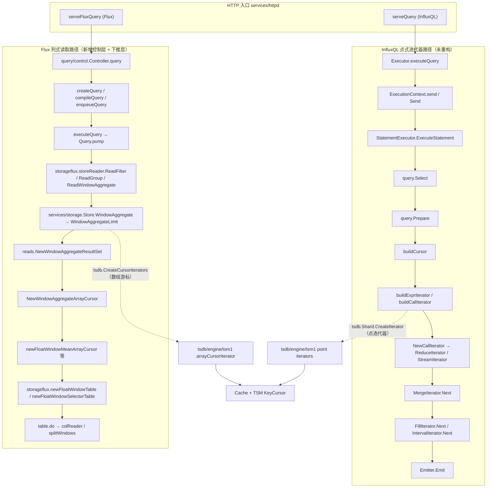
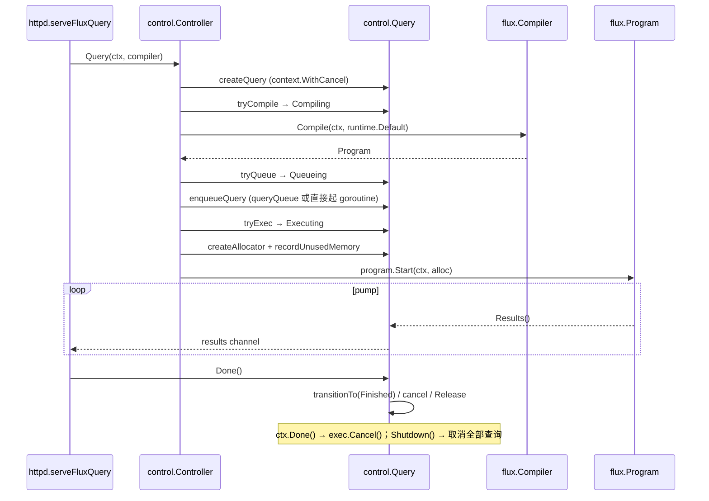
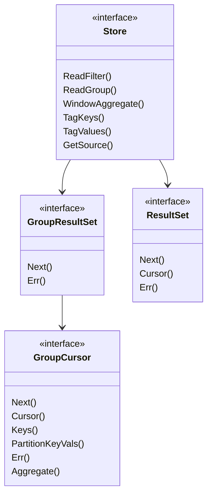

# 版本差异 3: 查询引擎、Flux 存储读取与 InfluxQL 执行（v1.8.10 → v1.12.3）

> **版本基线**
>
> - OLD：`v1.8.10` = commit `688e697c51`（2021-10-11）
> - NEW：`v1.12.3` = commit `f3d5cb68ab`（`docs/specs/` 这批文档的代码基准）
> - 区间：527 commits，602 files，+79,310 / −45,239
> - 本文件覆盖目录（`query/`、`storage/reads/`、`storage/flux/`、`tsdb/cursors/`、`tsdb/engine/tsm1/array_cursor*`）：
>   93 files，+30,372 / −9,998；涉及 69 个提交（含 array cursor 相关 tsm1 文件）。
> - NEW 的当前工作树只额外包含 4 个 docs 提交，代码与 `f3d5cb68ab` 相同。
>
> 引用格式：旧 `v1.8.10:path:line`，新 `v1.12.3:path:line`（即当前工作树行号）。
> 新版本行为的详细讲解见 [03 查询引擎](../03_query_engine_spec.md)、
> [08 Array Cursor](../08_array_cursor_spec.md)、[09 Storage Reads](../09_storage_reads_spec.md)、
> [11 InfluxQL 执行](../11_influxql_execution_spec.md)；HTTP/Flux 外围差异见
> [06 HTTP / Flux 差异](06_http_flux_diff.md)。

> **小白导读**
>
> 1. **一句话结论：InfluxQL 老引擎只是“打补丁”，Flux 读路径则是“换了发动机”。**
>    InfluxQL 的 `ExecutionContext` / `TaskManager` / `Iterator` 模型几乎原样保留，
>    改的是若干正确性 bug 和三个 HLL 算子；Flux 侧则把 2.x 的查询控制器
>    （`query/control`）整包搬进 1.x，并新增“窗口聚合下推”这一整层。
> 2. **旧版 Flux 控制器是“裸奔”的**：`flux/control/controller.go` 只有 127 行，
>    编译完直接 `program.Start`，内存分配器是 `&memory.Allocator{}`——不限内存、
>    不排队、不统计、不管理取消。新版 `query/control` 有 1108+157+111 行，
>    维护 7 状态状态机、并发配额、单查询/全局内存池、队列和 11 组 Prometheus 指标。
> 3. **查询从“拉取点”升级为“下推聚合”**：Flux 的 `window + mean/count/sum/min/max/first/last`
>    以及裸聚合、`group + 聚合` 现在由存储层直接算完再上送。
>    为此 `storage/reads.Store` 新增 `WindowAggregate`，`GroupCursor` 新增 `Aggregate()`，
>    proto 新增 `ReadWindowAggregateRequest` / `MultiPointsFrame`。
> 4. **表生成器从 10 种表变成 25 种表**：`storage/flux/table.gen.go`（4792 行）
>    为每种 Flux array 类型生成 5 个表：普通、window、window-selector、empty-window-selector、group。
>    旧版只有普通表和 group 表。
> 5. **一个边界值的修正会改变结果**：存储游标的时间范围从 `[start, stop)`
>    改成 `[start, stop]`，调用方统一传 `EndTime = stop - 1`。
>    以前恰好落在 `stop` 上的点是否返回，取决于哪条路径，现在统一“不返回”。
> 6. **元查询悄悄变了**：`SHOW SERIES CARDINALITY FROM ...`（非 EXACT）从精确
>    `count(distinct(_seriesKey))` 变成 HLL 近似；`SHOW TAG VALUES` 开始遵守
>    指定的 retention policy，多 RP 直接报错；`SHOW FIELD KEY CARDINALITY`
>    改走 `_fieldKeys` 系统迭代器。

---

## 1. 结论速览

| # | 变更点 | v1.8.10 | v1.12.3 | 影响 | 证据 |
|---|--------|---------|---------|------|------|
| 1 | Flux 查询控制器 | `flux/control`，127 行，无队列/无内存限制/无状态机 | `query/control`（controller 1108 行 + memory 157 + metrics 111），7 状态、队列、内存池 | 资源可控；错误码/取消语义变化 | `v1.8.10:flux/control/controller.go:73` / `v1.12.3:query/control/controller.go:175` |
| 2 | 控制器配置 | 无（构造参数写死） | `[flux-controller]`：`query-concurrency`、`query-initial-memory-bytes`、`query-max-memory-bytes`、`total-max-memory-bytes`、`query-queue-size` | 默认 0 = 不限制；配错会拒绝启动 | `v1.12.3:query/control/controller.go:77`-`:109`、`cmd/influxd/run/config.go:45` |
| 3 | 查询指标 | `PrometheusCollectors()` 返回 nil | `qc_requests_total` / `qc_functions_total` / `qc_*_active` / `qc_*_duration_seconds` / `qc_memory_unused_bytes` | 可观测性从 0 到 1 | `v1.8.10:flux/control/controller.go:125` / `v1.12.3:query/control/metrics.go:34`、`:44`、`:64` |
| 4 | 每用户查询字节 | 无 | `userquerybytes` 统计（tag `user`），开关 `user-query-bytes-enabled`（#27188） | 可按用户计费；默认关闭 | `v1.12.3:services/httpd/config.go:68`、`services/httpd/handler.go:505`、`:484` |
| 5 | Flux 读接口 | `ReadFilter` / `ReadGroup` | 追加 `ReadWindowAggregate`，`alloc *memory.Allocator` → `alloc memory.Allocator` | 外部实现（企业版/自定义 Reader）编译失败 | `v1.8.10:flux/stdlib/influxdata/influxdb/storage.go:90` / `v1.12.3:flux/stdlib/influxdata/influxdb/storage.go:111`-`:116` |
| 6 | 存储 Store 接口 | `ReadFilter` / `ReadGroup` | 追加 `WindowAggregate` | 下推窗口聚合的入口 | `v1.8.10:storage/reads/store.go:76` / `v1.12.3:storage/reads/store.go:81` |
| 7 | GroupCursor | 无 `Aggregate()` | `Aggregate() *datatypes.Aggregate` | 上层据此决定列布局（是否保留 `_time`） | `v1.12.3:storage/reads/store.go:75`、`storage/reads/group_resultset.go:288`、`:339` |
| 8 | 聚合类型 | sum / count | sum/count/min/max/first/last/mean + meanCount 双聚合 | 7 种聚合可下推 | `v1.8.10:storage/reads/array_cursor.go:25`-`:27` / `v1.12.3:storage/reads/array_cursor.go:20`-`:56` |
| 9 | 存储层数组游标 | 23 个类型（sum/count/filter/multishard） | 50 个类型（新增 limit/window×7/window-mean-count） | 窗口聚合在游标层完成 | `v1.8.10:storage/reads/array_cursor.gen.go:174` / `v1.12.3:storage/reads/array_cursor.gen.go:27`、`:50`、`:199` |
| 10 | 游标时间范围 | `EndTime = end`（`[start, stop)`） | `EndTime = end - 1`（存储侧 `[start, stop]`） | 落在 stop 的点不再返回；各路径统一 | `v1.8.10:storage/reads/array_cursor.go:100` / `v1.12.3:storage/reads/array_cursor.go:90` |
| 11 | 游标错误传播 | `shard.Next` 错误被 `_` 丢弃；`reset` 无返回值 | `reset`/`build*Cursor` 返回 `error`；`windowAggregateResultSet.Err()` 会上抛，但 filter/group 的 `Err()` 仍恒 nil（见 §7.1/§7.2） | nil 游标 panic 减少；但仍有漏点（见第 7 节） | `v1.8.10:storage/reads/array_cursor.go:133` / `v1.12.3:storage/reads/array_cursor.go:126`、`tsdb/engine/tsm1/array_cursor.gen.go:42` |
| 12 | array cursor 优化判定 | `pos==0 && len(res)>=len(tsm)` | 追加 `c.tsm.pos==0`（#26691） | 修复“整块走 TSM”误判导致的错值/重复 | `v1.8.10:tsdb/engine/tsm1/array_cursor.gen.go:107` / `v1.12.3:tsdb/engine/tsm1/array_cursor.gen.go:113` |
| 13 | 谓词表示 | gogo/protobuf；`TagRefValue string`；只在读时转换 | protobuf-go；`TagRefValue bytes`；计划期转换一次 | 读路径少一次 AST→PB 转换 | `v1.8.10:storage/reads/flux_predicate.go:19` / `v1.12.3:flux/stdlib/influxdata/influxdb/flux_predicate.go:19`、`rules.go:179` |
| 14 | Flux 表类型 | 10 种（普通 + group） | 25 种（+window / window-selector / empty-window-selector） | 空窗口、selector、createEmpty 可下推 | `v1.8.10:storage/reads/flux_table.gen.go:25`、`:101` / `v1.12.3:storage/flux/table.gen.go:107`、`:320`、`:416` |
| 15 | 聚合下推规则 | 0 条聚合规则 | 4 条：window / windowByTime / bare / group | Flux 计划层出现 `ReadWindowAggregate*` | `v1.8.10:flux/stdlib/influxdata/influxdb/rules.go:12`-`:20` / `v1.12.3:flux/stdlib/influxdata/influxdb/rules.go:22`-`:33` |
| 16 | InfluxQL 新增算子 | 无 | `count_hll` / `sum_hll` / `merge_hll` | 常量内存基数估计 | `v1.12.3:query/call_iterator.go:56`、`:1538`、`:1589`；`query/compile.go:787` |
| 17 | `SHOW SERIES CARDINALITY` | 非 EXACT 且带 FROM/WHERE 时走精确 distinct | 走 `count_hll(sum_hll(_seriesKey))` 近似 | 结果从精确变近似（有误差上界） | `v1.8.10:query/statement_rewriter.go:183`-`:222` / `v1.12.3:query/statement_rewriter.go:219`-`:243` |
| 18 | `SHOW FIELD KEY CARDINALITY` | 扫描实际数据源 | 子查询走 `_fieldKeys` 系统迭代器 | 索引级完成，语义依赖 field key 索引 | `v1.8.10:query/statement_rewriter.go:55`-`:95` / `v1.12.3:query/statement_rewriter.go:57`-`:101`；`tsdb/shard.go:2291` |
| 19 | `SHOW TAG VALUES` 的 RP | 重写时丢弃 `Sources`，扫描所有 RP | 保留 `Sources`，只查指定 RP；多 RP 报错 | 结果变准；多 RP 查询由“能跑”变“报错” | `v1.8.10:query/statement_rewriter.go:266` / `v1.12.3:query/statement_rewriter.go:317`；`coordinator/statement_executor.go:1143` |
| 20 | `GROUP BY time` + DST | `end += offset` 在时区修正之后 | 先加 offset 再做时区修正（#25082） | DST 回退窗口不再丢行 | `v1.8.10:query/iterator.go:864` / `v1.12.3:query/iterator.go:860` |
| 21 | 多语句错误结果 | `send` 覆盖 `StatementID`，`ErrNotExecuted` 数量少 1 | 显式传 `StatementID`，循环从 `i+1` 到末尾 | 结果条数与 ID 修正 | `v1.8.10:query/execution_context.go:93`、`query/executor.go:383` / `v1.12.3:query/execution_context.go:93`、`query/executor.go:432` |
| 22 | `SHOW QUERIES` | 5 列，无按库鉴权过滤 | 6 列（+`user`），按 READ 权限过滤（#27196） | 越权泄漏修复 | `v1.8.10:query/task_manager.go:152` / `v1.12.3:query/task_manager.go:34`、`:144` |
| 23 | 编译期 panic | 直接 panic | `Compile` defer recover，返回 `likely malformed statement...` | 畸形语句变错误而非进程崩溃 | `v1.8.10:query/compile.go:106` / `v1.12.3:query/compile.go:106`、`:118`-`:128` |
| 24 | 窗口 mean/count 的整数精度 | 无窗口 mean 下推（能力区间内新增） | 初版 `float64` 累加，后改为 int64/uint64 原生累加（#21334） | 大整数不再丢精度 | `v1.12.3:storage/reads/array_cursor.gen.go:2030`、`:2146`；commit `4cf19f8254` |
| 25 | 结果序列化 | `SeriesFrame.data_type` 已写（gen.go 10 处）；空 series 先建后删 | 类型改由 `startSeries(dataType,tags)` 填；有数据才建；新增 `MultiPointsFrame`/`DataTypeMulti` | 空 series 不再占位；双聚合新增一条 oneof 分支 | `v1.8.10:storage/reads/response_writer.gen.go:40` / `v1.12.3:storage/reads/response_writer.go:205`、`:216`、`storage/reads/response_writer.gen.go:89` |

---

## 2. 变更地图

### 2.1 两条查询路径：仍然完全分离



要点：

- InfluxQL 从来不经过 `storage/reads`：`coordinator/statement_executor.go:647` 调用
  `query.Select(ctx, stmt, e.ShardMapper, sopt)`，`query/select.go:622` 的 `buildCursor`
  通过 `IteratorCreator.CreateIterator` 拿到**点迭代器**。
- Flux 才走 `storage/reads` / `storage/flux`：`services/storage/store.go:234` 的
  `WindowAggregateLimit` 通过 `tsdb.CreateCursorIterators`（`tsdb/cursor.go:39`）
  拿到**数组游标**（`arrayCursorIterator`）。
- 因此本文件里的“数组游标/批量读取”改动只影响 Flux（以及 `influx_tools`），
  不影响 InfluxQL 的 `GROUP BY`。

### 2.2 Flux 查询生命周期（新控制器）



### 2.3 storage/reads 接口的扩张



新增的两块是 `Store.WindowAggregate` 与 `GroupCursor.Aggregate()`；`ResultSet.Err()` 是旧接口就有的，
但旧实现的 `resultSet.Err()` 恒为 `nil`（`v1.8.10:storage/reads/resultset.go:33`），
新实现仍然恒为 `nil`（`v1.12.3:storage/reads/resultset.go:33`），
真正的错误改由 `windowAggregateResultSet.Err()` 返回（`storage/reads/aggregate_resultset.go:148`）。

---

## 3. 逐项差异

### 3.1 Flux 查询控制器：`flux/control` → `query/control`

**旧版：编译完直接跑，没有任何资源账本。**

```go
// v1.8.10:flux/control/controller.go:92 — Controller.Query
func (c *Controller) Query(ctx context.Context, compiler flux.Compiler) (flux.Query, error) {
	requestStart := time.Now()
	for _, dep := range c.deps {
		ctx = dep.Inject(ctx)
	}
	p, err := c.compile(ctx, compiler, requestStart)
	if err != nil {
		return nil, err
	}
	alloc := &memory.Allocator{}      // 无限制、无统计
	return p.Start(ctx, alloc)
}
```

整个文件 127 行，只有 `Controller`（`deps`、`logger` 两个字段）、`query` 包装器（只为补
`CompileDuration`/`ExecuteDuration`）和 `program` 包装器。没有队列，没有 `Shutdown`，
没有取消后的结果排空，也没有 Prometheus 指标（`PrometheusCollectors()` 返回 `nil`，
`v1.8.10:flux/control/controller.go:125`）。

**新版：从 2.x 整包搬来的控制器**（commit `b9ee9e5b44` “pull in controller from 2.x”，
`f1aa051787` 把参数做成配置）。

```go
// v1.12.3:query/control/controller.go:246 — Controller.query
func (c *Controller) query(ctx context.Context, compiler flux.Compiler, deps *dependency.Span) (flux.Query, error) {
	q, err := c.createQuery(ctx, compiler, deps)
	if err != nil {
		return nil, handleFluxError(err)
	}
	if err := c.compileQuery(q, compiler); err != nil {
		q.setErr(err); c.finish(q); c.countQueryRequest(q, labelCompileError)
		return nil, q.Err()
	}
	if err := c.enqueueQuery(q); err != nil {
		q.setErr(err); c.finish(q); c.countQueryRequest(q, labelQueueError)
		return nil, q.Err()
	}
	return q, nil
}
```

对应结构：

| 机制 | 旧 | 新 | 证据 |
|------|----|----|------|
| 状态机 | 无 | `Created → Compiling → Queueing → Executing → Errored/Finished/Canceled` | `v1.12.3:query/control/controller.go:999`-`:1014`、`:1049` |
| 并发配额 | 无 | `ConcurrencyQuota` 个 `processQueryQueue` goroutine + `WaitGroup` | `:77`、`:219`-`:231`、`:427` |
| 队列 | 无 | 有界 `chan *Query`；满则 `codes.ResourceExhausted` “queue length exceeded” | `:386`-`:424` |
| 单查询内存 | `memory.Allocator{}` | `queryMemoryManager`：初始配额 + 硬上限 + 全局池 CAS 申请 | `query/control/memory.go:73`-`:116` |
| 全局内存池 | 无 | `unusedMemoryBytes`，`MaxMemoryBytes - ConcurrencyQuota*Initial` | `controller.go:191`-`:199`、`memory.go:31`-`:45` |
| 取消 | 只依赖调用方 ctx | `context.WithCancel` + `Query.Cancel` + `pump` 在 ctx.Done 时 `exec.Cancel()` | `controller.go:292`、`:631`、`:896`-`:930` |
| 关闭 | 无 | `Shutdown(ctx)` 取消全部查询，`abort` 兜底 | `controller.go:516`-`:554` |
| panic | 无 recover | `compileQuery` / `executeQuery` defer recover 并打栈 | `:345`-`:365`、`:439`-`:460` |
| 错误映射 | 原样返回 | `handleFluxError`：`codes.NotFound→ENotFound` 等 | `:1063`-`:1108` |
| 指标 | 无 | `qc_requests_total`、`qc_functions_total`、`qc_all_active`、`qc_compiling_active`、`qc_queueing_active`、`qc_executing_active`、`qc_memory_unused_bytes`、4 个 duration 直方图 | `query/control/metrics.go:34`-`:90` |

**内存管理器的工作方式**（`query/control/memory.go`）：

```go
// v1.12.3:query/control/memory.go:73 — queryMemoryManager.RequestMemory
if q.limit+want > q.m.memoryBytesQuotaPerQuery {
	return 0, errors.New("query hit hard limit")   // 单查询硬上限
}
for {
	unused := int64(math.MaxInt64)
	if !q.m.unlimited {                             // 默认 unlimited：不读全局池
		unused = q.m.getUnusedMemoryBytes()
		if unused < want {
			return 0, errors.New("not enough capacity")    // 全局池不够
		}
	}
	given := q.giveMemory(want, unused)                 // 尽量翻倍给，减少反复申请
	if !q.m.unlimited {
		if !q.m.trySetUnusedMemoryBytes(unused, unused-given) { continue }  // CAS 重试
	}
	q.limit += given
	q.given += given
	return given, nil
}
```

`FreeMemory` 是空实现（`memory.go:143`-`:147`）：内存只在 `Release()`（查询 `Done()`）时
一次性归还，**运行中不会因为释放中间结果而退还配额**。这是后面第 7 节要讲的风险。

**语义影响**

1. 默认行为仍然“不限制”：`control.NewConfig()` 返回零值，`Config.complete()` 把
   `MemoryBytesQuotaPerQuery==0` 解释为 `math.MaxInt64`、`InitialMemoryBytesQuotaPerQuery==0`
   继承前者；`ConcurrencyQuota==0` 时 `queryQueue=nil`，来一个查询起一个 goroutine
   （`controller.go:117`-`:131`、`:201`-`:203`、`:394`-`:415`）。所以**不配置就不会变慢/变严**。
2. 一旦配置了 `query-concurrency > 0`，`QueueSize` 必须为正，否则 `Config.validate` 直接报错
   （`controller.go:134`-`:150`）；服务起不来，而不是运行期降级。
3. 取消语义变强：客户端断开后，`pump` 会显式 `exec.Cancel()` 并继续排空结果，
   避免底层 Flux 程序卡在写 channel 上（`controller.go:896`-`:930`）。
4. 控制器只在 `flux-enabled=true` 时创建（`cmd/influxd/run/server.go:327`-`:347`），
   指标也只在此时注册（`:346`）。

### 3.2 每用户查询字节统计（#27188）：跨层改动，不在 `query/*`

这条经常被误认为“查询引擎统计”，实际实现全在 `services/httpd`：

```go
// v1.12.3:services/httpd/handler.go:505
func (h *Handler) addQueryBytesForUser(user string, n int64) {
	if !h.Config.UserQueryBytesEnabled {
		return
	}
	counter, _ := h.queryBytesPerUser.LoadOrStore(user, &atomic.Int64{})
	counter.Add(n)
}
```

- 开关：`UserQueryBytesEnabled` / toml `user-query-bytes-enabled`，默认 `false`
  （`v1.12.3:services/httpd/config.go:68`）。
- 计数点覆盖四条路径：InfluxQL 普通响应 `:913`、chunked 响应 `:821`、
  Flux 响应 `:2259`、storage 读响应 `:2094`。
- 输出：`/debug/vars` 与 `SHOW STATS` 中多出 `userquerybytes` 统计（tag `user`，
  匿名记为 `StatAnonymousUser`），见 `services/httpd/handler.go:484`-`:496`。

**影响**：默认关闭，升级不改变行为；开启后每个活跃用户多一个 `atomic.Int64`
和一条统计行，用户数极大时 `SHOW STATS` 结果集会变大。

### 3.3 InfluxQL Executor：`StatementID` 与 `ErrNotExecuted`（#22273）

旧版 `ExecutionContext.send` 会用 `ctx.statementID` **覆盖**调用方设置的 `StatementID`：

```go
// v1.8.10:query/execution_context.go:93 — send
func (ctx *ExecutionContext) send(result *Result) error {
	result.StatementID = ctx.statementID   // 覆盖
	...
}
```

而补发未执行语句的循环又从当前 `i` 开始、到 `len-1` 结束：

```go
// v1.8.10:query/executor.go:383
for ; i < len(query.Statements)-1; i++ {
	if err := ctx.send(&Result{StatementID: i, Err: ErrNotExecuted}); ...
}
```

于是：第 `i` 条语句失败时会多发一条（被覆盖成同一个 ID）的 `ErrNotExecuted`，
最后一条语句永远不会补发。新版删除覆盖逻辑（`v1.12.3:query/execution_context.go:93`），
并在需要时显式传 ID（`query/executor.go:383` 的 normalizer 分支），循环改为：

```go
// v1.12.3:query/executor.go:432
for i++; i < len(query.Statements); i++ {
	if err := ctx.send(&Result{StatementID: i, Err: ErrNotExecuted}); ...
}
```

**语义影响**：`SELECT ...; SELECT ...; SELECT ...` 中第一条报错时，旧版结果条数/ID 错位，
新版严格每剩一条语句一条 `ErrNotExecuted`。客户端如果按“结果条数 == 语句数”做校验，
升级后行为才正确。

另外，区间内 `FineAuthorizer` 新增了 `OptimizeSeriesRead` 钩子（`2cf2103cc4` #25207）：
接口定义在 `query/executor.go:93`-`:94`，`openAuthorizer`/`voidAuthorizer` 的实现是 no-op
（`:118`-`:119`、`:147`-`:148`）。OSS 里它恒为 open/true，企业版可据此把授权条件下推成索引过滤、
减少 series 扫描（`tsdb/index.go:2986`-`:2999`）。

### 3.4 InfluxQL TaskManager：user 字段、超时日志、SHOW QUERIES 鉴权

```go
// v1.12.3:query/task_manager.go:34
var queryFieldNames []string = []string{"qid", "query", "database", "duration", "status", "user"}
```

- `Task` 增加 `userID`，来自 `ExecutionOptions.UserID`（`query/executor.go:206`、
  `task_manager.go:216`）；`QueryInfo.User` 暴露到 JSON（`:288`，赋值见 `:305`）。
- `LogTimedoutQueries`（`task_manager.go:76`）打开时，`waitForQuery` 在超时分支打
  `"query killed for exceeding timeout limit"`，带 query/database/user/timeout（`:329`-`:337`）。
- `SHOW QUERIES` 结果按 `CoarseAuthorizer.AuthorizeDatabase(ReadPrivilege, db)` 过滤
  （`task_manager.go:144`），修复 #27196 的越权泄漏。
- 慢查询日志追加 `user`（`:231`-`:233`）。
- `SIGTERM` 时可选择把当前查询 dump 到日志（`LogCurrentQueries`，`task_manager.go:173`-`:181`，
  commit `fd1d51690d`）。

**兼容性**：`SHOW QUERIES` 多一列；老的 5 列客户端若按列数严格解析会受影响。
`QueryInfo` JSON 多一个 `user` 字段（向后兼容）。InfluxQL 的超时/取消链路本身没有重构：
`ExecutionContext.watch`（`v1.12.3:query/execution_context.go:32`）与
`TaskManager.waitForQuery`（`v1.12.3:query/task_manager.go:311`）与旧版结构一致，
差异只在日志与鉴权。

### 3.5 InfluxQL 新增 HLL 算子：`count_hll` / `sum_hll` / `merge_hll`

这是 InfluxQL 执行链在区间内**唯一新增的算子族**（commit `903b8cd0ea`），
目的是让 `SHOW SERIES CARDINALITY` 这类查询用常量内存做基数估计。

旧版没有任何 HLL 入口（`v1.8.10:query/select.go:258` 的分支列表里没有 `count_hll`）。
新版的三个入口：

```go
// v1.12.3:query/select.go:258
case "count_hll", "derivative", "non_negative_derivative", ..., "elapsed":
...
case "count_hll":
	return NewCountHllIterator(input, opt)      // v1.12.3:query/select.go:274
// v1.12.3:query/select.go:516
case "min", "max", "sum", "first", "last", "mean", "sum_hll", "merge_hll":
	return b.callIterator(ctx, expr, opt)
```

```go
// v1.12.3:query/call_iterator.go:1538 — NewSumHllIterator
// v1.12.3:query/call_iterator.go:1589 — NewCountHllIterator（只接受 StringIterator，输出 UnsignedPoint）
// v1.12.3:query/call_iterator.go:56   — NewCallIterator 分发到 sum_hll / merge_hll
```

关键细节：

- `sum_hll` 在**分片内**累加 sketch，跨分片合并时 `Iterators.Merge` 把表达式替换成
  `merge_hll`：

  ```go
  // v1.12.3:query/iterator.go:157
  // When merging the sum_hll() function, use merge_hll() to sum the counted points.
  if call.Name == "sum_hll" {
      opt.Expr = &influxql.Call{Name: "merge_hll", Args: call.Args}
  }
  ```

- 出错不返回 `error`，而是把错误编码进字符串：`HLLERROR ...` 前缀；
  正常 sketch 用 `HLL_` + base64（`query/functions.go:2169`、`:2213` 的
  `unmarshalPlus` / `marshalPlus`）。原因写在代码注释里：
  “返回 error 会让所有聚合函数慢约 1%”。
- `count_hll` 遇到长度合法但内容非法的 sketch 时静默返回 0（`query/functions.go:2256`-`:2262`），
  错误被吞掉——这是有意的性能取舍；但过短的字符串会直接 panic 而不是返回 0（见 §7.6），排障时需要知道。
- `query/compile.go:787` 的 `compileCountHll` 只接受 1 个参数，并把
  `OnlySelectors` 置 false；`compile.go:309` 负责字段级分发。

**行为变化**：`SHOW SERIES CARDINALITY` 的非 EXACT 路径从精确变近似（见 3.6）。
另外 HLL 对**字符串值**直接 `[]byte(p.Value)`，对数值类型用 BigEndian 二进制
（`query/functions.gen.go.tmpl` 的 `SumHllReducer`），输入类型决定估计口径。

### 3.6 InfluxQL 元查询重写：四个 SHOW 的行为变化

**(a) `SHOW SERIES CARDINALITY`：精确 → 近似（带 FROM/WHERE 时）**

```go
// v1.12.3:query/statement_rewriter.go:219 — 新增 HLL 分支
if !stmt.Exact && stmt.Dimensions == nil && stmt.Limit == 0 && stmt.Offset == 0 {
	return &influxql.SelectStatement{
		Fields: []*influxql.Field{{Expr: &influxql.Call{
			Name: "count_hll",
			Args: []influxql.Expr{&influxql.Call{Name: "sum_hll",
				Args: []influxql.Expr{&influxql.VarRef{Val: "_seriesKey"}}}},
			Alias: "cardinality estimation",
		}}},
		Sources: rewriteSources2(stmt.Sources, stmt.Database),
		...
	}, nil
}
```

旧版没有这段，非 EXACT 查询落到 `count(distinct(_seriesKey))`（精确、耗内存）：

```go
// v1.8.10:query/statement_rewriter.go:207
Expr: &influxql.Call{Name: "count", Args: []influxql.Expr{
	&influxql.Call{Name: "distinct", Args: []influxql.Expr{&influxql.VarRef{Val: "_seriesKey"}}},
}},
```

但注意**裸查询仍然走索引精确计数**：新版保留了开头的早退分支
（`v1.12.3:query/statement_rewriter.go:203`-`:205`），返回原始语句，
由 `executeShowSeriesCardinalityStatement` 调 `TSDBStore.SeriesCardinality`
（`coordinator/statement_executor.go:923`）。所以：
`SHOW SERIES CARDINALITY`（无 FROM/WHERE）= 精确；
`SHOW SERIES CARDINALITY FROM cpu WHERE ...` = HLL 近似。

**(b) `SHOW FIELD KEY CARDINALITY`：数据扫描 → `_fieldKeys` 索引**

旧版直接把测量名替换成真实数据源（`rewriteSources2`），再对 `_fieldKey` 做
`count(distinct(...))`（`v1.8.10:query/statement_rewriter.go:72`-`:86`）。
新版改成子查询，从 `_fieldKeys` 系统迭代器取 `fieldKey`/`fieldType`：

```go
// v1.12.3:query/statement_rewriter.go:90-92 — 子查询源
Sources: influxql.Sources{&influxql.SubQuery{Statement: &influxql.SelectStatement{
	Fields: influxql.Fields([]*influxql.Field{
		{Expr: &influxql.VarRef{Val: "fieldKey"}},
		{Expr: &influxql.VarRef{Val: "fieldType"}},
	}),
	Sources:    rewriteSources(stmt.Sources, "_fieldKeys", stmt.Database),
	Condition:  rewriteSourcesCondition(stmt.Sources, nil),
	OmitTime:   true,
	Dedupe:     true,
	IsRawQuery: true,
}}},
```

配套的 `tsdb.NewFieldKeysIterator`（`v1.12.3:tsdb/shard.go:2291`）曾加过
aux 参数校验，随后因为“企业版到处误用”被 `cc26b7653c`（#23875）回退。
因此当前版本**不会校验** aux 列，调用方传错列名会得到空/异常结果而不是错误。

**(c) `SHOW TAG VALUES`：保留 Sources，单 RP**

旧版重写返回的新语句**没有 `Sources` 字段**：

```go
// v1.8.10:query/statement_rewriter.go:266
return &influxql.ShowTagValuesStatement{
	Database:   stmt.Database,
	Op:         stmt.Op,
	TagKeyExpr: stmt.TagKeyExpr,
	Condition:  condition,
	SortFields: stmt.SortFields,
	Limit:      stmt.Limit,
	Offset:     stmt.Offset,
}, nil
```

新版补上 `Sources: stmt.Sources`（`v1.12.3:query/statement_rewriter.go:317`），
执行器据此限定 shard：

```go
// v1.12.3:coordinator/statement_executor.go:1129 — 收集 RP
rps := make([]string, 0, len(di.RetentionPolicies))
for _, m := range q.Sources.Measurements() {
	if len(m.RetentionPolicy) > 0 { rps = append(rps, m.RetentionPolicy) }
}
...
} else {
	for _, rp := range rps {
		if rp != rps[0] {
			return fmt.Errorf("only one retention policy allowed in SHOW TAG VALUES query: \"%s\", \"%s\"", rp, rps[0])
		}
	}
}
```

同时 `NormalizeStatement` 对 `ShowTagValuesStatement` 跳过 measurement 归一化，
以便“不写 RP 时跨所有 RP”（`coordinator/statement_executor.go:1419`）。
另外 `SHOW TAG KEYS` 新增 `WITH KEY`（`query/statement_rewriter.go:398`-`:425`，
commit `17b9ea8723`）。

**(d) `SHOW MEASUREMENTS` 新增通配库/RP**（`611a4370a2` #22388）：`ON *.*` 展开所有 db×rp，
`ON db.*` 展开该库所有 RP；`ON *`、`ON *.rp` 报错
（`v1.12.3:coordinator/statement_executor.go:733`-`:770`）。它依赖 influxql v1.2.0 新增的
`WildcardDatabase`/`WildcardRetentionPolicy` AST 字段：v1.8.10 的解析器在 `ON` 后只接受
`ParseIdent`，`ON *.*` 直接解析失败。

### 3.7 `storage/reads` 契约：`WindowAggregate`、`GroupCursor.Aggregate()`、proto

**(a) Store 接口与结果集**

```go
// v1.12.3:storage/reads/store.go:81
WindowAggregate(ctx context.Context, req *datatypes.ReadWindowAggregateRequest) (ResultSet, error)

// v1.12.3:storage/reads/store.go:75 — GroupCursor 新增
Aggregate() *datatypes.Aggregate
```

返回结果集的读取方法只有 `ReadFilter` / `ReadGroup`（`v1.8.10:storage/reads/store.go:76`-`:78`），
`GroupCursor` 没有 `Aggregate()`；`Store` 另有 `TagKeys` / `TagValues` / `GetSource`。

**(b) 请求 proto 新增**

```proto
// v1.12.3:storage/reads/datatypes/storage_common.proto:86-94
message ReadWindowAggregateRequest {
  google.protobuf.Any ReadSource = 1;
  TimestampRange range = 2;
  Predicate predicate = 3;
  int64 WindowEvery = 4;
  int64 Offset = 6;
  repeated Aggregate aggregate = 5;
  Window window = 7;
}
```

同时 `Aggregate.AggregateType` 从 `NONE/SUM/COUNT` 扩到
`...Min=3 / Max=4 / First=5 / Last=6 / Mean=7`（`:74`-`:78`），
响应新增 `DataTypeMulti = 5` 与 `MultiPointsFrame`（`:126`、`:179`），
用于 mean+count 双聚合一次返回两列。

**(c) 分片方向选择**

```go
// v1.12.3:services/storage/store.go:195
descending := !reads.IsAscendingGroupAggregate(req)
shardIDs, err := s.findShardIDs(database, rp, descending, start, end)
// v1.12.3:services/storage/store.go:252
descending := !reads.IsAscendingWindowAggregate(req)
```

旧版 `ReadGroup` 固定 `findShardIDs(..., false, ...)`（`v1.8.10:services/storage/store.go:162`），
即永远升序。新版为了 `last()` 的“降序游标 + limit 1”优化，会让 shard 列表反向
（`storage/reads/group_resultset.go:46`、`aggregate_resultset.go:28`）。
`IsAscendingWindowAggregate` 只在“单聚合且为 last 且窗口为单窗口”时返回 false
（`aggregate_resultset.go:28`-`:47`），否则仍然升序。

**(d) 谓词 proto 更换实现**

```proto
// v1.12.3:storage/reads/datatypes/predicate.proto:44
bytes TagRefValue = 9;     // 旧：string tag_ref_value = 9
```

生成器从 gogo 切到 `google.golang.org/protobuf`（`option go_package = ".;datatypes"`），
枚举常量名从 `NodeTypeLogicalExpression` 变成 `Node_TypeLogicalExpression`。
**线格式（字段号/类型）没变，但 Go API 变了**：`storage/reads.Store.GetSource`
的返回类型从 `github.com/gogo/protobuf/proto.Message` 变成
`google.golang.org/protobuf/proto.Message`（`v1.12.3:storage/reads/store.go:9`、`:86`）。
任何外部实现 `Store` / `Reader` 的代码都要改 import。

枚举常量名也统一变成 `<Message>_<Enum>_<Value>`：`FrameTypePoints` → `ReadResponse_FrameTypePoints`
（`v1.12.3:storage/reads/datatypes/storage_common.pb.go:199`）、`HintNone` → `ReadGroupRequest_HintNone`
（`:81`）、`AggregateTypeMean` → `Aggregate_AggregateTypeMean`（`:141`）、`GroupBy` →
`ReadGroupRequest_GroupBy`（`:32`）。`TimestampRange` 从值类型变成指针（旧 proto 标了
`(gogoproto.nullable) = false`），取字段前要判空；`Storage` service 新增
`rpc ReadWindowAggregate`（`storage_common.proto:16`）。

**(e) 谓词转换时机前移**

旧版在 `storage/reads/flux_reader.go` 每次 `ReadFilter`/`ReadGroup`/`handleRead`
都调用 `toStoragePredicate(spec.Predicate)`（`v1.8.10:storage/reads/flux_reader.go:57`、`:77`、`:121`、`:245`）。
新版把语义树转成 `datatypes.Predicate` 的工作放到物理计划规则里
（`v1.12.3:flux/stdlib/influxdata/influxdb/rules.go:179`），`ReadFilterSpec.Predicate`
直接就是 `*datatypes.Predicate`（`flux/stdlib/influxdata/influxdb/storage.go:69`），
reader 少一次遍历。`storage/reads/flux_predicate.go` 整个文件（183 行）被删除。
同一提交（`7210fa6355` #20767）还在 `query/encode.go` 新增 120 行 `NoContentDialect`：
`no-content` 方言把响应状态设为 204 并丢弃查询结果（仍消费 results），另有
`no-content-with-error` 变体，供 Flux 客户端做“只关心成败”的查询。

### 3.8 `array_cursor.gen.go`：从 23 个类型到 50 个类型

`storage/reads/array_cursor.gen.go` 的规模变化：+3423 / −399。

| 能力 | 旧（v1.8.10） | 新（v1.12.3） |
|------|---------------|---------------|
| 基础 filter/multishard | 有 | 有（错误处理加强） |
| filter 游标跨 series 条件复用 | `reset` 复用 `c.filter` 但不更新 `cond`；含 `or` 的谓词跨 series 会沿用上一条 series 的条件 | `else { c.filter.cond = cond }`（5 处生成代码）；丢点/多点，`5976e41d54` #23522 |
| 单聚合 sum/count | `floatArraySumCursor`、`integer*CountArrayCursor` | 能力保留，旧的非窗口实现被窗口化实现取代（`newWindowSumArrayCursor` 等，窗口为零值时即整段） |
| limit（first/last 单窗口） | 无 | `newLimitArrayCursor` / `floatLimitArrayCursor`（`:27`、`:367`） |
| 窗口 first/last | 无 | `newWindowFirstArrayCursor` / `newWindowLastArrayCursor`（`:50`、`:76`） |
| 窗口 count/sum | 无 | `:102`、`:125` |
| 窗口 min/max | 无 | `:145`、`:162` |
| 窗口 mean | 无 | `:179` |
| 窗口 mean+count | 无 | `:199`，输出 `cursors.MeanCountArray` |
| 空游标 | 有（每种类型一个） | 保留 |

`newAggregateArrayCursor` 的分发从“只认 Sum/Count”扩展到 7 种：

```go
// v1.12.3:storage/reads/array_cursor.go:20
func newAggregateArrayCursor(ctx context.Context, agg []*datatypes.Aggregate, cursor cursors.Cursor) (cursors.Cursor, error) {
	switch agg[0].Type {
	case datatypes.Aggregate_AggregateTypeFirst, datatypes.Aggregate_AggregateTypeLast:
		return newLimitArrayCursor(cursor), nil       // 单窗口 selector 只需第一个点
	}
	return NewWindowAggregateArrayCursor(ctx, agg, interval.Window{}, cursor)
}
```

```go
// v1.8.10:storage/reads/array_cursor.go:24
switch agg.Type {
case datatypes.AggregateTypeSum:   return newSumArrayCursor(cursor)
case datatypes.AggregateTypeCount: return newCountArrayCursor(cursor)
default: panic("invalid aggregate")
}
```

**时间范围语义**（commit `8edf7a4e2f`）：

```go
// v1.12.3:storage/reads/array_cursor.go:78
// The range of the cursor is [start, end). ...
// we translate the time range from [start, stop) to [start, stop].
req: cursors.CursorRequest{Ascending: asc, StartTime: start, EndTime: end - 1}
```

旧版直接 `EndTime: end`（`v1.8.10:storage/reads/array_cursor.go:100`）。
`tsdb/cursors.CursorRequest` 的新注释明确写了 `StartTime`/`EndTime` 都是 **inclusive**
（`v1.12.3:tsdb/cursors/cursor.go:64`-`:71`）。
影响：Flux 的 `range(start, stop)` 语义是 `[start, stop)`，旧版把 `stop` 直接交给
存储层，底层按闭区间读，**恰好等于 stop 的点可能被返回**；新版统一减 1。

**逐类型错误返回**：`reset` 从无返回值变成 `error`，`build*ArrayCursor` 同步改签名
（`v1.12.3:tsdb/engine/tsm1/array_cursor.gen.go:42`、
`tsdb/engine/tsm1/array_cursor_iterator.gen.go:18`），
`multiShardArrayCursors.createCursor` 在 `cur == nil || err != nil` 时返回 nil
（`storage/reads/array_cursor.go:126`），不再把错误丢掉后对 nil 游标调 `Next()`。

### 3.9 group/aggregate resultset 的变化

**旧版：`Cursor()` 现场组装聚合游标。**

```go
// v1.8.10:storage/reads/group_resultset.go:332
func (c *groupByCursor) Cursor() cursors.Cursor {
	cur := c.mb.createCursor(*c.rows[c.i-1])
	if c.agg != nil {
		cur = c.mb.newAggregateCursor(c.ctx, c.agg, cur)
	}
	return cur
}
```

**新版：`Next()` 里提前建好，`Cursor()` 只返回结果。**

```go
// v1.12.3:storage/reads/group_resultset.go:343
func (c *groupByCursor) Next() bool {
	if c.i < len(c.seriesRows) {
		c.i++
		c.cursor, c.err = c.createCursor(*c.seriesRows[c.i-1])
		return c.err == nil
	}
	return false
}
// v1.12.3:storage/reads/group_resultset.go:360
func (c *groupByCursor) Cursor() cursors.Cursor { return c.cursor }
```

原因：`newAggregateArrayCursor` 现在会返回错误（例如对 String 做 mean），
必须在 `Next()` 里把错误转成 `Next()==false`（错误本身仍被 `groupByCursor.Err()` 吞掉，见 §7.1），不能等到 `Cursor()`。

**新增 `windowAggregateResultSet`**（`storage/reads/aggregate_resultset.go`，旧版无此文件）：

- `NewWindowAggregateResultSet` 校验聚合个数：只允许 1 个，或 `mean+count` 两个，
  其余返回 `errors.InternalError`（`:50`-`:63`）。
- `createCursor` 判断窗口是否 `math.MaxInt64`（裸聚合），是则 `newAggregateArrayCursor`，
  否则 `NewWindowAggregateArrayCursor`（`:119`-`:131`）。
- `Err()` 返回创建游标时的错误（`:148`），这是新结果集里唯一真正会报错的地方。

**旧版 `resultSet.agg` 是死代码**：`NewFilteredResultSet` 从未给它赋值
（`v1.8.10:storage/reads/resultset.go:25`-`:31`），所以旧版 filter 路径的聚合分支永远不生效；
真正生效的只有 group 路径。新版删掉了这个字段（`resultSet` 只剩 `ctx/seriesCursor/seriesRow/arrayCursors`，
`v1.12.3:storage/reads/resultset.go:14`-`:19`）。

### 3.10 `storage/flux/table.gen.go`（+4792 行）到底带来了什么

**先厘清搬家**：旧版 Flux 的 reader/table 在 `storage/reads/flux_reader.go`、
`storage/reads/flux_table.go`、`storage/reads/flux_table.gen.go`、`storage/reads/flux_tags_cache.go`；
新版整体搬到独立包 `storage/flux`（`package storageflux`），
`cmd/influxd/run/server.go:41` 用别名 `reads` 导入。`storage/reads` 不再依赖 Flux 的
`flux.Table` API，只保留 `flux/interval` 与 `flux/values`（窗口计算需要）。

**表类型：10 → 25。** 对 5 种 Flux array 类型（Float/Integer/Unsigned/String/Boolean，`flux/array`），
每种生成 5 个结构体：

| 表类型 | 用途 | 旧 | 新证据 |
|--------|------|----|--------|
| `<T>Table` | filter 读、无聚合 | 有 | `table.gen.go:32` |
| `<T>GroupTable` | group 读、无窗口 | 有 | `table.gen.go:657` |
| `<T>WindowTable` | 窗口 count/sum/mean 等非 selector | 无 | `floatWindowTable` `:107` |
| `<T>WindowSelectorTable` | 窗口 first/last/min/max | 无 | `floatWindowSelectorTable` `:320` |
| `<T>EmptyWindowSelectorTable` | `createEmpty=true` 的空窗口 | 无 | `floatEmptyWindowSelectorTable` `:416` |

合计 25 个 `*Table struct`；旧版 `storage/reads/flux_table.gen.go` 只有 10 个
（`v1.8.10:storage/reads/flux_table.gen.go:25`、`:101`）。

**列式读取的核心**（`storage/flux/table.go`）：

```go
// v1.12.3:storage/flux/table.go:139 — colReader
type colReader struct {
	refCount int64            // allocateBuffer 据此判断能否复用
	key     flux.GroupKey
	colMeta []flux.ColMeta
	cols    []array.Array
	l       int
}
func (cr *colReader) Floats(j int) *array.Float { ... }   // CheckColType + 类型断言，不复制底层数组
```

- `table.allocateBuffer(l)` 复用上一次的 `colReader`：如果引用计数已归零就重置，
  否则新建（`table.go:124`-`:137`）。
- `table.init(advance)` 在构造时先推进一次，**提前**确定 `empty`
  （`table.go:73`-`:75`）；`table.do` 开头若 `t.err != nil` 直接返回
  （`table.go:87`-`:89`），旧版没有这一步，初始化错误会被吞掉。
- `readTags` 跳过不在列定义里的 tag（`table.go:194`-`:211`）。这是 group aggregate
  必需的：group 聚合只输出 group key 里的 tag，但 `rs.Tags()` 返回完整 tag 集。

**窗口表的实现要点**（以 `floatWindowTable` 为例，`table.gen.go:107`-`:320`）：

1. `createNextBufferTimes`：`createEmpty=true` 时按 `window.NextBounds` 枚举窗口，
   并用 `getWindowBoundsFor` 把 `_start`/`_stop` **裁剪到查询 range**；
   否则从游标读时间戳，用 `window.PrevBounds(window.GetLatestBounds(ts))` 反推。
2. `nextAt(ts)` + `isInWindow(ts, stop)`：判断某个点是否属于某窗口，
   容许 stop 被 range 截断（注释详细解释了 `(start, stop]` 的判定）。
3. `mergeValues`：把窗口内多个点压成一个值；整数 `count` 通过 `fillValue=0`
   把空窗口填 0（`table.go:272`-`:280`，`fillValue` 由 `reader.go:739`-`:744` 传入）。
4. `WindowSelectorTable` 直接用游标返回的 `(timestamp, value)` 作为窗口边界，
   selector 的 `_time` 就是数据点时间；`EmptyWindowSelectorTable` 在没有数据时
   仍按窗口数产生空行。

**窗口切分**：当 spec 不带 `TimeColumn`（即不是 `aggregateWindow`）时，
`windowAggregateIterator.handleRead` 用 `splitWindows` 把“一张表含多窗口”
拆成“一窗口一张表”，并重写 group key 的 `_start`/`_stop`：

```go
// v1.12.3:storage/flux/window.go:20
func splitWindows(ctx context.Context, alloc memory.Allocator, in flux.Table, selector bool, f func(t flux.Table) error) error
// v1.12.3:storage/flux/reader.go:694
if timeColumn == "" {
	tableFn := f
	f = func(table flux.Table) error {
		return splitWindows(wai.ctx, wai.alloc, table, selector, tableFn)
	}
}
```

selector 且值为 null 时，`splitWindows` 产出一张空表（`window.go:70`-`:75`），
以保持 `first()/last()` 对空窗口的语义。

**下推规则**（`flux/stdlib/influxdata/influxdb/rules.go`）：

| 规则 | 匹配 | 产出 | 证据 |
|------|------|------|------|
| `PushDownWindowAggregateRule` | `ReadRange \|> window \|> {count,sum,min,max,mean,first,last}` | `ReadWindowAggregate`（带 WindowEvery/Offset） | `:676`-`:775` |
| `PushDownWindowAggregateByTimeRule` | `ReadWindowAggregate \|> duplicate(_start/_stop) \|> window(inf)` | 设置 `TimeColumn`，供 `aggregateWindow` 用 | `:777`-`:833` |
| `PushDownBareAggregateRule` | `ReadRange \|> 聚合` | `ReadWindowAggregate`（`WindowEvery=MaxInt64`） | `:837`-`:863` |
| `PushDownGroupAggregateRule` | `ReadGroup \|> {count,sum,first,last,min,max}` | `ReadGroup` 带 `AggregateMethod` | `:866`-`:957` |

旧版 `init()` 只注册 6 条规则（含 `SortedPivotRule`），没有任何聚合下推
（`v1.8.10:flux/stdlib/influxdata/influxdb/rules.go:12`-`:20`）；新版 11 条 = 旧 6 条
+ `FromStorageRule`（`fbfd4b4651` #21074，`rules.go:23`）+ 4 条聚合规则。
`mean` 只支持窗口下推，不支持 group 下推（`determineTableColsForGroup` 注释里也写了
“if in the future we will add support for mean”）。

**结果形态**：非 selector 窗口聚合的输出列是 `_start,_stop,_value,tags...`（无 `_time`），
selector 则保留 `_time`（`reader.go:410`-`:452`、`:514`-`:581`）。
这与 Flux 自身 `window()+aggregate` 的输出一致，因此下推对用户透明。

### 3.11 结果序列化：`response_writer` 的变化

本节的全部新行为来自 `1d92b7a8fc`（#23846 “response writer simplification”）；
`32aa970eba`（#21291）只贡献 `MultiPointsFrame` / `DataTypeMulti` 与 mean+count 写出路径。

**旧版：先建 SeriesFrame，没点再回退。**

```go
// v1.8.10:storage/reads/response_writer.go:197 — startSeries 先占位
f := w.getSeriesFrame(next)
w.sf = f.Series
...
w.res.Frames = append(w.res.Frames, datatypes.ReadResponse_Frame{Data: f})
```

`WriteResultSet` 先 `startSeries` 再 `streamCursor`（`v1.8.10:storage/reads/response_writer.go:67`-`:89`）。
真正的回退在每个 `stream<Type>ArraySeries/ArrayPoints` 内部：`ss := len(w.res.Frames)-1` 是**局部**变量，
`seriesValueCount == 0` 时 `putSeriesFrame` 后 `w.res.Frames = w.res.Frames[:ss]`
（`v1.8.10:storage/reads/response_writer.gen.go:108`-`:112` 等 10 处）。`ResponseWriter.ss` 字段只在
`startSeries` 写入（`:202`），全文件从未读取，是死字段，新版已删除。

**新版：有点才建，类型由 `startSeries` 参数传入。**

```go
// v1.12.3:storage/reads/response_writer.go:205
func (w *ResponseWriter) startSeries(dataType datatypes.ReadResponse_DataType, next models.Tags) {
	f := w.getSeriesFrame(len(next))
	sf := f.Series
	sf.DataType = dataType
	...
}
// v1.12.3:storage/reads/response_writer.gen.go:71 — streamFloatArrayPoints
if seriesValueCount == 0 {
	w.startSeries(datatypes.ReadResponse_DataTypeFloat, tags)
}
```

- `SeriesFrame.data_type` 在 v1.8.10 就已写入：`stream*ArraySeries` 与 `stream*ArrayPoints` 共 10 处
  （`v1.8.10:storage/reads/response_writer.gen.go:40`、`:53`、`:143`、`:156`、`:246`、`:259`、`:349`、`:362`、`:452`、`:465`）。
  #23846 只是把赋值收进 `startSeries(dataType, tags)` 并在空 series 时不建 frame。区间内真正新增的是
  `DataTypeMulti = 5` 与 `MultiPointsFrame`（#21291）。
- 新增 `MeanCountArray` 的写出路径（`streamMeanCountArrayPoints`，对应
  `ReadResponse_Frame_MultiPoints` / `AnyPoints`）。
- `Flush` 改为 `defer` 回收所有 frame（`response_writer.go:262`-`:299`），
  即使写失败也会把 buffer 放回池子；旧版在 `stream.Send` 失败时直接返回，frame 留在切片里不被回收。
- 错误传播：`WriteResultSet` 结束返回 `rs.Err()`（`:91`），
  `WriteGroupResultSet` 每组结束检查 `gc.Err()`（`:116`）。
- 大小估算从生成代码的 `f.Size()`/`w.sf.Size()` 改成 `proto.Size(fr)`/`proto.Size(sf)`
  （`v1.12.3:storage/reads/response_writer.go:202`、`:216`）；数组侧 `a.Size()` 沿用旧实现
  （`v1.8.10:storage/reads/response_writer.gen.go:81` 已是 `w.sz += a.Size()`）。
  注释明确说“frame.Size() 在 varint 编码下可能很贵”。

**兼容性**：gRPC 响应多一个 `MultiPointsFrame` oneof 分支；旧版 `ReadResponse`
解析器遇到未知 oneof 会忽略，但 **mean+count 双聚合的客户端必须升级**。

### 3.12 `tsdb/cursors`：MeanCountArray 与游标契约

```go
// v1.12.3:tsdb/cursors/arrayvalues.go:5
type MeanCountArray struct {
	Timestamps []int64
	Values0    []float64   // mean
	Values1    []int64     // count
}
// v1.12.3:tsdb/cursors/cursor.go:42
type MeanCountArrayCursor interface {
	Cursor
	Next() *MeanCountArray
}
```

旧版没有这个类型（`v1.8.10:tsdb/cursors/arrayvalues.go` 只有 5 种数组的 `Size()`）。
它的 `Size()` 单独实现（`arrayvalues.go:33`-`:37`），因为三列长度不同，无法用模板生成。

另外：

- `CursorRequest` 的 `StartTime`/`EndTime` 明确写成 inclusive（`cursor.go:64`-`:71`）。
- 所有数组的 `Len()` 改为 nil-safe（`v1.12.3:tsdb/cursors/arrayvalues.gen.go:29`-`:34` 等 6 处）；
  来自 `bc80e881fa` #24784（“do not panic when empty tags are queried”），避免对 nil 数组取长度时 panic。
- 新增 `tsdb/cursors/mock`（`cursor_iterator.go`、`integer_array_cursor.go`），
  供上层单测注入可控游标。

### 3.13 tsm1 数组游标：#26691、错误传播、降序 reset

**(a) #26691：优化条件漏判 `c.tsm.pos`**

```go
// v1.8.10:tsdb/engine/tsm1/array_cursor.gen.go:107
if pos == 0 && len(c.res.Timestamps) >= len(tvals.Timestamps) {
// v1.12.3:tsdb/engine/tsm1/array_cursor.gen.go:113
if pos == 0 && c.tsm.pos == 0 && len(c.res.Timestamps) >= len(tvals.Timestamps) {
```

这段是升序游标的“全部点都能由 TSM 块直接提供”的快路径：直接把 `tvals` 赋给结果，
跳过逐点归并。旧条件只检查结果缓冲的 `pos==0` 和长度，没有检查 **TSM 侧当前位置**
`c.tsm.pos`。当 TSM 位置不为 0 时，会把从块中间开始的 `tvals` 当成整块返回，
导致**时间戳重复/缺失**。commit `31cb61f556` 补上 `c.tsm.pos == 0`，并新增
`tsdb/engine/tsm1/array_cursor_optimization_bug_test.go`（166 行）复现。

**(b) 错误传播**

`reset` 现在返回 `error`，`Read*ArrayBlock` 的错误不再被 `_` 丢弃：

```go
// v1.12.3:tsdb/engine/tsm1/array_cursor.gen.go:42
func (c *floatArrayAscendingCursor) reset(seek, end int64, cacheValues Values, tsmKeyCursor *KeyCursor) error {
	var err error
	...
	c.tsm.values, err = c.tsm.keyCursor.ReadFloatArrayBlock(c.tsm.buf)
	if err != nil {
		return err
	}
	...
}
```

旧版 `c.tsm.values, _ = ...ReadFloatArrayBlock(...)`（`v1.8.10:tsdb/engine/tsm1/array_cursor.gen.go:49`），
读块失败后继续用零值/旧缓冲。

**(c) 降序 reset 重写**

```go
// v1.12.3:tsdb/engine/tsm1/array_cursor.gen.go:190
func (c *floatArrayDescendingCursor) reset(seek, end int64, cacheValues Values, tsmKeyCursor *KeyCursor) error {
	...
	c.cache.pos = sort.Search(len(c.cache.values), func(i int) bool {
		return c.cache.values[i].UnixNano() > seek
	})
	c.cache.pos--
	...
	c.tsm.pos = sort.Search(c.tsm.values.Len(), func(i int) bool {
		return c.tsm.values.Timestamps[i] > seek
	})
	c.tsm.pos--
```

旧版用 `>= seek` 再根据“是否正好等于 seek / 是否越界”做 ±1 修正
（`v1.8.10:tsdb/engine/tsm1/array_cursor.gen.go:183`-`:213`）。
新写法等价于“最后一个 `<= seek` 的位置”，但边界更统一：空数组时
`sort.Search` 返回 0，减一得 -1，不需要 `if len(...)>0` 特判。
降序 `Next()` 里的 `pos -= 2` 末尾裁剪逻辑保留不变
（`v1.12.3:tsdb/engine/tsm1/array_cursor.gen.go:288`-`:294`）。

---

## 4. 优化与收益

> 本节只写**能从代码机制推出**的收益；没有基准数据就不写数字。

### 4.1 计算下推：把聚合从“查询进程”挪到“存储进程”

这是区间内最大的性能结构变化。旧版 Flux 的 `window + mean` 会把窗口内所有原始点
编码成 `FloatPointsFrame` 交给上层，再由 Flux 的 `mean` 算子逐点计算；新版在
`ReadWindowAggregate` 里直接返回每窗口一个值。1.x OSS 的 storage 与 query 在同一进程，
收益主要是**序列化/拷贝与分配**；企业版/分离式部署才额外省网络。

| 下推 | 旧路径 | 新路径 | 机制收益 | 证据 |
|------|--------|--------|----------|------|
| window + count/sum/mean | 传递 N 个原始点 + 上层聚合 | 传递 W 个窗口值 | 序列化/拷贝从 O(N) 降到 O(W) | `rules.go:676`、`array_cursor.gen.go:102`/`:125`/`:179` |
| window + first/last/min/max | 同上 | 每窗口一个点（selector） | 同上；`last` 还可用降序游标提前停 | `array_cursor.gen.go:50`/`:76`/`:145`/`:162` |
| 裸聚合 | 全量点上传 | `WindowEvery=MaxInt64`，单值 | O(1) 返回 | `rules.go:837` |
| group + count/sum/first/last/min/max | 每组全量点 | 每组一个值 | 组内聚合在存储层完成 | `rules.go:866` |
| mean + count | 两遍或上层组合 | 一次扫描输出 `MeanCountArray` | 少一次全量扫描 | `aggregate_resultset.go:50`-`:63`、`array_cursor.gen.go:199` |

### 4.2 单窗口 selector 的 limit 快路径

`newAggregateArrayCursor` 对所有**非窗口聚合**中的 `first`/`last` 直接套 `newLimitArrayCursor`
（`storage/reads/array_cursor.go:20`-`:25`，只按 `agg[0].Type` 分支，不判断窗口）。调用方有两处：
裸聚合（`storage/reads/aggregate_resultset.go:128`-`:130`，窗口为 `math.MaxInt64`）与 group 聚合
（`group_resultset.go:307`、`:355`）。`last` 还会把 shard 顺序反转（`services/storage/store.go:252`），
于是游标返回第一个点后 limit 就停止，不需要读完整个 series。
旧版只能读完全部点再取最后一条。

### 4.3 整数 mean/count 的原生累加（#21334）

```go
// v1.12.3:storage/reads/array_cursor.gen.go:2146
var sum int64
...
// :2167
c.res.Values0[pos] = float64(sum) / float64(count)
```

窗口 mean/count 游标本身是区间内新增的（#21107 / #21291），v1.8.10 没有对应实现。
它最初用 `var sum float64`，每个 int64 先转 float64 再累加，超过 2^53 会丢精度；
#21334 改成 int64/uint64 原生累加，只在最后做一次除法
（`:2030`、`:2146`、`:3037`、`:3153`）。**收益**：正确性 + 少一次每点转换。

### 4.4 时间范围少读一个点（#21347）

`EndTime = end - 1`（`storage/reads/array_cursor.go:90`）让底层闭区间恰好等价于
Flux 的 `[start, stop)`。旧版多包含一个边界点，除了语义错误，还可能让
`pos -= 2` 裁剪逻辑多走一轮。收益是“正确性 + 少量无效读取”，不是数量级。

### 4.5 谓词转换前移

旧版每次 `ReadFilter`/`ReadGroup` 都从 Flux semantic AST 重新构造 protobuf 谓词
（`v1.8.10:storage/reads/flux_reader.go:57`、`:77`、`:121`、`:245`）；
新版在物理计划阶段一次完成（`rules.go:179`），`ReadFilterSpec.Predicate` 直接复用。
**收益**：每个读请求少一次 AST 遍历和一次正则/字面量重建。

### 4.6 表缓冲与序列化

- `table.allocateBuffer` 复用 `colReader`，避免每批数据重新分配 4+ 列数组
  （`storage/flux/table.go:124`-`:137`）。
- `response_writer` 的 `Flush` 用 `defer` 回收 frame 到 `buffer.*` 池
  （`response_writer.go:262`-`:292`）；旧版失败路径会丢池。
- 大小估算改用 `proto.Size`（数组侧仍是旧的 `a.Size()`），避免 varint 编码下反复计算
  （`v1.12.3:storage/reads/response_writer.go:202`、`:216`）。
- `SeriesFrame` 只在有数据时创建（`response_writer.gen.go:89`），
  空 series 不再产生一次分配 + 一次截断。

### 4.7 常量内存基数估计（#20603 / #20745）

HLL sketch 的大小只与精度参数有关，与 series 数无关。对
`SHOW SERIES CARDINALITY FROM ...` 这类查询，旧版 `count(distinct(_seriesKey))`
需要把 distinct 集合放在内存里（最坏 O(series)），新版是 O(1) sketch。
代价是**结果变成近似值**（见第 5 节）。

### 4.8 索引级 `SHOW FIELD KEY CARDINALITY`（#23871）

新版重写走 `_fieldKeys` 系统迭代器（`query/statement_rewriter.go:90`-`:103`），
不再扫描实际数据块。旧版 `rewriteSources2` 会按真实 measurement 建 cursor，
需要读 TSM/cache。**收益**：从“读数据”变成“读索引”。

### 4.9 控制器可观测性与资源上限（#21100 / #21108）

`query/control` 带来 11 组指标和可配置的并发/内存上限。这不是“变快”，
而是把 Flux 查询从“不可控”变成“可限流、可观测、可排队”。
默认 0 值仍是不限制，因此**没有配置就没有收益**。

### 4.10 正确性修复本身就是收益

#26691（错位数据）、#23522（filter 条件复用导致丢点/多点）、#24791（nil 游标 panic）、
#24975（Close 吞错）、#22273（结果条数）、
#25082（DST 丢行）、#21792（编译 panic）、#26143（多子查询 panic）、#27196（越权）
都在第 3 节逐项给出证据；它们不直接提升吞吐，但把“偶发错误结果/进程崩溃”变成可诊断的错误。

---

## 5. 行为变化与兼容性

### 5.1 升级会不会坏？先看这张表

| 变更 | 旧行为 | 新行为 | 会不会坏 | 迁移建议 |
|------|--------|--------|----------|----------|
| Flux 是否启用 | `flux-enabled=false` 默认 | 同左，默认仍关闭 | 不会 | 不开启 Flux 则本文件大半改动与运行时无关 |
| Flux 控制器默认值 | 无限制 | 零值 = 无限制 | 不会 | 想限流才配 `[flux-controller]` |
| `[flux-controller]` 配置 | 不存在 | 新增；`query-concurrency>0` 时 `query-queue-size` 必须 >0 | **配错会启动失败** | 两项一起配；`total-max-memory-bytes >= concurrency*initial` |
| `ReadFilterSpec.Predicate` 类型 | `*semantic.FunctionExpression` | `*datatypes.Predicate` | **外部实现编译失败** | 改用 `ToStoragePredicate` 在计划期转换 |
| `Reader` 接口 | 5 个方法（含 Close） | 6 个（+`ReadWindowAggregate`），alloc 变接口 | **编译失败** | 实现新方法；`memory.Allocator` 用接口值 |
| `Store.GetSource` 返回类型 | gogo `proto.Message` | protobuf-go `proto.Message` | **编译失败** | 换 import；线格式不变 |
| 游标 stop 边界 | 可能包含 stop 点 | 不含 | **边界结果变化** | 依赖“含 stop”的查询需改 `range`/条件 |
| `SHOW SERIES CARDINALITY FROM ...` | 精确 | HLL 近似 | **结果数值变化** | 需要精确时加 `EXACT` |
| `SHOW TAG VALUES FROM "db"."rp"."m"` | 扫描所有 RP | 只扫指定 RP；多 RP 报错 | **结果变化/报错** | 去掉多 RP；不写 RP 仍跨所有 RP |
| `SHOW TAG KEYS ... WITH KEY` | 语法不支持 | 支持 | 不会（新增能力） | — |
| `SHOW MEASUREMENTS ON *.*` / `ON db.*` | 语法不支持（`ON` 后必须是标识符） | 支持通配库/RP | 不会（新增能力） | —；见 `v1.12.3:coordinator/statement_executor.go:733`-`:770`、`611a4370a2` #22388 |
| `SHOW FIELD KEY CARDINALITY` | 扫数据 | 走 `_fieldKeys` 索引 | 通常更准/更快；索引不完整时可能不同 | 确认 TSI 索引健康 |
| 窗口 `mean`（区间内新增能力） | v1.8.10 无窗口下推 | 初版 float64 累加，现 int64 累加 | **大整数结果更准** | 无需迁移 |
| `SHOW QUERIES` 列 | 5 列 | 6 列（+user） | 严格按列数解析的客户端会坏 | 按列名解析 |
| `SHOW QUERIES` 可见性 | 非管理员可见他人库 | 只看有 READ 权限的库 | **行为收紧** | 预期之内 |
| 多语句错误结果 | 数量/ID 错 | 每条剩余语句一条 | 客户端结果对齐逻辑变化 | 按 `StatementID` 对齐 |
| `MergeIterator.Close` | 恒 nil | 返回合并错误 | 调用方开始收到 Close 错误 | 检查 `Close()` 返回值 |
| `Iterators.Close` | nil 元素 panic | 跳过 nil，返回首个错误 | 不会 | — |
| 编译畸形语句 | panic（进程可能崩） | 返回错误 | 更好 | — |
| `max-select-point` 错误文案 | `exceeed` | `exceeded` | 匹配旧文案的告警规则会失效 | 更新正则 |
| EXPLAIN / EXPLAIN ANALYZE / InfluxQL 错误消息 | 浮点字面量旧格式化精度 | influxql v1.4.1 新精度 | 输出文本变化；按字面量比对 EXPLAIN 或错误串的测试/告警会失配 | 更新期望值；结果类型不变（`8648298012` #24764、`77d6f20894` #26181、`v1.12.3:go.mod:23`） |
| proto 生成代码的 Go 常量名 | `FrameTypePoints`/`DataTypeFloat`/`HintNone`/`GroupBy` 等 | `<Message>_<Enum>_<Value>` 前缀（如 `ReadResponse_FrameTypePoints`）；`TimestampRange` 变指针 | **源码不兼容** | 按新常量名重编译；取 range 前判空（`v1.12.3:storage/reads/datatypes/storage_common.pb.go:32`、`:81`、`:141`、`:199`） |
| 每用户查询字节 | 无 | 可选 `userquerybytes` | 默认关闭 | 需要计费时打开 |
| Flux 窗口聚合结果分表 | 由 Flux `window()` 分表 | 下推后 `splitWindows` 也按窗口分表 | 语义一致 | 依赖“一 series 一张表”的下游需验证 |

### 5.2 关键结论

1. **InfluxQL 的字段类型映射未改，但输出文本有已知差异**：`int64`/`uint64`/`float64`/`string`/`bool`
   的映射未改；已知差异有 HLL 近似、整数 mean 精度，以及 influxql 库 v1.1.1→v1.4.1
   （`8648298012` #24764、`77d6f20894` #26181）带来的 EXPLAIN / EXPLAIN ANALYZE / 语法错误消息 /
   tracing span 中浮点字面量的格式化精度变化。v1.4.1 另新增 `FUTURE`/`PAST` 关键字与
   `FUTURE LIMIT`/`PAST LIMIT` 语法（配合 #25517 的 RP 写入窗口），未加引号的 `future`/`past`
   标识符需要加引号。该口径与 [07 构建与性能差异](07_build_perf_diff.md)、readme 一致。
2. **Flux 仍然是可选路径**：`flux-enabled` 默认 `false`（`services/httpd/config.go:76`），
   关闭时 `/api/v2/query` 直接走 `serveFluxQueryDisabled`（`services/httpd/handler.go:376`-`:380`）。
   不开 Flux 的部署不会 `control.New`、也不会注册指标；`query/control` 包本身仍编译进二进制，
   只是不启用，同样不会走 `storage/flux`。
3. **线格式与 Go API 要分开看**：proto 字段号未变（gogo→protobuf-go 只是生成器），
   但 Go 类型/枚举名/接口签名变了。**二进制兼容、源码不兼容**。
4. **错误语义更“显式”，默认配置下没有性能回退的证据**：编译器 panic 变错误、
   窗口聚合结果集的错误会上抛（filter/group 路径仍会吞错，见 §7.1/§7.2）、Close 错误返回；
   控制器默认不限制、聚合下推是纯增量，
   唯一可能是 `ReadGroup` 为 `last()` 反转 shard 顺序
   （`services/storage/store.go:195`），对非 `last` 查询没有影响。

---

## 6. 具体案例

### 6.1 案例 A：`GROUP BY time(24h, 12h)` + `count()` 跨 DST 回退

**查询**（等价于 `query/iterator_test.go` 的 `TestGroupByIterator_DST_End`，
commit `d60741b506`）：

```sql
SELECT count(value) FROM a
WHERE time >= '2023-11-02T00:00:00Z' AND time < '2023-11-06T00:00:00Z'
GROUP BY time(24h, 12h) tz('America/Los_Angeles')
```

输入是每小时一个点（`value=1`）。2023-11-05 当地发生 DST 回退：
`2023-11-05T09:00:00Z` 时时钟从 02:00 PDT 拨回 01:00 PST。

**手推第四个窗口**（`2023-11-04T12:00-07:00` 开始；取窗口内一点 `t = 2023-11-05T08:00:00Z`，
忽略测试数据点的 +1s 偏移）：

| 步骤 | 旧代码 | 新代码 |
|------|--------|--------|
| `t_pre = t - offset` | `2023-11-04T20:00:00Z` | 同左 |
| `zone = Zone(t_pre)` | `-7h`（PDT） | 同左 |
| `dt = (t_pre+zone) mod 24h` | `13h` | 同左 |
| `start_raw = t_pre - dt` | `2023-11-04T07:00:00Z` | 同左 |
| `start = start_raw + offset` | `2023-11-04T19:00:00Z` | 同左 |
| `startOffset = Zone(start)`，修正 | `o=0`，不变 | 同左 |
| `end_raw = t_pre + (24h-dt)` | `2023-11-05T07:00:00Z` | 同左 |
| **先加 offset？** | 否 | 是 → `2023-11-05T19:00:00Z` |
| `endOffset = Zone(end)` | `Zone(07:00Z) = -7h` | `Zone(19:00Z) = -8h`（PST） |
| `o = zone - endOffset` | `0` | `+1h` |
| 修正 `end += o`（`abs(o) < 24h`） | 不加 | 加 → `2023-11-05T20:00:00Z` |
| **最终窗口** | `[11-04T19:00Z, 11-05T19:00Z)` = 24 小时 | `[11-04T19:00Z, 11-05T20:00Z)` = 25 小时 |
| 该窗口点数 | 24（少 1） | 25 |

旧代码的问题：`end_raw` 是“未加 offset 的 UTC 整点”，它正好落在 DST 切换前；
`Zone(end_raw)` 返回旧偏移 `-7h`，与 `zone` 相同，于是 `o=0`，跳过了 DST 修正；
之后才加 `offset`，窗口就短了一小时。新代码先把 `end` 移到真实时间轴
（`19:00Z`），此时 `Zone` 已经返回新偏移 `-8h`，`o=+1h` 被正确应用。

**预期结果**（回归测试）：

```
_window              count
2023-11-01T12:00-07:00   19
2023-11-02T12:00-07:00   24
2023-11-03T12:00-07:00   24
2023-11-04T12:00-07:00   25   ← 回退多出的一小时
2023-11-05T12:00-08:00    4
```

这个案例说明：**同一个 SQL 在旧版会少一行/少一个点**，升级后结果会变（变正确）。
如果业务对“DST 当天计数”做过补偿逻辑，需要重新核对。

### 6.2 案例 B：tag 过滤 + `SHOW TAG VALUES` 的 RP 语义

**查询**：

```sql
SHOW TAG VALUES FROM "mydb"."autogen"."cpu" WITH KEY = "host"
```

假设 `mydb` 有 `autogen` 和 `weekly` 两个 RP，且 `weekly.cpu` 里有
`host=stale-host`，`autogen.cpu` 里只有 `host=a`、`host=b`。

| 阶段 | 旧版（v1.8.10） | 新版（v1.12.3） |
|------|------------------|------------------|
| `RewriteStatement` | `rewriteShowTagValuesStatement` 返回的语句**丢掉 `Sources`**（`v1.8.10:query/statement_rewriter.go:266`） | 保留 `Sources: stmt.Sources`（`v1.12.3:query/statement_rewriter.go:317`） |
| `NormalizeStatement` | 对 measurement 做 DB/RP 归一化 | 对 `ShowTagValuesStatement` 跳过归一化（`coordinator/statement_executor.go:1419`） |
| 选择 shard | `for _, rpi := range di.RetentionPolicies`（所有 RP） | 先收集 `q.Sources` 里的 RP；没有则所有 RP（`:1129`-`:1148`） |
| 结果 | `a`、`b`、`stale-host` | `a`、`b` |
| 多 RP 查询 | 能跑，结果混合 | 返回 `only one retention policy allowed...`（`:1143`） |

**兼容性**：这是“结果变少但变对”的修复。依赖旧行为（跨 RP 混合）的报表需要改写；
显式写多个 RP 的查询从“静默混合”变成显式报错。
注意该修复只对 TSI 生效：INMEM shard 共享索引，限制 shard 不会限制 tag values
（commit `519e23b86a` 的说明）。

补充：如果是普通 `SELECT` 的 tag 过滤（`SELECT * FROM cpu WHERE host='a'`），
InfluxQL 路径**没有行为变化**：条件仍在 `IteratorOptions.Condition` 里下推到索引
（`query/select.go:622` 的 `buildCursor`），旧新一致。
Flux 路径的 `filter(fn: (r) => r.host == "a")` 也只是把谓词转换提前到计划期
（`rules.go:179`），谓词语义不变；`startsWith` 仍然不被 Index 支持，
`NodeToExpr` 会返回 `startsWith not implemented`（`storage/reads/influxql_predicate.go:112`-`:115`）。

### 6.3 案例 C：Flux `aggregateWindow(every: 1m, fn: mean)` 的下推轨迹

```flux
from(bucket: "mydb/autogen")
  |> range(start: -1h)
  |> filter(fn: (r) => r._measurement == "cpu" and r.host == "a")
  |> aggregateWindow(every: 1m, fn: mean)
```

- 旧版：`ReadRange` + `filter` 下推，`window`/`mean` 在 Flux 层执行，存储返回全部原始点。
- 新版：`PushDownWindowAggregateRule` 产出 `ReadWindowAggregate(mean, every=1m)`，
  `PushDownWindowAggregateByTimeRule` 设 `TimeColumn=_stop`；存储侧
  `newFloatWindowMeanArrayCursor`（`array_cursor.gen.go:179`）→ `newFloatWindowTable`
  （`table.gen.go:107`）。因为 `TimeColumn!=""`，**不** `splitWindows`。
- 边界：游标 `EndTime=stop-1`，落在 stop 的点不参与；`_start/_stop` 裁剪到 range。

**收益**：1 小时 1 分钟窗口、每 series 3600 点 → 上层只收 60 个 mean 值；
`mean+count` 还能一次扫描返回两列（`MeanCountArray`）。
**注意**：如果下游依赖“原始点表”做 `keep()`/`map()`，下推后表里只有窗口值，
但这是 Flux 语义本身决定的（`aggregateWindow` 的输出就是窗口值），不是 1.x 的额外变化。

---

## 7. 仍存在的风险

### 7.1 组游标的错误仍然被吞掉

`GroupCursor.Next()` 现在会在建游标失败时返回 `false`，但 `Err()` 仍然是 `nil`：

```go
// v1.12.3:storage/reads/group_resultset.go:343
c.cursor, c.err = c.createCursor(*c.seriesRows[c.i-1])
return c.err == nil
// v1.12.3:storage/reads/group_resultset.go:333
func (c *groupByCursor) Err() error { return nil }
// 同样：groupNoneCursor.Err() 在 :281 也返回 nil
```

上层 `storage/flux` 的 group 循环恰好把“Cursor 为 nil”当作“没数据”跳过：

```go
// v1.12.3:storage/flux/reader.go:325
if cur == nil {
	gc.Close()
	gc = rs.Next()
	continue
}
```

也就是说，**mean over string 之类的类型错误在 group 路径会被静默跳过整个 group**，
`WriteGroupResultSet` 里新增的 `gc.Err()` 检查（`response_writer.go:116`）永远看不到错误。
`writer` 只在 `ResultSet`（window/filter）路径能拿到错误。

### 7.2 filter 结果集的 `Err()` 仍是 nil

```go
// v1.12.3:storage/reads/resultset.go:33
func (r *resultSet) Err() error { return nil }
```

而 `multiShardArrayCursors.createCursor` 在 `cur == nil || err != nil` 时返回 nil
（`array_cursor.go:126`），`filterIterator` 把 nil 当“该 series 没数据”继续
（`storage/flux/reader.go:183`-`:186`）。因此 filter 读路径的底层读块错误
**不会出现在最终错误里**。这是 #24791 修了一半的地方：错误从 tsm1 传到了
`createCursor`，但 `ResultSet.Err()` 没有接。

### 7.3 `min`/`max` 窗口游标对不支持的类型直接 panic

```go
// v1.12.3:storage/reads/array_cursor.gen.go:158
panic(fmt.Sprintf("unsupported for aggregate min: %T", cur))
// :175 同样是 max；而 sum/mean 返回 error（:138、:192）
```

下推规则 `canPushWindowedAggregate` 只检查聚合列是 `_value`
（`flux/stdlib/influxdata/influxdb/rules.go:697`-`:726`），**不检查字段类型**；
Flux v0.196.1 的 `builtin min/max` 也没有类型约束（`universe.flux:1822`）。因此

    from(bucket: "db/rp") |> range(start: -1h)
      |> filter(fn: (r) => r._field == "s")
      |> window(every: 1m) |> min()

会一路下推（`PushDownFilterRule` 把 `_field` 谓词合并进 `ReadRange` 并删除 filter 节点），
在 `newWindowMinArrayCursor`/`newWindowMaxArrayCursor` 的 default 分支 panic
（`storage/reads/array_cursor.gen.go:157`-`:160`、`:174`-`:177`）。**可达**。

兜底不在 InfluxQL 的 `Executor.recover`：panic 发生在 Flux source goroutine
（`readWindowAggregateSource.run` → `processTables` → 建表/建游标），由 Flux `execute` 包的
`(*executionState).recover`（`flux@v0.196.1/execute/recover.go:22`，`//go:build !debug`）接住并转成
`codes.Internal`；`query/control` 的 `executeQuery` recover（`v1.12.3:query/control/controller.go:443`）
只覆盖查询协程。注意 `execute/recover_debug.go` 在 `debug` 构建标签下把 recover 变成空实现——
debug 构建里该 panic 会直接崩进程。

`v1.12.3:storage/flux/table.gen.go:3791`/`:4710` 的 `EInvalid` 分支对 min/max 基本不可达：
游标在 `windowAggregateResultSet.createCursor`（`aggregate_resultset.go:119`-`:133`）与
`groupByCursor.createCursor`（`group_resultset.go:352`-`:357`）就已 panic。

### 7.4 内存配额只增不减

```go
// v1.12.3:query/control/memory.go:143
func (q *queryMemoryManager) FreeMemory(bytes int64) {
	// Not implemented. ...
}
```

`ResourceAllocator` 在查询过程中释放的中间结果不会退还给全局池，
只有 `Query.Done()` 里的 `Release()` 才一次性归还（`memory.go:151`-`:157`）。
后果：多个长查询即使已经把大表释放，仍可能因为“曾经申请过”而把池子占满，
新查询收到 `not enough capacity`。配置 `total-max-memory-bytes` 时要按
“峰值 × 并发”估算，而不是按“活跃内存”。

### 7.5 控制器配置不在示例配置里，且两个字段强耦合

`[flux-controller]` 只出现在 `cmd/influxd/run/config.go:45`，
`etc/config.sample.toml` 里没有这个 section（`git show v1.8.10:etc/config.sample.toml`
和当前文件都没有）。运维只能从代码/文档得知字段名。
另外 `ConcurrencyQuota > 0` 时 `QueueSize <= 0` 会让 `validate` 返回错误
（`query/control/controller.go:145`-`:149`），`MaxMemoryBytes` 小于
`ConcurrencyQuota * InitialMemoryBytesQuotaPerQuery` 也会拒绝启动（`:160`-`:164`）。
`ConcurrencyQuota`/`QueueSize` 是 `int32`，注释自己承认极大值会导致 OOM
（`controller.go:72`-`:76`、`:98`-`:108`）。

### 7.6 HLL 的误差与“吞错”

- `count_hll` 对**长度合法但内容非法**的 sketch 返回 0（`query/functions.go:2256`-`:2262`），
  `unmarshalPlus` 的错误被丢掉，查询不会失败。但 `unmarshalPlus` 直接切片
  `s[:len(hllPrefix)]` / `s[:len(hllErrorPrefix)]`（`query/functions.go:2170`-`:2173`）：
  `len(s) < 4`，或 `4 <= len(s) < 9` 且前缀不是 `HLL_`（`hllErrorPrefix` 是 9 字节）时**越界 panic**。
  正常重写路径输入永远是 `HLL_`+base64（`marshalPlus`），只有 `SELECT count_hll("tag")`
  这类直接对原始字符串取 sketch 的查询才会触发；panic 由上层 recover 兜住。
- `SHOW SERIES CARDINALITY FROM ...` 从此是估计值。HLL 的标准误差约为
  `1.04/sqrt(m)`（`pkg/estimator/hll` 的精度参数决定），但**本仓库没有暴露精度配置**，
  文档也不提示“这是估计”。需要精确值的运维必须显式写 `EXACT`。
- `sum_hll` 对数值用 BigEndian 编码、对字符串直接取字节，
  同一个逻辑值以不同字段类型写入会被当成不同元素。

### 7.7 `SHOW FIELD KEY CARDINALITY` 的条件改写不完整

新版重写里，子查询的条件是 `rewriteSourcesCondition(stmt.Sources, nil)`，
外层 `Condition` 仍是 `stmt.Condition`（`query/statement_rewriter.go:90`-`:103`）。
旧版外层用的是 `rewriteSources2` 后的数据源 + `stmt.Condition`。
如果 `WHERE` 里含有 measurement 限定（例如 `WHERE "host"='a'` 与
`FROM cpu, mem` 组合），外层条件不会跟着子查询的 `_fieldKeys` 源改写；
再加上 3.6(b) 提到的 aux 校验被回退，**行为差异需要按具体查询验证**，标记为待核实。

### 7.8 编译期 recover 覆盖不全

`Compile` 的 `defer recover` 注册在 `c.compile` 之后
（`query/compile.go:106`-`:128`，`defer` 在 `:118`）：`newCompiler`（`:107`）、`stmt.Clone()`（`:108`）、
`c.preprocess`（`:109`）、`c.compile`（`:112`）里的 panic 仍然会向上冒。真正的兜底是
`Executor.recover`（`query/executor.go:453`-`:461`），
它默认只记录并返回错误，只有 `INFLUXDB_PANIC_CRASH=true` 才 `os.Exit(1)`。

### 7.9 `ProfilerResults` 的类型断言

```go
// v1.12.3:query/control/controller.go:608
func (q *Query) ProfilerResults() (flux.ResultIterator, error) {
	p := q.program.(*lang.AstProgram)
```

如果 compiler 不是 `lang.AstProgram`（自定义 Compiler / 测试 mock），
这里会 panic。该接口只在 profiling 路径调用，影响面小，但属于“新控制器引入的隐式契约”。

---

## 8. 证据索引

### 8.1 结构性变更

| 主题 | v1.8.10 | v1.12.3 | 提交 / PR |
|------|---------|---------|-----------|
| Flux 控制器换成 2.x 实现 | `flux/control/controller.go:73`-`:127` | `query/control/controller.go:50`-`:1108` | `b9ee9e5b44` #21100 |
| 控制器参数可配置 | 无 | `query/control/controller.go:71`-`:163`、`cmd/influxd/run/config.go:45`、`:76` | `f1aa051787` #21108 |
| 控制器内存池 | 无 | `query/control/memory.go:11`-`:157` | `b9ee9e5b44` |
| 控制器指标 | `flux/control/controller.go:125` 返回 nil | `query/control/metrics.go:31`-`:111` | `b9ee9e5b44` |
| 控制器接线 | `cmd/influxd/run/server.go:299` | `cmd/influxd/run/server.go:327`-`:347` | `b9ee9e5b44` |
| 每用户查询字节 | 无 | `services/httpd/config.go:68`、`handler.go:484`-`:511`、`:821`/`:913`/`:2094`/`:2259` | `4dcc8776c1` #27188 |
| 查询结果 StatementID | `query/execution_context.go:93` 覆盖 | `query/execution_context.go:93` 不覆盖；`query/executor.go:432` | `0090c5b111` #22273 |
| TaskManager user/超时日志 | `query/task_manager.go:148`、`:281` | `query/task_manager.go:34`、`:76`、`:144`、`:329` | `32d8b002d8` #26981、`88d2760bc8` #23978、`2b7164440f` #27196 |
| 编译 panic 恢复 | 无 | `query/compile.go:106`、`:117`-`:128` | `98361e2073` #21792 |
| 多子查询 panic | `query/select.go:588`-`:594` 强制 `*VarRef` | `query/select.go:588`-`:594` 传 `expr.Args[0]` | `9e00f0de98` #26143 |
| DST offset | `query/iterator.go:864` | `query/iterator.go:856`-`:866` | `d60741b506` #25082 |
| MergeIterator.Close | 恒 nil | `query/iterator.gen.go:161`-`:173` `errors.Join` | `5fda409f39` #24975 |
| Iterators.Close | 无 nil 检查 | `query/iterator.go:46`-`:64` | `acc4105b8c` #21666 |
| 作者权限优化钩子 | 无 | `query/executor.go:93`-`:94`、`:169`-`:173`；`tsdb/index.go:2986`-`:2999` | `2cf2103cc4` #25207 |

### 8.2 storage/reads 与 storage/flux

| 主题 | v1.8.10 | v1.12.3 | 提交 / PR |
|------|---------|---------|-----------|
| Store 新增 WindowAggregate | `storage/reads/store.go:76`-`:78` | `storage/reads/store.go:81` | `a2154f143c` #21107 |
| GroupCursor.Aggregate | 无 | `storage/reads/store.go:75`、`group_resultset.go:288`、`:339` | `a2154f143c` #21107 |
| ReadWindowAggregateRequest | 无 | `storage/reads/datatypes/storage_common.proto:86`-`:94` | `a2154f143c` #21107 |
| 聚合枚举扩展 | `NONE/SUM/COUNT`（`storage_common.proto:78`-`:83`） | `...Min/Max/First/Last/Mean`（`:74`-`:78`） | `a2154f143c`、`e74ece2c91` #21281、`32aa970eba` #21291 |
| MultiPointsFrame | 无 | `storage_common.proto:126`、`:138`、`:179` | `32aa970eba` #21291 |
| 聚合游标扩展 | `array_cursor.go:20`-`:29` | `array_cursor.go:20`-`:56`；`array_cursor.gen.go:27`-`:220` | `a2154f143c`、`e74ece2c91` |
| 时间范围 [start,stop] | `array_cursor.go:100` | `array_cursor.go:78`-`:90` | `8edf7a4e2f` #21347 |
| 游标错误传播 | `array_cursor.go:133` `cur, _ =` | `array_cursor.go:126`；`array_cursor_iterator.gen.go:18` | `fe6c64b21e` #24791 |
| 整数 mean 原生累加 | float64 | `array_cursor.gen.go:2030`、`:2146`、`:3037`、`:3153` | `4cf19f8254` #21334 |
| 谓词转换前移 | `storage/reads/flux_reader.go:57`/`:77`/`:121`/`:245` | `rules.go:179`、`storage.go:69` | `7210fa6355` #20767 |
| 谓词 proto 换生成器 | `predicate.proto:51` `string tag_ref_value` | `predicate.proto:44` `bytes TagRefValue` | `8b38d0e2bf` #22606、`d4b16dcd98` #24949 |
| Flux reader/table 搬家 | `storage/reads/flux_reader.go`、`flux_table.go` | `storage/flux/reader.go`、`table.go`、`table.gen.go` | `31d4d742e8` #21114 |
| 表类型 10→25 | `flux_table.gen.go:25`、`:101` | `storage/flux/table.gen.go:32`、`:107`、`:320`、`:416`、`:657` | `a2154f143c`、`32aa970eba` |
| 表 empty 提前判定 | `flux_table.go:60` | `storage/flux/table.go:63`、`:73`-`:75`、`:87`-`:89` | `31d4d742e8` |
| 窗口切分 | 无 | `storage/flux/window.go:20`、`reader.go:694`-`:699` | `a2154f143c` |
| 下推规则 | `rules.go:12`-`:20`（6 条，0 条聚合） | `rules.go:22`-`:33`（11 条 = 6 基础 + `FromStorageRule` + 4 聚合） | `599700b41b` #21124、`e74ece2c91` #21281、`fbfd4b4651` #21074 |
| 响应 writer 重写（延迟建 frame / dataType 参数化 / defer 回收 / rs.Err·gc.Err / proto.Size） | `response_writer.go:67`-`:89`、`:197`-`:214`、`:255`-`:286` | `response_writer.go:71`-`:127`、`:205`-`:217`、`:262`-`:299` | `1d92b7a8fc` #23846 |
| 响应 MultiPoints / DataTypeMulti | 无 | `storage_common.proto:126`、`:138`、`:179`；`response_writer.go:342`-`:360` | `32aa970eba` #21291 |
| 组/窗口结果集 | `group_resultset.go` 旧实现 | `aggregate_resultset.go:28`-`:160`、`group_resultset.go:46`-`:370` | `a2154f143c` |

### 8.3 InfluxQL 与游标底层

| 主题 | v1.8.10 | v1.12.3 | 提交 / PR |
|------|---------|---------|-----------|
| HLL 算子 | 无 | `query/call_iterator.go:56`、`:1538`、`:1589`；`query/functions.go:2159`-`:2268` | `903b8cd0ea` #20603 |
| SHOW SERIES CARDINALITY 近似 | `query/statement_rewriter.go:183`-`:222` | `query/statement_rewriter.go:199`-`:243` | `de1a0eb2a9` #20745 |
| SHOW FIELD KEY CARDINALITY 索引化 | `query/statement_rewriter.go:55`-`:95` | `query/statement_rewriter.go:57`-`:101`、`tsdb/shard.go:2291` | `f5da0f50f4` #23871、回退 `cc26b7653c` #23875 |
| SHOW TAG VALUES Sources | `query/statement_rewriter.go:266` | `query/statement_rewriter.go:317`、`coordinator/statement_executor.go:1129`-`:1148` | `519e23b86a` #21983 |
| SHOW TAG KEYS WITH KEY | 无 | `query/statement_rewriter.go:398`-`:425` | `17b9ea8723` #20793 |
| MeanCountArray | 无 | `tsdb/cursors/arrayvalues.go:5`-`:37`、`cursor.go:42` | `32aa970eba` #21291 |
| CursorRequest inclusive | 无注释 | `tsdb/cursors/cursor.go:50`-`:71` | `8edf7a4e2f` #21347 |
| 数组 Len nil-safe | 直接 `len` | `tsdb/cursors/arrayvalues.gen.go:29`-`:34` 等 | `bc80e881fa` #24784 |
| array cursor 优化判定 | `tsdb/engine/tsm1/array_cursor.gen.go:107` | `:113`（`c.tsm.pos == 0`） | `31cb61f556` #26691 |
| 降序 reset | `tsdb/engine/tsm1/array_cursor.gen.go:183`-`:213` | `:190`-`:215` | `8edf7a4e2f` |
| tsm1 reset 返回错误 | `:41`-`:53` | `:42`-`:61` | `fe6c64b21e` |

---

> **交叉引用**：查询引擎结构见 [03 查询引擎](../03_query_engine_spec.md)；
> 数组游标逐行讲解见 [08 Array Cursor](../08_array_cursor_spec.md)；
> storage/reads 的 predicate/resultset 细节见 [09 Storage Reads](../09_storage_reads_spec.md)；
> InfluxQL 从 HTTP 到 Emitter 的完整链路见 [11 InfluxQL 执行](../11_influxql_execution_spec.md)。
