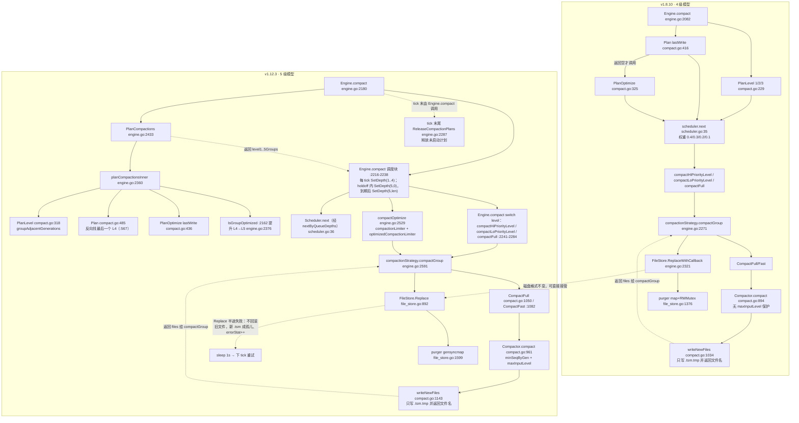
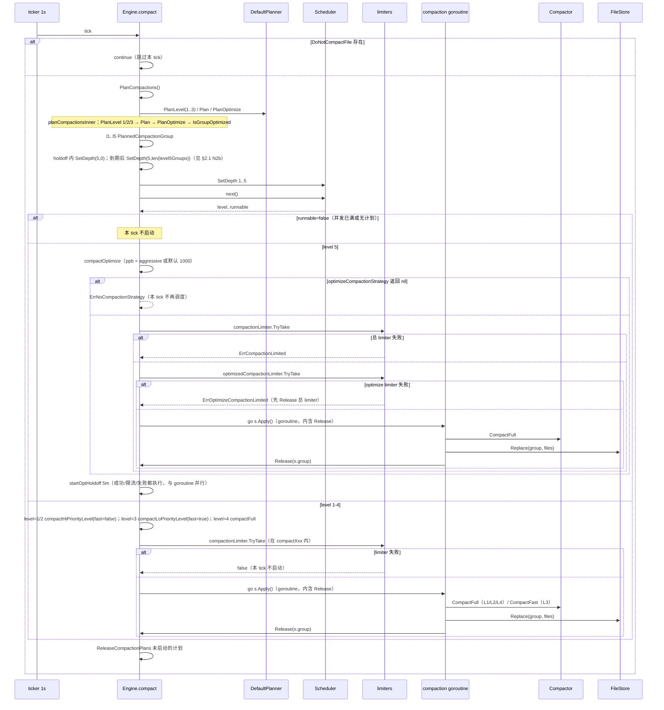
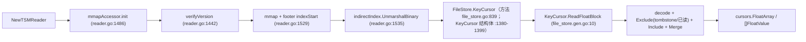
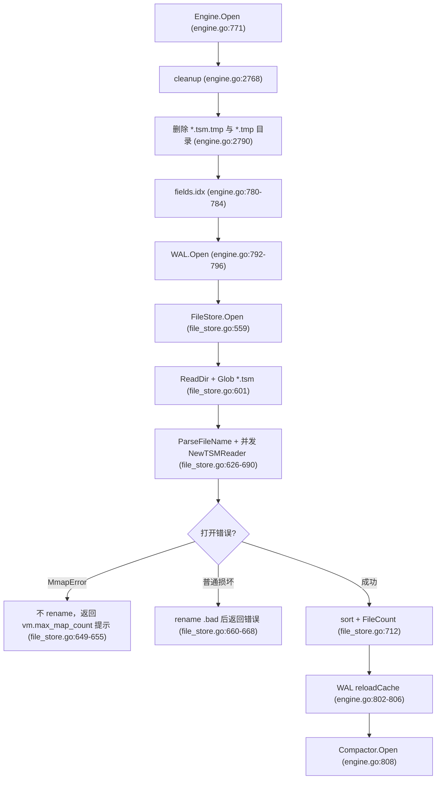
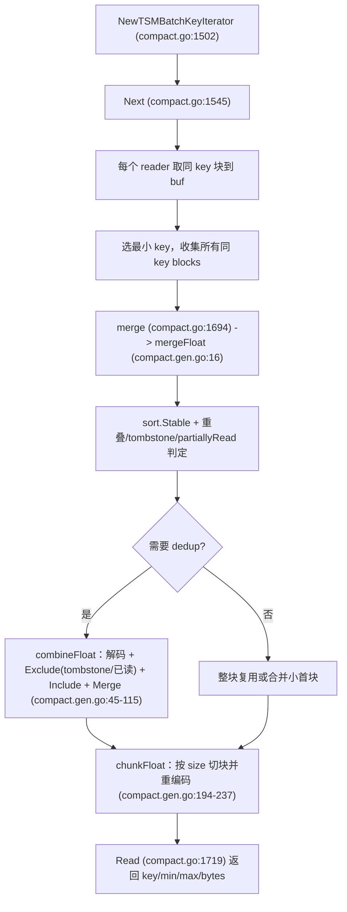
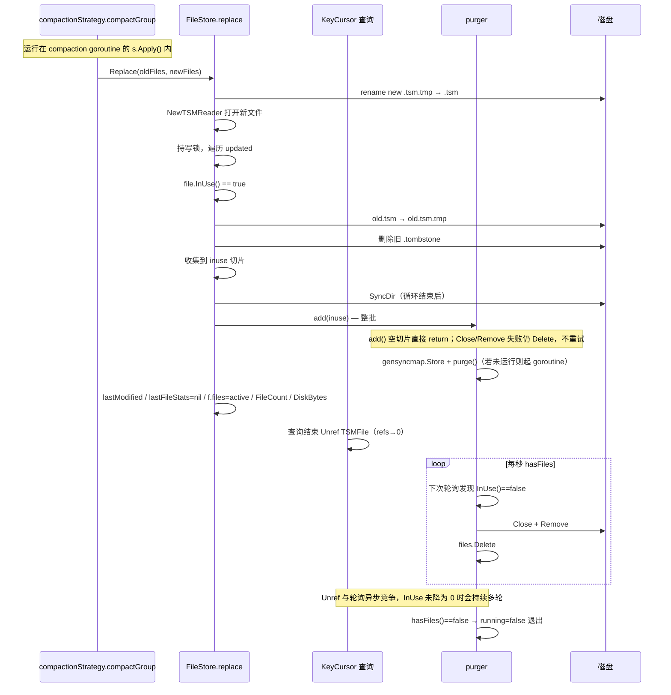

# 版本差异 4: 存储与 Compaction（v1.8.10 → v1.12.3）

> **基线**
> - OLD：`v1.8.10` = commit `688e697c51`（2021-10-11）
> - NEW：`v1.12.3` = commit `f3d5cb68ab`（`docs/specs/` 这批文档的代码基准）
> - 区间：527 commits，602 files，+79,310 / −45,239
> - NEW 工作树只额外包含若干 docs 提交（数量随文档演进），代码与 `f3d5cb68ab` 相同。
>
> **范围**：`tsdb/engine/tsm1/` 的 `compact.go`、`scheduler.go`、`file_store.go`（含 `purger`）、`writer.go`、`reader.go`、`digest*.go`、`tombstone.go`、`compact.gen.go`，以及 `engine.go` 的 compaction / Open / Close 相关部分。
>
> **一句话结论**：TSM **文件格式没有变化**（旧数据可直接读），但 **compaction 的层级模型、规划算法、调度与并发控制全部重写**：4 级（L1/L2/L3 + L4 full/optimize 混用）升级为 5 级（L1/L2/L3 + L4 full + L5 optimize），并补齐了防 level 回退、嵌套低层文件、full 漏调度、purger 锁竞争等一系列正确性与性能修复。

---

> **小白导读**
>
> 1. **4 车道变 5 车道**：v1.8.10 的“full compaction”和“optimize compaction”其实走同一条车道（都执行 `CompactFull`），只是规划器给它们贴了不同标签；v1.12.3 给 optimize 单独修了第 5 条车道（L5），配了独立的红绿灯（`optimizedCompactionLimiter`）、独立的分块大小（aggressive points-per-block）和独立的冷却时间（holdoff）。
> 2. **楼层号写在文件名里**：TSM 文件名是 `<generation>-<sequence>.tsm`，`level = min(sequence, 4)`。楼层不是存在文件里的，而是从文件名推算的。v1.12.3 把 generation/sequence 在打开文件时**缓存进内存**，规划时不再反复解析文件名。
> 3. **旧版会把 4 楼搬回 2 楼**：冷写（默认 4 小时无写入）触发 full compaction 时，会把最新的 L1 文件（高 generation、seq=1）和旧的 L4 文件（低 generation、seq≥4）放进同一组。旧版输出取“最大 generation 的 seq+1 = 2”，于是整组 L4 数据被写成 L2 —— 这是 #27233 修的 bug。新版先算出输入里的最高层级，保证输出层级不低于它。
> 4. **旧版是“两层兜底”，新版是“一层窗口”**：旧版 full 规划遇到低层文件就停，但 `Plan` 为空时还有 `PlanOptimize`——它不看冷写时间，会用孤儿规则把低层文件并进 L4 组。在 §6.4 的 5 世代输入（`600-4/601-2/602-4/603-4/604-4`）下，旧版一次压 `[600..604]`（输出 `604-5`），新版 4 世代窗口只压 `[600..603]`（输出 `603-5`）；若 `601-2` 只有 16MB，新版反而留下 `600-4`。谁压得多取决于世代大小与窗口边界，不是统计上的“常常”。新版把嵌套处理搬进 `Plan` 的反向扫描，但 `PlanOptimize` 改成了必须冷写 4h；热 shard 只靠 `PlanLevel` 的“低层组提前升级”和 `Plan` 的 4 世代窗口（#26911，修的是 1.12 线的回归）。
> 5. **旧版会把文件“锁死”**：1.12.1 引入（#26432）的 `PT_SmartOptimize` 规划在提前返回时把已经 `acquire` 的 L4 计划直接丢掉、没有 `Release`，这些文件永远留在 `filesInUse` 里，再也不会被压缩，表现为磁盘无界增长；#26670 删掉了这套特殊分支。
> 6. **数据文件本身没动**：magic `0x16D116D1`、version 1、28 字节索引项、8 字节 footer、mmap 读取、KeyCursor 归并、tombstone v3/v4、digest 文件格式全部不变；变的只是“怎么决定压缩谁、压成什么、谁来压”。

---

## 0. 五分钟速读

- **TSM 格式未变**：magic/version、Block、28B IndexEntry、8B Footer、mmap、KeyCursor、tombstone v3/v4、digest 均可直接读旧文件。
- **4→5 级**：L4 full 与 L5 optimize 分开；L5 有 aggressive points-per-block、双 limiter、启动 1h/后续 5m holdoff。
- **正确性修复**：#27233 防 level 回退、#26911 嵌套低层文件（1.12 线回归）、#26670 full 未排期/in-use 泄漏。
- **规划/调度**：`PlanCompactions` 收集 5 级；权重 `0.4/0.3/0.2/0.1/0.01`；文件命名 `%09d-%09d`，gen/seq 缓存。
- **风险**：`FileStore.Replace` 不是原子事务，半途失败会留孤儿/旧 reader 指向已关闭文件。

> **事实归属**：TSM 格式见 [17](../17_tsm_file_format_spec.md)；FileStore/KeyCursor 见 [16](../16_filestore_keycursor_spec.md)；写入/snapshot 见 [01](01_write_path_diff.md)。

## 1. 结论速览

| # | 变更点 | v1.8.10 | v1.12.3 | 影响 | 证据 |
|---|---|---|---|---|---|
| 1 | 压缩层级数 | 4（L1/L2/L3 + L4 复用） | **5**（L1/L2/L3 + L4 full + L5 optimize） | 调度、指标、限流全部改变 | `v1.8.10:tsdb/engine/tsm1/scheduler.go:7` / `v1.12.3:tsdb/engine/tsm1/engine.go:113` |
| 2 | optimize 执行路径 | 复用 `compactFull`，硬编码 `optimize=false`，与 full **执行层等价** | 独立 `compactOptimize` + `optimizeCompactionStrategy`，`CompactFull` + aggressive ppb | optimize 真正生效，不再与 full 抢同一个队列 | `v1.8.10:tsdb/engine/tsm1/engine.go:2222` / `v1.12.3:tsdb/engine/tsm1/engine.go:2529` |
| 3 | Planner 返回签名 | `[]CompactionGroup`（单值） | `([]CompactionGroup, int64)`；`PlanOptimize` 返回 3 值 | 规划器可报告队列长度与世代数 | `v1.8.10:tsdb/engine/tsm1/compact.go:90` / `v1.12.3:tsdb/engine/tsm1/compact.go:118` |
| 4 | 规划入口 | 每 tick 依次 `PlanLevel`×3、`Plan`，仅当 `Plan` 为空才 `PlanOptimize` | `PlanCompactions` 一次性收集 5 级 | L4/L5 可同 tick 竞争，L5 由权重决定 | `v1.8.10:tsdb/engine/tsm1/engine.go:2110` / `v1.12.3:tsdb/engine/tsm1/engine.go:2216` |
| 5 | 防 level 回退 | **无**；输出 seq 只由 max generation 的 max seq 决定 | `minSeqByGen` → `maxInputLevel` → 必要时抬升 `maxSequence` | 修复 L4 数据被压回 L2（#27233） | `v1.8.10:tsdb/engine/tsm1/compact.go:907` / `v1.12.3:tsdb/engine/tsm1/compact.go:975` |
| 6 | L4 段探测 | 正向扫描，遇 `level<=3` 即 `break` | **反向**找最后一个 `level>=4` | 嵌套低层不再截断 L4 段探测（#26911，1.12 线回归修复，见 §6.4） | `v1.8.10:tsdb/engine/tsm1/compact.go:489` / `v1.12.3:tsdb/engine/tsm1/compact.go:567` |
| 7 | 分组时遇到 in-use 世代 | `findGenerations(true)` 直接把 in-use 文件剔除出列表（留下“洞”） | `groupAdjacentGenerations` 在 in-use 处**切断**并继续 | 保持世代有序，避免跨洞合并导致覆盖顺序错误 | `v1.8.10:tsdb/engine/tsm1/compact.go:616` / `v1.12.3:tsdb/engine/tsm1/compact.go:394` |
| 8 | 低层级组被丢弃 | L4 分支分组里只要含 `level<=3` 就整组丢弃 | 不再丢弃，交给同一组一起卷 | 把嵌套处理从 `PlanOptimize` 移入 `Plan`（#26911）；这是 1.12 线的回归修复，v1.8.10 由 `PlanOptimize` 兜底 | `v1.8.10:tsdb/engine/tsm1/compact.go:554` / `v1.12.3:tsdb/engine/tsm1/compact.go:635` |
| 9 | optimize 触发条件 | 无 `lastWrite`，无冷写检查；仅 `level==4` 且 `len(group)>=4` 或有 tombstone | 必须 `since(lastWrite) >= 4h` 且未 fully compacted；`level==4` **或单世代** | 热 shard 不再做 optimize；单世代多文件可被重整 | `v1.8.10:tsdb/engine/tsm1/compact.go:325` / `v1.12.3:tsdb/engine/tsm1/compact.go:436` |
| 10 | “已完全压缩”判定 | `len(gens)<=1 && !hasTombstones` | 单世代多文件且并非所有文件的首 block > 1000（`DefaultMaxPointsPerBlock` 硬编码；与 aggressive 10000 无关）→ **不算**完全压缩 | 影响 `Engine.IsIdle` 与 optimize 机会 | `v1.8.10:tsdb/engine/tsm1/compact.go:214` / `v1.12.3:tsdb/engine/tsm1/compact.go:262` |
| 11 | L4→L5 提升 | 无 | 组内任一文件 `FirstBlockCount >= aggressive` 即提升为 L5 | 避免“反向优化”（回填数据把已优化文件拉回普通压缩） | `v1.8.10:tsdb/engine/tsm1/engine.go:2221` / `v1.12.3:tsdb/engine/tsm1/engine.go:2376` |
| 12 | aggressive points/block | 无 | `aggressive-points-per-block`，默认 10000 | L5 输出 block 更满、索引更小 | `v1.12.3:tsdb/config.go:57` |
| 13 | scheduler 权重 | `[4]{0.4,0.3,0.2,0.1}` | `[5]{0.4,0.3,0.2,0.1,0.01}` | L5 权重极低：仅当 `0.01×d5` 严格大于其余各级加权分时胜出（`d5>40×d1`、`>30×d2`、`>20×d3`、`>10×d4`）；无“队列为空”门槛，平局保留低层 | `v1.8.10:tsdb/engine/tsm1/scheduler.go:7` / `v1.12.3:tsdb/engine/tsm1/scheduler.go:8` |
| 14 | 并发限流 | 单一 `compactionLimiter` | `compactionLimiter` + `optimizedCompactionLimiter`（默认 1） | L5 最坏只占 1 个槽，且必须同时拿到两个 | `v1.8.10:tsdb/engine/tsm1/engine.go:193` / `v1.12.3:tsdb/engine/tsm1/engine.go:214` |
| 15 | optimize holdoff | 无 | 启动后 1h；每次尝试 L5 后 5m | 抑制 L5 频繁重规划 | `v1.12.3:tsdb/engine/tsm1/engine.go:2172` |
| 16 | 文件名解析 | 每次规划对每个文件 `ParseFileName` | 打开/重命名时缓存 `generation`/`sequence` 到 `TSMReader` | 规划 CPU 降低；`findGenerations` 不再解析 | `v1.8.10:tsdb/engine/tsm1/compact.go:631` / `v1.12.3:tsdb/engine/tsm1/reader.go:450` |
| 17 | 首 block 计数 | 规划时仅对 >2GiB（`PlanOptimize` 还要求该世代文件数>2）的世代做 `BlockCount(path,1)`（读盘/解码） | `FirstBlockCount` 缓存在 `ExtFileStat` | 机制上降低规划开销（未做基准；#26432） | `v1.8.10:tsdb/engine/tsm1/compact.go:354` / `v1.12.3:tsdb/engine/tsm1/reader.go:635` |
| 18 | FileStore merge 指标 | 无 | 5 种类型 × merge 次数/值数/耗时/`over4` 计数 | 可观测查询期重叠块归并成本（§3.20） | `v1.12.3:tsdb/engine/tsm1/file_store.go:163` |
| 19 | purger | `map` + `RWMutex`，扫描期间持写锁，失败 `continue` 永久重试 | `gensyncmap` + 仅 `running` 加锁，失败也删除条目 | 降低替换路径阻塞与泄漏（#27146） | `v1.8.10:tsdb/engine/tsm1/file_store.go:1376` / `v1.12.3:tsdb/engine/tsm1/file_store.go:1599` |
| 20 | TSM 文件格式 | magic `0x16D116D1`、version 1、28B 索引项、8B footer | **完全相同** | 旧 `.tsm`/`.tombstone` 可直接读 | `v1.8.10:tsdb/engine/tsm1/writer.go:81` / `v1.12.3:tsdb/engine/tsm1/writer.go:82` |
| 21 | 错误处理 | `TSMErrors`、`==` 比较、逐个 `os.Remove` | `errors.Join`、`errors.Is/As`、`RemoveTmpFilesOnErr`、`maxErrors=100` | 错误不再被吞，临时文件清理更彻底 | `v1.8.10:tsdb/engine/tsm1/compact.go:1034` / `v1.12.3:tsdb/engine/tsm1/compact.go:1116` |
| 22 | 测试体系 | 表驱动 | 新增 property-based 测试（邻接性属性） | 规划器回归更容易被发现 | `v1.12.3:tsdb/engine/tsm1/compact_property_test.go:18` |

---

## 2. 变更地图

### 2.1 4 级 → 5 级变更地图



### 2.2 单 tick 调度时序（v1.12.3）

一个 tick 内的时序（新版）：



### 2.3 模块边界：planner / scheduler / executor / FileStore

| 层 | 源码/owner | 输入 | 输出 | 失败归属 |
|----|------------|------|------|----------|
| Planner | `DefaultPlanner`（`tsdb/engine/tsm1/compact.go`） | `FileStore.Stats()`、`lastWrite` | `CompactionGroup`（已 `acquire`） | 规划为空/无策略；`Release` 由 Engine 负责 |
| Scheduler | `Scheduler`（`tsdb/engine/tsm1/scheduler.go`）+ `Engine.compact`（`tsdb/engine/tsm1/engine.go:2180`） | 五级队列深度、holdoff、limiter | 选中的 level 与启动的 goroutine | `ErrCompactionLimited` / `ErrOptimizeCompactionLimited` |
| Executor | `Compactor.compact/CompactFull/CompactFast`（`tsdb/engine/tsm1/compact.go:961`/`:1050`/`:1082`） | 文件组、`pointsPerBlock` | `.tsm.tmp` 文件（`writeNewFiles`） | `errBlockRead`（`MoveTsmOnReadErr`）、`ErrNoValues`、`errCompactionInProgress` |
| FileStore | `FileStore.replace`（`tsdb/engine/tsm1/file_store.go:896`）+ `purger`（`:1599`） | 旧文件、新 `.tsm` | 原子切换 `f.files`；延迟删除 | `replace` 半途失败不回滚；purger 失败不重试 |

边界规则：Planner 只选文件，不写盘；Scheduler 只选层，不决定 `pointsPerBlock`；Executor 只写
`.tsm.tmp`，不切换 `f.files`；FileStore 只做替换/删除，不重新压缩。`WriteSnapshot`（`tsdb/engine/tsm1/compact.go:888`）
是 cache→TSM 的刷盘路径，不属于 compaction，见 §3.16 边界声明。


---

## 3. 逐项差异

### 3.1 层级模型：4 级 → 5 级

**旧版：只有 4 个队列，没有 level 常量。**

```go
// v1.8.10:tsdb/engine/tsm1/scheduler.go:7 — defaultWeights
var defaultWeights = [4]float64{0.4, 0.3, 0.2, 0.1}

// v1.8.10:tsdb/engine/tsm1/engine.go:642 — EngineStatistics
TSMCompactions [3]int64 // 只有 level 1/2/3 的数组
```

旧版没有任何 `TotalCompactionLevels` / `FullCompactionLevel` / `OptimizeCompactionLevel` 常量（`git show v1.8.10:tsdb/engine/tsm1/engine.go | grep -n 'CompactionLevel'` 无输出）。full 与 optimize 共用一个队列下标 4。

**新版：显式 5 级。**

```go
// v1.12.3:tsdb/engine/tsm1/engine.go:103
// LevelCompactionCount is the number of level compactions (e.g. 1, 2, 3).
LevelCompactionCount = 3

// FullCompactionLevel is the compaction level for full compactions.
FullCompactionLevel = 4

// OptimizeCompactionLevel is the compaction level for optimized compactions.
OptimizeCompactionLevel = 5

// TotalCompactionLevels is the overall number of compaction levels.
TotalCompactionLevels = 5
```

**语义影响**：

- `TSMCompactions` 数组仍是 `[3]`（只有 L1–L3），但 `Scheduler.queues` / `weights` 变成 `[5]`（`v1.12.3:tsdb/engine/tsm1/scheduler.go:15`）。
- L5 不再借用 L4 的队列、统计和限流。`TSMOptimizeCompactionsActive` 在旧版**永远是 0**（因为执行 optimize 时走的是 `fullCompactionStrategy(grp,false)`，统计记在 `TSMFullCompactions*` 上），新版才真实反映 optimize 并发。
- 旧版 `TSMOptimizeCompactionsQueue` 在 `Plan` 之后被赋值为 **L4 full 队列长度**（`v1.8.10:tsdb/engine/tsm1/engine.go:2115`），`Plan` 为空时又被 `PlanOptimize` 的结果覆盖（`:2120`）。也就是说旧指标名不副实；新版 L4/L5 各自独立（`v1.12.3:tsdb/engine/tsm1/engine.go:2442`）。

### 3.2 旧版 full / optimize 是否等价？

**结论：执行层等价，规划层不等价。**

旧版 `compactFull` 写死了 `optimize=false`：

```go
// v1.8.10:tsdb/engine/tsm1/engine.go:2221
func (e *Engine) compactFull(grp CompactionGroup, wg *sync.WaitGroup) bool {
	s := e.fullCompactionStrategy(grp, false)   // ← 恒为 false
	...
}
```

`fullCompactionStrategy` 里 `optimize` 只影响三处：`fast`、四个统计指针，以及 struct 字面量里的 logger 字段 `zap.Bool("tsm1_optimize", optimize)`（`v1.8.10:tsdb/engine/tsm1/engine.go:2367`）。下面只展开前两处：

```go
// v1.8.10:tsdb/engine/tsm1/engine.go:2364
func (e *Engine) fullCompactionStrategy(group CompactionGroup, optimize bool) *compactionStrategy {
	s := &compactionStrategy{
		...
		fast:  optimize,      // ← optimize 时走 CompactFast（但永远不会发生）
		level: 4,
	}
	if optimize {
		s.activeStat = &e.stats.TSMOptimizeCompactionsActive   // ← 死路径
		...
	} else {
		s.activeStat = &e.stats.TSMFullCompactionsActive
		...
	}
	return s
}
```

`grep -n 'fullCompactionStrategy(' v1.8.10:tsdb/engine/tsm1/engine.go` 只有两处：定义（2364）与唯一调用（2222，传 `false`）。因此：

- 旧版 `Plan` 产出的 full 组和 `PlanOptimize` 产出的 optimize 组，最终都执行 `Compactor.CompactFull`（`fast=false`）。
- 在**执行层**，两个路径的差别只有日志标签和统计归属（而统计归属还是错的：optimize 组被记到 `TSMFullCompactions*`）。规划条件本身不同（见 §3.7）。
- 旧版 `optimize=true` 的 `CompactFast` 分支是死代码（为后来的 L5 预留）。
- 新版把“死路径”变成真路径：`optimizeCompactionStrategy`（`v1.12.3:tsdb/engine/tsm1/engine.go:2719`）显式 `fast:false` + `pointsPerBlock`，并使用 `TSMOptimize*` 统计。

### 3.3 调度主循环：五次规划 vs “Plan 为空才 optimize”

**旧版**：

```go
// v1.8.10:tsdb/engine/tsm1/engine.go:2111-2132
level1Groups := e.CompactionPlan.PlanLevel(1)
level2Groups := e.CompactionPlan.PlanLevel(2)
level3Groups := e.CompactionPlan.PlanLevel(3)
level4Groups := e.CompactionPlan.Plan(e.LastModified())
atomic.StoreInt64(&e.stats.TSMOptimizeCompactionsQueue, int64(len(level4Groups)))

// If no full compactions are need, see if an optimize is needed
if len(level4Groups) == 0 {
	level4Groups = e.CompactionPlan.PlanOptimize()
	atomic.StoreInt64(&e.stats.TSMOptimizeCompactionsQueue, int64(len(level4Groups)))
}
...
e.scheduler.setDepth(1, ...); ... e.scheduler.setDepth(4, len(level4Groups))
```

要点：

- `PlanOptimize` 与 `Plan` **互斥**：只要 full 有活，optimize 本轮就不看。
- optimize 与 full 共享 `level4Groups` 和队列深度 4。
- 每 tick 只启动一个 compaction group（`switch level` 里只处理一个 case），另一个 tick 再继续；**两版相同**，新版见 `tsdb/engine/tsm1/engine.go:2238-2284`。

**新版**：

```go
// v1.12.3:tsdb/engine/tsm1/engine.go:2216
level1Groups, level2Groups, level3Groups, level4Groups, level5Groups := e.PlanCompactions()

var l5GroupCount int
if time.Since(optHoldoffStart) >= optHoldoffDuration {
	l5GroupCount = len(level5Groups)
}

e.Scheduler.SetDepth(1, len(level1Groups))
...
e.Scheduler.SetDepth(4, len(level4Groups))
e.Scheduler.SetDepth(5, l5GroupCount)   // holdoff 内为 0，Scheduler 不会选 L5
```

`PlanCompactions`（`v1.12.3:tsdb/engine/tsm1/engine.go:2433`）一次收集五级，`planCompactionsInner`（`:2360`）顺序执行 `PlanLevel(1..3)`、`Plan`、`PlanOptimize`，然后做 L4→L5 提升。注意：**尚未被启动的 L5 计划仍然会返回**，并在 tick 末尾由 `ReleaseCompactionPlans`（`:2287`）释放，不会造成 in-use 泄漏——这正是 #26670 修复的核心。

**案例（同一 shard 的 tick 级规划差异）**：

- **输入**：generation 升序 `600-4`、`601-2`、`602-4`、`603-4`、`604-4`，各约 256MB，
  shard **热**（4h 内有写入）、`forceFull=false`、无 tombstone/in-use。
- **旧版 tick**：
  1. `PlanLevel(1/2/3)`：孤儿规则把 `601(L2)` 并入 `[600]`，整组层级取最大值 4，
     三级 planner 都拿不到组 → 全 nil。
  2. `Plan`：正向扫描在 `601` 处 `break`，`end=1`，只剩 `[600]`；4 个世代的下限不满足
     → nil。
  3. `PlanOptimize`（旧版无冷写门槛）：同一孤儿规则得到 `[600..604]`（len=5、level=4），
     `len>=4` 满足 → 1 个 optimize 组。
  4. 旧调度把 optimize 组放进 `level4Groups`，调用 `compactFull`（`fast=false`）；
     队列深度为 `[0,0,0,1]`（旧版没有第 5 级队列）。
- **新版 tick**：
  1. `PlanLevel(1/2/3)` 同样全 nil。
  2. `Plan` 反向找最后一个 L4 → `end=5`；按 4 个切窗得 `[600,601,602,603]`，
     `[604]` 因 len=1<4 被跳过；输出 1 个 L4 组。
  3. `PlanOptimize` 因 4h 冷写门槛直接返回 nil（热 shard）。
  4. 队列深度为 `[0,0,0,1,0]`；执行同样是 `compactFull`，输出 `603-000000005.tsm`（L4）。
- **预期输出**：旧版压 `[600..604]` → `604-000000005.tsm`；新版压 `[600..603]` →
  `603-000000005.tsm`。差别来自“`Plan` 为空才 optimize”与“每 tick 无条件 `Plan` +
  `PlanOptimize`”的分工，不是数据正确性差异。
- **源码**：`v1.8.10:tsdb/engine/tsm1/engine.go:2110-2120`、
  `v1.12.3:tsdb/engine/tsm1/engine.go:2216-2300`、`tsdb/engine/tsm1/compact.go:485-548`（新版 Plan）、
  `tsdb/engine/tsm1/compact.go:394-431`（分组）。

### 3.4 Planner 接口与返回值

```go
// v1.8.10:tsdb/engine/tsm1/compact.go:90
Plan(lastWrite time.Time) []CompactionGroup
PlanLevel(level int) []CompactionGroup
PlanOptimize() []CompactionGroup
Release(group []CompactionGroup)
FullyCompacted() bool
```

```go
// v1.12.3:tsdb/engine/tsm1/compact.go:118
Plan(lastWrite time.Time) ([]CompactionGroup, int64)
PlanLevel(level int) ([]CompactionGroup, int64)
// PlanOptimize will return the groups for compaction, the compaction group length,
// and the amount of generations within the compaction group.
PlanOptimize(lastWrite time.Time) (compactGroup []CompactionGroup, compactionGroupLen int64, generationCount int64)
Release(group []CompactionGroup)
FullyCompacted() (bool, string)
```

差异解释：

- 第二个返回值是**计划组数量**，由 1.9 线 #22195（`7d3efe1e9e`）为“`acquire` 失败时也报告计划长度”引入；但 v1.12.3 的 `PlanCompactions` 把它全部丢弃（`v1.12.3:tsdb/engine/tsm1/engine.go:2354-2366` 均以 `_` 接收），队列统计改回 `len()`（`:2439-2443`），当前**没有消费者**，仅作接口预留/测试使用。
- `PlanOptimize` 新增 `lastWrite`，用于冷写判定；第三个返回值 `generationCount` 让引擎判断“是否单世代”，从而决定 L5 是否用 aggressive points/block（`v1.12.3:tsdb/engine/tsm1/engine.go:2402`）。
- `FullyCompacted` 返回 `(bool, string)`，字符串是“为什么没完全压缩”的原因，由 `Engine.IsIdle` 原样返回给调用方（`v1.12.3:tsdb/engine/tsm1/engine.go:944-970`）。

### 3.5 PlanLevel：从内联分组到 `groupAdjacentGenerations`

**旧版分组（内联）**：

```go
// v1.8.10:tsdb/engine/tsm1/compact.go:252
var currentGen tsmGenerations
var groups []tsmGenerations
for i := 0; i < len(generations); i++ {
	cur := generations[i]
	// 孤儿世代：比后面的层级低，先并入当前组
	if i < len(generations)-1 {
		if cur.level() < generations[i+1].level() {
			currentGen = append(currentGen, cur)
			continue
		}
	}
	if len(currentGen) == 0 || currentGen.level() == cur.level() {
		currentGen = append(currentGen, cur)
		continue
	}
	groups = append(groups, currentGen)
	currentGen = tsmGenerations{}
	currentGen = append(currentGen, cur)
}

// 循环后 flush 最后一组（v1.8.10:tsdb/engine/tsm1/compact.go:276-278）
if len(currentGen) > 0 {
	groups = append(groups, currentGen)
}
```

```go
// v1.8.10:tsdb/engine/tsm1/compact.go:288
minGenerations := 4
if level == 1 {
	minGenerations = 8
}
...
if len(chunk) < minGenerations && !hasTombstones {
	continue
}
```

**新版**把分组抽成 `groupAdjacentGenerations`（`v1.12.3:tsdb/engine/tsm1/compact.go:394`），并新增两个行为：

```go
// v1.12.3:tsdb/engine/tsm1/compact.go:408-428
// 节选：函数头与 moveToNextGroup 闭包定义见 compact.go:394-407
for i := 0; i < len(generations); i++ {
	if c.isInUse(generations[i]) {
		moveToNextGroup()
		// Do not put this generation in the groups
		continue
	} else {
		if (len(currentGen) <= 0) ||
			(levelTestFn(currentGen.level(), generations[i].level()) ||
				(i < len(generations)-1 && generations[i].level() < generations[i+1].level())) {
			currentGen = append(currentGen, generations[i])
		} else {
			moveToNextGroup()
			currentGen = append(currentGen, generations[i])
		}
	}
}
```

```go
// v1.12.3:tsdb/engine/tsm1/compact.go:371-381 — 不足 minGenerations 时的新出口
// 节选：位于 PlanLevel 的 for i, group := range levelGroups 循环内（compact.go:357-385）
if len(chunk) < minGenerations && !hasTombstones {
	for j := levelGroupIndices[i] + 1; j < len(groups); j++ {
		if groups[j].level() >= level {
			// There are later generations of higher level, so this
			// group should be processed to go up a level.
			cGroups = append(cGroups, cGroup)
			break
		}
	}
	continue
}
```

行为差异：

1. **in-use 不再“消失”**：旧版 `findGenerations(true)` 把 in-use 文件直接从有序列表剔除，两个原本不相邻的世代可能因此变成相邻并被合进同一组；新版保留完整有序列表，在 in-use 处 `moveToNextGroup()` 切断，既不合并也不占用（`v1.12.3:tsdb/engine/tsm1/compact.go:685` 的 `isInUse`）。
2. **低层组可以提前升级**：如果某个 L2 组不足 4 代，但后面还有 L2/L3/L4 的世代，则允许先把它压上去，避免被永久卡住。代价是这个提前升级的小文件未来会再参与一次高层重写（本次写入的世代更少，单次写放大更小，不是“更大写放大”）。
3. `minGenerations`（L1=8，其余=4）与“含 tombstone 即使不足也压缩”的规则**未变**（`v1.8.10:tsdb/engine/tsm1/compact.go:307` / `v1.12.3:tsdb/engine/tsm1/compact.go:371`）。

**案例（PlanLevel 的分组、in-use 切断与提前升级）**：

- **例 1（9 个 L1，无 in-use）**：输入 `101-1`…`109-1`。`groupAdjacentGenerations` 把
  9 个同级世代放进一个组；`chunk(8)` 得到 `[101..108]` 与 `[109]`。前者 len=8 满足
  `minGenerations=8`；后者 len=1<8，且其后再无更高层组，被 `continue` 跳过。
  **输出只有 `108-000000002.tsm`（L2）**，`109-1` 留到下一轮。
- **例 2（`103-1` in-use）**：旧版 `findGenerations(true)` 把 `103-1` 从列表剔除，
  剩下 8 个 L1 在列表中相邻，`chunk(8)` 一次压成 `109-000000002.tsm`（L2）。
  新版保留完整列表，在 in-use 处切断：
  `[101,102]` 与 `[104..109]`；前者 len=2<8，但 `levelGroupIndices` 之后还有 level-1 组，
  满足 `groups[j].level() >= level` 的提前升级条件，**输出 `102-000000002.tsm`**；
  后者 len=6<8 且无后续组，跳过（`tsdb/engine/tsm1/compact.go:367-381`、`:394-431`）。
- **代价**：例 2 中旧版把剔除 103 后的 8 个 L1 一次压成 `109-2`（写入 8 个世代的数据）；
  新版在 103 处切断，`[101,102]` 提前升级为 `102-2`（只写 2 个世代），`[104..109]` 留到后续。
  因此**本次写放大更小**，代价是 `102-2` 这个小文件未来会再参与一次 L2/L3 重写；
  103 因 in-use 未参与本轮压缩，数据仍留在磁盘，不是被“漏掉”。
- **源码**：`v1.8.10:tsdb/engine/tsm1/compact.go:252-278`、`v1.12.3:tsdb/engine/tsm1/compact.go:394-431`。

另一个隐藏修复：旧版 `findGenerations` 会把结果缓存到 `lastGenerations` / `lastFindGenerations`，但**缓存不区分 `skipInUse` 参数**：

```go
// v1.8.10:tsdb/engine/tsm1/compact.go:616
func (c *DefaultPlanner) findGenerations(skipInUse bool) tsmGenerations {
	...
	if !last.IsZero() && c.FileStore.LastModified().Equal(last) {
		return lastGen   // ← 可能是用 skipInUse=true 计算的那一份
	}
```

该误判是**确定的调用顺序依赖**，不是概率事件：同一 `LastModified` 内，第一次 `findGenerations(true)`
把 in-use 世代剔除后写入 `lastGenerations`；随后 `FullyCompacted()` 的 `findGenerations(false)`
命中缓存，返回过滤后的短列表；若过滤后 `len<=1 && !hasTombstones`，`FullyCompacted()` 返回 true。
触发条件：规划器先规划、`IsIdle` 后检查，且两次之间无写入（`LastModified` 不变）。
新版彻底删除该缓存（`v1.12.3:tsdb/engine/tsm1/compact.go:699-724`），每次从 `FileStore.Stats()`
的缓存统计重建（统计本身由 `FileStore.Stats` 缓存，见 §3.14）。

### 3.6 Plan（L4 / full）：反向扫描与不再丢弃低层组

**旧版 full 分支**（冷写或 `forceFull`）：

```go
// v1.8.10:tsdb/engine/tsm1/compact.go:424
if forceFull || c.compactFullWriteColdDuration > 0 && time.Since(lastWrite) > c.compactFullWriteColdDuration && len(generations) > 1 {
	...
	for i, group := range generations {
		var skip bool
		if len(generations) > 2 && group.size() > uint64(maxTSMFileSize) &&
			c.FileStore.BlockCount(group.files[0].Path, 1) == tsdb.DefaultMaxPointsPerBlock && !group.hasTombstones() {
			skip = true
		}
		// 若下一个世代 level<=3，则不许跳过，避免新文件被漏掉
		if i < len(generations)-1 && generations[i+1].level() <= 3 {
			skip = false
		}
		if skip { continue }
		for _, f := range group.files { tsmFiles = append(tsmFiles, f.Path) }
		genCount += 1
	}
	if len(tsmFiles) <= 1 || genCount <= 1 { return nil }
	group := []CompactionGroup{tsmFiles}
	...
}
```

**旧版普通 L4 分支**：

```go
// v1.8.10:tsdb/engine/tsm1/compact.go:489
end := 0
start := 0
for i, g := range generations {
	if g.level() <= 3 {
		break          // ← 一遇低层就停
	}
	end = i + 1
}
...
// v1.8.10:tsdb/engine/tsm1/compact.go:554
if lvl <= 3 {
	skipGroup = true   // ← 组里含低层文件就整组丢弃
	break
}
```

**新版 full 分支**：逻辑基本保留，但增加 `isInUse` 跳过（`:508`）、把 `BlockCount(...)==DefaultMaxPointsPerBlock` 换成缓存字段 `FirstBlockCount >= DefaultMaxPointsPerBlock`（`:513`），并明确注释“不维护邻接性”：

```go
// v1.12.3:tsdb/engine/tsm1/compact.go:493
if forceFull || c.compactFullWriteColdDuration > 0 && time.Since(lastWrite) > c.compactFullWriteColdDuration && len(generations) > 1 {
	// We are NOT paying attention to maintaining adjacency in compaction here; groups may contain non-contiguous generations.
	// presumably because there are no overwrites or backfills
	...
	if c.isInUse(group) { continue }
```

**新版 L4 分支**：

```go
// v1.12.3:tsdb/engine/tsm1/compact.go:567
// Walk the generations in reverse to find the last level 4 generation
// The backwards iteration is to keep nested lower level generations from preventing
// compactions of higher level, later generations.
for i := len(generations) - 1; i >= 0; i-- {
	if generations[i].level() >= 4 {
		end = i + 1
		break
	}
}
```

```go
// v1.12.3:tsdb/engine/tsm1/compact.go:632-647
// 节选：位于 PlanOptimize 的 for i := 0; i < len(generations); 循环内（compact.go:619-631）
for j := 0; j < step && (j+i) < len(generations); j++ {
	gen := generations[j+i]
	// We used to discard groups of level 3 or under here, on the theory
	// that the level planner would pick them up.  But, if they are not in-use,
	// then they weren't picked up and should be rolled up in here.
	if c.isInUse(gen) { break }
	if gen.size() >= uint64(tsdb.MaxTSMFileSize) && gen.files[0].FirstBlockCount >= tsdb.DefaultMaxPointsPerBlock && !gen.hasTombstones() {
		break
	}
	currentGroup = append(currentGroup, gen)
}
```

差异解释：

- `end` 的语义从“从头开始连续 L4 的长度”变为“**最后一个** L4 的位置 + 1”。前者一旦遇到夹心低层文件就放弃后面的所有 L4；后者保证所有 L4 都在考察范围内。
- 分组循环里 `isInUse` / 超大文件现在用 `break` 而不是 `continue`+`startIndex++`，分组更简单，也不会把超大文件悄悄跳过而留下一个跨越它的组。
- 旧版“组里含 `level<=3` 就整组丢弃”的规则被删除：这些文件既然没被 level planner 拿走（`isInUse` 为 false），就应该在同一组里被卷掉——这是 #26911 的一部分（配合反向扫描；它修的是 1.12 线热 shard 失去 `PlanOptimize` 兜底后的回归，v1.8.10 本身不存在该漏压）。

### 3.7 PlanOptimize / L5：从“凑够 4 代”到“冷 shard 就重整”

**旧版**：

```go
// v1.8.10:tsdb/engine/tsm1/compact.go:325
func (c *DefaultPlanner) PlanOptimize() []CompactionGroup {
	...
	generations := c.findGenerations(true)
	if len(generations) <= 1 && !generations.hasTombstones() {
		return nil
	}
	for i := 0; i < len(generations); i++ {
		cur := generations[i]
		// Skip the file if it's over the max size and contains a full block and it does not have any tombstones
		if cur.count() > 2 && cur.size() > uint64(maxTSMFileSize) &&
			c.FileStore.BlockCount(cur.files[0].Path, 1) == tsdb.DefaultMaxPointsPerBlock && !cur.hasTombstones() {
			continue
		}
		...
	}
	// Only optimize level 4 files since using lower-levels will collide with the level planners
	...
	if len(group) < 4 && !group.hasTombstones() {
		continue
	}
	...
}
```

**新版**：

```go
// v1.12.3:tsdb/engine/tsm1/compact.go:436
func (c *DefaultPlanner) PlanOptimize(lastWrite time.Time) (compactGroup []CompactionGroup, compactionGroupLen int64, generationCount int64) {
	...
	generations := c.findGenerations()
	fullyCompacted, _ := c.generationsFullyCompacted(generations)

	if fullyCompacted || time.Since(lastWrite) < c.compactFullWriteColdDuration {
		return nil, 0, 0
	}

	groups := c.groupAdjacentGenerations(generations, func(currentLevel int, candidateLevel int) bool { return currentLevel >= candidateLevel })

	var cGroups []CompactionGroup
	for _, group := range groups {
		var cGroup CompactionGroup
		// Optimize level 4 generation groups since using lower-levels will collide
		// with the level planners. If this is a single-generation optimization,
		// do not skip any levels.
		if group.level() == 4 || len(generations) == 1 {
			for _, gen := range group {
				for _, file := range gen.files {
					cGroup = append(cGroup, file.Path)
				}
			}
		}
		if len(cGroup) > 0 {
			cGroups = append(cGroups, cGroup)
		}
	}
	...
	return cGroups, int64(len(cGroups)), int64(len(generations))
}
```

差异解释（行为影响最大的几处）：

1. **必须冷**：`time.Since(lastWrite) < compactFullWriteColdDuration` 直接返回空。默认 `compactFullWriteColdDuration = 4h`（`v1.8.10:tsdb/config.go:38` 与 `v1.12.3:tsdb/config.go:38` 相同）。旧版 optimize 完全不看写入时间，只靠“`Plan` 为空”间接限制。
2. **不再要求 4 代**：旧版 `len(group) < 4 && !hasTombstones` 才跳过；新版对 `level==4` 的组**不设数量下限**。但要注意**谁先拿到文件**：`planCompactionsInner` 每 tick **无条件**依次调用 `Plan` 与 `PlanOptimize`（`v1.12.3:tsdb/engine/tsm1/engine.go:2365-2366`），后者只跳过已被 `acquire` 的世代（`groupAdjacentGenerations` 遇 in-use 直接 `continue`，`:409-412`）。`Plan` 的 full 分支并不 `acquire` 全部世代：对 `len(generations) > 2`、`>2GB`、满块、无 tombstone 的世代直接 `continue`（`tsdb/engine/tsm1/compact.go:513`），`genCount<=1` 时整轮返回 nil（`:539`）。因此只要 `Plan` 没接管某些 L4 世代，1–3 个 L4 世代就会在同一 tick 进入 L5 队列，**L4 与 L5 可同时非空**。
3. **单世代特例**：`len(generations) == 1` 时不再按层级过滤，允许把同一世代的多个文件重整。旧版在 `len(generations) <= 1 && !hasTombstones()` 时直接返回 nil；若该单世代带 tombstone，旧版仍会把 `level==4` 的组送去 optimize（`len(group) < 4` 的过滤因 tombstone 放行）。因此“单世代多文件永远不会被 optimize”只对无 tombstone 成立。
4. **不再跳过超大文件**：旧版对 `count>2 && size>2GB && 满 block && 无 tombstone` 的世代 `continue`；新版没有这条，改由 `generationsFullyCompacted` 决定。
5. **返回值带世代数**：`generationCount == 1` 时引擎对该 L5 组使用 aggressive points/block（`v1.12.3:tsdb/engine/tsm1/engine.go:2402`）。

**案例 A（Plan 产出的 L4 组被提升为 L5）**：

- **输入**：冷写 full 组 `400-4`、`401-4`、`402-4`、`403-4`，各约 256MB、无 tombstone；
  `400-4` 的 `FirstBlockCount=10000`，其余为 1000。
- **步骤与输出**：`Plan` 冷写分支把 4 个世代收进一个组（`len>2` 但均 <2GB，不触发跳过）；
  `planCompactionsInner` 对每个 L4 组调用 `IsGroupOptimized`，命中 `400-4`
  （10000 ≥ aggressive 10000）→ 整组移入 `level5Groups`、`PointsPerBlock=10000`。
  `compact()` 得 `maxGeneration=403`、`maxSequence=4`，`writeNewFiles(403,4)` 从
  sequence 5 开始 → **`403-000000005.tsm`**，`level=min(5,4)=4`。若没有 optimized 文件，
  则留在 `level4Groups`、`PointsPerBlock=1000`，文件名和层级相同
  （`tsdb/engine/tsm1/engine.go:2376-2395`）。

**案例 B（PlanOptimize 的多世代组：只有超 2GB 文件才会轮到它）**：

- **输入**：`100-4`（2.1GiB、`FirstBlockCount=10000`）、`200-4`（2.1GiB、1000）、
  `300-4`（2.1GiB、1000），冷写 4h、无 tombstone。
- **步骤与数值**：
  1. 先跑 `Plan` 的冷写 full 分支。`len(generations)=3>2`，三个世代都满足
     `size>2GiB && FirstBlockCount>=1000 && !hasTombstones`，且下一个世代仍是 level 4
     （不触发“下一层 <=3 则不跳过”），所以全部 `skip`；`tsmFiles` 为空、`genCount=0`
     → `Plan` 返回 nil（`tsdb/engine/tsm1/compact.go:493-539`）。
  2. `PlanOptimize`：`generationsFullyCompacted` 因 3 个世代返回 false，冷写满足；
     `groupAdjacentGenerations(current>=candidate)` 把 `[100-4,200-4,300-4]` 并成
     level-4 组。新版不再跳过超大文件，整组进入计划；`generationCount=3`。
  3. `IsGroupOptimized` 命中 `100-4` → 整组使用 aggressive `PointsPerBlock=10000`。
  4. `compact()`：`maxGeneration=300`、`maxSequence=4`；`minSeqByGen` 全为 4 →
     `maxInputLevel=4`；`maxSequence+1=5` 不小于 4，不抬升 → `writeNewFiles(300,4)`
     → sequence 5 → **`300-000000005.tsm`**。
- **预期输出**：首个文件 `300-000000005.tsm`（约 2GiB+1 块）；总量约 6.3GiB，按 2GiB 上限继续 roll
  出 `300-000000006.tsm`、`300-000000007.tsm`、`300-000000008.tsm`（前三个各约 2GiB+1 块，最后一个约 0.3GiB），四者 level 都是 4（roll 见 §3.16）。
  若组内没有 optimized 文件，`PointsPerBlock` 回落到 1000，文件名/层级不变。
- **源码**：`v1.12.3:tsdb/engine/tsm1/compact.go:436-481`（PlanOptimize）、
  `tsdb/engine/tsm1/engine.go:2376-2428`（points/block）、`tsdb/engine/tsm1/compact.go:975-1011`（maxInputLevel）。

`generationsFullyCompacted` 的新语义：

```go
// v1.12.3:tsdb/engine/tsm1/compact.go:262
func (c *DefaultPlanner) generationsFullyCompacted(gens tsmGenerations) (bool, string) {
	if len(gens) > 1 {
		return false, "not fully compacted and not idle because of more than one generation"
	} else if gens.hasTombstones() {
		return false, "not fully compacted and not idle because of tombstones"
	} else {
		// 单世代且 ≥2 文件：至少 2 个文件 <2GB，且并非所有文件都超过默认 ppb（1000）时，才继续压
		if len(gens) == 1 && len(gens[0].files) > 1 {
			aggressivePointsPerBlockCount := 0
			filesUnderMaxTsmSizeCount := 0
			for _, tsmFile := range gens[0].files {
				if tsmFile.FirstBlockCount > tsdb.DefaultMaxPointsPerBlock {
					aggressivePointsPerBlockCount++
				}
				if tsmFile.Size < tsdb.MaxTSMFileSize {
					filesUnderMaxTsmSizeCount++
				}
			}
			if aggressivePointsPerBlockCount == len(gens[0].files) {
				return true, "fully compacted because all files are at aggressivePointsPerBlock"
			}
			if filesUnderMaxTsmSizeCount > 1 && aggressivePointsPerBlockCount < len(gens[0].files) {
				return false, tsdb.SingleGenerationReasonText
			}
		}
		return true, ""
	}
}
```

判定要点：

- 只有“单世代 + 至少 2 个文件 + 至少 2 个文件小于 2GB + 并非所有文件都超过 1000 points/block”才算“未完全压缩”。这正好覆盖“历史 compaction 因单 key 索引上限 65535 或多次 roll 留下的碎片”，而不会对“>2GB 必然分裂”的情况做无意义重写。
- 该函数同时被 `FullyCompacted()`（`v1.12.3:tsdb/engine/tsm1/compact.go:302`）用于 `Engine.IsIdle`。**升级后 idle 判定确定变化**：对“单世代、文件数 >1、至少 2 个文件 <2GB、且并非所有文件 `FirstBlockCount>1000`”的 shard，旧版 `FullyCompacted()` 返回 true（`v1.8.10:tsdb/engine/tsm1/compact.go:214-217`，只看世代数与 tombstone），新版返回 false 并带 `SingleGenerationReasonText`。

### 3.8 L4→L5 提升与 aggressive points/block

新版在规划阶段做一次“优化状态识别 + 提升”：

```go
// v1.12.3:tsdb/engine/tsm1/engine.go:2376
for _, group := range l4Groups {
	if isOpt, filename, heur := e.IsGroupOptimized(group); isOpt {
		e.logger.Debug("Promoting full compaction level 4 group to optimized level 5 compaction group because it contains an already optimized TSM file", ...)
		level5Groups = append(level5Groups, PlannedCompactionGroup{
			Group:          group,
			PointsPerBlock: e.CompactionPlan.GetAggressiveCompactionPointsPerBlock(),
		})
	} else {
		level4Groups = append(level4Groups, PlannedCompactionGroup{Group: group, PointsPerBlock: tsdb.DefaultMaxPointsPerBlock})
	}
}
```

```go
// v1.12.3:tsdb/engine/tsm1/engine.go:2137 — 判定启发式
func (e *Engine) isFileOptimized(f string) (bool, string) {
	firstBlockCount := -1
	stats := e.Compactor.FileStore.Stats()
	for _, st := range stats {
		if st.Path == f {
			firstBlockCount = st.FirstBlockCount
		}
	}
	...
	aggroThresh := e.CompactionPlan.GetAggressiveCompactionPointsPerBlock()
	if firstBlockCount >= aggroThresh {
		return true, fmt.Sprintf("first block contains aggressive points per block (%d > %d)", firstBlockCount, aggroThresh)
	}
	return false, ...
}
```

机制：

- 只要组内**任一**文件的首 block 达到 aggressive 阈值（默认 10000），**整组**（包括未达标的文件）就提升为 L5 并用 aggressive 重写。这样“冷 shard 被回填数据”后不会把已优化文件退回 1000 points/block——机制是整组重写，不是只处理“大部分”文件。
- 旧版完全没有这个概念：`fullCompactionStrategy` 的 `optimize` 参数是死的，L4 文件永远是 1000 points/block。
- 配置来自 `tsdb.Config.AggressivePointsPerBlock`（`v1.12.3:tsdb/config.go:135`，默认 `DefaultAggressiveMaxPointsPerBlock = 1000*10`，`v1.12.3:tsdb/config.go:57`），在 `NewEngine` 里注入 planner（`v1.12.3:tsdb/engine/tsm1/engine.go:256`）。

L5 组最终的 points/block 有三个来源（`v1.12.3:tsdb/engine/tsm1/engine.go:2376-2428`）：

| 来源 | points/block |
|---|---|
| `Plan` 的 L4 组被 `IsGroupOptimized` 提升 | aggressive |
| `PlanOptimize` 且整个计划 `l5GenCount == 1` | aggressive |
| 其余 `PlanOptimize` 组（逐组 `IsGroupOptimized`） | aggressive / 1000 |

### 3.9 `compact()`：`maxInputLevel` 防 level 回退（#27233，issue #27230）

**旧版**：

```go
// v1.8.10:tsdb/engine/tsm1/compact.go:907
var maxGeneration, maxSequence int
for _, f := range tsmFiles {
	gen, seq, err := c.parseFileName(f)
	if err != nil {
		return nil, err
	}
	if gen > maxGeneration {
		maxGeneration = gen
		maxSequence = seq
	}
	if gen == maxGeneration && seq > maxSequence {
		maxSequence = seq
	}
}
...
return c.writeNewFiles(maxGeneration, maxSequence, tsmFiles, tsm, true)
```

`maxSequence` 只在“当前最大 generation”的范围内更新。`writeNewFiles` 从 `maxSequence+1` 开始写；文件层级 = `min(sequence, 4)`。

**新版**：

```go
// v1.12.3:tsdb/engine/tsm1/compact.go:975
var maxGeneration, maxSequence int
minSeqByGen := make(map[int]int)

if c.FileStore == nil {
	return nil, fmt.Errorf("compactor for %s has no file store: %w", c.Dir, errCompactionsDisabled)
}
for _, f := range tsmFiles {
	gen, seq, err := c.FileStore.ParseFileName(f)
	if err != nil {
		return nil, err
	}
	if gen > maxGeneration {
		maxGeneration = gen
		maxSequence = seq
	}
	if gen == maxGeneration && seq > maxSequence {
		maxSequence = seq
	}
	if s, ok := minSeqByGen[gen]; !ok || seq < s {
		minSeqByGen[gen] = seq
	}
}

// Compute the highest compaction level among all input generations.
// A generation's level = min(its minimum sequence number, 4).
var maxInputLevel int
for _, minSeq := range minSeqByGen {
	maxInputLevel = max(maxInputLevel, min(minSeq, 4))
}

// Ensure the output level (min(maxSequence+1, 4)) does not regress
// below any input level. This matters when cold/forced compaction
// groups L1 files (high gen, seq=1) with L4 files (low gen, seq>=4).
if maxSequence+1 < maxInputLevel {
	maxSequence = maxInputLevel - 1
}
```

关键点：

- 用**每个 generation 的最小 sequence** 计算层级，而不是用“当前最大 generation 的 sequence”。因为一个 generation 可能因 2GB 上限被拆成 `seq=2,3` 两个文件：用 max 会把 L2 误算成 L3，用 min 才是真实层级（该用例对 min/max 不可区分，见下方回归测试条）。
- 只做“抬升”，不做“压低”：`maxSequence` 仍保留原值用于避免文件名冲突；只有当 `maxSequence+1` 低于输入最高层级时才抬到 `maxInputLevel-1`。
- 抬升后输出 `sequence = maxInputLevel`，层级 `min(maxInputLevel,4)`，因此最高只到 L4（不会凭空造 L5）。
- `max`/`min` 是 Go 1.21 内置函数；旧版 `go.mod` 是 `go 1.13`，新版是 `go 1.24.0`（`v1.12.3:go.mod:3`）。

官方回归测试（`v1.12.3:tsdb/engine/tsm1/compact_test.go`，来自 #27233）：

- `TestCompactor_CompactFull_MixedLevelNoRegression`：输入 `1-4`、`2-5`（L4）与 `3-1`、`4-1`（L1），要求输出 `>= 4`；注释明确“Without the fix, maxSequence was scoped to the max generation (gen=4, seq=1), producing seq=2 (L2)”。
- `TestCompactor_CompactFull_SplitFilesNoLevelInflation`：`1-2`、`1-3`（同一 L2 世代被 2GB 拆分）与 `8-2`，要求输出 `seq=3`（L3）。它防的是“用全局最大 sequence（3）当输出基准”（会得到 `8-4`）；但对 min/max 不可区分：换成 max 后 `maxInputLevel=3`，`maxSequence+1=3`，仍输出 `seq=3`。

**案例（min-seq 规则的可区分场景：同世代拆分 + 更老 L4）**：

- **输入**：`200-000000001.tsm`、`200-000000002.tsm`（同一 L1 世代因 2GB 拆分），
  以及更老的 `100-000000004.tsm`（L4），三者在同一个 cold/full 组。
- **步骤与数值**：
  1. 遍历后 `maxGeneration=200`、`maxSequence=2`；
     `minSeqByGen={200:1, 100:4}`。
  2. `maxInputLevel = max(min(1,4), min(4,4)) = 4`。
  3. `maxSequence+1 = 3 < 4` → `maxSequence = 4-1 = 3`。
  4. `writeNewFiles(200,3)` → 输出 **`200-000000004.tsm`**，`level=min(4,4)=4`。
- **反例**：如果只用“最大 generation 的 max sequence=2”计算，会输出 `200-3`（L3），
  把原有 L4 数据降级；这正是 #27233 要防的回退。
- **与官方测试的关系**：`TestCompactor_CompactFull_SplitFilesNoLevelInflation` 的
  输入 `1-2`、`1-3`、`8-2` 只用 max 也会得到 seq=3，**不能区分 min/max**；本案例
  增加更老的 `100-4`，才能区分。
- **源码**：`v1.12.3:tsdb/engine/tsm1/compact.go:975-1011`；
  测试 `tsdb/engine/tsm1/compact_test.go` 的 `TestCompactor_CompactFull_MixedLevelNoRegression`、
  `TestCompactor_CompactFull_SplitFilesNoLevelInflation`。

### 3.10 执行策略、双 limiter 与统计归属

**旧版**：`compactFull` → `fullCompactionStrategy(grp,false)` → `CompactFull(tsmFiles)`（`v1.8.10:tsdb/engine/tsm1/compact.go:957`），签名不带 logger / pointsPerBlock，块大小来自 `Compactor.Size`：

```go
// v1.8.10:tsdb/engine/tsm1/compact.go:894
func (c *Compactor) compact(fast bool, tsmFiles []string) ([]string, error) {
	size := c.Size
	if size <= 0 {
		size = tsdb.DefaultMaxPointsPerBlock
	}
```

**新版**：`CompactFull(tsmFiles, logger, pointsPerBlock)` / `CompactFast(tsmFiles, logger, pointsPerBlock)`（`v1.12.3:tsdb/engine/tsm1/compact.go:1050/1082`），`compact(fast, tsmFiles, logger, pointsPerBlock)`（`:961`）直接使用传入的块大小。`pointsPerBlock` 由策略决定：L1–L4 为 1000，L5 可能为 aggressive。

**双 limiter**：

```go
// v1.12.3:tsdb/engine/tsm1/engine.go:2535
// Ordering for taking and releasing limiters:
// 1. Take compactionLimiter
// 2. Take optimizedCompactionLimiter
// 3. Release optimizedCompactionLimiter
// 4/ Release compactionLimiter
if e.compactionLimiter.TryTake() {
	if !e.optimizedCompactionLimiter.TryTake() {
		e.compactionLimiter.Release()
		return ErrOptimizeCompactionLimited
	}
	atomic.AddInt64(&e.Stats.TSMOptimizeCompactionsActive, 1)
	wg.Add(1)
	go func() {
		defer wg.Done()
		defer atomic.AddInt64(&e.Stats.TSMOptimizeCompactionsActive, -1)
		defer e.compactionLimiter.Release()          // Happens second
		defer e.optimizedCompactionLimiter.Release() // Happens first
		s.Apply()
		e.CompactionPlan.Release([]CompactionGroup{s.group})
	}()
	return nil
}
return ErrCompactionLimited
```

**案例（双 limiter 的 3 个 tick：顺序、错误与 token 不泄漏）**：

- **输入**：`max-concurrent-compactions=2`、`max-concurrent-optimized-compactions=1`
  （`tsdb/store.go:511-524` 创建并共享给所有 shard）；启动 holdoff 已过。初始 L1
  compaction 正在**另一个 shard** 上运行：本 engine 的 L1–L5 running 计数为 0，但全局
  总 limiter 已被占用 1 个 token；L5 队列中有 G1、G2。若 L1 属于本 shard，t0+1s 时
  `Scheduler.next()` 会先因本 engine 总 running=2≥max 返回 `(0,false)`，G2 根本不会被尝试，
  也就没有 `ErrCompactionLimited` 与 `startOptHoldoff(5m)`。
- **步骤与数值**：

  | tick | 进入时 token | 动作 | 结果 |
  |---|---|---|---|
  | t0 | 总 1/2、opt 0/1 | G1：总 `TryTake` 成功（2/2）→ opt `TryTake` 成功（1/1） | 启动 G1；总 2/2、opt 1/1 |
  | t0+1s | 总 2/2、opt 1/1 | G2：总 `TryTake` 失败 | 返回 `ErrCompactionLimited`；`startOptHoldoff(5m)` |
  | t0+5m+2s | L1 已结束（总 1/2）；holdoff 到期 | G2：总 `TryTake` 成功（2/2）→ opt `TryTake` 失败（1/1） | 先 `compactionLimiter.Release()`（总回到 1/2），再返回 `ErrOptimizeCompactionLimited` |

- **为什么不会泄漏 token**：opt 失败分支显式释放总 token；成功路径用两个 defer，
  LIFO 先还 opt、再还总（`tsdb/engine/tsm1/engine.go:2535-2559`）。
- **错误区分**：总 limiter 满 → `ErrCompactionLimited`；总成功、opt 满 →
  `ErrOptimizeCompactionLimited`；调度循环对两者都只记 Info 并结束本轮
  （`tsdb/engine/tsm1/engine.go:2266-2281`）。
- **最坏 L5 并发**：opt 容量为 1，即使总并发为 2，L5 最多占 1 个槽；总 limiter 仍可能
  被 L1/L2 占满，L5 只能等待。
- **源码**：`v1.12.3:tsdb/engine/tsm1/engine.go:2529-2560`、`pkg/limiter/fixed.go:28-44`、
  `tsdb/store.go:511-524`。

配置链路：

- `tsdb/engine.go:179` 新增 `OptimizedCompactionLimiter limiter.Fixed`。
- `tsdb/store.go:513-524`：`optLim = Config.MaxConcurrentOptimizedCompactions`，默认 0 → 取 1，且不超过总 compaction 并发 `lim`。
- 旧版只有 `compactionLimiter`（`v1.8.10:tsdb/engine/tsm1/engine.go:193`），full/optimize/level 共用。

调度循环里对失败的处理：

```go
// v1.12.3:tsdb/engine/tsm1/engine.go:2266
if err := e.compactOptimize(theGroup, pointsPerBlock, wg); err != nil {
	if errors.Is(err, ErrOptimizeCompactionLimited) {
		log.Info("Reached limit for optimized compactions. Ending optimized compaction scheduling for this scheduling cycle")
	} else if errors.Is(err, ErrCompactionLimited) {
		log.Info("Reached limit for concurrent compactions while attempting optimized compaction. ...")
	} else {
		log.Error("Error during compactOptimize", zap.Error(err))
	}
} else {
	log.Info("Optimized level 5 group compacted")
	level5Groups = level5Groups[1:]
}
startOptHoldoff(optimizationHoldoff)   // ← 无论成功/限流/报错都会重置 5m
```

### 3.11 Scheduler：5 个权重与仍然失效的 loLimit

```go
// v1.12.3:tsdb/engine/tsm1/scheduler.go:8
// Level 5 (optimize) is set so much lower because level 5 compactions take so much longer.
var defaultWeights = [TotalCompactionLevels]float64{0.4, 0.3, 0.2, 0.1, 0.01}
```

选择逻辑：

```go
// v1.12.3:tsdb/engine/tsm1/scheduler.go:36
level1Running := int(atomic.LoadInt64(&s.stats.TSMCompactionsActive[0]))
...
level4Running := int(atomic.LoadInt64(&s.stats.TSMFullCompactionsActive))
level5Running := int(atomic.LoadInt64(&s.stats.TSMOptimizeCompactionsActive))

if level1Running+level2Running+level3Running+level4Running+level5Running >= s.maxConcurrency {
	return 0, false
}

loLimit, _ := s.limits()
end := len(depths)
if level3Running+level4Running+level5Running >= loLimit && s.maxConcurrency-(level1Running+level2Running) == 0 {
	end = 2
}

var weight float64
for i := 0; i < end; i++ {
	if float64(depths[i])*s.weights[i] > weight {
		level, runnable = i+1, true
		weight = float64(depths[i]) * s.weights[i]
	}
}
```

**模块结构/流程**：`Scheduler` 只有 `queues[5]`、`weights[5]`、`maxConcurrency`、`stats`；
`Engine.compact` 每 tick `PlanCompactions` → `SetDepth(1..5)` → `next()` → 分发
`compactHiPriorityLevel`/`compactLoPriorityLevel`/`compactFull`/`compactOptimize` →
`ReleaseCompactionPlans`。Scheduler 不持有 limiter，也不执行压缩；双 limiter 与 holdoff
属于 Engine/Executor 层（§2.3、§3.10、§3.12）。**并发模型**：Scheduler 的 running 计数来自
本 engine 的 `EngineStatistics`（`tsdb/engine/tsm1/scheduler.go:32-45`），而两个 limiter 由 `Store` 创建、
所有 shard 共享。因此本 engine 的 `total<max` 只表示“本 shard 还有并发余量”，
`TryTake` 仍可能因其他 shard 占满全局 token 而失败——`ErrCompactionLimited` 正是这条跨 shard
竞争路径。

**数值案例**：`maxConcurrency=10` 时，`depths=[1,0,0,0,41]` 的加权分数为
L1=0.4、L5=41×0.01=0.41，L5 胜出；`depths=[8,4,0,0,0]` 为 L1=3.2、L2=1.2，L1 胜出。
`end=2` 的保护仍不可达（见 §7 第 1 条），所以“低优先级饿死”只能靠权重而非该分支。

**running / loLimit 推演**（`maxConcurrency=4`，`limits()` 返回 `loLimit=(4/5)+1=1`、`hiLimit=4*4/5=3`）：

| # | running `[L1,L2,L3,L4,L5]` | total | depths | `end` | 加权最大 | 输出 |
|---|----------------------------|-------|--------|-------|----------|------|
| 1 | `[1,1,1,0,0]` | 3 < 4 | `[0,0,3,0,0]` | 5：`l3+l4+l5=1>=loLimit=1` 但 `maxConcurrency-(l1+l2)=2≠0` | L3: 3×0.2=0.6 | `(3,true)`，选 L3 |
| 2 | `[2,2,0,0,0]` | 4 ≥ 4 | `[0,0,0,0,1]` | —（第 43 行提前返回） | — | `(0,false)`；L5 深度 1 也永远轮不到 |
| 3 | `[0,0,0,0,0]` | 0 < 4 | `[0,0,0,0,0]` | 5 | 无（严格 `>` 不被 0 触发） | `(0,false)`，本轮无压缩 |

案例 2 说明 `end=2` 分支仍不可达：要进入它必须 `maxConcurrency-(l1+l2)==0`，即 `l1+l2==maxConcurrency`，而总 running 已 `>=maxConcurrency`，前面先返回 `(0,false)`。案例 3 说明 strict `>` 使所有 depth 为 0 时 runnable=false。另：`SetDepth(6)` 会把 `level` 改成 5，越界检查 `level > len(s.queues)` 为 `5>5=false`，随后 `s.queues[5]` 越界 panic（`tsdb/engine/tsm1/scheduler.go:29-33`）；当前调用方只传 1..5，不触发。

- 旧版第 39 行把 `TSMFullCompactionsActive + TSMOptimizeCompactionsActive` 相加作为 `level4Running`；新版拆成 `level4Running` 与 `level5Running`。
- **`end = 2` 的保护仍然是不可达死代码**：若 `level1Running+level2Running == maxConcurrency`，则总和已 `>= maxConcurrency`，第 43 行先返回 `false`。旧版同样如此（`v1.8.10:tsdb/engine/tsm1/scheduler.go:53`）。也就是说“防止低优先级饿死高优先级”的意图从未生效。新版沿用了这段逻辑，风险仍在（见 §7）。
- 权重 `0.01` 只影响加权分数，**没有 “shard 空闲” 门槛**。L5 被选中当且仅当总 running <
  `maxConcurrency` 且 `0.01×d5 > max(0.4×d1, 0.3×d2, 0.2×d3, 0.1×d4)`（`tsdb/engine/tsm1/scheduler.go:43-65`
  用严格 `>`，平局保留低层）；即 `d5` 需超过 `40×d1`、`30×d2`、`20×d3`、`10×d4`。反例：
  `depths=[1,0,0,0,41]` 时 L1=0.40、L5=0.41，L1 队列非空但 L5 胜出。这与 holdoff 只是
  “降低 L5 被选中概率”的设计意图一致。
- `Scheduler.SetDepth` 的越界检查 `level > len(s.queues)` 应为 `>=`，但调用方固定 1..5，不会触发（旧版同样）。

### 3.12 optimize holdoff：从无到 1h/5m，以及一个“值传递”bug

旧版**没有 holdoff**：每个 tick 都会尝试 `PlanOptimize`（虽然只在 `Plan` 为空时）。

新版：

```go
// v1.12.3:tsdb/engine/tsm1/engine.go:2172
const initialOptimizationHoldoff = time.Hour
const optimizationHoldoff = 5 * time.Minute
```

引入与修复历史：

- #26432（`2a0353ffd2`）把已存在的 `waitForOptimization` 改名并拆分为 `initialOptimizationHoldoff`，新增 `optimizationHoldoff = 5m`，并把已经进行中的 `firstBlockCount` 缓存用于规划。
- #26488（`0fdb6adcb2`）修掉一个真实 bug：`StartOptHoldOff(holdOffDurationCheck time.Duration, optHoldoffStart time.Time, optHoldoffDuration time.Duration)` 以**值传递**接收两个时间变量，闭包里的赋值只改副本，`optHoldoffStart/optHoldoffDuration` 永远为零值，导致 holdoff 判定失效。修复方式是把闭包内联进 `compact()` 的局部变量（`v1.12.3:tsdb/engine/tsm1/engine.go:2183-2190`）。
- #26670（`95e86be3f4`）把 holdoff 完全移到 `Engine.compact`，删除 planner 的 `PT_SmartOptimize`/`PT_NoOptimize`。
- #26945（`439604ecd9`）把“holdoff timer started”从 Info 降为 Debug，避免每 5 分钟刷日志。

当前语义：

- 每个 engine（shard）在 `compact()` goroutine 启动时开始计时，**1 小时**内不调度 L5；`do_not_compact` 的跳过分支不重置它（`tsdb/engine/tsm1/engine.go:2206-2214`）。
- 每次进入 `case 5`（无论成功、被限流还是报错）都重置为 **5 分钟**。
- holdoff 期间 `SetDepth(5, 0)`，`Scheduler.next` 不会选 L5；但 `level5Groups` 仍然会走 `ReleaseCompactionPlans`，不会泄漏 in-use。

**案例（holdoff 时间轴）**：

| 时间 | 事件 | `optHoldoffStart/Duration` | L5 队列深度 |
|---|---|---|---|
| t=0 | `Engine.compact` 启动 | `startOptHoldoff(1h)` | 0 |
| t<1h | 每 tick 规划，L5 深度置 0 | 不变 | 0 |
| t=1h | 首次到期 | 仍为 1h 起点 | `len(level5Groups)`，可被选中 |
| 进入 `case 5`（成功/限流/错误） | 执行 `startOptHoldoff(5m)` | 重置为当前 +5m | 下一 tick 起 0 |
| t+5m | 再次到期 | — | 可再次选中 |
| `do_not_compact` 文件存在 | `continue` | **不重置** | 保持原值 |

- 每个 tick 的 `level5Groups` 即使不启动，也会被 `ReleaseCompactionPlans` 释放，
  不会跨 tick 持有 in-use（`tsdb/engine/tsm1/engine.go:2206-2214`、`:2287`）。
- §3.10 的 tick3 必须放在 holdoff 到期后，否则 `SetDepth(5,0)` 会让
  `Scheduler.next` 不选 L5。
- **源码**：`v1.12.3:tsdb/engine/tsm1/engine.go:2172-2190`、`:2200-2284`。

### 3.13 TSM 文件名 generation/sequence 缓存（#26905）

**旧版**：`TSMReader` 不保存 generation/sequence；`FileStat` 也没有这两个字段：

```go
// v1.8.10:tsdb/engine/tsm1/file_store.go:199
type FileStat struct {
	Path             string
	HasTombstone     bool
	Size             uint32
	LastModified     int64
	MinTime, MaxTime int64
	MinKey, MaxKey   []byte
}
```

```go
// v1.8.10:tsdb/engine/tsm1/compact.go:177
func (t *tsmGeneration) level() int {
	_, seq, _ := t.parseFileName(t.files[0].Path)   // ← 每次调用都解析文件名
	if seq < 4 { return seq }
	return 4
}
```

```go
// v1.8.10:tsdb/engine/tsm1/compact.go:631
gen, _, _ := c.ParseFileName(f.Path)   // findGenerations 每个文件解析一次
```

**新版**：

```go
// v1.12.3:tsdb/engine/tsm1/reader.go:64
firstBlockCountCache blockCountCache

parseFileNameFunc ParseFileNameFunc
generation        int
sequence          int
```

```go
// v1.12.3:tsdb/engine/tsm1/reader.go:450
func (t *TSMReader) parseAndCacheFileName(path string) error {
	if t.parseFileNameFunc != nil {
		var err error
		t.generation, t.sequence, err = t.parseFileNameFunc(path)
		return err
	} else {
		// If parseFileNameFunc is nil, we are in a test or another TSMReader use
		// that does not involve compaction planning, and was not created by the FileStore
		return nil
	}
}
```

- 在 `NewTSMReader` 末尾调用（`v1.12.3:tsdb/engine/tsm1/reader.go:276`）；`Rename` 后重新解析（`:444`）——这一点很重要，因为 `FileStore.replace` 会把被查询占用的旧文件重命名为 `.tsm.tmp`，然后交给 purger。
- `FileStat` 新增 `Generation` / `Sequence`（`v1.12.3:tsdb/engine/tsm1/file_store.go:237`），`TSMReader.Stats` 填充（`v1.12.3:tsdb/engine/tsm1/reader.go:679`）。
- `tsmGeneration` 删掉 `parseFileName` 字段，`level()` 直接读 `t.files[0].Sequence`（`v1.12.3:tsdb/engine/tsm1/compact.go:219`）。
- `findGenerations` 用 `f.Generation` 聚合（`v1.12.3:tsdb/engine/tsm1/compact.go:707`），不再解析文件名。
- `Compactor` 的 `parseFileName` 字段与 `Compactor.WithParseFileNameFunc` 被删除（reader 级 `tsm1.WithParseFileNameFunc` 保留）；`compact()` 改为 `c.FileStore.ParseFileName(f)`（`:982`），并对 `FileStore == nil` 返回明确错误。
- `FileStore` 通过 `readerOptions` 把 `WithParseFileNameFunc` 传给每个 `TSMReader`（`v1.12.3:tsdb/engine/tsm1/file_store.go:329-331`、`:950`）。
- `NewDefaultPlanner` 增加防御：`SupportsCompactionPlanning()` 为 false 直接 panic（`v1.12.3:tsdb/engine/tsm1/compact.go:182`），避免“所有文件的 generation/sequence 都是 0”的静默错误。

收益与代价：

- 规划期从 O(文件数) 次字符串解析降为 0；解析发生在打开（`tsdb/engine/tsm1/reader.go:276`）、重命名（`:444`）和每次 `compact()` 起始（`tsdb/engine/tsm1/compact.go:981-985`）。
- 新 `findGenerations` **不再缓存**整个世代列表，每次 tick 重建（但依据 `FileStore.Stats()` 的缓存切片，`v1.12.3:tsdb/engine/tsm1/file_store.go:858`），状态永远新鲜，配合 `isInUse` 使用是正确的。
- 兼容性注意：自定义 `FormatFileNameFunc` 产生的名字必须能被 `ParseFileNameFunc` 解析出 `generation-sequence`，否则 `NewTSMReader`/`Rename` 现在会直接报错（旧版只在规划时用到解析结果，读取本身不受影响）。

**100 文件数值对照**：shard 有 100 个 `.tsm` 文件、分属 100 个 generation，规划 10 个 tick，期间没有 rename：

| 项 | v1.8.10 | v1.12.3 |
|----|---------|---------|
| `findGenerations` 解析 | 文件集不变（`LastModified` 未变）时早退并复用 `lastGenerations` → 每 tick **0 次**；变化时每文件 1 次（`v1.8.10:tsdb/engine/tsm1/compact.go:620-625,631-637`） | 打开时每文件 2 次（`FileStore.Open` 的 `ParseFileName` + `NewTSMReader` 的 `parseAndCacheFileName`）= **200 次**，规划期 0 次（`tsdb/engine/tsm1/file_store.go:614-638`、`tsdb/engine/tsm1/reader.go:245-276`、`tsdb/engine/tsm1/compact.go:707`） |
| `tsmGeneration.level()` | 每次调用都解析 `files[0]`（`v1.8.10:tsdb/engine/tsm1/compact.go:177-180`）；100 个世代至少各调用一次 → 另加 **≥100 次/tick** | 直接读 `files[0].Sequence`（`tsdb/engine/tsm1/compact.go:219`），**0 次**解析 |
| `Rename` 触发重解析 | 不适用（本来就每次解析） | 每次 `TSMReader.Rename` 重新解析（`tsdb/engine/tsm1/reader.go:444`）；purger 把旧文件改成 `.tsm.tmp` 时计 1 次 |

因此 10 tick 内 `findGenerations` 的字符串解析从“文件集变化时 1000 次、不变时 0 次”降为 0（解析集中到打开时一次性 200 次），旧版 `level()` 每 tick 的 ≥100 次也归零；总解析量约从 2000（文件集变化）或 ≥1000（不变，仅 `level()`）降到 200 + rename 次数。`findGenerations` 仍每 tick 重建 map，但不再做字符串解析。

### 3.14 首 block 计数缓存与 ExtFileStat（规划层）

**#26432 的规划 CPU 修复**：旧版 planner 通过 `FileStore.BlockCount(path, 1)` 读取并解码第一个 block 来判断“文件是否满块”：

```go
// v1.8.10:tsdb/engine/tsm1/file_store.go:927
func (f *FileStore) BlockCount(path string, idx int) int {
	f.mu.RLock()
	defer f.mu.RUnlock()
	...
}
```

旧版在 `Plan`（3 处：`v1.8.10:tsdb/engine/tsm1/compact.go:439,515,559`）与 `PlanOptimize`（1 处：`:354`）中调用 `BlockCount`，但**只对 `size>2GiB` 的世代求值**，且每世代只取 `files[0]`；旧版没有 `generationsFullyCompacted`（`FullyCompacted` 只看世代数与 tombstone，`v1.8.10:tsdb/engine/tsm1/compact.go:214-217`，不读 block）。所以“每个 tick 每文件一次 mmap 解码”是夸大：旧版每 tick 对**每个 `size>2GiB` 的世代**至多调用 3 次
`BlockCount(files[0], 1)`（互斥的 Plan 分支 1–2 次 + `PlanOptimize` 至多 1 次；静态调用点 `Plan` 3 处：`v1.8.10:tsdb/engine/tsm1/compact.go:439,515,559`，`PlanOptimize` 1 处：`:354`），无 >2GiB 世代时为 0 次；规划开销的放大因子 ≤ 3 × 该 shard 的 >2GiB 世代数，
而非文件总数。#26432 的标题确实是 “reduce excessive CPU usage during compaction planning”。

新版：

```go
// v1.12.3:tsdb/engine/tsm1/reader.go:31
type blockCountCache struct {
	valid bool
	count int
	err   error
}
```

```go
// v1.12.3:tsdb/engine/tsm1/reader.go:638-663（简化示意，语义等价）
func (t *TSMReader) firstBlockCount() (int, error) {
	t.mu.RLock()
	cache := t.firstBlockCountCache
	t.mu.RUnlock()

	if !cache.valid {
		count, err := t.BlockCount(1) // 首次读盘
		t.mu.Lock()
		if !t.firstBlockCountCache.valid { // 不覆盖他人结果
			t.firstBlockCountCache = blockCountCache{valid: true, count: count, err: err}
		}
		cache = t.firstBlockCountCache
		t.mu.Unlock()
	}
	return cache.count, cache.err
}
```

```go
// v1.12.3:tsdb/engine/tsm1/file_store.go:250
type ExtFileStat struct {
	FileStat
	FirstBlockCount int
}
```

`FileStore.Stats()` 改为返回 `[]ExtFileStat` 并调用 `fd.ExtStats()`（`v1.12.3:tsdb/engine/tsm1/reader.go:687`）；planner 的阈值判断改用 `FirstBlockCount >= tsdb.DefaultMaxPointsPerBlock`（`generationsFullyCompacted` 例外，用严格 `>`，`tsdb/engine/tsm1/compact.go:280`，见 §7 第 7 条），不再直接调用 `BlockCount`：首块点数在 `TSMReader` 内缓存，每个新 reader 首次 `Stats()` 时读一次盘（旧版仅 >2GB 世代），之后只读缓存。注意：`FileStore.Stats()` 缓存未命中时持**写锁**（`v1.12.3:tsdb/engine/tsm1/file_store.go:868-888`）逐个调用 `ExtStats()`，而旧版 `BlockCount` 只持读锁（`v1.8.10:tsdb/engine/tsm1/file_store.go:927-929`）；`findGenerations` 又持 planner 读锁调用 `Stats()`（`tsdb/engine/tsm1/compact.go:699-724`）。因此 replace 后首个 `Stats()` 会在 `FileStore` 写锁内逐个文件调用 `ExtStats()`；**新** reader 的首次
`ExtStats()` 会 `BlockCount(1)` 读盘并解码首块（`tsdb/engine/tsm1/reader.go:638-663`），已缓存 reader 只返回内存值。
阻塞窗口 = N 个新 reader × 首块读盘/解码时间，期间所有需要 `f.mu.RLock()` 的 KeyCursor 创建/查询等待
（`tsdb/engine/tsm1/file_store.go:839-854`）；批量替换后同 tick 的 N 个新 reader 是放大因子。旧版 `BlockCount` 逐次持读锁
（`v1.8.10:tsdb/engine/tsm1/file_store.go:927-929`），可与其他读交错。**未做基准，不能给出毫秒级“短暂”**。
语义上还从 `==` 改成了 `>=`（能识别 aggressive 文件）。

**FirstBlockCount 100 文件对照**：100 个文件中 10 个 >2GB（10 个世代），每 tick 都要判断是否满块：

| 项 | v1.8.10 | v1.12.3 |
|----|---------|---------|
| `BlockCount(files[0],1)` 调用 | `Plan` 的 cold/full 分支与 L4 分支互斥（full 分支必定 `return`，`:439` 不会落入 `:515/:559`），每世代 1 次、L4 分支内至多 2 次；`PlanOptimize` 仅在 `Plan` 为空时调用且要求 `count()>2`，至多 1 次 → 每个 >2GiB 世代每 tick 至多 **3 次**，10 世代 ≤ **30 次/tick**（`v1.8.10:tsdb/engine/tsm1/compact.go:354/439/515/559`；<2GiB 世代为 0） | 首次 `Stats()` 对 100 个 reader 各调 1 次 `ExtStats()`，每个都触发一次 `firstBlockCount()` 首块读盘（`tsdb/engine/tsm1/reader.go:638-663`、`:687-698`）→ **100 次**；之后同一 reader 命中缓存 **0 次** |
| 10 tick 合计 | ≤ **300 次** mmap/解码 | 首次 **100 次**，后续 **0 次** |

注意 `ExtStats()` 对所有 reader 调用（不只是 >2GB 的 10 个），所以首次缓存成本是 O(文件数)，之后才是 O(1)/文件。`FileStore.Stats()` 在缓存未命中时持**写锁**（`tsdb/engine/tsm1/file_store.go:868-888`）串行调用 100 次 `ExtStats()`；阻塞窗口 = 需要读盘的 reader 数 × 首块解码时间，批量 replace 后同 tick 的新 reader 是放大因子。旧版至多 30 次/tick 持读锁（`v1.8.10:tsdb/engine/tsm1/file_store.go:927-929`），可与查询交错。**未做基准，不能给出毫秒级数字**。

**查询读路径的 merge 指标不在这里**：`#26615` 的 `merge_*` 指标产生于
`FileStore.KeyCursor.Read*Block`，属于查询读路径，已移到 §3.20。本节只保留
`FirstBlockCount`/`ExtFileStat` 的规划开销。

### 3.15 文件替换与延迟清理：`replace` 与 purger

**`FileStore.replace` 主体逻辑两版一致**（两阶段：先 rename + 打开新 reader，再持写锁一次性替换 `f.files`），差异集中在：

```go
// v1.8.10:tsdb/engine/tsm1/file_store.go:782
tsm, err := NewTSMReader(fd, WithMadviseWillNeed(f.tsmMMAPWillNeed))

// v1.12.3:tsdb/engine/tsm1/file_store.go:950
tsm, err := NewTSMReader(fd, f.readerOptions...)
```

- 新版把 `WithMadviseWillNeed` 等选项统一放进 `readerOptions`，并额外注入 `ParseFileNameFunc`，于是新 reader 一创建就带上了缓存的 generation/sequence。
- 错误全部用 `%w` 包装，rename 回滚失败时用 `errors.Join` 同时保留两个错误（`v1.12.3:tsdb/engine/tsm1/file_store.go:932-959`）。
- 被查询占用的旧文件仍然走“`file.Rename(.tsm.tmp)` → `inuse` → `purger.add`”，逻辑未变（`v1.8.10:tsdb/engine/tsm1/file_store.go:839-861` / `v1.12.3:tsdb/engine/tsm1/file_store.go:1008-1030`）。

**purger 是这次变化较大的地方（#27146）**。

旧版：

```go
// v1.8.10:tsdb/engine/tsm1/file_store.go:1376
type purger struct {
	mu        sync.RWMutex
	fileStore *FileStore
	files     map[string]TSMFile
	running   bool
	logger    *zap.Logger
}

func (p *purger) purge() {
	p.mu.Lock()
	if p.running { p.mu.Unlock(); return }
	p.running = true
	p.mu.Unlock()

	go func() {
		for {
			p.mu.Lock()
			for k, v := range p.files {
				if !v.InUse() {
					if err := v.Close(); err != nil {
						p.logger.Info("Purge: close file", zap.Error(err))
						continue          // ← 不删除，下一秒重试
					}
					if err := v.Remove(); err != nil {
						p.logger.Info("Purge: remove file", zap.Error(err))
						continue          // ← 同上
					}
					delete(p.files, k)
				}
			}
			if len(p.files) == 0 {
				p.running = false
				p.mu.Unlock()
				return
			}
			p.mu.Unlock()
			time.Sleep(time.Second)
		}
	}()
}
```

问题：

1. 整个扫描 + `Close()` + `Remove()`（磁盘 I/O）都持有 `p.mu` 写锁；而 `add()` 需要同一把锁，`add()` 又是在 `FileStore.replace` 持有 `f.mu` 写锁时调用的（`v1.8.10:tsdb/engine/tsm1/file_store.go:885`）。于是 purger 的慢 I/O 会把 compaction 的替换路径一起堵住，这正是 #26110 / #27146 报告的锁竞争。
2. `Close`/`Remove` 失败时 `continue`，条目永不删除；如果文件是只读或句柄异常，goroutine 会每秒重试并刷日志，永远不退出。

新版：

```go
// v1.12.3:tsdb/engine/tsm1/file_store.go:1599
type purger struct {
	files   gensyncmap.Map[string, TSMFile]
	mu      sync.Mutex
	running bool
	logger  *zap.Logger
}

func (p *purger) add(files []TSMFile) {
	if len(files) == 0 {
		return                              // #26762：空切片直接返回
	}
	var fileNames []string
	for _, f := range files {
		fileName := f.Path()
		fileNames = append(fileNames, fileName)
		p.files.Store(fileName, f)
	}
	p.purge(fileNames)
}
```

```go
// v1.12.3:tsdb/engine/tsm1/file_store.go:1649
// hasFiles() acquires the lock to check files.Len() and, if empty,
// sets running = false before returning. This ensures no race between
// add() checking running and the goroutine exiting.
for p.hasFiles() {
	p.files.Range(func(k string, v TSMFile) bool {
		if !v.InUse() {
			if err := v.Close(); err != nil {
				logger.Error("close file failed", ...)
				failCount++
			} else if err := v.Remove(); err != nil {
				logger.Error("remove file failed", ...)
				failCount++
			} else {
				logger.Debug("successfully removed", zap.String("file", k))
				purgeCount++
			}
			// Remove the file regardless of success or failure.
			// Do not retry files which could not be closed or removed.
			p.files.Delete(k)
		}
		return true
	})
	time.Sleep(time.Second)
}
```

收益：

- `gensyncmap.Map` 是 `sync.Map` 的泛型薄封装（read/dirty 两份，并非分片），`Range` 不需要全局写锁；`p.mu` 只保护 `running`，`add()` 不再被磁盘 I/O 阻塞。
- `hasFiles()` 在**同一把锁内**完成“检查是否为空 + 设置 running=false”，消除了 `add()` 与 goroutine 退出之间的丢唤醒竞争。
- 失败条目不再永久重试（避免“每秒一条错误日志”），但代价是失败文件会留在磁盘上（见 §7）。

**可推演时序**：refs=2 → 0、1 秒轮询、失败即 `Delete` 不再重试的完整时间轴见 §6.5。

**替换失败的回滚（两版相同，均非原子）**：`Replace` 先把新文件从 `.tsm.tmp` rename 为 `.tsm`（`tsdb/engine/tsm1/file_store.go:924`），再在写锁内逐个处理旧文件：in-use 的 rename 为 `.tsm.tmp`，否则 `Close`+`Remove`（`:1016`、`:1033`、`:1037`）。任一步返回错误即直接返回，**已关闭/删除/改名的旧文件不会回滚**，`SyncDir`/`purger.add(inuse)`/`f.files = active`（`:1049`、`:1054`、`:1066`）均未执行，`f.files` 仍是旧列表。`compactGroup` 失败分支只按传入的 `.tsm.tmp` 路径 `os.Remove`（`tsdb/engine/tsm1/engine.go:2641-2652`；旧 `:2321-2330`），但文件已被 rename 成 `.tsm`，删除失败仅打日志。结果是：孤儿 `.tsm` 不在 `f.files` 中，`f.files` 可能仍指向已 `Close/Remove` 的 reader（`ReadBytes` 返回 `ErrTSMClosed`，`tsdb/engine/tsm1/reader.go:1653-1656`），filter 路径再折叠为“无数据”（03 §7.2），进程内可能静默少数据，直到重启重扫目录。并非“旧文件继续服务 + 新文件被清理”；详见主 04 §5.4、§7.1/§7.2 与主 16 §2.6。

### 3.16 写出路径：错误处理与临时文件清理

> **边界声明（D2-04-07）**：本节只覆盖 compaction 产出的 `.tsm.tmp` 与 `writeNewFiles`
> 的错误处理。`Cache.Snapshot`/`WriteSnapshot` 是 cache→TSM 的刷盘路径（`tsdb/engine/tsm1/engine.go:2089`
> `compactCache`、`tsdb/engine/tsm1/compact.go:888` `WriteSnapshot`），触发条件、节流与失败/重试/降级语义见 [01 §3.8.1](01_write_path_diff.md) 的“失败与重试”表，文件编号与 WAL 清理见
> 01 与主 04；`deletetsm` 是工具链旁注（见本节末），正常 compaction 不经过该条件；snapshot 路径本节只做交叉引用，不展开。

**旧版 `writeNewFiles`**：

```go
// v1.8.10:tsdb/engine/tsm1/compact.go:1034
for {
	sequence++
	fileName := filepath.Join(c.Dir, c.formatFileName(generation, sequence)+"."+TSMFileExtension+"."+TmpTSMFileExtension)
	err := c.write(fileName, iter, throttle)

	if err == errMaxFileExceeded || err == ErrMaxBlocksExceeded {
		files = append(files, fileName)
		continue
	} else if err == ErrNoValues {
		if err := os.RemoveAll(fileName); err != nil { return nil, err }
		break
	} else if _, ok := err.(errCompactionInProgress); ok {
		return nil, err
	} else if err != nil {
		for _, f := range files { if err := os.RemoveAll(f); err != nil { return nil, err } }
		if err := os.RemoveAll(fileName); err != nil { return nil, err }
		return nil, err
	}
	files = append(files, fileName)
	break
}
```

**新版**：

```go
// v1.12.3:tsdb/engine/tsm1/compact.go:1156-1188
// 节选：以下代码位于 writeNewFiles 的 for { ... } 循环内（compact.go:1148）；
// sequence++ 与 fileName 定义在循环顶部（compact.go:1149-1152）
rollToNext, err := c.write(fileName, iter, throttle, logger)
if rollToNext {
	files = append(files, fileName)
	logger.Debug("file size or block count exceeded, opening another output file", ...)
	continue
} else if errors.Is(err, ErrNoValues) {
	logger.Debug("Dropping empty file", ...)
	if err := os.RemoveAll(fileName); err != nil {
		return nil, c.RemoveTmpFilesOnErr(files, err)
	}
	break
} else if errors.As(err, &eInProgress) {
	...
	return nil, c.RemoveTmpFilesOnErr(files, err)
} else if err != nil {
	return nil, c.RemoveTmpFilesOnErr(files, err, os.RemoveAll(fileName))
}
```

差异：

1. `write` 的返回值从 `error` 变成 `(rollToNext bool, err error)`（`v1.12.3:tsdb/engine/tsm1/compact.go:1198`），是否轮转不再依赖哨兵错误比较。
2. `writeNewFiles`/`write` 改用 `errors.Is` / `errors.As`；`errCompactionInProgress` 新增 `Is` 方法（`v1.12.3:tsdb/engine/tsm1/compact.go:72`），故 Joined 的哨兵错误在这些调用点能被识别。注意 `compactGroup` 仍用类型断言 `err.(errCompactionInProgress)`（`tsdb/engine/tsm1/engine.go:2622`/`:2626`）；但 `RemoveTmpFilesOnErr` 在清理成功且只有一个原始错误时**原样返回该错误**（`tsdb/engine/tsm1/compact.go:1126-1139`），所以 `writeNewFiles` 的 in-progress 分支（`tsdb/engine/tsm1/compact.go:1173-1188`）仍会命中 “Aborted compaction”。只有清理失败、或 `write()` defer 已把 close/remove 错误 join 进来时，类型断言才失效。
3. 清理集中到 `RemoveTmpFiles` / `RemoveTmpFilesOnErr`（`v1.12.3:tsdb/engine/tsm1/compact.go:1116/1126`），把所有清理错误与原始错误 `errors.Join` 后返回，不再“清理失败就把原始错误吞掉”。
4. `write()` 的 defer 也改为 `errors.Join(err, closeErr, removeErr)`；保留文件的条件是 `closeErr == nil && (inProgress || rollToNext)`（`v1.12.3:tsdb/engine/tsm1/compact.go:1242-1243`），其中 `inProgress := errors.As(err, &eInProgress) && errors.Is(eInProgress.err, fs.ErrExist)`。`errCompactionInProgress` 唯一的带 `err` 构造点是 OpenFile 失败（`:1198-1202`），该路径在 defer 注册（`:1233`）之前已 `return`，因此 `inProgress` 在 defer 中实际恒为 false，保留文件只看 `rollToNext`；其他 in-progress 错误（非 `EEXIST`）即使能到达 defer 也会走 `w.Remove()`。
5. 新增每 `logEvery = 2 * DefaultSegmentSize` 的进度 Debug 日志（`v1.12.3:tsdb/engine/tsm1/compact.go:36,1292`）。
6. 空索引文件：`write()` 在 `iter` 结束后调用 `WriteIndex()`，若 `KeyCount()==0` 返回 `ErrNoValues`，`writeNewFiles` 删除该临时文件（逻辑与旧版相同）。#27123 修的其实是 **`cmd/influx_inspect/deletetsm`** 里的条件写反：`!(blockWritten || errors.Is(err, ErrNoValues))` 会在 `blockWritten=true` 时吞掉**任何** `WriteIndex` 错误，改为 `!(errors.Is(err, tsm1.ErrNoValues) && !blockWritten)`（`v1.12.3:cmd/influx_inspect/deletetsm/deletetsm.go:147`）。`tsmWriter.WriteIndex` 本身未变（`v1.8.10:tsdb/engine/tsm1/writer.go:708` / `v1.12.3:tsdb/engine/tsm1/writer.go:708`）。

**案例（2GiB/65535 触发的 roll 与空索引清理）**：

- **输入**：`maxGeneration=500`、`maxSequence=6`，去重后约 5GiB，`pointsPerBlock=1000`，
  每个编码块约 1MiB（按大字符串字段假设，不是基准测试；1000 个 float/integer 点的编码块上限约 16KB、典型约 2–10KB）。
- **步骤与输出**：
  1. `write` 每写完一个 block 检查 `w.Size() > 2GiB`；超过则 `WriteIndex()` 并返回
     `rollToNext=true`（`tsdb/engine/tsm1/compact.go:1286-1292`）。检查在写块之后，因此每个文件约为
     **2GiB + 最后一块**，允许略超 2GiB。
  2. `writeNewFiles` 的 sequence 从 `maxSequence+1=7` 开始：`500-000000007.tsm`
     （约 2GiB+1 块）、`500-000000008.tsm`（约 2GiB+1 块）、`500-000000009.tsm`
     （约 1GiB 剩余）。
  3. 单 key 达到 65535 个 block：`WriteBlock` 在写入第 65535 项后返回
     `ErrMaxBlocksExceeded`（`tsdb/engine/tsm1/writer.go:699-700`），同样触发 roll；下一文件该 key 的
     计数从 0 重新开始（上限定义见 `tsdb/engine/tsm1/writer.go:97`）。
  4. 整组只剩 tombstone：`WriteIndex` 发现 `KeyCount()==0` 返回 `ErrNoValues`，
     `writeNewFiles` 删除该临时文件并结束（`tsdb/engine/tsm1/writer.go:708-713`、`tsdb/engine/tsm1/compact.go:1160-1170`）。
- **源码**：`v1.12.3:tsdb/engine/tsm1/compact.go:1143-1258`、`:1286-1292`；
  `tsdb/engine/tsm1/writer.go:97`、`:699-700`、`:708-713`。

**`tsmBatchKeyIterator` 的错误累积**：

- 旧版 `errs TSMErrors`（`type TSMErrors []error`，`Error()` 用 `strings.Join`），无限增长（`v1.8.10:tsdb/engine/tsm1/compact.go:1607`）；`tsmBatchKeyIterator.Err()` 直接返回它（`v1.8.10:tsdb/engine/tsm1/compact.go:1899`）。
- 新版 `errs []error` + `errSet map[string]struct{}` + `maxErrors`，`AppendError` 去重并限制 100 条，超出的计入 `overflowErrors`；`Err()` 用 `errors.Join` 并在末尾附 `additional errors dropped: N`（`v1.12.3:tsdb/engine/tsm1/compact.go:1483-1497,1749-1758`），构造时传入 `DefaultMaxSavedErrors = 100`（`v1.12.3:tsdb/engine/tsm1/compact.go:45`）。

**损坏文件处理**：旧版在 `compactionStrategy.compactGroup` 内用类型断言 `err.(errBlockRead)`；新版抽出 `MoveTsmOnReadErr` 并用 `errors.As`（`v1.12.3:tsdb/engine/tsm1/engine.go:2663-2675`），同时 `errBlockRead.Is` 支持 `errors.Is`（`v1.12.3:tsdb/engine/tsm1/compact.go:100`）。注意两条隔离路径语义不同：`MoveTsmOnReadErr` 先 `Replace([path], nil)`，成功时源文件已被删除或改名 `.tsm.tmp`，随后的 `.bad` rename 实际不会成功；只有启动扫描 `FileStore.Open` 才真正 rename 为 `.bad`（`tsdb/engine/tsm1/file_store.go:657-662`）。


**工具链旁注：`deletetsm`（D2-04-08）**：`cmd/influx_inspect/deletetsm/deletetsm.go:147` 的
修复是 `!(errors.Is(err, tsm1.ErrNoValues) && !blockWritten)`，属于工具链；正常 compaction
由 `writeNewFiles` 删除 `ErrNoValues` 的临时文件（§3.16 上文），**不经过该条件**。
`tsmWriter.WriteIndex` 仍用 `KeyCount()==0` 判断 `ErrNoValues`，其他调用方若忽略错误仍可能留下
只有 header 的文件。

### 3.17 TSM 文件格式（未变）

**角色/owner**：磁盘字节布局，owner 是 `tsdb/engine/tsm1/writer.go`/`tsdb/engine/tsm1/reader.go`；
规范细节见主 17 §1-§6。compaction/查询都依赖它，但本区间**没有任何字节变化**。

**结构**：

| 段 | 布局 | 新旧 |
|----|------|------|
| header | magic 4B `0x16D116D1` + version 1B `1` | 同（`tsdb/engine/tsm1/writer.go:82`/`:85` vs 旧 `:81`/`:84`） |
| blocks | 每 key 的编码块（Gorilla/delta/bitpack/snappy） | 同 |
| index | key 长度 2B + key + type 1B + count 2B + N×`IndexEntry` 28B | 同（`tsdb/engine/tsm1/writer.go:88-97`） |
| footer | 最后 8B 的 index offset | 同（`tsdb/engine/tsm1/reader.go:1529` / 旧 `:1353`） |

`IndexEntry` 28B：`MinTime 8 + MaxTime 8 + Offset 8 + Size 4`（`tsdb/engine/tsm1/writer.go:193-219`）；
单 key 最多 `maxIndexEntries=65535`（`tsdb/engine/tsm1/writer.go:97`），超过会触发 compaction roll。

**代码卡**：常量块（`tsdb/engine/tsm1/writer.go:80-100`）；`IndexEntry` 编解码（`tsdb/engine/tsm1/writer.go:193-219`）；
`indexEntries` 拼装/解析（`tsdb/engine/tsm1/reader.go:1749-1816`）。旧版对应 `v1.8.10:tsdb/engine/tsm1/writer.go:79-99`、
`:192-218`、`tsdb/engine/tsm1/reader.go:1573-1637`。

**流程（读取校验）**：`NewTSMReader` → `mmapAccessor.init`（`tsdb/engine/tsm1/reader.go:1486`）→
`verifyVersion`（`:1442`：读 magic/version）→ `mmap` → 读 footer `indexStart`（`:1529`）→
`indirectIndex.UnmarshalBinary`（`:1535`）→ `indexEntries`（`:1738-1816`）。
写入侧：`WriteBlock` → `WriteIndex`（`KeyCount()==0` 返回 `ErrNoValues`）→ footer。

**案例（224B 真实文件字节走查，旧文件→新版打开）**：

- **输入**：3 个 key `cpu`/`disk`/`mem`，各 1 个 `FloatValue` @`t1=1000000000ns`，
  按 key 字典序写入。主 17 §11.1/§11.3 用 `NewTSMWriter` 实测得到 224B 文件。
- **字节布局**：

  | 偏移 | 长度 | 内容 |
  |---|---:|---|
  | `@0..4` | 5B | Header：magic `16 D1 16 D1` + version `01` |
  | `@5..38` | 34B | Block0（`cpu`）：CRC32 4B + encoded data 30B |
  | `@39..72` | 34B | Block1（`disk`）：CRC32 4B + encoded data 30B |
  | `@73..106` | 34B | Block2（`mem`）：CRC32 4B + encoded data 30B |
  | `@107..215` | 109B | Index（3 条记录） |
  | `@216..223` | 8B | Footer：uint64 BE = `107` |

- **Index 记录**（每条 = keyLen 2B + key + type 1B + count 2B + N×28B）：

  | key | 记录长度 | 偏移 | 相对 index 起点 |
  |---|---:|---:|---:|
  | `cpu` | 2+3+1+2+28 = 36B | @107 | 0 |
  | `disk` | 2+4+1+2+28 = 37B | @143 | 36 |
  | `mem` | 2+3+1+2+28 = 36B | @180 | 73 |

  `offsets=[0,36,73]`。`disk` 的 `IndexEntry` 为
  `{MinTime=t1, MaxTime=t1, Offset=39, Size=34}`；`Size` 含 4B CRC。
- **读取步骤**：读 Footer → `indexStart=107` → `UnmarshalBinary(b[107:216])` →
  `Seek("disk")=1` → `Entry("disk",t1)` → `readBytes` → `DecodeBlock` → `[t1:10]`
  （`tsdb/engine/tsm1/reader.go:1529-1535`、`:1749-1816`）。
- **旧文件→新版**：`verifyVersion` 读同样的 `16 D1 16 D1 01` 通过；footer 偏移不变；
  28B `IndexEntry` 的字段顺序/宽度不变，不需要转换。回滚同理：新版写出的 version 仍是 1。
- **约束**：`maxIndexEntries=65535`（2B count，`tsdb/engine/tsm1/writer.go:97`），单 key 最多 65535 项；
  `indexEntrySize=28`、`indexCountSize=2`、`indexTypeSize=1`（`tsdb/engine/tsm1/writer.go:82-97`、`:180-219`）。
- **源码**：`v1.12.3:tsdb/engine/tsm1/writer.go:82-97`、`:180-219`；
  `tsdb/engine/tsm1/reader.go:1442`、`:1529-1535`、`:1749-1816`；主 17 §11.3。

**风险**：① `Version=1` 是硬校验，任何第三方写 version 2 都会被拒绝；
② 单 key 达到 65535 个 block 时 `WriteBlock` 返回 `ErrMaxBlocksExceeded`（`tsdb/engine/tsm1/writer.go:699-700`），不是格式损坏；
③ 文件名不属于格式，但新版 `NewTSMReader`/`Rename` 依赖 `ParseFileNameFunc`（§3.21）。

### 3.18 TSM 读取路径：mmap / indirectIndex / KeyCursor（未变）

**角色/owner**：把 TSM 文件映射成随机/顺序块访问；owner `tsdb/engine/tsm1/reader.go`（mmapAccessor、
indirectIndex、BlockIterator）与 `tsdb/engine/tsm1/file_store.go`（KeyCursor）。查询和 compaction 共用。

**结构**：

- `mmapAccessor{b []byte, f *os.File, index *indirectIndex, accessCount, freeCount}`；
- `indirectIndex`：key → `indexEntries`（type + []IndexEntry）；
- `KeyCursor{key, seeks []*location, current []*location, buf, pos, ascending}`（`tsdb/engine/tsm1/file_store.go:1380-1399`）；
- `BlockIterator{r *TSMReader, n int, entry IndexEntry}`（`tsdb/engine/tsm1/reader.go:147-198`）。

**流程**：



**代码卡**：`mmapAccessor.init`（`tsdb/engine/tsm1/reader.go:1486-1544`）在 mmap 失败时包 `MmapError`；
`KeyCursor` 的多 location 归并在 `ReadFloatBlock`（`tsdb/engine/tsm1/file_store.gen.go:10-205`）：
首块解码后，遍历其余重叠块，`Exclude(cur.readMin, cur.readMax)` 去掉已读区间，
`Include(minT, maxT)` 取交集，`values.Merge(v)` 合并；`BlockIterator.Next`
（`tsdb/engine/tsm1/reader.go:175-198`）在 `b.n != b.r.KeyCount()` 时返回 `delete during iteration`。

**案例（两文件 KeyCursor 归并 + tombstone）**：

- **输入**：file A `000000100-000000001.tsm`，key `cpu,host=a#!~#value` 的块 `[100,300]`，
  值 `(100,1)(200,2)(300,3)`；file B `000000101-000000001.tsm`，同 key 块 `[200,400]`，
  值 `(200,20)(300,30)(400,40)`，且 B 带 tombstone `{200,200}`；`ascending=true`、`seek=150`。
- **步骤与数值**：
  1. `newKeyCursor` 的 `seeks` 用 `ascLocations` 排序：A、B 时间范围重叠，按 `Path()`
     升序 → `current=[A,B]`。`locations()` 同时把 seek 之前的区间标记为已读：
     `readMin=math.MinInt64`、`readMax=seek-1=149`（`tsdb/engine/tsm1/file_store.go:1136-1195`、
     `:1436-1465`、`:1497-1510`）。
  2. 解码 `current[0]=A` → `(100,1)(200,2)(300,3)`；A 无 tombstone；
     `Exclude(MinInt64,149)` 删掉 `(100,1)`，剩 `(200,2)(300,3)`。
  3. `minT,maxT=(200,300)`；B 的 `MinTime=200` 不扩大 `minT`；首个重叠块 B 的
     `MaxTime=400>maxT` → `maxT=400`；`Include(200,400)` 不删。
  4. 解码 B → `(200,20)(300,30)(400,40)`；B 的 tombstone `[200,200]` 先删掉 `(200,20)`
     → `(300,30)(400,40)`；`Exclude(MinInt64,149)` 对 300/400 无效果；
     `Include(200,400)`；`values.Merge(v)` 在时间戳 300 冲突时用 **b 覆盖 a**，
     所以 300 取 B 的 30（`tsdb/engine/tsm1/encoding.gen.go:414-443`）。
- **预期输出**：`(200,2)(300,30)(400,40)`（3 点）。100 已在步骤 2 被 `Exclude(MinInt64,149)` 裁掉；200 保留 A 的值，是因为 B 的 200 被
  B 自己的 tombstone 删除；tombstone 按文件作用，不会删除 A 的 200。
- **下一次 `Next()`**：`current` 已全部 `read()`，`nextAscending` 把 `c.pos` 推到
  `len(seeks)`，`current` 为空；再 `ReadFloatBlock` 返回 `(nil,nil)`
  （`tsdb/engine/tsm1/file_store.gen.go:10-14`）。
- **源码**：`tsdb/engine/tsm1/file_store.gen.go:10-190`（Exclude/Include/Merge）、
  `tsdb/engine/tsm1/file_store.go:1380-1399`（KeyCursor）、`tsdb/engine/tsm1/encoding.gen.go:414-443`（Merge tie-break）。

**风险**：① `BlockIterator` 的删除检测会让本次 compaction 以 `delete during iteration`
中止（§7 第 11 条），查询路径不走该迭代器；② `mmap` 失败被包成 `MmapError`，
`FileStore.Open` 据此不 rename `.bad`（§3.21）；③ `KeyCursor` 的 `current` 多 location
归并是 O(重叠块数)，merge 指标见 §3.20。

### 3.19 Tombstone 与 Digest 文件（未变）

**角色/owner**：`tsdb/engine/tsm1/tombstone.go` 管理 `<tsm>.tombstone` 旁车删除标记；
`tsdb/engine/tsm1/digest.go`/`tsdb/engine/tsm1/digest_writer.go` 生成 `digest.tsd`（备份/校验用的 shard 摘要）。
两者都是独立文件格式，不属于 TSM 主文件格式。

| 模块 | owner | 结构 | 流程 | 案例 | 风险 |
|------|-------|------|------|------|------|
| Tombstone | `tsdb/engine/tsm1/tombstone.go` | 4B header + gzip 时间范围 | header 分发 v4/v3/v2/v1；v3 全量、v4 追加 | 旧 v3 文件由新版 `readTombstoneV3` 读取 | v4 要求现有文件也是 v4；删除点在 compaction 前一直保留 |
| Digest | `tsdb/engine/tsm1/digest.go`/`tsdb/engine/tsm1/digest_writer.go` | snappy + JSON manifest + time span | 写 manifest → 写 key 的 `Min/Max/CRC/N`；`DigestFresh` 校验 | 旧 `digest.tsd` 的 manifest 字段仍可比较 | mtime/文件名/大小变化即判 stale |

**结构**：

- Tombstone：4B header（`0x1503` v3 / `0x1504` v4，`tsdb/engine/tsm1/tombstone.go:22-27`）+ gzip 压缩的
  `(min,max)` 时间范围；v3 全量重写，v4 增量追加。
- Digest：snappy 压缩流；先写 JSON manifest（`Dir` + `Entries[{Filename,Size}]`，
  `tsdb/engine/tsm1/digest.go:208-241`），再写每个 key 的 time span（`Min/Max/CRC/N`，
  `tsdb/engine/tsm1/digest_writer.go:60-95`）。

**代码卡**：v1.8.10 的 v3/v4 写入在 `tsdb/engine/tsm1/tombstone.go:272`/`:303`，新版在 `:271`/`:302`
（仅 `ioutil.TempFile`→`os.CreateTemp`）；digest 的 manifest/time span 布局两版一致
（`tsdb/engine/tsm1/digest_writer.go:35-95`），新版只改 `DigestWithOptions` 的具名返回值（`tsdb/engine/tsm1/digest.go:25-33`）。

**流程**：Tombstone 读取按 header 分发（`tsdb/engine/tsm1/tombstone.go:257-265`：v4 → v3 → v2 → v1）；
写入 v3 用 `os.CreateTemp` + gzip（`:271-300`），v4 先复制旧文件再追加（`:302-370`）。
Digest 写 manifest（`tsdb/engine/tsm1/digest_writer.go:35-52`）→ 遍历 key 写 time span（`:60-95`）；
`DigestFresh`（`tsdb/engine/tsm1/digest.go:130-200`）检查 mtime、manifest 的 dir/文件名/大小是否仍匹配。

**案例（v3 tombstone 字节与 digest 记录长度）**：

- **Tombstone v3 输入**：删除 key `cpu,host=a#!~#value`（`len=19`）的时间范围 `[100,499]`。
  文件字节为 4B header `00 00 15 03` + gzip 流；解压后的记录是
  `keyLen(uint32 BE)=19` + 19B key + `min(int64 BE)=100` + `max(int64 BE)=499`，共
  `4+19+8+8=39B`（`tsdb/engine/tsm1/tombstone.go:271-300`、`:714-730`）。
- **新版读取**：`Walk` 读前 4B → `v3header` → `readTombstoneV3` 跳过 header、gzip 解压、
  逐条回调 `Tombstone{Key, Min:100, Max:499}`（`tsdb/engine/tsm1/tombstone.go:257-265`、`:533-600`）。
- **v4 输入**：header `00 00 15 04`，后接多个 gzip stream；`readTombstoneV4` 用
  `Multistream(false)` 逐段读取（`:602-690`）。`prepareV4` 发现现有文件 header 不是
  `0x1504` 时返回 `errIncompatibleVersion`（`:302-370`、`:28`）。
- **Digest manifest**：JSON 为
  `{"dir":"/shard","entries":[{"filename":"000000001-000000001.tsm","size":4096}]}`，
  长度 **79B**；`WriteManifest` 写 `uint32 BE=79` + 79B JSON 到 snappy 流
  （`tsdb/engine/tsm1/digest_writer.go:35-52`）。
- **Digest TimeSpan**：key `cpu,host=a#!~#value`（19B）、1 个 range
  `{Min:1000, Max:2000, CRC:0x12345678, N:2}`。布局为 `uint16 keyLen=19` +
  19B key + `uint32 rangeCount=1` + `Range` 22B（8+8+4+2），共 **47B**，再经 snappy 压缩
  （`tsdb/engine/tsm1/digest_writer.go:60-95`）。注意 `keyLen` 是 2B 的 uint16，`22B` 是单个 `Range` 的长度，不是整个 TimeSpan。
- **`DigestFresh`**：只比较 digest mtime、manifest 的 dir/文件名/大小，以及每个 TSM 文件的
  mtime/size；**不读取 TimeSpan 内容**（`tsdb/engine/tsm1/digest.go:130-200`）。
- **源码**：`tsdb/engine/tsm1/tombstone.go:22-27`、`:257-300`、`:302-370`、`:533-600`、`:602-690`；
  `tsdb/engine/tsm1/digest_writer.go:35-95`；`tsdb/engine/tsm1/digest.go:130-200`。

**风险**：① v4 写入要求现有文件也是 v4，否则 `errIncompatibleVersion`（`tsdb/engine/tsm1/tombstone.go:28`、`:325-330`）；
② digest 的 freshness 依赖 mtime + 文件名/大小，手工改名或复制目录会被判 stale（`DigestFresh`）；
③ tombstone 只在读取时排除，不清理已删除点，直到下一次 compaction。

### 3.20 查询读路径指标：FileStore merge 指标（不属于 planner）

**归属**：`#26615` 的 merge 指标产生于 `FileStore.KeyCursor.Read*Block`（查询读路径），
不是 compaction 写路径，也不是 planner。它原先放在 §3.14 规划缓存节，现移到这里。

**结构/指标**：5 种类型（float/integer/unsigned/string/boolean）× 4 个指标；
旧版没有这些指标（`v1.8.10:tsdb/engine/tsm1/file_store.gen.go` 无 `mergeCount`/`merge_over4_count`）。
`<type>_blocks_merge_duration`（Timer）、`_merge_count`、`_merge_values_count`、
`_merge_over4_count`（Counter）（`tsdb/engine/tsm1/file_store.go:163-198`）。注册在 `tsmGroup`。

**代码卡**：指标注册（`tsdb/engine/tsm1/file_store.go:163-198`）；`ReadFloatBlock` 的 `mergeCount`/
`mergeValuesCount`/`start`（`tsdb/engine/tsm1/file_store.gen.go:10-28`）与 `AddSince`/`over4` 分支
（`:190-205`）；其余 4 种类型在 `tsdb/engine/tsm1/file_store.gen.go:217`/`:424`/`:631`/`:838` 起。

**流程**：`KeyCursor.ReadFloatBlock`（`tsdb/engine/tsm1/file_store.gen.go:10-205`）对首块之后每个重叠块
`mergeCount++`、`mergeValuesCount += len(v)`，最后 `AddSince(start)`/`Add(...)`；
`mergeCount > 4` 时 `over4++`，注释说明“若该值很高，顺序归并可能是 O(n²)，可考虑树形归并”。

**案例（数值）**：同 key 有 6 个重叠块：首块不计数，其余 5 次合并 → `merge_count=5`、
`merge_values_count=5×块内点数`、`merge_over4_count=1`；若只有 5 个重叠块 →
`merge_count=4`、`over4=0`（阈值是严格 `>`）。指标只在 `c.col != nil`（有 metrics/tracing
上下文）时记录；`/debug/vars` 不暴露（与主 16 §3.8 一致）。

**风险**：① 没有 metrics 上下文时无记录，不能把“指标为 0”当成“没有归并”；
② `over4` 只反映单次 `Read*Block` 的归并次数，不区分块大小；
③ 该指标不改变 compaction 行为，升级时不要把它误读成 compaction 指标（§5.3）。

### 3.21 启动、损坏与关闭：恢复路径集中

**角色/owner**：shard 生命周期，owner `Engine.Open/cleanup/Close`（`tsdb/engine/tsm1/engine.go`）与
`FileStore.Open/Close`（`tsdb/engine/tsm1/file_store.go`）；不属于 planner/executor。它决定“哪些文件参与
查询/压缩、哪些被隔离/清理”。

**结构/流程**：



**两条失败路径（新旧差异）**：

| 失败 | v1.8.10 | v1.12.3 |
|------|---------|---------|
| mmap 系统限制 | 一律 rename `.bad`（`v1.8.10:tsdb/engine/tsm1/file_store.go:552-561`） | `errors.Is(err, MmapError{})` → 保留原文件并提示 `vm.max_map_count`（`tsdb/engine/tsm1/file_store.go:649-655`） |
| 普通损坏 | rename `.bad` 后返回错误 | 同（`tsdb/engine/tsm1/file_store.go:660-668`） |
| 启动临时文件 | `Engine.cleanup` 删 `*.tsm.tmp`/tmp 目录（`v1.8.10:tsdb/engine/tsm1/engine.go:2419-2445`） | 同（`tsdb/engine/tsm1/engine.go:2768-2806`） |

**Close/IsIdle（同步点）**：`Engine.Close` 先 `SetCompactionsEnabled(false)`：`disableLevelCompactions(false)` 关闭 `e.done` 并 `wg.Wait()`（含调度循环与所有在跑 compaction），`disableSnapshotCompactions` 关闭 `snapDone` 并等 `snapWG`；之后才 `fieldset.Close`、`FileStore.Close`（逐个 `TSMFile.Close()`，再等查询 refs 归零）、`WAL.Close`（`tsdb/engine/tsm1/engine.go:416-424,466-570,818-837`；`tsdb/engine/tsm1/file_store.go:716-735`；`tsdb/engine/tsm1/reader.go:393-404`）。因此底层 IO 卡住的 compaction 或未关闭的查询游标会让 shard Close 挂起。
`IsIdle`（`:944-970`）依次检查 Cache/各层 active compaction，再看 `Cache.Size()` 与
`FullyCompacted()`；映射：

| `FullyCompacted` 原因 | `IsIdle` | 语义 |
|-----------------------|----------|------|
| `""`（true） | true | 空闲 |
| `more than one generation` | false | 多世代 |
| `tombstones` | false | 有删除标记 |
| `SingleGenerationReasonText` | false | 单世代多文件未 aggressive（§3.7） |

**案例（损坏文件）**：启动时扫描到 `000000123-000000004.tsm`：

- 若 `NewTSMReader` 返回 `MmapError`：日志写 “system limit for vm.max_map_count may be too low”，
  文件保留，`FileStore.Open` 返回错误；调大内核参数后重启即可，**不要**去找 `.tsm.bad`。
- 若返回普通损坏：改名为 `000000123-000000004.tsm.bad`，`Open` 返回错误；重启后该文件
  不再被扫描，`.bad` 留在磁盘上供人工分析。
- 若上次 snapshot 崩溃留下 `000.tsm.tmp/` 或 `123.tsm.tmp`：`Engine.cleanup` 在 `Open`
  最前面删除，不参与解析。

**风险**：① `.bad` 只隔离不修复，反复启动不会自动恢复；② `MoveTsmOnReadErr`
（`tsdb/engine/tsm1/engine.go:2663-2675`）在 compaction 读到坏块时先 `Replace([path], nil)` 再 `os.Rename(path, path+".bad")`。
`Replace` 成功时已把源文件 `Close`+`Remove`（未被查询占用）或改名为 `.tsm.tmp` 交给 purger（in-use）
（`tsdb/engine/tsm1/file_store.go:1008-1066`），源路径已不存在，随后的 `.bad` rename 必然失败，只打印 “Error renaming corrupt TSM file”
（且 `zap.Error(err)` 打的是外层 `err` 而非 rename 错误 `e`）→ **compaction 坏块路径不会产出 `.bad` 文件**；
只有 `Replace` 在 `FileUnlinking` 观测钩子处失败时源文件还在（`newFiles` 为空，走不到 rename/NewTSMReader 步骤；
`tsdb/engine/tsm1/file_store.go:988-995`），此时后续 rename 成功才会隔离。
启动扫描路径由 `FileStore.Open` 真正 rename `.bad`（`tsdb/engine/tsm1/file_store.go:657-662`）。③ `Close` 的错误用 `errors.Join` 返回，但调用方若丢弃
返回值仍会漏掉（与 §7 的 Close 风险同源）；④ `IsIdle` 更严格（单世代多文件不再 idle），
依赖 idle 的运维脚本需要复核。⑤ `FileStore.Open` 的失败路径不回收已启动的 goroutine 与 reader：`readerC` 是无缓冲 channel（`tsdb/engine/tsm1/file_store.go:613`），主循环遇到首个错误立即 `return`（`:677-680`），其余 N-1 个 goroutine 永久阻塞在发送上，已成功打开的 TSMReader（mmap/fd）也不会 `Close`。启动失败通常进程退出；但运行期 `CreateShard` 重开 shard 失败（01 §3.7 的 badShards 路径）时进程继续运行，泄漏持续到退出。修复方向：`make(chan *res, len(files))` 并在失败时 drain/close。

### 3.22 压缩合并管线：`tsmBatchKeyIterator` 的 merge/combine/chunk（未变）

**角色/owner**：把多个 TSM 文件中同一个 key 的块归并成有序、去重、块大小受控的输出流；
owner `tsdb/engine/tsm1/compact.go`（`tsmBatchKeyIterator`/`Next`/`Read`）与 `tsdb/engine/tsm1/compact.gen.go`（按类型的
`merge*`/`combine*`/`chunk*`）。它是 `Compactor.compact` 的输入迭代器，不决定“压哪些文件”。

**结构**：`tsmBatchKeyIterator{readers, values map[string][]Value, pos []int, iterators []*BlockIterator,
blocks, merged, mergedFloatValues..., buf [][]blocks, size, fast, maxErrors, errs, errSet}`；
`size` 是每块最大点数（1000 或 aggressive 10000），`fast` 由 `CompactFast` 传入。

**流程**：



**代码卡**：`Next` 的 `for bytes.Equal(iter.PeekNext(), blockKey)` 收集同 key 块
（`tsdb/engine/tsm1/compact.go:1609-1640`）；`combineFloat` 的 `Exclude`/`Include`/`Merge` 顺序保证
tombstone 与已读区间先排除再合并；`chunkFloat` 用 `k.mergedFloatValues.Timestamps[:k.size]`
切块，剩余留到下一次。旧版 `tsmBatchKeyIterator` 的生成代码与新版的对应段逐字节相同
（旧 `v1.8.10:tsdb/engine/tsm1/compact.gen.go:1035-2152` / 新 `:16-1133`），旧版另有一份已删除的
`tsmKeyIterator`（#23888）。

**案例（两文件重叠 + tombstone）**：文件 A 的 key `cpu,host=a#!~#value` 块 `[100,300]`，
文件 B 同 key 块 `[200,400]`，tombstone `[260,270]`，`size=1000`。

- `Next` 把两个块放入 `k.blocks`；`mergeFloat` 检测 `[200,300]` 重叠，`dedup=true`；
- `combineFloat` 解码两块，`Exclude(260,270)` 去掉删除点，`Merge` 按时间排序并去重；
- 输出一个块 `[100,400]`（点数 = 301 − 11 个 tombstone 点 = 290，若每毫秒一点）；
- 若两点同时间戳，`FloatValues.Merge` 在相等分支丢弃累计值 `a` 的副本、保留新块 `b` 的值
  （`tsdb/engine/tsm1/encoding.gen.go:438-446`），最终值取决于 `sort.Stable` 后的块顺序，planner 必须保证邻接性。

**风险**：① 删除与 compaction 竞态：`BlockIterator.Next` 的 `b.n != b.r.KeyCount()`
返回 “delete during iteration”，本次 compaction 中止（`tsdb/engine/tsm1/reader.go:197-198`，§7 第 11 条）；
② 错误上限 100：`AppendError` 去重并在超出后 `overflowErrors++`，`Err()` 用
`errors.Join` 附 `additional errors dropped: N`（`tsdb/engine/tsm1/compact.go:1483-1497`、`:1749-1758`）；
③ `fast=true` 会跳过非满块的合并，直接复用块，代价是块更碎——这是 `CompactFast` 的设计。

### 3.23 测试体系：property-based（#26783 / #26816）

新增 `tsdb/engine/tsm1/compact_property_test.go`，把“压缩计划必须满足的性质”写成可复用断言，而不是逐个 case 对比期望：

```go
// v1.12.3:tsdb/engine/tsm1/compact_property_test.go:18
// AdjacentFileProperty validates that compaction groups don't create gaps
var AdjacentFileProperty = CompactionProperty{
	Name:        "Adjacency Rule",
	Description: "Files should not have non-adjacent files within the same compaction level - if files A and C are in the same level group, any file B between them should also be in a group at the same level or higher",
	Validator:   validateFileAdjacency,
}
```

```go
// v1.12.3:tsdb/engine/tsm1/compact_property_test.go:32
// Given the following list of files [01-01.tsm, 02-02.tsm, 03-03.tsm] let's say we have the following compaction plans created
// Group 1: [01-01.tsm, 03-03.tsm] & Group 2: [02-02.tsm]
// This violates file adjacency ... with improper ordering we cannot determine which point is the newest point when overwrites occur.
// We always want the newest write to win.
```

`ValidateTestCase` 会同时校验“期望结果”和“实际 planner 输出”都满足邻接性（`:123-143`），`#26816` 又修正了测试里文件未排序导致误报的问题（`7f56ad35ac`）。

**输入/期望输出**（`allFiles` 由 `validateFileAdjacency` 内部按 `(generation,sequence)` 排序后映射为 index 0,1,2）：

| 输入文件组 | expected / actual groups | `validateFileAdjacency` | `ValidateTestCase` 输出 |
|------------|---------------------------|--------------------------|--------------------------|
| `[01-01.tsm,02-02.tsm,03-03.tsm]` | expected `G1=[01-01,02-02,03-03]`；actual `G1=[01-01,03-03]`、`G2=[02-02]` | actual 非 nil：G1 中 `01`(index 0) 到 `03`(index 2) 跳过了 `02`(index 1)，`lastIndex+1 != f.index` | `actual results: Adjacency Rule violation: file 03-03.tsm in compaction group 1 violates adjacency policy`（单行；expected 合法） |
| 同上 | expected 与 actual 都是 `G1=[01-01,02-02,03-03]` | nil（index 连续） | nil（通过） |
| 同上 | expected 与 actual 都是 `G1=[01-01,02-02]`、`G2=[03-03]` | nil（每个组内部连续；跨组不要求连续） | nil（通过） |
| 输入顺序打乱为 `[03-03,01-01,02-02]`，expected/actual 均为 `G1=[01-01,02-02,03-03]` | 同上 | nil；`validateFileAdjacency` 先 `slices.SortFunc` 按 `(generation,sequence)` 排序（`tsdb/engine/tsm1/compact_property_test.go:54-61`），不再因调用方顺序误报 | nil（通过；这是 #26816 修的点） |

`ValidateTestCase` 同时校验期望与实际两组（`:123-143`）：错误前缀分别是 `expected results:` 与 `actual results:`，用 `errors.Join` 合并，因此“期望正确、实际错误”只会出现 `actual results: ...` 一行。

---

## 4. 优化与收益

| 方向 | 版本 | 机制 | 收益（机制层面） | 证据 |
|---|---|---|---|---|
| 规划 CPU | #26432 | 首 block 计数缓存到 `TSMReader`，planner 只读 `ExtFileStat.FirstBlockCount` | 去掉对 >2GB 世代首块的 mmap 读取 + block 解码；改成读缓存字段 | `v1.12.3:tsdb/engine/tsm1/reader.go:635`、`tsdb/engine/tsm1/compact.go:280` |
| 文件名解析 CPU | #26905 | generation/sequence 缓存在 `TSMReader` | 规划期 O(files) 次字符串解析 → 0；`level()` 直接读缓存 | `v1.12.3:tsdb/engine/tsm1/reader.go:450`、`tsdb/engine/tsm1/compact.go:219,707` |
| 锁竞争 | #27146 | purger 用 `gensyncmap.Map`，互斥锁只保护 `running` | compaction 的 `replace` 不再被 purger 的磁盘 I/O 阻塞；消除 `add`/goroutine 退出竞争 | `v1.12.3:tsdb/engine/tsm1/file_store.go:1599-1698` |
| 日志噪声 | #26762 / #26945 | 空切片直接返回；holdoff 日志降级 Debug | 空闲 shard 不再周期性刷日志 | `v1.12.3:tsdb/engine/tsm1/file_store.go:1608`、`tsdb/engine/tsm1/engine.go:2188` |
| 磁盘放大 | #26670 / #26911 | #26670：删除 `PT_SmartOptimize` 提前返回，计划全部 `Release`；#26911：L4 反向扫描 + 不再丢弃含低层文件的组 | 文件不再被永久锁在 `filesInUse`；嵌套低层组能被卷掉（相对 1.12.0–1.12.2；v1.8.10 由 `PlanOptimize` 兜底，比较基准不同） | `v1.12.3:tsdb/engine/tsm1/engine.go:2360-2430`、`tsdb/engine/tsm1/compact.go:567-575,635-647` |
| 磁盘放大 | #26911 | L4 反向扫描 + `groupAdjacentGenerations` | 低层文件不再阻断后续 L4 的压缩（相对 1.12.0–1.12.2；v1.8.10 的 optimize 兜底可覆盖同类场景） | `v1.12.3:tsdb/engine/tsm1/compact.go:567-575,394-431` |
| 正确性 | #27233 | `maxInputLevel` 防回退 | 避免 L4 数据被写成 L2 后需要多轮 level compaction 才能爬回来 | `v1.12.3:tsdb/engine/tsm1/compact.go:999-1011` |
| 读放大 | #25594 / #26319 | L5 + aggressive points/block（10000） | 每 key 的块数 = `ceil(key 点数/ppb)`，文件总块数 = 各 key 块数之和；ppb 1000→10000 且每块写满时降为约 1/10。单 key 12000 点从 12 块变为 2 块（不是 1/10）；301 点仍是 1 块 | `v1.12.3:tsdb/config.go:57`、`tsdb/engine/tsm1/engine.go:2402`、`tsdb/engine/tsm1/compact.gen.go:194-237` |
| 可观测性 | #26615 | merge 次数/值数/耗时/`over4` 指标 | 能量化“查询期重叠块顺序归并”的成本，为将来树形归并提供依据 | `v1.12.3:tsdb/engine/tsm1/file_store.go:163-198` |
| 可观测性 | — | L4/L5 队列、active、optimize 统计分离 | `tsmOptimizeCompactionsActive` 从恒 0 变为真实值；`tsmFullCompactionsQueue` 与 `tsmOptimizeCompactionQueue` 不再混用 | `v1.12.3:tsdb/engine/tsm1/engine.go:2442` |
| 正确性 | #26905 + #26911 | 删除 `lastGenerations` 缓存 | 消除“同一 LastModified 下 `skipInUse` 缓存串味”导致的误判 | `v1.8.10:tsdb/engine/tsm1/compact.go:616-657` / `v1.12.3:tsdb/engine/tsm1/compact.go:699-724` |
| 错误可诊断性 | 多个 | `%w` + `errors.Join` + `RemoveTmpFilesOnErr` + `MoveTsmOnReadErr` | 清理失败不再吞掉原始错误；损坏文件能被 `errors.As` 识别 | `v1.12.3:tsdb/engine/tsm1/compact.go:1116-1139`、`tsdb/engine/tsm1/engine.go:2663` |
| 规划器回归 | #26783 | 邻接性 property 测试 | 把“不能跨文件合并”的不变量固化为测试 | `v1.12.3:tsdb/engine/tsm1/compact_property_test.go:18` |

> 说明：这里只写机制，不给吞吐/延迟数字。仓库内没有针对 v1.8.10 vs v1.12.3 的 compaction 基准数据；任何具体百分比都需要实测。

---

## 5. 行为变化与兼容性

### 5.1 磁盘格式：存储/索引文件双向兼容（整体回滚另受 `fields.idxl` 约束）

- 旧 `.tsm`、`.tombstone`、digest 文件**可直接读**，无需 `influx_inspect` 转换（§3.17-§3.19）。
- 新版本写出的 TSM/tombstone/digest（以及 TSI/SSEG/SIDX）仍是既有版本（TSM version 1、28B 索引项），旧版本也能读——**文件格式支持原地回滚**。
- 但“整个数据目录原地回滚”还受 `fields.idxl` 单向性约束：旧版不读未合并的 `fields.idxl`，回滚前必须完成合并并同时满足 01 §5.3 / 02 §5.3 的三项判据（`Close` 返回 nil、`fields.idxl` 不存在、`fields.idx` 已含最新字段）。
- `.tsm.tmp` 启动清理与 `.tombstone` 旁车文件语义未变。
- `.bad` 重命名的**触发条件变了**：v1.8.10 对任何打开失败一律 rename；v1.12.3 先用 `errors.Is(err, MmapError{})` 区分——mmap 系统限制（`vm.max_map_count` 过低或句柄不足）**不 rename**，保留原文件并返回提示，只有普通损坏才 rename 成 `.bad`（`v1.12.3:tsdb/engine/tsm1/file_store.go:649-668`；`v1.8.10:tsdb/engine/tsm1/file_store.go:549-561`）。排障时若日志出现 “system limit for vm.max_map_count may be too low”，应调高内核参数后重启，而不是去找 `.bad` 文件。

### 5.2 配置变化

| 配置 | v1.8.10 | v1.12.3 | 说明 |
|---|---|---|---|
| `compact-full-write-cold-duration` | 4h | 4h | 未变；现在同时是 L5 optimize 的冷写门槛。注意 0/负值对 `Plan` 是关闭冷写 full（`>0` 守卫），对 `PlanOptimize` 却**无守卫**（`time.Since(lastWrite) < c.compactFullWriteColdDuration` 恒成立，仅受 1h 初始 / 5m holdoff 与权重限制） |
| `compact-throughput` / `-burst` | 48 MiB/s | 48 MiB/s | 未变；日志字段从 `throughput_bytes_per_second*` 改为 `compact-throughput*`（#27210） |
| `aggressive-points-per-block` | 不存在 | 默认 10000 | 新增；L5/aggressive 重写的块大小 |
| `max-concurrent-optimized-compactions` | 不存在 | 默认 0 → 实际 1 | 新增；L5 专用并发上限，且被总并发上限夹住 |
| `max-concurrent-compactions` | 有 | 有 | 未变，仍是 `compactionLimiter` 容量 |

`tsdb.Config` 新增字段：`AggressivePointsPerBlock`（`v1.12.3:tsdb/config.go:135`）、`MaxConcurrentOptimizedCompactions`（`:162`）。样例配置见 `etc/config.sample.toml:130`（`aggressive-points-per-block`）；`max-concurrent-optimized-compactions` 未写入样例文件，默认值 0 在 `tsdb/store.go:513-524` 里被夹到 1。

### 5.3 指标语义变化（会直接影响告警/看板）

1. `tsmOptimizeCompactions` / `tsmOptimizeCompactionsActive` / `tsmOptimizeCompactionErr` / `tsmOptimizeCompactionDuration` 四个指标在 v1.8.10 **恒为 0**（optimize 走 `fullCompactionStrategy(grp,false)`，是死路径）；升级后会真实增长。
2. 队列指标名是**单数** `tsmOptimizeCompactionQueue`（`v1.8.10:tsdb/engine/tsm1/engine.go:125` / `v1.12.3:tsdb/engine/tsm1/engine.go:145`）；它在 v1.8.10 实际反映的是 L4 full 队列（`v1.8.10:tsdb/engine/tsm1/engine.go:2115`），升级后只反映 L5（`v1.12.3:tsdb/engine/tsm1/engine.go:2443`）。
3. `tsmFullCompactionsQueue` 现在单独反映 L4。
4. 新增 `tsm1_engine` 之外的 `tsmGroup` merge 指标（`float_blocks_merge_*` 等），属于查询读路径（§3.20）。
5. `tsmLevel{1,2,3}Compactions*` 名称未变；`EngineStatistics` 字段从私有 `stats` 改为公开 `Stats`（仅影响直接构造 `Engine` 的 Go 代码，如测试/企业版）。

### 5.4 语义变化：升级后会发生什么

- **L5 第一次运行最早在该 engine（shard）启动 1 小时后**（每个 shard 的 compact goroutine 各自计时）；之后每次 L5 尝试后至少间隔 5 分钟。
- **`PlanOptimize` 只对冷 shard 生效**（默认 `since(lastWrite) >= 4h`），但 **L5 并非只服务冷 shard**：`planCompactionsInner` 会把含已优化文件的 L4 组直接提升为 L5 aggressive（`IsGroupOptimized`，`v1.12.3:tsdb/engine/tsm1/engine.go:2373-2395`），即使 shard 是热的。因此热 shard 也可能做 L5，只是入口是 L4 提升而不是 `PlanOptimize`；把 `compact-full-write-cold-duration` 调小只会增加 `PlanOptimize` 那条冷写入口（并放大 §7 第 6 条的重复重写风险）。
- **单世代多文件会被重写一次**：旧版认为“1 个世代且无 tombstone = 完全压缩”，新版在“≥2 个文件、≥2 个文件小于 2GB、并非全部 aggressive”时会做一次 L5，把块大小抬到 10000。升级后首次空闲期可能看到一次额外的磁盘写入与短暂的磁盘占用上升（新文件写完、旧文件删除前）。
- **`Engine.IsIdle` 更严格**：单世代多文件且未 aggressive 时不再算 idle，`influxd` 的 “shard idle” 判断与相关日志会变化。
- **L4 段与 full 分支的边界变化**：非 full 的 L4 窗口不再丢弃含低层文件的组，也不再被夹心层截断；冷 shard 的 full 分支新增 `isInUse` 跳过与首块缓存判定。热 shard 上两版的分组边界**确定不同**：在 §6.4 的输入下旧版 5 个世代 → `604-000000005.tsm`，新版 4 个世代 → `603-000000005.tsm`；当 `601-2` 为 16MB 时，新版 `start` 尺寸差规则把窗口推到 `[601..604]`，留下 `600-4`。差异可由 `Plan` 的 4 世代窗口 + `start` 尺寸差直接复算。
- **L4 数据不会再被压回 L2**，因此升级后 level 分布会整体偏高（L4 文件更多、L2 更少），依赖层级分布的容量模型需要重新校准。

### 5.5 升级对磁盘 / CPU / 延迟的影响（机制层面）

| 资源 | 机制性变化（未做基准，不给百分比） | 原因/证据 |
|---|---|---|
| 磁盘占用 | L5 期间新旧文件并存，峰值 ≈ 输入总量 + 输出总量（§3.7 案例 B 约 6.3GiB + 6.3GiB ≈ 12.6GiB）；`replace` 后删除旧文件，被查询占用的延迟到 purger | L5 重写生成新文件；#26670 修复 1.12.1 引入的 in-use 泄漏，#26911 修复 1.12 线热 shard 的嵌套低层调度（相对 1.12.0–1.12.2；v1.8.10 由 `PlanOptimize` 兜底） |
| 磁盘写放大 | 冷 shard 多一次整组 L5 重写，写入字节 ≈ 输出文件的编码后大小；若首 block 达到 aggressive 阈值，`generationsFullyCompacted` 返回 true，只发生一次，否则见 §7 第 6 条 | L5 以 aggressive ppb 重写整组（`fast=false`，`tsdb/engine/tsm1/engine.go:2402`、`tsdb/engine/tsm1/compact.go:961`） |
| CPU（规划） | 规划期不再对 >2GB 世代调用 `BlockCount`，改为读缓存的 `FirstBlockCount`；文件名解析从 O(文件数)/tick 降为 0。代价是 replace 后首次 `Stats()` 在 FileStore 写锁内对每个新 reader 读一次首块，期间 KeyCursor 创建等待读锁（§3.14）。未做基准 | #26432/#26905；锁范围见 `tsdb/engine/tsm1/file_store.go:858-889` |
| CPU（压缩） | 冷 shard 上 L5 解码并重编码整组文件（`fast=false`）；CPU 峰值与输入总量成正比 | `compactOptimize` → `CompactFull(..., pointsPerBlock=10000)` |
| 查询延迟 | 机制：每 key 的块数 = `ceil(key 点数/ppb)`，ppb 1000→10000 且每块写满时降为约 1/10，索引项更少、顺序扫描更少；L5 运行期与查询争 I/O 与 page cache。未做延迟基准 | `tsdb/config.go:57`、`tsdb/engine/tsm1/engine.go:2402` |
| 写延迟 | 机制：compaction 在后台 goroutine 写 `.tsm.tmp`；snapshot 路径只多传 logger 参数并用 `errors.Join` 汇总错误，写入流程未变。未做基准 | `tsdb/engine/tsm1/engine.go:2051`、`tsdb/engine/tsm1/compact.go:1116-1139` |
| 启动时间 | 机制：每个 TSM 文件打开时多一次 `parseAndCacheFileName`（`tsdb/engine/tsm1/reader.go:276`），换来规划期零解析；不增加 I/O。未做基准 | #26905 |

### 5.6 回滚

- 直接回滚到 v1.8.10 可读新版本写出的所有存储/索引文件（格式 version 1）；但整体回滚仍需先完成 `fields.idxl` 合并，并同时满足 01 §5.3 / 02 §5.3 的三项判据。
- 回滚后 L5 留下的“单世代多文件、10000 points/block”文件会被旧版视为 `level=4` 的普通文件；旧版 `PlanOptimize` 在 `len(generations)<=1 && !hasTombstones()` 时不会碰它（带 tombstone 的世代仍可能被重整），因此通常**不会自动拆回 1000 points/block**——这是单向的优化，但不影响正确性。
- 若曾把 `aggressive-points-per-block` 调低，回滚后旧版没有该配置，行为回到 1000。

### 5.7 Go API 破坏清单（`tsdb/engine/tsm1`，编译期）

04 的主线是存储与 compaction，但该包在区间内有大量导出签名破坏；直接使用 `CompactionPlanner`/`Compactor`/`FileStore` 的企业版或自研工具需要改编译。文件格式不受影响。

| 符号 | v1.8.10 | v1.12.3 | 影响 |
|---|---|---|---|
| `CompactionPlanner` 接口 | `PlanLevel(level) []CompactionGroup`、`Plan(lastWrite) []CompactionGroup`、`PlanOptimize() []CompactionGroup`、`FullyCompacted() bool` | `PlanLevel/Plan` 返回 `([]CompactionGroup, int64)`；`PlanOptimize(lastWrite) (groups, groupLen, generationCount int64)`；`FullyCompacted() (bool, string)`；新增 `Get/SetAggressiveCompactionPointsPerBlock` | 自定义 `CompactionPlannerCreator` 编译失败 |
| `Compactor.WriteSnapshot` | `(cache *Cache)` | `(cache *Cache, logger *zap.Logger)` | 直接调用者编译失败 |
| `Compactor.CompactFull` / `CompactFast` | `(tsmFiles []string)` | `(tsmFiles []string, logger *zap.Logger, pointsPerBlock int)` | 直接调用者编译失败 |
| `FileStore.Stats` | `[]FileStat` | `[]ExtFileStat` | 读取返回值字段的代码需改 |
| `FileStore.TSMReader` | `*TSMReader` | `(*TSMReader, error)` | 需处理 error |
| `FileStore.BlockCount` | 导出 | 删除（改用 `FirstBlockCount`/`ExtFileStat`） | 编译失败 |
| `NewTSMKeyIterator` | 导出 | 删除（`tsmKeyIterator` 已移除） | 编译失败 |
| `NewTSMBatchKeyIterator` | `(size, fast, interrupt, tsmFiles, readers...)` | 增加 `maxErrors int`（第二参数后） | 编译失败 |

依据：旧 `v1.8.10:tsdb/engine/tsm1/compact.go:89-98,821,957,989,1358,1655`、`tsdb/engine/tsm1/file_store.go:670,690,927`；新 `v1.12.3:tsdb/engine/tsm1/compact.go:117-138,888,1050,1082,1502`、`tsdb/engine/tsm1/file_store.go:775,858`。

---

## 6. 具体案例

### 6.1 端到端：旧 4 级 vs 新 5 级的选层与输出

假设 shard 使用默认配置（L1 需要 8 个世代，L2/L3/L4 需要 4 个；`DefaultMaxPointsPerBlock=1000`；aggressive=10000；冷写 4h）。每个 cache snapshot 产生一个新 generation、`seq=1`。下文文件名中的 generation 省略前导 0（实际格式为 `%09d-%09d`）。

**阶段 A：8 次 snapshot**

| 项目 | 值 |
|---|---|
| 输入 | `101-1` … `108-1`（8 个 L1 世代） |
| 旧版选择 | `PlanLevel(1)`：8 个同级相邻世代成一组，`minGenerations=8` 满足 |
| 新版选择 | 同左（`groupAdjacentGenerations` + `chunk(8)`） |
| 执行 | `CompactFull(fast=false)` |
| maxGeneration / maxSequence | 108 / 1 |
| 输出 | `108-000000002.tsm` |
| level | `min(2,4)=2` |
| 被删除 | 101–107 全部、108-1 |

**阶段 B：重复 4 次阶段 A**

得到 4 个 L2 世代：`108-2`、`116-2`、`124-2`、`132-2`。

| 项目 | 值 |
|---|---|
| 旧/新选择 | 都是 `PlanLevel(2)`：4 个同级相邻世代 |
| maxGeneration / maxSequence | 132 / 2 |
| 输出 | `132-000000003.tsm`（L3） |

**阶段 C：重复 4 次阶段 B**

每次阶段 B 消耗 4 个 L2 世代（每个 L2 又来自 8 个 snapshot），因此四批 L2 与产出的 L3 是：

| 批次 | 输入 L2（每 8 个 snapshot 一个） | 输出 L3 |
|---|---|---|
| 1 | `108-2`、`116-2`、`124-2`、`132-2` | `132-3` |
| 2 | `140-2`、`148-2`、`156-2`、`164-2` | `164-3` |
| 3 | `172-2`、`180-2`、`188-2`、`196-2` | `196-3` |
| 4 | `204-2`、`212-2`、`220-2`、`228-2` | `228-3` |

得到 4 个 L3 世代：`132-3`、`164-3`、`196-3`、`228-3`。

| 项目 | 值 |
|---|---|
| 旧/新选择 | `PlanLevel(3)`：4 个同级相邻世代成一组 |
| 执行方式（两版相同） | 都是 `compactLoPriorityLevel(..., fast=true)` → `CompactFast`（`v1.12.3:tsdb/engine/tsm1/engine.go:2249`） |
| maxGeneration / maxSequence | 228 / 3 |
| `maxInputLevel` | `max(min(3,4)) = 3` |
| 输出 | `228-000000004.tsm`（L4） |

原文把 L3 写成 `140-3/148-3/156-3/164-3` 并把输出写成 `164-4`，与“L1 每 8 个
snapshot 一个 L2、L2 每 4 个一个 L3”的节奏矛盾：140/148/156/164 是第二批 L2 的世代号，
不可能同时是 L3。正确的 L3 世代号每 32 个 snapshot 一个：132、164、196、228。

到这里两版一致。接下来的两个场景才是分水岭。

---

### 6.2 场景一：冷写 full compaction 把 L4 压回 L2（#27233）

状态：`600-000000004.tsm`（L4，唯一世代）+ 两个新 snapshot `700-000000001.tsm`、`701-000000001.tsm`（L1），且 4 小时无写入。

`Plan` 走冷写分支（`len(generations)=3 > 1`），三个世代都不满足“超大 + 满块 + 无 tombstone”的跳过条件，于是被放进**同一个 CompactionGroup**。

**旧版推演**：

| 步骤 | 值 |
|---|---|
| 输入文件（按路径升序） | `600-4`、`700-1`、`701-1` |
| 遍历 600-4 | maxGen=600，maxSeq=4 |
| 遍历 700-1 | gen 600→700 更大 → maxGen=700，maxSeq=1 |
| 遍历 701-1 | gen 701 更大 → maxGen=701，maxSeq=1；`gen==maxGen && seq>maxSeq` 不成立 |
| 输出文件名 | `writeNewFiles(701, 1, ...)` → sequence 从 2 开始 → `701-000000002.tsm.tmp` → `701-000000002.tsm` |
| 输出 level | `min(2,4) = 2` |
| 后果 | 原本的 L4 数据整体变成 L2；旧 L4 文件被删除。此后 Plan 的 L4 分支（要求 `level>=4`）再也看不到它，旧版 `PlanOptimize` 也只处理 `level==4`，这段数据只能在积累出 4 个 L2 世代后再爬回 L3，且可能永远回不到 L4 |

**新版推演**：

| 步骤 | 值 |
|---|---|
| 遍历后 maxGeneration / maxSequence | 701 / 1 |
| `minSeqByGen` | `{600:4, 700:1, 701:1}` |
| `maxInputLevel` | `max(min(4,4), min(1,4), min(1,4)) = 4` |
| 回退保护 | `maxSequence+1 = 2 < 4` → `maxSequence = 4-1 = 3` |
| 输出文件名 | `writeNewFiles(701, 3, ...)` → 从 4 开始 → `701-000000004.tsm` |
| 输出 level | `min(4,4) = 4` |
| 后果 | level 保持 L4，数据不再“降级”；文件数 3 → 1 |

对应测试：`TestCompactor_CompactFull_MixedLevelNoRegression`（见 §3.9）。注意保护只抬不压：如果输入里有 `seq=3` 的拆分文件，`maxInputLevel` 用 min-seq 计算为 2，不会被抬成 L4（`TestCompactor_CompactFull_SplitFilesNoLevelInflation`）。

---

### 6.3 场景二：单世代多文件（无 tombstone），旧版永不再压，新版 L5 重整

状态：只有一个世代 500，含三个文件 `500-000000004.tsm`、`500-000000005.tsm`、`500-000000006.tsm`，每个约 700×10^6 B（十进制 700 MB；历史上因单 key 索引上限 65535 触发 roll），每个 `FirstBlockCount=1000`，shard 已空闲 4h+，且无 tombstone。

| 步骤 | v1.8.10 | v1.12.3 |
|---|---|---|
| 世代/层级 | 1 个世代，`files[0].Sequence=4` → L4 | 同 |
| `Plan` | `len(generations)<=1 && !hasTombstones()` → nil（`tsdb/engine/tsm1/compact.go:485`） | `len(generations)<=1 && !hasTombstones()` → nil（`tsdb/engine/tsm1/compact.go:559`） |
| `PlanOptimize` | `len(generations)<=1 && !hasTombstones()` → nil（`tsdb/engine/tsm1/compact.go:342`） | `generationsFullyCompacted`：1 世代、3 文件、均 <2GB、`FirstBlockCount=1000` 不大于 1000 → **false**；冷写满足 → 计划一个组（`group.level()==4`） |
| `generationCount` | — | 1 → 触发 aggressive（`tsdb/engine/tsm1/engine.go:2402`） |
| 调度 | 无 | L5 权重 0.01，L1–L4 队列为空 → 选中；holdoff：启动 1h 后或上次尝试 5m 后 |
| 限流 | — | 先拿 `compactionLimiter`，再拿 `optimizedCompactionLimiter`（默认容量 1） |
| 执行 | — | `compactOptimize` → `CompactFull(..., pointsPerBlock=10000)` |
| compact() 计算 | — | maxGen=500，maxSeq=6；`minSeqByGen={500:4}` → `maxInputLevel=4`；`7<4` 不成立 → 不改 |
| 输出 | — | `writeNewFiles(500, 6, ...)` → `500-000000007.tsm`。roll 条件是每个输出文件写入一块后 `w.Size() > MaxTSMFileSize`（`tsdb/config.go:85-86` → `2048×1024×1024 = 2,147,483,648B`，`tsdb/engine/tsm1/compact.go:1286`）；本例每个输入 700×10^6 B、总量 2.1×10^9 B < 2,147,483,648B，不会 roll。若把 700MB 理解为 700MiB（734,003,200B），总量 2.202×10^9 B > 2,147,483,648B，会在某块写完后 roll 出 `500-000000008.tsm`，所以本例必须按十进制 MB 读 |
| 输出 level | — | `min(7,4)=4`（文件名仍是 L4；“已优化”由 `FirstBlockCount>=10000` 表达，而不是靠 sequence） |
| 下一轮 | 永远不再变化 | `generationsFullyCompacted` 返回 true 的条件（单世代、多文件）：所有文件 `FirstBlockCount > 1000`（严格大于），或 `<2GB` 的文件数 ≤1；前者成立则 L5 停止，幂等。注意该阈值是 1000，不是 aggressive 的 `>=10000`；首 block 偏小的边界见 §7 第 5、6 条 |

要点：**level 仍然只由 sequence 决定，L5 不引入独立的第 5 级编号**；输出 sequence 仍由输入的 `maxSequence+1` 决定（本例为 7），层级恒按 `min(seq,4)` 视为 L4；“L5 是 optimize”是调度层的概念，不是文件命名层的概念。判断一个文件是否“已优化”用的是首 block 点数，不是文件名。

---

### 6.4 场景三：嵌套低层文件与 #26911（更正版）

状态（generation 升序）：`600-4`、`601-2`、`602-4`、`603-4`、`604-4`（同为 256MB）；shard **热**、`forceFull=false`、无 tombstone/in-use。`601-2` 若是 16MB 小文件，见下文变体。

**v1.8.10：会压，而且一次压完。** `PlanLevel(1/2/3)` 的孤儿规则（`v1.8.10:tsdb/engine/tsm1/compact.go:252-262`）把 `601(L2)` 并入 `[600]`，组层级取最大值（`:2089-2098`）=4，三级 planner 都拿不到组；`Plan` 正向扫描在 601 处 `break`（`end=1`、`step=1`），只剩 `[600]` → nil；于是调用**没有冷写门槛**的 `PlanOptimize`（`:325-412`），同样的孤儿规则得到单组 `[600,601,602,603,604]`（level=4、5 代 ≥4），`compactFull` 输出 `604-000000005.tsm`（L4）。所以“旧版不压 602/603/604”不成立，原稿的 `[[600],[601],[602,603,604]]` 也漏了孤儿规则。

**v1.12.3：只压 4 个。** `groupAdjacentGenerations`（`v1.12.3:tsdb/engine/tsm1/compact.go:394-431`）同样把 601 吞进 level-4 组，三级 planner 均 nil；`Plan` 反向找最后一个 L4（`:567-575`），等大文件按 4 个切窗得 `[600..603]`，输出 `603-000000005.tsm`；`PlanOptimize` 因 4h 冷写门槛（`e984a226f2` #26211）返回 nil。若 `601-2` 只有 16MB，`start` 的尺寸差规则（`16MB*2 < 256MB`，`:600-602`）把窗口推到 `[601..604]`，反而留下 `600-4`。

**要点：在这个初始状态下旧版压得更多**，原“旧版卡死、新版推进”的结论撤回；热 shard 上谁压得多取决于文件大小与分组边界，属于调度差异，不是数据风险。

**#26911 修的是什么。** `d1d68d656d`（cherry-pick `a099cb75a8`，Fixes #26947）把 L4 段探测从“正向扫描、遇 `level<=3` 即停”改成“反向找最后一个 L4”，并删除“组内含低层就整组丢弃”的规则（旧 `v1.8.10:tsdb/engine/tsm1/compact.go:489-498,551-556`；新 `v1.12.3:tsdb/engine/tsm1/compact.go:567-575,632-647`）。它针对的是 **1.12 线的回归**：#26211 让 `PlanOptimize` 必须等 4h 冷写，热 shard 失去 v1.8.10 的 optimize 兜底，#26911 把嵌套处理搬进 `Plan`。上游用例（`TestEnginePlanCompactions`，`v1.12.3:tsdb/engine/tsm1/compact_test.go:3139`，随该提交加入）：`nested_4_5_2_4_5`、`nested_4_5_2_2_4_5`、`complex_nested_4_5_2_4_5_2_4`、`complex_nested_4_5_2_2_1_2_4_5`、`mixed_leading_nested_trailing_2_4_5_2_4_5_2`、`leading_low_*`、`trailing_low_*`、`original_problem_case_01_04_through_04_04_with_05_02`。它不是“v1.8.10 漏压 → v1.12.3 修好”。

**可构造性说明。** 我们未能在 4–8 个世代的 level 组合中构造出“v1.8.10 无计划、v1.12.3 靠 `Plan` 的 L4 组卷走低层文件”的初始态：旧版 `PlanOptimize` 的孤儿规则 + `len>=4` 会兜住，新版的“低层组提前升级”分支（`:371-381`）会先拿走短低层组。因此本节以 commit 与回归测试为证据，不再构造跨版本推演。

**升级提示。** 热 shard 的节奏由 `PlanLevel` 提前升级 + `Plan` 的 4 世代窗口 + `start` 尺寸差共同决定；在 §6.4 的输入下旧版压 5 个世代（`604-5`）、新版压 4 个（`603-5`），若 `601-2` 为 16MB 则窗口右移到 `[601..604]`、留下 `600-4`；冷写后 L5/full 收尾。

---

### 6.5 场景四：purger 的延迟删除时序（查询占用旧文件）



旧版在这个时序里会把 `Close/Remove` 放在 `p.mu` 写锁内，而 `add()` 需要同一把锁；如果磁盘慢，`FileStore.replace`（持有 `f.mu` 写锁）会被拖住，进而阻塞所有需要读锁的查询与 compaction 规划。新版把 I/O 移出锁外，`add()` 只做一次 `gensyncmap.Store`。


**数值时间轴（refs=2、1s 轮询、失败不重试）**：

- **t=0**：`Replace` 完成；新文件已 rename 为 `.tsm` 并加入 `f.files`；旧文件 A 正被
  2 个 `KeyCursor` 引用（refs=2），B 空闲。A 被 rename 为 `A.tsm.tmp`，B 直接
  `Close+Remove`；`purger.add([A.tsm.tmp])` 后第一轮立即检查，`InUse()==true` → 保留，
  然后 `time.Sleep(1s)`（`tsdb/engine/tsm1/file_store.go:1649-1685`）。
- **t=+3s**：最后一个查询 `Unref`，A 的 refs → 0。
- **t=+4s**：下一轮轮询（距上次 ≤1s）→ `Close`+`Remove` 成功 → `files.Delete`，
  然后 `time.Sleep(1s)`；**t=+5s** 的 `hasFiles()` 看到空表 → `running=false`，goroutine 退出。
- **失败分支**：t=+4s `Remove` 失败 → 只记 Error，仍然 `files.Delete`，同样在 t=+5s 退出；
  磁盘留下孤儿 `A.tsm.tmp`，直到下次启动由 `Engine.cleanup` 删除（`tsdb/engine/tsm1/engine.go:2768-2806`）。
  旧版在 `Close`/`Remove` 失败时 `continue`，每秒重试且永不退出，并在持 `p.mu` 期间
  执行磁盘 I/O，阻塞 `add()`/`Replace`。
- **源码**：`v1.12.3:tsdb/engine/tsm1/file_store.go:1599-1698`、`:1008-1066`；
  `tsdb/engine/tsm1/engine.go:2768-2806`。

### 6.6 案例 F：`compact` 执行层数值推演（fast/full 与 roll）

输入两个文件，同一 key，块 A `[100,300]`（201 点）、块 B `[200,400]`（201 点），
时间戳按毫秒连续，`CompactFull(pointsPerBlock=1000)`：

| 步骤 | 值 |
|------|----|
| `compact(fast=false, ..., 1000)` | `size=1000`（`tsdb/engine/tsm1/compact.go:961`） |
| `NewTSMBatchKeyIterator` | 2 个 reader，`maxErrors=100`（`tsdb/engine/tsm1/compact.go:1041`） |
| 重叠判定 | `[200,300]` 重叠 → `dedup=true` |
| 合并结果 | 301 个不同时间戳（100..400），无重复 |
| `chunkFloat` | 301 ≤ 1000 → 1 个块 |
| 输出文件 | `writeNewFiles` 写一个 `.tsm.tmp`，`write` 返回 `rollToNext=false`（`tsdb/engine/tsm1/compact.go:1143`、`:1198`） |
| L5 `pointsPerBlock=10000` | 同样 301 点 → 仍是 1 个块；若输入 12000 点 → 2 个块（10000 + 2000） |
| 触发 roll | 输出文件达到 `MaxTSMFileSize=2GB` 或 block 数上限时 `rollToNext=true`，sequence++ 写下一个文件 |

**结论**：`fast` 只影响“是否复用未满块”，不改变重叠去重；`pointsPerBlock` 只影响
`chunkFloat` 的切块大小；文件 roll 由 `write` 的 `rollToNext` 决定，与 planner 的层数无关。


---

## 7. 仍存在的风险

1. **`scheduler.loLimit` 保护仍是死代码**：`v1.12.3:tsdb/engine/tsm1/scheduler.go:55` 的 `end = 2` 分支不可达（前面的 `total >= maxConcurrency` 已拦截）。如果将来并发上限与队列权重变化，L1/L2 仍可能被 L3/L4/L5 饿死。旧版同样（`v1.8.10:tsdb/engine/tsm1/scheduler.go:53`）。
2. **L5 失败也重置 5 分钟 holdoff**：`v1.12.3:tsdb/engine/tsm1/engine.go:2282` 的 `startOptHoldoff(optimizationHoldoff)` 在 `compactOptimize` 返回错误时也会执行。若 L5 持续因限流/损坏文件失败，会以 5 分钟为周期反复尝试并刷 Info/Error 日志。
3. **holdoff 期间仍会完整规划 L5**：`PlanCompactions` 每 tick 都会调用 `PlanOptimize` 并 `acquire` 文件（`tsdb/engine/tsm1/engine.go:2366`），holdoff 只是把队列深度置 0（`tsdb/engine/tsm1/engine.go:2226-2235`）；这些计划在 tick 末尾由 `ReleaseCompactionPlans` 释放（`tsdb/engine/tsm1/engine.go:2287`），因此不会跨 tick 阻塞，但冷 shard 上仍会每个 tick 付出一次 L5 规划/加锁开销：`findGenerations()` O(文件数，从 `FileStore.Stats()` 缓存重建) + `groupAdjacentGenerations()` O(世代数) + `acquire`/`Release`。复杂度是 O(F+G)/tick，常数未测；世代数很大时这段 CPU 与锁开销随 F+G 线性增长，但没有基准能给出“可忽略/不可忽略”。
4. **full 分支不维护邻接性**：`v1.12.3:tsdb/engine/tsm1/compact.go:494` 明确注释“groups may contain non-contiguous generations”，并且会跳过 in-use 世代（`:508`）。冷 shard 上这会产生“跨洞”组，覆盖顺序由查询侧决定：重叠块按 Path 升序合并（`tsdb/engine/tsm1/file_store.go:1439-1444`），同时间戳保留后合并的那个（`tsdb/engine/tsm1/encoding.gen.go:442-443` 的 `a = a[1:]`）。确定反例：A=`100-4` 在 t=1000 写 v=1，B=`101-2` 在 t=1000 写 v=2（B 正被别的 compaction 占用），C=`102-4` 不含 t=1000。full 跳过 B，把 A+C 压成 `102-000000005.tsm`（maxGeneration=102、maxSequence=4+1）；之后查询同时打开 `101-2` 与 `102-5`，按 Path 升序先读 B 再读 `102-5`，`values.Merge(v)` 对同时间戳保留后者 → 返回 A 的旧值 v=1，而正确值应为 B 的 v=2。触发条件：同一 series 在 A 与 B 有同时间戳覆盖，且 B 在 full 规划时 in-use；没有 overwrite/backfill 时不会触发。这是旧版就存在的设计假设，新版没有收紧。
5. **`FirstBlockCount` 启发式会漏判**：它只读取**第一个 block** 的点数（`v1.12.3:tsdb/engine/tsm1/reader.go:646` 调用 `BlockCount(1)`，该 API 的 `idx` 是 1-based）。aggressive 压缩保证的是“每个 block 最多 10000 点”，而不是“第一个 block 一定 ≥10000 点”：如果文件的第一个 key 只有少量点（例如刚写入就被压缩的孤立序列），`FirstBlockCount` 可能远低于阈值，`isFileOptimized` 会判为“未优化”，L4→L5 提升不触发；同理 `generationsFullyCompacted` 的 `aggressivePointsPerBlockCount` 也会偏低，使 shard 一直处于“未完全压缩”状态。
6. **满足条件时会周期性重复 L5**：接上一条，若单世代多文件满足“至少 2 个文件 <2GB 且并非所有文件 `FirstBlockCount>1000`”，`generationsFullyCompacted` 每轮返回 false；每个冷写窗口（默认 4h）结束后的第一次 `PlanOptimize` 会再次规划 L5，重写间隔下限由 5m holdoff 夹住（`startOptHoldoff` 在成功/失败后都执行）。源码没有“重写后仍无改善就放弃”的分支。
7. **两个阈值在默认配置下就不一致**：`generationsFullyCompacted` 用 `FirstBlockCount > DefaultMaxPointsPerBlock`（1000，硬编码），`isFileOptimized` 用 `>= AggressivePointsPerBlock`（默认 10000）。因此 `FirstBlockCount` 落在 1001..9999 的文件被前者视为“已 aggressive”，却被后者视为“未优化”，结果是 shard 被判 fully compacted 但文件并未达到 10000 ppb。若管理员把 `aggressive-points-per-block` 调到 ≤1000，则 L5 输出 `FirstBlockCount≤1000`：`isFileOptimized` 判 true（会反复提升为 L5），`generationsFullyCompacted` 判 false（永远不会 fully compacted），于是每个冷写窗口都确定重复 L5。源码未对 `AggressivePointsPerBlock <= DefaultMaxPointsPerBlock` 做校验；这不是随机“摆动”。
8. **purger 失败即放弃**：`v1.12.3:tsdb/engine/tsm1/file_store.go:1669-1674` 对 `Close`/`Remove` 失败的文件也执行 `files.Delete(k)`，不再重试。若失败原因是暂时性的（如 Windows 上句柄未释放），会在 shard 目录留下孤立的 `.tsm.tmp`，直到下次启动被 `Engine.cleanup` 清理；磁盘占用在此期间不会释放。
9. **`TSMReader.Rename` 现在依赖可解析的文件名**：`v1.12.3:tsdb/engine/tsm1/reader.go:444` 在 rename 后重新解析；自定义 `FormatFileNameFunc` 若生成 `xxx.tsm.tmp` 形式但无法解析出 `gen-seq`，`replace` 会在“旧文件被查询占用”这条路径上失败，而旧版不会。
10. **`write()` 的 defer 实际只在 `closeErr == nil && rollToNext` 时保留文件（`inProgress` 不可达）**：`v1.12.3:tsdb/engine/tsm1/compact.go:1242-1249` 的条件是 `(closeErr == nil) && (inProgress || rollToNext)` 才保留文件；`closeErr != nil` 时会尝试删除一个已经 `WriteIndex` 并关闭的文件。而且 `inProgress` 要求 `errors.Is(eInProgress.err, fs.ErrExist)`，`errCompactionInProgress` 唯一的带 `err` 构造点（OpenFile 失败，`:1198-1202`）在 defer 注册（`:1233`）前就 `return`，所以 defer 里 `inProgress` 实际不可达，保留条件退化为 `closeErr == nil && rollToNext`。正常路径不会命中，但错误路径下的行为依赖 `TSM Writer.Remove` 的幂等性。
11. **删除与 compaction 的竞态仍在**：当某个删除落在 `BlockIterator` 取完索引快照（`b.n`）与读取下一块之间，`b.n != b.r.KeyCount()` 触发 `delete during iteration`（`v1.8.10:tsdb/engine/tsm1/reader.go:181` / `v1.12.3:tsdb/engine/tsm1/reader.go:197`），本次 compaction 以错误结束，下一 tick（≥1s，`tsdb/engine/tsm1/engine.go:2637`、`:2644`）重试。触发概率取决于删除与该 key compaction 的时间重叠，不是单纯由“删除率高”决定。
12. **`deletetsm` 的空索引修复只覆盖了工具**：`v1.12.3:cmd/influx_inspect/deletetsm/deletetsm.go:147` 修正了条件，但 `tsmWriter.WriteIndex` 仍然用 `KeyCount()==0` 判断 `ErrNoValues`；如果有调用方忽略该错误并继续 rename，仍会留下只有 header 的 5 字节文件。该路径不涉及正常 compaction（正常路径会删除临时文件）。
13. **`scheduler.SetDepth` 的越界判断是 `>` 而不是 `>=`**（`v1.12.3:tsdb/engine/tsm1/scheduler.go:29`）：当前调用固定 1..5 不会触发，但作为公开方法（新版已导出）存在误用风险。

---

## 8. 证据索引

| 主题 | v1.8.10 证据 | v1.12.3 证据 | 关键 commit / PR |
|---|---|---|---|
| 层级权重 4→5 | `tsdb/engine/tsm1/scheduler.go:7` | `tsdb/engine/tsm1/scheduler.go:8` | `f738344a81` #26319 |
| 层级常量 | 无 | `tsdb/engine/tsm1/engine.go:103-113` | `f738344a81` #26319 |
| 调度主循环 | `tsdb/engine/tsm1/engine.go:2082-2163` | `tsdb/engine/tsm1/engine.go:2180-2290` | `f738344a81`、`95e86be3f4` |
| `PlanCompactions` | 无（内联） | `tsdb/engine/tsm1/engine.go:2360-2445` | `f738344a81` #26319 |
| Planner 接口 | `tsdb/engine/tsm1/compact.go:90-98` | `tsdb/engine/tsm1/compact.go:117-138` | `d1d68d656d`、`f04105bede` |
| `tsmGeneration.level` | `tsdb/engine/tsm1/compact.go:177-188` | `tsdb/engine/tsm1/compact.go:219-229` | `f0d5c73253` #26905 |
| `FullyCompacted` | `tsdb/engine/tsm1/compact.go:214-217` | `tsdb/engine/tsm1/compact.go:262-304` | `f04105bede` #25594 |
| `PlanLevel` | `tsdb/engine/tsm1/compact.go:229-320` | `tsdb/engine/tsm1/compact.go:318-392` | `d1d68d656d` #26911 |
| `groupAdjacentGenerations` | 无（内联） | `tsdb/engine/tsm1/compact.go:394-431` | `d1d68d656d` #26911 |
| `PlanOptimize` | `tsdb/engine/tsm1/compact.go:325-412` | `tsdb/engine/tsm1/compact.go:436-481` | `e984a226f2` #26211、`d1d68d656d` |
| `Plan` full 分支 | `tsdb/engine/tsm1/compact.go:424-474` | `tsdb/engine/tsm1/compact.go:493-548` | `d1d68d656d` |
| `Plan` L4 分支 | `tsdb/engine/tsm1/compact.go:489-609` | `tsdb/engine/tsm1/compact.go:567-682` | `d1d68d656d` #26911 |
| `findGenerations` | `tsdb/engine/tsm1/compact.go:616-658` | `tsdb/engine/tsm1/compact.go:699-724` | `d1d68d656d`、`f0d5c73253` |
| `isInUse` | 无（靠 `skipInUse`） | `tsdb/engine/tsm1/compact.go:685-695` | `d1d68d656d` |
| `acquire` / `Release` | `tsdb/engine/tsm1/compact.go:660-692` | `tsdb/engine/tsm1/compact.go:726-761` | — |
| `InUseCount` | 无 | `tsdb/engine/tsm1/compact.go:765-769` | `95e86be3f4` #26670 |
| `compact()` 防回退 | `tsdb/engine/tsm1/compact.go:907-922` | `tsdb/engine/tsm1/compact.go:975-1011` | `5e9d85c972` #27233（issue #27230） |
| `CompactFull/Fast` 签名 | `tsdb/engine/tsm1/compact.go:957,989` | `tsdb/engine/tsm1/compact.go:1050,1082` | `e984a226f2` #26211（`f738344a81` 改的是 limiter 与 `PlanCompactions`） |
| `writeNewFiles` / `write` | `tsdb/engine/tsm1/compact.go:1034,1084` | `tsdb/engine/tsm1/compact.go:1143,1198` | `e974165d25` #25725（`rollToNext`/句柄不泄漏）、`1efb8dad43` #26074（出错时清临时文件） |
| 临时文件清理 | `tsdb/engine/tsm1/compact.go:1023` | `tsdb/engine/tsm1/compact.go:1116-1139` | 同上 |
| `WriteSnapshot` | `tsdb/engine/tsm1/compact.go:821` | `tsdb/engine/tsm1/compact.go:888` | `f738344a81` |
| `errCompactionInProgress.Is` | 无 | `tsdb/engine/tsm1/compact.go:72-78` | `d1d68d656d` |
| `DefaultMaxSavedErrors` | 无（`TSMErrors` 无上限） | `tsdb/engine/tsm1/compact.go:45-47,1483-1497` | `e53f75e06d` |
| L4→L5 提升 | 无 | `tsdb/engine/tsm1/engine.go:2376-2428` | `f04105bede` #25594、`95e86be3f4` |
| `isFileOptimized` | 无 | `tsdb/engine/tsm1/engine.go:2137-2168` | `f04105bede` |
| 双 limiter | `tsdb/engine/tsm1/engine.go:193` | `tsdb/engine/tsm1/engine.go:214-217,2535-2559` | `f738344a81` #26319 |
| `OptimizedCompactionLimiter` 配置 | 无 | `tsdb/engine.go:179`、`tsdb/store.go:513-524` | `f738344a81` |
| holdoff | 无 | `tsdb/engine/tsm1/engine.go:2172-2175,2183-2190,2282` | `2a0353ffd2`、`0fdb6adcb2`、`95e86be3f4`、`439604ecd9` |
| gen/seq 缓存 | `tsdb/engine/tsm1/reader.go`（无字段） | `tsdb/engine/tsm1/reader.go:64-68,450-460,679-680` | `f0d5c73253` #26905 |
| `FileStat.Generation` | 无 | `tsdb/engine/tsm1/file_store.go:237-246` | `f0d5c73253` |
| `ExtFileStat.FirstBlockCount` | 无 | `tsdb/engine/tsm1/file_store.go:250-255` | `2a0353ffd2` #26432 |
| `firstBlockCount` 缓存 | 无 | `tsdb/engine/tsm1/reader.go:31-35,635-663` | `2a0353ffd2` |
| merge 指标 | 无 | `tsdb/engine/tsm1/file_store.go:163-198` | `133c290fc2` #26615 |
| `FileStore.replace` | `tsdb/engine/tsm1/file_store.go:729-912` | `tsdb/engine/tsm1/file_store.go:896-1081` | — |
| purger | `tsdb/engine/tsm1/file_store.go:1376-1436` | `tsdb/engine/tsm1/file_store.go:1599-1698` | `d5a48e0662` #27146、`e883e8bec3` #26762 |
| 文件名格式 | `tsdb/engine/tsm1/file_store.go:1123,1131` | `tsdb/engine/tsm1/file_store.go:1344,1352` | — |
| 文件格式常量 | `tsdb/engine/tsm1/writer.go:81-96` | `tsdb/engine/tsm1/writer.go:82-97` | 未变 |
| `verifyVersion` | `tsdb/engine/tsm1/writer.go:802` | `tsdb/engine/tsm1/reader.go:1442` | `2a0353ffd2` |
| mmap init | `tsdb/engine/tsm1/reader.go:1316-1368` | `tsdb/engine/tsm1/reader.go:1486-1544` | `2a0353ffd2` |
| `indexEntries` 编解码 | `tsdb/engine/tsm1/reader.go:1562-1637` | `tsdb/engine/tsm1/reader.go:1738-1816` | 未变 |
| KeyCursor | `tsdb/engine/tsm1/file_store.go:1159+` | `tsdb/engine/tsm1/file_store.go:1380+` | 仅加指标 |
| `BlockIterator` 删除检测 | `tsdb/engine/tsm1/reader.go:181` | `tsdb/engine/tsm1/reader.go:197` | 未变 |
| Tombstone 写入 | `tsdb/engine/tsm1/tombstone.go:272,303` | `tsdb/engine/tsm1/tombstone.go:271,302` | 未变 |
| Digest | `tsdb/engine/tsm1/digest.go:25` | `tsdb/engine/tsm1/digest.go:25` | 仅错误处理 |
| 删除 `tsmKeyIterator` | `tsdb/engine/tsm1/compact.gen.go`（两份生成代码） | 只剩 `tsmBatchKeyIterator` | `9e9f1be574` #23888 |
| 空索引工具修复 | 无 `blockWritten`，`WriteIndex` 错误直接返回（`cmd/influx_inspect/deletetsm/deletetsm.go:135`） | `!(errors.Is(err, ErrNoValues) && !blockWritten)`（`:147`）；#27123 前为 `!(blockWritten \|\| ErrNoValues)` | `52cd83dc6f` #27123 |
| property 测试 | 无 | `tsdb/engine/tsm1/compact_property_test.go:18-143` | `ba2c2b6432` #26783、`7f56ad35ac` #26816 |
| 冷写时长 | `tsdb/config.go:38` | `tsdb/config.go:38` | 未变 |
| aggressive ppb | 无 | `tsdb/config.go:55-57,135` | `f04105bede` #25594 |
| Engine Open/Close | `tsdb/engine/tsm1/engine.go:723-784` | `tsdb/engine/tsm1/engine.go:771-837` | 仅错误合并与 fieldset 关闭 |
| `Engine.IsIdle` | `tsdb/engine/tsm1/engine.go:891` | `tsdb/engine/tsm1/engine.go:944` | `f04105bede`（改名与字段导出） |

---

## 9. 升级操作清单

1. **确认没有自定义 TSM 文件名格式**：若有自定义 `FormatFileNameFunc`，确认其输出能被 `ParseFileNameFunc` 解析出 `generation` 与 `sequence`；否则由 `FileStore` 打开（默认注入 `DefaultParseFileName`）的 reader 在 `NewTSMReader`/`Rename` 会报错。直接 `NewTSMReader(f)` 且未传 `WithParseFileNameFunc` 时 `parseFileNameFunc==nil`，`parseAndCacheFileName` 直接返回 nil，不做校验（`v1.12.3:tsdb/engine/tsm1/reader.go:450-459`；`tsdb/engine/tsm1/file_store.go:314`）。
2. **预留一次额外压缩窗口**：升级后首个空闲期（启动 1h 后）可能触发 L5 重写单世代多文件；磁盘需要容纳“新旧文件并存”的峰值。
3. **调整看板/告警**：`tsmOptimizeCompactions*` 会从 0 变为真实值；`tsmOptimizeCompactionQueue`（单数）不再代表 L4。
4. **按需设置 `aggressive-points-per-block`**：默认 10000。若查询对 point-per-block 敏感（例如大量按时间点精确查找），先在测试环境验证；不要设置为 ≤1000，否则会与 `generationsFullyCompacted` 的判定冲突。
5. **按需设置 `max-concurrent-optimized-compactions`**：默认 1。提高会增加 L5 与查询/写入争抢 I/O 的概率。
6. **不要删除 `do_not_compact` 文件后立刻观察 L5**：holdoff 1h 是 engine（shard）启动时开始计时的；若 shard 已运行超过 1h，删除后 L5 可立即调度，不必再等 1h。
7. **回滚安全**：存储/索引文件格式未变，可直接回滚；但整体回滚仍需先完成 `fields.idxl` 合并并同时满足 01 §5.3 / 02 §5.3 的三项判据。L5 产生的 10000 points/block 文件不会被旧版自动拆回 1000（除非旧版之后再做一次 full/L4 compaction 按 1000 ppb 重写；仅靠 `PlanOptimize` 不会主动碰它）。
8. **检查 `compact-full-write-cold-duration` > 0**：对 `Plan`，0/负值关闭冷写 full；对 `PlanOptimize`，0/负值没有守卫，会让 L5 冷写入口在每个 tick 都满足（仅受 1h 初始 / 5m holdoff 与权重限制）。要关闭 L5 冷写入口不能靠设 0，应通过 holdoff/并发与 `aggressive-points-per-block` 控制。
9. **重新编译直接使用 tsm1 的代码**：`CompactionPlanner`、`Compactor`、`FileStore.Stats/TSMReader`、`NewTSM*KeyIterator` 均有签名破坏，见 §5.7。
10. **监控 `disk bytes` 与 `numFiles`**：升级后若 `numFiles` 持续增长而 `tsmFullCompactions` 不增长，检查是否有 in-use 泄漏。当前代码在每个 tick 末统一 `ReleaseCompactionPlans`（`tsdb/engine/tsm1/engine.go:2287`）；#26670（`95e86be3f4`）删除了 `PT_SmartOptimize` 提前返回时丢弃已 `acquire` 计划的分支，因此旧版“计划被永久锁在 `filesInUse`”的路径已不存在。若 `numFiles` 仍增长，优先检查 `purger` 失败留下的 `.tsm.tmp`（§7 第 8 条）与 `filesInUse` 指标，而不是等待“理论修复”。

---

## 10. 交叉引用与延伸阅读

- [04 Background Tasks](../04_background_tasks_spec.md)：Compaction 全链路、Planner、Scheduler、错误处理的新版实现细节。
- [16 FileStore + KeyCursor](../16_filestore_keycursor_spec.md)：`FileStore.Replace`、`purger`、`KeyCursor` 的逐行讲解。
- [17 TSM 文件格式](../17_tsm_file_format_spec.md)：header / block / index / footer、mmap、`IndexEntry`、Digest 的字节级规范（用于确认“格式未变”）。
- [15 Ring + Cache 并发模型](../15_ring_cache_concurrency_spec.md)：snapshot 路径（`Cache.Snapshot` 的 store 交换）与 compaction 的衔接。
- **compaction 吞吐占用率**（#26754）见 [06 HTTP 服务差异](06_http_flux_diff.md) §3.12 与 [07 构建与性能差异](07_build_perf_diff.md) §1 第 20 条。
- **不在本篇展开**：`TSMBatchKeyIterator`、`FileStore` 关闭、快照复制、retention 删除（#24957、#22703、#22551、#27114）见 [05](05_meta_background_diff.md) 与 [16](../16_filestore_keycursor_spec.md)。
- **草稿更正**：根目录草稿称 v1.12.3 的 L5 走 `CompactFast`，已过时——`optimizeCompactionStrategy` 显式 `fast:false`（见 §3.2、§3.10）。
- 参考草稿（仓库根，未跟踪）：`influxdb-compaction-v1.8.10.md`（4 级模型）、`influxdb-compaction-5level.md`（5 级模型）。本文所有行号均以 `git show v1.8.10:<path>` 与当前工作树重新核对，未直接照抄上述草稿。
