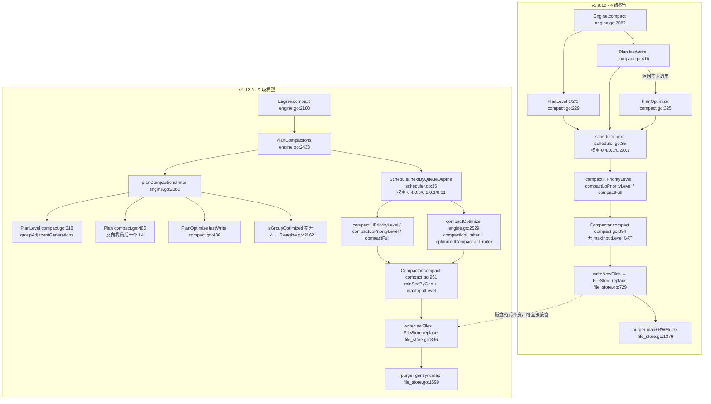
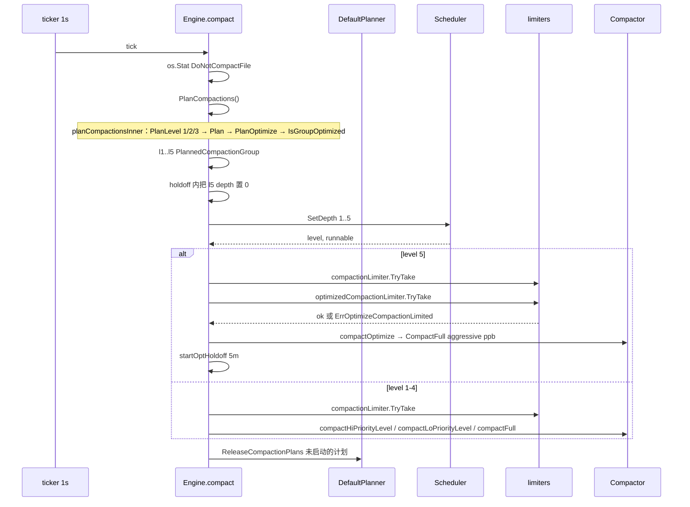
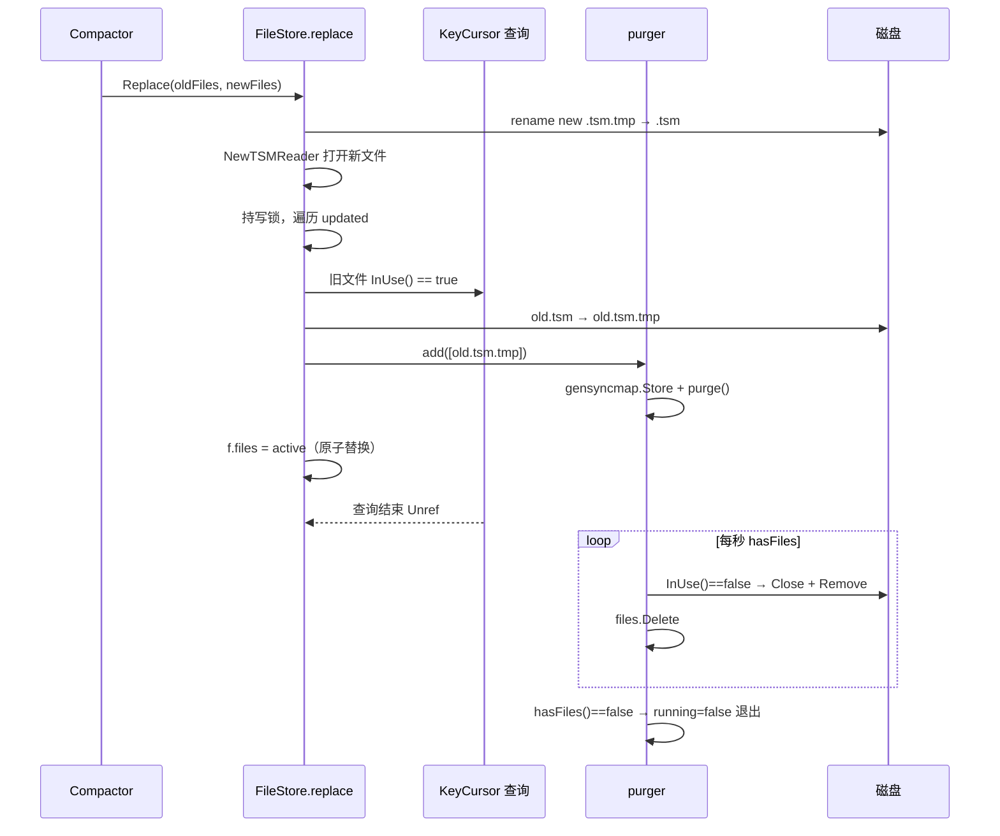

# 版本差异 4: 存储与 Compaction（v1.8.10 → v1.12.3）

> **基线**
> - OLD：`v1.8.10` = commit `688e697c51`（2021-10-11）
> - NEW：`v1.12.3` = commit `f3d5cb68ab`（`docs/specs/` 这批文档的代码基准）
> - 区间：527 commits，602 files，+79,310 / −45,239
> - NEW 工作树只额外包含 4 个 docs 提交，代码与 `f3d5cb68ab` 相同。
>
> **范围**：`tsdb/engine/tsm1/` 的 `compact.go`、`scheduler.go`、`file_store.go`（含 `purger`）、`writer.go`、`reader.go`、`digest*.go`、`tombstone.go`、`compact.gen.go`，以及 `engine.go` 的 compaction / Open / Close 相关部分。
>
> **一句话结论**：TSM **文件格式没有变化**（旧数据可直接读），但 **compaction 的层级模型、规划算法、调度与并发控制全部重写**：4 级（L1/L2/L3 + L4 full/optimize 混用）升级为 5 级（L1/L2/L3 + L4 full + L5 optimize），并补齐了防 level 回退、嵌套低层文件、full 漏调度、purger 锁竞争等一系列正确性与性能修复。

---

> **小白导读**
>
> 1. **4 车道变 5 车道**：v1.8.10 的“full compaction”和“optimize compaction”其实走同一条车道（都执行 `CompactFull`），只是规划器给它们贴了不同标签；v1.12.3 给 optimize 单独修了第 5 条车道（L5），配了独立的红绿灯（`optimizedCompactionLimiter`）、独立的分块大小（aggressive points-per-block）和独立的冷却时间（holdoff）。
> 2. **楼层号写在文件名里**：TSM 文件名是 `<generation>-<sequence>.tsm`，`level = min(sequence, 4)`。楼层不是存在文件里的，而是从文件名推算的。v1.12.3 把 generation/sequence 在打开文件时**缓存进内存**，规划时不再反复解析文件名。
> 3. **旧版会把 4 楼搬回 2 楼**：冷写（默认 4 小时无写入）触发 full compaction 时，会把最新的 L1 文件（高 generation、seq=1）和旧的 L4 文件（低 generation、seq≥4）放进同一组。旧版输出取“最大 generation 的 seq+1 = 2”，于是整组 L4 数据被写成 L2 —— 这是 #27233 修的 bug。新版先算出输入里的最高层级，保证输出层级不低于它。
> 4. **旧版是“两层兜底”，新版是“一层窗口”**：旧版 full 规划遇到低层文件就停，但 `Plan` 为空时还有 `PlanOptimize`——它不看冷写时间，会用孤儿规则把低层文件并进 L4 组，所以热 shard 上常常仍能压（甚至比新版一次压得更多，见 §6.4）。新版把嵌套处理搬进 `Plan` 的反向扫描，但 `PlanOptimize` 改成了必须冷写 4h；热 shard 只靠 `PlanLevel` 的“低层组提前升级”和 `Plan` 的 4 世代窗口（#26911，修的是 1.12 线的回归）。
> 5. **旧版会把文件“锁死”**：1.12.1 引入（#26432）的 `PT_SmartOptimize` 规划在提前返回时把已经 `acquire` 的 L4 计划直接丢掉、没有 `Release`，这些文件永远留在 `filesInUse` 里，再也不会被压缩，表现为磁盘无界增长；#26670 删掉了这套特殊分支。
> 6. **数据文件本身没动**：magic `0x16D116D1`、version 1、28 字节索引项、8 字节 footer、mmap 读取、KeyCursor 归并、tombstone v3/v4、digest 文件格式全部不变；变的只是“怎么决定压缩谁、压成什么、谁来压”。

---

## 1. 结论速览

| # | 变更点 | v1.8.10 | v1.12.3 | 影响 | 证据 |
|---|---|---|---|---|---|
| 1 | 压缩层级数 | 4（L1/L2/L3 + L4 复用） | **5**（L1/L2/L3 + L4 full + L5 optimize） | 调度、指标、限流全部改变 | `v1.8.10:tsdb/engine/tsm1/scheduler.go:7` / `v1.12.3:tsdb/engine/tsm1/engine.go:113` |
| 2 | optimize 执行路径 | 复用 `compactFull`，硬编码 `optimize=false`，与 full **执行层等价** | 独立 `compactOptimize` + `optimizeCompactionStrategy`，`CompactFull` + aggressive ppb | optimize 真正生效，不再与 full 抢同一个队列 | `v1.8.10:tsdb/engine/tsm1/engine.go:2222` / `v1.12.3:tsdb/engine/tsm1/engine.go:2529` |
| 3 | Planner 返回签名 | `[]CompactionGroup`（单值） | `([]CompactionGroup, int64)`；`PlanOptimize` 返回 3 值 | 规划器可报告队列长度与世代数 | `v1.8.10:tsdb/engine/tsm1/compact.go:90` / `v1.12.3:tsdb/engine/tsm1/compact.go:118` |
| 4 | 规划入口 | 每 tick 依次 `PlanLevel`×3、`Plan`，仅当 `Plan` 为空才 `PlanOptimize` | `PlanCompactions` 一次性收集 5 级 | L4/L5 可同 tick 竞争，L5 由权重决定 | `v1.8.10:tsdb/engine/tsm1/engine.go:2110` / `v1.12.3:tsdb/engine/tsm1/engine.go:2216` |
| 5 | 防 level 回退 | **无**；输出 seq 只由 max generation 的 max seq 决定 | `minSeqByGen` → `maxInputLevel` → 必要时抬升 `maxSequence` | 修复 L4 数据被压回 L2（#27233） | `v1.8.10:tsdb/engine/tsm1/compact.go:907` / `v1.12.3:tsdb/engine/tsm1/compact.go:975` |
| 6 | L4 段探测 | 正向扫描，遇 `level<=3` 即 `break` | **反向**找最后一个 `level>=4` | 嵌套低层不再截断 L4 段探测（#26911，1.12 线回归修复，见 §6.4） | `v1.8.10:tsdb/engine/tsm1/compact.go:489` / `v1.12.3:tsdb/engine/tsm1/compact.go:567` |
| 7 | 分组时遇到 in-use 世代 | `findGenerations(true)` 直接把 in-use 文件剔除出列表（留下“洞”） | `groupAdjacentGenerations` 在 in-use 处**切断**并继续 | 保持世代有序，避免跨洞合并导致覆盖顺序错误 | `v1.8.10:tsdb/engine/tsm1/compact.go:616` / `v1.12.3:tsdb/engine/tsm1/compact.go:394` |
| 8 | 低层级组被丢弃 | L4 分支分组里只要含 `level<=3` 就整组丢弃 | 不再丢弃，交给同一组一起卷 | 把嵌套处理从 `PlanOptimize` 移入 `Plan`（#26911）；这是 1.12 线的回归修复，v1.8.10 由 `PlanOptimize` 兜底 | `v1.8.10:tsdb/engine/tsm1/compact.go:554` / `v1.12.3:tsdb/engine/tsm1/compact.go:635` |
| 9 | optimize 触发条件 | 无 `lastWrite`，无冷写检查；仅 `level==4` 且 `len(group)>=4` 或有 tombstone | 必须 `since(lastWrite) >= 4h` 且未 fully compacted；`level==4` **或单世代** | 热 shard 不再做 optimize；单世代多文件可被重整 | `v1.8.10:tsdb/engine/tsm1/compact.go:325` / `v1.12.3:tsdb/engine/tsm1/compact.go:436` |
| 10 | “已完全压缩”判定 | `len(gens)<=1 && !hasTombstones` | 单世代多文件且未全部达到 aggressive ppb → **不算**完全压缩 | 影响 `Engine.IsIdle` 与 optimize 机会 | `v1.8.10:tsdb/engine/tsm1/compact.go:214` / `v1.12.3:tsdb/engine/tsm1/compact.go:262` |
| 11 | L4→L5 提升 | 无 | 组内任一文件 `FirstBlockCount >= aggressive` 即提升为 L5 | 避免“反向优化”（回填数据把已优化文件拉回普通压缩） | `v1.8.10:tsdb/engine/tsm1/engine.go:2221` / `v1.12.3:tsdb/engine/tsm1/engine.go:2376` |
| 12 | aggressive points/block | 无 | `aggressive-points-per-block`，默认 10000 | L5 输出 block 更满、索引更小 | `v1.12.3:tsdb/config.go:57` |
| 13 | scheduler 权重 | `[4]{0.4,0.3,0.2,0.1}` | `[5]{0.4,0.3,0.2,0.1,0.01}` | L5 权重极低，通常只在其他队列为空时被选中 | `v1.8.10:tsdb/engine/tsm1/scheduler.go:7` / `v1.12.3:tsdb/engine/tsm1/scheduler.go:8` |
| 14 | 并发限流 | 单一 `compactionLimiter` | `compactionLimiter` + `optimizedCompactionLimiter`（默认 1） | L5 最坏只占 1 个槽，且必须同时拿到两个 | `v1.8.10:tsdb/engine/tsm1/engine.go:193` / `v1.12.3:tsdb/engine/tsm1/engine.go:214` |
| 15 | optimize holdoff | 无 | 启动后 1h；每次尝试 L5 后 5m | 抑制 L5 频繁重规划 | `v1.12.3:tsdb/engine/tsm1/engine.go:2172` |
| 16 | 文件名解析 | 每次规划对每个文件 `ParseFileName` | 打开/重命名时缓存 `generation`/`sequence` 到 `TSMReader` | 规划 CPU 降低；`findGenerations` 不再解析 | `v1.8.10:tsdb/engine/tsm1/compact.go:631` / `v1.12.3:tsdb/engine/tsm1/reader.go:450` |
| 17 | 首 block 计数 | 规划时对文件做 `BlockCount(path,1)`（读盘/解码） | `FirstBlockCount` 缓存在 `ExtFileStat` | 规划 CPU 显著下降（#26432） | `v1.8.10:tsdb/engine/tsm1/compact.go:354` / `v1.12.3:tsdb/engine/tsm1/reader.go:635` |
| 18 | FileStore merge 指标 | 无 | 5 种类型 × merge 次数/值数/耗时/`over4` 计数 | 可观测查询期重叠块归并成本 | `v1.12.3:tsdb/engine/tsm1/file_store.go:163` |
| 19 | purger | `map` + `RWMutex`，扫描期间持写锁，失败 `continue` 永久重试 | `gensyncmap` + 仅 `running` 加锁，失败也删除条目 | 降低替换路径阻塞与泄漏（#27146） | `v1.8.10:tsdb/engine/tsm1/file_store.go:1376` / `v1.12.3:tsdb/engine/tsm1/file_store.go:1599` |
| 20 | TSM 文件格式 | magic `0x16D116D1`、version 1、28B 索引项、8B footer | **完全相同** | 旧 `.tsm`/`.tombstone` 可直接读 | `v1.8.10:tsdb/engine/tsm1/writer.go:81` / `v1.12.3:tsdb/engine/tsm1/writer.go:82` |
| 21 | 错误处理 | `TSMErrors`、`==` 比较、逐个 `os.Remove` | `errors.Join`、`errors.Is/As`、`RemoveTmpFilesOnErr`、`maxErrors=100` | 错误不再被吞，临时文件清理更彻底 | `v1.8.10:tsdb/engine/tsm1/compact.go:1034` / `v1.12.3:tsdb/engine/tsm1/compact.go:1116` |
| 22 | 测试体系 | 表驱动 | 新增 property-based 测试（邻接性属性） | 规划器回归更容易被发现 | `v1.12.3:tsdb/engine/tsm1/compact_property_test.go:18` |

---

## 2. 变更地图



一个 tick 内的时序（新版）：



---

## 3. 逐项差异

### 3.1 层级模型：4 级 → 5 级

**旧版：只有 4 个队列，没有 level 常量。**

```go
// v1.8.10:tsdb/engine/tsm1/scheduler.go:7 — defaultWeights
var defaultWeights = [4]float64{0.4, 0.3, 0.2, 0.1}

// v1.8.10:tsdb/engine/tsm1/engine.go:642 — EngineStatistics
TSMCompactions [3]int64 // 只有 level 1/2/3 的数组
```

旧版没有任何 `TotalCompactionLevels` / `FullCompactionLevel` / `OptimizeCompactionLevel` 常量（`git show v1.8.10:tsdb/engine/tsm1/engine.go | grep -n 'CompactionLevel'` 无输出）。full 与 optimize 共用一个队列下标 4。

**新版：显式 5 级。**

```go
// v1.12.3:tsdb/engine/tsm1/engine.go:103
// LevelCompactionCount is the number of level compactions (e.g. 1, 2, 3).
LevelCompactionCount = 3

// FullCompactionLevel is the compaction level for full compactions.
FullCompactionLevel = 4

// OptimizeCompactionLevel is the compaction level for optimized compactions.
OptimizeCompactionLevel = 5

// TotalCompactionLevels is the overall number of compaction levels.
TotalCompactionLevels = 5
```

**语义影响**：

- `TSMCompactions` 数组仍是 `[3]`（只有 L1–L3），但 `Scheduler.queues` / `weights` 变成 `[5]`（`v1.12.3:tsdb/engine/tsm1/scheduler.go:15`）。
- L5 不再借用 L4 的队列、统计和限流。`TSMOptimizeCompactionsActive` 在旧版**永远是 0**（因为执行 optimize 时走的是 `fullCompactionStrategy(grp,false)`，统计记在 `TSMFullCompactions*` 上），新版才真实反映 optimize 并发。
- 旧版 `TSMOptimizeCompactionsQueue` 在 `Plan` 之后被赋值为 **L4 full 队列长度**（`v1.8.10:tsdb/engine/tsm1/engine.go:2115`），`Plan` 为空时又被 `PlanOptimize` 的结果覆盖（`:2120`）。也就是说旧指标名不副实；新版 L4/L5 各自独立（`v1.12.3:tsdb/engine/tsm1/engine.go:2442`）。

### 3.2 旧版 full / optimize 是否等价？

**结论：执行层等价，规划层不等价。**

旧版 `compactFull` 写死了 `optimize=false`：

```go
// v1.8.10:tsdb/engine/tsm1/engine.go:2221
func (e *Engine) compactFull(grp CompactionGroup, wg *sync.WaitGroup) bool {
	s := e.fullCompactionStrategy(grp, false)   // ← 恒为 false
	...
}
```

`fullCompactionStrategy` 里 `optimize` 只影响三处：`fast`、四个统计指针，以及 struct 字面量里的 logger 字段 `zap.Bool("tsm1_optimize", optimize)`（`v1.8.10:tsdb/engine/tsm1/engine.go:2367`）。下面只展开前两处：

```go
// v1.8.10:tsdb/engine/tsm1/engine.go:2364
func (e *Engine) fullCompactionStrategy(group CompactionGroup, optimize bool) *compactionStrategy {
	s := &compactionStrategy{
		...
		fast:  optimize,      // ← optimize 时走 CompactFast（但永远不会发生）
		level: 4,
	}
	if optimize {
		s.activeStat = &e.stats.TSMOptimizeCompactionsActive   // ← 死路径
		...
	} else {
		s.activeStat = &e.stats.TSMFullCompactionsActive
		...
	}
	return s
}
```

`grep -n 'fullCompactionStrategy(' v1.8.10:tsdb/engine/tsm1/engine.go` 只有两处：定义（2364）与唯一调用（2222，传 `false`）。因此：

- 旧版 `Plan` 产出的 full 组和 `PlanOptimize` 产出的 optimize 组，最终都执行 `Compactor.CompactFull`（`fast=false`）。
- 在**执行层**，两个路径的差别只有日志标签和统计归属（而统计归属还是错的：optimize 组被记到 `TSMFullCompactions*`）。规划条件本身不同（见 §3.7）。
- 旧版 `optimize=true` 的 `CompactFast` 分支是死代码（为后来的 L5 预留）。
- 新版把“死路径”变成真路径：`optimizeCompactionStrategy`（`v1.12.3:.../engine.go:2719`）显式 `fast:false` + `pointsPerBlock`，并使用 `TSMOptimize*` 统计。

### 3.3 调度主循环：五次规划 vs “Plan 为空才 optimize”

**旧版**：

```go
// v1.8.10:tsdb/engine/tsm1/engine.go:2110
level1Groups := e.CompactionPlan.PlanLevel(1)
level2Groups := e.CompactionPlan.PlanLevel(2)
level3Groups := e.CompactionPlan.PlanLevel(3)
level4Groups := e.CompactionPlan.Plan(e.LastModified())
atomic.StoreInt64(&e.stats.TSMOptimizeCompactionsQueue, int64(len(level4Groups)))

// If no full compactions are need, see if an optimize is needed
if len(level4Groups) == 0 {
	level4Groups = e.CompactionPlan.PlanOptimize()
	atomic.StoreInt64(&e.stats.TSMOptimizeCompactionsQueue, int64(len(level4Groups)))
}
...
e.scheduler.setDepth(1, ...); ... e.scheduler.setDepth(4, len(level4Groups))
```

要点：

- `PlanOptimize` 与 `Plan` **互斥**：只要 full 有活，optimize 本轮就不看。
- optimize 与 full 共享 `level4Groups` 和队列深度 4。
- 每 tick 只启动一个 compaction group（`switch level` 里只处理一个 case），另一个 tick 再继续。

**新版**：

```go
// v1.12.3:tsdb/engine/tsm1/engine.go:2216
level1Groups, level2Groups, level3Groups, level4Groups, level5Groups := e.PlanCompactions()

var l5GroupCount int
if time.Since(optHoldoffStart) >= optHoldoffDuration {
	l5GroupCount = len(level5Groups)
}

e.Scheduler.SetDepth(1, len(level1Groups))
...
e.Scheduler.SetDepth(4, len(level4Groups))
e.Scheduler.SetDepth(5, l5GroupCount)   // holdoff 内为 0，Scheduler 不会选 L5
```

`PlanCompactions`（`v1.12.3:.../engine.go:2433`）一次收集五级，`planCompactionsInner`（`:2360`）顺序执行 `PlanLevel(1..3)`、`Plan`、`PlanOptimize`，然后做 L4→L5 提升。注意：**尚未被启动的 L5 计划仍然会返回**，并在 tick 末尾由 `ReleaseCompactionPlans`（`:2292`）释放，不会造成 in-use 泄漏——这正是 #26670 修复的核心。

### 3.4 Planner 接口与返回值

```go
// v1.8.10:tsdb/engine/tsm1/compact.go:90
Plan(lastWrite time.Time) []CompactionGroup
PlanLevel(level int) []CompactionGroup
PlanOptimize() []CompactionGroup
Release(group []CompactionGroup)
FullyCompacted() bool
```

```go
// v1.12.3:tsdb/engine/tsm1/compact.go:118
Plan(lastWrite time.Time) ([]CompactionGroup, int64)
PlanLevel(level int) ([]CompactionGroup, int64)
// PlanOptimize will return the groups for compaction, the compaction group length,
// and the amount of generations within the compaction group.
PlanOptimize(lastWrite time.Time) (compactGroup []CompactionGroup, compactionGroupLen int64, generationCount int64)
Release(group []CompactionGroup)
FullyCompacted() (bool, string)
```

差异解释：

- 第二个返回值是**计划组数量**，由 1.9 线 #22195（`7d3efe1e9e`）为“`acquire` 失败时也报告计划长度”引入；但 v1.12.3 的 `PlanCompactions` 把它全部丢弃（`v1.12.3:tsdb/engine/tsm1/engine.go:2354-2366` 均以 `_` 接收），队列统计改回 `len()`（`:2439-2443`），当前**没有消费者**，仅作接口预留/测试使用。
- `PlanOptimize` 新增 `lastWrite`，用于冷写判定；第三个返回值 `generationCount` 让引擎判断“是否单世代”，从而决定 L5 是否用 aggressive points/block（`v1.12.3:.../engine.go:2402`）。
- `FullyCompacted` 返回 `(bool, string)`，字符串是“为什么没完全压缩”的原因，由 `Engine.IsIdle` 原样返回给调用方（`v1.12.3:.../engine.go:944-970`）。

### 3.5 PlanLevel：从内联分组到 `groupAdjacentGenerations`

**旧版分组（内联）**：

```go
// v1.8.10:tsdb/engine/tsm1/compact.go:252
var currentGen tsmGenerations
var groups []tsmGenerations
for i := 0; i < len(generations); i++ {
	cur := generations[i]
	// 孤儿世代：比后面的层级低，先并入当前组
	if i < len(generations)-1 {
		if cur.level() < generations[i+1].level() {
			currentGen = append(currentGen, cur)
			continue
		}
	}
	if len(currentGen) == 0 || currentGen.level() == cur.level() {
		currentGen = append(currentGen, cur)
		continue
	}
	groups = append(groups, currentGen)
	currentGen = tsmGenerations{}
	currentGen = append(currentGen, cur)
}
```

```go
// v1.8.10:tsdb/engine/tsm1/compact.go:288
minGenerations := 4
if level == 1 {
	minGenerations = 8
}
...
if len(chunk) < minGenerations && !hasTombstones {
	continue
}
```

**新版**把分组抽成 `groupAdjacentGenerations`（`v1.12.3:.../compact.go:394`），并新增两个行为：

```go
// v1.12.3:tsdb/engine/tsm1/compact.go:408
for i := 0; i < len(generations); i++ {
	if c.isInUse(generations[i]) {
		moveToNextGroup()
		// Do not put this generation in the groups
		continue
	} else {
		if (len(currentGen) <= 0) ||
			(levelTestFn(currentGen.level(), generations[i].level()) ||
				(i < len(generations)-1 && generations[i].level() < generations[i+1].level())) {
			currentGen = append(currentGen, generations[i])
		} else {
			moveToNextGroup()
			currentGen = append(currentGen, generations[i])
		}
	}
}
```

```go
// v1.12.3:tsdb/engine/tsm1/compact.go:371 — 不足 minGenerations 时的新出口
if len(chunk) < minGenerations && !hasTombstones {
	for j := levelGroupIndices[i] + 1; j < len(groups); j++ {
		if groups[j].level() >= level {
			// There are later generations of higher level, so this
			// group should be processed to go up a level.
			cGroups = append(cGroups, cGroup)
			break
		}
	}
	continue
}
```

行为差异：

1. **in-use 不再“消失”**：旧版 `findGenerations(true)` 把 in-use 文件直接从有序列表剔除，两个原本不相邻的世代可能因此变成相邻并被合进同一组；新版保留完整有序列表，在 in-use 处 `moveToNextGroup()` 切断，既不合并也不占用（`v1.12.3:.../compact.go:685` 的 `isInUse`）。
2. **低层组可以提前升级**：如果某个 L2 组不足 4 代，但后面还有 L2/L3/L4 的世代，则允许先把它压上去，避免被永久卡住。代价是可能产生更多小的写放大。
3. `minGenerations`（L1=8，其余=4）与“含 tombstone 即使不足也压缩”的规则**未变**（`v1.8.10:.../compact.go:307` / `v1.12.3:.../compact.go:371`）。

另一个隐藏修复：旧版 `findGenerations` 会把结果缓存到 `lastGenerations` / `lastFindGenerations`，但**缓存不区分 `skipInUse` 参数**：

```go
// v1.8.10:tsdb/engine/tsm1/compact.go:616
func (c *DefaultPlanner) findGenerations(skipInUse bool) tsmGenerations {
	...
	if !last.IsZero() && c.FileStore.LastModified().Equal(last) {
		return lastGen   // ← 可能是用 skipInUse=true 计算的那一份
	}
```

于是同一 `LastModified` 下，先由规划器以 `true` 调用、再由 `FullyCompacted()` 以 `false` 调用时，会拿到被过滤过的列表，可能误判“已完全压缩”。新版彻底删除该缓存（`v1.12.3:.../compact.go:699-724`），每次从 `FileStore.Stats()` 的缓存统计重建（统计本身由 `FileStore.Stats` 缓存，见 3.11）。

### 3.6 Plan（L4 / full）：反向扫描与不再丢弃低层组

**旧版 full 分支**（冷写或 `forceFull`）：

```go
// v1.8.10:tsdb/engine/tsm1/compact.go:424
if forceFull || c.compactFullWriteColdDuration > 0 && time.Since(lastWrite) > c.compactFullWriteColdDuration && len(generations) > 1 {
	...
	for i, group := range generations {
		var skip bool
		if len(generations) > 2 && group.size() > uint64(maxTSMFileSize) &&
			c.FileStore.BlockCount(group.files[0].Path, 1) == tsdb.DefaultMaxPointsPerBlock && !group.hasTombstones() {
			skip = true
		}
		// 若下一个世代 level<=3，则不许跳过，避免新文件被漏掉
		if i < len(generations)-1 && generations[i+1].level() <= 3 {
			skip = false
		}
		if skip { continue }
		for _, f := range group.files { tsmFiles = append(tsmFiles, f.Path) }
		genCount += 1
	}
	if len(tsmFiles) <= 1 || genCount <= 1 { return nil }
	group := []CompactionGroup{tsmFiles}
	...
}
```

**旧版普通 L4 分支**：

```go
// v1.8.10:tsdb/engine/tsm1/compact.go:489
end := 0
start := 0
for i, g := range generations {
	if g.level() <= 3 {
		break          // ← 一遇低层就停
	}
	end = i + 1
}
...
// v1.8.10:tsdb/engine/tsm1/compact.go:554
if lvl <= 3 {
	skipGroup = true   // ← 组里含低层文件就整组丢弃
	break
}
```

**新版 full 分支**：逻辑基本保留，但增加 `isInUse` 跳过（`:508`）、把 `BlockCount(...)==DefaultMaxPointsPerBlock` 换成缓存字段 `FirstBlockCount >= DefaultMaxPointsPerBlock`（`:513`），并明确注释“不维护邻接性”：

```go
// v1.12.3:tsdb/engine/tsm1/compact.go:493
if forceFull || c.compactFullWriteColdDuration > 0 && time.Since(lastWrite) > c.compactFullWriteColdDuration && len(generations) > 1 {
	// We are NOT paying attention to maintaining adjacency in compaction here; groups may contain non-contiguous generations.
	// presumably because there are no overwrites or backfills
	...
	if c.isInUse(group) { continue }
```

**新版 L4 分支**：

```go
// v1.12.3:tsdb/engine/tsm1/compact.go:567
// Walk the generations in reverse to find the last level 4 generation
// The backwards iteration is to keep nested lower level generations from preventing
// compactions of higher level, later generations.
for i := len(generations) - 1; i >= 0; i-- {
	if generations[i].level() >= 4 {
		end = i + 1
		break
	}
}
```

```go
// v1.12.3:tsdb/engine/tsm1/compact.go:632
for j := 0; j < step && (j+i) < len(generations); j++ {
	gen := generations[j+i]
	// We used to discard groups of level 3 or under here, on the theory
	// that the level planner would pick them up.  But, if they are not in-use,
	// then they weren't picked up and should be rolled up in here.
	if c.isInUse(gen) { break }
	if gen.size() >= uint64(tsdb.MaxTSMFileSize) && gen.files[0].FirstBlockCount >= tsdb.DefaultMaxPointsPerBlock && !gen.hasTombstones() {
		break
	}
	currentGroup = append(currentGroup, gen)
}
```

差异解释：

- `end` 的语义从“从头开始连续 L4 的长度”变为“**最后一个** L4 的位置 + 1”。前者一旦遇到夹心低层文件就放弃后面的所有 L4；后者保证所有 L4 都在考察范围内。
- 分组循环里 `isInUse` / 超大文件现在用 `break` 而不是 `continue`+`startIndex++`，分组更简单，也不会把超大文件悄悄跳过而留下一个跨越它的组。
- 旧版“组里含 `level<=3` 就整组丢弃”的规则被删除：这些文件既然没被 level planner 拿走（`isInUse` 为 false），就应该在同一组里被卷掉——这是 #26911 的一部分（配合反向扫描，解决夹心低层文件导致的漏压缩）。

### 3.7 PlanOptimize / L5：从“凑够 4 代”到“冷 shard 就重整”

**旧版**：

```go
// v1.8.10:tsdb/engine/tsm1/compact.go:325
func (c *DefaultPlanner) PlanOptimize() []CompactionGroup {
	...
	generations := c.findGenerations(true)
	if len(generations) <= 1 && !generations.hasTombstones() {
		return nil
	}
	for i := 0; i < len(generations); i++ {
		cur := generations[i]
		// Skip the file if it's over the max size and contains a full block and it does not have any tombstones
		if cur.count() > 2 && cur.size() > uint64(maxTSMFileSize) &&
			c.FileStore.BlockCount(cur.files[0].Path, 1) == tsdb.DefaultMaxPointsPerBlock && !cur.hasTombstones() {
			continue
		}
		...
	}
	// Only optimize level 4 files since using lower-levels will collide with the level planners
	...
	if len(group) < 4 && !group.hasTombstones() {
		continue
	}
	...
}
```

**新版**：

```go
// v1.12.3:tsdb/engine/tsm1/compact.go:436
func (c *DefaultPlanner) PlanOptimize(lastWrite time.Time) (compactGroup []CompactionGroup, compactionGroupLen int64, generationCount int64) {
	...
	generations := c.findGenerations()
	fullyCompacted, _ := c.generationsFullyCompacted(generations)

	if fullyCompacted || time.Since(lastWrite) < c.compactFullWriteColdDuration {
		return nil, 0, 0
	}

	groups := c.groupAdjacentGenerations(generations, func(currentLevel int, candidateLevel int) bool { return currentLevel >= candidateLevel })

	var cGroups []CompactionGroup
	for _, group := range groups {
		var cGroup CompactionGroup
		// Optimize level 4 generation groups since using lower-levels will collide
		// with the level planners. If this is a single-generation optimization,
		// do not skip any levels.
		if group.level() == 4 || len(generations) == 1 {
			for _, gen := range group {
				for _, file := range gen.files {
					cGroup = append(cGroup, file.Path)
				}
			}
		}
		if len(cGroup) > 0 {
			cGroups = append(cGroups, cGroup)
		}
	}
	...
	return cGroups, int64(len(cGroups)), int64(len(generations))
}
```

差异解释（行为影响最大的几处）：

1. **必须冷**：`time.Since(lastWrite) < compactFullWriteColdDuration` 直接返回空。默认 `compactFullWriteColdDuration = 4h`（`v1.8.10:tsdb/config.go:38` 与 `v1.12.3:tsdb/config.go:38` 相同）。旧版 optimize 完全不看写入时间，只靠“`Plan` 为空”间接限制。
2. **不再要求 4 代**：旧版 `len(group) < 4 && !hasTombstones` 才跳过；新版对 `level==4` 的组**不设数量下限**。但要注意**谁先拿到文件**：冷 shard 上 `Plan` 的 full 分支会先 `acquire` 全部世代（`v1.12.3:.../compact.go:493-548`），`PlanOptimize` 只能在 `Plan` 交不出计划时接手（`planCompactionsInner` 的顺序是 `Plan` 在前，`v1.12.3:.../engine.go:2365-2366`；`groupAdjacentGenerations` 遇 in-use 直接跳过，`:409-412`）。所以正确表述是“**当 `Plan` 为空时**，1–3 个 L4 世代也会被 L5 合并”，而不是无条件。
3. **单世代特例**：`len(generations) == 1` 时不再按层级过滤，允许把同一世代的多个文件重整。旧版在 `len(generations) <= 1` 时直接返回 nil，**单世代多文件永远不会被 optimize**。
4. **不再跳过超大文件**：旧版对 `count>2 && size>2GB && 满 block && 无 tombstone` 的世代 `continue`；新版没有这条，改由 `generationsFullyCompacted` 决定。
5. **返回值带世代数**：`generationCount == 1` 时引擎对该 L5 组使用 aggressive points/block（`v1.12.3:.../engine.go:2402`）。

`generationsFullyCompacted` 的新语义：

```go
// v1.12.3:tsdb/engine/tsm1/compact.go:262
func (c *DefaultPlanner) generationsFullyCompacted(gens tsmGenerations) (bool, string) {
	if len(gens) > 1 {
		return false, "not fully compacted and not idle because of more than one generation"
	} else if gens.hasTombstones() {
		return false, "not fully compacted and not idle because of tombstones"
	} else {
		// 单世代但多文件：只要还有文件没到 aggressive points/block，就继续压
		if len(gens) == 1 && len(gens[0].files) > 1 {
			aggressivePointsPerBlockCount := 0
			filesUnderMaxTsmSizeCount := 0
			for _, tsmFile := range gens[0].files {
				if tsmFile.FirstBlockCount > tsdb.DefaultMaxPointsPerBlock {
					aggressivePointsPerBlockCount++
				}
				if tsmFile.Size < tsdb.MaxTSMFileSize {
					filesUnderMaxTsmSizeCount++
				}
			}
			if aggressivePointsPerBlockCount == len(gens[0].files) {
				return true, "fully compacted because all files are at aggressivePointsPerBlock"
			}
			if filesUnderMaxTsmSizeCount > 1 && aggressivePointsPerBlockCount < len(gens[0].files) {
				return false, tsdb.SingleGenerationReasonText
			}
		}
		return true, ""
	}
}
```

判定要点：

- 只有“单世代 + 至少 2 个文件 + 至少 2 个文件小于 2GB + 并非所有文件都超过 1000 points/block”才算“未完全压缩”。这正好覆盖“历史 compaction 因单 key 索引上限 65535 或多次 roll 留下的碎片”，而不会对“>2GB 必然分裂”的情况做无意义重写。
- 该函数同时被 `FullyCompacted()`（`v1.12.3:.../compact.go:302`）用于 `Engine.IsIdle`，所以**升级后 shard 可能比以前更晚进入 idle**（日志会给出 `SingleGenerationReasonText`）。

### 3.8 L4→L5 提升与 aggressive points/block

新版在规划阶段做一次“优化状态识别 + 提升”：

```go
// v1.12.3:tsdb/engine/tsm1/engine.go:2376
for _, group := range l4Groups {
	if isOpt, filename, heur := e.IsGroupOptimized(group); isOpt {
		e.logger.Debug("Promoting full compaction level 4 group to optimized level 5 compaction group because it contains an already optimized TSM file", ...)
		level5Groups = append(level5Groups, PlannedCompactionGroup{
			Group:          group,
			PointsPerBlock: e.CompactionPlan.GetAggressiveCompactionPointsPerBlock(),
		})
	} else {
		level4Groups = append(level4Groups, PlannedCompactionGroup{Group: group, PointsPerBlock: tsdb.DefaultMaxPointsPerBlock})
	}
}
```

```go
// v1.12.3:tsdb/engine/tsm1/engine.go:2137 — 判定启发式
func (e *Engine) isFileOptimized(f string) (bool, string) {
	firstBlockCount := -1
	stats := e.Compactor.FileStore.Stats()
	for _, st := range stats {
		if st.Path == f {
			firstBlockCount = st.FirstBlockCount
		}
	}
	...
	aggroThresh := e.CompactionPlan.GetAggressiveCompactionPointsPerBlock()
	if firstBlockCount >= aggroThresh {
		return true, fmt.Sprintf("first block contains aggressive points per block (%d > %d)", firstBlockCount, aggroThresh)
	}
	return false, ...
}
```

机制：

- 只要组内**任一**文件的首 block 达到 aggressive 阈值（默认 10000），整组就提升为 L5 并用 aggressive 重写。这样“冷 shard 被回填数据”后不会把大部分已优化文件退回 1000 points/block。
- 旧版完全没有这个概念：`fullCompactionStrategy` 的 `optimize` 参数是死的，L4 文件永远是 1000 points/block。
- 配置来自 `tsdb.Config.AggressivePointsPerBlock`（`v1.12.3:tsdb/config.go:135`，默认 `DefaultAggressiveMaxPointsPerBlock = 1000*10`，`v1.12.3:tsdb/config.go:57`），在 `NewEngine` 里注入 planner（`v1.12.3:tsdb/engine/tsm1/engine.go:256`）。

### 3.9 `compact()`：`maxInputLevel` 防 level 回退（#27233，issue #27230）

**旧版**：

```go
// v1.8.10:tsdb/engine/tsm1/compact.go:907
var maxGeneration, maxSequence int
for _, f := range tsmFiles {
	gen, seq, err := c.parseFileName(f)
	if err != nil {
		return nil, err
	}
	if gen > maxGeneration {
		maxGeneration = gen
		maxSequence = seq
	}
	if gen == maxGeneration && seq > maxSequence {
		maxSequence = seq
	}
}
...
return c.writeNewFiles(maxGeneration, maxSequence, tsmFiles, tsm, true)
```

`maxSequence` 只在“当前最大 generation”的范围内更新。`writeNewFiles` 从 `maxSequence+1` 开始写；文件层级 = `min(sequence, 4)`。

**新版**：

```go
// v1.12.3:tsdb/engine/tsm1/compact.go:975
var maxGeneration, maxSequence int
minSeqByGen := make(map[int]int)

if c.FileStore == nil {
	return nil, fmt.Errorf("compactor for %s has no file store: %w", c.Dir, errCompactionsDisabled)
}
for _, f := range tsmFiles {
	gen, seq, err := c.FileStore.ParseFileName(f)
	if err != nil {
		return nil, err
	}
	if gen > maxGeneration {
		maxGeneration = gen
		maxSequence = seq
	}
	if gen == maxGeneration && seq > maxSequence {
		maxSequence = seq
	}
	if s, ok := minSeqByGen[gen]; !ok || seq < s {
		minSeqByGen[gen] = seq
	}
}

// Compute the highest compaction level among all input generations.
// A generation's level = min(its minimum sequence number, 4).
var maxInputLevel int
for _, minSeq := range minSeqByGen {
	maxInputLevel = max(maxInputLevel, min(minSeq, 4))
}

// Ensure the output level (min(maxSequence+1, 4)) does not regress
// below any input level. This matters when cold/forced compaction
// groups L1 files (high gen, seq=1) with L4 files (low gen, seq>=4).
if maxSequence+1 < maxInputLevel {
	maxSequence = maxInputLevel - 1
}
```

关键点：

- 用**每个 generation 的最小 sequence** 计算层级，而不是用“当前最大 generation 的 sequence”。因为一个 generation 可能因 2GB 上限被拆成 `seq=2,3` 两个文件：用 max 会把 L2 误算成 L3，用 min 才是真实层级（`TestCompactor_CompactFull_SplitFilesNoLevelInflation`，`v1.12.3:tsdb/engine/tsm1/compact_test.go:317-360`）。
- 只做“抬升”，不做“压低”：`maxSequence` 仍保留原值用于避免文件名冲突；只有当 `maxSequence+1` 低于输入最高层级时才抬到 `maxInputLevel-1`。
- 抬升后输出 `sequence = maxInputLevel`，层级 `min(maxInputLevel,4)`，因此最高只到 L4（不会凭空造 L5）。
- `max`/`min` 是 Go 1.21 内置函数；旧版 `go.mod` 是 `go 1.13`，新版是 `go 1.24.0`（`v1.12.3:go.mod:3`）。

官方回归测试（`v1.12.3:tsdb/engine/tsm1/compact_test.go`，来自 #27233）：

- `TestCompactor_CompactFull_MixedLevelNoRegression`：输入 `1-4`、`2-5`（L4）与 `3-1`、`4-1`（L1），要求输出 `>= 4`；注释明确“Without the fix, maxSequence was scoped to the max generation (gen=4, seq=1), producing seq=2 (L2)”。
- `TestCompactor_CompactFull_SplitFilesNoLevelInflation`：`1-2`、`1-3`（同一 L2 世代被 2GB 拆分）与 `8-2`，要求输出 `seq=3`（L3），不能被拆分裂出的 `seq=3` 抬成 L4。这正是“用 min 而不是 max”的动机。

### 3.10 执行策略、双 limiter 与统计归属

**旧版**：`compactFull` → `fullCompactionStrategy(grp,false)` → `CompactFull(tsmFiles)`（`v1.8.10:.../compact.go:957`），签名不带 logger / pointsPerBlock，块大小来自 `Compactor.Size`：

```go
// v1.8.10:tsdb/engine/tsm1/compact.go:894
func (c *Compactor) compact(fast bool, tsmFiles []string) ([]string, error) {
	size := c.Size
	if size <= 0 {
		size = tsdb.DefaultMaxPointsPerBlock
	}
```

**新版**：`CompactFull(tsmFiles, logger, pointsPerBlock)` / `CompactFast(tsmFiles, logger, pointsPerBlock)`（`v1.12.3:.../compact.go:1050/1082`），`compact(fast, tsmFiles, logger, pointsPerBlock)`（`:961`）直接使用传入的块大小。`pointsPerBlock` 由策略决定：L1–L4 为 1000，L5 可能为 aggressive。

**双 limiter**：

```go
// v1.12.3:tsdb/engine/tsm1/engine.go:2535
// Ordering for taking and releasing limiters:
// 1. Take compactionLimiter
// 2. Take optimizedCompactionLimiter
// 3. Release optimizedCompactionLimiter
// 4/ Release compactionLimiter
if e.compactionLimiter.TryTake() {
	if !e.optimizedCompactionLimiter.TryTake() {
		e.compactionLimiter.Release()
		return ErrOptimizeCompactionLimited
	}
	atomic.AddInt64(&e.Stats.TSMOptimizeCompactionsActive, 1)
	wg.Add(1)
	go func() {
		defer wg.Done()
		defer atomic.AddInt64(&e.Stats.TSMOptimizeCompactionsActive, -1)
		defer e.compactionLimiter.Release()          // Happens second
		defer e.optimizedCompactionLimiter.Release() // Happens first
		s.Apply()
		e.CompactionPlan.Release([]CompactionGroup{s.group})
	}()
	return nil
}
return ErrCompactionLimited
```

配置链路：

- `tsdb/engine.go:179` 新增 `OptimizedCompactionLimiter limiter.Fixed`。
- `tsdb/store.go:513-524`：`optLim = Config.MaxConcurrentOptimizedCompactions`，默认 0 → 取 1，且不超过总 compaction 并发 `lim`。
- 旧版只有 `compactionLimiter`（`v1.8.10:tsdb/engine/tsm1/engine.go:193`），full/optimize/level 共用。

调度循环里对失败的处理：

```go
// v1.12.3:tsdb/engine/tsm1/engine.go:2266
if err := e.compactOptimize(theGroup, pointsPerBlock, wg); err != nil {
	if errors.Is(err, ErrOptimizeCompactionLimited) {
		log.Info("Reached limit for optimized compactions. Ending optimized compaction scheduling for this scheduling cycle")
	} else if errors.Is(err, ErrCompactionLimited) {
		log.Info("Reached limit for concurrent compactions while attempting optimized compaction. ...")
	} else {
		log.Error("Error during compactOptimize", zap.Error(err))
	}
} else {
	log.Info("Optimized level 5 group compacted")
	level5Groups = level5Groups[1:]
}
startOptHoldoff(optimizationHoldoff)   // ← 无论成功/限流/报错都会重置 5m
```

### 3.11 Scheduler：5 个权重与仍然失效的 loLimit

```go
// v1.12.3:tsdb/engine/tsm1/scheduler.go:8
// Level 5 (optimize) is set so much lower because level 5 compactions take so much longer.
var defaultWeights = [TotalCompactionLevels]float64{0.4, 0.3, 0.2, 0.1, 0.01}
```

选择逻辑：

```go
// v1.12.3:tsdb/engine/tsm1/scheduler.go:36
level1Running := int(atomic.LoadInt64(&s.stats.TSMCompactionsActive[0]))
...
level4Running := int(atomic.LoadInt64(&s.stats.TSMFullCompactionsActive))
level5Running := int(atomic.LoadInt64(&s.stats.TSMOptimizeCompactionsActive))

if level1Running+level2Running+level3Running+level4Running+level5Running >= s.maxConcurrency {
	return 0, false
}

loLimit, _ := s.limits()
end := len(depths)
if level3Running+level4Running+level5Running >= loLimit && s.maxConcurrency-(level1Running+level2Running) == 0 {
	end = 2
}

var weight float64
for i := 0; i < end; i++ {
	if float64(depths[i])*s.weights[i] > weight {
		level, runnable = i+1, true
		weight = float64(depths[i]) * s.weights[i]
	}
}
```

- 旧版第 39 行把 `TSMFullCompactionsActive + TSMOptimizeCompactionsActive` 相加作为 `level4Running`；新版拆成 `level4Running` 与 `level5Running`。
- **`end = 2` 的保护仍然是不可达死代码**：若 `level1Running+level2Running == maxConcurrency`，则总和已 `>= maxConcurrency`，第 43 行先返回 `false`。旧版同样如此（`v1.8.10:.../scheduler.go:53`）。也就是说“防止低优先级饿死高优先级”的意图从未生效。新版沿用了这段逻辑，风险仍在（见 §7）。
- 权重 `0.01` 意味着：只要 L1–L4 任一队列非空且分数更高，L5 就不会被选中；L5 实际上只在 shard 空闲时运行，与 holdoff 的设计意图一致。
- `Scheduler.SetDepth` 的越界检查 `level > len(s.queues)` 应为 `>=`，但调用方固定 1..5，不会触发（旧版同样）。

### 3.12 optimize holdoff：从无到 1h/5m，以及一个“值传递”bug

旧版**没有 holdoff**：每个 tick 都会尝试 `PlanOptimize`（虽然只在 `Plan` 为空时）。

新版：

```go
// v1.12.3:tsdb/engine/tsm1/engine.go:2172
const initialOptimizationHoldoff = time.Hour
const optimizationHoldoff = 5 * time.Minute
```

引入与修复历史：

- #26432（`2a0353ffd2`）引入 `waitForOptimization = time.Hour`、`initialOptimizationHoldoff`、`optimizationHoldoff`，并把已经进行中的 `firstBlockCount` 缓存用于规划。
- #26488（`0fdb6adcb2`）修掉一个真实 bug：`StartOptHoldOff(holdOffDurationCheck time.Duration, optHoldoffStart time.Time, optHoldoffDuration time.Duration)` 以**值传递**接收两个时间变量，闭包里的赋值只改副本，`optHoldoffStart/optHoldoffDuration` 永远为零值，导致 holdoff 判定失效。修复方式是把闭包内联进 `compact()` 的局部变量（`v1.12.3:.../engine.go:2183-2190`）。
- #26670（`95e86be3f4`）把 holdoff 完全移到 `Engine.compact`，删除 planner 的 `PT_SmartOptimize`/`PT_NoOptimize`。
- #26945（`439604ecd9`）把“holdoff timer started”从 Info 降为 Debug，避免每 5 分钟刷日志。

当前语义：

- 进程启动/engine 启动后 **1 小时**内不调度 L5。
- 每次进入 `case 5`（无论成功、被限流还是报错）都重置为 **5 分钟**。
- holdoff 期间 `SetDepth(5, 0)`，`Scheduler.next` 不会选 L5；但 `level5Groups` 仍然会走 `ReleaseCompactionPlans`，不会泄漏 in-use。

### 3.13 TSM 文件名 generation/sequence 缓存（#26905）

**旧版**：`TSMReader` 不保存 generation/sequence；`FileStat` 也没有这两个字段：

```go
// v1.8.10:tsdb/engine/tsm1/file_store.go:199
type FileStat struct {
	Path             string
	HasTombstone     bool
	Size             uint32
	LastModified     int64
	MinTime, MaxTime int64
	MinKey, MaxKey   []byte
}
```

```go
// v1.8.10:tsdb/engine/tsm1/compact.go:177
func (t *tsmGeneration) level() int {
	_, seq, _ := t.parseFileName(t.files[0].Path)   // ← 每次调用都解析文件名
	if seq < 4 { return seq }
	return 4
}
```

```go
// v1.8.10:tsdb/engine/tsm1/compact.go:631
gen, _, _ := c.ParseFileName(f.Path)   // findGenerations 每个文件解析一次
```

**新版**：

```go
// v1.12.3:tsdb/engine/tsm1/reader.go:64
firstBlockCountCache blockCountCache

parseFileNameFunc ParseFileNameFunc
generation        int
sequence          int
```

```go
// v1.12.3:tsdb/engine/tsm1/reader.go:450
func (t *TSMReader) parseAndCacheFileName(path string) error {
	if t.parseFileNameFunc != nil {
		var err error
		t.generation, t.sequence, err = t.parseFileNameFunc(path)
		return err
	} else {
		// If parseFileNameFunc is nil, we are in a test or another TSMReader use
		// that does not involve compaction planning, and was not created by the FileStore
		return nil
	}
}
```

- 在 `NewTSMReader` 末尾调用（`v1.12.3:.../reader.go:276`）；`Rename` 后重新解析（`:444`）——这一点很重要，因为 `FileStore.replace` 会把被查询占用的旧文件重命名为 `.tsm.tmp`，然后交给 purger。
- `FileStat` 新增 `Generation` / `Sequence`（`v1.12.3:.../file_store.go:237`），`TSMReader.Stats` 填充（`v1.12.3:.../reader.go:679`）。
- `tsmGeneration` 删掉 `parseFileName` 字段，`level()` 直接读 `t.files[0].Sequence`（`v1.12.3:.../compact.go:219`）。
- `findGenerations` 用 `f.Generation` 聚合（`v1.12.3:.../compact.go:707`），不再解析文件名。
- `Compactor.parseFileName` / `WithParseFileNameFunc` 被删除；`compact()` 改为 `c.FileStore.ParseFileName(f)`（`:982`），并对 `FileStore == nil` 返回明确错误。
- `FileStore` 通过 `readerOptions` 把 `WithParseFileNameFunc` 传给每个 `TSMReader`（`v1.12.3:.../file_store.go:329-331`、`:950`）。
- `NewDefaultPlanner` 增加防御：`SupportsCompactionPlanning()` 为 false 直接 panic（`v1.12.3:.../compact.go:182`），避免“所有文件的 generation/sequence 都是 0”的静默错误。

收益与代价：

- 规划期从 O(文件数) 次字符串解析降为 0；解析只发生在打开/重命名时。
- 新 `findGenerations` **不再缓存**整个世代列表，每次 tick 重建（但依据 `FileStore.Stats()` 的缓存切片，`v1.12.3:.../file_store.go:858`），状态永远新鲜，配合 `isInUse` 使用是正确的。
- 兼容性注意：自定义 `FormatFileNameFunc` 产生的名字必须能被 `ParseFileNameFunc` 解析出 `generation-sequence`，否则 `NewTSMReader`/`Rename` 现在会直接报错（旧版只在规划时用到解析结果，读取本身不受影响）。

### 3.14 首 block 计数缓存、ExtFileStat 与 merge 指标

**#26432 的规划 CPU 修复**：旧版 planner 通过 `FileStore.BlockCount(path, 1)` 读取并解码第一个 block 来判断“文件是否满块”：

```go
// v1.8.10:tsdb/engine/tsm1/file_store.go:927
func (f *FileStore) BlockCount(path string, idx int) int {
	f.mu.RLock()
	defer f.mu.RUnlock()
	...
}
```

旧版在 `Plan`（3 处：`v1.8.10:tsdb/engine/tsm1/compact.go:439,515,559`）与 `PlanOptimize`（1 处：`:354`）中调用 `BlockCount`，但**只对 `size>2GB` 的世代求值**，且每世代只取 `files[0]`；旧版没有 `generationsFullyCompacted`（`FullyCompacted` 只看世代数与 tombstone，`v1.8.10:.../compact.go:214-217`，不读 block）。所以“每个 tick 每文件一次 mmap 解码”是夸大：开销集中在超大世代较多的 shard，但 #26432 的标题确实是 “reduce excessive CPU usage during compaction planning”。

新版：

```go
// v1.12.3:tsdb/engine/tsm1/reader.go:31
type blockCountCache struct {
	valid bool
	count int
	err   error
}
```

```go
// v1.12.3:tsdb/engine/tsm1/reader.go:635
func (t *TSMReader) firstBlockCount() (int, error) {
	// 首次读取并缓存，之后直接返回
}
```

```go
// v1.12.3:tsdb/engine/tsm1/file_store.go:250
type ExtFileStat struct {
	FileStat
	FirstBlockCount int
}
```

`FileStore.Stats()` 改为返回 `[]ExtFileStat` 并调用 `fd.ExtStats()`（`v1.12.3:.../reader.go:687`）；planner 的所有判断都改成 `FirstBlockCount >= tsdb.DefaultMaxPointsPerBlock`，不再触碰磁盘。语义上还从 `==` 改成了 `>=`（能识别 aggressive 文件）。

**#26615 FileStore merge 指标**（注意：这是**查询读路径**，不是 compaction 写路径）：

```go
// v1.12.3:tsdb/engine/tsm1/file_store.go:163
TsmGroupMergeTimeSuffix        = "merge_duration"
TsmGroupMergeCountSuffix       = "merge_count"
TsmGroupMergeValuesCountSuffix = "merge_values_count"
TsmGroupMergeOver4CountSuffix  = "merge_over4_count"
...
floatBlocksMergeTimer          = metrics.MustRegisterTimer("float_blocks_"+TsmGroupMergeTimeSuffix, metrics.WithGroup(tsmGroup))
floatBlocksMergeCount          = metrics.MustRegisterCounter("float_blocks_"+TsmGroupMergeCountSuffix, metrics.WithGroup(tsmGroup))
floatBlocksMergeOver4Count     = metrics.MustRegisterCounter("float_blocks_"+TsmGroupMergeOver4CountSuffix, metrics.WithGroup(tsmGroup))
floatBlocksMergeValuesCount    = metrics.MustRegisterCounter("float_blocks_"+TsmGroupMergeValuesCountSuffix, metrics.WithGroup(tsmGroup))
```

在 `KeyCursor.Read<Type>Block`（`file_store.gen.go`）里统计：`mergeCount`、`mergeValuesCount`、`start = time.Now()`，并在 `mergeCount > 4` 时递增 `..._over4_count`，注释说明“如果这个值很高，说明当前顺序归并是 O(n²)，可能值得换成树形归并”。`pkg/metrics.Timer` 也从 `int64 + atomic.Load/Store` 改为 `atomic.Int64` 并新增 `AddSince`。

### 3.15 文件替换与延迟清理：`replace` 与 purger

**`FileStore.replace` 主体逻辑两版一致**（两阶段：先 rename + 打开新 reader，再持写锁一次性替换 `f.files`），差异集中在：

```go
// v1.8.10:tsdb/engine/tsm1/file_store.go:782
tsm, err := NewTSMReader(fd, WithMadviseWillNeed(f.tsmMMAPWillNeed))

// v1.12.3:tsdb/engine/tsm1/file_store.go:950
tsm, err := NewTSMReader(fd, f.readerOptions...)
```

- 新版把 `WithMadviseWillNeed` 等选项统一放进 `readerOptions`，并额外注入 `ParseFileNameFunc`，于是新 reader 一创建就带上了缓存的 generation/sequence。
- 错误全部用 `%w` 包装，rename 回滚失败时用 `errors.Join` 同时保留两个错误（`v1.12.3:.../file_store.go:932-959`）。
- 被查询占用的旧文件仍然走“`file.Rename(.tsm.tmp)` → `inuse` → `purger.add`”，逻辑未变（`v1.8.10:.../file_store.go:839-861` / `v1.12.3:.../file_store.go:1008-1030`）。

**purger 是这次变化较大的地方（#27146）**。

旧版：

```go
// v1.8.10:tsdb/engine/tsm1/file_store.go:1376
type purger struct {
	mu        sync.RWMutex
	fileStore *FileStore
	files     map[string]TSMFile
	running   bool
	logger    *zap.Logger
}

func (p *purger) purge() {
	p.mu.Lock()
	if p.running { p.mu.Unlock(); return }
	p.running = true
	p.mu.Unlock()

	go func() {
		for {
			p.mu.Lock()
			for k, v := range p.files {
				if !v.InUse() {
					if err := v.Close(); err != nil {
						p.logger.Info("Purge: close file", zap.Error(err))
						continue          // ← 不删除，下一秒重试
					}
					if err := v.Remove(); err != nil {
						p.logger.Info("Purge: remove file", zap.Error(err))
						continue          // ← 同上
					}
					delete(p.files, k)
				}
			}
			if len(p.files) == 0 {
				p.running = false
				p.mu.Unlock()
				return
			}
			p.mu.Unlock()
			time.Sleep(time.Second)
		}
	}()
}
```

问题：

1. 整个扫描 + `Close()` + `Remove()`（磁盘 I/O）都持有 `p.mu` 写锁；而 `add()` 需要同一把锁，`add()` 又是在 `FileStore.replace` 持有 `f.mu` 写锁时调用的（`v1.8.10:.../file_store.go:885`）。于是 purger 的慢 I/O 会把 compaction 的替换路径一起堵住，这正是 #26110 / #27146 报告的锁竞争。
2. `Close`/`Remove` 失败时 `continue`，条目永不删除；如果文件是只读或句柄异常，goroutine 会每秒重试并刷日志，永远不退出。

新版：

```go
// v1.12.3:tsdb/engine/tsm1/file_store.go:1599
type purger struct {
	files   gensyncmap.Map[string, TSMFile]
	mu      sync.Mutex
	running bool
	logger  *zap.Logger
}

func (p *purger) add(files []TSMFile) {
	if len(files) == 0 {
		return                              // #26762：空切片直接返回
	}
	var fileNames []string
	for _, f := range files {
		fileName := f.Path()
		fileNames = append(fileNames, fileName)
		p.files.Store(fileName, f)
	}
	p.purge(fileNames)
}
```

```go
// v1.12.3:tsdb/engine/tsm1/file_store.go:1649
// hasFiles() acquires the lock to check files.Len() and, if empty,
// sets running = false before returning. This ensures no race between
// add() checking running and the goroutine exiting.
for p.hasFiles() {
	p.files.Range(func(k string, v TSMFile) bool {
		if !v.InUse() {
			if err := v.Close(); err != nil {
				logger.Error("close file failed", ...)
				failCount++
			} else if err := v.Remove(); err != nil {
				logger.Error("remove file failed", ...)
				failCount++
			} else {
				logger.Debug("successfully removed", zap.String("file", k))
				purgeCount++
			}
			// Remove the file regardless of success or failure.
			// Do not retry files which could not be closed or removed.
			p.files.Delete(k)
		}
		return true
	})
	time.Sleep(time.Second)
}
```

收益：

- `gensyncmap.Map` 分片存储，`Range` 不需要全局写锁；`p.mu` 只保护 `running`，`add()` 不再被磁盘 I/O 阻塞。
- `hasFiles()` 在**同一把锁内**完成“检查是否为空 + 设置 running=false”，消除了 `add()` 与 goroutine 退出之间的丢唤醒竞争。
- 失败条目不再永久重试（避免“每秒一条错误日志”），但代价是失败文件会留在磁盘上（见 §7）。

### 3.16 写出路径：错误处理与临时文件清理

**旧版 `writeNewFiles`**：

```go
// v1.8.10:tsdb/engine/tsm1/compact.go:1034
for {
	sequence++
	fileName := filepath.Join(c.Dir, c.formatFileName(generation, sequence)+"."+TSMFileExtension+"."+TmpTSMFileExtension)
	err := c.write(fileName, iter, throttle)

	if err == errMaxFileExceeded || err == ErrMaxBlocksExceeded {
		files = append(files, fileName)
		continue
	} else if err == ErrNoValues {
		if err := os.RemoveAll(fileName); err != nil { return nil, err }
		break
	} else if _, ok := err.(errCompactionInProgress); ok {
		return nil, err
	} else if err != nil {
		for _, f := range files { if err := os.RemoveAll(f); err != nil { return nil, err } }
		if err := os.RemoveAll(fileName); err != nil { return nil, err }
		return nil, err
	}
	files = append(files, fileName)
	break
}
```

**新版**：

```go
// v1.12.3:tsdb/engine/tsm1/compact.go:1143
rollToNext, err := c.write(fileName, iter, throttle, logger)
if rollToNext {
	files = append(files, fileName)
	logger.Debug("file size or block count exceeded, opening another output file", ...)
	continue
} else if errors.Is(err, ErrNoValues) {
	logger.Debug("Dropping empty file", ...)
	if err := os.RemoveAll(fileName); err != nil {
		return nil, c.RemoveTmpFilesOnErr(files, err)
	}
	break
} else if errors.As(err, &eInProgress) {
	...
	return nil, c.RemoveTmpFilesOnErr(files, err)
} else if err != nil {
	return nil, c.RemoveTmpFilesOnErr(files, err, os.RemoveAll(fileName))
}
```

差异：

1. `write` 的返回值从 `error` 变成 `(rollToNext bool, err error)`（`v1.12.3:.../compact.go:1198`），是否轮转不再依赖哨兵错误比较。
2. 全部改用 `errors.Is` / `errors.As`；`errCompactionInProgress` 新增 `Is` 方法（`v1.12.3:.../compact.go:72`），嵌套错误也能识别。
3. 清理集中到 `RemoveTmpFiles` / `RemoveTmpFilesOnErr`（`v1.12.3:.../compact.go:1116/1126`），把所有清理错误与原始错误 `errors.Join` 后返回，不再“清理失败就把原始错误吞掉”。
4. `write()` 的 defer 也改为 `errors.Join(err, closeErr, removeErr)`，并在 `rollToNext`/`inProgress` 时保留文件（`v1.12.3:.../compact.go:1233-1251`）。
5. 新增每 `logEvery = 2 * DefaultSegmentSize` 的进度 Debug 日志（`v1.12.3:.../compact.go:36,1292`）。
6. 空索引文件：`write()` 在 `iter` 结束后调用 `WriteIndex()`，若 `KeyCount()==0` 返回 `ErrNoValues`，`writeNewFiles` 删除该临时文件（逻辑与旧版相同）。#27123 修的其实是 **`cmd/influx_inspect/deletetsm`** 里的条件写反：`!(blockWritten || errors.Is(err, ErrNoValues))` 会在 `blockWritten=true` 时吞掉**任何** `WriteIndex` 错误，改为 `!(errors.Is(err, tsm1.ErrNoValues) && !blockWritten)`（`v1.12.3:cmd/influx_inspect/deletetsm/deletetsm.go:147`）。`tsmWriter.WriteIndex` 本身未变（`v1.8.10:.../writer.go:708` / `v1.12.3:.../writer.go:708`）。

**`tsmBatchKeyIterator` 的错误累积**：

- 旧版 `errs TSMErrors`（`type TSMErrors []error`，`Error()` 用 `strings.Join`），无限增长（`v1.8.10:.../compact.go:1607`）；`tsmBatchKeyIterator.Err()` 直接返回它（`v1.8.10:.../compact.go:1899`）。
- 新版 `errs []error` + `errSet map[string]struct{}` + `maxErrors`，`AppendError` 去重并限制 100 条，超出的计入 `overflowErrors`；`Err()` 用 `errors.Join` 并在末尾附 `additional errors dropped: N`（`v1.12.3:.../compact.go:1483-1497,1749-1758`），构造时传入 `DefaultMaxSavedErrors = 100`（`v1.12.3:.../compact.go:45`）。

**损坏文件处理**：旧版在 `compactionStrategy.compactGroup` 内用类型断言 `err.(errBlockRead)`；新版抽出 `MoveTsmOnReadErr` 并用 `errors.As`（`v1.12.3:.../engine.go:2663`），同时 `errBlockRead.Is` 支持 `errors.Is`（`v1.12.3:.../compact.go:100`）。

### 3.17 TSM 文件格式 / 读取 / Digest / Tombstone：**未变**

这一节是升级评估的关键：**没有任何磁盘格式变化**。

| 格式要素 | v1.8.10 | v1.12.3 | 结论 |
|---|---|---|---|
| magic number | `MagicNumber uint32 = 0x16D116D1`（`writer.go:81`） | 同（`writer.go:82`） | 未变 |
| 版本号 | `Version byte = 1`（`writer.go:84`） | 同（`writer.go:85`） | 未变 |
| 索引项大小 | `indexEntrySize = 28`（`writer.go:87`） | 同（`writer.go:88`） | 未变 |
| 索引计数/类型 | `indexCountSize=2`、`indexTypeSize=1`（`writer.go:90,93`） | 同（`writer.go:91,94`） | 未变 |
| 单 key 索引上限 | `maxIndexEntries=(1<<16)-1`（`writer.go:96`） | 同（`writer.go:97`） | 未变 |
| 四段布局 | header(5B)/blocks/index/footer(8B offset) | 同 | 未变 |
| `IndexEntry` 编解码 | 固定 28B | 逐字节相同（`reader.go:1738-1816` vs 旧 `reader.go:1562-1637`） | 未变 |
| mmap 初始化 | 读 footer 8B → `indexStart` → `UnmarshalBinary`（旧 `reader.go:1352-1361`） | 同（新 `reader.go:1528-1537`），仅多一次 `Seek(0,0)` 与 `MmapError` 包装 | 未变 |
| `verifyVersion` | `writer.go:800` | 搬到 `reader.go:1440`（逻辑相同） | 位置变，行为不变 |
| KeyCursor | 结构、`seek`、`nextAscending/nextDescending`、`locations` | 同（只在 `Read*Block` 里加指标） | 未变 |
| Tombstone 文件 | `<tsm>.tombstone`，v3 gzip / v4 增量（`tombstone.go:272/303`） | 同（`tombstone.go:271/302`），仅 `ioutil.TempFile` → `os.CreateTemp` | 未变 |
| Digest | manifest + snappy block（`digest_writer.go:32`） | 同；仅错误返回方式改变（`digest.go:25` 具名返回值，`Close` 错误不再被 `defer` 吞掉） | 未变 |
| 编码器 | Gorilla / delta+zigzag+simple8b / bitpack / snappy | 同（`encoding.go` 仅改了方法接收者写法） | 未变 |
| 合并算法 | `compact.gen.go` 中 `tsmBatchKeyIterator` 的 merge/combine/chunk | **逐字节相同**；`git diff` 只删除了旧的 `tsmKeyIterator` 那份生成代码（`9e9f1be574 fix: remove dead iterator (#23888)`） | 未变 |

结论：**升级不需要转换/重写任何已有 TSM 文件**；新进程可以直接打开 v1.8.10 写的 shard 目录。回滚同理（新版本不会写出旧版本读不了的文件，因为格式版本仍是 1）。

唯一需要留意的是**文件名**：新版在 `NewTSMReader`/`Rename` 时强制用 `ParseFileNameFunc` 解析（仅当由 `FileStore` 创建时）。默认命名 `<gen>-<seq>.tsm` 与 `.tsm.tmp`（解析时会截断到第一个 `.`）都没问题；自定义命名需要保证可解析。

### 3.18 测试体系：property-based（#26783 / #26816）

新增 `compact_property_test.go`，把“压缩计划必须满足的性质”写成可复用断言，而不是逐个 case 对比期望：

```go
// v1.12.3:tsdb/engine/tsm1/compact_property_test.go:18
// AdjacentFileProperty validates that compaction groups don't create gaps
var AdjacentFileProperty = CompactionProperty{
	Name:        "Adjacency Rule",
	Description: "Files should not have non-adjacent files within the same compaction level - if files A and C are in the same level group, any file B between them should also be in a group at the same level or higher",
	Validator:   validateFileAdjacency,
}
```

```go
// v1.12.3:tsdb/engine/tsm1/compact_property_test.go:32
// Given the following list of files [01-01.tsm, 02-02.tsm, 03-03.tsm] let's say we have the following compaction plans created
// Group 1: [01-01.tsm, 03-03.tsm] & Group 2: [02-02.tsm]
// This violates file adjacency ... with improper ordering we cannot determine which point is the newest point when overwrites occur.
// We always want the newest write to win.
```

`ValidateTestCase` 会同时校验“期望结果”和“实际 planner 输出”都满足邻接性（`:123-143`），`#26816` 又修正了测试里文件未排序导致误报的问题（`7f56ad35ac`）。

---

## 4. 优化与收益

| 方向 | 版本 | 机制 | 收益（机制层面） | 证据 |
|---|---|---|---|---|
| 规划 CPU | #26432 | 首 block 计数缓存到 `TSMReader`，planner 只读 `ExtFileStat.FirstBlockCount` | 去掉对 >2GB 世代首块的 mmap 读取 + block 解码；改成读缓存字段 | `v1.12.3:.../reader.go:635`、`.../compact.go:280` |
| 文件名解析 CPU | #26905 | generation/sequence 缓存在 `TSMReader` | 规划期 O(files) 次字符串解析 → 0；`level()` 直接读缓存 | `v1.12.3:.../reader.go:450`、`.../compact.go:219,707` |
| 锁竞争 | #27146 | purger 用 `gensyncmap.Map`，互斥锁只保护 `running` | compaction 的 `replace` 不再被 purger 的磁盘 I/O 阻塞；消除 `add`/goroutine 退出竞争 | `v1.12.3:.../file_store.go:1599-1698` |
| 日志噪声 | #26762 / #26945 | 空切片直接返回；holdoff 日志降级 Debug | 空闲 shard 不再周期性刷日志 | `v1.12.3:.../file_store.go:1608`、`.../engine.go:2188` |
| 磁盘放大 | #26670 / #26911 | #26670：删除 `PT_SmartOptimize` 提前返回，计划全部 `Release`；#26911：L4 反向扫描 + 不再丢弃含低层文件的组 | 文件不再被永久锁在 `filesInUse`；嵌套低层组能被卷掉（相对 1.12.0–1.12.2；v1.8.10 由 `PlanOptimize` 兜底，比较基准不同） | `v1.12.3:.../engine.go:2360-2430`、`.../compact.go:567-575,635-647` |
| 磁盘放大 | #26911 | L4 反向扫描 + `groupAdjacentGenerations` | 低层文件不再阻断后续 L4 的压缩（相对 1.12.0–1.12.2；v1.8.10 的 optimize 兜底可覆盖同类场景） | `v1.12.3:.../compact.go:567-575,394-431` |
| 正确性 | #27233 | `maxInputLevel` 防回退 | 避免 L4 数据被写成 L2 后需要多轮 level compaction 才能爬回来 | `v1.12.3:.../compact.go:999-1011` |
| 读放大 | #25594 / #26319 | L5 + aggressive points/block（10000） | 单文件 block 数（索引项）减少约一个数量级（按 block 点数计），索引更小、顺序扫描更少 | `v1.12.3:tsdb/config.go:57`、`.../engine.go:2402` |
| 可观测性 | #26615 | merge 次数/值数/耗时/`over4` 指标 | 能量化“查询期重叠块顺序归并”的成本，为将来树形归并提供依据 | `v1.12.3:.../file_store.go:163-198` |
| 可观测性 | — | L4/L5 队列、active、optimize 统计分离 | `tsmOptimizeCompactionsActive` 从恒 0 变为真实值；`tsmFullCompactionsQueue` 与 `tsmOptimizeCompactionQueue` 不再混用 | `v1.12.3:.../engine.go:2442` |
| 正确性 | #26905 + #26911 | 删除 `lastGenerations` 缓存 | 消除“同一 LastModified 下 `skipInUse` 缓存串味”导致的误判 | `v1.8.10:.../compact.go:616-657` / `v1.12.3:.../compact.go:699-724` |
| 错误可诊断性 | 多个 | `%w` + `errors.Join` + `RemoveTmpFilesOnErr` + `MoveTsmOnReadErr` | 清理失败不再吞掉原始错误；损坏文件能被 `errors.As` 识别 | `v1.12.3:.../compact.go:1116-1139`、`.../engine.go:2663` |
| 规划器回归 | #26783 | 邻接性 property 测试 | 把“不能跨文件合并”的不变量固化为测试 | `v1.12.3:.../compact_property_test.go:18` |

> 说明：这里只写机制，不给吞吐/延迟数字。仓库内没有针对 v1.8.10 vs v1.12.3 的 compaction 基准数据；任何具体百分比都需要实测。

---

## 5. 行为变化与兼容性

### 5.1 磁盘格式：完全兼容

- 旧 `.tsm`、`.tombstone`、digest 文件**可直接读**，无需 `influx_inspect` 转换（§3.17）。
- 新版本写出的文件仍是 version 1、28B 索引项，旧版本也能读——**支持原地回滚**。
- `.tsm.tmp` 启动清理、`.bad` 重命名、`.tombstone` 旁车文件语义均未变。

### 5.2 配置变化

| 配置 | v1.8.10 | v1.12.3 | 说明 |
|---|---|---|---|
| `compact-full-write-cold-duration` | 4h | 4h | 未变；现在同时是 L5 optimize 的冷写门槛 |
| `compact-throughput` / `-burst` | 48MB/s | 48MB/s | 未变；日志字段从 `throughput_bytes_per_second*` 改为 `compact-throughput*`（#27210） |
| `aggressive-points-per-block` | 不存在 | 默认 10000 | 新增；L5/aggressive 重写的块大小 |
| `max-concurrent-optimized-compactions` | 不存在 | 默认 0 → 实际 1 | 新增；L5 专用并发上限，且被总并发上限夹住 |
| `max-concurrent-compactions` | 有 | 有 | 未变，仍是 `compactionLimiter` 容量 |

`tsdb.Config` 新增字段：`AggressivePointsPerBlock`（`v1.12.3:tsdb/config.go:135`）、`MaxConcurrentOptimizedCompactions`（`:162`）。样例配置见 `etc/config.sample.toml:130`（`aggressive-points-per-block`）；`max-concurrent-optimized-compactions` 未写入样例文件，默认值 0 在 `tsdb/store.go:513-524` 里被夹到 1。

### 5.3 指标语义变化（会直接影响告警/看板）

1. `tsmOptimizeCompactions` / `tsmOptimizeCompactionsActive` / `tsmOptimizeCompactionErr` / `tsmOptimizeCompactionDuration` 四个指标在 v1.8.10 **恒为 0**（optimize 走 `fullCompactionStrategy(grp,false)`，是死路径）；升级后会真实增长。
2. 队列指标名是**单数** `tsmOptimizeCompactionQueue`（`v1.8.10:tsdb/engine/tsm1/engine.go:125` / `v1.12.3:tsdb/engine/tsm1/engine.go:145`）；它在 v1.8.10 实际反映的是 L4 full 队列（`v1.8.10:.../engine.go:2115`），升级后只反映 L5（`v1.12.3:.../engine.go:2443`）。
3. `tsmFullCompactionsQueue` 现在单独反映 L4。
4. 新增 `tsm1_engine` 之外的 `tsmGroup` merge 指标（`float_blocks_merge_*` 等）。
5. `tsmLevel{1,2,3}Compactions*` 名称未变；`EngineStatistics` 字段从私有 `stats` 改为公开 `Stats`（仅影响直接构造 `Engine` 的 Go 代码，如测试/企业版）。

### 5.4 语义变化：升级后会发生什么

- **L5 第一次运行最早在进程启动 1 小时后**；之后每次 L5 尝试后至少间隔 5 分钟。
- **optimize 只对冷 shard 生效**（默认 `since(lastWrite) >= 4h`）。默认配置下热 shard 不会做 L5，即使有很多 L4 文件；这与旧版“`Plan` 为空就 optimize”不同。把 `compact-full-write-cold-duration` 调小会让 L5 更频繁（并放大 §7 第 6 条的重复重写风险）。
- **单世代多文件会被重写一次**：旧版认为“1 个世代 = 完全压缩”，新版在“≥2 个文件、≥2 个文件小于 2GB、并非全部 aggressive”时会做一次 L5，把块大小抬到 10000。升级后首次空闲期可能看到一次额外的磁盘写入与短暂的磁盘占用上升（新文件写完、旧文件删除前）。
- **`Engine.IsIdle` 更严格**：单世代多文件且未 aggressive 时不再算 idle，`influxd` 的 “shard idle” 判断与相关日志会变化。
- **L4 段与 full 分支的边界变化**：非 full 的 L4 窗口不再丢弃含低层文件的组，也不再被夹心层截断；冷 shard 的 full 分支新增 `isInUse` 跳过与首块缓存判定。热 shard 上两版的分组边界可能不同（见 §6.4）。
- **L4 数据不会再被压回 L2**，因此升级后 level 分布会整体偏高（L4 文件更多、L2 更少），依赖层级分布的容量模型需要重新校准。

### 5.5 升级对磁盘 / CPU / 延迟的影响（机制层面）

| 资源 | 预期变化 | 原因 |
|---|---|---|
| 磁盘占用 | 升级后短期内可能**先升后降** | L5 重写产生新文件；旧文件在 `replace` 后被删除（被查询占用的延迟到 purger）。长期看 #26670/#26911 修复了漏压缩，碎片减少 |
| 磁盘写放大 | 冷 shard 上略增 | 多了一次 L5 aggressive 重写；但只发生一次（之后 `generationsFullyCompacted` 返回 true） |
| CPU（规划） | 明显下降 | `FirstBlockCount` 缓存 + generation/sequence 缓存（#26432/#26905） |
| CPU（压缩） | 冷 shard 上短时上升 | L5 会解码/重编码整组文件（`fast=false`） |
| 查询延迟 | 长期改善 | block 更大（10000 点）→ 索引更小、块更少；但**正在进行的 L5** 会与查询争抢 I/O 与 page cache |
| 写延迟 | 基本不变 | compaction 不阻塞写入；snapshot 路径未变（仅多 logger 参数与 `errors.Join`） |
| 启动时间 | 略增 | 每个 TSM 文件打开时多做一次文件名解析（换来规划期零解析） |

### 5.6 回滚

- 直接回滚到 v1.8.10 可读新版本写出的所有文件（格式 version 1）。
- 回滚后 L5 留下的“单世代多文件、10000 points/block”文件会被旧版视为 `level=4` 的普通文件；旧版 `PlanOptimize` 在 `len(generations)<=1` 时不会碰它，因此**不会自动拆回 1000 points/block**——这是单向的优化，但不影响正确性。
- 若曾把 `aggressive-points-per-block` 调低，回滚后旧版没有该配置，行为回到 1000。

---

## 6. 具体案例

### 6.1 端到端：旧 4 级 vs 新 5 级的选层与输出

假设 shard 使用默认配置（L1 需要 8 个世代，L2/L3/L4 需要 4 个；`DefaultMaxPointsPerBlock=1000`；aggressive=10000；冷写 4h）。每个 cache snapshot 产生一个新 generation、`seq=1`。

**阶段 A：8 次 snapshot**

| 项目 | 值 |
|---|---|
| 输入 | `101-1` … `108-1`（8 个 L1 世代） |
| 旧版选择 | `PlanLevel(1)`：8 个同级相邻世代成一组，`minGenerations=8` 满足 |
| 新版选择 | 同左（`groupAdjacentGenerations` + `chunk(8)`） |
| 执行 | `CompactFull(fast=false)` |
| maxGeneration / maxSequence | 108 / 1 |
| 输出 | `108-000000002.tsm` |
| level | `min(2,4)=2` |
| 被删除 | 101–107 全部、108-1 |

**阶段 B：重复 4 次阶段 A**

得到 4 个 L2 世代：`108-2`、`116-2`、`124-2`、`132-2`。

| 项目 | 值 |
|---|---|
| 旧/新选择 | 都是 `PlanLevel(2)`：4 个同级相邻世代 |
| maxGeneration / maxSequence | 132 / 2 |
| 输出 | `132-000000003.tsm`（L3） |

**阶段 C：重复 4 次阶段 B**

得到 4 个 L3 世代：`140-3`、`148-3`、`156-3`、`164-3`。

| 项目 | 值 |
|---|---|
| 旧/新选择 | `PlanLevel(3)` |
| 执行方式（两版相同） | 都是 `compactLoPriorityLevel(..., fast=true)` → `CompactFast`（`v1.12.3:.../engine.go:2249`） |
| maxGeneration / maxSequence | 164 / 3 |
| 输出 | `164-000000004.tsm`（L4） |

到这里两版一致。接下来的两个场景才是分水岭。

---

### 6.2 场景一：冷写 full compaction 把 L4 压回 L2（#27233）

状态：`600-000000004.tsm`（L4，唯一世代）+ 两个新 snapshot `700-000000001.tsm`、`701-000000001.tsm`（L1），且 4 小时无写入。

`Plan` 走冷写分支（`len(generations)=3 > 1`），三个世代都不满足“超大 + 满块 + 无 tombstone”的跳过条件，于是被放进**同一个 CompactionGroup**。

**旧版推演**：

| 步骤 | 值 |
|---|---|
| 输入文件（按路径升序） | `600-4`、`700-1`、`701-1` |
| 遍历 600-4 | maxGen=600，maxSeq=4 |
| 遍历 700-1 | gen 600→700 更大 → maxGen=700，maxSeq=1 |
| 遍历 701-1 | gen 701 更大 → maxGen=701，maxSeq=1；`gen==maxGen && seq>maxSeq` 不成立 |
| 输出文件名 | `writeNewFiles(701, 1, ...)` → sequence 从 2 开始 → `701-000000002.tsm.tmp` → `701-000000002.tsm` |
| 输出 level | `min(2,4) = 2` |
| 后果 | 原本的 L4 数据整体变成 L2；旧 L4 文件被删除。此后 Plan 的 L4 分支（要求 `level>=4`）再也看不到它，旧版 `PlanOptimize` 也只处理 `level==4`，这段数据只能在积累出 4 个 L2 世代后再爬回 L3，且可能永远回不到 L4 |

**新版推演**：

| 步骤 | 值 |
|---|---|
| 遍历后 maxGeneration / maxSequence | 701 / 1 |
| `minSeqByGen` | `{600:4, 700:1, 701:1}` |
| `maxInputLevel` | `max(min(4,4), min(1,4), min(1,4)) = 4` |
| 回退保护 | `maxSequence+1 = 2 < 4` → `maxSequence = 4-1 = 3` |
| 输出文件名 | `writeNewFiles(701, 3, ...)` → 从 4 开始 → `701-000000004.tsm` |
| 输出 level | `min(4,4) = 4` |
| 后果 | level 保持 L4，数据不再“降级”；文件数 3 → 1 |

对应测试：`TestCompactor_CompactFull_MixedLevelNoRegression`（见 §3.9）。注意保护只抬不压：如果输入里有 `seq=3` 的拆分文件，`maxInputLevel` 用 min-seq 计算为 2，不会被抬成 L4（`TestCompactor_CompactFull_SplitFilesNoLevelInflation`）。

---

### 6.3 场景二：单世代多文件，旧版永不再压，新版 L5 重整

状态：只有一个世代 500，含三个文件 `500-000000004.tsm`、`500-000000005.tsm`、`500-000000006.tsm`，每个约 700MB（历史上因单 key 索引上限 65535 触发 roll），每个 `FirstBlockCount=1000`，shard 已空闲 4h+。

| 步骤 | v1.8.10 | v1.12.3 |
|---|---|---|
| 世代/层级 | 1 个世代，`files[0].Sequence=4` → L4 | 同 |
| `Plan` | `len(generations)<=1` → nil（`compact.go:485`） | `len(generations)<=1` → nil（`compact.go:559`） |
| `PlanOptimize` | `len(generations)<=1` → nil（`compact.go:342`） | `generationsFullyCompacted`：1 世代、3 文件、均 <2GB、`FirstBlockCount=1000` 不大于 1000 → **false**；冷写满足 → 计划一个组（`group.level()==4`） |
| `generationCount` | — | 1 → 触发 aggressive（`engine.go:2402`） |
| 调度 | 无 | L5 权重 0.01，L1–L4 队列为空 → 选中；holdoff：启动 1h 后或上次尝试 5m 后 |
| 限流 | — | 先拿 `compactionLimiter`，再拿 `optimizedCompactionLimiter`（默认容量 1） |
| 执行 | — | `compactOptimize` → `CompactFull(..., pointsPerBlock=10000)` |
| compact() 计算 | — | maxGen=500，maxSeq=6；`minSeqByGen={500:4}` → `maxInputLevel=4`；`7<4` 不成立 → 不改 |
| 输出 | — | `writeNewFiles(500, 6, ...)` → `500-000000007.tsm`（若总量 >2GB 会继续 roll 成 `500-7`、`500-8`） |
| 输出 level | — | `min(7,4)=4`（文件名仍是 L4；“已优化”由 `FirstBlockCount>=10000` 表达，而不是靠 sequence） |
| 下一轮 | 永远不再变化 | 若首 block 足够满：`generationsFullyCompacted` 中所有文件 `FirstBlockCount > 1000` → true → L5 停止，幂等（首 block 偏小的边界见 §7 第 5、6 条） |

要点：**level 仍然只由 sequence 决定，L5 不会写出 `seq=5` 的文件**；“L5 是 optimize”是调度层的概念，不是文件命名层的概念。判断一个文件是否“已优化”用的是首 block 点数，不是文件名。

---

### 6.4 场景三：嵌套低层文件与 #26911（更正版）

状态（generation 升序）：`600-4`、`601-2`、`602-4`、`603-4`、`604-4`（同为 256MB）；shard **热**、`forceFull=false`、无 tombstone/in-use。`601-2` 若是 16MB 小文件，见下文变体。

**v1.8.10：会压，而且一次压完。** `PlanLevel(1/2/3)` 的孤儿规则（`v1.8.10:tsdb/engine/tsm1/compact.go:252-262`）把 `601(L2)` 并入 `[600]`，组层级取最大值（`:2089-2098`）=4，三级 planner 都拿不到组；`Plan` 正向扫描在 601 处 `break`（`end=1`、`step=1`），只剩 `[600]` → nil；于是调用**没有冷写门槛**的 `PlanOptimize`（`:325-412`），同样的孤儿规则得到单组 `[600,601,602,603,604]`（level=4、5 代 ≥4），`compactFull` 输出 `604-000000005.tsm`（L4）。所以“旧版不压 602/603/604”不成立，原稿的 `[[600],[601],[602,603,604]]` 也漏了孤儿规则。

**v1.12.3：只压 4 个。** `groupAdjacentGenerations`（`v1.12.3:.../compact.go:394-431`）同样把 601 吞进 level-4 组，三级 planner 均 nil；`Plan` 反向找最后一个 L4（`:567-575`），等大文件按 4 个切窗得 `[600..603]`，输出 `603-000000005.tsm`；`PlanOptimize` 因 4h 冷写门槛（`e984a226f2` #26211）返回 nil。若 `601-2` 只有 16MB，`start` 的尺寸差规则（`16MB*2 < 256MB`，`:600-602`）把窗口推到 `[601..604]`，反而留下 `600-4`。

**要点：在这个初始状态下旧版压得更多**，原“旧版卡死、新版推进”的结论撤回；热 shard 上谁压得多取决于文件大小与分组边界，属于调度差异，不是数据风险。

**#26911 修的是什么。** `d1d68d656d`（cherry-pick `a099cb75a8`，Fixes #26947）把 L4 段探测从“正向扫描、遇 `level<=3` 即停”改成“反向找最后一个 L4”，并删除“组内含低层就整组丢弃”的规则（旧 `v1.8.10:.../compact.go:489-498,551-556`；新 `v1.12.3:.../compact.go:567-575,632-647`）。它针对的是 **1.12 线的回归**：#26211 让 `PlanOptimize` 必须等 4h 冷写，热 shard 失去 v1.8.10 的 optimize 兜底，#26911 把嵌套处理搬进 `Plan`。上游用例（`TestEnginePlanCompactions`，`v1.12.3:tsdb/engine/tsm1/compact_test.go:3139`，随该提交加入）：`nested_4_5_2_4_5`、`nested_4_5_2_2_4_5`、`complex_nested_4_5_2_4_5_2_4`、`complex_nested_4_5_2_2_1_2_4_5`、`mixed_leading_nested_trailing_2_4_5_2_4_5_2`、`leading_low_*`、`trailing_low_*`、`original_problem_case_01_04_through_04_04_with_05_02`。它不是“v1.8.10 漏压 → v1.12.3 修好”。

**可构造性说明。** 对 4–8 个世代的 level 组合穷举后找不到“v1.8.10 无计划、v1.12.3 靠 `Plan` 的 L4 组卷走低层文件”的初始态：旧版 `PlanOptimize` 的孤儿规则 + `len>=4` 会兜住，新版的“低层组提前升级”分支（`:371-381`）会先拿走短低层组。因此本节以 commit 与回归测试为证据，不再构造跨版本推演。

**升级提示。** 热 shard 的节奏由 `PlanLevel` 提前升级 + `Plan` 的 4 世代窗口 + `start` 尺寸差共同决定，分组边界可能不同（上例新版少压 1 个）；冷写后 L5/full 收尾。

---

### 6.5 场景四：purger 的延迟删除时序（查询占用旧文件）



旧版在这个时序里会把 `Close/Remove` 放在 `p.mu` 写锁内，而 `add()` 需要同一把锁；如果磁盘慢，`FileStore.replace`（持有 `f.mu` 写锁）会被拖住，进而阻塞所有需要读锁的查询与 compaction 规划。新版把 I/O 移出锁外，`add()` 只做一次 `gensyncmap.Store`。

---

## 7. 仍存在的风险

1. **`scheduler.loLimit` 保护仍是死代码**：`v1.12.3:tsdb/engine/tsm1/scheduler.go:55` 的 `end = 2` 分支不可达（前面的 `total >= maxConcurrency` 已拦截）。如果将来并发上限与队列权重变化，L1/L2 仍可能被 L3/L4/L5 饿死。旧版同样（`v1.8.10:.../scheduler.go:53`）。
2. **L5 失败也重置 5 分钟 holdoff**：`v1.12.3:.../engine.go:2282` 的 `startOptHoldoff(optimizationHoldoff)` 在 `compactOptimize` 返回错误时也会执行。若 L5 持续因限流/损坏文件失败，会以 5 分钟为周期反复尝试并刷 Info/Error 日志。
3. **holdoff 期间仍会完整规划 L5**：`PlanCompactions` 每 tick 都会调用 `PlanOptimize` 并 `acquire` 文件，holdoff 只是把队列深度置 0；这些计划在 tick 末尾由 `ReleaseCompactionPlans` 释放，因此不会跨 tick 阻塞，但冷 shard 上仍会每个 tick 付出一次 L5 规划/加锁开销。若 `PlanOptimize` 自身变慢（例如世代数很多），这段开销不可忽略。
4. **full 分支不维护邻接性**：`v1.12.3:.../compact.go:494` 明确注释“groups may contain non-contiguous generations”，并且新增了 `isInUse` 跳过（`:508`）。冷 shard 上如果某个世代正被别的 compaction 占用，full 组会出现“跨洞”，理论上可能影响同一时间戳的覆盖顺序（该分支假设冷 shard 没有 overwrite/backfill）。这是旧版就存在的设计假设，新版没有收紧。
5. **`FirstBlockCount` 启发式会漏判**：它只读取**第一个 block** 的点数（`v1.12.3:.../reader.go:646` 调用 `BlockCount(1)`，该 API 的 `idx` 是 1-based）。aggressive 压缩保证的是“每个 block 最多 10000 点”，而不是“第一个 block 一定 ≥10000 点”：如果文件的第一个 key 只有少量点（例如刚写入就被压缩的孤立序列），`FirstBlockCount` 可能远低于阈值，`isFileOptimized` 会判为“未优化”，L4→L5 提升不触发；同理 `generationsFullyCompacted` 的 `aggressivePointsPerBlockCount` 也会偏低，使 shard 一直处于“未完全压缩”状态。
6. **可能周期性重复 L5**：接上一条，若单世代多文件的首 block 始终达不到 1000 点（`generationsFullyCompacted` 的阈值）但文件其实已经是 aggressive 压缩，则每次冷写窗口（默认 4h）结束后都会再规划一次 L5，产生无实际收益的重写。若把 `compact-full-write-cold-duration` 设得很小（或 0），`PlanOptimize` 的冷写门槛失效，重复间隔会进一步被 5 分钟 holdoff 限制。源码没有“重写后仍无改善就放弃”的保护。
7. **aggressive 阈值可配置，状态判定随之漂移**：`generationsFullyCompacted` 用 `FirstBlockCount > DefaultMaxPointsPerBlock`（1000）判断“是否 aggressive”，而 `isFileOptimized` 用 `>= AggressivePointsPerBlock`（10000）。如果管理员把 `aggressive-points-per-block` 调到 1000 或更低，两个判定会不一致：文件可能被反复提升为 L5 或在“fully compacted”与“未压缩”之间摆动。源码未对 `AggressivePointsPerBlock <= DefaultMaxPointsPerBlock` 做校验。
8. **purger 失败即放弃**：`v1.12.3:.../file_store.go:1669-1674` 对 `Close`/`Remove` 失败的文件也执行 `files.Delete(k)`，不再重试。若失败原因是暂时性的（如 Windows 上句柄未释放），会在 shard 目录留下孤立的 `.tsm.tmp`，直到下次启动被 `Engine.cleanup` 清理；磁盘占用在此期间不会释放。
9. **`TSMReader.Rename` 现在依赖可解析的文件名**：`v1.12.3:.../reader.go:444` 在 rename 后重新解析；自定义 `FormatFileNameFunc` 若生成 `xxx.tsm.tmp` 形式但无法解析出 `gen-seq`，`replace` 会在“旧文件被查询占用”这条路径上失败，而旧版不会。
10. **`write()` 的 defer 在 `rollToNext && closeErr != nil` 时会调用 `w.Remove()`**：`v1.12.3:.../compact.go:1243-1249` 的条件是 `(closeErr == nil) && (inProgress || rollToNext)` 才保留文件；`closeErr != nil` 时会尝试删除一个已经 `WriteIndex` 并关闭的文件。正常路径不会命中，但错误路径下的行为依赖 `TSM Writer.Remove` 的幂等性。
11. **删除与 compaction 的竞态仍在**：`BlockIterator.Next` 的 `b.n != b.r.KeyCount()` 检测（`v1.8.10:.../reader.go:181` / `v1.12.3:.../reader.go:197`）仍会让本次 compaction 以 "delete during iteration" 中止；高删除率场景下会表现为 compaction 反复失败重试（每次 `time.Sleep(time.Second)`）。
12. **`deletetsm` 的空索引修复只覆盖了工具**：`v1.12.3:cmd/influx_inspect/deletetsm/deletetsm.go:147` 修正了条件，但 `tsmWriter.WriteIndex` 仍然用 `KeyCount()==0` 判断 `ErrNoValues`；如果有调用方忽略该错误并继续 rename，仍会留下只有 header 的 5 字节文件。该路径不涉及正常 compaction（正常路径会删除临时文件）。
13. **`scheduler.SetDepth` 的越界判断是 `>` 而不是 `>=`**（`v1.12.3:.../scheduler.go:29`）：当前调用固定 1..5 不会触发，但作为公开方法（新版已导出）存在误用风险。

---

## 8. 证据索引

| 主题 | v1.8.10 证据 | v1.12.3 证据 | 关键 commit / PR |
|---|---|---|---|
| 层级权重 4→5 | `tsdb/engine/tsm1/scheduler.go:7` | `tsdb/engine/tsm1/scheduler.go:8` | `f738344a81` #26319 |
| 层级常量 | 无 | `tsdb/engine/tsm1/engine.go:103-113` | `f738344a81` #26319 |
| 调度主循环 | `tsdb/engine/tsm1/engine.go:2082-2163` | `tsdb/engine/tsm1/engine.go:2180-2290` | `f738344a81`、`95e86be3f4` |
| `PlanCompactions` | 无（内联） | `tsdb/engine/tsm1/engine.go:2360-2445` | `f738344a81` #26319 |
| Planner 接口 | `tsdb/engine/tsm1/compact.go:90-98` | `tsdb/engine/tsm1/compact.go:117-138` | `d1d68d656d`、`f04105bede` |
| `tsmGeneration.level` | `tsdb/engine/tsm1/compact.go:177-188` | `tsdb/engine/tsm1/compact.go:219-229` | `f0d5c73253` #26905 |
| `FullyCompacted` | `tsdb/engine/tsm1/compact.go:214-217` | `tsdb/engine/tsm1/compact.go:262-304` | `f04105bede` #25594 |
| `PlanLevel` | `tsdb/engine/tsm1/compact.go:229-320` | `tsdb/engine/tsm1/compact.go:318-392` | `d1d68d656d` #26911 |
| `groupAdjacentGenerations` | 无（内联） | `tsdb/engine/tsm1/compact.go:394-431` | `d1d68d656d` #26911 |
| `PlanOptimize` | `tsdb/engine/tsm1/compact.go:325-412` | `tsdb/engine/tsm1/compact.go:436-481` | `e984a226f2` #26211、`d1d68d656d` |
| `Plan` full 分支 | `tsdb/engine/tsm1/compact.go:424-474` | `tsdb/engine/tsm1/compact.go:493-548` | `d1d68d656d` |
| `Plan` L4 分支 | `tsdb/engine/tsm1/compact.go:489-609` | `tsdb/engine/tsm1/compact.go:567-682` | `d1d68d656d` #26911 |
| `findGenerations` | `tsdb/engine/tsm1/compact.go:616-658` | `tsdb/engine/tsm1/compact.go:699-724` | `d1d68d656d`、`f0d5c73253` |
| `isInUse` | 无（靠 `skipInUse`） | `tsdb/engine/tsm1/compact.go:685-695` | `d1d68d656d` |
| `acquire` / `Release` | `tsdb/engine/tsm1/compact.go:660-692` | `tsdb/engine/tsm1/compact.go:726-761` | — |
| `InUseCount` | 无 | `tsdb/engine/tsm1/compact.go:765-769` | `95e86be3f4` #26670 |
| `compact()` 防回退 | `tsdb/engine/tsm1/compact.go:907-922` | `tsdb/engine/tsm1/compact.go:975-1011` | `5e9d85c972` #27233（issue #27230） |
| `CompactFull/Fast` 签名 | `tsdb/engine/tsm1/compact.go:957,989` | `tsdb/engine/tsm1/compact.go:1050,1082` | `e984a226f2` #26211（`f738344a81` 改的是 limiter 与 `PlanCompactions`） |
| `writeNewFiles` / `write` | `tsdb/engine/tsm1/compact.go:1034,1084` | `tsdb/engine/tsm1/compact.go:1143,1198` | `e974165d25` #25725（`rollToNext`/句柄不泄漏）、`1efb8dad43` #26074（出错时清临时文件） |
| 临时文件清理 | `tsdb/engine/tsm1/compact.go:1023` | `tsdb/engine/tsm1/compact.go:1116-1139` | 同上 |
| `WriteSnapshot` | `tsdb/engine/tsm1/compact.go:821` | `tsdb/engine/tsm1/compact.go:888` | `f738344a81` |
| `errCompactionInProgress.Is` | 无 | `tsdb/engine/tsm1/compact.go:72-78` | `d1d68d656d` |
| `DefaultMaxSavedErrors` | 无（`TSMErrors` 无上限） | `tsdb/engine/tsm1/compact.go:45-47,1483-1497` | `e53f75e06d` |
| L4→L5 提升 | 无 | `tsdb/engine/tsm1/engine.go:2376-2428` | `f04105bede` #25594、`95e86be3f4` |
| `isFileOptimized` | 无 | `tsdb/engine/tsm1/engine.go:2137-2168` | `f04105bede` |
| 双 limiter | `tsdb/engine/tsm1/engine.go:193` | `tsdb/engine/tsm1/engine.go:214-217,2535-2559` | `f738344a81` #26319 |
| `OptimizedCompactionLimiter` 配置 | 无 | `tsdb/engine.go:179`、`tsdb/store.go:513-524` | `f738344a81` |
| holdoff | 无 | `tsdb/engine/tsm1/engine.go:2172-2175,2183-2190,2282` | `2a0353ffd2`、`0fdb6adcb2`、`95e86be3f4`、`439604ecd9` |
| gen/seq 缓存 | `tsdb/engine/tsm1/reader.go`（无字段） | `tsdb/engine/tsm1/reader.go:64-68,450-460,679-680` | `f0d5c73253` #26905 |
| `FileStat.Generation` | 无 | `tsdb/engine/tsm1/file_store.go:237-246` | `f0d5c73253` |
| `ExtFileStat.FirstBlockCount` | 无 | `tsdb/engine/tsm1/file_store.go:250-255` | `2a0353ffd2` #26432 |
| `firstBlockCount` 缓存 | 无 | `tsdb/engine/tsm1/reader.go:31-35,635-663` | `2a0353ffd2` |
| merge 指标 | 无 | `tsdb/engine/tsm1/file_store.go:163-198` | `133c290fc2` #26615 |
| `FileStore.replace` | `tsdb/engine/tsm1/file_store.go:729-912` | `tsdb/engine/tsm1/file_store.go:896-1081` | — |
| purger | `tsdb/engine/tsm1/file_store.go:1376-1436` | `tsdb/engine/tsm1/file_store.go:1599-1698` | `d5a48e0662` #27146、`e883e8bec3` #26762 |
| 文件名格式 | `tsdb/engine/tsm1/file_store.go:1123,1131` | `tsdb/engine/tsm1/file_store.go:1344,1352` | — |
| 文件格式常量 | `tsdb/engine/tsm1/writer.go:81-96` | `tsdb/engine/tsm1/writer.go:82-97` | 未变 |
| `verifyVersion` | `tsdb/engine/tsm1/writer.go:800` | `tsdb/engine/tsm1/reader.go:1440` | `2a0353ffd2` |
| mmap init | `tsdb/engine/tsm1/reader.go:1316-1368` | `tsdb/engine/tsm1/reader.go:1486-1544` | `2a0353ffd2` |
| `indexEntries` 编解码 | `tsdb/engine/tsm1/reader.go:1562-1637` | `tsdb/engine/tsm1/reader.go:1738-1816` | 未变 |
| KeyCursor | `tsdb/engine/tsm1/file_store.go:1159+` | `tsdb/engine/tsm1/file_store.go:1380+` | 仅加指标 |
| `BlockIterator` 删除检测 | `tsdb/engine/tsm1/reader.go:181` | `tsdb/engine/tsm1/reader.go:197` | 未变 |
| Tombstone 写入 | `tsdb/engine/tsm1/tombstone.go:272,303` | `tsdb/engine/tsm1/tombstone.go:271,302` | 未变 |
| Digest | `tsdb/engine/tsm1/digest.go:25` | `tsdb/engine/tsm1/digest.go:25` | 仅错误处理 |
| 删除 `tsmKeyIterator` | `tsdb/engine/tsm1/compact.gen.go`（两份生成代码） | 只剩 `tsmBatchKeyIterator` | `9e9f1be574` #23888 |
| 空索引工具修复 | 旧条件 `!(blockWritten \|\| ErrNoValues)` | `cmd/influx_inspect/deletetsm/deletetsm.go:147` | `52cd83dc6f` #27123 |
| property 测试 | 无 | `tsdb/engine/tsm1/compact_property_test.go:18-143` | `ba2c2b6432` #26783、`7f56ad35ac` #26816 |
| 冷写时长 | `tsdb/config.go:38` | `tsdb/config.go:38` | 未变 |
| aggressive ppb | 无 | `tsdb/config.go:55-57,135` | `f04105bede` #25594 |
| Engine Open/Close | `tsdb/engine/tsm1/engine.go:723-784` | `tsdb/engine/tsm1/engine.go:771-837` | 仅错误合并与 fieldset 关闭 |
| `Engine.IsIdle` | `tsdb/engine/tsm1/engine.go:891` | `tsdb/engine/tsm1/engine.go:944` | `f04105bede`（改名与字段导出） |

---

## 9. 升级操作清单

1. **确认没有自定义 TSM 文件名格式**：若有自定义 `FormatFileNameFunc`，确认其输出能被 `ParseFileNameFunc` 解析出 `generation` 与 `sequence`；否则新版本在 `NewTSMReader`/`Rename` 会报错。
2. **预留一次额外压缩窗口**：升级后首个空闲期（启动 1h 后）可能触发 L5 重写单世代多文件；磁盘需要容纳“新旧文件并存”的峰值。
3. **调整看板/告警**：`tsmOptimizeCompactions*` 会从 0 变为真实值；`tsmOptimizeCompactionQueue`（单数）不再代表 L4。
4. **按需设置 `aggressive-points-per-block`**：默认 10000。若查询对 point-per-block 敏感（例如大量按时间点精确查找），先在测试环境验证；不要设置为 ≤1000，否则会与 `generationsFullyCompacted` 的判定冲突。
5. **按需设置 `max-concurrent-optimized-compactions`**：默认 1。提高会增加 L5 与查询/写入争抢 I/O 的概率。
6. **不要删除 `do_not_compact` 文件后立刻观察 L5**：holdoff 1h 会延迟首次 optimize；这是预期行为。
7. **回滚安全**：文件格式未变，可直接回滚；但 L5 产生的 10000 points/block 文件不会被旧版自动拆回 1000。
8. **监控 `disk bytes` 与 `numFiles`**：升级后若 `numFiles` 持续增长而 `tsmFullCompactions` 不增长，检查是否有 in-use 泄漏（理论上 #26670 已修复），以及 `purger` 是否留下 `.tsm.tmp`。

---

## 10. 交叉引用与延伸阅读

- [04 Background Tasks](../04_background_tasks_spec.md)：Compaction 全链路、Planner、Scheduler、错误处理的新版实现细节。
- [16 FileStore + KeyCursor](../16_filestore_keycursor_spec.md)：`FileStore.Replace`、`purger`、`KeyCursor` 的逐行讲解。
- [17 TSM 文件格式](../17_tsm_file_format_spec.md)：header / block / index / footer、mmap、`IndexEntry`、Digest 的字节级规范（用于确认“格式未变”）。
- [15 Ring + Cache 并发模型](../15_ring_cache_concurrency_spec.md)：snapshot 路径（`Cache.Snapshot` 的 store 交换）与 compaction 的衔接。
- **compaction 吞吐占用率**（#26754）见 [06 HTTP 服务差异](06_http_flux_diff.md) §3.12 与 [07 构建与性能差异](07_build_perf_diff.md) §1 第 20 条。
- **不在本篇展开**：`TSMBatchKeyIterator`、`FileStore` 关闭、快照复制、retention 删除（#24957、#22703、#22551、#27114）见 [05](05_meta_background_diff.md) 与 [16](../16_filestore_keycursor_spec.md)。
- **草稿更正**：根目录草稿称 v1.12.3 的 L5 走 `CompactFast`，已过时——`optimizeCompactionStrategy` 显式 `fast:false`（见 §3.2、§3.10）。
- 参考草稿（仓库根，未跟踪）：`influxdb-compaction-v1.8.10.md`（4 级模型）、`influxdb-compaction-5level.md`（5 级模型）。本文所有行号均以 `git show v1.8.10:<path>` 与当前工作树重新核对，未直接照抄上述草稿。
