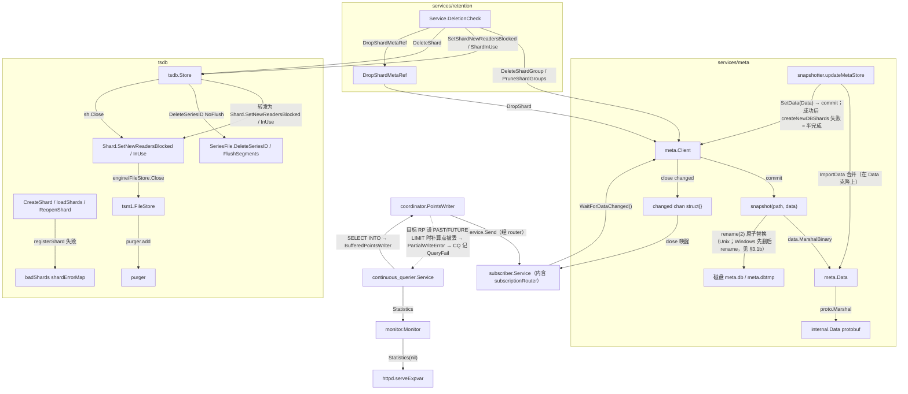
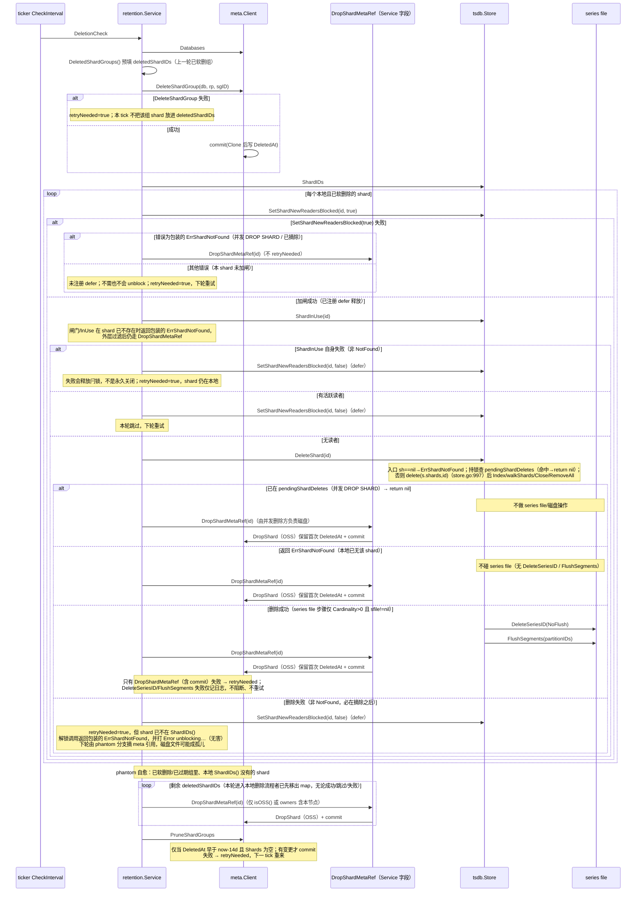

# 版本差异 5: 元数据与后台服务（v1.8.10 → v1.12.3）

> **基线**
> - OLD（旧）: `v1.8.10` = commit `688e697c51`（2021-10-11）
> - NEW（新）: `v1.12.3` = commit `f3d5cb68ab`（本仓库 `docs/specs/` 的代码基准）
> - 区间: 527 commits / 602 files / +79,310 −45,239；当前工作树只额外包含若干 docs 提交（数量随文档演进），代码相同。
> - 本文覆盖: `services/meta/*`、`services/retention/*`、`services/continuous_querier/*`、`services/precreator/*`、`services/snapshotter/*`、`services/subscriber/*`、`tsdb/store.go` 的 shard 删除/修剪路径、`tsdb/engine/tsm1/file_store.go` 的 purger（仅 retention 交互摘要，owner 04）、`coordinator` 中与 CQ/RP/写入编排相关的部分。
> - 旧版本证据统一来自 `git show v1.8.10:<path>`；新版本证据来自当前工作树。

> **小白导读**
> 1. **meta 的"户口本"流程没变**：改数据永远是"复印一份 → 在复印件上改 → 整本重新誊写并盖章（fsync+rename）→ 换掉正本 → 按铃通知所有人"。这一套在 v1.8.10 和 v1.12.3 里逐字相同，变的是"复印/誊写"用哪套序列化工具，以及"什么时候允许撕掉一页"。
> 2. **`meta.pb.go` 那 5000 多行 diff 不是重写业务**：它是把代码生成器从 `protoc-gen-gogo` 换成官方 `protoc-gen-go`，消息类型和命令号一个没改，只有 `RetentionPolicySpec`/`RetentionPolicyInfo` 各多了两个 `int64` 字段（写入窗口）。
> 3. **最关键的修复发生在"删除顺序"上**：旧版 retention 是"软删除（写 DeletedAt）→ 尝试删磁盘 → 14 天后无条件修剪"，磁盘删失败也照修；一旦搬家（删磁盘文件）失败或延迟，meta 里已经没有这条记录，磁盘上的 shard 目录就永远没人认领——也就是"孤儿文件"。新版反过来：**先删磁盘、再从 meta 摘掉 shard 引用；meta 里只要还剩 shard，就绝不修剪这个 shard group**。
> 4. **旧版删除大 shard 要"一条 series 一次 flush"（只刷用户态缓冲，不 fsync）**，几十万 series 时 retention 会看起来像卡死；新版把 flush 攒到"每个 series-file 分区一次"，并按分区补 fsync（≤8 次），且每删 1 万条打一行进度日志（#27114）。
> 5. **旧版删 shard 可能被"正在读它的查询"永久卡住**，整个 retention 循环停在 `Shard.Close()` 上；新版先"禁止新读者进入"，再检查"还有没有人在读"，有人读就跳过、下轮再来（#25055）。注意闸门与 `ShardInUse` **只统计 TSM/FileStore 的 reader**；TSI 索引迭代器（`LogFile`/`IndexFile` 的 `Retain/Release`）不在计数内，慢的索引类查询仍可让 `sh.Close()` 等待，见 §3.9、§7.16。
> 6. **purger 从"一个人拿着大门钥匙锁住整栋楼干活"变成"用带锁的格子柜"**：旧版在整个扫描+关闭+删除期间持有 `purger.mu` 写锁，会把 `FileStore` 的提交路径一起拖住；新版换成 `sync.Map` + 极短临界区。

## 0. 五分钟速读

- **meta**：仍是 clone-modify-commit + tmp/fsync/rename + changed 广播；protobuf 生成器迁移，消息/命令号不变。
- **retention**：读者闸门（`SetNewReadersBlocked`/`ShardInUse`）→ `DeleteShard` → `DropShardMetaRef` → phantom 自愈；`PruneShardGroups` 要求 `len(Shards)==0`。
- **CQ**：调度/时间窗口基本未变；SELECT INTO 受写窗口影响，窗口外的桶会被丢弃并计 `QueryFail`。
- **snapshotter**：IDMap 握手；`SetData`/`createNewDBShards` 失败分支不发响应。
- **风险**：meta `Clone` 不复制 `Subscriptions`（浅拷贝）、`total-buffer-bytes=0` 除零、OSS lease 恒成功且无互斥。

> **事实归属**：meta 状态机细节见 [07](../07_state_machine_spec.md)；retention/shard 生命周期见 [12](../12_background_services_spec.md)；CQ 见 [05](../05_downsampling_spec.md)；HTTP 见 [10](../10_http_service_spec.md)。

## 1. 结论速览

| # | 变更点 | v1.8.10 | v1.12.3 | 影响 | 证据 |
|---|--------|---------|---------|------|------|
| 1 | meta 提交骨架 `commit()` | Clone→snapshot→换 cache→`close(changed)` | **逐字未变** | 无 | `v1.8.10:services/meta/client.go:964` / `v1.12.3:services/meta/client.go:948` |
| 2 | meta 落盘 `snapshot()` | tmp→Write→Sync→Close→RenameFile | **逐字未变** | 无 | `v1.8.10:services/meta/client.go:997` / `v1.12.3:services/meta/client.go:981` |
| 3 | Lease | OSS 恒成功、内存对象、`Owner=0`、无持久化 | **逐字未变** | 唯一调用方是 CQ；多进程不互斥（3.1c） | `v1.8.10:services/meta/client.go:128` / `v1.12.3:services/meta/client.go:127` |
| 4 | `meta.pb.go` 生成器 | `protoc-gen-gogo`（2864 行，`XXX_Marshal`→`xxx_messageInfo` 表驱动） | `protoc-gen-go v1.34.1 / protoc v5.29.2`（4293 行，protoreflect） | 线格式兼容；序列化路径与文件体积变化 | `v1.8.10:services/meta/internal/meta.pb.go:1` / `v1.12.3:services/meta/internal/meta.pb.go:1` |
| 5 | RP 写入窗口字段 | 无 | `FutureWriteLimit=5/7`、`PastWriteLimit=6/8` | 新 SQL 语法、meta.db 新增字段、写路径丢点判定 | `v1.8.10:services/meta/internal/meta.proto:43` / `v1.12.3:services/meta/internal/meta.proto:47` |
| 6 | `CreateShardGroup` 边界 | 直接 `Truncate`，允许重叠 | 与已有 shard group 按**有效区间**（`Truncated()` 时取 `TruncatedAt`）求差集，保证有效区间不重叠；原始 `StartTime/EndTime` 仍可能重叠 | 同时间戳可能落到不同起止时间的组 | `v1.8.10:services/meta/data.go:358` / `v1.12.3:services/meta/data.go:382` |
| 7 | `DropShard` 的 `DeletedAt` | 每次都覆盖为 `time.Now()` | 保留首次删除时间 | 14 天修剪窗口计时更准 | `v1.8.10:services/meta/data.go:278` / `v1.12.3:services/meta/data.go:299` |
| 8 | `PruneShardGroups` | 14 天后**无条件**删组 | 仅当 `len(Shards)==0` 才删组 | 修复孤儿文件（#24530） | `v1.8.10:services/meta/client.go:682` / `v1.12.3:services/meta/client.go:680` + `services/meta/data.go:482` |
| 9 | `DeleteShard` 不存在时 | 返回 `nil` | 返回 `ErrShardNotFound` | retention 可识别 phantom shard | `v1.8.10:tsdb/store.go:698` / `v1.12.3:tsdb/store.go:978` |
| 10 | `DeleteShard` 索引类型清理 | `defer` 里无条件清（失败也清） | 仅在磁盘删除成功后清 | 统计更准；但见第 7 节风险 | `v1.8.10:tsdb/store.go:733` / `v1.12.3:tsdb/store.go:1139` |
| 11 | 删 series 的写盘 | 每条 `segment.Flush()`（只刷用户态缓冲，**不 fsync**） | `NoFlush` 批处理 + 每分区一次 `FlushSegments`（含 `file.Sync()`） | 显式 flush 次数 O(N)→O(分区数)，fsync 从 0 变为 ≤8（每分区一次）；属**持久化增强**，批末延迟可能上升，不计入跨版本性能收益（§4 #2，#27114） | `v1.8.10:tsdb/series_partition.go:317` / `v1.12.3:tsdb/series_file.go:211` |
| 12 | retention 删除流程 | 直接 `DeleteShard` | 阻塞新读者→`InUse`→`DeleteShard`→`DropShardMetaRef` | 不再挂死、不再留 phantom | `v1.8.10:services/retention/service.go:134` / `v1.12.3:services/retention/service.go:157` |
| 13 | purger 并发 | `sync.RWMutex` 全程持有 | `gensyncmap.Map` + 短临界区 | 降低 `FileStore` 写入/压缩阻塞 | `v1.8.10:tsdb/engine/tsm1/file_store.go:1376` / `v1.12.3:tsdb/engine/tsm1/file_store.go:1599` |
| 14 | 坏 shard 记忆 | 无（`Store` 无此字段） | `badShards shardErrorMap` | 启动不再对同一 shard 反复 Open | `v1.8.10:tsdb/store.go` 无 `badShards` / `v1.12.3:tsdb/store.go:462` |
| 15 | `DeleteSeries` 锁 | 手工 `RUnlock` 分支 | 闭包 + `defer RUnlock` | 消除 RLock 泄漏（#26647） | `v1.8.10:tsdb/store.go:1302` / `v1.12.3:tsdb/store.go:1657` |
| 16 | CQ 调度 / DST / SELECT INTO 写回 | `truncate` + `shouldRunContinuousQuery` | 调度与 DST **逐字未变**；写回走 `PointsWriter`，本区间新增写窗口 | 调度不变；设置 `PAST/FUTURE LIMIT` 时 CQ 补算点可能被丢弃并计 `QueryFail`（§3.15） | `v1.8.10:services/continuous_querier/service.go:547` / `v1.12.3:services/continuous_querier/service.go:559`；`v1.12.3:coordinator/points_writer.go:211-245` |
| 17 | `/debug/vars` 的 `cq` | 整个 `models.Statistic`（含 name/tags） | 只输出 `Values` 扁平 map | 监控解析格式变化（#26874）；输出/截断细节 owner 06 §3.12 | `v1.8.10:services/httpd/handler.go:1479` / `v1.12.3:services/httpd/handler.go:2452` |
| 18 | `SHOW RETENTION POLICIES` | 5 列 | 7 列（新增 future/past write limit） | 客户端列解析需适配 | `v1.8.10:coordinator/statement_executor.go:787` / `v1.12.3:coordinator/statement_executor.go:862` |
| 19 | subscriber | `points chan` 直发 + 每订阅 `chanWriter` | `subscriptionRouter` + 字节配额（`total-buffer-bytes`） | 重写；新增配置与 `memUsage` 指标 | `v1.8.10:services/subscriber/service.go:233` / `v1.12.3:services/subscriber/service.go:608` |
| 20 | precreator / snapshotter | — | 无功能变化（仅 `ioutil`→`io`） | 无需迁移 | `git diff v1.8.10 HEAD -- services/precreator` 为空 / `v1.12.3:services/snapshotter/client.go:53` |

## 2. 变更地图



> 图例：实线 = 调用/数据流（caller→callee 或统计数据流向）；虚线 = 反馈/影响。`CQ` 的统计先进入 `monitor.Monitor`，再由 `serveExpvar` 调用 `Monitor.Statistics(nil)` 读出（`v1.12.3:services/httpd/handler.go:2291-2292`、`monitor/service.go:146-166`）；07 §2 的 OBS 子图画了同样的 `MON→EXP` 中转。



## 3. 逐项差异

> 本节只保留每个小节的核心结论；完整代码、表格、图与失败矩阵见 [05a 详细附录](05a_details_appendix.md)。标题编号与附录一致，跨文档的 `05 §3.x` 引用仍然有效。

### 3.0 shard / shard group 生命周期总表

shard group 生命周期（Created/Active/Expired/SoftDeleted/Pruned）与 shard 本地删除状态（ReaderBlocked/InUseSkipped/LocalDeleted/Phantom）是两级模型；本区间新增了闸门、in-use 跳过、`ErrShardNotFound` 与 phantom 自愈，`TruncatedAt` 和 `badShards` 都不是生命周期状态。

> 完整细节见 [05a 附录 §3.0](05a_details_appendix.md#s3-0)

### 3.1a meta 状态机：clone-modify-commit 与 changed 广播

meta 仍是 clone-modify-commit：在副本上改、`snapshot` 成功后换 `cacheData` 并 `close(changed)`；控制流逐字符未变，变更只在序列化工具与 shard 删除策略。风险是 `Subscriptions` 浅拷贝、protobuf 降级丢字段、每次 `DropShard` 全量提交。

> 完整细节见 [05a 附录 §3.1a](05a_details_appendix.md#s3-1a)

### 3.1b snapshot/commit：五步落盘、失败矩阵与 Windows rename

`snapshot` 固定五步（Create→Marshal→Write→Sync→Close→Rename），失败时旧 `meta.db` 与旧 `cacheData` 保持不变；关键缺口是只 `f.Sync()` 文件数据、未 `file.SyncDir`，掉电可能回退 rename。Windows 的“先删后 rename”窗口可让节点重启读不到 meta。

> 完整细节见 [05a 附录 §3.1b](05a_details_appendix.md#s3-1b)

### 3.1c Lease：60 秒空实现、CQ 唯一调用方与单机语义

OSS `Lease` 是 60 秒空实现：`Owner=0`、无持久化、无显式 release，唯一调用方是 CQ；单进程内 `RunCh`/timer 串行进入 `backgroundLoop`，多进程共享 meta 时会重复执行 CQ（重复计算/写竞争，而非重复 timestamp）。

> 完整细节见 [05a 附录 §3.1c](05a_details_appendix.md#s3-1c)

### 3.2 `meta.pb.go` 的 +3397/−1968 到底是什么

`meta.pb.go` 的 +3397/−1968 是生成器从 gogo 换到官方 protoc-gen-go（2864→4293 行），消息类型与 `Command_Type` 枚举差集为空，业务增量只有 RP 的 4 个 `*int64` 写窗口字段。线格式兼容，但降级后第一次提交会静默丢掉写窗口；没有证据支持“新版 commit 更慢”。

> 完整细节见 [05a 附录 §3.2](05a_details_appendix.md#s3-2)

### 3.3 RP 写入窗口：新字段、新校验、新 SQL

RP 新增 `FutureWriteLimit`/`PastWriteLimit` 字段、负值校验、`FUTURE/PAST LIMIT` SQL 语法与 `ErrRetentionPolicyConflict` 比较；OSS 语义与旧版一致，只是多两个字段。`CREATE` 中 `FUTURE` 必须写在 `PAST` 前（`ALTER` 两种顺序都可），未加引号的 `future`/`past` measurement 名在 v1.12.3 解析失败。

> 完整细节见 [05a 附录 §3.3](05a_details_appendix.md#s3-3)

### 3.4 `CreateShardGroup`：从"允许重叠"到"有效区间不重叠"

`CreateShardGroup` 从“直接 Truncate、允许重叠”改为与未删除组按**有效区间**求差集，保证有效区间不重叠；原始 Start/EndTime 仍可能相交，新组也可能短于 `ShardGroupDuration`，`ShardGroupAt` 的线性回退仍必要。

> 完整细节见 [05a 附录 §3.4](05a_details_appendix.md#s3-4)

### 3.5 `DropShard`：不要覆盖第一次的 `DeletedAt`

`DropShard` 只在组尚未删除时设置 `DeletedAt`，保留第一次删除时间；这是 3.6 的配套：否则 retention 每摘一个 shard 都会重置 14 天计时，组永远无法修剪。

> 完整细节见 [05a 附录 §3.5](05a_details_appendix.md#s3-5)

### 3.6 `PruneShardGroups`：把"14 天"从"唯一条件"降级为"必要条件"

`PruneShardGroups` 从“14 天到点无条件删组”改为“14 天且 `len(Shards)==0`”，修复“磁盘删失败仍修剪 meta → 孤儿文件”（#24530）。新版消除的是成功路径与摘除前失败路径的孤儿；`DeleteShard` 从 `s.shards` 摘除之后失败仍会留孤儿（§7.2）。

> 完整细节见 [05a 附录 §3.6](05a_details_appendix.md#s3-6)

### 3.7 `SetData` 的锁泄漏

`SetData` 旧版在 `commit` 失败时直接 return、不释放 `c.mu`，meta 目录只读/磁盘满会让整个节点所有 meta 读永久阻塞、只能重启；新版 `defer c.mu.Unlock()` 修复（#22929），但未回移到 1.8 线。

> 完整细节见 [05a 附录 §3.7](05a_details_appendix.md#s3-7)

### 3.8 `Store.DeleteShard`：六处语义变化

`Store.DeleteShard` 有六处语义变化：不存在返回 `ErrShardNotFound`、索引类型只在成功删除后递减、其他 shard 索引读取失败即中止（避免误删活 series）、`DropSeriesGlobal` 错误聚合、series 删除改批量 `NoFlush`+分区 fsync、日志带上下文；其中 `ErrShardNotFound` 改变了 retention 与 `DROP SHARD` 的控制流。

> 完整细节见 [05a 附录 §3.8](05a_details_appendix.md#s3-8)

### 3.9 新增"读者闸门"：SetNewReadersBlocked / InUse（#25055）

新增读者闸门 `SetNewReadersBlocked`/`ShardInUse`（#25055）：retention 先关闸、再看是否有 TSM reader、无人则删，有人则跳过并下轮重试，不再被慢查询冻结整个 tick；闸门**只统计 FileStore/TSM reader**，TSI 索引迭代器不在内（§7.16）。

> 完整细节见 [05a 附录 §3.9](05a_details_appendix.md#s3-9)

### 3.10 badShards：记住打不开的 shard，避免反复重试（#23437）

新增内存 `badShards` 黑名单（#23437）：启动/注册失败的 shard 不再被每次写入反复打开，避免日志刷屏与重复开销；黑名单不持久化、重启清空，但启动即失败的 shard 无法通过 `ReopenShard(force=true)` 自救，只能修磁盘后重启。

> 完整细节见 [05a 附录 §3.10](05a_details_appendix.md#s3-10)

### 3.11 `DeleteSeries`：锁、RP 过滤与并发度

`DeleteSeries` 的手工 `RUnlock` 改为闭包 + `defer`，修掉区间内新增错误分支导致的读锁泄漏（#26647）；同时按 RP 过滤 shard（#25312）并让 DELETE 并发可配（#23055，默认仍 1，limiter 是每次调用内的局部上限）。

> 完整细节见 [05a 附录 §3.11](05a_details_appendix.md#s3-11)

### 3.12 purger（跨层摘要：owner 04 §3.15）

purger 从“全程持 `RWMutex`”改为 `sync.Map` + 短临界区（owner 04 §3.15），retention 删除后的空间回收不再容易反向阻塞 compaction/替换路径；代价是失败文件本进程内不重试（§7.4）。

> 完整细节见 [05a 附录 §3.12](05a_details_appendix.md#s3-12)

### 3.13 retention 服务：从"一次遍历"到"五阶段 + phantom 自愈"

retention 从一次性四件事拆成五阶段：标记到期组 → 加闸/InUse/本地删除 → `DropShardMetaRef` → phantom 清理（按 owners 过滤）→ 双条件 `PruneShardGroups`；`Open()` 校验 `DropShardMetaRef` 非空，`ErrShardNotFound` 继续去摘引用，其他错误才重试。

> 完整细节见 [05a 附录 §3.13](05a_details_appendix.md#s3-13)

### 3.14 #27114（跨层摘要：owner 02 §3.11）

series 删除从“每条 `DeleteSeriesID` 一次 `Flush()`（不 fsync）”改为 `NoFlush` + 按分区 `FlushSegments`（≤8 次 fsync），并每 1 万条打进度日志（#27114）；`FlushSegments` 失败只记日志、不阻断删除、不触发重试。

> 完整细节见 [05a 附录 §3.14](05a_details_appendix.md#s3-14)

### 3.15 CQ：调度与 DST 未变，SELECT INTO 写回受 `PointsWriter` 写窗口影响

CQ 的调度、DST 修正、`shouldRunContinuousQuery` 与窗口计算逐字未变；唯一实质影响是 `SELECT INTO` 写回经过 `PointsWriter` 的新写窗口，目标 RP 设 `PAST/FUTURE LIMIT` 时补算点会被丢弃并计 `QueryFail`。

> 完整细节见 [05a 附录 §3.15](05a_details_appendix.md#s3-15)

#### 3.15a 角色与结构

CQ 服务只负责“何时跑、跑哪条、进度记在哪”：`lastRuns` 仅在内存、`stats` 只有 queryOk/queryFail；调度/DST 相关函数两版逐字相同，差异全部来自写回链路。

> 完整细节见 [05a 附录 §3.15a](05a_details_appendix.md#s3-15a)

#### 3.15b 流程：timer/RunCh → lease → SELECT INTO → 写窗口

流程是 timer/RunCh → `AcquireLease`（OSS 恒成功）→ 遍历 CQ → **先推进 `LastRun`** → 执行 SELECT INTO → `BufferedPointsWriter` → `PointsWriter` 写窗口；因此失败不会回退进度，被丢弃的区间不会自动补算。

> 完整细节见 [05a 附录 §3.15b](05a_details_appendix.md#s3-15b)

#### 3.15c 案例：`FOR 6h` 补算遇到目标 RP `PAST LIMIT 1h`

`FOR 6h` 补算遇到目标 RP `PAST LIMIT 1h` 时，06:00–10:00 的桶在 `MapShards` 第一遍不建组、第二遍按 `RetentionPolicyBound` 丢弃，`PartialWriteError` 使 CQ 记 `QueryFail`；06:00 桶随后滑出窗口，只能调大 `PAST LIMIT`/`RESAMPLE FOR` 或手工补写。

> 完整细节见 [05a 附录 §3.15c](05a_details_appendix.md#s3-15c)

#### 3.15d 风险

CQ 风险：不自动重试、无资源隔离、OSS lease 无互斥、`lastRuns` 非持久化、统计写失败不回滚；升级前应确认目标 RP 的写窗口与 `RESAMPLE` 配置匹配。

> 完整细节见 [05a 附录 §3.15d](05a_details_appendix.md#s3-15d)

#### `SHOW CONTINUOUS QUERIES` 的库级鉴权

`SHOW CONTINUOUS QUERIES` 增加库级鉴权（#22283）：非管理员只能看到自己有 READ/WRITE 权限的库；`auth-enabled=false` 时仍返回全部。CQ 同名判定不分大小写，但 CQ 名称匹配仍区分大小写。

> 完整细节见 [05a 附录 §3.15 鉴权附注](05a_details_appendix.md#s3-15-auth)

### 3.16 后台服务（snapshotter / subscriber / precreator）

三个后台服务中只有 subscriber 被整体重写；snapshotter 与 precreator 无功能变化（仅 `ioutil`→`io` 等）。

> 完整细节见 [05a 附录 §3.16](05a_details_appendix.md#s3-16)

#### 3.16a Snapshotter：备份/恢复 meta 与 shard

snapshotter 的备份/恢复帧格式与 `updateMetaStore` 流程未变：`SetData` 成功但 `createNewDBShards` 失败时不发响应，客户端只能从连接关闭判错；重试会命中 `database already exists`，必须人工 `DROP DATABASE` 或修复 meta。恢复期间应停机（`Data()` 到 `SetData` 之间可能覆盖新提交）。

> 完整细节见 [05a 附录 §3.16a](05a_details_appendix.md#s3-16a)

#### 3.16b Subscriber：meta changed 消费者与写扇出

subscriber 从两级异步（全局 `points chan` + per-sub `chanWriter`）重写为 `subscriptionRouter` + 每 writer 队列/字节配额：`Send` 在调用方 goroutine 内一次序列化后分发；queue-full 分支不回滚 `queueSize`，`total-buffer-bytes>0` 时配额会永久泄漏直至重启（§7.11）。

> 完整细节见 [05a 附录 §3.16b](05a_details_appendix.md#s3-16b)

#### 3.16c Precreator：预创建下一个 shard group（零改动）

precreator 零改动：默认 10m 检查、30m 提前量，只对最后一个未删除且将在 cutoff 前到期的组预建下一组；`time.After` 是“上一轮结束后再等”，不是固定 ticker。

> 完整细节见 [05a 附录 §3.16c](05a_details_appendix.md#s3-16c)

## 4. 优化与收益

| # | 优化 | 机制 | Commit / PR | 证据 |
|---|------|------|-------------|------|
| 1 | retention 不再被慢查询卡死（仅 TSM reader；索引读者见 §3.9/§7.16） | 读者闸门 + 单次 `ShardInUse` 检查 + 跳过而非等待（下轮重试） | `b4bd607eef` (#25055) | `v1.12.3:services/retention/service.go:234-255` |
| 2 | 大 shard 删除的写盘从 O(N) 次 flush 降到 O(1) 次/分区（按分区 fsync ≤8 次；fsync 次数 0→≤8，删除延迟可能上升，属**持久化增强**，不计入跨版本性能收益，见 07 §4.7 #18） | `NoFlush` tombstone + `FlushSegments` 并行刷 8 个分区 | `1420aaf2bc` (#27114/#27129) | `v1.12.3:tsdb/series_file.go:211`、`tsdb/store.go:1108` |
| 3 | 删除过程可观测 | 每 1 万条一条 Info（含 remaining/total/elapsed），每条失败带 series_id | `1420aaf2bc` | `v1.12.3:tsdb/store.go:1095` |
| 4 | 成功路径不再产生孤儿 shard 文件 | meta 修剪前要求 `len(Shards)==0`；每个 shard 删完立即 `DropShard`；摘除后失败仍可能留孤儿（§7.2） | `7bd3f89d18` (#24530) | `v1.12.3:services/meta/data.go:476` |
| 5 | phantom shard 自愈 | "meta 有、本地无"的过期 shard 直接摘引用 | `7bd3f89d18` + `c168cc5aca` (#26527) | `v1.12.3:services/retention/service.go:283` |
| 6 | 集群 phantom 告警降噪 | `DeletionCheck` 内本地删除循环之后按 `owners` 过滤，只有本节点拥有的才算 phantom | `c168cc5aca` | `v1.12.3:services/retention/service.go:153/288` |
| 7 | purger 不再阻塞 FileStore | `sync.Map` 取代覆盖全流程的 `RWMutex` | `d5a48e0662` (#27146/#27177) | `v1.12.3:tsdb/engine/tsm1/file_store.go:1599` |
| 8 | purger 日志与无效重试 | 空批次早退（`e883e8bec3` #26762）；失败即出队、汇总 `Warn`（`d5a48e0662` #27146） | `e883e8bec3`、`d5a48e0662` | `v1.12.3:tsdb/engine/tsm1/file_store.go:1607` |
| 9 | 消除 `DeleteSeries` 的 RLock 泄漏 | 闭包 + `defer s.mu.RUnlock()` | `21ab48416e` (#26647/#26852) | `v1.12.3:tsdb/store.go:1685` |
| 10 | `deleteSeriesRange` 的 seriesKeys 竞态与 RLock 泄漏 | 先加锁修 data race（#25268），再修泄漏（#26658）：闭包 + `defer RUnlock` | `1bc0eb4795` / `81b42fd344` | `v1.12.3:tsdb/engine/tsm1/engine.go:1720-1721` |
| 11 | `SetData` 死锁修复 | `defer c.mu.Unlock()` | `956915296a` (#22929)；未回移 1.8 线 | `v1.12.3:services/meta/client.go:917` |
| 12 | 坏 shard 不反复重试 | `badShards` 内存黑名单 | `54ac7e54ed` (#23437) | `v1.12.3:tsdb/store.go:462/638` |
| 13 | `ClearBadShardList` 数据竞争 | 补 `badShards.mu` | `e8ef25b647` (#26423/#26831) | `v1.12.3:tsdb/store.go:792` |
| 14 | shard group 不重叠 | 与现有组求差集 | `3c811bcd81` (#22601) | `v1.12.3:services/meta/data.go:403-430`（收缩条件 422-429） |
| 15 | 启动进度可见 | `StartupProgress` 已打开/总数/百分比（打开耗时旧版已有） | `3c87f524ed` (#25378) | `v1.12.3:tsdb/store.go:564/600` |
| 16 | DELETE 并发可调 | `MaxConcurrentDeletes`（默认仍 1；`DeleteSeries`/`DeleteMeasurement` 每次调用内新建局部 limiter，不是全局上限） | `eb3bc7069f` (#23055) | `v1.12.3:tsdb/config.go:75/170`、`tsdb/store.go:1732/1284` |
| 17 | 写入热路径减负 | subscriber 每批只序列化一次 line protocol；路由查表 O(1)，但读锁覆盖整批序列化与分发（3.16b） | subscriber 重写 | `v1.12.3:services/subscriber/service.go:42/608` |
| 18 | 订阅内存可封顶 | `total-buffer-bytes` 按订阅数均分，超限丢弃并告警；**订阅数归零时整数除零 panic**（`:373`，见 7.14） | #21752 系列 | `v1.12.3:services/subscriber/service.go:372/449` |
| 19 | 恢复备份不再死锁 | 见 #11 | — | `v1.12.3:services/meta/client.go:917` |

**没有基准数据的地方只描述机制**：仓库里没有 `retention deletion` 或 `purger` 的 benchmark。可以确定的是复杂度层面的变化（flush 次数从 O(N) → O(分区数)、fsync 次数从 0 → ≤8（每分区一次）、锁持有时长从 O(文件数) → O(1)），而不是具体百分比。

## 5. 行为变化与兼容性

### 5.1 升级会不会坏：逐项判断

| 变更 | 升级后会发生什么 | 破坏性 |
|------|------------------|--------|
| `meta.db` 格式（3.2） | 旧文件可直接读；新文件多出 field 7/8 | 否 |
| **降级**到 v1.8.10 | 写窗口字段在第一次 meta 提交后丢失（`unmarshal`→`marshal` 重建） | 是（仅新特性） |
| `SHOW RETENTION POLICIES` | 输出从 5 列变 7 列：`name,duration,shardGroupDuration,replicaN,`**`futureWriteLimit,pastWriteLimit,`**`default`（`v1.12.3:coordinator/statement_executor.go:862` / 旧 `:787`） | 是（按列号解析的客户端） |
| `SHOW SHARDS` 的 `expiry_time` | 无限保留（`Duration==0`）的 RP 由"打印 EndTime 本身"变为空字符串（`v1.12.3:coordinator/statement_executor.go:896` / `v1.8.10:coordinator/statement_executor.go:821`，#21795） | 轻微 |
| shard group 起止时间 | 不再总是 `duration` 的整数倍（3.4） | 轻微（依赖整点假设的脚本） |
| partial write 错误文本 | 追加 ` for database: X for retention policy: Y`（`v1.12.3:tsdb/shard.go:131-140` / 旧 `113-123`），原因文本也从固定 `points beyond retention policy` 变为 `dropped N points outside retention policy of duration ... [and M points outside write window (...)]` | 是（正则/字符串匹配） |
| `/debug/vars` 的 `cq` | 从 `{"name","tags","values"}` 变为扁平的 values（3.15）；字段集合不变（queryOk/queryFail），只去掉 name/tags 包装 | 是（监控面板） |
| `subWriteDrop` 指标 | `coordinator` 不再输出该字段（`v1.12.3:coordinator/points_writer.go` 中 `statSubWriteDrop` 已删除） | 是（监控面板） |
| `SHOW CONTINUOUS QUERIES` | 非管理员只能看到自己有权限的库 | 是（有意的安全修复） |
| `SHOW MEASUREMENTS ON *.*` / `ON db.*` | 支持通配；输出多出 `database`、`retention policy` 两列（`v1.12.3:coordinator/statement_executor.go:732-834`） | 轻微 |
| `FUTURE` / `PAST` 成为 SQL 关键字 | `CREATE/ALTER RETENTION POLICY` 与 `CREATE DATABASE ... WITH ...` 支持 `FUTURE LIMIT` / `PAST LIMIT`（`CREATE` 语句顺序固定 `FUTURE`→`PAST`，`ALTER` 任意顺序）；influxql v1.4.1 的 tokenizer 大小写不敏感（`token.go:326-331`），`future`/`past` 映射为 `FUTURE`/`PAST`（`:96/:116`），`ParseIdent` 只接受 `IDENT`（`parser.go:476-483`），`FROM` 的 `parseSegmentedIdents` 逐段调用它（`:510-545`）。因此未加引号的 measurement 名在 v1.12.3 解析失败：`SELECT * FROM future` → `found FUTURE, expected identifier at line 1, char 15`；`SELECT * FROM db.rp.past` → `found PAST, expected identifier at line 1, char 21`；写成 `"future"`/`"past"` 正常。v1.8.10 的 influxql v1.1.1-0.20200828144457 没有这两个 token，四种写法都正常（两个版本各跑一次解析验证） | 是（依赖未加引号的 `future`/`past` 查询/写入脚本） |
| retention 服务 `Open()` 与接口 | 若嵌入式调用未设置 `DropShardMetaRef`，**启动直接报错**（`v1.12.3:services/retention/service.go:103-110`）。同服务的接口也破坏：`TSDBStore` 新增 `SetShardNewReadersBlocked(uint64,bool) error`/`ShardInUse(uint64) (bool,error)`；`MetaClient` 改为 embeds `OSSMetaClient`，新增 `DropShard(uint64) error` 与 `NodeID() uint64`。嵌入式/企业版实现必须补齐，否则 1.12.3 编译失败；OSS 实现可用 `SetOSSMetaClient`/`OSSDropShardMetaRef` 适配 | 是（仅嵌入式/企业集成；编译期） |
| 订阅配置 | 新增 `total-buffer-bytes`，默认 0 = 不限制，行为与旧版一致；但非 0 且订阅数归零时会除零 panic（3.16b、7.14） | 否（默认兼容；启用后见风险） |
| 订阅 Go API | `subscriber.Service.Points() chan<- *coordinator.WritePointsRequest` 与 `Service.Update()` 删除，新增 `Service.Send(*coordinator.WritePointsRequest)`；`subscriber.PointsWriter` 接口由 `WritePoints(*coordinator.WritePointsRequest) error` 改为 `WritePointsContext(ctx, WriteRequest) (string, error)`。嵌入式/企业版若自己实现 `PointsWriter`（赋给 `Service.NewPointsWriter`）或调用 `Points()/Update()`，升级后编译失败（旧 `v1.8.10:services/subscriber/service.go:31-33,178,228` → 新 `v1.12.3:services/subscriber/service.go:94-96,309`） | 是（仅嵌入式/企业版，编译期） |
| `[data]`/`[coordinator]` 新增配置键 | `tar-stream-buffer-size`（默认 1 MiB）、`max-concurrent-deletes`（默认 1）、`ingress-metric-by-measurement-enabled`/`ingress-metric-by-login-enabled`（默认 false）、`log-timedout-queries`（默认 false） | 否（默认值保持旧行为；`tar-stream-buffer-size` 只影响备份 tar 流缓冲，其余键显式设置才生效；升级评估/模板需补列） |
| `DROP SHARD <id>`（本地不存在或属其它节点） | 旧版 `DeleteShard` 返回 nil 并继续 `MetaClient.DropShard`（成功、清 meta）；新版返回 `ErrShardNotFound`，语句直接报错且不清 meta（`v1.8.10:tsdb/store.go:699-701`、`v1.12.3:tsdb/store.go:979`、`coordinator/statement_executor.go:384-390`） | 是（幂等重试脚本开始报错） |
| 已软删除组的修剪时机 | 从"14 天到点就删"变成"14 天且 shard 全部删完" | 否（更安全，但见风险） |

### 5.2 运维视角的变化

1. **磁盘回收更快**：以前"retention 卡住 → 老数据不删 → 磁盘涨"的两个根因（`Shard.Close` 阻塞、14 天无条件修剪）都被处理；现在会看到 `retention_delete_shard` 的 operation 日志，能直接看到"哪个 shard 因为 in-use 被跳过"。
2. **`meta.db` 体积变化的两个独立来源**：①写窗口字段让每个 RP 的 `RetentionPolicyInfo` 固定多 4 字节（field 7/8 即使为 0 也会被 `proto.Int64(0)` 写成 `tag + 0x00`，`v1.12.3:services/meta/data.go:1301-1308`）；②摘除前失败或被 `ShardInUse` 长期挡住的组永不满足 `len(Shards)==0`，其 `ShardGroupInfo` 记录不会被修剪，文件体积随新 shard group 创建线性增长且不回落。注意**重试通常不写 meta**：`DeleteShardGroup` 已成功、失败发生在 `DeleteShard` 之前时，后续 tick 只重试本地删除、不产生 commit（除非同一 tick 还有其他组首次软删除或可修剪）；但 `DeleteShardGroup` 自身失败时组仍是未删除状态，下一 tick 会重试软删除并可能产生一次 commit（见 §7.2 A）。大集群应关注 `meta.db` 体积与提交延迟。
3. **新增日志关键字**：`Drop phantom shard references`、`Expired phantom shard detected during retention check`、`can not delete an in-use shard`、`group's shards will be removed from local storage if found`（注意最后这条有 bug，见 7.3）。
4. **不再有 `Purge: close file` / `Purge: remove file` 的 Info 刷屏**：改为**每个失败文件**一条 `Error("close file failed"/"remove file failed")`、随后汇总一条 `Warn("failed to remove")`；每个文件只尝试一次（有界），失败即出队不再重试（`v1.12.3:tsdb/engine/tsm1/file_store.go:1659-1674`）。

## 6. 具体案例

### 6.1 案例一：retention 删除一个过期 shard（新旧对照）

**场景**（时间均为 UTC）：

- DB `telegraf`，RP `autogen`，`DURATION 7d`，`ShardGroupDuration = 24h`
- ShardGroup `100`：`[2026-10-01T00:00Z, 2026-10-02T00:00Z)`，组内唯一 shard `500`
- 本地磁盘：`<data>/telegraf/autogen/500/`（TSM）与 `<wal>/telegraf/autogen/500/`（WAL）
- retention `check-interval=30m`（`v1.12.3:services/retention/config.go:19`）；**假设 influxd 于 `2026-10-10T00:00Z` 启动**，ticker 是相对定时器（`services/retention/service.go:139-141`），tick 为 `00:30/01:00/01:30/02:00/...`（每 30m 一次；首个 tick 在启动 30m 后；启动在其他时刻则整体平移）
- 当前时间 `2026-10-10T00:30Z`；`EndTime+7d=2026-10-09T00:00Z < now` → 组过期

**到期判定**（两版一致，`RetentionPolicyInfo.ExpiredShardGroups`）：

```go
// v1.12.3:services/meta/data.go:1275-1287
if rpi.ShardGroups[i].Deleted() { continue }
if rpi.Duration != 0 && rpi.ShardGroups[i].EndTime.Add(rpi.Duration).Before(t) { ... }
```

**路径 A：读者长期持有 shard 500 的 `TSMReader`**

| 时刻 | v1.8.10 | v1.12.3 |
|------|---------|---------|
| 10-10 00:30 | `DeleteShardGroup` → `DeletedAt=00:30`；`DeleteShard(500)` 先 `delete(s.shards,500)`（`tsdb/store.go:717`），然后 `sh.Close()`（`:802`）阻塞在 `refsWG.Wait()` | `DeleteShardGroup` → `DeletedAt=00:30`；`SetShardNewReadersBlocked(500,true)`；`ShardInUse(500)` 为 true |
| 10-10 00:30 | **整个 tick 停住**：`PruneShardGroups`（`services/retention/service.go:150`）不执行，后续 shard 不处理；日志只有 `Deleted shard group` | 返回 `can not delete an in-use shard`（`:250`）；defer 解除闸门并打 `Unblocking new readers for shard after delete failed`；operation 内 `Error deleting shard`，随后 `One or more errors occurred during shard deletion and will be retried on the next check`；**继续处理下一个 shard**；组保留（`PruneShardGroups` 的 `expiration=DeletedAt-14d` 不晚于 `DeletedAt`，14 天条件未到；`len(Shards)>0` 要到 10-24 才成为第二个条件） |
| 10-10 02:00 | 查询结束，同一次 tick 继续：`sh.Close()` 返回，`os.RemoveAll`（`:807/:811`）删目录；`Prune` 的 `expiration=2026-09-26T02:00:00Z` 不晚于 `DeletedAt`，组保留 | 下一轮 tick：`InUse=false` → `DeleteShard` 成功（`Deleted shard`）→ `DropShardMetaRef(500)`（`Dropping shard meta references`），组内 shard 清空 |
| 10-24 01:00 | `expiration=2026-10-10T01:00:00Z > DeletedAt` → 旧版删组；目录已在 02:00 删除 | `expiration` 同样晚于 `DeletedAt` 且 `len(Shards)==0` → 删组；目录已删除 |

结论：路径 A 下**旧版不会产生孤儿**；它的问题是整轮 retention 被一个慢查询冻结（#25054），新版用“跳过并下轮重试”换取吞吐。注意本节的“慢查询”指持有 `TSMReader` 的查询；持有 TSI 索引迭代器的查询不在闸门/`InUse` 内，仍可让 `sh.Close()` 等待（§3.9、§7.16）。

**路径 B：`DeleteShard` 返回错误（EACCES/EBUSY/Close 失败）**

| 时刻 | v1.8.10 | v1.12.3 |
|------|---------|---------|
| 10-10 00:30 | `DeleteShardGroup` → `DeletedAt=00:30`；`DeleteShard(500)` 在 `delete(s.shards,500)`（`:717`）后失败（如 `remove /var/lib/influxdb/data/telegraf/autogen/500: permission denied`），打 `Failed to delete shard`，`retryNeeded=true` | 同样在 `delete(s.shards,500)`（`v1.12.3:tsdb/store.go:997`）后失败；打 `Error deleting shard` + `Unblocking ...`，`retryNeeded=true`；随后 defer 再尝试 `SetShardNewReadersBlocked(500,false)`，因 shard 已不在 `s.shards` 而返回包装的 `ErrShardNotFound`，再打 `Error unblocking new readers for shard`（解锁失败无害，shard 已不可达） |
| 10-10 00:30 | **继续执行 `PruneShardGroups`**；14 天未到，组保留。500 已不在 `ShardIDs()`，后续不再重试 | 继续执行 prune；组保留（14 天条件未到，`len(Shards)>0` 的作用见 10-24 行）。500 已不在 `ShardIDs()` |
| 10-10 01:00 | — | 下一 tick 的 phantom 分支：500 仍在 `deletedShardIDs`、不在 `ShardIDs()`、`isOSS()` 为真 → `Warn("Expired phantom shard detected during retention check, removing from metadata")` + `DropShardMetaRef(500)`；组内 shard 立即清空（不必等 14 天） |
| 10-24 01:00 | 旧版 `PruneShardGroups` 不看 `Shards`（`v1.8.10:services/meta/client.go:682-695`）→ 删组 → meta 无 500，目录孤儿 | 新版 `len(Shards)==0` 满足 → 删组 → **目录同样是孤儿** |
| 之后 | `SHOW SHARDS` 无该组；磁盘 `.../500/` 永久残留 | 同左；新版只是把 meta 引用摘除提前到 phantom 分支，孤儿窗口仍存在 |

两版 tick 末尾的 `One or more errors occurred during shard deletion and will be retried on the next check` 都**不包含**刚失败的 500：它只汇总本轮的其他失败；500 已从 `s.shards` 摘除，下一轮 `ShardIDs()` 不含它，磁盘删除不会重试（新版的重试动作发生在下一 tick 的 phantom 分支，见上一行）。

**关键差异**：旧版在路径 A（阻塞）下不修剪、在路径 B（报错）下才产生孤儿，两种后果不能串成一条因果链；新版把路径 A 变成可重试的跳过，把路径 B 的“摘除前失败”变成组保留重试，但**没有消除“摘除后失败”的孤儿**（§7.2 B、主 12 §3.2）。真正避免孤儿的前提是 `DeleteShard` 在磁盘删除成功后才返回成功；失败位置恰好是 `delete(s.shards, id)` 之后时，代码已无法回滚。

### 6.2 案例二：一次 meta commit 的完整字节流（含写窗口）

场景：执行 `CREATE RETENTION POLICY "hot" ON "db0" DURATION 24h REPLICATION 1 FUTURE LIMIT 1h PAST LIMIT 6h`。旧版因 influxql 无 `FUTURE/PAST` token 在解析阶段失败；新版依次完成 meta 校验、五步落盘与 `changed` 通知。字节层面 `RetentionPolicyInfo` 总是写入 field 7/8（1h→7 字节、6h→8 字节；未设置时也各 2 字节，合计 +4 字节/RP），写路径随后以 `now-6h`/`now+1h` 为硬边界。

> 完整字节流、proto 编码、两遍 `MapShards` 与 400 响应见 [05a 附录 §6.2](05a_details_appendix.md#s6-2)

### 6.3 案例三：phantom shard 自愈

**场景**（UTC）：DB `telegraf`、RP `autogen`、`DURATION 7d`；ShardGroup `100` 为 `[2026-10-01T00:00Z, 2026-10-02T00:00Z)`，组内唯一 shard `500`。retention 服务在 `2026-10-08T00:00Z` 启动，`check-interval=30m`，tick 落在 `:00/:30`。`ExpiredShardGroups` 用严格 `EndTime.Add(Duration).Before(t)`（`v1.12.3:services/meta/data.go:1281`；旧版同形 `v1.8.10:services/meta/data.go:1175`），`EndTime+7d = 2026-10-09T00:00Z`，所以 **`10-09T00:00` 这个时刻不满足严格 `Before`，首次发现到期的是 `10-09T00:30` tick**；该 tick 的 `DeleteShardGroup` 把 `DeletedAt` 置为 `2026-10-09T00:30Z`（`v1.12.3:services/meta/data.go:460-468`，取 `time.Now().UTC()`）。前提：shard `500` 的 `<data>/telegraf/autogen/500` 与 WAL 目录在进程启动前已被人工删除，因此 `TSDBStore.ShardIDs()` 不含 500，但 meta 仍记着它。OSS 的 `CreateShardGroup` 每个组固定只建一个 `ShardInfo`（`v1.12.3:services/meta/data.go:437-441`），所以这里没有“同组其他活 shard”。

| 时刻 | v1.8.10 | v1.12.3 |
|------|---------|---------|
| `10-09T00:30` tick | `DeletedShardGroups()` 为空；`ExpiredShardGroups(10-09T00:30)` 命中组 100 → `DeleteShardGroup`，`DeletedAt=10-09T00:30`；`deletedShardIDs={500}`；`ShardIDs()` 不含 500，本地删除循环跳过；`PruneShardGroups` 的 `expiration=09-25T00:30` 不晚于 `DeletedAt` → 保留 | 前四步相同；随后 phantom 分支命中（`v1.12.3:services/retention/service.go:283-301`），`isOSS()` 为真（`NodeID()==ossNodeID==math.MaxUint64`，`:34`）→ `log.Warn("Expired phantom shard detected during retention check, removing from metadata")` → `DropShardMetaRef(500)` 把 shard 500 从组内清空；`PruneShardGroups` 因 `DeletedAt` 未满 14 天仍保留组记录 |
| `10-09T00:30` 起 | `SHOW SHARDS` 仍显示 500（组内 `Shards` 未清空） | `SHOW SHARDS` 不再显示 500；组记录仍在 `SHOW SHARD GROUPS` 中，直到被修剪 |
| `10-23T00:30` tick | `expiration = 10-23T00:30 - 14d = 10-09T00:30`，与 `DeletedAt` 相等；`!expiration.After(...)` 为真 → 不修剪 | 同左：相等不修剪（新版 `PruneShardGroups` 还要求 `len(Shards)==0`，此时已满足） |
| `10-23T01:00` tick | `expiration=10-09T01:00 > DeletedAt` → 旧版**无条件删除整个组**（`v1.8.10:services/meta/client.go:682-695` 的循环只判 `DeletedAt`，不看 `Shards`），shard 500 的 `ShardInfo` 随之消失 | `expiration=10-09T01:00 > DeletedAt` 且 `len(Shards)==0` → 修剪空组（`v1.12.3:services/meta/data.go:476-495`、`v1.12.3:services/meta/client.go:680-690`） |

**结论**：两版都不会凭空产生磁盘孤儿（磁盘本来就没有目录）。差异只是 meta 中 shard 引用的消失时间：新版在 `10-09T00:30`（软删除的同一 tick），旧版要等到 `10-23T01:00` 组修剪；**新版早约 14 天**。旧稿的“旧版 10-24 才修剪”是把 `DeletedAt` 错记为 10-10 再与 14 天窗口相加的结果；按严格 `Before` 和 30m tick，正确的节点是 `10-09T00:30` / `10-23T01:00`。`ShardGroupDeletedExpiration=-2*7*24h` 见 `v1.12.3:services/meta/client.go:35`。

- **要展示“孤儿”必须换场景**：① 数据盘未挂载/`WALDir` 配错时，本地所有 shard 都不在 `ShardIDs()`，过期组的 meta 引用会在第一次检查就被摘掉，磁盘恢复后目录无人清理（§7.6）；② Enterprise 多 shard 组里只删掉部分 shard 的 owner。OSS 单 shard 场景本身不会产生磁盘孤儿。

## 7. 仍存在的风险

### 7.1 `DeleteShard` 末尾的 `removeIndexType` 在锁外（新引入）

```go
// v1.12.3:tsdb/store.go:1132-1141
	} else if err = os.RemoveAll(sh.walPath); err != nil {
		return err
	} else {
		// Remove index type from the database on success
		s.databases[db].removeIndexType(sh.IndexType())
		return nil
	}
```

对比旧版（`v1.8.10:tsdb/store.go:727-735`）：旧代码在 `defer` 里**持有 `s.mu`** 才调用 `removeIndexType`；新版把它移出了临界区，而 `s.databases` 是普通 `map`、`databaseState.indexTypes` 也是普通 `map`。这与 `CreateShard`/`loadShards`（都持 `s.mu` 写 `s.databases`）构成**数据竞争**；如果并发的 `DeleteDatabase`（`v1.12.3:tsdb/store.go:1210` 的 `delete(s.databases, name)`）已把该 db 从 map 删除，这里还会对 `nil` 的 `*databaseState` 调方法（`removeIndexType` 只判了 `d.indexTypes != nil`，没有判 receiver）。`DeleteDatabase` 的早退只看 `s.databases`（`v1.12.3:tsdb/store.go:1145-1151`），而 `DeleteShard` 只从 `s.shards` 摘除（`:997`），因此该竞争在 `DROP DATABASE` 与 retention 删除并发时可达；`DeleteDatabase` 还会 `walkShards`→`Close`，窗口足以覆盖。生产上仍应避免"retention 删 shard"与 `DROP DATABASE/RP` 并发。

### 7.2 retention 删除失败的两种后果：meta 记录不修剪 vs 孤儿目录

3.6 的修复把"修剪"绑死在"shard 全部删除成功"上，但 `DeleteShard` 在 `delete(s.shards, id)`（`v1.12.3:tsdb/store.go:997`）**之前**还是**之后**失败，后果完全不同：

**A. 摘除前失败 / 长期无法进入删除**——组永久留在 meta，`meta.db` 不回落：

- 查询长期持有引用（`ShardInUse` 恒为 true，`v1.12.3:services/retention/service.go:247-251`）；
- `DeleteShardGroup` 或闸门操作本身失败（`service.go:196-199/234-235`）。

表现：每 `check-interval`（默认 30 分钟，`v1.12.3:services/retention/config.go:19`）一行 `Error deleting shard` / `Unblocking new readers for shard after delete failed`。对**已软删除**的组，`SHOW SHARDS` 看不到它们（它跳过 `sgi.Deleted()`，`v1.12.3:coordinator/statement_executor.go:887`）；若失败的是 `DeleteShardGroup` 本身，组仍是未删除状态，`SHOW SHARDS` 仍会显示它，并在下一 tick 重试软删除。**重试通常不会让 `meta.db` 逐 tick 变大**：一旦 `DeleteShardGroup` 成功，该组被 `Deleted()` 过滤（`services/meta/data.go:1278-1282` 的 `ExpiredShardGroups`），后续 tick 只重试本地删除、不再产生 commit（`services/retention/service.go:263-268`；除非同一 tick 有其他组首次软删除或 `PruneShardGroups` 修剪掉旧组）；但 `DeleteShardGroup` 自身失败时下一 tick 会再次提交软删除，可能产生一次 commit。每次 commit 都是全文件重写，大小只由数据内容决定（`services/meta/client.go:948-964`）。真正的后果是这些组的 `ShardGroupInfo` 永不修剪（`data.PruneShardGroups` 要求 `len(Shards)==0`，`services/meta/data.go:476-495`），文件体积随新 shard group 创建线性增长且不回落。量化：每个 RP 固定 +4 字节（field 7/8 的 `tag+0x00`，§6.2），每个保留组按实际 `ShardGroupInfo` 序列化大小累加。排查应看日志中的 `retention_delete_shard` operation。

**B. 摘除后失败**——组仍会修剪，磁盘目录成孤儿：

- 文件系统错误（`os.RemoveAll` 返回 EACCES/EBUSY，NFS 上常见，`v1.12.3:tsdb/store.go:1133-1135`）；
- 索引损坏导致 `sh.Index()` / `walkShards` 失败（`:1016-1019/1035-1038`）；
- `sh.Close()` 失败（`:1128-1130`）；
- `FlushSegments` 失败：`DeleteSeriesID(id, NoFlush)` 只把 tombstone 写进分区 active segment 的缓冲；`FlushSegments` 只对该 active segment `Flush()`（fsync，`tsdb/series_file.go:211-238`），失败时 `DeleteShard` 只打 `error while flushing a series file segment`（`tsdb/store.go:1108-1114`）并继续 `DropShardMetaRef`、最终返回 nil。后果：该次删除的 tombstone 在失败后未 fsync，若进程在后续 flush 前崩溃，重启后这些 series ID 仍可能存在；但对应 shard 已被摘除/修剪，它们成为不可查询的残留 series 记录（3.14；机制细节见 02 §3.11）。

shard 已不在 `ShardIDs()`，下一轮由 phantom 分支 `DropShardMetaRef` 摘掉 `ShardInfo`（`service.go:284-300`），组内 shard 清空后按 14 天规则正常修剪；但 `data/<db>/<rp>/<id>` 与 WAL 目录已无人清理（主 12 §3.2 的 4 步失败链）。这也是 §7.12 并发场景的同一后果。

### 7.3 retention 的 `groupShards` 日志有一个数组前缀 bug

```go
// v1.12.3:services/retention/service.go:205
					groupShards := make([]uint64, len(g.Shards))   // 长度已是 n
					for _, sh := range g.Shards {
						groupShards = append(groupShards, sh.ID)   // 变成 [0,0,...,0, id1, id2, ...]
						deletedShardIDs[sh.ID] = newDeletionInfo(d.Name, r.Name, sh)
					}
					log.Info("Group's shards will be removed from local storage if found", zap.Uint64s("shards", groupShards))
```

日志会打印 `shards: [0,0,0,500,501]` 这种带前导 0 的列表。**不影响功能**（真正的删除用 `deletedShardIDs`），但会误导排障。正确写法是 `make([]uint64, 0, len(g.Shards))`。

### 7.4 purger 对失败文件"一次就放弃"

```go
// v1.12.3:tsdb/engine/tsm1/file_store.go:1659-1674
					if err := v.Close(); err != nil { failCount++ }
					else if err := v.Remove(); err != nil { failCount++ }
					else { purgeCount++ }
					// Remove the file regardless of success or failure.
					// Do not retry files which could not be closed or removed.
					p.files.Delete(k)
```

这对"已经关掉/操作系统级故障"是合理取舍，遇到**瞬时**错误（Windows 上杀毒软件占用、NFS 短暂无响应）时，文件在本次进程内不再重试、也不会再被 purge；但下次 shard 打开时 `Engine.Open` → `cleanupTempTSMFiles` 会删除 `*.tmp`（含 `.tsm.tmp`，`v1.12.3:tsdb/engine/tsm1/engine.go:776`、`:2768-2803`）。只有清理本身也失败（权限/持续占用）时才需要按日志手工处理。旧版虽然无限重试+刷日志，但不会静默泄漏。

### 7.5 `badShards` 只在内存，且默认不自动重试

`badShards` 不持久化，重启清零。**启动时打不开的 shard 从未进入 `s.shards`**：`registerShard` 在 `res.err != nil` 时只记 `badShards` 后 return（`v1.12.3:tsdb/store.go:632-639`），`ReopenShard` 首行 `s.Shard(id)` 即返回 nil → `ErrShardNotFound`（`:833-847`），`force` 分支根本到不了；它只对仍注册、随后被标记 bad 的 shard（测试注入）可达。`Store.ReopenShard(id, force=true)`（`v1.12.3:tsdb/store.go:833`）只对本次 `Load` 跳过检查（`newShardLoader` 的 `!l.force` 早退），成功后条目仍保留，之后的非强制加载仍返回 `ErrPreviousShardFail`；真正清空只有 `ClearBadShardList()`（`:788`，删除 map 条目）或重启，二者在 OSS 仓库内均无生产调用点（仅测试）。含义：**一个因瞬时 IO 错误打开失败的 shard，在本次进程生命周期内会一直被拒绝打开**（写入路径每次都会拿到 `ErrPreviousShardFail`），直到重启。这是"避免日志刷屏"与"自愈能力"之间的取舍。

### 7.6 数据目录不可见时，phantom 清理会摘掉 meta 引用

`DeletionCheck` 的 phantom 分支只针对**已软删除/已过期**的组，判断依据是"这个 shard 不在 `TSDBStore.ShardIDs()` 里"。如果此时数据盘没挂上（或 `WALDir` 配错），所有本地 shard 都"不存在"，这些过期组的 meta 引用会被立刻摘掉；等磁盘恢复，目录还在但 meta 已无记录 —— 这些文件既不会被查询，也不会再被 retention 删除。旧版要等满 14 天才发生同样的事，**新版把窗口缩短到了"到期后的第一次检查"**。升级运维须知：**先确认挂载，再启动**。

### 7.7 每次 `DropShard` 都是一次完整的 meta 提交

`Client.DropShard`（`v1.12.3:services/meta/client.go:660`）走 `Clone → DropShard → commit`，即**每个 shard 一次 `meta.db` 全量重写 + fsync**。旧版 retention 从不调用它，提交只来自每个到期组的 `DeleteShardGroup` 与末尾可能一次 `PruneShardGroups`；新版在此之上每个 shard 再加一次 `DropShard` 提交；但 **OSS 每个到期组固定只有 1 个 `ShardInfo`**（`v1.12.3:services/meta/data.go:437-440`），所以**每个到期且只含 1 个 `ShardInfo` 的组**产生 1 次 `DeleteShardGroup` commit + 1 次 `DropShard` commit；一个 tick 处理 N 个组就是 N+N 次。`PruneShardGroups` 仅当本 tick 至少修剪掉一个组（`changed==true`）时才 commit，否则 0 次（`services/meta/client.go:680-690`、`services/meta/data.go:476-495`）；“组刚软删除未满 14 天”只说明该组自身不满足条件，同库其他更老的组仍可能触发这次提交。企业版多 shard 组才是 1+N 次提交。在大 meta（几十万 shard group）场景下，retention 检查会造成明显的写放大。这是"正确性换 IO"的取舍，未被批量化。

### 7.8 protobuf 运行时与降级

见 3.2：新旧都是运行时驱动（旧 gogo 走 `proto.InternalMessageInfo` 表驱动，新官方生成器走 protoimpl+rawDesc），不能仅凭生成器差异断言新版 commit 更慢；仓库没有序列化基准。降级到 v1.8.10 会在第一次提交后丢失写窗口字段（`Data.marshal()` 会重建所有 RP，任一提交即丢失）。**跨大版本回滚前应备份 `meta.db`**。

### 7.9 `/debug/vars` 的 `cq` 截断（跨层摘要：owner 06 §3.12）

`parseCQStatistics` 在 `len(Values)==0` 时返回 error；`serveExpvar` 在写出 `{` 与 `system`/`build` 等板块后才进入 stats 循环，此时响应头已隐式 200，后续 `httpError` 的 500 是 superfluous，客户端收到 **200 + 截断 JSON**（`v1.12.3:services/httpd/handler.go:2452-2458`、`:2728-2734`）。该风险的代码路径、触发面与案例 owner 是 06 §3.12/§6.4；05 只说明 CQ 的 `Statistics()` 总会填 `queryOk`/`queryFail`，OSS 下不会主动触发，企业扩展返回空 values 时才可达。

### 7.10 DELETE 仍然默认串行

`MaxConcurrentDeletes` 默认 1（`v1.12.3:tsdb/config.go:75`），且 `DeleteSeries` 对每个 shard 串行 `limit.Take()`。大范围 `DROP SERIES` 在单 shard 上仍是单线程，本区间只把它变成了可配置。作用域：limiter 是每次 `DeleteSeries`/`DeleteMeasurement` 调用内新建的**局部** limiter（`tsdb/store.go:1732/1284`），不是跨语句的全局并发上限；并发多个 DELETE 语句可各自达到该并发度。epoch guard 只隔离 delete 与后续写入（`tsdb/epoch_tracker.go:120-140`），不串行两个 DELETE 语句。

### 7.11 subscriber 丢弃只打 `Warn`，且 queue-full 永久吞掉字节配额

`chanWriter.Write` 在队列满或超字节上限时直接丢弃并 `c.logger.Warn(...)`（`v1.12.3:services/subscriber/service.go:449-467`）。高频丢弃时日志量线性增长，且丢弃后**没有重试**。

两版的失败后果并不同级：旧版 `chanWriter` 没有字节配额（`v1.8.10:services/subscriber/service.go:358-364`），队列满只丢当前批、只加 `WriteFailures`（`:248-253`）；新版先 `newSize := atomic.AddInt64(&c.queueSize, sz)`（`:451`），over-byte-limit 分支会 `-sz` 回滚（`:455-459`），**queue-full 分支只 `WriteFailures++` + Warn、不回滚**（`:461-467`）。`Run` 仅对已出队请求扣减（`:490-500`），所以每次 channel-full 丢弃都让 `queueSize` 净增 `sz`；`total-buffer-bytes>0` 时配额单调膨胀，累计超过 `queueLimit` 后，之后每笔写入都命中 over-byte-limit（本次 `sz` 扣回，但基数仍超限），订阅端在**进程剩余生命周期内持续丢弃全部数据**（订阅集合与配额不变时）。`limitTo`（`:472-476`）只存新 limit、不修正 `queueSize`，除零修复（`:371-379`）也不重置；除非后续 `limitTo` 把 limit 提高到泄漏后的 `queueSize` 之上（需订阅数减少等），否则**只有重启进程能恢复**。因此观察到 `queue over byte limit` 持续刷屏时，不应只当作偶发丢弃：它可能是此前 channel-full 泄漏已把配额推过上限，需重启并评估订阅消费能力。

**与旧版丢弃语义的差异**：v1.8.10 是两级异步——`PointsWriter` 在写锁内非阻塞投递到每个订阅的 `points chan`（容量 100），某订阅 channel 满时计 `SubWriteDrop`（`v1.8.10:coordinator/points_writer.go:410-430`、`v1.8.10:services/subscriber/service.go:93`）；subscriber 的 `run()` goroutine 再逐订阅非阻塞投递，失败只计 `WriteFailures`（`:242-254`）。因此旧版存在“全局 `points` 满 → 整批对该订阅丢弃”的层级，`SubWriteDrop` 对应这一层；新版随 `points chan` 一起删除了它，丢弃只发生在 per-sub 队列/字节上限。对比旧版监控时，应把 `SubWriteDrop` 与 `writeFailures` 相加。

### 7.12 并发 `DROP SHARD` 与 retention 可能把失败当成功

`DeleteShard` 在发现同一 shard 已在 `pendingShardDeletes` 时直接 `return nil`（`v1.12.3:tsdb/store.go:989-995`）；retention 侧把 `nil` 当成功并继续 `DropShardMetaRef`（`v1.12.3:services/retention/service.go:254-280`）。另有两条同源入口：`SetShardNewReadersBlocked` / `ShardInUse` 在 shard 已不在 `s.shards` 时返回包装的 `ErrShardNotFound`（`store.go:957-962/969-974`），retention 的 `errors.Is` 过滤会跳过 `DeleteShard` 直接 `DropShardMetaRef`（`service.go:234-235/247-248/263`）。如果并发 `DROP SHARD` 先到、随后它的 `sh.Close()`/`os.RemoveAll` 失败，后到的 retention 调用已经摘掉 meta 引用，仍会产生"meta 无引用、磁盘有文件"的孤儿。建议避免对同一 shard 并发执行管理命令与 retention，并监控 `Error deleting shard` 与残留 shard 目录。

### 7.13 `Subscriptions` 不是深拷贝，`DropSubscription` 原地改共享数组

§3.1a 的前提是"写操作在副本上修改"，但 `Data.Clone()` 对 RP 只做浅层的 `RetentionPolicyInfo.clone()`：

```go
// v1.12.3:services/meta/data.go:1347-1358
func (rpi RetentionPolicyInfo) clone() RetentionPolicyInfo {
    other := rpi
    if rpi.ShardGroups != nil { /* 只深拷贝 ShardGroups */ }
    return other          // Subscriptions 只复制 slice header
}

// v1.12.3:services/meta/data.go:591-606 — DropSubscription
rpi.Subscriptions = append(rpi.Subscriptions[:i], rpi.Subscriptions[i+1:]...)
```

`append(s[:i], s[i+1:]...)` 在**原底层数组**上搬移元素。后果（`DROP SUBSCRIPTION` 可达）：

1. commit 前，旧 `cacheData` 的 `Subscriptions` 已被改；此前 `Data()`/`Databases()` 返回、与旧 `cacheData` 共享该数组的快照同样被改。
2. `snapshot` 失败时 `cacheData` 指针虽未换、内容已变：**内存与磁盘分叉**，之后任意一次成功 commit 会把这次"失败并返回错误"的删除持久化。
3. 长时间持有快照的读者（如 snapshotter 的 `Data()`）与上述原地写构成 data race。

**时间线（T0–T2）**：

| 时刻 | 动作 | 内存 | 磁盘 |
|------|------|------|------|
| T0 | `DROP SUBSCRIPTION "s1" ON "db0"."rp0"` → `Client.Update` → `data := c.cacheData.Clone()` | 副本的 RP 与旧 cache 共享 `Subscriptions` 底层数组 | `meta.db` 仍是旧内容 |
| T1 | `DropSubscription` 在副本上 `append(s[:0], s[1:]...)` | 共享数组被原地左移；旧 cache 的 slice header 仍是 `len=2`，内容变成 `[s2, s2]`（最后一个元素重复）；副本 `len=1` | 未变 |
| T2a | `commit` 成功 | 指针换成副本（`[s2]`），旧快照继续持有被污染的数组 | 写入 `[s2]` |
| T2b | `snapshot` 失败、`commit` 返回错误 | 指针仍是旧 cache，但旧 cache 已是 `[s2,s2]`；下一次任意成功 commit 会把这次“失败”的删除持久化 | 仍是 `[s1,s2]`，与内存分叉 |

**修复代码**（`Data.Clone` 深拷贝，或 `DropSubscription` 不改共享数组）：

```go
// 方案 A：clone 时深拷贝（v1.12.3:services/meta/data.go:1347-1358）
if rpi.Subscriptions != nil {
    other.Subscriptions = append([]SubscriptionInfo(nil), rpi.Subscriptions...)
}

// 方案 B：DropSubscription 构造新切片（v1.12.3:services/meta/data.go:599-602）
subs := make([]SubscriptionInfo, 0, len(rpi.Subscriptions)-1)
subs = append(subs, rpi.Subscriptions[:i]...)
subs = append(subs, rpi.Subscriptions[i+1:]...)
rpi.Subscriptions = subs
```

注意 `slices.Delete` 仍会原地搬移并清零尾部，不能单独用它修这个问题。

旧版实现相同（`v1.8.10:services/meta/data.go:514-526/1237`），因此这是文档把"通常成立的原子性"写成无条件保证，不是版本回归。运营含义：`DROP SUBSCRIPTION` 返回错误时不要假定订阅仍在，应重试并核对 `SHOW SUBSCRIPTIONS`。

### 7.14 `total-buffer-bytes` 的除零 panic 与关闭竞态

- **除零 panic**：`updateSubs` 在 `createdNew || len(toClose) > 0` 分支里执行 `int64(s.conf.TotalBufferBytes / len(s.subs))`（`v1.12.3:services/subscriber/service.go:371-373`），**没有判空**。两条可达路径：① 删除最后一个订阅（前面的循环已 `delete(s.subs, se)`，`toClose` 非空）；② 内存中无订阅、新订阅全部创建失败（`createdNew=true`，`s.subs` 仍空）。panic 发生在 `waitForMetaUpdates` 的调用链上（`:255-268`，无 recover）或 `Open` 期间，Go 运行时直接终止进程。触发前提是配置了非 0 的 `total-buffer-bytes`。
- **关闭竞态**：`Close()` 先 `router.Close()`（置 `ready=false`），再取 `s.mu`/`close(s.closing)`（`:175-195`）。若 `updateSubs` 已持锁并通过 `closing` 检查，随后调用 `router.Update`，会命中 `!ready` 的 `panic("...must not call update after close")`（`:629-634`）。关闭期间应避免同时触发 meta 变更；代码侧应调整顺序或让 `Update` 返回错误。
- **更新期间持锁等待**：`updateSubs` 全程持 `s.mu`，并对 `toClose` 里的旧 writer 调 `CancelAndClose()`（close channel + cancel + `wg.Wait()`，`:478-482`）。它会等待所有在飞订阅写入完成，HTTP 目的地受 `HTTPTimeout` 约束；在此期间 `Close()` 与下一次 meta 变更更新都被阻塞。`router.Update` 必须先于 `CancelAndClose`，否则 `Send` 可能持 router 读锁写入已关闭 channel（`:608-627`）。

**除零时间线（T0–T2，`total-buffer-bytes=1048576`）**：

| 时刻 | 动作 | 状态 |
|------|------|------|
| T0 | 只有订阅 `s1`；`DROP SUBSCRIPTION s1` 触发 `WaitForDataChanged`，`updateSubs` 取 `s.mu`，`closing` 未关闭 | `s.subs={s1}` |
| T1 | `delete(s.subs, se)` 删除最后一个订阅，`toClose={s1}` | `s.subs` 为空，`createdNew=false` |
| T2 | `createdNew` 为假、`len(toClose)>0` 为真 → `int64(1048576 / len(s.subs))` = `int64(1048576 / 0)` | `panic: runtime error: integer divide by zero`；`waitForMetaUpdates` 无 recover（`:255-268`），进程退出 |

另一条同样可达：`Open()` 时内存无订阅、所有 `createSubscription` 都失败（例如 destination 非法），`createdNew=true` 且 `s.subs` 为空，`Open` 直接 panic。

**关闭竞态时间线（T0–T2）**：

| 时刻 | 动作 | 状态 |
|------|------|------|
| T0 | `updateSubs` 已持有 `s.mu`，通过 `closing` 检查，正在计算新增/删除 | `router.ready=true` |
| T1 | 并发 `Close()` 先执行 `s.router.Close()`（不取 `s.mu`） | `router.ready=false` |
| T2 | `updateSubs` 调 `s.router.Update(...)` | `router.Update` 见 `!ready`，`panic("must be created with NewServer before calling update, must not call update after close")`（`:629-634`）；进程退出 |

**修复代码**：

```go
// services/subscriber/service.go:370-379 — 除零保护
if createdNew || len(toClose) > 0 {
    memoryLimit := int64(0)
    if s.conf.TotalBufferBytes != 0 && len(s.subs) > 0 {
        memoryLimit = int64(s.conf.TotalBufferBytes / len(s.subs))
        if memoryLimit == 0 {
            memoryLimit = 1
        }
    }
    s.router.Update(s.subs, memoryLimit)
}

// services/subscriber/service.go:175-195 — 先置 closing（持 s.mu），再关 router
s.mu.Lock()
// ... 原 closing 检查与 close(s.closing) ...
s.mu.Unlock()
s.router.Close()
```

`updateSubs` 持有 `s.mu` 期间 `Close` 无法置 `closing`；`Close` 置位后，新的 `updateSubs` 在 `:317-323` 的 `closing` 检查处直接返回，因此 `router.Update` 不会再与 `router.Close` 竞争。

### 7.15 CQ 补算点被写窗口丢弃后不会自动补算

`ExecuteContinuousQuery` 在真正执行查询之前就把 `LastRun` 推进并写入 `s.lastRuns`（`v1.12.3:services/continuous_querier/service.go:338-339`）。如果目标 RP 设置了 `PAST LIMIT`，`MapShards` 的两遍循环会丢弃 `FOR` 回补的历史点：第一遍对窗口外点直接 `continue`、**不建组**（`coordinator/points_writer.go:319-322`）；第二遍先判 `sg == nil`，本轮没有建出覆盖该时间的组时按 `RetentionPolicyBound` 丢弃（`:340-345`），只有组已由同请求的窗口内点建出/命中、再判窗口失败时才是 `WriteWindowLowerBound`（`:346-350`）。CQ 的 `FOR` 回补点通常全部越界，所以实际 reason 多为 `RetentionPolicyBound`；两种 reason 都进入 `PartialWriteError`（`:517-521`），CQ 记 `QueryFail` 并打 `Error executing query`（`service.go:271-273/390-394`）。由于进度已推进，下一轮窗口整体右移，被丢弃的桶不会再进入查询范围；`RESAMPLE FOR` 只扩大单次查询窗口，不会突破目标 RP 当前的写窗口。案例与数值见 3.15c。缓解：先调大目标 RP 的 `PAST LIMIT`（必要时同时调大 `RESAMPLE FOR`），或停机手工补写；不要依赖 CQ 自动重试。

### 7.16 读者闸门不覆盖 TSI 索引迭代器（#25055 的边界）

`SetShardNewReadersBlocked`/`ShardInUse` 的计数只覆盖 `FileStore` 的 TSM reader（`tsdb/engine/tsm1/file_store.go:795-836`、`engine.go:583-594`、`shard.go:242-255`）；TSI 索引迭代器通过 `Partition.RetainFileSet()` 对 `LogFile`/`IndexFile` 做 `Retain`、`Close()` 时 `Release`（`tsdb/index/tsi1/partition.go:503-519,600-610,832-859`、`file_set.go:45-56,511-528`、`log_file.go:177-188,231-237`、`index_file.go:129-138`），完全不在闸门/`InUse` 内。查询入口 `Store.MeasurementNames`/`IndexSet` 直接调用 `sh.Index()`（`tsdb/store.go:1905-1930`、`tsdb/shard.go:479-486`，后者不检查 `newReaderBlockCount`）。

后果：慢的索引类查询（`SHOW SERIES`、`SHOW MEASUREMENTS`、`SHOW TAG VALUES`、series 展开）可以在 `ShardInUse=false` 之后继续持有索引文件引用；`DeleteShard` 的 `sh.Close()` → `index.Close()` → `Partition.Close()` → `LogFile.Close()/IndexFile.Close()` 会在 `wg.Wait()` 上等待这些迭代器（`tsdb/shard.go:412-433`、`tsdb/index/tsi1/index.go:344-366`、`partition.go:388-413`、`log_file.go:177-179`、`index_file.go:129-136`）。retention 是单 goroutine 串行遍历，整个 tick 仍可能停住，#25054 的症状对索引读者并未消除。

缓解/修复方向：把 index 的 `Retain/Release` 纳入可查询的计数并让 `ShardInUse` 同时检查索引读者；或让 `Shard.Close` 不等待索引引用（延迟回收）。运维上应监控 `Deleted shard` 与 `can not delete an in-use shard` 之间的长时间空档，并排查长 `SHOW`/series 查询。

## 8. 证据索引

| 主题 | v1.8.10 | v1.12.3 | Commit / PR |
|------|---------|---------|-------------|
| meta commit | `services/meta/client.go:964` | `services/meta/client.go:948` | — |
| meta snapshot（fsync+rename） | `services/meta/client.go:997` | `services/meta/client.go:981` | — |
| changed 通道 | `services/meta/client.go:956` | `services/meta/client.go:940` | — |
| AcquireLease（OSS） | `services/meta/client.go:128` | `services/meta/client.go:127` | — |
| SetData 锁 | `services/meta/client.go:932` | `services/meta/client.go:917` | `956915296a` #22929 |
| PruneShardGroups | `services/meta/client.go:682` | `services/meta/client.go:680` + `services/meta/data.go:476` | `7bd3f89d18` #24530 |
| 14 天常量 | `services/meta/client.go:36` | `services/meta/client.go:35` | — |
| DropShard 保留 DeletedAt | `services/meta/data.go:294` | `services/meta/data.go:315` | 随 #24530 |
| CreateShardGroup 去重叠 | `services/meta/data.go:358` | `services/meta/data.go:382`（循环 403-430，收缩条件 422-429） | `3c811bcd81` #22601 |
| 写窗口字段（proto） | `services/meta/internal/meta.proto:43` | `services/meta/internal/meta.proto:47/58` | `07c261a21a` #25517 |
| 写窗口校验 | — | `services/meta/data.go:141`、`services/meta/errors.go:73` | `07c261a21a` |
| protobuf 生成器 | `services/meta/internal/meta.pb.go:1`（gogo，2864 行） | `services/meta/internal/meta.pb.go:1`（protoc-gen-go，4293 行） | `23c3d35aab` #21882、`d4b16dcd98`、`dbbe4611c0`、`03b6ed2bed`（protoc-gen-go v1.34.1 / protoc v5.29.2） |
| 生成字段 5/6、7/8 | — | `services/meta/internal/meta.pb.go:431/520` | 同上 |
| Data.MarshalBinary | `services/meta/data.go:744` | `services/meta/data.go:820` | — |
| retention 主循环 | `services/retention/service.go:74` | `services/retention/service.go:157` | `b4bd607eef` #25055 / `7bd3f89d18` |
| 读者闸门（retention） | — | `services/retention/service.go:234/247` | `b4bd607eef` #25055 |
| phantom 清理 | — | `services/retention/service.go:283/288` | `c168cc5aca` #26527 |
| OSS node id | — | `services/retention/service.go:34` | `c168cc5aca` |
| Open 校验 DropShardMetaRef | — | `services/retention/service.go:107` | `7bd3f89d18` |
| DeleteShard | `tsdb/store.go:698` | `tsdb/store.go:978` | `8ff06d5a92` #24602 |
| DeleteShard 索引错误中止 | `tsdb/store.go:744` | `tsdb/store.go:1024` | `8ff06d5a92` |
| DeleteShard indexType 清理 | `tsdb/store.go:733` | `tsdb/store.go:1139` | `8ff06d5a92` |
| 批量删除 series | `tsdb/store.go:785` | `tsdb/store.go:1076-1110` | `1420aaf2bc` #27114 |
| SeriesFile.DeleteSeriesID | `tsdb/series_partition.go:317`（无 flush 参数） | `tsdb/series_file.go:203`、`tsdb/series_partition.go:334` | `1420aaf2bc` |
| SeriesFile.FlushSegments | — | `tsdb/series_file.go:211` | `1420aaf2bc` |
| engine deleteSeriesRange | `tsdb/engine/tsm1/engine.go:1814` | `tsdb/engine/tsm1/engine.go:1858/1878` | `1420aaf2bc` |
| FileStore 读者闸门 | — | `tsdb/engine/tsm1/file_store.go:795/824` | `b4bd607eef` #25055 |
| Shard 转发 | — | `tsdb/shard.go:242/249` | `b4bd607eef` |
| Store 转发 | — | `tsdb/store.go:957/969` | `b4bd607eef` |
| purger | `tsdb/engine/tsm1/file_store.go:1376` | `tsdb/engine/tsm1/file_store.go:1599` | `d5a48e0662` #27146 / `e883e8bec3` #26762 |
| badShards | — | `tsdb/store.go:139/462/638` | `54ac7e54ed` #23437 |
| ClearBadShardList 加锁 | — | `tsdb/store.go:792` | `e8ef25b647` #26423 |
| DeleteSeries 锁 | `tsdb/store.go:1302` | `tsdb/store.go:1657/1685` | `21ab48416e` #26647 |
| DeleteSeries RP 过滤 | — | `tsdb/store.go:1713` | `8eaa24d813` #25312 |
| DELETE 并发 | `tsdb/store.go:1347` | `tsdb/store.go:1732`、`tsdb/config.go:75` | `eb3bc7069f` #23055 |
| 启动进度日志 | — | `tsdb/store.go:564/600` | `3c87f524ed` #25378 |
| CQ Diagnostics | — | `services/continuous_querier/service.go:175` | `f75be56eee` #26874 |
| CQ 统计写失败日志 | `services/continuous_querier/service.go:415`（返回值被丢弃） | `services/continuous_querier/service.go:423` | `bfccddc7b6` #23822 |
| CQ 调度/DST | `services/continuous_querier/service.go:550/500/331` | `services/continuous_querier/service.go:562/512/338` | 未变 |
| /debug/vars cq | `services/httpd/handler.go:1479`（无特判） | `services/httpd/handler.go:2452/2728` | `f75be56eee` #26874 |
| SHOW CONTINUOUS QUERIES 鉴权 | `coordinator/statement_executor.go:648` | `coordinator/statement_executor.go:654` | `71b3d06494` #22283 |
| SHOW RETENTION POLICIES 列 | `coordinator/statement_executor.go:787` | `coordinator/statement_executor.go:862` | `07c261a21a` #25517 |
| SHOW SHARDS expiry | `coordinator/statement_executor.go:821` | `coordinator/statement_executor.go:896` | `8fa4d82ce7` #21795 |
| shard group 无 shard 报错 | `coordinator/points_writer.go:237` 直接 `ShardFor` | `coordinator/points_writer.go:353` | `694607a22c` #25719 |
| PartialWriteError | `tsdb/shard.go:113` | `tsdb/shard.go:121` | `31b41a6a2d` #26257 |
| Lease 结构 | `services/meta/data.go:1679` | `services/meta/data.go:1799` | — |
| Leases/Acquire（集群，OSS 无调用方） | `services/meta/data.go:1686/1704` | `services/meta/data.go:1806/1824` | — |
| CQ Service 结构/lastRuns | `services/continuous_querier/service.go:83` | `services/continuous_querier/service.go:84` | — |
| CQ LastRun 推进 | `services/continuous_querier/service.go:331` | `services/continuous_querier/service.go:338-339` | — |
| CQ backgroundLoop lease | `services/continuous_querier/service.go:223/232` | `services/continuous_querier/service.go:230/239` | — |
| precreator 零改动 | `services/precreator/*` | 同左 | 无 commit |
| snapshotter 恢复合并 | `services/snapshotter/service.go:181-221` | `services/snapshotter/service.go:181-221` | 未变 |
| subscriber 除零点 | — | `services/subscriber/service.go:373` | #21752 系列 |
| subscriber 路由 | `services/subscriber/service.go:228/233` | `services/subscriber/service.go:586/608` | 订阅重写 |
| subscriber 字节配额 | — | `services/subscriber/config.go:49`、`services/subscriber/service.go:372/449` | #21752 系列 |
| snapshotter IDMap | `services/snapshotter/service.go:249` | `services/snapshotter/service.go:249` | 未变 |
| snapshotter 备份 | `services/snapshotter/service.go:267` | `services/snapshotter/service.go:267` | 未变 |

---

### 交叉引用

- 新版本行为详解：[04 Background Tasks](../04_background_tasks_spec.md)、[05 Downsampling](../05_downsampling_spec.md)、[06 Cluster Communication](../06_cluster_communication_spec.md)、[07 State Machine](../07_state_machine_spec.md)、[12 Background Services](../12_background_services_spec.md)
- 相邻版本差异篇目：[01 写入路径](01_write_path_diff.md)（写路径/写窗口）、[02 索引与 series](02_index_series_diff.md)（TSI / series file，3.11/3.14 的 owner）、[04 存储与 compaction](04_storage_compaction_diff.md)（purger，3.12 的 owner）
- retention 与 shard 生命周期的完整状态机：主 12 §6.1；CQ 的 lease 使用：主 07 §5/§11.7、主 12 §7.5；快照/恢复：主 07 §8；订阅扇出：主 07 §12.1。
