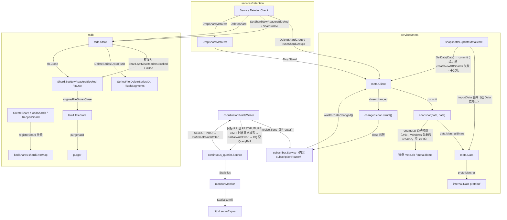
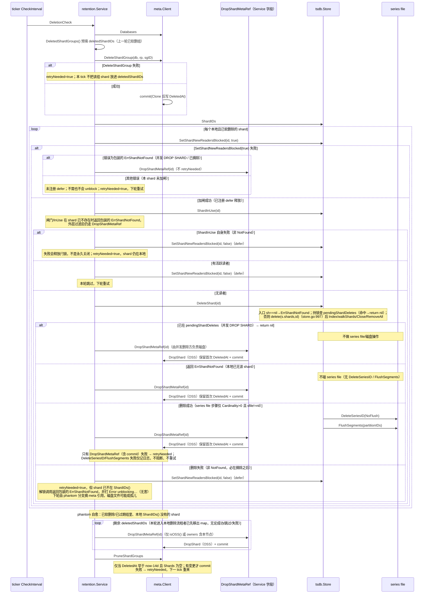
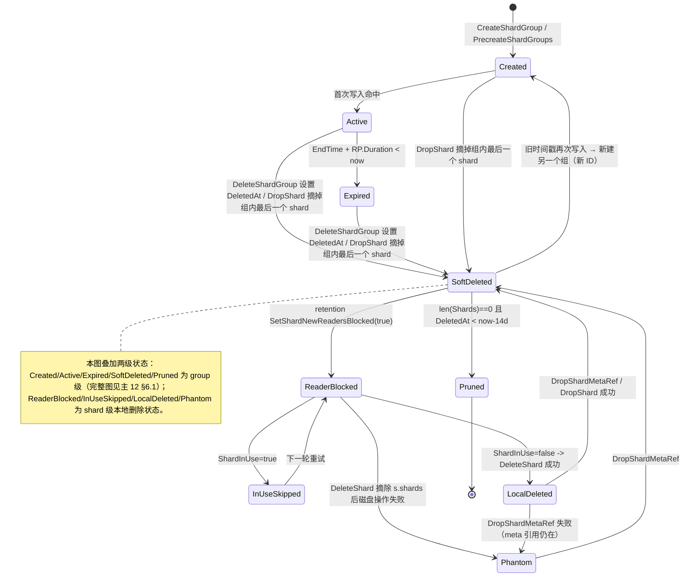

# 版本差异 5: 元数据与后台服务（v1.8.10 → v1.12.3）

> **基线**
> - OLD（旧）: `v1.8.10` = commit `688e697c51`（2021-10-11）
> - NEW（新）: `v1.12.3` = commit `f3d5cb68ab`（本仓库 `docs/specs/` 的代码基准）
> - 区间: 527 commits / 602 files / +79,310 −45,239；当前工作树只额外包含若干 docs 提交（数量随文档演进），代码相同。
> - 本文覆盖: `services/meta/*`、`services/retention/*`、`services/continuous_querier/*`、`services/precreator/*`、`services/snapshotter/*`、`services/subscriber/*`、`tsdb/store.go` 的 shard 删除/修剪路径、`tsdb/engine/tsm1/file_store.go` 的 purger（仅 retention 交互摘要，owner 04）、`coordinator` 中与 CQ/RP/写入编排相关的部分。
> - 旧版本证据统一来自 `git show v1.8.10:<path>`；新版本证据来自当前工作树。

> **小白导读**
> 1. **meta 的"户口本"流程没变**：改数据永远是"复印一份 → 在复印件上改 → 整本重新誊写并盖章（fsync+rename）→ 换掉正本 → 按铃通知所有人"。这一套在 v1.8.10 和 v1.12.3 里逐字相同，变的是"复印/誊写"用哪套序列化工具，以及"什么时候允许撕掉一页"。
> 2. **`meta.pb.go` 那 5000 多行 diff 不是重写业务**：它是把代码生成器从 `protoc-gen-gogo` 换成官方 `protoc-gen-go`，消息类型和命令号一个没改，只有 `RetentionPolicySpec`/`RetentionPolicyInfo` 各多了两个 `int64` 字段（写入窗口）。
> 3. **最关键的修复发生在"删除顺序"上**：旧版 retention 是"软删除（写 DeletedAt）→ 尝试删磁盘 → 14 天后无条件修剪"，磁盘删失败也照修；一旦搬家（删磁盘文件）失败或延迟，meta 里已经没有这条记录，磁盘上的 shard 目录就永远没人认领——也就是"孤儿文件"。新版反过来：**先删磁盘、再从 meta 摘掉 shard 引用；meta 里只要还剩 shard，就绝不修剪这个 shard group**。
> 4. **旧版删除大 shard 要"一条 series 一次 flush"（只刷用户态缓冲，不 fsync）**，几十万 series 时 retention 会看起来像卡死；新版把 flush 攒到"每个 series-file 分区一次"，并按分区补 fsync（≤8 次），且每删 1 万条打一行进度日志（#27114）。
> 5. **旧版删 shard 可能被"正在读它的查询"永久卡住**，整个 retention 循环停在 `Shard.Close()` 上；新版先"禁止新读者进入"，再检查"还有没有人在读"，有人读就跳过、下轮再来（#25055）。注意闸门与 `ShardInUse` **只统计 TSM/FileStore 的 reader**；TSI 索引迭代器（`LogFile`/`IndexFile` 的 `Retain/Release`）不在计数内，慢的索引类查询仍可让 `sh.Close()` 等待，见 §3.9、§7.16。
> 6. **purger 从"一个人拿着大门钥匙锁住整栋楼干活"变成"用带锁的格子柜"**：旧版在整个扫描+关闭+删除期间持有 `purger.mu` 写锁，会把 `FileStore` 的提交路径一起拖住；新版换成 `sync.Map` + 极短临界区。

## 0. 五分钟速读

- **meta**：仍是 clone-modify-commit + tmp/fsync/rename + changed 广播；protobuf 生成器迁移，消息/命令号不变。
- **retention**：读者闸门（`SetNewReadersBlocked`/`ShardInUse`）→ `DeleteShard` → `DropShardMetaRef` → phantom 自愈；`PruneShardGroups` 要求 `len(Shards)==0`。
- **CQ**：调度/时间窗口基本未变；SELECT INTO 受写窗口影响，窗口外的桶会被丢弃并计 `QueryFail`。
- **snapshotter**：IDMap 握手；`SetData`/`createNewDBShards` 失败分支不发响应。
- **风险**：meta `Clone` 不复制 `Subscriptions`（浅拷贝）、`total-buffer-bytes=0` 除零、OSS lease 恒成功且无互斥。

> **事实归属**：meta 状态机细节见 [07](../07_state_machine_spec.md)；retention/shard 生命周期见 [12](../12_background_services_spec.md)；CQ 见 [05](../05_downsampling_spec.md)；HTTP 见 [10](../10_http_service_spec.md)。

## 1. 结论速览

| # | 变更点 | v1.8.10 | v1.12.3 | 影响 | 证据 |
|---|--------|---------|---------|------|------|
| 1 | meta 提交骨架 `commit()` | Clone→snapshot→换 cache→`close(changed)` | **逐字未变** | 无 | `v1.8.10:services/meta/client.go:964` / `v1.12.3:services/meta/client.go:948` |
| 2 | meta 落盘 `snapshot()` | tmp→Write→Sync→Close→RenameFile | **逐字未变** | 无 | `v1.8.10:services/meta/client.go:997` / `v1.12.3:services/meta/client.go:981` |
| 3 | Lease | OSS 恒成功、内存对象、`Owner=0`、无持久化 | **逐字未变** | 唯一调用方是 CQ；多进程不互斥（3.1c） | `v1.8.10:services/meta/client.go:128` / `v1.12.3:services/meta/client.go:127` |
| 4 | `meta.pb.go` 生成器 | `protoc-gen-gogo`（2864 行，`XXX_Marshal`→`xxx_messageInfo` 表驱动） | `protoc-gen-go v1.34.1 / protoc v5.29.2`（4293 行，protoreflect） | 线格式兼容；序列化路径与文件体积变化 | `v1.8.10:services/meta/internal/meta.pb.go:1` / `v1.12.3:services/meta/internal/meta.pb.go:1` |
| 5 | RP 写入窗口字段 | 无 | `FutureWriteLimit=5/7`、`PastWriteLimit=6/8` | 新 SQL 语法、meta.db 新增字段、写路径丢点判定 | `v1.8.10:services/meta/internal/meta.proto:43` / `v1.12.3:services/meta/internal/meta.proto:47` |
| 6 | `CreateShardGroup` 边界 | 直接 `Truncate`，允许重叠 | 与已有 shard group 按**有效区间**（`Truncated()` 时取 `TruncatedAt`）求差集，保证有效区间不重叠；原始 `StartTime/EndTime` 仍可能重叠 | 同时间戳可能落到不同起止时间的组 | `v1.8.10:services/meta/data.go:358` / `v1.12.3:services/meta/data.go:382` |
| 7 | `DropShard` 的 `DeletedAt` | 每次都覆盖为 `time.Now()` | 保留首次删除时间 | 14 天修剪窗口计时更准 | `v1.8.10:services/meta/data.go:278` / `v1.12.3:services/meta/data.go:299` |
| 8 | `PruneShardGroups` | 14 天后**无条件**删组 | 仅当 `len(Shards)==0` 才删组 | 修复孤儿文件（#24530） | `v1.8.10:services/meta/client.go:682` / `v1.12.3:services/meta/client.go:680` + `services/meta/data.go:482` |
| 9 | `DeleteShard` 不存在时 | 返回 `nil` | 返回 `ErrShardNotFound` | retention 可识别 phantom shard | `v1.8.10:tsdb/store.go:698` / `v1.12.3:tsdb/store.go:978` |
| 10 | `DeleteShard` 索引类型清理 | `defer` 里无条件清（失败也清） | 仅在磁盘删除成功后清 | 统计更准；但见第 7 节风险 | `v1.8.10:tsdb/store.go:733` / `v1.12.3:tsdb/store.go:1139` |
| 11 | 删 series 的写盘 | 每条 `segment.Flush()`（只刷用户态缓冲，**不 fsync**） | `NoFlush` 批处理 + 每分区一次 `FlushSegments`（含 `file.Sync()`） | 显式 flush 次数 O(N)→O(分区数)，fsync 从 0 变为 ≤8（每分区一次）；属**持久化增强**，批末延迟可能上升，不计入跨版本性能收益（§4 #2，#27114） | `v1.8.10:tsdb/series_partition.go:317` / `v1.12.3:tsdb/series_file.go:211` |
| 12 | retention 删除流程 | 直接 `DeleteShard` | 阻塞新读者→`InUse`→`DeleteShard`→`DropShardMetaRef` | 不再挂死、不再留 phantom | `v1.8.10:services/retention/service.go:134` / `v1.12.3:services/retention/service.go:157` |
| 13 | purger 并发 | `sync.RWMutex` 全程持有 | `gensyncmap.Map` + 短临界区 | 降低 `FileStore` 写入/压缩阻塞 | `v1.8.10:tsdb/engine/tsm1/file_store.go:1376` / `v1.12.3:tsdb/engine/tsm1/file_store.go:1599` |
| 14 | 坏 shard 记忆 | 无（`Store` 无此字段） | `badShards shardErrorMap` | 启动不再对同一 shard 反复 Open | `v1.8.10:tsdb/store.go` 无 `badShards` / `v1.12.3:tsdb/store.go:462` |
| 15 | `DeleteSeries` 锁 | 手工 `RUnlock` 分支 | 闭包 + `defer RUnlock` | 消除 RLock 泄漏（#26647） | `v1.8.10:tsdb/store.go:1302` / `v1.12.3:tsdb/store.go:1657` |
| 16 | CQ 调度 / DST / SELECT INTO 写回 | `truncate` + `shouldRunContinuousQuery` | 调度与 DST **逐字未变**；写回走 `PointsWriter`，本区间新增写窗口 | 调度不变；设置 `PAST/FUTURE LIMIT` 时 CQ 补算点可能被丢弃并计 `QueryFail`（§3.15） | `v1.8.10:services/continuous_querier/service.go:547` / `v1.12.3:services/continuous_querier/service.go:559`；`v1.12.3:coordinator/points_writer.go:211-245` |
| 17 | `/debug/vars` 的 `cq` | 整个 `models.Statistic`（含 name/tags） | 只输出 `Values` 扁平 map | 监控解析格式变化（#26874）；输出/截断细节 owner 06 §3.12 | `v1.8.10:services/httpd/handler.go:1479` / `v1.12.3:services/httpd/handler.go:2452` |
| 18 | `SHOW RETENTION POLICIES` | 5 列 | 7 列（新增 future/past write limit） | 客户端列解析需适配 | `v1.8.10:coordinator/statement_executor.go:787` / `v1.12.3:coordinator/statement_executor.go:862` |
| 19 | subscriber | `points chan` 直发 + 每订阅 `chanWriter` | `subscriptionRouter` + 字节配额（`total-buffer-bytes`） | 重写；新增配置与 `memUsage` 指标 | `v1.8.10:services/subscriber/service.go:233` / `v1.12.3:services/subscriber/service.go:608` |
| 20 | precreator / snapshotter | — | 无功能变化（仅 `ioutil`→`io`） | 无需迁移 | `git diff v1.8.10 HEAD -- services/precreator` 为空 / `v1.12.3:services/snapshotter/client.go:53` |

## 2. 变更地图



> 图例：实线 = 调用/数据流（caller→callee 或统计数据流向）；虚线 = 反馈/影响。`CQ` 的统计先进入 `monitor.Monitor`，再由 `serveExpvar` 调用 `Monitor.Statistics(nil)` 读出（`v1.12.3:services/httpd/handler.go:2291-2292`、`monitor/service.go:146-166`）；07 §2 的 OBS 子图画了同样的 `MON→EXP` 中转。



## 3. 逐项差异

### 3.0 shard / shard group 生命周期总表

本节是后续 3.4-3.14 的“地图”。**owner 划分**：shard group 的生命周期（Created/Active/Expired/SoftDeleted/Pruned）由 meta + retention 负责；单个 shard 的本地删除（ReaderBlocked/InUseSkipped/LocalDeleted/Phantom）由 `retention.Service` + `tsdb.Store` 负责；series 文件的批量 fsync 机制 owner 是 02 §3.11（本文 3.14 只保留 retention 视角的摘要），purger owner 是 04 §3.15（本文 3.12 只保留交互摘要）。group 级的完整状态机与 note 见主 12 §6.1；本节把 shard 级本地删除状态叠加在同一张图上，两类状态不是同一层级。



| 状态 | 判定条件 | 进入路径 | 离开路径 | 本区间差异 | 对应节 |
|------|----------|----------|----------|------------|--------|
| Created | `ShardGroupInfo` 存在，`DeletedAt==0`，尚未写入 | `CreateShardGroup`（写路径或 precreator） | 首次写入命中 → Active | 与已有组求差集，允许组短于 `ShardGroupDuration`（#22601） | 3.4 |
| Active | 写路径 `ShardGroupAt`/`Contains` 命中；无独立字段 | 首次写入 | 到期或 `DeleteShardGroup` | RP 写窗口在 `MapShards` 过滤点（属于 RP 字段，不是组状态） | 3.3、3.4 |
| Expired | `EndTime.Add(RP.Duration).Before(now)`（`services/meta/data.go:1275`） | 时间推进 | `DeleteShardGroup` → SoftDeleted | 判定未变；写路径仍可能命中（除非先被写窗口过滤） | 3.6、3.13 |
| SoftDeleted | `DeletedAt != 0`，物理文件可能仍在 | `DeleteShardGroup`，或 `DropShard` 摘掉最后一个 shard 的副作用 | 本地删除、14 天后 Pruned；或旧时间戳再次写入时新建另一个组（新 ID，本组仍保留到 Pruned） | `DropShard` 保留首次 `DeletedAt`（#24530）；Prune 增加 `len(Shards)==0` 必要条件 | 3.5、3.6 |
| ReaderBlocked | `FileStore.newReaderBlockCount>0`（只计 TSM reader；索引迭代器不计入） | retention 删除前加闸 | `ShardInUse=false` 后删除；失败/跳过则解锁 | 新增读者闸门（#25055）；覆盖边界见 §3.9/§7.16 | 3.9 |
| InUseSkipped | `ShardInUse=true`（只反映 FileStore/TSM reader） | 加闸后仍有活跃读者 | 下一轮重试（不阻塞其他 shard） | 新增“跳过而非等待”；索引读者不触发该状态 | 3.9、6.1、7.16 |
| LocalDeleted | 已从 `s.shards` 摘除，series tombstone/索引/目录已处理 | `DeleteShard` 成功 | `DropShardMetaRef` 摘 meta 引用 | `ErrShardNotFound` 语义、索引清理时机、批量 fsync（fsync 细节 owner 02） | 3.8、3.14 |
| Phantom | meta 有、本地 `ShardIDs()` 无（OSS 或 owners 含本节点） | 本地 `DeleteShard` 已摘除 `s.shards` 但磁盘操作失败（未返回 nil）；本地删除成功但摘引用失败；或数据目录不可见 | `DropShardMetaRef` | 新增 phantom 自愈 + owners 过滤（#26527） | 3.13、7.6 |
| Pruned | `len(Shards)==0` 且 `DeletedAt` 早于 `now-14d` | SoftDeleted 且组内无 shard | 终态 | 从“只看到期”变为“到期 + 空组” | 3.6 |

> `TruncatedAt` 只影响 `ShardGroupByTimestamp` 路由，是 Enterprise/运维分支，不是独立生命周期状态（主 12 §6.1）；`badShards` 是 `tsdb.Store` 的本地打开失败缓存，也不是 shard 状态（3.10、7.5）。3.4-3.10 的每个变更点都对应上表的一次迁移或一次迁移前的检查；3.11 的 `DeleteSeries` 与 3.14 的 series-file fsync 属于 series 删除模块，不是 shard 生命周期本身。

### 3.1a meta 状态机：clone-modify-commit 与 changed 广播

**角色**：`services/meta` 是单机的元数据状态机。所有 DDL（库/RP/shard group/订阅/CQ）都走同一条“克隆 → 在副本上改 → 全量落盘 → 换内存指针 → 关通道通知”的控制流。v1.8.10 与 v1.12.3 的这条控制流逐字符相同，差异只在“副本怎么序列化”和“什么时候允许删 shard”（3.2、3.4-3.6）。

**结构**：

| 组件 | 作用 | 旧/新证据 |
|------|------|-----------|
| `Data` | 全量元数据树（Databases/RPs/ShardGroups/Subscriptions/CQs） | `v1.8.10:services/meta/data.go` / `v1.12.3:services/meta/data.go` |
| `Client` | 对外 API、读写锁、`cacheData` 指针、`changed` 通道 | `v1.8.10:services/meta/client.go:49` / `v1.12.3:services/meta/client.go:48` |
| `commit(data)` | index+1 → `snapshot` → 换 `cacheData` → `close(changed)` | `v1.8.10:services/meta/client.go:964` / `v1.12.3:services/meta/client.go:948` |
| `changed` | 无缓冲的“广播”通道；关闭即通知，随后立即换新通道 | `v1.8.10:services/meta/client.go:976` / `v1.12.3:services/meta/client.go:960` |

**流程**（以 `CreateRetentionPolicy` 为例）：

1. 调用方取 `Client.mu` 写锁后取 `cacheData`、`Clone()` 出副本：读 API 走 `RLock`；DDL（如 `CreateRetentionPolicy`）直接 `Lock()`，没有 RLock 快路径、也没有二次检查（`v1.12.3:services/meta/client.go:286-306`）。本组唯一的 `RLock`→`RUnlock`→`Lock`→二次检查路径是 `CreateShardGroup`（`client.go:693-720`；主 07 §3.2 步骤 2-4）。
2. 在副本上执行 `Data.CreateRetentionPolicy` 等变更；校验失败直接返回，`cacheData` 不动。
3. `commit(data)`：`data.Index++` → `snapshot(c.path, data)`（3.1b）。
4. 落盘成功后 `c.cacheData = data`，随后 `close(c.changed); c.changed = make(chan struct{})`。
5. 等待者（`changed` 的唯一消费者是 `subscriber.waitForMetaUpdates`）在 `close` 时被唤醒，**必须重新取通道**再等待下一次变更；复用旧通道会立即返回并空转。

**代码**：

```go
// v1.8.10:services/meta/client.go:964 — (*Client).commit
// v1.12.3:services/meta/client.go:948 — (*Client).commit
func (c *Client) commit(data *Data) error {
	data.Index++

	// try to write to disk before updating in memory
	if err := snapshot(c.path, data); err != nil {
		return err
	}

	// update in memory
	c.cacheData = data

	// close channels to signal changes
	close(c.changed)
	c.changed = make(chan struct{})

	return nil
}
```

**案例**：§6.2 跟踪 `CREATE RETENTION POLICY "hot" ... FUTURE LIMIT 1h PAST LIMIT 6h` 的完整字节流：`Index` 从 N 变 N+1，`snapshot` 写出的 `RetentionPolicyInfo` 多出 field 7/8（含 tag 共 7/8 字节；varint 载荷分别为 6/7 字节），`changed` 唤醒 subscriber。该案例同时是 3.1b 的落盘案例。

**风险**：`Subscriptions` 不是深拷贝，`DropSubscription` 会原地改共享数组（7.13）；protobuf 运行时降级会丢写窗口字段（7.8）；每次 `DropShard` 都是一次全量 commit（7.7）。

### 3.1b snapshot/commit：五步落盘、失败矩阵与 Windows rename

**角色**：把内存中的全量 `Data` 变成磁盘上可原子替换的 `meta.db`。它是 meta 状态机的持久化边界，**不是**后台服务；调用者是每次 `commit`。

**结构**：

| 项 | 值/实现 | 证据 |
|----|---------|------|
| 正式文件 | `<meta>/meta.db`（`metaFile`） | `v1.12.3:services/meta/client.go:31` |
| 临时文件 | `<meta>/meta.dbtmp`（`filename + "tmp"`，中间无点） | `v1.12.3:services/meta/client.go:981-983` |
| 序列化 | `Data.MarshalBinary` → `proto.Marshal(data.marshal())` | `v1.12.3:services/meta/data.go:820` |
| 原子替换 | `file.RenameFile(tmp, meta.db)`；Unix 为 `rename(2)`，Windows 先删目标再 rename | `v1.12.3:pkg/file/file_unix.go:54`、`pkg/file/file_windows.go:10` |

**流程**（五步）：

1. `os.Create(tmp)`；失败则本次 commit 直接返回，`cacheData` 保持旧指针。
2. `data.MarshalBinary()`；失败时 tmp 文件可能为空/半写，`defer f.Close()` 关闭。
3. `f.Write(d)`；失败同上。
4. `f.Sync()`（fsync 数据）；失败同上。
5. `f.Close()`（Windows 下 rename 前必须关闭）→ `file.RenameFile(tmp, meta.db)`；成功后 `commit` 才换内存指针。注意这里只 `f.Sync()` 了文件数据，**没有 `file.SyncDir` 持久化 rename 的目录项**。

**失败矩阵**：

| 失败点 | 磁盘 | 内存 | 可见后果 | 恢复 |
|--------|------|------|----------|------|
| `os.Create` | 旧 `meta.db` 完整 | 旧 `cacheData` | 调用方拿到错误 | 下次 commit 重试 |
| `MarshalBinary` / `Write` / `Sync` / `Close` | 旧 `meta.db` 完整；tmp 残留 | 旧 `cacheData` | 本次变更未持久化，返回错误 | 下次 `os.Create` 截断 tmp |
| `RenameFile`（Unix） | 旧 `meta.db` 完整 | 旧 `cacheData` | 返回错误；tmp 残留 | 下次重试 |
| `RenameFile`（Windows） | 先 `os.Stat(meta.db)`：成功 → `os.Remove(meta.db)` → `os.Rename(tmp, meta.db)`（`pkg/file/file_windows.go:10-17`）。`os.Remove` 失败 → 直接返回错误、`meta.db` 仍在；remove 成功而 rename 失败 → `meta.db` 不存在、只剩 `meta.dbtmp`；`os.Stat` 返回非 nil 错误（如权限）→ 跳过 remove 直接 rename，结果取决于 rename 的错误 | 旧 `cacheData` | 只有“remove 成功、rename 失败”这一窗口会让节点重启读不到 meta | 需人工恢复 tmp/备份（主 07 §11.1） |
| rename 成功、目录项未持久化（掉电） | 新 `meta.db` 内容已 `Sync`，但 `snapshot` 只同步文件数据后 rename，**未调用 `file.SyncDir`**（`v1.12.3:services/meta/client.go:981-1011`；对照 `tsdb/shard.go:2020-2032` 的 `fields.idx` 路径）。掉电后 rename 的目录项可能回退 | 进程已退出 | 重启可能读到**旧** `meta.db`（最后一次 commit 丢失），或出现 tmp/旧文件并存；与进程崩溃不同，**不保证自动恢复到新文件** | 需从备份恢复并人工核对；主 07 §9.2/§14.5、主 12 §2.8 已记录该缺口 |
| rename 成功、换内存前**进程崩溃**（非掉电） | 新 `meta.db` | 进程已退出 | 重启加载新文件 | 自动 |

**代码**：

```go
// v1.8.10:services/meta/client.go:997 — snapshot
// v1.12.3:services/meta/client.go:981 — snapshot
filename := filepath.Join(path, metaFile)   // metaFile = "meta.db"
tmpFile := filename + "tmp"                 // <meta>/meta.dbtmp（中间无点）
f, err := os.Create(tmpFile)
if err != nil { return err }
defer f.Close()
var d []byte
if b, err := data.MarshalBinary(); err != nil {   // proto.Marshal(data.marshal())
	return err
} else {
	d = b
}
if _, err := f.Write(d); err != nil { return err }
if err = f.Sync(); err != nil { return err }        // fsync 数据
if err = f.Close(); err != nil { return err }       // 先关句柄以兼容 Windows
return file.RenameFile(tmpFile, filename)           // 原子替换
```

**案例**：§6.2 的字节流案例给出一次成功 commit 的 5 步、field 7/8 的编码长度（tag + varint 载荷：1h 共 7 字节、6h 共 8 字节），以及升级后每个 RP 至少 +4 字节的原因。失败场景见上表；Windows 的“先删后 rename”窗口是 §3.1b/主 07 §11.1 的核心风险。

**案例：Windows 上 `remove` 成功、`rename` 失败后的重启（T0–T3）**

输入：Windows 节点，`<meta>/meta.db` 为上一次成功提交的版本（含 `db0`/`rp0`/用户/CQ），`cacheData.Index=42`；外部进程（杀毒/索引器/备份）短暂占用 `<meta>/meta.dbtmp` 或目标路径。

| 时刻 | 动作 | 磁盘 | 内存/返回值 |
|------|------|------|--------------|
| T0 | `commit` 进入 `snapshot` | `meta.db`=v42、无 tmp | `cacheData`=v42 |
| T1 | `os.Create(meta.dbtmp)` → `Write` → `Sync` → `Close` 全部成功 | `meta.db`=v42、`meta.dbtmp`=v43 完整 | 未换指针 |
| T2 | `os.Stat(meta.db)` 成功 → `os.Remove(meta.db)` 成功 | **`meta.db` 不存在**、`meta.dbtmp`=v43 | 未换指针 |
| T3 | `os.Rename(meta.dbtmp, meta.db)` 失败（如 `ERROR_ACCESS_DENIED`/共享冲突） | 仍无 `meta.db`，只剩 `meta.dbtmp`（内容 v43） | `snapshot` 返回错误；`commit` 返回错误，`cacheData` 仍是 v42；服务继续运行 |
| T4a | 进程不重启，下一次任意 commit 成功 | `Stat(meta.db)` 不存在 → 跳过 remove，`Rename(tmp, meta.db)` 成功；新文件包含 v42+本次变更 | 文件层面自愈；T2/T3 未提交的 v43 变更本身已丢失 |
| T4b | 进程在 T4a 前重启 | `Load()` 的 `os.Open(meta.db)` 返回 `IsNotExist` → **`return nil`**（不是错误） | `Open()` 看到 `cacheData.Index==1`（`NewClient` 的初值）→ `snapshot` 用空 Data **截断并覆盖 meta.dbtmp**，再改名为全新的空 `meta.db`（随机 `ClusterID`、无数据库/用户/CQ） |

T4b 的后果：节点正常启动、无错误日志，但 `SHOW DATABASES` 为空、所有用户/CQ/RP 消失、`ClusterID` 变化；T3 留下的 `meta.dbtmp`（v43）在重启的 `os.Create` 时已被截断，只能从备份恢复。`Load()` 把“文件不存在”当“全新实例”（`v1.12.3:services/meta/client.go:1018-1023`）是该窗口真正危险的地方。v1.8.10 的 `snapshot`（`v1.8.10:services/meta/client.go:997-1025`）、`file_windows.go` 与 `Load` 实现逐字相同，因此**不是版本回归**，两版都有。

**风险**：全量重写 + fsync 的写放大（7.7）；Windows 非原子替换（§3.1b）；降级到 v1.8.10 后写窗口字段在第一次提交时丢失（7.8、5.1）。

### 3.1c Lease：60 秒空实现、CQ 唯一调用方与单机语义

**角色**：`AcquireLease` 在集群版里用于选主/互斥；在 OSS 单机版里只是一个“永远成功”的占位实现。它**不持久化、不释放、不做互斥**，唯一生产调用方是 CQ 服务。

**结构**：

| 类型/函数 | 字段/行为 | 证据 |
|-----------|-----------|------|
| `Lease` | `Name string`、`Expiration time.Time`、`Owner uint64` | `v1.8.10:services/meta/data.go:1679` / `v1.12.3:services/meta/data.go:1799` |
| `DefaultLeaseDuration` | 60s | `v1.12.3:services/meta/config.go:12` |
| `Client.AcquireLease` | 只填 `Name`/`Expiration`；**`Owner` 保持零值**；恒返回 nil error | `v1.8.10:services/meta/client.go:128` / `v1.12.3:services/meta/client.go:127` |
| `Leases` / `NewLeases` / `Leases.Acquire` | 带 `mu`、`map[string]*Lease`、60s 续期/拒绝逻辑 | `v1.12.3:services/meta/data.go:1806-1847` |
| `Leases` 可达性 | OSS 全树无调用方（含测试）；`Client.AcquireLease` 是另一条路径 | 主 12 §7.4 |

**流程**（CQ 的两个触发分支）：

1. `backgroundLoop` 起一个 timer（`RunInterval`），同时监听 `s.RunCh`；两者都会走到 `MetaClient.AcquireLease("continuous_querier")`。
2. OSS 的 `AcquireLease` 立即返回一个 60s 后过期的结构体；CQ 只判断 `err == nil`，不检查 `Owner`/`Expiration`，也不续期或释放。
3. 成功后调用 `runContinuousQueries`，遍历所有库的 CQ 并执行；失败（集群版“another node has the lease”）则跳过本轮。
4. 进程退出/重启不会清理 lease；OSS 也没有任何代码读取 `Expiration`。

**调用约束（`Run()` 的锁/发送互等）**：`RunCh` 是无缓冲 channel（`v1.12.3:services/continuous_querier/service.go:109`），`Run(database,name,t)` 在持有 `s.mu` 时执行 `s.RunCh <- req`（`:196-210`）；而 `backgroundLoop` 一旦进入 timer 分支的 `runContinuousQueries` → `ExecuteContinuousQuery`（同样要拿 `s.mu`，`:282-299`）就不在 `select` 上接收。精确交错：`Run()` 先拿到 `s.mu` 并阻塞在发送；后台 goroutine 已进入 CQ 执行（或在两个 CQ 之间）并阻塞在 `s.mu.Lock`，双方互相等待，`Close()` 也会卡在 `wg.Wait()`。因此 `Run()` 必须在 `Open()` 之后调用，且不要在 CQ 执行路径/持锁回调中调用；代码侧可改为带缓冲的 `RunCh` 或在锁外发送（主 05 §1.2 的“调用约束”已记录该死锁窗口，此处为补充）。

**代码**：

```go
// v1.12.3:services/meta/client.go:127 — AcquireLease（OSS）
func (c *Client) AcquireLease(name string) (*Lease, error) {
	l := Lease{
		Name:       name,
		Expiration: time.Now().Add(DefaultLeaseDuration),
	}
	return &l, nil
}

// v1.12.3:services/continuous_querier/service.go:226-243 — backgroundLoop 的两个分支
case req := <-s.RunCh:
	if !s.hasContinuousQueries() { continue }
	if _, err := s.MetaClient.AcquireLease(leaseName); err == nil {
		s.runContinuousQueries(req)
	}
case <-t.C:
	if !s.hasContinuousQueries() { t.Reset(s.RunInterval); continue }
	if _, err := s.MetaClient.AcquireLease(leaseName); err == nil {
		s.runContinuousQueries(&RunRequest{Now: time.Now()})
	}
	t.Reset(s.RunInterval)
```

**案例（双进程共享 meta，`EVERY 1h`）**：

- 部署：进程 A、B 配置同一 `meta` 目录（或同一后端），都开启 CQ；CQ `cq_hourly` 为 `CREATE CONTINUOUS QUERY cq_hourly ON db0 BEGIN SELECT mean(usage) INTO db0.autogen.cpu_hourly FROM db0.autogen.cpu GROUP BY time(1h), host END`，`run-interval=1s`。
- `2026-10-10T11:59:59Z`：A、B 的 `lastRuns` 都是空 map（`v1.12.3:services/continuous_querier/service.go:98/114`），`HasRun=false`，`shouldRunContinuousQuery` 直接返回 `true, now`（`:512-549`）。
- `12:00:00Z` / `12:00:01Z`：A/B 各自的 timer 分支调 `AcquireLease("continuous_querier")`（`:234-242`）；OSS 实现只填 `Name` 和 `Expiration=now+60s`、`Owner=0`、返回 `nil`（`v1.12.3:services/meta/client.go:127-133`），两边都通过 `err == nil` 检查。
- 两边各自执行 `SELECT INTO`，目标都是 `db0.autogen.cpu_hourly` 的 `11:00` 桶。CQ 的 `LastRun` 只写本进程的 `s.lastRuns`（`service.go:338-339`），不会跨进程同步。
- 结果：
  - **执行次数**：`log-enabled=true`（默认）时，A、B 各打一行 `Finished continuous query`（`service.go:409-417`），共 2 行；开启 `query-stats-enabled=true` 时，监控库 `_internal` 出现 2 个 `cq_query` 点（同一 `db`/`cq` tag、时间戳不同，`:419-426`）。
  - **写入数据**：同一 series+timestamp 在客户端只会看到一行，**不存在“合并前短暂看到重复 timestamp”**。①查询游标在 cache 与 TSM 时间戳相同时只返回 cache 值，并同时推进两个游标（`tsdb/engine/tsm1/iterator.gen.go:442-470`，`ckey == tkey` 分支 `:454-458`）；②TSM 多 block 用 `Values.Merge` 合并，时间戳相等时丢弃参数 `a` 的值、保留 `b`（`encoding.gen.go:186-224`；ascending 分支 `values.Merge(v)`、descending 分支 `v.Merge(values)`，`file_store.gen.go:120/185`）；③cache `Values()` 返回前再 `Deduplicate()`（`cache.go:554-605`，规则是“时间戳相同时保留 slice 中靠后的值”，`encoding.gen.go:58-89`），snapshot 前也会 `Deduplicate()`（`engine.go:2009`）。因此“两份写入哪个值可见”由 cache/TSM 的合并顺序决定（cache 优先于 TSM；TSM 内按 `Merge` 的参数顺序），但**不会出现两行同 timestamp 的数据**，也不能假设“后写一定生效”。
  - **写放大**：每小时的聚合被计算并写入 2 次，写请求与 compaction 成本约为单进程的 2 倍。
- 若 A、B 的 `now` 或读到的源数据快照不同（例如 B 晚 2 分钟启动、期间有新点写入），两边的聚合值可能不同；由于重复值最终会合并，最终值不可预期。**风险是重复计算/写竞争，不是“重复数据”。** OSS 不提供跨进程互斥，运维上必须保证同一 meta 只有一个写入者。单进程内，`RunCh` 与 timer 也可能在同一时刻各触发一次，但二者串行进入 `backgroundLoop`，不会并发。

**风险**：无持久化、无显式 release、`Expiration` 不被消费；多进程重复执行；集群 `Leases` 在 OSS 是死代码（主 07 §11.7、主 12 §7.5）。本区间无差异。

### 3.2 `meta.pb.go` 的 +3397/−1968 到底是什么

diffstat：`services/meta/internal/meta.pb.go` **+3397 / −1968**（`meta.proto` 另 +5）。文件行数 2864 → 4293。拆开看只有三类内容：

| 类别 | 旧 | 新 | 占比 |
|------|----|----|------|
| 头部/生成器标识 | `// Code generated by protoc-gen-gogo` | `protoc-gen-go v1.34.1` + `protoc v5.29.2` | 极小 |
| 序列化实现 | `XXX_Marshal`/`XXX_Size`/`XXX_Unmarshal` 转发到 `xxx_messageInfo_*.{Marshal,Size,...}`（`proto.InternalMessageInfo` 表驱动；**没有** `MarshalToSizedBuffer` 或 `Size()` 快路径，全文件 0 命中） | 统一交给 `protoimpl` + 一段 `file_internal_meta_proto_rawDesc` 描述符字节块 | 绝大部分 |
| 字段/访问器 | 无 `GetXxx` 之外的结构差异 | 新增 4 个 `*int64` 字段 + `GetFutureWriteLimit` 等访问器 | 约 40 行 |

验证方式（可直接复现）：把两边所有 `type X struct` 与 `Command_*` 常量抽出来排序比较，**差集为空** —— 消息类型和 `Command_Type` 枚举值一个没增、一个没减：

```go
// v1.8.10:services/meta/internal/meta.pb.go:1
// Code generated by protoc-gen-gogo. DO NOT EDIT.
// source: internal/meta.proto
import (
	fmt "fmt"
	proto "github.com/gogo/protobuf/proto"
	math "math"
)

// v1.12.3:services/meta/internal/meta.pb.go:1-12（节选）
// Code generated by protoc-gen-go. DO NOT EDIT.
// versions:
// 	protoc-gen-go v1.34.1
// 	protoc        v5.29.2
// source: internal/meta.proto

package meta

import (
	protoreflect "google.golang.org/protobuf/reflect/protoreflect"
	protoimpl "google.golang.org/protobuf/runtime/protoimpl"
	reflect "reflect"
	sync "sync"
)
```

```go
// v1.12.3:services/meta/internal/meta.pb.go:431 — RetentionPolicySpec
	FutureWriteLimit   *int64  `protobuf:"varint,5,opt,name=FutureWriteLimit" json:"FutureWriteLimit,omitempty"`
	PastWriteLimit     *int64  `protobuf:"varint,6,opt,name=PastWriteLimit" json:"PastWriteLimit,omitempty"`

// v1.12.3:services/meta/internal/meta.pb.go:520 — RetentionPolicyInfo
	FutureWriteLimit   *int64              `protobuf:"varint,7,opt,name=FutureWriteLimit" json:"FutureWriteLimit,omitempty"`
	PastWriteLimit     *int64              `protobuf:"varint,8,opt,name=PastWriteLimit" json:"PastWriteLimit,omitempty"`
```

对应的 `.proto` 增量（旧版完全没有这四个字段）：

```proto
// v1.12.3:services/meta/internal/meta.proto:47
	optional int64 FutureWriteLimit    = 5;
	optional int64 PastWriteLimit      = 6;
// v1.12.3:services/meta/internal/meta.proto:58
	optional int64 FutureWriteLimit = 7;
	optional int64 PastWriteLimit = 8;
```

调用方也跟着换库：

```go
// v1.8.10:services/meta/data.go:14-22（节选）
	"github.com/gogo/protobuf/proto"
)

//go:generate protoc --gogo_out=. internal/meta.proto

// v1.12.3:services/meta/data.go:19-22（节选）
	"google.golang.org/protobuf/proto"
)

//go:generate protoc --go_out=./internal internal/meta.proto
```

**语义影响**：
1. **线格式（wire format）不变**：proto2 optional + 相同的 field number 编码规则。旧 `meta.db` 可被新版直接 `proto.Unmarshal`；新版写出的 `meta.db` 中新增的 field 7/8 在旧版里会成为"未知字段"。
2. **未知字段在旧版不会长期保留**：`Data.UnmarshalBinary` 解到 `internal.Data` 后，业务层 `data.unmarshal(&pb)` 把内容搬进 Go 结构体 `RetentionPolicyInfo`（没有写窗口字段），下一次 `commit` 时 `rpi.marshal()` 会**重新构造**一个新的 `internal.RetentionPolicyInfo`，未知字段自然丢失。也就是说：**降级到 v1.8.10 并发生任意一次 meta 提交，写窗口配置会被静默抹掉**（见第 5 节）。
3. **序列化实现换了，但不能断言“新版更慢”**：v1.8.10 的 `meta.pb.go` 由普通 `protoc-gen-gogo`（`//go:generate protoc --gogo_out=.`，`services/meta/data.go:22`）生成，只有 `XXX_Marshal`/`XXX_Size`/`XXX_Unmarshal` 转发到 `xxx_messageInfo_*.{Marshal,Size,...}`（`proto.InternalMessageInfo` 表驱动）；全文件没有 `MarshalToSizedBuffer`（`git show v1.8.10:services/meta/internal/meta.pb.go | grep -c MarshalToSizedBuffer` = 0），也没有 `Size()` 快路径。新版是 protoimpl + `file_internal_meta_proto_rawDesc`。新旧都由运行时驱动；meta 每次提交仍是**全量序列化**（见 3.1b），但“生成器不同 ⇒ 单次 commit CPU 上升”不成立，仓库也没有两者基准。

### 3.3 RP 写入窗口：新字段、新校验、新 SQL

```go
// v1.8.10:services/meta/data.go:139 — CreateRetentionPolicy 校验
	} else if rpi.ReplicaN < 1 {
		return ErrReplicationFactorTooLow
	}

// v1.12.3:services/meta/data.go:141 — 新增负值校验
	} else if rpi.PastWriteLimit < 0 || rpi.FutureWriteLimit < 0 {
		return ErrNegativeWriteLimit
	}
```

```go
// v1.12.3:services/meta/errors.go:73
	// ErrNegativeWriteLimit is returned when the FutureWriteLimit or PastWriteLimit is below zero
	ErrNegativeWriteLimit = errors.New("negative write limit")
```

同时 `UpdateRetentionPolicy` 被拆成两层：

```go
// v1.12.3:services/meta/data.go:228 — UpdateRetentionPolicy 只负责查库/查名/设默认（ApplyRetentionUpdate 调用在 246，定义在 257）
	if err := ApplyRetentionUpdate(rpu, rpi); err != nil {
		return err
	}
	if di.DefaultRetentionPolicy != rpi.Name && makeDefault {
		di.DefaultRetentionPolicy = rpi.Name
	}
	return nil
// v1.12.3:services/meta/data.go:257 — ApplyRetentionUpdate 负责逐字段赋值
```

拆分动机是让 enterprise 复用同一套"字段应用"逻辑（推断；`RetentionPolicyUpdate` 新增 `SetFutureWriteLimit`/`SetPastWriteLimit`）。**OSS 语义与旧版一致，只是多了两个字段**。另外 v2 bucket create 的幂等判定 `RetentionPolicySpec.Matches` 现在也比较写窗口，写窗口不同会返回 `ErrRetentionPolicyConflict`（`v1.12.3:services/meta/data.go:1117-1129`、`services/meta/client.go:241-245`）。

SQL 语法由 influxql 升级带来（`go.mod`：`influxql v1.1.1-0.20200828144457-65d3ef77d385` → `v1.4.1`）：

```
CREATE RETENTION POLICY <rp> ON <db> DURATION <d> REPLICATION <n>
  [SHARD DURATION <d>] [DEFAULT] [FUTURE LIMIT <d>] [PAST LIMIT <d>]

ALTER RETENTION POLICY <rp> ON <db> [DURATION <d>] [REPLICATION <n>]
  [SHARD DURATION <d>] [DEFAULT] [FUTURE LIMIT <d>] [PAST LIMIT <d>]

CREATE DATABASE <db> WITH [DURATION <d>] [REPLICATION <n>] [SHARD DURATION <d>]
  [FUTURE LIMIT <d>] [PAST LIMIT <d>] [NAME <rp>]
```

注意关键字是 `FUTURE` / `PAST`（不是 `FUTURE_WRITE_LIMIT`）。旧版 influxql 的 `token.go` 里根本没有这两个 token（`influxql@v1.1.1-0.20200828144457-65d3ef77d385/token.go` 中检索 `FUTURE` 无结果），所以**同一句 SQL 在 v1.8.10 上是语法错误，在 v1.12.3 上合法**。

语法顺序：`CREATE DATABASE ... WITH` 与 `CREATE RETENTION POLICY` 都是顺序扫描，`FUTURE` 必须写在 `PAST` 之前（`CREATE ... PAST ... FUTURE` 报 `found FUTURE, expected ;`）；`ALTER RETENTION POLICY` 是 switch 循环，两种顺序都合法（`influxql@v1.4.1/parser.go:1786-1882`、`:204-303`、`:304-405`）。`CREATE DATABASE ... WITH` 的 limits 由 `statement_executor` 写进 `RetentionPolicySpec`（`v1.12.3:coordinator/statement_executor.go:273-296`）。

写入侧如何使用（详见 `[06 Cluster Communication](../06_cluster_communication_spec.md)`），这里只给差异锚点：

```go
// v1.12.3:coordinator/points_writer.go:211 — type WriteWindow
// v1.12.3:coordinator/points_writer.go:237 — (*WriteWindow).WithinWindow
	if w.checkBefore && t.Before(w.before) { return false, w.before, WriteWindowLowerBound }
	if w.checkAfter  && t.After(w.after)   { return false, w.after,  WriteWindowUpperBound }
```

### 3.4 `CreateShardGroup`：从"允许重叠"到"有效区间不重叠"

旧版只做一次 `Truncate`：

```go
// v1.8.10:services/meta/data.go:358 — CreateShardGroup
	sgi.StartTime = timestamp.Truncate(rpi.ShardGroupDuration).UTC()
	sgi.EndTime = sgi.StartTime.Add(rpi.ShardGroupDuration).UTC()
	if sgi.EndTime.After(time.Unix(0, models.MaxNanoTime)) {
		sgi.EndTime = time.Unix(0, models.MaxNanoTime+1)
	}
```

新版在写入前，与所有**未删除**的 shard group 按**有效区间**求差集，把新组的 `[startTime, endTime)` 收缩到不与任何已有组的有效区间相交（已有组 `Truncated()` 时用 `TruncatedAt` 代替 `EndTime`）：

```go
// v1.12.3:services/meta/data.go:382 — CreateShardGroup
	startTime := timestamp.Truncate(rpi.ShardGroupDuration).UTC()
	endTime := startTime.Add(rpi.ShardGroupDuration).UTC()
	if endTime.After(time.Unix(0, models.MaxNanoTime)) {
		endTime = time.Unix(0, models.MaxNanoTime+1)   // [start,end) 上界钳位，与旧版相同
	}
	for i := range rpi.ShardGroups {
		if rpi.ShardGroups[i].Deleted() { continue }
		startI := rpi.ShardGroups[i].StartTime
		endI := rpi.ShardGroups[i].EndTime
		if rpi.ShardGroups[i].Truncated() { endI = rpi.ShardGroups[i].TruncatedAt }
		if !timestamp.Before(endI) && endI.After(startTime) { startTime = endI }
		if startI.After(timestamp) && startI.Before(endTime)   { endTime = startI }
	}
```

**为什么改**（commit `3c811bcd81 fix: create shards without overlaps (#22601)`）：`sgList.ShardGroupAt` 在 `coordinator/points_writer.go` 里对有序列表做二分查找，一旦 shard group 区间重叠，二分可能返回"第一个 EndTime 更晚的组"，而该组并不包含这个时间点。旧代码在 `ShardGroupAt` 里做了线性回退兜底（这段在 v1.8.10 已存在，本区间未变），但重叠本身会让"同一个时间点到底进哪个组"依赖写入顺序，进而让 retention 的"过期组"边界难以推理。

**语义影响**：
- 差集只保证**有效区间**不重叠：原始 `StartTime/EndTime` 仍可能重叠（例如组被 `TruncateShardGroups` 截断后，新组与原组的 `EndTime` 区间仍相交），因此 `ShardGroupAt` 的线性回退仍然必要，`SHOW SHARDS` 的 `start_time`/`end_time` 也可能看起来相交。
- 新版本的 shard group 可能**短于** `ShardGroupDuration`（例如从 07:00 开始而不是 00:00），`SHOW SHARDS` 里看到的 `start_time` 不再是整齐的整点。
- `CreateShardGroup` 的幂等性判断仍基于 `ShardGroupByTimestamp(timestamp)`，即"该时间点已在某个组里 → 直接返回 nil"，行为未变。

**案例（truncate 后写入）**：RP `autogen`、`ShardGroupDuration=24h`；组 A 原为 `[2026-10-01T00:00Z, 2026-10-02T00:00Z)`，`TruncateShardGroups(2026-10-01T12:00Z)` 之后 `TruncatedAt=2026-10-01T12:00Z`（`v1.12.3:services/meta/data.go:834-857`），因此 `ShardGroupByTimestamp(2026-10-01T18:00Z)` 返回 nil（`:1263-1270`）。

写入 `2026-10-01T18:00Z` 的点：

- **v1.8.10**：`startTime=00:00`、`endTime=10-02T00:00`，不做重叠检查，创建组 `[00:00, 10-02T00:00)`。它与 A 的原始区间完全重叠；`SHOW SHARDS` 新增一行的 `start_time=2026-10-01T00:00:00Z`、`end_time=2026-10-02T00:00:00Z`（`SHOW SHARDS` 打印 `EndTime`，不打印 `TruncatedAt`）。同一个时间点现在落在两个组里，`ShardGroupAt` 的二分结果依赖列表顺序。
- **v1.12.3**：循环遇到 A（`endI=TruncatedAt=12:00`），`timestamp(18:00)` 不早于 `endI` 且 `endI(12:00) > startTime(00:00)` → `startTime=12:00`；第二个条件不成立。创建组 `[12:00, 10-02T00:00)`。`SHOW SHARDS` 新行 `start_time=2026-10-01T12:00:00Z`、`end_time=2026-10-02T00:00:00Z`。对新点 `ShardGroupByTimestamp(18:00)` 返回新组；再次写入 18:00 不会再建组（`:391-394` 的幂等检查命中）。

两版的 A 都保留原 `EndTime`（10-02），差异只在**新组起点**：旧版 00:00（与 A 重叠 12 小时），新版 12:00（从 A 的截断点开始）。

### 3.5 `DropShard`：不要覆盖第一次的 `DeletedAt`

```go
// v1.8.10:services/meta/data.go:294-297
					if len(shards) == 1 {
						// We just deleted the last shard in the shard group.
						data.Databases[dbidx].RetentionPolicies[rpidx].ShardGroups[sgidx].DeletedAt = time.Now()
					}

// v1.12.3:services/meta/data.go:315
					if len(shards) == 1 {
						// ... make sure we don't overwrite the timestamp if it was already deleted.
						if !data.Databases[dbidx].RetentionPolicies[rpidx].ShardGroups[sgidx].Deleted() {
							data.Databases[dbidx].RetentionPolicies[rpidx].ShardGroups[sgidx].DeletedAt = time.Now()
						}
					}
```

为什么需要这个判断：
- 在 v1.8.10 里，能触发 `DropShard` 的 OSS 路径只有管理员语句 `DROP SHARD <id>`（`v1.8.10:coordinator/statement_executor.go:385`），所以影响面有限（Enterprise 的 `RemoveShardOwner` 是另一条路径）。
- 但在 v1.12.3 的 retention 流程里，**`DeleteShardGroup` 已经先给组打上了 `DeletedAt`**，随后每个 shard 删完都要调一次 `DropShard`（3.13 第 3 阶段）。如果没有这个 `Deleted()` 判断，**组内最后一个 shard 的 `DropShard` 会把 14 天计时重置为"此刻"**，`PruneShardGroups` 就永远等不到窗口。换句话说，3.5 和 3.6 是配套的：没有 3.5，3.6 的新条件会让组记录长期滞留。

### 3.6 `PruneShardGroups`：把"14 天"从"唯一条件"降级为"必要条件"

```go
// v1.8.10:services/meta/client.go:682 — PruneShardGroups
	for i, d := range data.Databases {
		for j, rp := range d.RetentionPolicies {
			var remainingShardGroups []ShardGroupInfo
			for _, sgi := range rp.ShardGroups {
				if sgi.DeletedAt.IsZero() || !expiration.After(sgi.DeletedAt) {
					remainingShardGroups = append(remainingShardGroups, sgi)
					continue
				}
				changed = true      // 只要够 14 天，直接丢弃整组（含未删掉的 shard 引用）
			}
```

```go
// v1.12.3:services/meta/data.go:476 — (*Data).PruneShardGroups
			for _, sgi := range rp.ShardGroups {
				if sgi.DeletedAt.IsZero() || !expiration.After(sgi.DeletedAt) || len(sgi.Shards) > 0 {
					remainingShardGroups = append(remainingShardGroups, sgi)
					continue
				}
				changed = true
			}
```

`expiration` 的算法两边一致：`time.Now().Add(ShardGroupDeletedExpiration)`，而 `ShardGroupDeletedExpiration = -2 * 7 * 24 * time.Hour`（`v1.8.10:services/meta/client.go:36` / `v1.12.3:services/meta/client.go:35`），即 **14 天**。

这正是 `7bd3f89d18 fix: prevent retention service creating orphaned shard files (#24530)` 的核心：

> "This corrects that by requiring shards files be deleted before they can be removed from the meta store."

**旧版有两条互斥的失败路径，必须分开推演**（统一取 `DeletedAt=2026-10-01T00:30:00Z`、`check-interval=30m`，并**假设 influxd 在 `2026-10-01T00:00:00Z` 启动**）：ticker 是 `run()` 内 `time.NewTicker` 创建的相对定时器（`services/retention/service.go:139-141`；旧版同形，`v1.8.10:services/retention/service.go:75`），**首个 tick 在启动 30m 后**；tick 时刻为 `启动时刻 + n×30m（n≥1）`，启动时刻本身不是 tick，**也不会自动对齐整点/半点**；若在 `00:07` 启动，tick 是 `00:37/01:07/...`，本节所有 `00:30/02:00/10-15T01:00` 需整体平移。

**A. 读者长期持有 `TSMReader`（`sh.Close()` 阻塞）**

1. `2026-10-01T00:30:00Z` tick：`DeleteShardGroup` 先把组软删除（`DeletedAt=00:30:00`），随后 `DeleteShard(500)` 在 `delete(s.shards,500)`（`v1.8.10:tsdb/store.go:717`）之后执行到 `sh.Close()`（`:802`）。查询持有的 reader 引用让 `refsWG.Wait()` 不返回（`v1.8.10:tsdb/engine/tsm1/reader.go:364-365`）。
2. 整个 tick 停在 `sh.Close()`，**`PruneShardGroups`（`v1.8.10:services/retention/service.go:150`）不会执行**，排在 500 后面的 shard 也不处理；日志停在 `Deleted shard group`，没有 `Deleted shard`。
3. 查询在 `2026-10-01T02:00:00Z` 结束后，同一次 tick 继续：`sh.Close()` 返回，`os.RemoveAll(sh.path)`/`os.RemoveAll(sh.walPath)`（`:807/:811`）删掉目录；`PruneShardGroups` 用 `expiration=now-14d=2026-09-17T02:00:00Z` 比较，不晚于 `DeletedAt`，组保留。
4. 500 已不在 `ShardIDs()`，不再重试；`2026-10-15T01:00:00Z` tick 的 `expiration=2026-10-01T01:00:00Z > DeletedAt`，旧版删组。**目录已在第 3 步删除，这条路径不产生孤儿。**

**B. `DeleteShard` 返回错误（EACCES/EBUSY/`sh.Close()` 失败）**

1. `2026-10-01T00:30:00Z` tick：组软删除后，`DeleteShard(500)` 在 `delete(s.shards,500)` 之后、`sh.Close()`/`os.RemoveAll` 处失败，例如 `remove /var/lib/influxdb/data/telegraf/autogen/500: permission denied`，返回错误。
2. 旧版只记 `Failed to delete shard` 并置 `retryNeeded=true`，**循环继续走到 `PruneShardGroups`**；此时 14 天未到，组保留。这里必须拆开两件事：`retryNeeded=true` 只控制 tick 末尾那一行汇总日志 `One or more errors occurred during shard deletion and will be retried on the next check`（`v1.8.10:services/retention/service.go:132-156`）；真正的“重试集合”是下一 tick 的 `TSDBStore.ShardIDs()`。500 已从 `s.shards` 摘除，所以那句 “will be retried” 指的是本 tick 其他仍在 `ShardIDs()` 里的 shard，**不包含 500**，500 的磁盘删除**永远不会重试**。
3. `2026-10-15T01:00:00Z` tick：旧版 `PruneShardGroups` 只看 `DeletedAt`（`v1.8.10:services/meta/client.go:682-695`，没有 `len(sgi.Shards)>0`），删掉整组 → meta 中不再有 500；残留目录成为**孤儿**。`SHOW SHARDS` 早已看不到该组（跳过 `Deleted()`），所以磁盘只涨不降（#24529）。

**新版的顺序**：`DeleteShard` 成功 → `DropShardMetaRef` 把该 shard 从组里摘掉 → 组内 shard 清空后，14 天窗口一到才允许修剪。失败要分两类：闸门 / `ShardInUse` / `DeleteShardGroup` 在摘除 `s.shards` 之前失败时，shard 仍在本地，组留在 meta，下一轮重试（对应 A 的阻塞或可恢复错误）；`DeleteShard` 在 `delete(s.shards, id)`（`v1.12.3:tsdb/store.go:997`）之后才因 `sh.Index()`、`walkShards`、`sh.Close()`、`os.RemoveAll` 失败时，shard 已不在 `ShardIDs()`，**下一轮**由 phantom 分支摘掉 `ShardInfo`（`v1.12.3:services/retention/service.go:283-301`），组仍按 14 天规则修剪，磁盘目录却成了孤儿（见 §7.2 B 与主 12 §3.2 的 4 步失败链）。**新版并没有消除 B 类孤儿**，只是把失败窗口限制在“从 `s.shards` 摘除之后”，并把摘除前失败变成可重试；代价是摘除前失败或长期 `InUse` 的组可能长期留在 meta（见第 7 节）。

### 3.7 `SetData` 的锁泄漏

```go
// v1.8.10:services/meta/client.go:932 — SetData
	c.mu.Lock()

	d := data.Clone()

	if err := c.commit(d); err != nil {
		return err          // <-- 走这里时 c.mu 永久不释放
	}

	c.mu.Unlock()

	return nil

// v1.12.3:services/meta/client.go:917
	c.mu.Lock()
	defer c.mu.Unlock()
```

`SetData` 是**恢复备份**的入口（snapshotter 的 `updateMetaStore` → `ossClient.SetData(&data)`）。旧版只要 `commit` 失败（磁盘满、权限、Windows rename 失败），整个节点的 meta 客户端就死锁：后续任何 `Databases()`（读锁）都会挂住，表现为"节点还活着但所有写入/查询卡死"。该修复来自 `956915296a fix: use defer for unlock (#22929)`（2021-11-24），只改 `services/meta/client.go` 一个文件（+1/−2）。它**没有回移到 1.8 线**：v1.8.10 之后的第一个包含它的 tag 是 v1.10.0，因此不能从任何 1.8.x 补丁版本获得；**运维价值极高**。

**案例（meta 目录只读导致旧版死锁）**：

| 时刻 | 动作 | v1.8.10 | v1.12.3 |
|------|------|---------|---------|
| T0 | 把 `<meta>` 目录改为只读（或磁盘满） | — | — |
| T1 | snapshotter 恢复调用 `SetData`；`snapshot` 的 `os.Create("<meta>/meta.dbtmp")` 返回 `open /var/lib/influxdb/meta/meta.dbtmp: permission denied` | `c.mu.Lock()` 后 `commit` 失败直接 `return err`（`v1.8.10:services/meta/client.go:932-943`），**不执行 `c.mu.Unlock()`** | `defer c.mu.Unlock()`（`v1.12.3:services/meta/client.go:917-925`）先释放锁，再返回同一错误 |
| T2 | `SHOW DATABASES` / 任意写入 / retention/precreator 的 tick | 所有调用 `Databases()`/`Database()` 的路径永久阻塞在 `RLock`（`services/meta/client.go:144-166`）；HTTP 服务无 Read/Write/IdleTimeout（`v1.12.3:services/httpd/service.go:132-134`），客户端超时/断开不会释放该 goroutine，只有重启进程才能释放锁；`/ping`、`/metrics`、`/debug/vars` 不触达 meta，仍可用。进程仍在、端口仍监听 | 读操作正常返回；恢复请求失败但可重试 |
| T3 | 修复目录权限 | 必须**重启进程**（锁已无法释放）；重启后重新执行恢复 | 无需重启，直接重试 `SetData` |

### 3.8 `Store.DeleteShard`：六处语义变化

这是整个 shard 生命周期的核心函数。新旧对照（旧 `v1.8.10:tsdb/store.go:698`，新 `v1.12.3:tsdb/store.go:978`）：

**(1) shard 不存在时的返回值**

```go
// v1.8.10:tsdb/store.go:699-701
	sh := s.Shard(shardID)
	if sh == nil {
		return nil            // "删一个不存在的 shard 不算错"
	}

// v1.12.3:tsdb/store.go:979-982
	sh := s.Shard(shardID)
	if sh == nil {
		return ErrShardNotFound
	}
```

这一个返回值改变了 retention 的控制流：新版把 `ErrShardNotFound` 当作**"store 已不再持有该 shard，应去 meta 摘引用"**的信号（`errors.Is(err, tsdb.ErrShardNotFound)`），而不是失败重试。它并不等价于"这是从未存在过的 phantom"：并发 `DROP SHARD`、或上一次 `DeleteShard` 在摘除 `s.shards` 后失败，都会让下一轮落到这里。并且 `SetShardNewReadersBlocked` / `ShardInUse` 在 shard 已不存在时也包装同一个 `ErrShardNotFound`（`v1.12.3:tsdb/store.go:957-962/969-974`），retention 的外层过滤同样会跳过 `DeleteShard` 直接 `DropShardMetaRef`（`v1.12.3:services/retention/service.go:234-235/247-248/263`）。真正"meta 有、本地从未有"的 phantom 不在 `ShardIDs()` 中，只由循环后的 phantom 分支处理（§3.13）。管理面同样受影响：`executeDropShardStatement` 在 `DeleteShard` 返回错误时直接 return（`v1.12.3:coordinator/statement_executor.go:384-390`），因此 `DROP SHARD` 一个本地不存在（或属于其它节点）的 shard 从旧版的幂等成功（并摘掉 meta 引用）变成报错且**不清 meta 引用**；若该组已软删除/过期，稍后由 retention 的 phantom 分支清理。

**案例（`DROP SHARD` 一个本地已不存在的 shard）**：当前 `2026-10-10T12:00:00Z`；meta 中组 `100` `[2026-10-10T00:00Z, 2026-10-11T00:00Z)` 仍为活跃（未 `Deleted`），组内唯一 shard `500`（OSS 每个组固定 1 个 `ShardInfo`）；本地 `<data>/telegraf/autogen/500` 被人工移走，`s.shards` 中没有 500。

- **v1.8.10**：`DROP SHARD 500` → `DeleteShard` 的 `sh == nil` 返回 `nil`（`v1.8.10:tsdb/store.go:699-701`）→ 继续 `MetaClient.DropShard(500)`。`Data.DropShard` 删掉组内最后一个 shard 并把组的 `DeletedAt` 设为当前时间（`v1.8.10:services/meta/data.go:294-297`）。HTTP 返回 **200**，body `{"results":[{"statement_id":0}]}`；随后 `SHOW SHARDS` **看不到**该组（`coordinator/statement_executor.go:885-890` 跳过 `Deleted()`），meta 中 500 的引用立即消失。
- **v1.12.3**：`DeleteShard` 返回 `ErrShardNotFound`（`v1.12.3:tsdb/store.go:979-981`），`executeDropShardStatement` 直接 `return err`（`coordinator/statement_executor.go:384-390`），**不会调用 `DropShard`**。HTTP 仍是 **200**（查询结果在 `writeHeader(200)` 之后才产生，`services/httpd/handler.go:793/911`），body 为 `{"results":[{"statement_id":0,"error":"shard not found"}]}`；`SHOW SHARDS` **仍然显示** shard 500。
- 若该组已经软删除（`DeletedAt` 非零），`SHOW SHARDS` 两版都不显示；旧版立即摘掉 meta 引用，新版留到下一轮 retention 的 phantom 分支（§3.13/§7.2）才摘。管理命令不应把“200 + error 字段”误判为成功。

**(2) 索引类型计数何时递减**

```go
// v1.8.10:tsdb/store.go:728 — defer 里无条件执行
	defer func() {
		s.mu.Lock()
		defer s.mu.Unlock()
		delete(s.epochs, shardID)
		delete(s.pendingShardDeletes, shardID)
		s.databases[db].removeIndexType(sh.IndexType())   // 删除失败也减
	}()

// v1.12.3:tsdb/store.go:1008 — defer 只清 pending/epoch
	defer func() {
		s.mu.Lock()
		defer s.mu.Unlock()
		delete(s.epochs, shardID)
		delete(s.pendingShardDeletes, shardID)
	}()
// v1.12.3:tsdb/store.go:1139 — 只有磁盘删成功才减
	} else {
		// Remove index type from the database on success
		s.databases[db].removeIndexType(sh.IndexType())
		return nil
	}
```

旧版在 `sh.Close()` 失败时也会把 `indexTypes` 减一，导致 `hasMultipleIndexTypes()` 判断错误 —— 而 `DeleteSeries` 遇到 `ErrMultipleIndexTypes` 会直接拒绝删除（`v1.12.3:tsdb/store.go:1688-1689`）。

**(3) 其他 shard 的索引读取失败 → 中止删除**

```go
// v1.8.10:tsdb/store.go:744
	s.walkShards(shards, func(sh *Shard) error {
		index, err := sh.Index()
		if err != nil {
			return err          // 返回值被丢弃，删除继续
		}
		ss.Diff(index.SeriesIDSet())
		return nil
	})
	// 后面直接进入 "从 series file 删除 ss 中的 series"

// v1.12.3:tsdb/store.go:1023
	err = s.walkShards(shards, func(sh *Shard) error {
		index, err := sh.Index()
		if err != nil {
			s.Logger.Error("cannot find shard index", zap.Uint64("shard_id", sh.ID()), zap.Error(err))
			return err
		}
		ss.Diff(index.SeriesIDSet())
		return nil
	})
	if err != nil {
		// We couldn't get the index for a shard. Rather than deleting series which may
		// exist in that shard as well as in the current shard, we stop the current deletion
		return err
	}
```

这是 `8ff06d5a92 fix: improved shard deletion (#24602)` 的内容之一。**旧版的风险是数据不可逆**：如果某个 shard 的索引打不开，它的 series 集合没参与 `Diff`，那些"其实还活着"的 series ID 会被从 series file 里删掉 —— 而 series file 的删除是 tombstone，重新写入会分配新 ID。

**(4) in-mem 索引的 `DropSeriesGlobal` 错误处理**

旧版用一个 `err` 变量，`ForEach` 回调里第一次出错就 `return`（只退出当前回调），后续 series 仍继续删；新版把每个错误收集到 `errs`，最后 `errors.Join` 一起返回，并且对每条失败都打日志（`v1.12.3:tsdb/store.go:1051-1072`，`v1.8.10:tsdb/store.go:765-782`）。

**(5) series file 删除：从"每条一次 Flush（不 fsync）"到"批量 + 每分区一次 fsync + 进度日志"（#27114）**

```go
// v1.8.10:tsdb/store.go:785
			ss.ForEach(func(id uint64) {
				sfile.DeleteSeriesID(id)      // 内部每条都 segment.Flush()：只刷用户态缓冲，不做 fsync
			})

// v1.12.3:tsdb/store.go:1076
			const DeleteLogTrigger = 10_000
			seriesCount := ss.Cardinality()
			deleteStart := time.Now()
			var deletedCount atomic.Uint64
			var partitionIDs = make(map[int]struct{}, SeriesFilePartitionN)
			ss.ForEach(func(id uint64) {
				p, err := sfile.DeleteSeriesID(id, NoFlush)   // 只写 tombstone，不 fsync
				...
					partitionIDs[p.id] = struct{}{}
					deleted := deletedCount.Add(1)
					if deleted%DeleteLogTrigger == 0 { /* 每 1 万条一行 Info */ }
			})
			if err := sfile.FlushSegments(partitionIDs); err != nil { /* 每个分区一次 fsync */ }
```

**(6) 删除失败时的日志**

旧版 `sh.Close()`/`os.RemoveAll` 的错误直接 `return err`，没有上下文；新版逐层返回，并在 retention 层用 `logger.NewOperation` 包成带 `db/shard/rp` 的 operation（见 3.13）。

### 3.9 新增"读者闸门"：SetNewReadersBlocked / InUse（#25055）

v1.8.10 **完全没有**这套机制。旧版删除 shard 的最后一步是：

```go
// v1.8.10:tsdb/store.go:793 — 关闭前只等 epoch（写）守护者
	guards, gen := epoch.StartWrite()
	defer epoch.EndWrite(gen)
	for _, guard := range guards { guard.Wait() }
	if err := sh.Close(); err != nil { return err }
```

`epochTracker` 只管**写**（写入与 delete-range 的互斥），并不跟踪查询读者。查询持有的 `TSMReader` 引用（`Ref`/`Unref`）会让 `TSMReader.Close()` 等下去（`v1.8.10:tsdb/engine/tsm1/reader.go:364-365` / `v1.12.3:tsdb/engine/tsm1/reader.go:393-394`，两边都是 `refsWG.Wait()`）；只要有一个慢查询或泄漏的 cursor，`sh.Close()` 就永久阻塞 —— 而 retention 是**串行**遍历 `ShardIDs()` 的，整个服务的删除就此停摆（issue #25054："retention service hangs waiting on Shard.Close"）。

新版加了三层闸门：

```go
// v1.12.3:tsdb/engine/tsm1/file_store.go:795 — (*FileStore).SetNewReadersBlocked（节选：补回锁行）
	f.mu.Lock()
	defer f.mu.Unlock()
	if block {
		if f.newReaderBlockCount < 0 { return fmt.Errorf(...) }
		f.newReaderBlockCount++
	} else {
		if f.newReaderBlockCount <= 0 { return fmt.Errorf(...) }
		f.newReaderBlockCount--
	}

// v1.12.3:tsdb/engine/tsm1/file_store.go:824 — (*FileStore).InUse（节选：补回锁行）
	f.mu.RLock()
	defer f.mu.RUnlock()
	if !f.newReadersBlocked() {
		return false, fmt.Errorf("InUse called without a new reader block for %q", f.dir)
	}
	for _, r := range f.files { if r.InUse() { return true, nil } }
	return false, nil
```

`newReaderBlockCount` 是普通 `int`（不是 atomic），必须由 `FileStore.mu` 保护：block/unblock 用写锁、`InUse` 用读锁，计数可嵌套且必须成对增减；锁顺序是 `Shard.mu` → `Engine.mu` → `FileStore.mu`（`v1.12.3:tsdb/shard.go:242-255`、`tsdb/engine/tsm1/engine.go:583-594`）。以及 `v1.12.3:tsdb/shard.go:242` / `:249` 的转发、`v1.12.3:tsdb/store.go:957` / `:969` 的 Store 层封装。`KeyCursor` 在闸门关闭时直接返回空 cursor（`v1.12.3:tsdb/engine/tsm1/file_store.go:839`），让查询"看到空数据"而不是报错或挂住。

retention 侧的使用顺序是**先关闸、再看有没有人、没人再删**（`v1.12.3:services/retention/service.go:234-255`）：这既避免"检查完 InUse 之后又来了个读者"的竞态，也保证在有人在读时**立刻放弃并进入下一轮**，不再阻塞其他 shard 的删除。

**覆盖边界（重要）**：上面三层闸门只覆盖 `FileStore` 的 TSM reader 引用。`ShardInUse` 的调用链是 `Shard.InUse()` → `Engine.InUse()` → `FileStore.InUse()`，后者只遍历 `f.files` 并检查 `TSMReader.InUse()`（`v1.12.3:tsdb/shard.go:249-255`、`tsdb/engine/tsm1/engine.go:590-594`、`tsdb/engine/tsm1/file_store.go:824-836`）。TSI 索引侧不在其中：查询通过 `tsdb.Store.MeasurementNames`/`IndexSet` 取 `sh.Index()`（`tsdb/store.go:1905-1930`、`tsdb/shard.go:479-486`，后者**不检查** `newReaderBlockCount`），迭代器在 `Partition.RetainFileSet()` 中对 `LogFile`/`IndexFile` 做 `Retain`，`Close()` 时 `Release`（`tsdb/index/tsi1/partition.go:503-519,600-610,832-859`；`file_set.go:45-56,511-528`；`log_file.go:177-188,231-237`；`index_file.go:129-138`）。`sh.Close()` 依次 `engine.Close()` → `index.Close()` → `Partition.Close()` → 各文件 `Close()` 的 `wg.Wait()`（`tsdb/shard.go:412-433`、`tsdb/index/tsi1/index.go:344-366`、`partition.go:388-413`、`log_file.go:177-179`、`index_file.go:129-136`）。因此 `ShardInUse=false` **不代表**没有索引读者：慢的 `SHOW SERIES`/`SHOW MEASUREMENTS`/`SHOW TAG VALUES`/series 展开在闸门之后仍持有索引引用，`DeleteShard` 的 `sh.Close()` 会等它们；retention 是单 goroutine 串行遍历，整个 tick 仍可能停住，#25054 的症状对索引类查询并未消除。若要给索引读者同等保证，需要把 index 的 `Retain/Release` 纳入 `InUse`（或在 `Shard.Close` 不等待索引引用时另行处理）；当前“跳过而非等待”只对 TSM reader 成立。

### 3.10 badShards：记住打不开的 shard，避免反复重试（#23437）

v1.8.10 的 `Store` 里没有 `badShards` 字段（`v1.8.10:tsdb/store.go` 全文检索 `bad` 无命中）。一个 shard 打不开（TSM 校验失败、权限问题）时，`loadShards` 会记录错误，但**每次 `CreateShard`（写入路径遇到 `ErrShardNotFound` 会触发）都会重新尝试打开**，于是日志被"Failed to open shard"刷屏，且每次都要付出打开失败的开销。

```go
// v1.12.3:tsdb/store.go:139 — Store 新增字段
	badShards shardErrorMap
// v1.12.3:tsdb/store.go:462 — newShardLoader 早退
	lastErr, _ := s.badShards.shardError(shardID)
	if lastErr != nil && !l.force {
		l.loadErr = fmt.Errorf("not attempting to open shard %d; %w", shardID, lastErr)
		return l
	}
// v1.12.3:tsdb/store.go:638 — registerShard 记录
	if res.err != nil {
		s.badShards.setShardOpenError(res.s.ID(), res.err)
		return
	}
```

**这份黑名单只在内存里**：重启后清空，符合"磁盘问题可能已被人工修复"的运维预期。配套的 `ClearBadShardList()`（`v1.12.3:tsdb/store.go:788`）允许进程内手动清空，它在 `e8ef25b647 fix: add locking in ClearBadShardList (#26423)` 里补上了 `badShards.mu`：旧实现清空 `shardErrors` 时未持 `badShards.mu`，与 `setShardOpenError`/`shardError`（持 `badShards.mu`）并发访问同一 map，构成数据竞争。另一个可达性限制：启动时打不开的 shard 从未注册进 `s.shards`（`registerShard` 错误分支只记 `badShards` 后 return，`v1.12.3:tsdb/store.go:632-639`），`ReopenShard(force=true)` 因而不可达，见 §7.5。

顺带一条可观测性改进：`3c87f524ed` (#25378) 新增启动进度计数（已打开/总数/百分比，`v1.12.3:tsdb/store.go:154/195/564/600`）；日志里的 `Opened shard ... duration` 旧版已有（`v1.8.10:tsdb/store.go:412`），不是新增。

**案例：shard 500 打开失败（T0–T3）**

输入：`db0/autogen` 的 shard 500 目录存在。分两种输入：

- **A（普通 TSM 损坏）**：`<data>/db0/autogen/500/000000001-000000001.tsm` 的 magic/version 被破坏；
- **B（持续打开失败）**：该 `.tsm` 文件权限为 `000`（或 mmap 失败），`os.OpenFile`/`NewTSMReader` 每次都失败。

| 时刻 | A：普通损坏 | B：权限/持续失败 |
|------|-------------|------------------|
| T0 启动 | `loadShards` 并发 `shardLoader.Load()`；`FileStore.Open` 读失败后把文件改名为 `...tsm.bad`，`shard.Open` 返回 `NewShardError` | `os.OpenFile` 返回 `permission denied`，**不改名**，`shard.Open` 返回 `NewShardError` |
| T1 日志/注册 | 日志 `Cannot read corrupt tsm file, renaming` + `Failed to open shard`，错误 `[shard 500] cannot read corrupt file ...: init: error reading magic number of file: EOF`；`registerShard` 写入 `badShards`，shard 500 不在 `s.shards` | 日志 `Failed to open shard`，错误 `[shard 500] error calling OpenFile on ".../000000001-000000001.tsm" in FileStore.Open: open ...: permission denied`；同样写入 `badShards` |
| T2 写入（时间戳落在 shard 500 区间） | `WriteToShard`→`ErrShardNotFound`→`CreateShard` 命中 `badShards` 且 `force=false` → 错误 `not attempting to open shard 500; [shard 500] cannot read corrupt file ...`；日志 `Write failed creating shard`（`coordinator/points_writer.go:551`）；HTTP **500** JSON + `X-InfluxDB-Error` | 错误 `not attempting to open shard 500; [shard 500] error calling OpenFile ... permission denied`；HTTP 500，同上 |
| T3 重启 | **重启后不再失败**：`.tsm.bad` 不匹配 `*.tsm` glob（`file_store.go:600-613`），shard 500 以空 file store 打开并注册；写入恢复 204，但原 TSM 数据已丢失（`.bad` 保留供取证） | **重启仍失败**：权限未修，`FileStore.Open` 再次报错；`badShards` 清空后第一次写入会真正重试打开，失败后回到 `not attempting to open shard 500; ...` |

恢复：A 需从备份恢复 `.tsm`（或接受该 shard 数据丢失）；B 需修复权限/解除 mmap 限制后重启。`ClearBadShardList()` 没有生产调用方（仅测试，`tsdb/store_test.go:291/322`），且 `ReopenShard(force=true)` 要求 shard 已在 `s.shards` 中（`tsdb/store.go:833-837`），启动即失败的 shard 不满足，故进程内无法自救（§7.5）。**注意**：旧稿“TSM 损坏→重启仍失败”的说法只对 B 成立；A 的 `.bad` 改名让重启自动绕过损坏文件（`file_store.go:649-668`）。

### 3.11 `DeleteSeries`：锁、RP 过滤与并发度

> **跨层归属**：series 删除的引擎与 series-file 机制（`Engine.deleteSeriesRange`、`SeriesFile.DeleteSeriesID`、`FlushSegments`）owner 是 02 §3.11，案例见 02 §6.2；本节只保留 retention/`DELETE` 调用方看到的锁、RP 过滤与并发度结论。

```go
// v1.8.10:tsdb/store.go:1330 — 手工 RUnlock，三条返回路径各写一次
	s.mu.RLock()
	if s.databases[database].hasMultipleIndexTypes() {
		s.mu.RUnlock()
		return ErrMultipleIndexTypes
	}
	sfile := s.sfiles[database]
	if sfile == nil {
		s.mu.RUnlock()
		return nil
	}
	...
	s.mu.RUnlock()

// v1.12.3:tsdb/store.go:1685 — 闭包 + defer
	getEpochsAndShards := func() (error, []*Shard, map[uint64]*epochTracker, *SeriesFile) {
		s.mu.RLock()
		defer s.mu.RUnlock()
		...
	}
```

同类的第二个问题在引擎层：v1.8.10 的 `Engine.deleteSeriesRange` 对 `seriesKeys` 切片**没有加锁**（并发删除时存在 data race）；`1bc0eb4795 fix(tsm1): Fix data race of seriesKeys in deleteSeriesRange (#25268)` 引入 `seriesKeysLock` 修掉竞态，却把 `RUnlock` 漏在一条 `return nil` 路径上（读锁泄漏会阻塞后续写锁与 `FileStore.Apply`，把 DELETE 和 compaction 一起拖住）；`81b42fd344 (#26658)` 再用闭包 + `defer RUnlock` 修正。这一小块在区间内经历了"无锁 → 泄漏的锁 → 正确的锁"两次改动，v1.12.3 是最终正确形态（`v1.12.3:tsdb/engine/tsm1/engine.go:1720-1721`）。

`21ab48416e fix: Resolves RLock() leakage in Store.DeleteSeries() (#26647)` 修的是一个**区间内引入又修掉**的回归：v1.8.10 的手工加解锁路径是平衡的（`RLock` 之后的三条返回路径都显式 `RUnlock`），但 `8eaa24d813 (#25312)` 在临界区里新增了"RP 混用 / source 类型不支持 / 按 RP 过滤"等分支，这些新增的错误返回**没有 `RUnlock`**。一次失败的 `DROP SERIES`（例如同时写了两个不同 RP 的 measurement）就能把 `Store.mu` 的读锁永久占住，后续任何写锁请求（建 shard、删 shard、压缩回调）都会挂死。`21ab48416e` 把整个临界区收进闭包并 `defer RUnlock`，从结构上消除这一类问题（`v1.12.3:tsdb/store.go:1685-1689`）。

另外两处行为变化：
- **按 RP 过滤**（`8eaa24d813 feat(tsm): Allow for deletion of series outside default rp (#25312)`）：`shardFilterFn = ComposeShardFilter(byDatabase(database), byRetentionPolicy(rp))`（`v1.12.3:tsdb/store.go:1713`）。旧版 `DELETE FROM db.rp.measurement` 会扫该 DB 下**所有** RP 的 shard。
- **并发度可配**（`eb3bc7069f feat: configurable DELETE concurrency (#23055)`）：`limiter.NewFixed(1)` → `limiter.NewFixed(s.EngineOptions.Config.MaxConcurrentDeletes)`（`v1.8.10:tsdb/store.go:1347` / `v1.12.3:tsdb/store.go:1732`），默认仍为 1（`tsdb/config.go:75`）。作用域要点：这个 limiter 是 `DeleteSeries` **每次调用内新建的局部 limiter**（`DeleteMeasurement` 同理，`tsdb/store.go:1284`），不是进程级/全局上限；并发多个 DELETE 语句可以各自达到该并发度（每语句内最多 N 个 shard 并发）。epoch guard 只隔离 delete 与后续写入（`tsdb/epoch_tracker.go:120-140`），不串行两个 DELETE 语句。

**案例：同库两个 RP 的 `DELETE`**

输入：`db0` 有 `rp1`（shard 3）与 `rp2`（shard 4）；两边都写入同一 series `cpu,host=a`（`POST /write?db=db0&rp=rp1` / `rp=rp2`），各 1 点。

请求：`POST /query`，表单 `q=DELETE FROM db0.rp1.cpu`。

| 版本 | shard 过滤 | 实际执行 | 结果 |
|------|------------|----------|------|
| v1.8.10 | `filterShards(byDatabase("db0"))`（`v1.8.10:tsdb/store.go:1341`），不看 source 的 RP | walk shard 3 与 shard 4；两边的 measurement 名都是 `cpu` | rp1 与 rp2 的 `cpu,host=a` 都被删除；`SELECT * FROM db0.rp1.cpu`、`...rp2.cpu` 均为空 |
| v1.12.3 | `ComposeShardFilter(byDatabase("db0"), byRetentionPolicy("rp1"))`（`tsdb/store.go:1697-1714`） | 只 walk shard 3 | 仅 rp1 被删除；rp2 的 `cpu,host=a` 保留 |

混合 RP：`DELETE FROM db0.rp1.cpu,db0.rp2.cpu` 在新版返回错误 `mixed retention policies not supported, wanted "rp1" got "rp2"`（`tsdb/store.go:1700-1706`）。该错误发生在语句执行阶段（`Store.DeleteSeries` 的 `getEpochsAndShards` 闭包），此时 `serveQuery` 已在 `services/httpd/handler.go:793` 写出 200，执行错误只进入 `Result.Err`；所以 HTTP 仍是 **200**，body 为 `{"results":[{"statement_id":0,"error":"mixed retention policies not supported, wanted \"rp1\" got \"rp2\""}]}`（`query/result.go:97-117` 的 `MarshalJSON`）。旧版不校验，照常删除两个 shard，返回 HTTP 200 + `{"results":[{"statement_id":0}]}`。

### 3.12 purger（跨层摘要：owner 04 §3.15）

**归属**：purger 的结构、`gensyncmap.Map` 改造、`add`/`purge`/`hasFiles` 的竞态与失败重试策略，owner 是 04 §3.15（完整代码与案例见 04 §6.5）。本节只回答“retention 为什么受它影响”。

**与 retention 的接口**：retention 的 `Store.DeleteShard` 在删完 series/索引后调用 `sh.Close()` → `FileStore.Close`；被查询占用的 TSM 文件会先 rename 成 `.tsm.tmp`，再 `purger.add` 延迟删除（`v1.12.3:tsdb/engine/tsm1/file_store.go:1599`）。旧版 purger 在整个扫描 + `Close` + `Remove` 期间持 `RWMutex`，而 `add` 在 `FileStore.replace` 持写锁时调用，于是磁盘慢 I/O 会反向阻塞 compaction/替换路径；新版用 `sync.Map`，`mu` 只保护 `running`。

**本区间结论**：机制从“一把大锁”变为“短临界区 + 失败即出队”，retention 删除后的空间回收不再容易拖住 compaction；代价是失败文件在本进程内不再重试（7.4，详见 04 §7 第 8 条）。版本差异一行：`v1.8.10:tsdb/engine/tsm1/file_store.go:1376` → `v1.12.3:tsdb/engine/tsm1/file_store.go:1599`（`d5a48e0662` #27146、`e883e8bec3` #26762）。

### 3.13 retention 服务：从"一次遍历"到"五阶段 + phantom 自愈"

旧版 `run()` 的 tick 分支一次性做完四件事（`v1.8.10:services/retention/service.go:74`）：收集已删除组 → 收集到期组并 `DeleteShardGroup` → 对本地 shard 调 `DeleteShard` → `PruneShardGroups`。错误只用 `retryNeeded` 汇总；任一 shard 删除失败不会中断循环，但任一 `Shard.Close()` **卡住**就会冻结整个 tick（3.9）。

新版把这套逻辑抽成 `DeletionCheck()`（`v1.12.3:services/retention/service.go:157`），并拆成五个明确的阶段：

| 阶段 | 旧 | 新 | 证据 |
|------|----|----|------|
| 1. 标记到期组 | `DeleteShardGroup` + `log.Info` | 同左，但包在 `logger.NewOperation("Deleting expired shard group")` 里 | `v1.12.3:services/retention/service.go:193-196` |
| 2. 本地删除 | `DeleteShard(id)` | `SetShardNewReadersBlocked(true)` → `ShardInUse` → `DeleteShard` | `v1.12.3:services/retention/service.go:234-259` |
| 3. 摘 meta 引用 | **不存在** | `DropShardMetaRef(id, owners)` | `v1.12.3:services/retention/service.go:271-281` |
| 4. phantom 清理 | **不存在** | 对已软删除/已过期组里、本地 `ShardIDs()` 没有的 shard 也调 `DropShardMetaRef` | `v1.12.3:services/retention/service.go:283-301` |
| 5. 修剪 meta 组 | 末尾 `PruneShardGroups` | 独立成一步：双条件（`DeletedAt` 早于 now-14d 且 `Shards` 为空）、有变更才 commit（主 12 列为 Phase 3） | `v1.12.3:services/retention/service.go:302-309` |

若干实现细节值得注意：

- **接口被拆成 OSS/Enterprise 两套**：`OSSMetaClient`（`Databases/DeleteShardGroup/DropShard/PruneShardGroups`）与 `MetaClient`（额外 `NodeID()`）。OSS 用 `ossMetaClientAdapter` 返回特殊值 `ossNodeID = math.MaxUint64`（`v1.12.3:services/retention/service.go:34`），`isOSS()` 据此判断"本地没有的 shard 一定是 phantom"。Enterprise 只有在 `slices.Contains(owners, NodeID())` 时才认为是自己的 phantom —— 这就是 `c168cc5aca fix: stop noisy logging about phantom shards that do not belong to node (#26527)` 修的东西：**未包含 #26527 的 1.12 版本在集群里会把属于别的节点的 shard 也当成本地 phantom 反复告警**。
- **`Open()` 增加前置校验**：`DropShardMetaRef == nil` 直接返回错误（`v1.12.3:services/retention/service.go:107`），避免"服务启动了但永远不会摘 meta 引用"的静默失效。
- **错误处理更细**：任一步返回 `ErrShardNotFound` 时**继续**去 `DropShardMetaRef`（本地已无该 shard，含并发删除；见 §3.8(1)）；其他错误才 `retryNeeded = true`。重试是否有效取决于失败位置：闸门 / `ShardInUse` / 摘除前失败时 shard 仍在 `ShardIDs()`，下一轮可重来；`DeleteShard` 摘除后的失败会让 shard 从 `ShardIDs()` 消失，下一轮由循环后的 phantom 分支摘引用（§7.2）。被 `InUse` 跳过的 shard 也在下一轮重试，且**不会**被误判为 phantom（`delete(deletedShardIDs, id)` 发生在错误判断之前，`v1.12.3:services/retention/service.go:219`）。

### 3.14 #27114（跨层摘要：owner 02 §3.11）

**归属**：`DeleteSeriesID(id, flush bool)`、`FlushSegments(partitionIDs)`、`NoFlush` 常量、每 1 万条进度日志与失败日志的完整实现，owner 是 02 §3.11，数值案例见 02 §6.2。本节只保留“retention 为什么需要批量 fsync”的结论。

**结论**：旧版 `SeriesPartition.DeleteSeriesID` 只做 `segment.Flush()`（bufio → 内核，**不 fsync**），成本是 N 条 series 各一次显式 flush、0 次 fsync；新版把 tombstone 写入改为 `NoFlush`，循环结束后按分区收集 `partitionIDs`，`FlushSegments` 每个分区只对 **active segment** fsync 一次（`SeriesFilePartitionN=8`，`v1.12.3:tsdb/series_file.go:211-238`），成本变为 ≤8 次 fsync。收益是删除百万级 series 的 shard 时 I/O 次数从 O(N) 降到 O(分区数)，retention 不再长时间卡在删除阶段。

**边界**：`FlushSegments` 失败只记 `error while flushing a series file segment`，不阻断删除、不触发 `retryNeeded`；批内因写满而轮转出的旧 segment 仍可能未 fsync（02 §3.11）。调用方只有 `Store.DeleteShard` 与 `Engine.deleteSeriesRange` 两条生产路径。

**版本差异一行**：`v1.8.10:tsdb/series_partition.go:317` → `v1.12.3:tsdb/series_partition.go:334`、`tsdb/series_file.go:203/211`（`1420aaf2bc` #27114/#27129）。

### 3.15 CQ：调度与 DST 未变，SELECT INTO 写回受 `PointsWriter` 写窗口影响

#### 3.15a 角色与结构

**角色**：`continuous_querier.Service` 周期性执行 `CREATE CONTINUOUS QUERY` 定义的降采样查询，把 `SELECT ... INTO` 的结果写回目标 RP。它不拥有查询引擎或写路径，只负责“何时跑、跑哪条、进度记在哪”。

**结构**：

| 字段 | 作用 | 证据 |
|------|------|------|
| `MetaClient` | `AcquireLease` / `Databases` / `Database` | `v1.12.3:services/continuous_querier/service.go:45-49` |
| `QueryExecutor` | 执行 `SELECT INTO`，实际写回由 `coordinator` 完成 | `:86`；`coordinator/statement_executor.go:566` |
| `Monitor` | 可选写 `cq_query` 统计点（`durationNs`/`pointsWrittenOK`/`startTime`/`endTime`） | `:73-76`、`:418-428` |
| `RunInterval` / `RunCh` | 定时触发与外部按需触发 | `:89-91`、`:216-245` |
| `lastRuns map[string]time.Time` | 每个 CQ 的上次运行时间，key = `db` + `\x1f` + `name`；**只在内存** | `:97-99`、`:302-307` |
| `stats` / `Statistics()` | `queryOk`、`queryFail` 两个计数 | `:34-35`、`:162-171` |
| `Diagnostics()` | 空实现，仅为满足 `monitor.Monitor` 接口 | `:175-177` |

**调度与 DST 差异**：下表逐项确认“CQ 自身未变”的边界；DST 的 `GROUP BY time(1d) offset` 修复在查询引擎，不在 CQ 服务（CQ 的窗口仍用基于 Unix 秒的 `truncate()`）。

| 关注点 | v1.8.10 | v1.12.3 | 结论 |
|--------|---------|---------|------|
| `truncate()`（自定义周起点/DST 修正） | `service.go:550` | `service.go:562` | 函数体逐字未变 |
| `zone()` / `abs()` | `service.go:569/574` | `service.go:581/586` | 未变 |
| `shouldRunContinuousQuery`（EVERY/FOR 判定） | `service.go:500` | `service.go:512` | 未变 |
| `ExecuteContinuousQuery` 的 `LastRun` 计算 | `service.go:331` | `service.go:338` | 未变 |
| `startTime`/`endTime` 窗口 | `service.go:352-353` | `service.go:359-360` | 未变 |
| `AcquireLease` 调用 | `service.go:223/232` | `service.go:230/239` | 未变（OSS 恒成功，见 3.1c） |
| SELECT INTO 写回 | `BufferedPointsWriter`(10000) → `PointsWriter`（无写窗口） | 同一链路，但 `MapShards` 新增 `WriteWindow`、`WriteToShard(WriteContext)`、`Subscriber.Send` | 可能丢点并计 `QueryFail`（3.15b/3.15c） |

#### 3.15b 流程：timer/RunCh → lease → SELECT INTO → 写窗口

1. `Open()` 启动一个 `backgroundLoop` goroutine；`Close()` 关闭 `stop` 并 `wg.Wait()`（`:121-151`）。
2. `backgroundLoop` 在 `stop`、`RunCh`、timer 三个分支中选择；`RunCh` 分支来自公开的 `Run(database,name,t)`（`:180-213`），用于手工立即执行（`RunCh` 无缓冲，`Run()` 持 `s.mu` 发送，见 3.1c 的锁/发送互等窗口）。
3. 两个触发分支都先 `hasContinuousQueries()`；没有 CQ 直接跳过，不获取 lease。
4. `AcquireLease("continuous_querier")`：OSS 恒成功；失败（集群版）则跳过本轮（3.1c）。
5. `runContinuousQueries` 遍历 `MetaClient.Databases()`，对每个匹配的 CQ 调 `ExecuteContinuousQuery`；错误时 `Error executing query` + `QueryFail++`，成功且实际执行时 `QueryOK++`（`:261-279`）。
6. `ExecuteContinuousQuery`：从 `lastRuns` 取进度 → 补默认目标 RP → 取 `GROUP BY` interval/offset → `shouldRunContinuousQuery` 决定是否跑 → **先把 `LastRun` 推进并写回 `lastRuns`**（`:338-339`）→ 计算 `[startTime,endTime)` → 执行查询。
7. `runContinuousQueryAndWriteResult` 把 CQ 包成 `influxql.Query` 交给 `QueryExecutor`；`SELECT INTO` 由 `coordinator/statement_executor.go:566` 的 `BufferedPointsWriter`（容量 10000）承接，`Flush()` → `PointsWriter.WritePointsInto` → `WritePointsPrivileged`（`points_writer.go:454-460/474-538`）。
8. 目标 RP 设置 `PAST/FUTURE LIMIT` 时，`MapShards` 第一遍对越界点 `continue`、不建组（`points_writer.go:319-322`）；第二遍对没有覆盖组的点按 `RetentionPolicyBound` 丢弃，只有组已由同请求窗口内点建出时越界点才按 `WriteWindowLowerBound` 丢弃（`:340-350`）。若仍有有效点被写入，`WritePointsPrivileged` 在等待 shard 之前构造 `PartialWriteError`（`:517-521`），`BufferedPointsWriter.Flush` 上抛（`statement_executor.go:608-610`），`res.Err` 使 CQ 失败（`service.go:390-394`）。
9. 失败不会回退 `LastRun`：第 6 步已经推进进度，因此被写窗口丢弃的区间**不会自动补算**。

```go
// v1.12.3:services/continuous_querier/service.go:216-245（节选）
case req := <-s.RunCh:
	if !s.hasContinuousQueries() { continue }
	if _, err := s.MetaClient.AcquireLease(leaseName); err == nil {
		s.runContinuousQueries(req)
	}
case <-t.C:
	if !s.hasContinuousQueries() { t.Reset(s.RunInterval); continue }
	if _, err := s.MetaClient.AcquireLease(leaseName); err == nil {
		s.runContinuousQueries(&RunRequest{Now: time.Now()})
	}
	t.Reset(s.RunInterval)
```

```go
// v1.12.3:services/continuous_querier/service.go:338-339 — 先推进进度，再执行查询
cq.LastRun = truncate(now.Add(-offset), resampleEvery).Add(offset)
s.lastRuns[id] = cq.LastRun
```

#### 3.15c 案例：`FOR 6h` 补算遇到目标 RP `PAST LIMIT 1h`

**输入**：

```sql
CREATE RETENTION POLICY hot ON db0 DURATION 24h REPLICATION 1 PAST LIMIT 1h;
CREATE CONTINUOUS QUERY cq_cpu ON db0
  RESAMPLE EVERY 1h FOR 6h
BEGIN
  SELECT mean(usage_user) INTO db0.hot.cpu
  FROM db0.autogen.cpu GROUP BY time(1h)
END;
```

**时序**（UTC，offset=0）：上一轮 `LastRun=11:00`，当前 tick `now=12:00`。

| 步骤 | 计算/动作 | 结果 |
|------|-----------|------|
| 1 | `shouldRunContinuousQuery` | `nextRun=12:00`，`run=true` |
| 2 | `resampleFor=6h`、`resampleEvery=1h` | — |
| 3 | `startTime = truncate(12:00+1h-6h-1ns,1h)` | `06:00` |
| 4 | `endTime = truncate(12:00+1h-1h,1h)` | `12:00` |
| 5 | 查询 `[06:00,12:00)` | 6 个 1h 桶：06:00、07:00、08:00、09:00、10:00、11:00 |
| 6 | `LastRun=12:00` 写入 `lastRuns` | 进度已推进 |
| 7 | 写回时 `NewWriteWindow(hot)`：`now≈12:00`、`PastWriteLimit=1h` | 下界 `11:00`；11:00 桶是否在窗口内取决于 `now` 与 `11:00:00` 的毫秒差。`hot` 的 `DURATION 24h` 对应默认 shard group duration **1h**（`services/meta/data.go:1376-1382`） |
| 8 | 第一遍 `MapShards`：06:00-10:00 的 5 个桶 `WithinWindow=false` → `continue`，**不建组**；11:00 若在窗口内则由 `CreateShardGroup` 建出 `[11:00,12:00)` 组 | 06:00-10:00 在第二遍没有覆盖它们的组 |
| 9 | 第二遍：06:00-11:00 都命中 `sg == nil` → `AddDropped(p, min, RetentionPolicyBound)`（`min = now-24h`，这些桶都晚于 `min`）。11:00 建出的组只覆盖 `[11:00,12:00)`、不覆盖 06:00-10:00；11:00 自身越界时第一遍也不建组，同样 `sg == nil`。本场景**没有任何点**会按 `WriteWindowLowerBound` 丢弃（那需要同组窗口内点先建组，见 readme §9.2） | `Dropped` 为 5（11:00 恰在窗口内、正常写入）或 6（11:00 越界）；reason **恒为 `RetentionPolicyBound`** |
| 10 | `PartialWriteError` 上抛 | `BufferedPointsWriter.Flush` 返回错误 → `res.Err` → `QueryFail++`，日志 `Error executing query` |
| 11 | 下一轮 13:00 | 查询 `[07:00,13:00)`，下界 `12:00`；07:00-11:00 再次被丢，12:00 桶是否写入取决于写回是否恰在整点（毫秒延迟会把它也丢）。**06:00 的桶永远不会再进入查询窗口** |

**预期输出/观测**：`/debug/vars` 的 `cq.queryFail` 每轮 +1（输出形状见 06 §3.12）；服务器日志出现 `Error executing query`；`db0.hot.cpu` 中只有写窗口下界内的桶（理想整点写回时是 11:00；有毫秒延迟时可能一个都不剩），06:00-10:00 缺失。该 CQ 会持续“补算 6h、丢掉大部分桶”，直到目标 RP 的 `PAST LIMIT` 被调大。

**恢复**：先 `ALTER RETENTION POLICY hot ON db0 PAST LIMIT 8h`（v1.12.3 支持；多留 1h 余量，避免整点毫秒差），下一轮 CQ 的写窗口下界变为 `now-8h`，07:00 之后的桶可以被接受；06:00 桶已不在 `FOR 6h` 窗口内，需要把 `RESAMPLE FOR` 临时调大（或停机手工执行同一条 `SELECT INTO`）才能补回。v1.8.10 没有写窗口，同一 CQ 不会出现这个失败。

#### 3.15d 风险

- **不自动重试**：`LastRun` 在执行查询前推进，写窗口丢弃/查询失败都不会回退；`RESAMPLE FOR` 只扩大每次查询窗口，不会让已经滑出窗口的桶复活。
- **无资源隔离**：CQ 与用户查询共用 `QueryExecutor`/`PointsWriter`，大 `SELECT INTO` 会挤占用户查询（主 05 §7.1）。
- **lease 无互斥**：OSS `AcquireLease` 恒成功，多进程共享 meta 时同一 CQ 可能重复执行（3.1c）。
- **`lastRuns` 非持久化**：重启后进度清零，首轮可能重新计算一个较大窗口；是否重复写入取决于目标 RP 的写窗口与时间边界（主 05 §7.2）。
- **统计写失败仍不重试**：`Monitor.WritePoints` 失败现在打 `Error`（`:423-428`），不回滚 CQ 结果。

#### `SHOW CONTINUOUS QUERIES` 的库级鉴权

`SHOW CONTINUOUS QUERIES` 增加了库级鉴权（`71b3d06494 fix: require database authorization to see continuous queries (#22283)`）：

```go
// v1.8.10:coordinator/statement_executor.go:648
func (e *StatementExecutor) executeShowContinuousQueriesStatement(stmt *influxql.ShowContinuousQueriesStatement) (models.Rows, error) {
	dis := e.MetaClient.Databases()
	for _, di := range dis { /* 全部返回 */ }

// v1.12.3:coordinator/statement_executor.go:654
func (e *StatementExecutor) executeShowContinuousQueriesStatement(ctx *query.ExecutionContext, stmt *influxql.ShowContinuousQueriesStatement) (models.Rows, error) {
	dis := e.MetaClient.Databases()
	a := ctx.ExecutionOptions.CoarseAuthorizer
	for _, di := range dis {
		if a.AuthorizeDatabase(influxql.ReadPrivilege, di.Name) || a.AuthorizeDatabase(influxql.WritePrivilege, di.Name) { ... }
	}
```

非管理员用户升级后只能看到自己有权限的库里的 CQ；这是有意的安全修复，但会改变既有脚本输出。附注：`CreateContinuousQuery` 命中同名 CQ 时，比较的是 **query 文本**（`strings.EqualFold(cq.Query, query)`）；此前是 `strings.ToLower(...) == strings.ToLower(...)`，本来就不区分大小写，`2529799abb` 只是去掉两侧临时分配。**名称匹配 `cq.Name == name` 仍区分大小写**（`v1.12.3:services/meta/data.go:503-509`）。

**案例：普通用户的 `SHOW CONTINUOUS QUERIES`**

输入：`auth-enabled=true`；`db0` 有 `cq_cpu`、`db1` 有 `cq_mem`；`alice` 是 admin，`bob` 只有 `db0` 的 READ，`carol` 只有 `db1` 的 READ，`dave` 无任何权限。

| 用户 | v1.8.10 | v1.12.3 |
|------|---------|---------|
| alice (admin) | db0、db1 两行 | db0、db1 两行 |
| bob (READ db0) | **db0、db1 两行**（无过滤） | 只有 db0 一行 |
| carol (READ db1) | db0、db1 两行 | 只有 db1 一行 |
| dave (无权限) | db0、db1 两行 | 空结果集（HTTP 200，无 row） |

`CoarseAuthorizer` 在 `auth-enabled=false` 时是 `query.OpenCoarseAuthorizer`（`services/httpd/handler.go:742-748`），`AuthorizeDatabase` 恒 true，所以关闭认证时两版都返回全部行；只有开启认证后才会出现上表差异。源码：`v1.12.3:coordinator/statement_executor.go:654-670`、`v1.8.10:coordinator/statement_executor.go:648-660`。

> `/debug/vars` 中 `cq` 的扁平化、输出样例与截断风险统一由 06 §3.12/§6.4 维护；本篇只声明 CQ 统计字段是 `queryOk`/`queryFail`（`v1.12.3:services/continuous_querier/service.go:34-35`），并保留“形状变化”的摘要，不重复 JSON 样例。

### 3.16 后台服务（snapshotter / subscriber / precreator）

三个后台服务都通过 `MetaClient` 读取或监听 meta：snapshotter 处理备份/恢复，subscriber 消费 `changed` 通道做写扇出，precreator 只调用 `PrecreateShardGroups`。本区间只有 subscriber 被整体重写，另外两个仅有 `ioutil`→`io` 等无行为变化。

#### 3.16a Snapshotter：备份/恢复 meta 与 shard

**角色**：`services/snapshotter` 是备份/恢复的 TCP 服务，处理 `influxd-ctl`/`influx_inspect` 的请求；它不在写入/查询热路径上，但恢复会直接调用 `meta.Client.SetData`。

**结构**：

| 组件 | 作用 | 证据 |
|------|------|------|
| `Service.Node` | 备份时写入 node JSON | `v1.12.3:services/snapshotter/service.go:46` |
| `MetaClient` | `MarshalBinary`（备份）；`Data`/`SetData`（恢复） | `:33-37`、`:39-43` |
| `TSDBStore` | `BackupShard`/`ExportShard`/`RestoreShard`/`SetShardEnabled`/`CreateShard` | `:50-61` |
| `RequestType` | 0 shard backup、1 metastore backup、2 series file backup、3 db info、4 rp info、5 shard export、6 metastore update、7 shard update | `:442-474` |
| `writeMetaStore` | `[magic 8][len(metaBlob) 8] + metaBlob + [len(nodeJSON) 8] + nodeJSON`（magic 与所有长度字段均为 **8 字节大端**，`binary.BigEndian.PutUint64`） | `:267-301` |
| `updateMetaStore` | 解码 → `Data()` 克隆 → `ImportData` → `SetData` → `createNewDBShards` → `respondIDMap` | `:181-221` |

**流程**：

- **备份**：客户端发 1 字节请求类型 + JSON `Request`；服务端 `handleConn` 读类型，`RequestMetastoreBackup` 走 `writeMetaStore`，先 `MarshalBinary`，再按上述帧格式写 conn。
- **恢复**：`RequestMetaStoreUpdate` 带上 `UploadSize` 字节的 meta blob；`updateMetaStore` 先 `UnmarshalBinary`，再取当前 `Data()` 作为合并基座，`ImportData` 在副本上合并并重编号 shard/shard group，`SetData` 提交，`createNewDBShards` 为每个新库建 shard，最后 `respondIDMap` 回 `(旧 ID, 新 ID)` 对。
- **失败语义**：解码失败、非 OSS 客户端、`ImportData` 失败会先回空 IDMap 再返回错误；`SetData`/`createNewDBShards` 失败**不发任何响应**，客户端只能从连接关闭判错。
- **备份路径失败语义**（`writeMetaStore`，`v1.12.3:services/snapshotter/service.go:267-301`）：`MarshalBinary` 失败返回 `marshal meta: %s`；node JSON `Encode` 失败直接 return；随后四次写（16 字节头、meta blob、8 字节 node 长度、node JSON）逐次判错。任一步失败都只 return，负责该连接的 goroutine 在 `handleConn` 返回后以 `Logger.Info` 记录并 `defer conn.Close()`（`:111-119`），客户端收到**截断帧/EOF**；没有重试、没有清理协议，已写出的部分字节无法撤回，客户端应整次丢弃该备份。

```go
// v1.12.3:services/snapshotter/service.go:181-221（节选，错误分支已合并）
md := meta.Data{}
if err := md.UnmarshalBinary(bits); err != nil {
    if rerr := s.respondIDMap(conn, map[uint64]uint64{}); rerr != nil { return rerr }
    return fmt.Errorf("failed to decode meta: %s", err)
}
ossClient, ok := s.MetaClient.(OSSMetaClient)
if !ok {
    if rerr := s.respondIDMap(conn, map[uint64]uint64{}); rerr != nil { return rerr }
    return fmt.Errorf("updateMetaStore only supported for OSS - likely tried to restore with OSS tooling instead of influxd-ctl")
}
data := ossClient.Data()
IDMap, newDBs, err := data.ImportData(md, backupDBName, restoreDBName, backupRPName, restoreRPName)
if err != nil {
    if rerr := s.respondIDMap(conn, map[uint64]uint64{}); rerr != nil { return rerr }
    return err
}
if err := ossClient.SetData(&data); err != nil { return err }
if err := s.createNewDBShards(data, newDBs); err != nil { return err }
return s.respondIDMap(conn, IDMap)
```

**案例：`SetData` 成功、`createNewDBShards` 失败后的重试卡死**（时间均为 UTC）：

| 时刻 | 输入/动作 | 结果与可观察输出 |
|------|-----------|------------------|
| T0 | 备份文件含 DB `telegraf`（RP `autogen`，shard `500`）；目标 meta 的 `MaxShardID=500`（已有一个 500） | 目标节点没有 `telegraf` |
| T1 | `data := ossClient.Data()`；`ImportData(md, "telegraf", "", "", "")` | `importOneDB` 先 `CreateDatabase("telegraf")`，再 `data.MaxShardID++`（`v1.12.3:services/meta/data.go:958`）→ 新 shard `501`；返回 `IDMap{500:501}`、`newDBs=["telegraf"]` |
| T2 | `ossClient.SetData(&data)` | 成功：`meta.db` 已含 `telegraf` 和 shard `501`（`services/meta/client.go:917-927`） |
| T3 | `createNewDBShards(data, ["telegraf"])` → `CreateShard("telegraf","autogen",501,true)`（`services/snapshotter/service.go:226-244`） | 若 WAL 目录只读，`os.MkdirAll("/mnt/ro/wal/telegraf/autogen/501")` 返回 `mkdir /mnt/ro/wal/telegraf/autogen/501: read-only file system`；`updateMetaStore` 直接 `return err`，**不调用 `respondIDMap`** |
| T4 | 客户端 `UpdateMeta` 的 `io.ReadAll(conn)` | TCP 连接被服务端关闭，读回 `n=0, err=nil` → 返回 `updating metadata on influxd service failed: err=<nil>, n=0`（`services/snapshotter/client.go:53-56`）；服务端 `handleConn` 用 `Logger.Info` 打印同一底层错误（`service.go:115-118`） |
| T5 | 用户原样重试 | `ImportData` 命中 `data.Database("telegraf") != nil` → `importOneDB` 返回 `database already exists`（`services/meta/data.go:916-918`）；`updateMetaStore` 先回 `[magic 0x59590101][0]` 的 16 字节（`service.go:249-258`），客户端 `npairs==0` → `DB metadata not changed. database may already exist`（`client.go:65-68`） |
| T6 | 继续重试 | 永远停在 T5；必须人工 `DROP DATABASE telegraf`（连同 shard 501）或修复 meta 后才能重来 |

**风险**：非原子半完成（`SetData` 与 `createNewDBShards` 之间无回滚）；`Data()` 克隆到 `SetData` 之间若有正常 commit，`SetData` 会用旧基座覆盖新提交（丢失更新），恢复期间应停机；从 v1.8.10 备份恢复时 RP 写窗口字段为 0（不限制），反向降级会在第一次 commit 丢失新字段。本区间快照/恢复实现**无功能变化**，只有 `ioutil`→`io` 与注释调整；详细流程见主 07 §8。

**生命周期/关闭风险（两版相同）**：`Close()` 关闭 listener 后 `wg.Wait()`（`v1.12.3:services/snapshotter/service.go:81-93`）；`serve()` 为每个连接 `wg.Add(1)` 起 goroutine（`:97-121`），而 `handleConn` 的第一次 `io.ReadFull(conn, typ[:])` **没有 read deadline**（`:124-127`）。客户端只建连不发帧即可让 handler goroutine 永久阻塞，`Close()`/进程停机随之永久挂起。建议设置 `ReadDeadline`，或给 `Close()` 加超时。

#### 3.16b Subscriber：meta changed 消费者与写扇出

**角色**：`services/subscriber` 监听 meta 变更，把写入按 `db/rp` 路由到已配置的订阅端点（HTTP/HTTPS/UDP）。它是 `PointsWriter` 写路径上的同步扇出点，也是 `changed` 通道的唯一消费者（生产者是 `meta.Client.commit` 的 `close(c.changed)`）。

**旧模型（v1.8.10，两级异步 + 全局丢弃层）**：`PointsWriter` 在写锁保护下把整批点**非阻塞**投递到每个订阅的 `points chan`（容量 100），某个订阅的 channel 满时只把该订阅计入 `SubWriteDrop` 并继续（`v1.8.10:coordinator/points_writer.go:410-430`、`v1.8.10:services/subscriber/service.go:93`）；subscriber 的 `run()` goroutine 再从 `points` 取出，按 `db/rp` 逐订阅**非阻塞**投递到各 `chanWriter`，失败只加 `WriteFailures`（`:242-254`）。因此旧版有两级丢弃：①全局 `points` 满 → 整批对该订阅丢弃并计 `SubWriteDrop`；②per-sub writer 队列满 → 只计 `WriteFailures`。新版删除了 `points chan` 这层：`Send` 在调用方 goroutine 内序列化后直接逐 writer 入队，丢弃只发生在 per-sub 队列/字节上限（见下文与 §7.11）。

**结构**：

| 组件 | 作用 | 证据 |
|------|------|------|
| `Service` | `MetaClient`、`NewPointsWriter`、`subs map[subEntry]*chanWriter`、`router` | `v1.12.3:services/subscriber/service.go:108-127` |
| `subscriptionRouter` | `map[dbrp][]*chanWriter` + `RWMutex` + `ready` | `:586-600` |
| `chanWriter` | 每个订阅一个（或 `WriteConcurrency` 个）writer；`writeRequests` 队列 + `queueLimit` 字节上限 | `:413-446` |
| `WriteRequest` | 一次序列化整批 line protocol + `pointOffsets` | `:32-56` |
| 字节配额 | `total-buffer-bytes` 按订阅数均分到每个 `chanWriter.queueLimit` | `:371-379` |

**流程**：

1. `PointsWriter` 在写路径同步调用 `Subscriber.Send(*WritePointsRequest)`（`coordinator/points_writer.go:511-514`）。
2. `subscriptionRouter.Send` 持读锁：查 `map[dbrp][]*chanWriter` → `NewWriteRequest` 一次把整批点序列化成 line protocol（过滤 `models.ValidPointStrings`）→ 逐 writer `Write`（`service.go:608-627`）。
3. `chanWriter.Write` 先把 `sz := wr.SizeOf()` 原子加到 `queueSize`，再判字节上限：超限则 `WriteFailures++` + `Warn("Write rejected, queue over byte limit")`、**扣回 `-sz`** 并丢弃；`writeRequests` 满则 `WriteFailures++` + `Warn("Write rejected, queue full")`，但**不回滚 `queueSize`**（`v1.12.3:services/subscriber/service.go:449-467`）。只有 `Run` 对成功出队的请求扣减（`:490-500`），因此每次 queue-full 丢弃都把 `sz` 永久留在配额里；`total-buffer-bytes>0` 时 `queueSize` 单调膨胀，越过 `queueLimit` 后所有后续写入都落入 over-byte-limit 分支（该分支只扣回本次 `sz`，基数仍超限），订阅端在进程剩余生命周期内**持续静默丢数据**（只有 Warn，不重试；订阅集合/limit 不变时）。`limitTo` 只改 limit、不清 `queueSize`（`:472-476`），`total-buffer-bytes` 的除零修复（`:371-379`）也不重置；除调大 limit 外，恢复只能重启进程。这是 v1.12.3 引入的配额泄漏缺陷，正确修法是 queue-full 分支同样 `atomic.AddInt64(&c.queueSize, -int64(sz))`，并在降限/换 writer 时重算。
4. `chanWriter.Run` 从队列取 `WriteRequest`，调 `pw.WritePointsContext`；失败 `WriteFailures++` + `Warn("Write failed")`，成功累加 `PointsWritten`。
5. meta 变更：`waitForMetaUpdates` 等待 `changed`，收到后重新取通道并 `updateSubs`；`updateSubs` 增删 `s.subs`，计算新的 `memoryLimit`，`router.Update` 后关闭旧 writer。整个 `updateSubs` 持 `s.mu`（`v1.12.3:services/subscriber/service.go:313-341`），关闭旧 writer 用 `CancelAndClose()`（close channel + cancel + `wg.Wait()`，`:478-482`），会等待所有在飞订阅写入完成（HTTP 目的地受 `HTTPTimeout` 约束）；在此期间 `Close()` 与下一次 meta 变更更新都被阻塞。`router.Update` 必须先于 close，避免 `Send` 持 router 读锁写入已关闭的 channel（`:608-627`）。

```go
// v1.12.3:services/subscriber/service.go:608-627（节选）
s.mu.RLock()
defer s.mu.RUnlock()
if !s.ready { return }
writers := s.m[dbrp{db: request.Database, rp: request.RetentionPolicy}]
if len(writers) == 0 { return }
writeReq, numInvalid := NewWriteRequest(request, s.Logger)
atomic.AddInt64(s.writeFailures, numInvalid)
for _, w := range writers { w.Write(writeReq) }
```

**案例：`total-buffer-bytes` 非 0 且删除最后一个订阅 → 整数除零 panic**：

- 配置：`total-buffer-bytes=104857600`（100 MiB），两个订阅 `subA`、`subB`。
- 第一轮 `updateSubs`：`memoryLimit = 104857600/2 = 52428800`，两个 `chanWriter.queueLimit` 都是 52,428,800。
- `DROP SUBSCRIPTION subB`：`toClose` 含 `subB`，先 `delete(s.subs, subB)`，此时 `len(s.subs)=1` → `memoryLimit=104857600/1`，正常。
- `DROP SUBSCRIPTION subA`：`delete(s.subs, subA)` 后 `len(s.subs)=0`，执行 `int64(s.conf.TotalBufferBytes / len(s.subs))`（`:373`）→ **integer divide by zero panic**；调用链在 `waitForMetaUpdates` goroutine（`:255-268`，无 recover），Go 运行时终止进程。
- 期望：`total-buffer-bytes=0`（默认）时不进入除法，不会 panic；非 0 时应先判 `len(s.subs)==0` 并把 `memoryLimit` 置 0/1。

**风险**：丢弃只打 `Warn` 且不重试（7.11）；queue-full 分支不回滚 `queueSize`，会永久抬高字节配额并最终把全部写入推入 over-byte-limit（7.11，v1.12.3 缺陷）；`Close` 与 `router.Update` 的竞态可 panic（7.14）；`Send` 的读锁覆盖整批序列化与分发，订阅多/批量大时阻塞 `updateSubs`；`SubWriteDrop` 指标被删除，丢弃计数只剩 subscriber 的 `writeFailures`。订阅是整体重写，详细流程见主 07 §12.1。

#### 3.16c Precreator：预创建下一个 shard group（零改动）

**角色**：在 shard group 到期前预创建“下一个”组，避免写入时临时建组。它只调用 `MetaClient.PrecreateShardGroups(now, cutoff)`，不直接改 `Data`。

**结构/流程**：

| 项 | 值/行为 | 证据 |
|----|---------|------|
| `Service.checkInterval` | 默认 10m | `v1.12.3:services/precreator/config.go:13` |
| `Service.advancePeriod` | 默认 30m | `:17` |
| `runPrecreation` | `time.After(checkInterval)` 循环；串行调用 `precreate(now)` | `v1.12.3:services/precreator/service.go:72-86` |
| `precreate` | `cutoff = now.Add(advancePeriod).UTC()` → `PrecreateShardGroups(now, cutoff)` | `:89-92` |
| meta 判定 | 取每个 RP 最后一个组；`!Deleted() && EndTime.Before(cutoff) && EndTime.After(now)` 才创建 `EndTime+1ns` 的下一组 | `v1.12.3:services/meta/client.go:766-800` |

```go
// v1.12.3:services/precreator/service.go:89-92
func (s *Service) precreate(now time.Time) error {
	cutoff := now.Add(s.advancePeriod).UTC()
	return s.MetaClient.PrecreateShardGroups(now, cutoff)
}

// v1.12.3:services/meta/client.go:778-800
g := rp.ShardGroups[len(rp.ShardGroups)-1] // Get the last group in time.
if !g.Deleted() && g.EndTime.Before(to) && g.EndTime.After(from) {
	// Group is not deleted, will end before the future time, but is still yet to expire.
	// This last check is important, so the system doesn't create shards groups wholly
	// in the past.

	// Create successive shard group.
	nextShardGroupTime := g.EndTime.Add(1 * time.Nanosecond)
	// if it already exists, continue
	if sg, _ := data.ShardGroupByTimestamp(di.Name, rp.Name, nextShardGroupTime); sg != nil {
		c.logger.Info("Shard group already exists",
			logger.ShardGroup(sg.ID),
			logger.Database(di.Name),
			logger.RetentionPolicy(rp.Name))
		continue
	}
	newGroup, err := createShardGroup(data, di.Name, rp.Name, nextShardGroupTime)
	if err != nil {
		c.logger.Info("Failed to precreate successive shard group",
			zap.Uint64("group_id", g.ID), zap.Error(err))
		continue
	}
	changed = true
```

**案例**：RP `autogen`、`ShardGroupDuration=24h`、最后一个组 `[2026-10-10T00:00Z, 2026-10-11T00:00Z)`。`advance-period=30m`，`check-interval=10m`：

- `now=2026-10-10T23:30Z` → `cutoff=2026-10-11T00:00Z`；`EndTime.Before(cutoff)` 为 false（相等），**不创建**。
- `now=23:40Z` → `cutoff=00:10Z`；`EndTime.Before(cutoff)` true 且 `EndTime.After(now)` true → 创建以 `2026-10-11T00:00:00.000000001Z` 为时间戳的新组，`CreateShardGroup` 截断为 `[00:00Z, 次日00:00Z)`，新组 ID/Shard ID 各 +1。
- 若 `check-interval` 过大、越过 `EndTime` 后才触发，则 `EndTime.After(now)` 为 false，不会补建；写入路径会在需要时自行建组。

**零改动证据**：

| 检查 | 命令 | 结果 |
|------|------|------|
| 工作树 vs v1.8.10 | `git diff --stat v1.8.10 HEAD -- services/precreator` | 空（0 文件、0 行） |
| 变更文件清单 | `git diff --name-status v1.8.10 HEAD -- services/precreator` | 空 |
| 目录文件 | `services/precreator/{service.go,config.go,config_test.go,service_test.go,README.md}` | 两版相同 |
| 相关 commit | `git log --oneline v1.8.10..HEAD -- services/precreator` | 无 |

**风险**：`time.After` 是“上一轮结束后再等 10m”，不是固定 ticker；`precreate` 慢时实际周期 >10m；只检查最后一个组，若该组已删除或无组则跳过；时钟回拨/时区已由 UTC 规避。本区间无差异，详见主 12 §5。

## 4. 优化与收益

| # | 优化 | 机制 | Commit / PR | 证据 |
|---|------|------|-------------|------|
| 1 | retention 不再被慢查询卡死（仅 TSM reader；索引读者见 §3.9/§7.16） | 读者闸门 + 单次 `ShardInUse` 检查 + 跳过而非等待（下轮重试） | `b4bd607eef` (#25055) | `v1.12.3:services/retention/service.go:234-255` |
| 2 | 大 shard 删除的写盘从 O(N) 次 flush 降到 O(1) 次/分区（按分区 fsync ≤8 次；fsync 次数 0→≤8，删除延迟可能上升，属**持久化增强**，不计入跨版本性能收益，见 07 §4.7 #18） | `NoFlush` tombstone + `FlushSegments` 并行刷 8 个分区 | `1420aaf2bc` (#27114/#27129) | `v1.12.3:tsdb/series_file.go:211`、`tsdb/store.go:1108` |
| 3 | 删除过程可观测 | 每 1 万条一条 Info（含 remaining/total/elapsed），每条失败带 series_id | `1420aaf2bc` | `v1.12.3:tsdb/store.go:1095` |
| 4 | 成功路径不再产生孤儿 shard 文件 | meta 修剪前要求 `len(Shards)==0`；每个 shard 删完立即 `DropShard`；摘除后失败仍可能留孤儿（§7.2） | `7bd3f89d18` (#24530) | `v1.12.3:services/meta/data.go:476` |
| 5 | phantom shard 自愈 | "meta 有、本地无"的过期 shard 直接摘引用 | `7bd3f89d18` + `c168cc5aca` (#26527) | `v1.12.3:services/retention/service.go:283` |
| 6 | 集群 phantom 告警降噪 | `DeletionCheck` 内本地删除循环之后按 `owners` 过滤，只有本节点拥有的才算 phantom | `c168cc5aca` | `v1.12.3:services/retention/service.go:153/288` |
| 7 | purger 不再阻塞 FileStore | `sync.Map` 取代覆盖全流程的 `RWMutex` | `d5a48e0662` (#27146/#27177) | `v1.12.3:tsdb/engine/tsm1/file_store.go:1599` |
| 8 | purger 日志与无效重试 | 空批次早退（`e883e8bec3` #26762）；失败即出队、汇总 `Warn`（`d5a48e0662` #27146） | `e883e8bec3`、`d5a48e0662` | `v1.12.3:tsdb/engine/tsm1/file_store.go:1607` |
| 9 | 消除 `DeleteSeries` 的 RLock 泄漏 | 闭包 + `defer s.mu.RUnlock()` | `21ab48416e` (#26647/#26852) | `v1.12.3:tsdb/store.go:1685` |
| 10 | `deleteSeriesRange` 的 seriesKeys 竞态与 RLock 泄漏 | 先加锁修 data race（#25268），再修泄漏（#26658）：闭包 + `defer RUnlock` | `1bc0eb4795` / `81b42fd344` | `v1.12.3:tsdb/engine/tsm1/engine.go:1720-1721` |
| 11 | `SetData` 死锁修复 | `defer c.mu.Unlock()` | `956915296a` (#22929)；未回移 1.8 线 | `v1.12.3:services/meta/client.go:917` |
| 12 | 坏 shard 不反复重试 | `badShards` 内存黑名单 | `54ac7e54ed` (#23437) | `v1.12.3:tsdb/store.go:462/638` |
| 13 | `ClearBadShardList` 数据竞争 | 补 `badShards.mu` | `e8ef25b647` (#26423/#26831) | `v1.12.3:tsdb/store.go:792` |
| 14 | shard group 不重叠 | 与现有组求差集 | `3c811bcd81` (#22601) | `v1.12.3:services/meta/data.go:403-430`（收缩条件 422-429） |
| 15 | 启动进度可见 | `StartupProgress` 已打开/总数/百分比（打开耗时旧版已有） | `3c87f524ed` (#25378) | `v1.12.3:tsdb/store.go:564/600` |
| 16 | DELETE 并发可调 | `MaxConcurrentDeletes`（默认仍 1；`DeleteSeries`/`DeleteMeasurement` 每次调用内新建局部 limiter，不是全局上限） | `eb3bc7069f` (#23055) | `v1.12.3:tsdb/config.go:75/170`、`tsdb/store.go:1732/1284` |
| 17 | 写入热路径减负 | subscriber 每批只序列化一次 line protocol；路由查表 O(1)，但读锁覆盖整批序列化与分发（3.16b） | subscriber 重写 | `v1.12.3:services/subscriber/service.go:42/608` |
| 18 | 订阅内存可封顶 | `total-buffer-bytes` 按订阅数均分，超限丢弃并告警；**订阅数归零时整数除零 panic**（`:373`，见 7.14） | #21752 系列 | `v1.12.3:services/subscriber/service.go:372/449` |
| 19 | 恢复备份不再死锁 | 见 #11 | — | `v1.12.3:services/meta/client.go:917` |

**没有基准数据的地方只描述机制**：仓库里没有 `retention deletion` 或 `purger` 的 benchmark。可以确定的是复杂度层面的变化（flush 次数从 O(N) → O(分区数)、fsync 次数从 0 → ≤8（每分区一次）、锁持有时长从 O(文件数) → O(1)），而不是具体百分比。

## 5. 行为变化与兼容性

### 5.1 升级会不会坏：逐项判断

| 变更 | 升级后会发生什么 | 破坏性 |
|------|------------------|--------|
| `meta.db` 格式（3.2） | 旧文件可直接读；新文件多出 field 7/8 | 否 |
| **降级**到 v1.8.10 | 写窗口字段在第一次 meta 提交后丢失（`unmarshal`→`marshal` 重建） | 是（仅新特性） |
| `SHOW RETENTION POLICIES` | 输出从 5 列变 7 列：`name,duration,shardGroupDuration,replicaN,`**`futureWriteLimit,pastWriteLimit,`**`default`（`v1.12.3:coordinator/statement_executor.go:862` / 旧 `:787`） | 是（按列号解析的客户端） |
| `SHOW SHARDS` 的 `expiry_time` | 无限保留（`Duration==0`）的 RP 由"打印 EndTime 本身"变为空字符串（`v1.12.3:coordinator/statement_executor.go:896` / `v1.8.10:coordinator/statement_executor.go:821`，#21795） | 轻微 |
| shard group 起止时间 | 不再总是 `duration` 的整数倍（3.4） | 轻微（依赖整点假设的脚本） |
| partial write 错误文本 | 追加 ` for database: X for retention policy: Y`（`v1.12.3:tsdb/shard.go:131-140` / 旧 `113-123`），原因文本也从固定 `points beyond retention policy` 变为 `dropped N points outside retention policy of duration ... [and M points outside write window (...)]` | 是（正则/字符串匹配） |
| `/debug/vars` 的 `cq` | 从 `{"name","tags","values"}` 变为扁平的 values（3.15）；字段集合不变（queryOk/queryFail），只去掉 name/tags 包装 | 是（监控面板） |
| `subWriteDrop` 指标 | `coordinator` 不再输出该字段（`v1.12.3:coordinator/points_writer.go` 中 `statSubWriteDrop` 已删除） | 是（监控面板） |
| `SHOW CONTINUOUS QUERIES` | 非管理员只能看到自己有权限的库 | 是（有意的安全修复） |
| `SHOW MEASUREMENTS ON *.*` / `ON db.*` | 支持通配；输出多出 `database`、`retention policy` 两列（`v1.12.3:coordinator/statement_executor.go:732-834`） | 轻微 |
| `FUTURE` / `PAST` 成为 SQL 关键字 | `CREATE/ALTER RETENTION POLICY` 与 `CREATE DATABASE ... WITH ...` 支持 `FUTURE LIMIT` / `PAST LIMIT`（`CREATE` 语句顺序固定 `FUTURE`→`PAST`，`ALTER` 任意顺序）；influxql v1.4.1 的 tokenizer 大小写不敏感（`token.go:326-331`），`future`/`past` 映射为 `FUTURE`/`PAST`（`:96/:116`），`ParseIdent` 只接受 `IDENT`（`parser.go:476-483`），`FROM` 的 `parseSegmentedIdents` 逐段调用它（`:510-545`）。因此未加引号的 measurement 名在 v1.12.3 解析失败：`SELECT * FROM future` → `found FUTURE, expected identifier at line 1, char 15`；`SELECT * FROM db.rp.past` → `found PAST, expected identifier at line 1, char 21`；写成 `"future"`/`"past"` 正常。v1.8.10 的 influxql v1.1.1-0.20200828144457 没有这两个 token，四种写法都正常（两个版本各跑一次解析验证） | 是（依赖未加引号的 `future`/`past` 查询/写入脚本） |
| retention 服务 `Open()` 与接口 | 若嵌入式调用未设置 `DropShardMetaRef`，**启动直接报错**（`v1.12.3:services/retention/service.go:103-110`）。同服务的接口也破坏：`TSDBStore` 新增 `SetShardNewReadersBlocked(uint64,bool) error`/`ShardInUse(uint64) (bool,error)`；`MetaClient` 改为 embeds `OSSMetaClient`，新增 `DropShard(uint64) error` 与 `NodeID() uint64`。嵌入式/企业版实现必须补齐，否则 1.12.3 编译失败；OSS 实现可用 `SetOSSMetaClient`/`OSSDropShardMetaRef` 适配 | 是（仅嵌入式/企业集成；编译期） |
| 订阅配置 | 新增 `total-buffer-bytes`，默认 0 = 不限制，行为与旧版一致；但非 0 且订阅数归零时会除零 panic（3.16b、7.14） | 否（默认兼容；启用后见风险） |
| 订阅 Go API | `subscriber.Service.Points() chan<- *coordinator.WritePointsRequest` 与 `Service.Update()` 删除，新增 `Service.Send(*coordinator.WritePointsRequest)`；`subscriber.PointsWriter` 接口由 `WritePoints(*coordinator.WritePointsRequest) error` 改为 `WritePointsContext(ctx, WriteRequest) (string, error)`。嵌入式/企业版若自己实现 `PointsWriter`（赋给 `Service.NewPointsWriter`）或调用 `Points()/Update()`，升级后编译失败（旧 `v1.8.10:services/subscriber/service.go:31-33,178,228` → 新 `v1.12.3:services/subscriber/service.go:94-96,309`） | 是（仅嵌入式/企业版，编译期） |
| `[data]`/`[coordinator]` 新增配置键 | `tar-stream-buffer-size`（默认 1 MiB）、`max-concurrent-deletes`（默认 1）、`ingress-metric-by-measurement-enabled`/`ingress-metric-by-login-enabled`（默认 false）、`log-timedout-queries`（默认 false） | 否（默认值保持旧行为；`tar-stream-buffer-size` 只影响备份 tar 流缓冲，其余键显式设置才生效；升级评估/模板需补列） |
| `DROP SHARD <id>`（本地不存在或属其它节点） | 旧版 `DeleteShard` 返回 nil 并继续 `MetaClient.DropShard`（成功、清 meta）；新版返回 `ErrShardNotFound`，语句直接报错且不清 meta（`v1.8.10:tsdb/store.go:699-701`、`v1.12.3:tsdb/store.go:979`、`coordinator/statement_executor.go:384-390`） | 是（幂等重试脚本开始报错） |
| 已软删除组的修剪时机 | 从"14 天到点就删"变成"14 天且 shard 全部删完" | 否（更安全，但见风险） |

### 5.2 运维视角的变化

1. **磁盘回收更快**：以前"retention 卡住 → 老数据不删 → 磁盘涨"的两个根因（`Shard.Close` 阻塞、14 天无条件修剪）都被处理；现在会看到 `retention_delete_shard` 的 operation 日志，能直接看到"哪个 shard 因为 in-use 被跳过"。
2. **`meta.db` 体积变化的两个独立来源**：①写窗口字段让每个 RP 的 `RetentionPolicyInfo` 固定多 4 字节（field 7/8 即使为 0 也会被 `proto.Int64(0)` 写成 `tag + 0x00`，`v1.12.3:services/meta/data.go:1301-1308`）；②摘除前失败或被 `ShardInUse` 长期挡住的组永不满足 `len(Shards)==0`，其 `ShardGroupInfo` 记录不会被修剪，文件体积随新 shard group 创建线性增长且不回落。注意**重试通常不写 meta**：`DeleteShardGroup` 已成功、失败发生在 `DeleteShard` 之前时，后续 tick 只重试本地删除、不产生 commit（除非同一 tick 还有其他组首次软删除或可修剪）；但 `DeleteShardGroup` 自身失败时组仍是未删除状态，下一 tick 会重试软删除并可能产生一次 commit（见 §7.2 A）。大集群应关注 `meta.db` 体积与提交延迟。
3. **新增日志关键字**：`Drop phantom shard references`、`Expired phantom shard detected during retention check`、`can not delete an in-use shard`、`group's shards will be removed from local storage if found`（注意最后这条有 bug，见 7.3）。
4. **不再有 `Purge: close file` / `Purge: remove file` 的 Info 刷屏**：改为**每个失败文件**一条 `Error("close file failed"/"remove file failed")`、随后汇总一条 `Warn("failed to remove")`；每个文件只尝试一次（有界），失败即出队不再重试（`v1.12.3:tsdb/engine/tsm1/file_store.go:1659-1674`）。

## 6. 具体案例

### 6.1 案例一：retention 删除一个过期 shard（新旧对照）

**场景**（时间均为 UTC）：

- DB `telegraf`，RP `autogen`，`DURATION 7d`，`ShardGroupDuration = 24h`
- ShardGroup `100`：`[2026-10-01T00:00Z, 2026-10-02T00:00Z)`，组内唯一 shard `500`
- 本地磁盘：`<data>/telegraf/autogen/500/`（TSM）与 `<wal>/telegraf/autogen/500/`（WAL）
- retention `check-interval=30m`（`v1.12.3:services/retention/config.go:19`）；**假设 influxd 于 `2026-10-10T00:00Z` 启动**，ticker 是相对定时器（`services/retention/service.go:139-141`），tick 为 `00:30/01:00/01:30/02:00/...`（每 30m 一次；首个 tick 在启动 30m 后；启动在其他时刻则整体平移）
- 当前时间 `2026-10-10T00:30Z`；`EndTime+7d=2026-10-09T00:00Z < now` → 组过期

**到期判定**（两版一致，`RetentionPolicyInfo.ExpiredShardGroups`）：

```go
// v1.12.3:services/meta/data.go:1275-1287
if rpi.ShardGroups[i].Deleted() { continue }
if rpi.Duration != 0 && rpi.ShardGroups[i].EndTime.Add(rpi.Duration).Before(t) { ... }
```

**路径 A：读者长期持有 shard 500 的 `TSMReader`**

| 时刻 | v1.8.10 | v1.12.3 |
|------|---------|---------|
| 10-10 00:30 | `DeleteShardGroup` → `DeletedAt=00:30`；`DeleteShard(500)` 先 `delete(s.shards,500)`（`tsdb/store.go:717`），然后 `sh.Close()`（`:802`）阻塞在 `refsWG.Wait()` | `DeleteShardGroup` → `DeletedAt=00:30`；`SetShardNewReadersBlocked(500,true)`；`ShardInUse(500)` 为 true |
| 10-10 00:30 | **整个 tick 停住**：`PruneShardGroups`（`services/retention/service.go:150`）不执行，后续 shard 不处理；日志只有 `Deleted shard group` | 返回 `can not delete an in-use shard`（`:250`）；defer 解除闸门并打 `Unblocking new readers for shard after delete failed`；operation 内 `Error deleting shard`，随后 `One or more errors occurred during shard deletion and will be retried on the next check`；**继续处理下一个 shard**；组保留（`PruneShardGroups` 的 `expiration=DeletedAt-14d` 不晚于 `DeletedAt`，14 天条件未到；`len(Shards)>0` 要到 10-24 才成为第二个条件） |
| 10-10 02:00 | 查询结束，同一次 tick 继续：`sh.Close()` 返回，`os.RemoveAll`（`:807/:811`）删目录；`Prune` 的 `expiration=2026-09-26T02:00:00Z` 不晚于 `DeletedAt`，组保留 | 下一轮 tick：`InUse=false` → `DeleteShard` 成功（`Deleted shard`）→ `DropShardMetaRef(500)`（`Dropping shard meta references`），组内 shard 清空 |
| 10-24 01:00 | `expiration=2026-10-10T01:00:00Z > DeletedAt` → 旧版删组；目录已在 02:00 删除 | `expiration` 同样晚于 `DeletedAt` 且 `len(Shards)==0` → 删组；目录已删除 |

结论：路径 A 下**旧版不会产生孤儿**；它的问题是整轮 retention 被一个慢查询冻结（#25054），新版用“跳过并下轮重试”换取吞吐。注意本节的“慢查询”指持有 `TSMReader` 的查询；持有 TSI 索引迭代器的查询不在闸门/`InUse` 内，仍可让 `sh.Close()` 等待（§3.9、§7.16）。

**路径 B：`DeleteShard` 返回错误（EACCES/EBUSY/Close 失败）**

| 时刻 | v1.8.10 | v1.12.3 |
|------|---------|---------|
| 10-10 00:30 | `DeleteShardGroup` → `DeletedAt=00:30`；`DeleteShard(500)` 在 `delete(s.shards,500)`（`:717`）后失败（如 `remove /var/lib/influxdb/data/telegraf/autogen/500: permission denied`），打 `Failed to delete shard`，`retryNeeded=true` | 同样在 `delete(s.shards,500)`（`v1.12.3:tsdb/store.go:997`）后失败；打 `Error deleting shard` + `Unblocking ...`，`retryNeeded=true`；随后 defer 再尝试 `SetShardNewReadersBlocked(500,false)`，因 shard 已不在 `s.shards` 而返回包装的 `ErrShardNotFound`，再打 `Error unblocking new readers for shard`（解锁失败无害，shard 已不可达） |
| 10-10 00:30 | **继续执行 `PruneShardGroups`**；14 天未到，组保留。500 已不在 `ShardIDs()`，后续不再重试 | 继续执行 prune；组保留（14 天条件未到，`len(Shards)>0` 的作用见 10-24 行）。500 已不在 `ShardIDs()` |
| 10-10 01:00 | — | 下一 tick 的 phantom 分支：500 仍在 `deletedShardIDs`、不在 `ShardIDs()`、`isOSS()` 为真 → `Warn("Expired phantom shard detected during retention check, removing from metadata")` + `DropShardMetaRef(500)`；组内 shard 立即清空（不必等 14 天） |
| 10-24 01:00 | 旧版 `PruneShardGroups` 不看 `Shards`（`v1.8.10:services/meta/client.go:682-695`）→ 删组 → meta 无 500，目录孤儿 | 新版 `len(Shards)==0` 满足 → 删组 → **目录同样是孤儿** |
| 之后 | `SHOW SHARDS` 无该组；磁盘 `.../500/` 永久残留 | 同左；新版只是把 meta 引用摘除提前到 phantom 分支，孤儿窗口仍存在 |

两版 tick 末尾的 `One or more errors occurred during shard deletion and will be retried on the next check` 都**不包含**刚失败的 500：它只汇总本轮的其他失败；500 已从 `s.shards` 摘除，下一轮 `ShardIDs()` 不含它，磁盘删除不会重试（新版的重试动作发生在下一 tick 的 phantom 分支，见上一行）。

**关键差异**：旧版在路径 A（阻塞）下不修剪、在路径 B（报错）下才产生孤儿，两种后果不能串成一条因果链；新版把路径 A 变成可重试的跳过，把路径 B 的“摘除前失败”变成组保留重试，但**没有消除“摘除后失败”的孤儿**（§7.2 B、主 12 §3.2）。真正避免孤儿的前提是 `DeleteShard` 在磁盘删除成功后才返回成功；失败位置恰好是 `delete(s.shards, id)` 之后时，代码已无法回滚。

### 6.2 案例二：一次 meta commit 的完整字节流（含写窗口）

执行：

```sql
CREATE RETENTION POLICY "hot" ON "db0" DURATION 24h REPLICATION 1 FUTURE LIMIT 1h PAST LIMIT 6h
```

**第 1 步：解析**（v1.8.10 在这里就失败）

- v1.8.10 依赖 `influxql@v1.1.1-0.20200828144457-65d3ef77d385`，`token.go` 中没有 `FUTURE`/`PAST`，`CREATE RETENTION POLICY ... FUTURE LIMIT 1h` → **语法错误**。
- v1.12.3 依赖 `influxql@v1.4.1`，`parser.go:282` 识别 `FUTURE` → `parseWriteLimit()` → `stmt.FutureWriteLimit = 1h`。

**第 2 步：进入 meta**

```go
// v1.12.3:coordinator/statement_executor.go:305
	spec := meta.RetentionPolicySpec{
		Name: stmt.Name, Duration: &stmt.Duration, ReplicaN: &stmt.Replication,
		ShardGroupDuration: stmt.ShardGroupDuration,
		FutureWriteLimit:   &stmt.FutureWriteLimit,
		PastWriteLimit:     &stmt.PastWriteLimit,
	}
// → meta.Client.CreateRetentionPolicy (v1.12.3:services/meta/client.go:286)
// → data.CreateRetentionPolicy (v1.12.3:services/meta/data.go:131)
//     校验 ReplicaN>=1、写窗口 >=0（负数 → ErrNegativeWriteLimit）
// → c.commit(data) (v1.12.3:services/meta/client.go:948)
```

**第 3 步：落盘**

`snapshot()`（`v1.12.3:services/meta/client.go:981`）走固定五步：

1. `os.Create("<meta>/meta.dbtmp")`（`tmpFile := filename + "tmp"`）
2. `data.MarshalBinary()` → `proto.Marshal(data.marshal())`，此时 `data.Index` 已 +1
3. `f.Write(d)` → `f.Sync()`（**fsync**）
4. `f.Close()`（Windows 下 rename 前必须关闭）
5. `file.RenameFile(tmp, meta.db)`

**第 4 步：内存与通知**

`c.cacheData = data`；`close(c.changed)`；`c.changed = make(chan struct{})`。`WaitForDataChanged()` 的唯一消费者 `subscriber.Service.waitForMetaUpdates` 被唤醒并执行 `updateSubs()`；retention/precreator 用 ticker、CQ 用 timer，都不监听 changed（主 07 §12.2）。

**字节层面**（proto2，field number 见 3.2）：

- `RetentionPolicySpec`（命令载荷）：`FutureWriteLimit` 只在 `>0` 时写入（`v1.12.3:services/meta/data.go:1154-1159`）。
- `RetentionPolicyInfo`（meta.db 正文）：**总是**写入 field 7/8（`v1.12.3:services/meta/data.go:1306-1307`）：
  - `FutureWriteLimit = 1h = 3,600,000,000,000 ns` → tag `0x38`（field 7, varint）+ 6 字节 varint = **7 字节**
  - `PastWriteLimit = 6h = 21,600,000,000,000 ns` → tag `0x40`（field 8, varint）+ 7 字节 varint = **8 字节**
  - 若两者为 0（未设置写窗口），每个字段仍是 `tag + 0x00` = 2 字节，合计 **+4 字节/RP**（这是升级后 meta.db 必然变大的一点）。

**第 5 步：写入侧生效**

下一次 `PointsWriter.MapShards` 会构造 `NewWriteWindow(rp)`（`v1.12.3:coordinator/points_writer.go:314`），把 `now-6h` 与 `now+1h` 作为硬边界。写入一个 `now-7h` 的点（取 `now=2026-10-10T12:00:00Z`，点 `cpu,host=a value=1 2026-10-10T05:00:00Z`），且该小时的 shard group 事先不存在：

```go
// v1.12.3:coordinator/points_writer.go:338-350 — 两遍循环：第一遍只建组，第二遍才丢弃
		sg := list.ShardGroupAt(p.Time())
		if sg == nil {
			mapping.AddDropped(p, min, RetentionPolicyBound)  // min = now-24h = 2026-10-09T12:00:00Z
			atomic.AddInt64(&w.stats.WriteDropped, 1)
			continue
		} else if withinWindow, bound, reason := ww.WithinWindow(p.Time()); !withinWindow {
			mapping.AddDropped(p, bound, reason)              // 只有同组窗口内点先建出组才会走到这里
			atomic.AddInt64(&w.stats.WriteDropped, 1)
			continue
		}
```

第一遍（`:314-335`）里 `WithinWindow(now-7h)` 为 false，`!withinWindow` 命中、点被 `continue`，不会建组；第二遍（`:338-350`）的 `list.ShardGroupAt(now-7h)` 返回 nil，于是按 `RetentionPolicyBound` 丢弃：`RetentionDropped=1`、`WriteWindowDropped=0`。**不能因为“点越过了写窗口”就预期 `WriteWindowLowerBound`**：只有同一请求里另有一个落在同一 shard group 的窗口内点、先把组建出来，第二遍才会走到 `WriteWindowLowerBound` 分支（readme §9.2 的案例就是这种构造）。

最终 HTTP 响应（400；`PartialWriteError`，`v1.12.3:tsdb/shard.go:131-140`）：

```
partial write: dropped 1 points outside retention policy of duration 24h0m0s and 0 points outside write window (-6h0m0s to 1h0m0s) - oldest point cpu,host=a at 2026-10-10T05:00:00Z dropped because it violates a Retention Policy Lower Bound at 2026-10-09T12:00:00Z, newest point cpu,host=a at 2026-10-10T05:00:00Z dropped because it violates a Retention Policy Lower Bound at 2026-10-09T12:00:00Z dropped=1 for database: db0 for retention policy: hot
```

（`SummariseDropped` 固定打印 `oldest ... , newest ...` 两段，单点丢弃时两段相同；写窗口段在 `PastWriteLimit`/`FutureWriteLimit > 0` 时**即使 `WriteWindowDropped=0` 也会出现**，`v1.12.3:coordinator/points_writer.go:175-199`。）对照旧版：同一持久化状态（DDL 去掉 `FUTURE/PAST` 子句，因为 v1.8.10 解析不了这两个关键字）下写入同一点，旧版只判 `p.Time().Before(now-rp.Duration)`（`v1.8.10:coordinator/points_writer.go:206-210`），`now-7h` 在 24h 内 → 建组并写入，返回 **204**；只有点早于 `now-24h` 时旧版才返回 `partial write: points beyond retention policy dropped=1`（`v1.8.10:coordinator/points_writer.go:434`、`v1.8.10:tsdb/shard.go:121-123`）。

### 6.3 案例三：phantom shard 自愈

**场景**（UTC）：DB `telegraf`、RP `autogen`、`DURATION 7d`；ShardGroup `100` 为 `[2026-10-01T00:00Z, 2026-10-02T00:00Z)`，组内唯一 shard `500`。retention 服务在 `2026-10-08T00:00Z` 启动，`check-interval=30m`，tick 落在 `:00/:30`。`ExpiredShardGroups` 用严格 `EndTime.Add(Duration).Before(t)`（`v1.12.3:services/meta/data.go:1281`；旧版同形 `v1.8.10:services/meta/data.go:1175`），`EndTime+7d = 2026-10-09T00:00Z`，所以 **`10-09T00:00` 这个时刻不满足严格 `Before`，首次发现到期的是 `10-09T00:30` tick**；该 tick 的 `DeleteShardGroup` 把 `DeletedAt` 置为 `2026-10-09T00:30Z`（`v1.12.3:services/meta/data.go:460-468`，取 `time.Now().UTC()`）。前提：shard `500` 的 `<data>/telegraf/autogen/500` 与 WAL 目录在进程启动前已被人工删除，因此 `TSDBStore.ShardIDs()` 不含 500，但 meta 仍记着它。OSS 的 `CreateShardGroup` 每个组固定只建一个 `ShardInfo`（`v1.12.3:services/meta/data.go:437-441`），所以这里没有“同组其他活 shard”。

| 时刻 | v1.8.10 | v1.12.3 |
|------|---------|---------|
| `10-09T00:30` tick | `DeletedShardGroups()` 为空；`ExpiredShardGroups(10-09T00:30)` 命中组 100 → `DeleteShardGroup`，`DeletedAt=10-09T00:30`；`deletedShardIDs={500}`；`ShardIDs()` 不含 500，本地删除循环跳过；`PruneShardGroups` 的 `expiration=09-25T00:30` 不晚于 `DeletedAt` → 保留 | 前四步相同；随后 phantom 分支命中（`v1.12.3:services/retention/service.go:283-301`），`isOSS()` 为真（`NodeID()==ossNodeID==math.MaxUint64`，`:34`）→ `log.Warn("Expired phantom shard detected during retention check, removing from metadata")` → `DropShardMetaRef(500)` 把 shard 500 从组内清空；`PruneShardGroups` 因 `DeletedAt` 未满 14 天仍保留组记录 |
| `10-09T00:30` 起 | `SHOW SHARDS` 仍显示 500（组内 `Shards` 未清空） | `SHOW SHARDS` 不再显示 500；组记录仍在 `SHOW SHARD GROUPS` 中，直到被修剪 |
| `10-23T00:30` tick | `expiration = 10-23T00:30 - 14d = 10-09T00:30`，与 `DeletedAt` 相等；`!expiration.After(...)` 为真 → 不修剪 | 同左：相等不修剪（新版 `PruneShardGroups` 还要求 `len(Shards)==0`，此时已满足） |
| `10-23T01:00` tick | `expiration=10-09T01:00 > DeletedAt` → 旧版**无条件删除整个组**（`v1.8.10:services/meta/client.go:682-695` 的循环只判 `DeletedAt`，不看 `Shards`），shard 500 的 `ShardInfo` 随之消失 | `expiration=10-09T01:00 > DeletedAt` 且 `len(Shards)==0` → 修剪空组（`v1.12.3:services/meta/data.go:476-495`、`v1.12.3:services/meta/client.go:680-690`） |

**结论**：两版都不会凭空产生磁盘孤儿（磁盘本来就没有目录）。差异只是 meta 中 shard 引用的消失时间：新版在 `10-09T00:30`（软删除的同一 tick），旧版要等到 `10-23T01:00` 组修剪；**新版早约 14 天**。旧稿的“旧版 10-24 才修剪”是把 `DeletedAt` 错记为 10-10 再与 14 天窗口相加的结果；按严格 `Before` 和 30m tick，正确的节点是 `10-09T00:30` / `10-23T01:00`。`ShardGroupDeletedExpiration=-2*7*24h` 见 `v1.12.3:services/meta/client.go:35`。

- **要展示“孤儿”必须换场景**：① 数据盘未挂载/`WALDir` 配错时，本地所有 shard 都不在 `ShardIDs()`，过期组的 meta 引用会在第一次检查就被摘掉，磁盘恢复后目录无人清理（§7.6）；② Enterprise 多 shard 组里只删掉部分 shard 的 owner。OSS 单 shard 场景本身不会产生磁盘孤儿。

## 7. 仍存在的风险

### 7.1 `DeleteShard` 末尾的 `removeIndexType` 在锁外（新引入）

```go
// v1.12.3:tsdb/store.go:1132-1141
	} else if err = os.RemoveAll(sh.walPath); err != nil {
		return err
	} else {
		// Remove index type from the database on success
		s.databases[db].removeIndexType(sh.IndexType())
		return nil
	}
```

对比旧版（`v1.8.10:tsdb/store.go:727-735`）：旧代码在 `defer` 里**持有 `s.mu`** 才调用 `removeIndexType`；新版把它移出了临界区，而 `s.databases` 是普通 `map`、`databaseState.indexTypes` 也是普通 `map`。这与 `CreateShard`/`loadShards`（都持 `s.mu` 写 `s.databases`）构成**数据竞争**；如果并发的 `DeleteDatabase`（`v1.12.3:tsdb/store.go:1210` 的 `delete(s.databases, name)`）已把该 db 从 map 删除，这里还会对 `nil` 的 `*databaseState` 调方法（`removeIndexType` 只判了 `d.indexTypes != nil`，没有判 receiver）。`DeleteDatabase` 的早退只看 `s.databases`（`v1.12.3:tsdb/store.go:1145-1151`），而 `DeleteShard` 只从 `s.shards` 摘除（`:997`），因此该竞争在 `DROP DATABASE` 与 retention 删除并发时可达；`DeleteDatabase` 还会 `walkShards`→`Close`，窗口足以覆盖。生产上仍应避免"retention 删 shard"与 `DROP DATABASE/RP` 并发。

### 7.2 retention 删除失败的两种后果：meta 记录不修剪 vs 孤儿目录

3.6 的修复把"修剪"绑死在"shard 全部删除成功"上，但 `DeleteShard` 在 `delete(s.shards, id)`（`v1.12.3:tsdb/store.go:997`）**之前**还是**之后**失败，后果完全不同：

**A. 摘除前失败 / 长期无法进入删除**——组永久留在 meta，`meta.db` 不回落：

- 查询长期持有引用（`ShardInUse` 恒为 true，`v1.12.3:services/retention/service.go:247-251`）；
- `DeleteShardGroup` 或闸门操作本身失败（`service.go:196-199/234-235`）。

表现：每 `check-interval`（默认 30 分钟，`v1.12.3:services/retention/config.go:19`）一行 `Error deleting shard` / `Unblocking new readers for shard after delete failed`。对**已软删除**的组，`SHOW SHARDS` 看不到它们（它跳过 `sgi.Deleted()`，`v1.12.3:coordinator/statement_executor.go:887`）；若失败的是 `DeleteShardGroup` 本身，组仍是未删除状态，`SHOW SHARDS` 仍会显示它，并在下一 tick 重试软删除。**重试通常不会让 `meta.db` 逐 tick 变大**：一旦 `DeleteShardGroup` 成功，该组被 `Deleted()` 过滤（`services/meta/data.go:1278-1282` 的 `ExpiredShardGroups`），后续 tick 只重试本地删除、不再产生 commit（`services/retention/service.go:263-268`；除非同一 tick 有其他组首次软删除或 `PruneShardGroups` 修剪掉旧组）；但 `DeleteShardGroup` 自身失败时下一 tick 会再次提交软删除，可能产生一次 commit。每次 commit 都是全文件重写，大小只由数据内容决定（`services/meta/client.go:948-964`）。真正的后果是这些组的 `ShardGroupInfo` 永不修剪（`data.PruneShardGroups` 要求 `len(Shards)==0`，`services/meta/data.go:476-495`），文件体积随新 shard group 创建线性增长且不回落。量化：每个 RP 固定 +4 字节（field 7/8 的 `tag+0x00`，§6.2），每个保留组按实际 `ShardGroupInfo` 序列化大小累加。排查应看日志中的 `retention_delete_shard` operation。

**B. 摘除后失败**——组仍会修剪，磁盘目录成孤儿：

- 文件系统错误（`os.RemoveAll` 返回 EACCES/EBUSY，NFS 上常见，`v1.12.3:tsdb/store.go:1133-1135`）；
- 索引损坏导致 `sh.Index()` / `walkShards` 失败（`:1016-1019/1035-1038`）；
- `sh.Close()` 失败（`:1128-1130`）；
- `FlushSegments` 失败：`DeleteSeriesID(id, NoFlush)` 只把 tombstone 写进分区 active segment 的缓冲；`FlushSegments` 只对该 active segment `Flush()`（fsync，`tsdb/series_file.go:211-238`），失败时 `DeleteShard` 只打 `error while flushing a series file segment`（`tsdb/store.go:1108-1114`）并继续 `DropShardMetaRef`、最终返回 nil。后果：该次删除的 tombstone 在失败后未 fsync，若进程在后续 flush 前崩溃，重启后这些 series ID 仍可能存在；但对应 shard 已被摘除/修剪，它们成为不可查询的残留 series 记录（3.14；机制细节见 02 §3.11）。

shard 已不在 `ShardIDs()`，下一轮由 phantom 分支 `DropShardMetaRef` 摘掉 `ShardInfo`（`service.go:284-300`），组内 shard 清空后按 14 天规则正常修剪；但 `data/<db>/<rp>/<id>` 与 WAL 目录已无人清理（主 12 §3.2 的 4 步失败链）。这也是 §7.12 并发场景的同一后果。

### 7.3 retention 的 `groupShards` 日志有一个数组前缀 bug

```go
// v1.12.3:services/retention/service.go:205
					groupShards := make([]uint64, len(g.Shards))   // 长度已是 n
					for _, sh := range g.Shards {
						groupShards = append(groupShards, sh.ID)   // 变成 [0,0,...,0, id1, id2, ...]
						deletedShardIDs[sh.ID] = newDeletionInfo(d.Name, r.Name, sh)
					}
					log.Info("Group's shards will be removed from local storage if found", zap.Uint64s("shards", groupShards))
```

日志会打印 `shards: [0,0,0,500,501]` 这种带前导 0 的列表。**不影响功能**（真正的删除用 `deletedShardIDs`），但会误导排障。正确写法是 `make([]uint64, 0, len(g.Shards))`。

### 7.4 purger 对失败文件"一次就放弃"

```go
// v1.12.3:tsdb/engine/tsm1/file_store.go:1659-1674
					if err := v.Close(); err != nil { failCount++ }
					else if err := v.Remove(); err != nil { failCount++ }
					else { purgeCount++ }
					// Remove the file regardless of success or failure.
					// Do not retry files which could not be closed or removed.
					p.files.Delete(k)
```

这对"已经关掉/操作系统级故障"是合理取舍，遇到**瞬时**错误（Windows 上杀毒软件占用、NFS 短暂无响应）时，文件在本次进程内不再重试、也不会再被 purge；但下次 shard 打开时 `Engine.Open` → `cleanupTempTSMFiles` 会删除 `*.tmp`（含 `.tsm.tmp`，`v1.12.3:tsdb/engine/tsm1/engine.go:776`、`:2768-2803`）。只有清理本身也失败（权限/持续占用）时才需要按日志手工处理。旧版虽然无限重试+刷日志，但不会静默泄漏。

### 7.5 `badShards` 只在内存，且默认不自动重试

`badShards` 不持久化，重启清零。**启动时打不开的 shard 从未进入 `s.shards`**：`registerShard` 在 `res.err != nil` 时只记 `badShards` 后 return（`v1.12.3:tsdb/store.go:632-639`），`ReopenShard` 首行 `s.Shard(id)` 即返回 nil → `ErrShardNotFound`（`:833-847`），`force` 分支根本到不了；它只对仍注册、随后被标记 bad 的 shard（测试注入）可达。`Store.ReopenShard(id, force=true)`（`v1.12.3:tsdb/store.go:833`）只对本次 `Load` 跳过检查（`newShardLoader` 的 `!l.force` 早退），成功后条目仍保留，之后的非强制加载仍返回 `ErrPreviousShardFail`；真正清空只有 `ClearBadShardList()`（`:788`，删除 map 条目）或重启，二者在 OSS 仓库内均无生产调用点（仅测试）。含义：**一个因瞬时 IO 错误打开失败的 shard，在本次进程生命周期内会一直被拒绝打开**（写入路径每次都会拿到 `ErrPreviousShardFail`），直到重启。这是"避免日志刷屏"与"自愈能力"之间的取舍。

### 7.6 数据目录不可见时，phantom 清理会摘掉 meta 引用

`DeletionCheck` 的 phantom 分支只针对**已软删除/已过期**的组，判断依据是"这个 shard 不在 `TSDBStore.ShardIDs()` 里"。如果此时数据盘没挂上（或 `WALDir` 配错），所有本地 shard 都"不存在"，这些过期组的 meta 引用会被立刻摘掉；等磁盘恢复，目录还在但 meta 已无记录 —— 这些文件既不会被查询，也不会再被 retention 删除。旧版要等满 14 天才发生同样的事，**新版把窗口缩短到了"到期后的第一次检查"**。升级运维须知：**先确认挂载，再启动**。

### 7.7 每次 `DropShard` 都是一次完整的 meta 提交

`Client.DropShard`（`v1.12.3:services/meta/client.go:660`）走 `Clone → DropShard → commit`，即**每个 shard 一次 `meta.db` 全量重写 + fsync**。旧版 retention 从不调用它，提交只来自每个到期组的 `DeleteShardGroup` 与末尾可能一次 `PruneShardGroups`；新版在此之上每个 shard 再加一次 `DropShard` 提交；但 **OSS 每个到期组固定只有 1 个 `ShardInfo`**（`v1.12.3:services/meta/data.go:437-440`），所以**每个到期且只含 1 个 `ShardInfo` 的组**产生 1 次 `DeleteShardGroup` commit + 1 次 `DropShard` commit；一个 tick 处理 N 个组就是 N+N 次。`PruneShardGroups` 仅当本 tick 至少修剪掉一个组（`changed==true`）时才 commit，否则 0 次（`services/meta/client.go:680-690`、`services/meta/data.go:476-495`）；“组刚软删除未满 14 天”只说明该组自身不满足条件，同库其他更老的组仍可能触发这次提交。企业版多 shard 组才是 1+N 次提交。在大 meta（几十万 shard group）场景下，retention 检查会造成明显的写放大。这是"正确性换 IO"的取舍，未被批量化。

### 7.8 protobuf 运行时与降级

见 3.2：新旧都是运行时驱动（旧 gogo 走 `proto.InternalMessageInfo` 表驱动，新官方生成器走 protoimpl+rawDesc），不能仅凭生成器差异断言新版 commit 更慢；仓库没有序列化基准。降级到 v1.8.10 会在第一次提交后丢失写窗口字段（`Data.marshal()` 会重建所有 RP，任一提交即丢失）。**跨大版本回滚前应备份 `meta.db`**。

### 7.9 `/debug/vars` 的 `cq` 截断（跨层摘要：owner 06 §3.12）

`parseCQStatistics` 在 `len(Values)==0` 时返回 error；`serveExpvar` 在写出 `{` 与 `system`/`build` 等板块后才进入 stats 循环，此时响应头已隐式 200，后续 `httpError` 的 500 是 superfluous，客户端收到 **200 + 截断 JSON**（`v1.12.3:services/httpd/handler.go:2452-2458`、`:2728-2734`）。该风险的代码路径、触发面与案例 owner 是 06 §3.12/§6.4；05 只说明 CQ 的 `Statistics()` 总会填 `queryOk`/`queryFail`，OSS 下不会主动触发，企业扩展返回空 values 时才可达。

### 7.10 DELETE 仍然默认串行

`MaxConcurrentDeletes` 默认 1（`v1.12.3:tsdb/config.go:75`），且 `DeleteSeries` 对每个 shard 串行 `limit.Take()`。大范围 `DROP SERIES` 在单 shard 上仍是单线程，本区间只把它变成了可配置。作用域：limiter 是每次 `DeleteSeries`/`DeleteMeasurement` 调用内新建的**局部** limiter（`tsdb/store.go:1732/1284`），不是跨语句的全局并发上限；并发多个 DELETE 语句可各自达到该并发度。epoch guard 只隔离 delete 与后续写入（`tsdb/epoch_tracker.go:120-140`），不串行两个 DELETE 语句。

### 7.11 subscriber 丢弃只打 `Warn`，且 queue-full 永久吞掉字节配额

`chanWriter.Write` 在队列满或超字节上限时直接丢弃并 `c.logger.Warn(...)`（`v1.12.3:services/subscriber/service.go:449-467`）。高频丢弃时日志量线性增长，且丢弃后**没有重试**。

两版的失败后果并不同级：旧版 `chanWriter` 没有字节配额（`v1.8.10:services/subscriber/service.go:358-364`），队列满只丢当前批、只加 `WriteFailures`（`:248-253`）；新版先 `newSize := atomic.AddInt64(&c.queueSize, sz)`（`:451`），over-byte-limit 分支会 `-sz` 回滚（`:455-459`），**queue-full 分支只 `WriteFailures++` + Warn、不回滚**（`:461-467`）。`Run` 仅对已出队请求扣减（`:490-500`），所以每次 channel-full 丢弃都让 `queueSize` 净增 `sz`；`total-buffer-bytes>0` 时配额单调膨胀，累计超过 `queueLimit` 后，之后每笔写入都命中 over-byte-limit（本次 `sz` 扣回，但基数仍超限），订阅端在**进程剩余生命周期内持续丢弃全部数据**（订阅集合与配额不变时）。`limitTo`（`:472-476`）只存新 limit、不修正 `queueSize`，除零修复（`:371-379`）也不重置；除非后续 `limitTo` 把 limit 提高到泄漏后的 `queueSize` 之上（需订阅数减少等），否则**只有重启进程能恢复**。因此观察到 `queue over byte limit` 持续刷屏时，不应只当作偶发丢弃：它可能是此前 channel-full 泄漏已把配额推过上限，需重启并评估订阅消费能力。

**与旧版丢弃语义的差异**：v1.8.10 是两级异步——`PointsWriter` 在写锁内非阻塞投递到每个订阅的 `points chan`（容量 100），某订阅 channel 满时计 `SubWriteDrop`（`v1.8.10:coordinator/points_writer.go:410-430`、`v1.8.10:services/subscriber/service.go:93`）；subscriber 的 `run()` goroutine 再逐订阅非阻塞投递，失败只计 `WriteFailures`（`:242-254`）。因此旧版存在“全局 `points` 满 → 整批对该订阅丢弃”的层级，`SubWriteDrop` 对应这一层；新版随 `points chan` 一起删除了它，丢弃只发生在 per-sub 队列/字节上限。对比旧版监控时，应把 `SubWriteDrop` 与 `writeFailures` 相加。

### 7.12 并发 `DROP SHARD` 与 retention 可能把失败当成功

`DeleteShard` 在发现同一 shard 已在 `pendingShardDeletes` 时直接 `return nil`（`v1.12.3:tsdb/store.go:989-995`）；retention 侧把 `nil` 当成功并继续 `DropShardMetaRef`（`v1.12.3:services/retention/service.go:254-280`）。另有两条同源入口：`SetShardNewReadersBlocked` / `ShardInUse` 在 shard 已不在 `s.shards` 时返回包装的 `ErrShardNotFound`（`store.go:957-962/969-974`），retention 的 `errors.Is` 过滤会跳过 `DeleteShard` 直接 `DropShardMetaRef`（`service.go:234-235/247-248/263`）。如果并发 `DROP SHARD` 先到、随后它的 `sh.Close()`/`os.RemoveAll` 失败，后到的 retention 调用已经摘掉 meta 引用，仍会产生"meta 无引用、磁盘有文件"的孤儿。建议避免对同一 shard 并发执行管理命令与 retention，并监控 `Error deleting shard` 与残留 shard 目录。

### 7.13 `Subscriptions` 不是深拷贝，`DropSubscription` 原地改共享数组

§3.1a 的前提是"写操作在副本上修改"，但 `Data.Clone()` 对 RP 只做浅层的 `RetentionPolicyInfo.clone()`：

```go
// v1.12.3:services/meta/data.go:1347-1358
func (rpi RetentionPolicyInfo) clone() RetentionPolicyInfo {
    other := rpi
    if rpi.ShardGroups != nil { /* 只深拷贝 ShardGroups */ }
    return other          // Subscriptions 只复制 slice header
}

// v1.12.3:services/meta/data.go:591-606 — DropSubscription
rpi.Subscriptions = append(rpi.Subscriptions[:i], rpi.Subscriptions[i+1:]...)
```

`append(s[:i], s[i+1:]...)` 在**原底层数组**上搬移元素。后果（`DROP SUBSCRIPTION` 可达）：

1. commit 前，旧 `cacheData` 的 `Subscriptions` 已被改；此前 `Data()`/`Databases()` 返回、与旧 `cacheData` 共享该数组的快照同样被改。
2. `snapshot` 失败时 `cacheData` 指针虽未换、内容已变：**内存与磁盘分叉**，之后任意一次成功 commit 会把这次"失败并返回错误"的删除持久化。
3. 长时间持有快照的读者（如 snapshotter 的 `Data()`）与上述原地写构成 data race。

**时间线（T0–T2）**：

| 时刻 | 动作 | 内存 | 磁盘 |
|------|------|------|------|
| T0 | `DROP SUBSCRIPTION "s1" ON "db0"."rp0"` → `Client.Update` → `data := c.cacheData.Clone()` | 副本的 RP 与旧 cache 共享 `Subscriptions` 底层数组 | `meta.db` 仍是旧内容 |
| T1 | `DropSubscription` 在副本上 `append(s[:0], s[1:]...)` | 共享数组被原地左移；旧 cache 的 slice header 仍是 `len=2`，内容变成 `[s2, s2]`（最后一个元素重复）；副本 `len=1` | 未变 |
| T2a | `commit` 成功 | 指针换成副本（`[s2]`），旧快照继续持有被污染的数组 | 写入 `[s2]` |
| T2b | `snapshot` 失败、`commit` 返回错误 | 指针仍是旧 cache，但旧 cache 已是 `[s2,s2]`；下一次任意成功 commit 会把这次“失败”的删除持久化 | 仍是 `[s1,s2]`，与内存分叉 |

**修复代码**（`Data.Clone` 深拷贝，或 `DropSubscription` 不改共享数组）：

```go
// 方案 A：clone 时深拷贝（v1.12.3:services/meta/data.go:1347-1358）
if rpi.Subscriptions != nil {
    other.Subscriptions = append([]SubscriptionInfo(nil), rpi.Subscriptions...)
}

// 方案 B：DropSubscription 构造新切片（v1.12.3:services/meta/data.go:599-602）
subs := make([]SubscriptionInfo, 0, len(rpi.Subscriptions)-1)
subs = append(subs, rpi.Subscriptions[:i]...)
subs = append(subs, rpi.Subscriptions[i+1:]...)
rpi.Subscriptions = subs
```

注意 `slices.Delete` 仍会原地搬移并清零尾部，不能单独用它修这个问题。

旧版实现相同（`v1.8.10:services/meta/data.go:514-526/1237`），因此这是文档把"通常成立的原子性"写成无条件保证，不是版本回归。运营含义：`DROP SUBSCRIPTION` 返回错误时不要假定订阅仍在，应重试并核对 `SHOW SUBSCRIPTIONS`。

### 7.14 `total-buffer-bytes` 的除零 panic 与关闭竞态

- **除零 panic**：`updateSubs` 在 `createdNew || len(toClose) > 0` 分支里执行 `int64(s.conf.TotalBufferBytes / len(s.subs))`（`v1.12.3:services/subscriber/service.go:371-373`），**没有判空**。两条可达路径：① 删除最后一个订阅（前面的循环已 `delete(s.subs, se)`，`toClose` 非空）；② 内存中无订阅、新订阅全部创建失败（`createdNew=true`，`s.subs` 仍空）。panic 发生在 `waitForMetaUpdates` 的调用链上（`:255-268`，无 recover）或 `Open` 期间，Go 运行时直接终止进程。触发前提是配置了非 0 的 `total-buffer-bytes`。
- **关闭竞态**：`Close()` 先 `router.Close()`（置 `ready=false`），再取 `s.mu`/`close(s.closing)`（`:175-195`）。若 `updateSubs` 已持锁并通过 `closing` 检查，随后调用 `router.Update`，会命中 `!ready` 的 `panic("...must not call update after close")`（`:629-634`）。关闭期间应避免同时触发 meta 变更；代码侧应调整顺序或让 `Update` 返回错误。
- **更新期间持锁等待**：`updateSubs` 全程持 `s.mu`，并对 `toClose` 里的旧 writer 调 `CancelAndClose()`（close channel + cancel + `wg.Wait()`，`:478-482`）。它会等待所有在飞订阅写入完成，HTTP 目的地受 `HTTPTimeout` 约束；在此期间 `Close()` 与下一次 meta 变更更新都被阻塞。`router.Update` 必须先于 `CancelAndClose`，否则 `Send` 可能持 router 读锁写入已关闭 channel（`:608-627`）。

**除零时间线（T0–T2，`total-buffer-bytes=1048576`）**：

| 时刻 | 动作 | 状态 |
|------|------|------|
| T0 | 只有订阅 `s1`；`DROP SUBSCRIPTION s1` 触发 `WaitForDataChanged`，`updateSubs` 取 `s.mu`，`closing` 未关闭 | `s.subs={s1}` |
| T1 | `delete(s.subs, se)` 删除最后一个订阅，`toClose={s1}` | `s.subs` 为空，`createdNew=false` |
| T2 | `createdNew` 为假、`len(toClose)>0` 为真 → `int64(1048576 / len(s.subs))` = `int64(1048576 / 0)` | `panic: runtime error: integer divide by zero`；`waitForMetaUpdates` 无 recover（`:255-268`），进程退出 |

另一条同样可达：`Open()` 时内存无订阅、所有 `createSubscription` 都失败（例如 destination 非法），`createdNew=true` 且 `s.subs` 为空，`Open` 直接 panic。

**关闭竞态时间线（T0–T2）**：

| 时刻 | 动作 | 状态 |
|------|------|------|
| T0 | `updateSubs` 已持有 `s.mu`，通过 `closing` 检查，正在计算新增/删除 | `router.ready=true` |
| T1 | 并发 `Close()` 先执行 `s.router.Close()`（不取 `s.mu`） | `router.ready=false` |
| T2 | `updateSubs` 调 `s.router.Update(...)` | `router.Update` 见 `!ready`，`panic("must be created with NewServer before calling update, must not call update after close")`（`:629-634`）；进程退出 |

**修复代码**：

```go
// services/subscriber/service.go:370-379 — 除零保护
if createdNew || len(toClose) > 0 {
    memoryLimit := int64(0)
    if s.conf.TotalBufferBytes != 0 && len(s.subs) > 0 {
        memoryLimit = int64(s.conf.TotalBufferBytes / len(s.subs))
        if memoryLimit == 0 {
            memoryLimit = 1
        }
    }
    s.router.Update(s.subs, memoryLimit)
}

// services/subscriber/service.go:175-195 — 先置 closing（持 s.mu），再关 router
s.mu.Lock()
// ... 原 closing 检查与 close(s.closing) ...
s.mu.Unlock()
s.router.Close()
```

`updateSubs` 持有 `s.mu` 期间 `Close` 无法置 `closing`；`Close` 置位后，新的 `updateSubs` 在 `:317-323` 的 `closing` 检查处直接返回，因此 `router.Update` 不会再与 `router.Close` 竞争。

### 7.15 CQ 补算点被写窗口丢弃后不会自动补算

`ExecuteContinuousQuery` 在真正执行查询之前就把 `LastRun` 推进并写入 `s.lastRuns`（`v1.12.3:services/continuous_querier/service.go:338-339`）。如果目标 RP 设置了 `PAST LIMIT`，`MapShards` 的两遍循环会丢弃 `FOR` 回补的历史点：第一遍对窗口外点直接 `continue`、**不建组**（`coordinator/points_writer.go:319-322`）；第二遍先判 `sg == nil`，本轮没有建出覆盖该时间的组时按 `RetentionPolicyBound` 丢弃（`:340-345`），只有组已由同请求的窗口内点建出/命中、再判窗口失败时才是 `WriteWindowLowerBound`（`:346-350`）。CQ 的 `FOR` 回补点通常全部越界，所以实际 reason 多为 `RetentionPolicyBound`；两种 reason 都进入 `PartialWriteError`（`:517-521`），CQ 记 `QueryFail` 并打 `Error executing query`（`service.go:271-273/390-394`）。由于进度已推进，下一轮窗口整体右移，被丢弃的桶不会再进入查询范围；`RESAMPLE FOR` 只扩大单次查询窗口，不会突破目标 RP 当前的写窗口。案例与数值见 3.15c。缓解：先调大目标 RP 的 `PAST LIMIT`（必要时同时调大 `RESAMPLE FOR`），或停机手工补写；不要依赖 CQ 自动重试。

### 7.16 读者闸门不覆盖 TSI 索引迭代器（#25055 的边界）

`SetShardNewReadersBlocked`/`ShardInUse` 的计数只覆盖 `FileStore` 的 TSM reader（`tsdb/engine/tsm1/file_store.go:795-836`、`engine.go:583-594`、`shard.go:242-255`）；TSI 索引迭代器通过 `Partition.RetainFileSet()` 对 `LogFile`/`IndexFile` 做 `Retain`、`Close()` 时 `Release`（`tsdb/index/tsi1/partition.go:503-519,600-610,832-859`、`file_set.go:45-56,511-528`、`log_file.go:177-188,231-237`、`index_file.go:129-138`），完全不在闸门/`InUse` 内。查询入口 `Store.MeasurementNames`/`IndexSet` 直接调用 `sh.Index()`（`tsdb/store.go:1905-1930`、`tsdb/shard.go:479-486`，后者不检查 `newReaderBlockCount`）。

后果：慢的索引类查询（`SHOW SERIES`、`SHOW MEASUREMENTS`、`SHOW TAG VALUES`、series 展开）可以在 `ShardInUse=false` 之后继续持有索引文件引用；`DeleteShard` 的 `sh.Close()` → `index.Close()` → `Partition.Close()` → `LogFile.Close()/IndexFile.Close()` 会在 `wg.Wait()` 上等待这些迭代器（`tsdb/shard.go:412-433`、`tsdb/index/tsi1/index.go:344-366`、`partition.go:388-413`、`log_file.go:177-179`、`index_file.go:129-136`）。retention 是单 goroutine 串行遍历，整个 tick 仍可能停住，#25054 的症状对索引读者并未消除。

缓解/修复方向：把 index 的 `Retain/Release` 纳入可查询的计数并让 `ShardInUse` 同时检查索引读者；或让 `Shard.Close` 不等待索引引用（延迟回收）。运维上应监控 `Deleted shard` 与 `can not delete an in-use shard` 之间的长时间空档，并排查长 `SHOW`/series 查询。

## 8. 证据索引

| 主题 | v1.8.10 | v1.12.3 | Commit / PR |
|------|---------|---------|-------------|
| meta commit | `services/meta/client.go:964` | `services/meta/client.go:948` | — |
| meta snapshot（fsync+rename） | `services/meta/client.go:997` | `services/meta/client.go:981` | — |
| changed 通道 | `services/meta/client.go:956` | `services/meta/client.go:940` | — |
| AcquireLease（OSS） | `services/meta/client.go:128` | `services/meta/client.go:127` | — |
| SetData 锁 | `services/meta/client.go:932` | `services/meta/client.go:917` | `956915296a` #22929 |
| PruneShardGroups | `services/meta/client.go:682` | `services/meta/client.go:680` + `services/meta/data.go:476` | `7bd3f89d18` #24530 |
| 14 天常量 | `services/meta/client.go:36` | `services/meta/client.go:35` | — |
| DropShard 保留 DeletedAt | `services/meta/data.go:294` | `services/meta/data.go:315` | 随 #24530 |
| CreateShardGroup 去重叠 | `services/meta/data.go:358` | `services/meta/data.go:382`（循环 403-430，收缩条件 422-429） | `3c811bcd81` #22601 |
| 写窗口字段（proto） | `services/meta/internal/meta.proto:43` | `services/meta/internal/meta.proto:47/58` | `07c261a21a` #25517 |
| 写窗口校验 | — | `services/meta/data.go:141`、`services/meta/errors.go:73` | `07c261a21a` |
| protobuf 生成器 | `services/meta/internal/meta.pb.go:1`（gogo，2864 行） | `services/meta/internal/meta.pb.go:1`（protoc-gen-go，4293 行） | `23c3d35aab` #21882、`d4b16dcd98`、`dbbe4611c0`、`03b6ed2bed`（protoc-gen-go v1.34.1 / protoc v5.29.2） |
| 生成字段 5/6、7/8 | — | `services/meta/internal/meta.pb.go:431/520` | 同上 |
| Data.MarshalBinary | `services/meta/data.go:744` | `services/meta/data.go:820` | — |
| retention 主循环 | `services/retention/service.go:74` | `services/retention/service.go:157` | `b4bd607eef` #25055 / `7bd3f89d18` |
| 读者闸门（retention） | — | `services/retention/service.go:234/247` | `b4bd607eef` #25055 |
| phantom 清理 | — | `services/retention/service.go:283/288` | `c168cc5aca` #26527 |
| OSS node id | — | `services/retention/service.go:34` | `c168cc5aca` |
| Open 校验 DropShardMetaRef | — | `services/retention/service.go:107` | `7bd3f89d18` |
| DeleteShard | `tsdb/store.go:698` | `tsdb/store.go:978` | `8ff06d5a92` #24602 |
| DeleteShard 索引错误中止 | `tsdb/store.go:744` | `tsdb/store.go:1024` | `8ff06d5a92` |
| DeleteShard indexType 清理 | `tsdb/store.go:733` | `tsdb/store.go:1139` | `8ff06d5a92` |
| 批量删除 series | `tsdb/store.go:785` | `tsdb/store.go:1076-1110` | `1420aaf2bc` #27114 |
| SeriesFile.DeleteSeriesID | `tsdb/series_partition.go:317`（无 flush 参数） | `tsdb/series_file.go:203`、`tsdb/series_partition.go:334` | `1420aaf2bc` |
| SeriesFile.FlushSegments | — | `tsdb/series_file.go:211` | `1420aaf2bc` |
| engine deleteSeriesRange | `tsdb/engine/tsm1/engine.go:1814` | `tsdb/engine/tsm1/engine.go:1858/1878` | `1420aaf2bc` |
| FileStore 读者闸门 | — | `tsdb/engine/tsm1/file_store.go:795/824` | `b4bd607eef` #25055 |
| Shard 转发 | — | `tsdb/shard.go:242/249` | `b4bd607eef` |
| Store 转发 | — | `tsdb/store.go:957/969` | `b4bd607eef` |
| purger | `tsdb/engine/tsm1/file_store.go:1376` | `tsdb/engine/tsm1/file_store.go:1599` | `d5a48e0662` #27146 / `e883e8bec3` #26762 |
| badShards | — | `tsdb/store.go:139/462/638` | `54ac7e54ed` #23437 |
| ClearBadShardList 加锁 | — | `tsdb/store.go:792` | `e8ef25b647` #26423 |
| DeleteSeries 锁 | `tsdb/store.go:1302` | `tsdb/store.go:1657/1685` | `21ab48416e` #26647 |
| DeleteSeries RP 过滤 | — | `tsdb/store.go:1713` | `8eaa24d813` #25312 |
| DELETE 并发 | `tsdb/store.go:1347` | `tsdb/store.go:1732`、`tsdb/config.go:75` | `eb3bc7069f` #23055 |
| 启动进度日志 | — | `tsdb/store.go:564/600` | `3c87f524ed` #25378 |
| CQ Diagnostics | — | `services/continuous_querier/service.go:175` | `f75be56eee` #26874 |
| CQ 统计写失败日志 | `services/continuous_querier/service.go:415`（返回值被丢弃） | `services/continuous_querier/service.go:423` | `bfccddc7b6` #23822 |
| CQ 调度/DST | `services/continuous_querier/service.go:550/500/331` | `services/continuous_querier/service.go:562/512/338` | 未变 |
| /debug/vars cq | `services/httpd/handler.go:1479`（无特判） | `services/httpd/handler.go:2452/2728` | `f75be56eee` #26874 |
| SHOW CONTINUOUS QUERIES 鉴权 | `coordinator/statement_executor.go:648` | `coordinator/statement_executor.go:654` | `71b3d06494` #22283 |
| SHOW RETENTION POLICIES 列 | `coordinator/statement_executor.go:787` | `coordinator/statement_executor.go:862` | `07c261a21a` #25517 |
| SHOW SHARDS expiry | `coordinator/statement_executor.go:821` | `coordinator/statement_executor.go:896` | `8fa4d82ce7` #21795 |
| shard group 无 shard 报错 | `coordinator/points_writer.go:237` 直接 `ShardFor` | `coordinator/points_writer.go:353` | `694607a22c` #25719 |
| PartialWriteError | `tsdb/shard.go:113` | `tsdb/shard.go:121` | `31b41a6a2d` #26257 |
| Lease 结构 | `services/meta/data.go:1679` | `services/meta/data.go:1799` | — |
| Leases/Acquire（集群，OSS 无调用方） | `services/meta/data.go:1686/1704` | `services/meta/data.go:1806/1824` | — |
| CQ Service 结构/lastRuns | `services/continuous_querier/service.go:83` | `services/continuous_querier/service.go:84` | — |
| CQ LastRun 推进 | `services/continuous_querier/service.go:331` | `services/continuous_querier/service.go:338-339` | — |
| CQ backgroundLoop lease | `services/continuous_querier/service.go:223/232` | `services/continuous_querier/service.go:230/239` | — |
| precreator 零改动 | `services/precreator/*` | 同左 | 无 commit |
| snapshotter 恢复合并 | `services/snapshotter/service.go:181-221` | `services/snapshotter/service.go:181-221` | 未变 |
| subscriber 除零点 | — | `services/subscriber/service.go:373` | #21752 系列 |
| subscriber 路由 | `services/subscriber/service.go:228/233` | `services/subscriber/service.go:586/608` | 订阅重写 |
| subscriber 字节配额 | — | `services/subscriber/config.go:49`、`services/subscriber/service.go:372/449` | #21752 系列 |
| snapshotter IDMap | `services/snapshotter/service.go:249` | `services/snapshotter/service.go:249` | 未变 |
| snapshotter 备份 | `services/snapshotter/service.go:267` | `services/snapshotter/service.go:267` | 未变 |

---

### 交叉引用

- 新版本行为详解：[04 Background Tasks](../04_background_tasks_spec.md)、[05 Downsampling](../05_downsampling_spec.md)、[06 Cluster Communication](../06_cluster_communication_spec.md)、[07 State Machine](../07_state_machine_spec.md)、[12 Background Services](../12_background_services_spec.md)
- 相邻版本差异篇目：[01 写入路径](01_write_path_diff.md)（写路径/写窗口）、[02 索引与 series](02_index_series_diff.md)（TSI / series file，3.11/3.14 的 owner）、[04 存储与 compaction](04_storage_compaction_diff.md)（purger，3.12 的 owner）
- retention 与 shard 生命周期的完整状态机：主 12 §6.1；CQ 的 lease 使用：主 07 §5/§11.7、主 12 §7.5；快照/恢复：主 07 §8；订阅扇出：主 07 §12.1。
