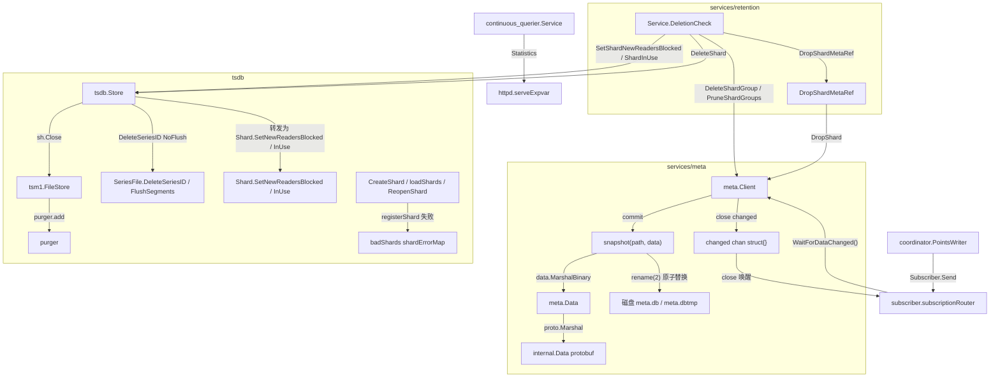
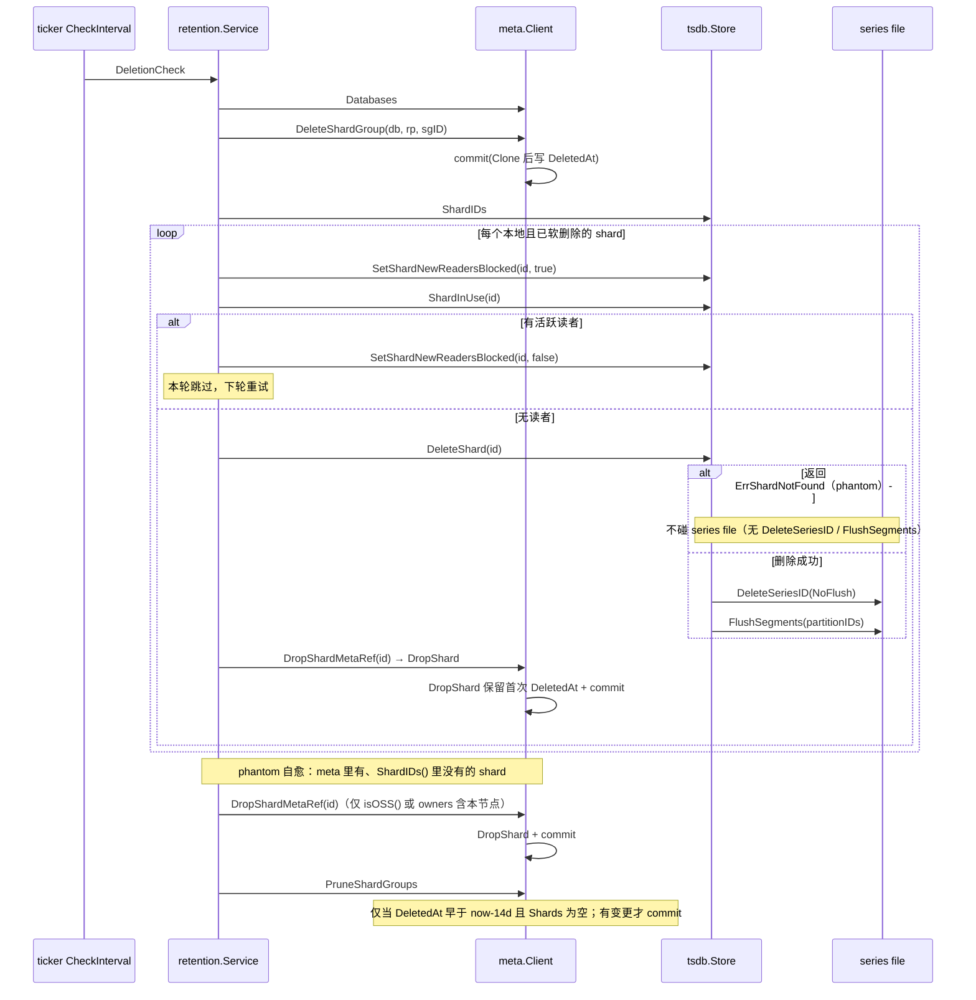

# 版本差异 5: 元数据与后台服务（v1.8.10 → v1.12.3）

> **基线**
> - OLD（旧）: `v1.8.10` = commit `688e697c51`（2021-10-11）
> - NEW（新）: `v1.12.3` = commit `f3d5cb68ab`（本仓库 `docs/specs/` 的代码基准）
> - 区间: 527 commits / 602 files / +79,310 −45,239；当前工作树只比 `f3d5cb68ab` 多 4 个 docs 提交，代码相同。
> - 本文覆盖: `services/meta/*`、`services/retention/*`、`services/continuous_querier/*`、`services/precreator/*`、`services/snapshotter/*`、`services/subscriber/*`、`tsdb/store.go` 的 shard 删除/修剪路径、`tsdb/engine/tsm1/file_store.go` 的 purger、`coordinator` 中与 CQ/RP/写入编排相关的部分。
> - 旧版本证据统一来自 `git show v1.8.10:<path>`；新版本证据来自当前工作树。

> **小白导读**
> 1. **meta 的"户口本"流程没变**：改数据永远是"复印一份 → 在复印件上改 → 整本重新誊写并盖章（fsync+rename）→ 换掉正本 → 按铃通知所有人"。这一套在 v1.8.10 和 v1.12.3 里逐字相同，变的是"复印/誊写"用哪套序列化工具，以及"什么时候允许撕掉一页"。
> 2. **`meta.pb.go` 那 5000 多行 diff 不是重写业务**：它是把代码生成器从 `protoc-gen-gogo` 换成官方 `protoc-gen-go`，消息类型和命令号一个没改，只有 `RetentionPolicySpec`/`RetentionPolicyInfo` 各多了两个 `int64` 字段（写入窗口）。
> 3. **最关键的修复发生在"删除顺序"上**：旧版 retention 是"软删除（写 DeletedAt）→ 尝试删磁盘 → 14 天后无条件修剪"，磁盘删失败也照修；一旦搬家（删磁盘文件）失败或延迟，meta 里已经没有这条记录，磁盘上的 shard 目录就永远没人认领——也就是"孤儿文件"。新版反过来：**先删磁盘、再从 meta 摘掉 shard 引用；meta 里只要还剩 shard，就绝不修剪这个 shard group**。
> 4. **旧版删除大 shard 会"一条 series 一次 fsync"**，几十万 series 时 retention 会看起来像卡死；新版把 fsync 攒到"每个 series-file 分区一次"，并且每删 1 万条打一行进度日志（#27114）。
> 5. **旧版删 shard 可能被"正在读它的查询"永久卡住**，整个 retention 循环停在 `Shard.Close()` 上；新版先"禁止新读者进入"，再检查"还有没有人在读"，有人读就跳过、下轮再来（#25055）。
> 6. **purger 从"一个人拿着大门钥匙锁住整栋楼干活"变成"用带锁的格子柜"**：旧版在整个扫描+关闭+删除期间持有 `purger.mu` 写锁，会把 `FileStore` 的提交路径一起拖住；新版换成 `sync.Map` + 极短临界区。

## 1. 结论速览

| # | 变更点 | v1.8.10 | v1.12.3 | 影响 | 证据 |
|---|--------|---------|---------|------|------|
| 1 | meta 提交骨架 `commit()` | Clone→snapshot→换 cache→`close(changed)` | **逐字未变** | 无 | `v1.8.10:services/meta/client.go:964` / `v1.12.3:services/meta/client.go:948` |
| 2 | meta 落盘 `snapshot()` | tmp→Write→Sync→Close→RenameFile | **逐字未变** | 无 | `v1.8.10:services/meta/client.go:997` / `v1.12.3:services/meta/client.go:981` |
| 3 | Lease | OSS 恒成功、内存对象 | **逐字未变** | 无 | `v1.8.10:services/meta/client.go:128` / `v1.12.3:services/meta/client.go:127` |
| 4 | `meta.pb.go` 生成器 | `protoc-gen-gogo`（2864 行，手写 Marshal） | `protoc-gen-go v1.34.1 / protoc v5.29.2`（4293 行，protoreflect） | 线格式兼容；序列化路径与文件体积变化 | `v1.8.10:services/meta/internal/meta.pb.go:1` / `v1.12.3:services/meta/internal/meta.pb.go:1` |
| 5 | RP 写入窗口字段 | 无 | `FutureWriteLimit=5/7`、`PastWriteLimit=6/8` | 新 SQL 语法、meta.db 新增字段、写路径丢点判定 | `v1.8.10:services/meta/internal/meta.proto:43` / `v1.12.3:services/meta/internal/meta.proto:47` |
| 6 | `CreateShardGroup` 边界 | 直接 `Truncate`，允许重叠 | 与已有 shard group 求差集，保证不重叠 | 同时间戳可能落到不同起止时间的组 | `v1.8.10:services/meta/data.go:358` / `v1.12.3:services/meta/data.go:382` |
| 7 | `DropShard` 的 `DeletedAt` | 每次都覆盖为 `time.Now()` | 保留首次删除时间 | 14 天修剪窗口计时更准 | `v1.8.10:services/meta/data.go:278` / `v1.12.3:services/meta/data.go:299` |
| 8 | `PruneShardGroups` | 14 天后**无条件**删组 | 仅当 `len(Shards)==0` 才删组 | 修复孤儿文件（#24530） | `v1.8.10:services/meta/client.go:682` / `v1.12.3:services/meta/client.go:680` + `services/meta/data.go:482` |
| 9 | `DeleteShard` 不存在时 | 返回 `nil` | 返回 `ErrShardNotFound` | retention 可识别 phantom shard | `v1.8.10:tsdb/store.go:698` / `v1.12.3:tsdb/store.go:978` |
| 10 | `DeleteShard` 索引类型清理 | `defer` 里无条件清（失败也清） | 仅在磁盘删除成功后清 | 统计更准；但见第 7 节风险 | `v1.8.10:tsdb/store.go:733` / `v1.12.3:tsdb/store.go:1139` |
| 11 | 删 series 的 fsync | 每条一次 `segment.Flush()` | `NoFlush` 批处理 + 每分区一次 `FlushSegments` | 大 shard 删除大幅加速（#27114） | `v1.8.10:tsdb/series_partition.go:317` / `v1.12.3:tsdb/series_file.go:211` |
| 12 | retention 删除流程 | 直接 `DeleteShard` | 阻塞新读者→`InUse`→`DeleteShard`→`DropShardMetaRef` | 不再挂死、不再留 phantom | `v1.8.10:services/retention/service.go:134` / `v1.12.3:services/retention/service.go:157` |
| 13 | purger 并发 | `sync.RWMutex` 全程持有 | `gensyncmap.Map` + 短临界区 | 降低 `FileStore` 写入/压缩阻塞 | `v1.8.10:tsdb/engine/tsm1/file_store.go:1376` / `v1.12.3:tsdb/engine/tsm1/file_store.go:1599` |
| 14 | 坏 shard 记忆 | 无（`Store` 无此字段） | `badShards shardErrorMap` | 启动不再对同一 shard 反复 Open | `v1.8.10:tsdb/store.go` 无 `badShards` / `v1.12.3:tsdb/store.go:462` |
| 15 | `DeleteSeries` 锁 | 手工 `RUnlock` 分支 | 闭包 + `defer RUnlock` | 消除 RLock 泄漏（#26647） | `v1.8.10:tsdb/store.go:1302` / `v1.12.3:tsdb/store.go:1657` |
| 16 | CQ 调度 / DST / 写回 | `truncate` + `shouldRunContinuousQuery` | **逐字未变** | CQ 行为不变 | `v1.8.10:services/continuous_querier/service.go:547` / `v1.12.3:services/continuous_querier/service.go:559` |
| 17 | `/debug/vars` 的 `cq` | 整个 `models.Statistic`（含 name/tags） | 只输出 `Values` 扁平 map | 监控解析格式变化（#26874） | `v1.8.10:services/httpd/handler.go:1479` / `v1.12.3:services/httpd/handler.go:2452` |
| 18 | `SHOW RETENTION POLICIES` | 5 列 | 7 列（新增 future/past write limit） | 客户端列解析需适配 | `v1.8.10:coordinator/statement_executor.go:787` / `v1.12.3:coordinator/statement_executor.go:862` |
| 19 | subscriber | `points chan` 直发 + 每订阅 `chanWriter` | `subscriptionRouter` + 字节配额（`total-buffer-bytes`） | 重写；新增配置与 `memUsage` 指标 | `v1.8.10:services/subscriber/service.go:233` / `v1.12.3:services/subscriber/service.go:608` |
| 20 | precreator / snapshotter | — | 无功能变化（仅 `ioutil`→`io`） | 无需迁移 | `git diff v1.8.10 HEAD -- services/precreator` 为空 / `v1.12.3:services/snapshotter/client.go:53` |

## 2. 变更地图





## 3. 逐项差异

### 3.1 meta 状态机骨架：clone-modify-commit / snapshot / changed / lease 全都没变

先给结论，避免读者被 `meta.pb.go` 的巨大 diff 误导：**状态机的控制流在 v1.8.10 与 v1.12.3 之间逐字符相同**。

```go
// v1.8.10:services/meta/client.go:964 — (*Client).commit
// v1.12.3:services/meta/client.go:948 — (*Client).commit
func (c *Client) commit(data *Data) error {
	data.Index++

	// try to write to disk before updating in memory
	if err := snapshot(c.path, data); err != nil {
		return err
	}

	// update in memory
	c.cacheData = data

	// close channels to signal changes
	close(c.changed)
	c.changed = make(chan struct{})

	return nil
}
```

```go
// v1.8.10:services/meta/client.go:997 — snapshot
// v1.12.3:services/meta/client.go:981 — snapshot
filename := filepath.Join(path, metaFile)   // metaFile = "meta.db"
tmpFile := filename + "tmp"                 // <meta>/meta.dbtmp（中间无点）
f, err := os.Create(tmpFile)
if err != nil { return err }
defer f.Close()
d, err := data.MarshalBinary()              // proto.Marshal(data.marshal())
if err != nil { return err }
if _, err := f.Write(d); err != nil { return err }
if err = f.Sync(); err != nil { return err }        // fsync 数据
if err = f.Close(); err != nil { return err }       // 先关句柄以兼容 Windows
return file.RenameFile(tmpFile, filename)           // 原子替换
```

要点：

- **先落盘再更新内存**：`snapshot` 失败时 `commit` 直接返回，`c.cacheData` 保持旧值，调用方拿到 error，内存与磁盘不会分叉。
- **changed 广播是"关通道"而不是"发消息"**：`close(c.changed)` 会唤醒所有 `WaitForDataChanged()` 的等待者，然后立刻换一个新通道。消费者必须在收到信号后**重新取通道**，否则会永远等一个已关闭的通道。
- **Lease 在 OSS 里是空实现**：`AcquireLease` 只返回带过期时间的结构体，永不失败、也永不持久化（`v1.8.10:services/meta/client.go:128` / `v1.12.3:services/meta/client.go:127`，两边函数体一致）。CQ 的 lease 语义因此没有变化。

状态机骨架真正变化的只有四处：`SetData` 的锁（3.7）、`PruneShardGroups` 的判定（3.6）、`Data.CreateShardGroup` 的区间算法（3.4）、`Data.DropShard` 的时间戳（3.5），外加 protobuf 代码生成与两个新字段。

另需注意 `services/meta` 一侧新增的 3 个授权钩子：`AuthorizeCreateDatabase`/`AuthorizeCreateRetentionPolicy`/`AuthorizeDeleteRetentionPolicy`（`v1.12.3:services/meta/query_authorizer.go:138/161/184`），它们是 `/api/v2/buckets` 端点鉴权的基础，详见 06 §3.19。

### 3.2 `meta.pb.go` 的 +3397/−1968 到底是什么

diffstat：`services/meta/internal/meta.pb.go` **+3397 / −1968**（`meta.proto` 另 +5）。文件行数 2864 → 4293。拆开看只有三类内容：

| 类别 | 旧 | 新 | 占比 |
|------|----|----|------|
| 头部/生成器标识 | `// Code generated by protoc-gen-gogo` | `protoc-gen-go v1.34.1` + `protoc v5.29.2` | 极小 |
| 序列化实现 | 每个消息手写 `Marshal`/`MarshalToSizedBuffer`/`Size`/`Unmarshal` | 统一交给 `protoimpl` + 一段 `file_internal_meta_proto_rawDesc` 描述符字节块 | 绝大部分 |
| 字段/访问器 | 无 `GetXxx` 之外的结构差异 | 新增 4 个 `*int64` 字段 + `GetFutureWriteLimit` 等访问器 | 约 40 行 |

验证方式（可直接复现）：把两边所有 `type X struct` 与 `Command_*` 常量抽出来排序比较，**差集为空** —— 消息类型和 `Command_Type` 枚举值一个没增、一个没减：

```go
// v1.8.10:services/meta/internal/meta.pb.go:1
// Code generated by protoc-gen-gogo. DO NOT EDIT.
// source: internal/meta.proto
import (
	fmt "fmt"
	proto "github.com/gogo/protobuf/proto"
	math "math"
)

// v1.12.3:services/meta/internal/meta.pb.go:1
// Code generated by protoc-gen-go. DO NOT EDIT.
// versions:
// 	protoc-gen-go v1.34.1
// 	protoc        v5.29.2
import (
	protoreflect "google.golang.org/protobuf/reflect/protoreflect"
	protoimpl "google.golang.org/protobuf/runtime/protoimpl"
	reflect "reflect"
	sync "sync"
)
```

```go
// v1.12.3:services/meta/internal/meta.pb.go:431 — RetentionPolicySpec
	FutureWriteLimit   *int64  `protobuf:"varint,5,opt,name=FutureWriteLimit" json:"FutureWriteLimit,omitempty"`
	PastWriteLimit     *int64  `protobuf:"varint,6,opt,name=PastWriteLimit" json:"PastWriteLimit,omitempty"`

// v1.12.3:services/meta/internal/meta.pb.go:520 — RetentionPolicyInfo
	FutureWriteLimit   *int64              `protobuf:"varint,7,opt,name=FutureWriteLimit" json:"FutureWriteLimit,omitempty"`
	PastWriteLimit     *int64              `protobuf:"varint,8,opt,name=PastWriteLimit" json:"PastWriteLimit,omitempty"`
```

对应的 `.proto` 增量（旧版完全没有这四个字段）：

```proto
// v1.12.3:services/meta/internal/meta.proto:47
	optional int64 FutureWriteLimit    = 5;
	optional int64 PastWriteLimit      = 6;
// v1.12.3:services/meta/internal/meta.proto:58
	optional int64 FutureWriteLimit = 7;
	optional int64 PastWriteLimit = 8;
```

调用方也跟着换库：

```go
// v1.8.10:services/meta/data.go:14
	"github.com/gogo/protobuf/proto"
//go:generate protoc --gogo_out=. internal/meta.proto

// v1.12.3:services/meta/data.go:20
	"google.golang.org/protobuf/proto"
//go:generate protoc --go_out=./internal internal/meta.proto
```

**语义影响**：
1. **线格式（wire format）不变**：proto2 optional + 相同的 field number 编码规则。旧 `meta.db` 可被新版直接 `proto.Unmarshal`；新版写出的 `meta.db` 中新增的 field 7/8 在旧版里会成为"未知字段"。
2. **未知字段在旧版不会长期保留**：`Data.UnmarshalBinary` 解到 `internal.Data` 后，业务层 `data.unmarshal(&pb)` 把内容搬进 Go 结构体 `RetentionPolicyInfo`（没有写窗口字段），下一次 `commit` 时 `rpi.marshal()` 会**重新构造**一个新的 `internal.RetentionPolicyInfo`，未知字段自然丢失。也就是说：**降级到 v1.8.10 并发生任意一次 meta 提交，写窗口配置会被静默抹掉**（见第 5 节）。
3. **性能路径变了**：gogo 生成的是手写 `MarshalToSizedBuffer`/`Size`，官方生成器走 protoreflect 运行时（带缓存的反射）。meta 每次提交都是**全量序列化**（见 3.1），元数据规模大（数据库/RP/shard group 多）时单次 commit 的 CPU 开销会上升。这是机制推断，仓库内没有基准数据。

### 3.3 RP 写入窗口：新字段、新校验、新 SQL

```go
// v1.8.10:services/meta/data.go:139 — CreateRetentionPolicy 校验
	if rpi.ReplicaN < 1 {
		return ErrReplicationFactorTooLow
	}

// v1.12.3:services/meta/data.go:141 — 新增负值校验
	} else if rpi.PastWriteLimit < 0 || rpi.FutureWriteLimit < 0 {
		return ErrNegativeWriteLimit
	}
```

```go
// v1.12.3:services/meta/errors.go:73
	// ErrNegativeWriteLimit is returned when the FutureWriteLimit or PastWriteLimit is below zero
	ErrNegativeWriteLimit = errors.New("negative write limit")
```

同时 `UpdateRetentionPolicy` 被拆成两层：

```go
// v1.12.3:services/meta/data.go:244 — UpdateRetentionPolicy 只负责查库/查名/设默认
	if err := ApplyRetentionUpdate(rpu, rpi); err != nil {
		return err
	}
	if di.DefaultRetentionPolicy != rpi.Name && makeDefault {
		di.DefaultRetentionPolicy = rpi.Name
	}
	return nil
// v1.12.3:services/meta/data.go:257 — ApplyRetentionUpdate 负责逐字段赋值
```

拆分动机是让 enterprise 复用同一套"字段应用"逻辑（推断；`RetentionPolicyUpdate` 新增 `SetFutureWriteLimit`/`SetPastWriteLimit`）。**OSS 语义与旧版一致，只是多了两个字段**。另外 v2 bucket create 的幂等判定 `RetentionPolicySpec.Matches` 现在也比较写窗口，写窗口不同会返回 `ErrRetentionPolicyConflict`（`v1.12.3:services/meta/data.go:1123-1130`、`services/meta/client.go:241-245`）。

SQL 语法由 influxql 升级带来（`go.mod`：`influxql v1.1.1-0.20200828144457-65d3ef77d385` → `v1.4.1`）：

```
CREATE RETENTION POLICY <rp> ON <db> DURATION <d> REPLICATION <n>
  [SHARD DURATION <d>] [DEFAULT] [FUTURE LIMIT <d>] [PAST LIMIT <d>]

ALTER RETENTION POLICY <rp> ON <db> [DURATION <d>] [REPLICATION <n>]
  [SHARD DURATION <d>] [DEFAULT] [FUTURE LIMIT <d>] [PAST LIMIT <d>]
```

注意关键字是 `FUTURE` / `PAST`（不是 `FUTURE_WRITE_LIMIT`）。旧版 influxql 的 `token.go` 里根本没有这两个 token（`influxql@v1.1.1-0.20200828144457-65d3ef77d385/token.go` 中检索 `FUTURE` 无结果），所以**同一句 SQL 在 v1.8.10 上是语法错误，在 v1.12.3 上合法**。

写入侧如何使用（详见 `[06 Cluster Communication](../06_cluster_communication_spec.md)`），这里只给差异锚点：

```go
// v1.12.3:coordinator/points_writer.go:211 — type WriteWindow
// v1.12.3:coordinator/points_writer.go:237 — (*WriteWindow).WithinWindow
	if w.checkBefore && t.Before(w.before) { return false, w.before, WriteWindowLowerBound }
	if w.checkAfter  && t.After(w.after)   { return false, w.after,  WriteWindowUpperBound }
```

### 3.4 `CreateShardGroup`：从"允许重叠"到"强制不重叠"

旧版只做一次 `Truncate`：

```go
// v1.8.10:services/meta/data.go:358 — CreateShardGroup
	sgi.StartTime = timestamp.Truncate(rpi.ShardGroupDuration).UTC()
	sgi.EndTime = sgi.StartTime.Add(rpi.ShardGroupDuration).UTC()
	if sgi.EndTime.After(time.Unix(0, models.MaxNanoTime)) {
		sgi.EndTime = time.Unix(0, models.MaxNanoTime+1)
	}
```

新版在写入前，与所有**未删除**的 shard group 求差集，把新组的 `[startTime, endTime)` 收缩到不与任何已有组相交：

```go
// v1.12.3:services/meta/data.go:382 — CreateShardGroup
	startTime := timestamp.Truncate(rpi.ShardGroupDuration).UTC()
	endTime := startTime.Add(rpi.ShardGroupDuration).UTC()
	if endTime.After(time.Unix(0, models.MaxNanoTime)) {
		endTime = time.Unix(0, models.MaxNanoTime+1)   // [start,end) 上界钳位，与旧版相同
	}
	for i := range rpi.ShardGroups {
		if rpi.ShardGroups[i].Deleted() { continue }
		startI := rpi.ShardGroups[i].StartTime
		endI := rpi.ShardGroups[i].EndTime
		if rpi.ShardGroups[i].Truncated() { endI = rpi.ShardGroups[i].TruncatedAt }
		if !timestamp.Before(endI) && endI.After(startTime) { startTime = endI }
		if startI.After(timestamp) && startI.Before(endTime)   { endTime = startI }
	}
```

**为什么改**（commit `3c811bcd81 fix: create shards without overlaps (#22601)`）：`sgList.ShardGroupAt` 在 `coordinator/points_writer.go` 里对有序列表做二分查找，一旦 shard group 区间重叠，二分可能返回"第一个 EndTime 更晚的组"，而该组并不包含这个时间点。旧代码在 `ShardGroupAt` 里做了线性回退兜底（这段在 v1.8.10 已存在，本区间未变），但重叠本身会让"同一个时间点到底进哪个组"依赖写入顺序，进而让 retention 的"过期组"边界难以推理。

**语义影响**：
- 新版本的 shard group 可能**短于** `ShardGroupDuration`（例如从 07:00 开始而不是 00:00），`SHOW SHARDS` 里看到的 `start_time` 不再是整齐的整点。
- `CreateShardGroup` 的幂等性判断仍基于 `ShardGroupByTimestamp(timestamp)`，即"该时间点已在某个组里 → 直接返回 nil"，行为未变。

### 3.5 `DropShard`：不要覆盖第一次的 `DeletedAt`

```go
// v1.8.10:services/meta/data.go:295
					if len(shards) == 1 {
						// We just deleted the last shard in the shard group.
						data.Databases[dbidx].RetentionPolicies[rpidx].ShardGroups[sgidx].DeletedAt = time.Now()
					}

// v1.12.3:services/meta/data.go:313
					if len(shards) == 1 {
						// ... make sure we don't overwrite the timestamp if it was already deleted.
						if !data.Databases[dbidx].RetentionPolicies[rpidx].ShardGroups[sgidx].Deleted() {
							data.Databases[dbidx].RetentionPolicies[rpidx].ShardGroups[sgidx].DeletedAt = time.Now()
						}
					}
```

为什么需要这个判断：
- 在 v1.8.10 里，能触发 `DropShard` 的 OSS 路径只有管理员语句 `DROP SHARD <id>`（`v1.8.10:coordinator/statement_executor.go:385`），所以影响面有限（Enterprise 的 `RemoveShardOwner` 是另一条路径）。
- 但在 v1.12.3 的 retention 流程里，**`DeleteShardGroup` 已经先给组打上了 `DeletedAt`**，随后每个 shard 删完都要调一次 `DropShard`（3.13 第 3 阶段）。如果没有这个 `Deleted()` 判断，**组内最后一个 shard 的 `DropShard` 会把 14 天计时重置为"此刻"**，`PruneShardGroups` 就永远等不到窗口。换句话说，3.5 和 3.6 是配套的：没有 3.5，3.6 的新条件会让组记录长期滞留。

### 3.6 `PruneShardGroups`：把"14 天"从"唯一条件"降级为"必要条件"

```go
// v1.8.10:services/meta/client.go:682 — PruneShardGroups
	for i, d := range data.Databases {
		for j, rp := range d.RetentionPolicies {
			var remainingShardGroups []ShardGroupInfo
			for _, sgi := range rp.ShardGroups {
				if sgi.DeletedAt.IsZero() || !expiration.After(sgi.DeletedAt) {
					remainingShardGroups = append(remainingShardGroups, sgi)
					continue
				}
				changed = true      // 只要够 14 天，直接丢弃整组（含未删掉的 shard 引用）
			}
```

```go
// v1.12.3:services/meta/data.go:476 — (*Data).PruneShardGroups
			for _, sgi := range rp.ShardGroups {
				if sgi.DeletedAt.IsZero() || !expiration.After(sgi.DeletedAt) || len(sgi.Shards) > 0 {
					remainingShardGroups = append(remainingShardGroups, sgi)
					continue
				}
				changed = true
			}
```

`expiration` 的算法两边一致：`time.Now().Add(ShardGroupDeletedExpiration)`，而 `ShardGroupDeletedExpiration = -2 * 7 * 24 * time.Hour`（`v1.8.10:services/meta/client.go:36` / `v1.12.3:services/meta/client.go:35`），即 **14 天**。

这正是 `7bd3f89d18 fix: prevent retention service creating orphaned shard files (#24530)` 的核心：

> "This corrects that by requiring shards files be deleted before they can be removed from the meta store."

**旧版的失效链条**：
1. 组到期 → `DeleteShardGroup` 打上 `DeletedAt`（软删除）。
2. retention 尝试 `TSDBStore.DeleteShard(id)`，但 `sh.Close()` 被活跃读者阻塞（见 3.9），或磁盘删除报错。
3. 14 天过去，`PruneShardGroups` **不看 shard 是否删掉**，直接把整组从 meta 移除。
4. 从此 meta 里没有这个 shard，retention 的 `ShardIDs()` 循环永远不会再处理它 → 目录永久残留，磁盘只涨不降。

**新版的顺序**：`DeleteShard` 成功 → `DropShardMetaRef` 把该 shard 从组里摘掉 → 组内 shard 清空后，14 天窗口一到才允许修剪。任何一步失败，组就留在 meta 里，下一轮继续。**代价**是 meta.db 可能长期保留一批"删不掉的组"（见第 7 节）。

### 3.7 `SetData` 的锁泄漏

```go
// v1.8.10:services/meta/client.go:932 — SetData
	c.mu.Lock()

	d := data.Clone()

	if err := c.commit(d); err != nil {
		return err          // <-- 走这里时 c.mu 永久不释放
	}

	c.mu.Unlock()

	return nil

// v1.12.3:services/meta/client.go:917
	c.mu.Lock()
	defer c.mu.Unlock()
```

`SetData` 是**恢复备份**的入口（snapshotter 的 `updateMetaStore` → `ossClient.SetData(&data)`）。旧版只要 `commit` 失败（磁盘满、权限、Windows rename 失败），整个节点的 meta 客户端就死锁：后续任何 `Databases()`（读锁）都会挂住，表现为"节点还活着但所有写入/查询卡死"。该修复来自 `956915296a fix: use defer for unlock (#22929)`（2021-11-24），只改 `services/meta/client.go` 一个文件（+1/−2）。它**没有回移到 1.8 线**：v1.8.10 之后的第一个包含它的 tag 是 v1.10.0，因此不能从任何 1.8.x 补丁版本获得；**运维价值极高**。

### 3.8 `Store.DeleteShard`：六处语义变化

这是整个 shard 生命周期的核心函数。新旧对照（旧 `v1.8.10:tsdb/store.go:698`，新 `v1.12.3:tsdb/store.go:978`）：

**(1) shard 不存在时的返回值**

```go
// v1.8.10:tsdb/store.go:700
	sh := s.Shard(shardID)
	if sh == nil {
		return nil            // "删一个不存在的 shard 不算错"
	}

// v1.12.3:tsdb/store.go:979
	if sh == nil {
		return ErrShardNotFound
	}
```

这一个返回值改变了 retention 的控制流：新版把 `ErrShardNotFound` 当成**"这是 phantom shard，应该去 meta 里摘引用"**的信号（`errors.Is(err, tsdb.ErrShardNotFound)`），而不是当成失败重试。

**(2) 索引类型计数何时递减**

```go
// v1.8.10:tsdb/store.go:727 — defer 里无条件执行
	defer func() {
		s.mu.Lock()
		defer s.mu.Unlock()
		delete(s.epochs, shardID)
		delete(s.pendingShardDeletes, shardID)
		s.databases[db].removeIndexType(sh.IndexType())   // 删除失败也减
	}()

// v1.12.3:tsdb/store.go:1010 — defer 只清 pending/epoch
	defer func() {
		s.mu.Lock()
		defer s.mu.Unlock()
		delete(s.epochs, shardID)
		delete(s.pendingShardDeletes, shardID)
	}()
// v1.12.3:tsdb/store.go:1139 — 只有磁盘删成功才减
	} else {
		// Remove index type from the database on success
		s.databases[db].removeIndexType(sh.IndexType())
		return nil
	}
```

旧版在 `sh.Close()` 失败时也会把 `indexTypes` 减一，导致 `hasMultipleIndexTypes()` 判断错误 —— 而 `DeleteSeries` 遇到 `ErrMultipleIndexTypes` 会直接拒绝删除（`v1.12.3:tsdb/store.go:1687`）。

**(3) 其他 shard 的索引读取失败 → 中止删除**

```go
// v1.8.10:tsdb/store.go:744
	s.walkShards(shards, func(sh *Shard) error {
		index, err := sh.Index()
		if err != nil {
			return err          // 返回值被丢弃，删除继续
		}
		ss.Diff(index.SeriesIDSet())
		return nil
	})
	// 后面直接进入 "从 series file 删除 ss 中的 series"

// v1.12.3:tsdb/store.go:1024
	err = s.walkShards(shards, func(sh *Shard) error {
		index, err := sh.Index()
		if err != nil {
			s.Logger.Error("cannot find shard index", zap.Uint64("shard_id", sh.ID()), zap.Error(err))
			return err
		}
		ss.Diff(index.SeriesIDSet())
		return nil
	})
	if err != nil {
		// We couldn't get the index for a shard. Rather than deleting series which may
		// exist in that shard as well as in the current shard, we stop the current deletion
		return err
	}
```

这是 `8ff06d5a92 fix: improved shard deletion (#24602)` 的内容之一。**旧版的风险是数据不可逆**：如果某个 shard 的索引打不开，它的 series 集合没参与 `Diff`，那些"其实还活着"的 series ID 会被从 series file 里删掉 —— 而 series file 的删除是 tombstone，重新写入会分配新 ID。

**(4) in-mem 索引的 `DropSeriesGlobal` 错误处理**

旧版用一个 `err` 变量，`ForEach` 回调里第一次出错就 `return`（只退出当前回调），后续 series 仍继续删；新版把每个错误收集到 `errs`，最后 `errors.Join` 一起返回，并且对每条失败都打日志（`v1.12.3:tsdb/store.go:1050-1066`，`v1.8.10:tsdb/store.go:772-783`）。

**(5) series file 删除：从"每条一次 fsync"到"批量 + 进度日志"（#27114）**

```go
// v1.8.10:tsdb/store.go:785
			ss.ForEach(func(id uint64) {
				sfile.DeleteSeriesID(id)      // 内部每条都 segment.Flush() → fsync
			})

// v1.12.3:tsdb/store.go:1076
			const DeleteLogTrigger = 10_000
			seriesCount := ss.Cardinality()
			deleteStart := time.Now()
			var deletedCount atomic.Uint64
			var partitionIDs = make(map[int]struct{}, SeriesFilePartitionN)
			ss.ForEach(func(id uint64) {
				p, err := sfile.DeleteSeriesID(id, NoFlush)   // 只写 tombstone，不 fsync
				...
					partitionIDs[p.id] = struct{}{}
					deleted := deletedCount.Add(1)
					if deleted%DeleteLogTrigger == 0 { /* 每 1 万条一行 Info */ }
			})
			if err := sfile.FlushSegments(partitionIDs); err != nil { /* 每个分区一次 fsync */ }
```

**(6) 删除失败时的日志**

旧版 `sh.Close()`/`os.RemoveAll` 的错误直接 `return err`，没有上下文；新版逐层返回，并在 retention 层用 `logger.NewOperation` 包成带 `db/shard/rp` 的 operation（见 3.13）。

### 3.9 新增"读者闸门"：SetNewReadersBlocked / InUse（#25055）

v1.8.10 **完全没有**这套机制。旧版删除 shard 的最后一步是：

```go
// v1.8.10:tsdb/store.go:793 — 关闭前只等 epoch（写）守护者
	guards, gen := epoch.StartWrite()
	defer epoch.EndWrite(gen)
	for _, guard := range guards { guard.Wait() }
	if err := sh.Close(); err != nil { return err }
```

`epochTracker` 只管**写**（写入与 delete-range 的互斥），并不跟踪查询读者。查询持有的 `TSMReader` 引用（`Ref`/`Unref`）会让 `TSMReader.Close()` 等下去（`v1.8.10:tsdb/engine/tsm1/reader.go:364-365` / `v1.12.3:tsdb/engine/tsm1/reader.go:393-394`，两边都是 `refsWG.Wait()`）；只要有一个慢查询或泄漏的 cursor，`sh.Close()` 就永久阻塞 —— 而 retention 是**串行**遍历 `ShardIDs()` 的，整个服务的删除就此停摆（issue #25054："retention service hangs waiting on Shard.Close"）。

新版加了三层闸门：

```go
// v1.12.3:tsdb/engine/tsm1/file_store.go:795 — (*FileStore).SetNewReadersBlocked
	if block {
		if f.newReaderBlockCount < 0 { return fmt.Errorf(...) }
		f.newReaderBlockCount++
	} else {
		if f.newReaderBlockCount <= 0 { return fmt.Errorf(...) }
		f.newReaderBlockCount--
	}

// v1.12.3:tsdb/engine/tsm1/file_store.go:824 — (*FileStore).InUse
	if !f.newReadersBlocked() {
		return false, fmt.Errorf("InUse called without a new reader block for %q", f.dir)
	}
	for _, r := range f.files { if r.InUse() { return true, nil } }
	return false, nil
```

以及 `v1.12.3:tsdb/shard.go:242` / `:249` 的转发、`v1.12.3:tsdb/store.go:957` / `:969` 的 Store 层封装。`KeyCursor` 在闸门关闭时直接返回空 cursor（`v1.12.3:tsdb/engine/tsm1/file_store.go:839`），让查询"看到空数据"而不是报错或挂住。

retention 侧的使用顺序是**先关闸、再看有没有人、没人再删**（`v1.12.3:services/retention/service.go:234-255`）：这既避免"检查完 InUse 之后又来了个读者"的竞态，也保证在有人在读时**立刻放弃并进入下一轮**，不再阻塞其他 shard 的删除。

### 3.10 badShards：记住打不开的 shard，避免反复重试（#23437）

v1.8.10 的 `Store` 里没有 `badShards` 字段（`v1.8.10:tsdb/store.go` 全文检索 `bad` 无命中）。一个 shard 打不开（TSM 校验失败、权限问题）时，`loadShards` 会记录错误，但**每次 `CreateShard`（写入路径遇到 `ErrShardNotFound` 会触发）都会重新尝试打开**，于是日志被"Failed to open shard"刷屏，且每次都要付出打开失败的开销。

```go
// v1.12.3:tsdb/store.go:139 — Store 新增字段
	badShards shardErrorMap
// v1.12.3:tsdb/store.go:462 — newShardLoader 早退
	lastErr, _ := s.badShards.shardError(shardID)
	if lastErr != nil && !l.force {
		l.loadErr = fmt.Errorf("not attempting to open shard %d; %w", shardID, lastErr)
		return l
	}
// v1.12.3:tsdb/store.go:638 — registerShard 记录
	if res.err != nil {
		s.badShards.setShardOpenError(res.s.ID(), res.err)
		return
	}
```

**这份黑名单只在内存里**：重启后清空，符合"磁盘问题可能已被人工修复"的运维预期。配套的 `ClearBadShardList()`（`v1.12.3:tsdb/store.go:788`）允许进程内手动清空，它在 `e8ef25b647 fix: add locking in ClearBadShardList (#26423)` 里补上了 `badShards.mu`：旧实现清空 `shardErrors` 时未持 `badShards.mu`，与 `setShardOpenError`/`shardError`（持 `badShards.mu`）并发访问同一 map，构成数据竞争。

顺带一条可观测性改进：`3c87f524ed` (#25378) 新增启动进度计数（已打开/总数/百分比，`v1.12.3:tsdb/store.go:154/195/562/599`）；日志里的 `Opened shard ... duration` 旧版已有（`v1.8.10:tsdb/store.go:412`），不是新增。

### 3.11 `DeleteSeries`：锁、RP 过滤与并发度

```go
// v1.8.10:tsdb/store.go:1330 — 手工 RUnlock，三条返回路径各写一次
	s.mu.RLock()
	if s.databases[database].hasMultipleIndexTypes() {
		s.mu.RUnlock()
		return ErrMultipleIndexTypes
	}
	sfile := s.sfiles[database]
	if sfile == nil {
		s.mu.RUnlock()
		return nil
	}
	...
	s.mu.RUnlock()

// v1.12.3:tsdb/store.go:1684 — 闭包 + defer
	getEpochsAndShards := func() (error, []*Shard, map[uint64]*epochTracker, *SeriesFile) {
		s.mu.RLock()
		defer s.mu.RUnlock()
		...
	}
```

同类的第二个问题在引擎层：v1.8.10 的 `Engine.deleteSeriesRange` 对 `seriesKeys` 切片**没有加锁**（并发删除时存在 data race）；`1bc0eb4795 fix(tsm1): Fix data race of seriesKeys in deleteSeriesRange (#25268)` 引入 `seriesKeysLock` 修掉竞态，却把 `RUnlock` 漏在一条 `return nil` 路径上（读锁泄漏会阻塞后续写锁与 `FileStore.Apply`，把 DELETE 和 compaction 一起拖住）；`81b42fd344 (#26658)` 再用闭包 + `defer RUnlock` 修正。这一小块在区间内经历了"无锁 → 泄漏的锁 → 正确的锁"两次改动，v1.12.3 是最终正确形态（`v1.12.3:tsdb/engine/tsm1/engine.go:1720-1721`）。

`21ab48416e fix: Resolves RLock() leakage in Store.DeleteSeries() (#26647)` 修的是一个**区间内引入又修掉**的回归：v1.8.10 的手工加解锁路径是平衡的（`RLock` 之后的三条返回路径都显式 `RUnlock`），但 `8eaa24d813 (#25312)` 在临界区里新增了"RP 混用 / source 类型不支持 / 按 RP 过滤"等分支，这些新增的错误返回**没有 `RUnlock`**。一次失败的 `DROP SERIES`（例如同时写了两个不同 RP 的 measurement）就能把 `Store.mu` 的读锁永久占住，后续任何写锁请求（建 shard、删 shard、压缩回调）都会挂死。`21ab48416e` 把整个临界区收进闭包并 `defer RUnlock`，从结构上消除这一类问题（`v1.12.3:tsdb/store.go:1684-1688`）。

另外两处行为变化：
- **按 RP 过滤**（`8eaa24d813 feat(tsm): Allow for deletion of series outside default rp (#25312)`）：`shardFilterFn = ComposeShardFilter(byDatabase(database), byRetentionPolicy(rp))`（`v1.12.3:tsdb/store.go:1714`）。旧版 `DELETE FROM db.rp.measurement` 会扫该 DB 下**所有** RP 的 shard。
- **并发度可配**（`eb3bc7069f feat: configurable DELETE concurrency (#23055)`）：`limiter.NewFixed(1)` → `limiter.NewFixed(s.EngineOptions.Config.MaxConcurrentDeletes)`（`v1.8.10:tsdb/store.go:1347` / `v1.12.3:tsdb/store.go:1732`），默认仍为 1（`tsdb/config.go:75`）。

### 3.12 purger 重写：从"全局写锁"到 sync.Map（#27146 / #26762）

旧版（`v1.8.10:tsdb/engine/tsm1/file_store.go:1376`）：

```go
type purger struct {
	mu        sync.RWMutex
	fileStore *FileStore
	files     map[string]TSMFile
	running   bool
	logger    *zap.Logger
}

func (p *purger) add(files []TSMFile) {
	p.mu.Lock()
	for _, f := range files { p.files[f.Path()] = f }
	p.mu.Unlock()
	p.purge()
}

func (p *purger) purge() {
	p.mu.Lock()                       // 进入 goroutine 前先占锁置位
	if p.running { p.mu.Unlock(); return }
	p.running = true
	p.mu.Unlock()
	go func() {
		for {
			p.mu.Lock()                       // 整个扫描 + Close + Remove 都在写锁内
			for k, v := range p.files {
				if !v.InUse() {
					if err := v.Close(); err != nil {
						p.logger.Info("Purge: close file", zap.Error(err))
						continue              // 保留在 map 里，1 秒后重试，日志无限刷
					}
					if err := v.Remove(); err != nil {
						p.logger.Info("Purge: remove file", zap.Error(err))
						continue
					}
					delete(p.files, k)
				}
			}
			if len(p.files) == 0 { p.running = false; p.mu.Unlock(); return }
			p.mu.Unlock()
			time.Sleep(time.Second)
		}
	}()
}
```

新版（`v1.12.3:tsdb/engine/tsm1/file_store.go:1599`）：

```go
type purger struct {
	files   gensyncmap.Map[string, TSMFile]   // sync.Map 泛型封装
	mu      sync.Mutex                        // 只保护 running
	running bool
	logger  *zap.Logger
}

func (p *purger) add(files []TSMFile) {
	if len(files) == 0 { return }             // #26762：空批直接返回
	var fileNames []string
	for _, f := range files {
		fileName := f.Path()
		fileNames = append(fileNames, fileName)
		p.files.Store(fileName, f)
	}
	p.purge(fileNames)
}

func (p *purger) purge(fileNames []string) {
	p.mu.Lock(); defer p.mu.Unlock()
	if p.running { /* 已在跑，文件已入 map，直接返回 */ return }
	p.running = true
	go func() {
		for p.hasFiles() {                    // hasFiles 在锁内顺手把 running 置为 false
			p.files.Range(func(k string, v TSMFile) bool {
				if !v.InUse() {
					if err := v.Close(); err != nil { failCount++ }
					else if err := v.Remove(); err != nil { failCount++ }
					else { purgeCount++ }
					p.files.Delete(k)         // 成功失败都删，不再重试
				}
				return true
			})
			time.Sleep(time.Second)
		}
	}()
}
```

关键差异：

| 维度 | v1.8.10 | v1.12.3 | 影响 |
|------|---------|---------|------|
| 并发保护 | 一个 `RWMutex` 覆盖"遍历 + InUse + Close + Remove" | `sync.Map` 无锁遍历，`mu` 只保护 `running` | 不再阻塞 `FileStore` 的提交/读路径 |
| 失败处理 | `continue` → 留在 map，每秒重试并 `Info` 打日志 | 从 map 删除，`failCount++`，结束时一行 `Warn` | 消除无限日志与无效重试 |
| 空批次 | 每次 compaction 都开 operation 日志 | `len(files)==0` 直接返回 | 降日志噪声 |
| 日志级别 | 失败 `Info`，无成功日志 | 失败 `Error`，成功 `Debug`，汇总 `Info/Warn` | 可观测性更好 |
| 退出条件 | `len(files)==0` 时在锁内置 `running=false` | `hasFiles()` 在锁内检查并置位 | 消除 `add` 与 goroutine 退出之间的竞态 |

注意 `gensyncmap.Map` 是仓库内新增的泛型 `sync.Map` 封装（`pkg/data/gensyncmap`），属于 Go 1.18+ 泛型化的配套改造。

### 3.13 retention 服务：从"一次遍历"到"四阶段 + phantom 自愈"

旧版 `run()` 的 tick 分支一次性做完四件事（`v1.8.10:services/retention/service.go:74`）：收集已删除组 → 收集到期组并 `DeleteShardGroup` → 对本地 shard 调 `DeleteShard` → `PruneShardGroups`。错误只用 `retryNeeded` 汇总；任一 shard 删除失败不会中断循环，但任一 `Shard.Close()` **卡住**就会冻结整个 tick（3.9）。

新版把这套逻辑抽成 `DeletionCheck()`（`v1.12.3:services/retention/service.go:157`），并拆成四个明确的阶段：

| 阶段 | 旧 | 新 | 证据 |
|------|----|----|------|
| 1. 标记到期组 | `DeleteShardGroup` + `log.Info` | 同左，但包在 `logger.NewOperation("Deleting expired shard group")` 里 | `v1.12.3:services/retention/service.go:196` |
| 2. 本地删除 | `DeleteShard(id)` | `SetShardNewReadersBlocked(true)` → `ShardInUse` → `DeleteShard` | `v1.12.3:services/retention/service.go:234-259` |
| 3. 摘 meta 引用 | **不存在** | `DropShardMetaRef(id, owners)` | `v1.12.3:services/retention/service.go:271-281` |
| 4. phantom 清理 | **不存在** | 对"meta 里有、本地没有"的 shard 也调 `DropShardMetaRef` | `v1.12.3:services/retention/service.go:283-301` |

若干实现细节值得注意：

- **接口被拆成 OSS/Enterprise 两套**：`OSSMetaClient`（`Databases/DeleteShardGroup/DropShard/PruneShardGroups`）与 `MetaClient`（额外 `NodeID()`）。OSS 用 `ossMetaClientAdapter` 返回特殊值 `ossNodeID = math.MaxUint64`（`v1.12.3:services/retention/service.go:34`），`isOSS()` 据此判断"本地没有的 shard 一定是 phantom"。Enterprise 只有在 `slices.Contains(owners, NodeID())` 时才认为是自己的 phantom —— 这就是 `c168cc5aca fix: stop noisy logging about phantom shards that do not belong to node (#26527)` 修的东西：**旧版在集群里会把属于别的节点的 shard 也当成本地 phantom 反复告警**。
- **`Open()` 增加前置校验**：`DropShardMetaRef == nil` 直接返回错误（`v1.12.3:services/retention/service.go:107`），避免"服务启动了但永远不会摘 meta 引用"的静默失效。
- **错误处理更细**：`DeleteShard` 返回 `ErrShardNotFound` 时**继续**去 `DropShardMetaRef`（phantom 路径）；其他错误才 `retryNeeded = true` 并在下一轮重试。被 `InUse` 跳过的 shard 也在下一轮重试，且**不会**被误判为 phantom（`delete(deletedShardIDs, id)` 发生在错误判断之前，`v1.12.3:services/retention/service.go:219`）。

### 3.14 #27114 到底改了什么：把"每条 series 一次 fsync"改成"每分区一次 fsync"

这条 PR 的标题是 "Logging and fsync delay for retention deletion"，但它**没有改 `services/retention/service.go` 一行**，改的是 retention 调用的那条删除链路（`tsdb/store.go`、`tsdb/series_file.go`、`tsdb/series_partition.go`、`tsdb/engine/tsm1/engine.go`）。

**(1) `DeleteSeriesID` 增加 `flush` 参数**

```go
// v1.8.10:tsdb/series_partition.go:317
func (p *SeriesPartition) DeleteSeriesID(id uint64) error {
	...
	// Write tombstone entry.
	_, err := p.writeLogEntry(AppendSeriesEntry(nil, SeriesEntryTombstoneFlag, id, nil))
	if err != nil { return err }

	// Flush active segment write.
	if segment := p.activeSegment(); segment != nil {
		if err := segment.Flush(); err != nil { return err }   // 每条一次 fsync
	}
	p.index.Delete(id)
	return nil
}

// v1.12.3:tsdb/series_partition.go:334
func (p *SeriesPartition) DeleteSeriesID(id uint64, flush bool) error {
	...
	if flush {
		if segment := p.activeSegment(); segment != nil {
			if err := segment.Flush(); err != nil {
				return fmt.Errorf("unable to flush segment %s: %w", segment.file.Name(), err)
			}
		}
	}
	p.index.Delete(id)
	return nil
}
```

**(2) 新增批量刷盘入口**

```go
// v1.12.3:tsdb/series_file.go:34
	// Flush lets us know when to fsync
	Flush = true
	// NoFlush lets us know when to not fsync
	NoFlush = false

// v1.12.3:tsdb/series_file.go:203
func (f *SeriesFile) DeleteSeriesID(id uint64, flush bool) (*SeriesPartition, error) {
	p := f.SeriesIDPartition(id)
	if p == nil { return nil, ErrInvalidSeriesPartitionID }
	return p, p.DeleteSeriesID(id, flush)
}

// v1.12.3:tsdb/series_file.go:211
func (f *SeriesFile) FlushSegments(partitionIDs map[int]struct{}) error {
	// 每个分区一个 goroutine：p.mu.Lock() → segment.Flush() → Unlock
	// 错误收集到 errCh，最后 errors.Join
}
```

**(3) 两处生产调用方改成"先 NoFlush、最后统一 FlushSegments"，另有一处测试调用**

- `Store.DeleteShard`：`v1.12.3:tsdb/store.go:1083` + `:1108`
- `Engine.deleteSeriesRange`（DELETE / DROP SERIES）：`v1.12.3:tsdb/engine/tsm1/engine.go:1858` + `:1878`
- `#27114` 同时把 `influx_inspect verify` 的**测试**调用改为 `tsdb.Flush`；生产侧只有 `Store.DeleteShard` 与 `Engine.deleteSeriesRange` 两条删除路径，均改为 `NoFlush` + `FlushSegments`

**(4) 附带日志**

- 每 10,000 条：`DeleteShard: 10000 series deleted`，字段含 `db/shard_id/deleted/remaining/total/elapsed`（`v1.12.3:tsdb/store.go:1095`）。
- 每条失败：`cannot delete series in shard`，含 `series_id/shard_id/series_file_path`（`v1.12.3:tsdb/store.go:1084-1092`）。旧版**完全忽略** `sfile.DeleteSeriesID(id)` 的返回值。
- 分区刷盘失败：`error while flushing a series file segment`（`v1.12.3:tsdb/store.go:1110`）。

**收益机制**（不编数字）：旧成本 ≈ `N_series × fsync`；新成本 ≈ `min(N_series, 8) × fsync`（`SeriesFilePartitionN = 8`，`tsdb/series_file.go:32`）+ `N_series` 次内存写入。当 shard 含百万级 series 时，这是数量级差异，也是"retention 看起来卡住"的直接原因之一。`Engine.deleteSeriesRange` 同理，影响 `DELETE FROM` / `DROP SERIES` 的响应时间。

### 3.15 CQ：调度、DST、写回语义**没有**变化

`services/continuous_querier/service.go` 在本区间的净变化只有 **+13 / −1 行**（`git diff --numstat v1.8.10 HEAD`）：一个 `Diagnostics()` 桩函数 + 一个 import + 一处 `cq_query` 写失败日志。逐项确认：

| 关注点 | v1.8.10 | v1.12.3 | 结论 |
|--------|---------|---------|------|
| `truncate()`（自定义周起点/DST 修正） | `service.go:550` | `service.go:562` | 函数体逐字未变 |
| `zone()` / `abs()` | `service.go:569/574` | `service.go:581/586` | 未变 |
| `shouldRunContinuousQuery`（EVERY/FOR 判定） | `service.go:500` | `service.go:512` | 未变 |
| `ExecuteContinuousQuery` 的 `LastRun` 计算 | `service.go:331` | `service.go:338` | 未变 |
| `startTime`/`endTime` 窗口 | `service.go:352-353` | `service.go:359-360` | 未变 |
| `AcquireLease` 调用 | `service.go:223/232` | `service.go:230/239`（同结构） | 未变（OSS 恒成功） |

> 关于 DST：`d60741b506 fix: GROUP BY queries with offset that crosses a DST boundary fail (#25082)` 修的是**查询引擎**里 `GROUP BY time(1d) offset` 的窗口计算，不在 CQ 服务里。CQ 的窗口截断仍是基于 Unix 时间戳的 `truncate()`，与 v1.8.10 一致。详见 `[05 Downsampling](../05_downsampling_spec.md)`。

新增内容只有两块：

```go
// v1.12.3:services/continuous_querier/service.go:175
// Required for Monitor interface. Currently does not return any
// diagnostic values.
func (s *Service) Diagnostics() (*diagnostics.Diagnostics, error) {
	return &diagnostics.Diagnostics{}, nil
}

// v1.12.3:services/continuous_querier/service.go:423
		if err := s.Monitor.WritePoints(models.Points{p}); err != nil {
			log.Error("failed storing continuous query statistics",
				zap.String("name", cq.Info.Name), logger.Database(cq.Database), zap.Error(err))
		}
```

后者来自 `bfccddc7b6 fix: log errors in continuous query statistics storage (#23822)`：旧版 `s.Monitor.WritePoints(models.Points{p})` 的返回值被直接丢弃，`cq_query` 统计写失败时无任何痕迹。

`Diagnostics()` 是 `monitor.Monitor` 注册服务的必要条件（`monitor/service.go` 在 `f75be56eee` 中同步改动），**它返回空诊断**，真正的 CQ 数据走 `Statistics()`。

#### `/debug/vars` 里的 `cq`（#26874）

```go
// v1.12.3:services/httpd/handler.go:2452
		if s.Name == "cq" {
			jv, err := parseCQStatistics(&s.Statistic)   // 直接返回 s.Values
			...
			_, err = fmt.Fprintf(w, "\"cq\": %s", data)
			continue
		}
```

旧版没有这个分支，`cq` 走通用路径：`json.Marshal(models.Statistic)` 后以 `"cq": {...}` 输出，内容是 `{"name":"cq","tags":{},"values":{...}}`。新版只输出 `values` 本身：

```json
// v1.8.10
"cq": {"name":"cq","tags":{},"values":{"queryOk":12,"queryFail":0}}
// v1.12.3
"cq": {"queryOk":12,"queryFail":0}
```

`cq` 只有 `queryOk` / `queryFail` 两个键（`v1.12.3:services/continuous_querier/service.go:34-35`），没有 `queryOK`（大写 K），也没有 `QueryDurationNs` 之类的耗时字段。监控脚本若按 `.cq.values.queryOk` 取值，升级后要改为 `.cq.queryOk`；按 `.cq.values.queryOK` 取值在两版都取不到。

另外 `SHOW CONTINUOUS QUERIES` 增加了库级鉴权（`71b3d06494 fix: require database authorization to see continuous queries (#22283)`）：

```go
// v1.8.10:coordinator/statement_executor.go:648
func (e *StatementExecutor) executeShowContinuousQueriesStatement(stmt *influxql.ShowContinuousQueriesStatement) (models.Rows, error) {
	dis := e.MetaClient.Databases()
	for _, di := range dis { /* 全部返回 */ }

// v1.12.3:coordinator/statement_executor.go:654
func (e *StatementExecutor) executeShowContinuousQueriesStatement(ctx *query.ExecutionContext, stmt *influxql.ShowContinuousQueriesStatement) (models.Rows, error) {
	dis := e.MetaClient.Databases()
	a := ctx.ExecutionOptions.CoarseAuthorizer
	for _, di := range dis {
		if a.AuthorizeDatabase(influxql.ReadPrivilege, di.Name) || a.AuthorizeDatabase(influxql.WritePrivilege, di.Name) { ... }
	}
```

非管理员用户升级后会**看不到**自己无权限的库里的 CQ —— 这是有意的安全修复，但会改变既有脚本的输出。

> 附注：`CreateContinuousQuery` 的名称比较在本区间改为大小写不敏感（`strings.EqualFold`，`2529799abb`，`v1.12.3:services/meta/data.go:507`）。

### 3.16 snapshotter / precreator / subscriber

**snapshotter：没有功能变化。** 全区间改动只有 `ioutil.ReadAll` → `io.ReadAll`、注释里的空 `//` 行，以及测试里 `tcp.NewMux(tcp.MuxLogger(os.Stderr))`。

- **IDMap 握手未变**：`respondIDMap` 仍是 `[BackupMagicHeader(8) + npairs(8)]` 头部，再写 `(from,to)` 对（`v1.8.10:services/snapshotter/service.go:249` / `v1.12.3:services/snapshotter/service.go:249`，行号与实现均未动）。
- **备份路径未变**：`writeMetaStore` 仍调用 `MetaClient.MarshalBinary()` 取 `meta.db` 的 protobuf 字节，按 `[BackupMagicHeader(8) | len(metaBlob)(8)] | metaBlob | len(nodeJSON)(8) | nodeJSON` 的顺序写出（`v1.12.3:services/snapshotter/service.go:267-301`，与 v1.8.10 相同）。因为 3.2 的 wire format 兼容，**旧版本备份可以被新版本恢复**。
- **恢复路径未变**：`updateMetaStore` → `meta.Data.UnmarshalBinary` → `ImportData` → `SetData` → `createNewDBShards` → `respondIDMap(IDMap)`（`v1.12.3:services/snapshotter/service.go:181-221`）。失败语义分两类：解码失败、非 OSS 客户端、`ImportData` 失败会**先回一个空 IDMap** 再返回错误（`:185/:193/:203`）；`SetData` 与 `createNewDBShards` 失败则**不发任何响应**、直接返回错误（`:209-217`），客户端只能从连接关闭判错；只有全部成功才回 IDMap。`ImportData`/`importOneDB` 在区间内**没有改动**，因此恢复出来的 RP 会带上备份文件里的写窗口字段（如果有）；但从 v1.8.10 备份恢复到 v1.12.3 时字段为 0（不限制）。

**precreator：零改动。** `git diff v1.8.10 HEAD -- services/precreator` 为空。

**subscriber：整体重写（虽然不在本题主线，但它是 meta 变更的主要消费者，必须交代）。**

| 维度 | v1.8.10 | v1.12.3 |
|------|---------|---------|
| 数据入口 | `Service.Points() chan<- *WritePointsRequest`（`service.go:228`），由 `PointsWriter.subPoints` 直接投递 | `Service.Send(*WritePointsRequest)` → `subscriptionRouter.Send`（`service.go:608`） |
| 分发 | `run()` 单 goroutine 遍历所有订阅，按 `db/rp` 匹配 | `subscriptionRouter` 维护 `map[dbrp][]*chanWriter`（`service.go:586`），读锁内只做一次查表 |
| 背压 | 只有 `WriteBufferSize` 条数上限；`run()` 里 channel 满 → `WriteFailures++`（不打日志），`PointsWriter` 投递到 `s.points` 失败 → `SubWriteDrop++` | 条数上限 + **字节上限** `TotalBufferBytes`（新配置，`config.go:49`）；两种丢弃都计 `WriteFailures` 并打 `Warn`（`service.go:449`）；`SubWriteDrop` 指标被删除 |
| 序列化 | `coordinator.WritePointsRequest.Points`（`models.Point` 切片）逐个 `p.String()` | **一次**把整批 points 拼成 line protocol（`NewWriteRequest`，`service.go:42`），HTTP 走 `WriteRawCtx` |
| 点校验 | 无 | `models.ValidPointStrings` 过滤非法点（#21558 非 UTF-8 修复的上游），计入 `writeFailures` |
| 关闭 | `close(s.points)` + `close(s.closing)` | `router.Close()` + `close(s.closing)` + `wg.Wait()` + 逐个 `cw.Close()`，可重复调用（`CancelAndClose()` 只用于退订，`service.go:387/478`） |
| 指标 | `pointsWritten/writeFailures/createFailures` | 新增 `memUsage`（`service.go:250`） |
| 写失败日志 | `c.logger.Info(err.Error())` | `Write failed` 来自 `d2f874b411`；`Write rejected, queue over byte limit` / `queue full` 来自 `eea87ba94c` (#25589) |

注意：`PointsWriter` 侧的 `SubWriteDrop` 统计被**删除**（`statSubWriteDrop` 在 v1.12.3 已不存在），丢弃计数改由 subscriber 自己的 `writeFailures` 承担。

## 4. 优化与收益

| # | 优化 | 机制 | Commit / PR | 证据 |
|---|------|------|-------------|------|
| 1 | retention 不再被慢查询卡死 | 读者闸门 + `InUse` 轮询 + 跳过而非等待 | `b4bd607eef` (#25055) | `v1.12.3:services/retention/service.go:234-255` |
| 2 | 大 shard 删除从 O(N) 次 fsync 降到 O(1) 次/分区 | `NoFlush` tombstone + `FlushSegments` 并行刷 8 个分区 | `1420aaf2bc` (#27114/#27129) | `v1.12.3:tsdb/series_file.go:211`、`tsdb/store.go:1108` |
| 3 | 删除过程可观测 | 每 1 万条一条 Info（含 remaining/total/elapsed），每条失败带 series_id | `1420aaf2bc` | `v1.12.3:tsdb/store.go:1095` |
| 4 | 不再产生孤儿 shard 文件 | meta 修剪前要求 `len(Shards)==0`；每个 shard 删完立即 `DropShard` | `7bd3f89d18` (#24530) | `v1.12.3:services/meta/data.go:476` |
| 5 | phantom shard 自愈 | "meta 有、本地无"的过期 shard 直接摘引用 | `7bd3f89d18` + `c168cc5aca` (#26527) | `v1.12.3:services/retention/service.go:283` |
| 6 | 集群 phantom 告警降噪 | `DeletionCheck` 返回后按 `owners` 过滤，只有本节点拥有的才算 phantom | `c168cc5aca` | `v1.12.3:services/retention/service.go:153/288` |
| 7 | purger 不再阻塞 FileStore | `sync.Map` 取代覆盖全流程的 `RWMutex` | `d5a48e0662` (#27146/#27177) | `v1.12.3:tsdb/engine/tsm1/file_store.go:1599` |
| 8 | purger 日志与无效重试 | 空批次早退（`e883e8bec3` #26762）；失败即出队、汇总 `Warn`（`d5a48e0662` #27146） | `e883e8bec3`、`d5a48e0662` | `v1.12.3:tsdb/engine/tsm1/file_store.go:1607` |
| 9 | 消除 `DeleteSeries` 的 RLock 泄漏 | 闭包 + `defer s.mu.RUnlock()` | `21ab48416e` (#26647/#26852) | `v1.12.3:tsdb/store.go:1684` |
| 10 | `deleteSeriesRange` 的 seriesKeys 竞态与 RLock 泄漏 | 先加锁修 data race（#25268），再修泄漏（#26658）：闭包 + `defer RUnlock` | `1bc0eb4795` / `81b42fd344` | `v1.12.3:tsdb/engine/tsm1/engine.go:1720-1721` |
| 11 | `SetData` 死锁修复 | `defer c.mu.Unlock()` | `956915296a` (#22929)；未回移 1.8 线 | `v1.12.3:services/meta/client.go:917` |
| 12 | 坏 shard 不反复重试 | `badShards` 内存黑名单 | `54ac7e54ed` (#23437) | `v1.12.3:tsdb/store.go:462/638` |
| 13 | `ClearBadShardList` 数据竞争 | 补 `badShards.mu` | `e8ef25b647` (#26423/#26831) | `v1.12.3:tsdb/store.go:792` |
| 14 | shard group 不重叠 | 与现有组求差集 | `3c811bcd81` (#22601) | `v1.12.3:services/meta/data.go:403-421` |
| 15 | 启动进度可见 | `StartupProgress` 已打开/总数/百分比（打开耗时旧版已有） | `3c87f524ed` (#25378) | `v1.12.3:tsdb/store.go:562/599` |
| 16 | DELETE 并发可调 | `MaxConcurrentDeletes`（默认仍 1） | `eb3bc7069f` (#23055) | `v1.12.3:tsdb/config.go:75/170` |
| 17 | 写入热路径减负 | subscriber 每批只序列化一次 line protocol；路由查表 O(1) | subscriber 重写 | `v1.12.3:services/subscriber/service.go:42/608` |
| 18 | 订阅内存可封顶 | `total-buffer-bytes` 按订阅数均分，超限丢弃并告警 | #21752 系列 | `v1.12.3:services/subscriber/service.go:372/449` |
| 19 | 恢复备份不再死锁 | 见 #11 | — | `v1.12.3:services/meta/client.go:917` |

**没有基准数据的地方只描述机制**：仓库里没有 `retention deletion` 或 `purger` 的 benchmark。可以确定的是复杂度层面的变化（fsync 次数从 O(N) → O(分区数)、锁持有时长从 O(文件数) → O(1)），而不是具体百分比。

## 5. 行为变化与兼容性

### 5.1 升级会不会坏：逐项判断

| 变更 | 升级后会发生什么 | 破坏性 |
|------|------------------|--------|
| `meta.db` 格式（3.2） | 旧文件可直接读；新文件多出 field 7/8 | 否 |
| **降级**到 v1.8.10 | 写窗口字段在第一次 meta 提交后丢失（`unmarshal`→`marshal` 重建） | 是（仅新特性） |
| `SHOW RETENTION POLICIES` | 输出从 5 列变 7 列：`name,duration,shardGroupDuration,replicaN,`**`futureWriteLimit,pastWriteLimit,`**`default`（`v1.12.3:coordinator/statement_executor.go:862` / 旧 `:787`） | 是（按列号解析的客户端） |
| `SHOW SHARDS` 的 `expiry_time` | 无限保留（`Duration==0`）的 RP 由"打印 EndTime 本身"变为空字符串（`v1.12.3:coordinator/statement_executor.go:896` / `v1.8.10:coordinator/statement_executor.go:821`，#21795） | 轻微 |
| shard group 起止时间 | 不再总是 `duration` 的整数倍（3.4） | 轻微（依赖整点假设的脚本） |
| partial write 错误文本 | 追加 ` for database: X for retention policy: Y`（`v1.12.3:tsdb/shard.go:131-140` / 旧 `113-123`），原因文本也从固定 `points beyond retention policy` 变为 `dropped N points outside retention policy of duration ... [and M points outside write window (...)]` | 是（正则/字符串匹配） |
| `/debug/vars` 的 `cq` | 从 `{"name","tags","values"}` 变为扁平的 values（3.15）；字段集合不变（queryOk/queryFail），只去掉 name/tags 包装 | 是（监控面板） |
| `subWriteDrop` 指标 | `coordinator` 不再输出该字段（`v1.12.3:coordinator/points_writer.go` 中 `statSubWriteDrop` 已删除） | 是（监控面板） |
| `SHOW CONTINUOUS QUERIES` | 非管理员只能看到自己有权限的库 | 是（有意的安全修复） |
| `SHOW MEASUREMENTS ON *.*` / `ON db.*` | 支持通配；输出多出 `database`、`retention policy` 两列（`v1.12.3:coordinator/statement_executor.go:732-800`） | 轻微 |
| `FUTURE` / `PAST` 成为 SQL 关键字 | `CREATE/ALTER RETENTION POLICY` 支持 `FUTURE LIMIT` / `PAST LIMIT`；理论上影响把 `future`/`past` 当 measurement 名的写法（**待核实**，未做端到端验证） | 待核实 |
| retention 服务 `Open()` | 若嵌入式调用未设置 `DropShardMetaRef`，**启动直接报错**（`v1.12.3:services/retention/service.go:107`） | 是（仅嵌入式/企业集成） |
| 订阅配置 | 新增 `total-buffer-bytes`，默认 0 = 不限制，行为与旧版一致 | 否（默认兼容） |
| 已软删除组的修剪时机 | 从"14 天到点就删"变成"14 天且 shard 全部删完" | 否（更安全，但见风险） |

### 5.2 运维视角的变化

1. **磁盘回收更快**：以前"retention 卡住 → 老数据不删 → 磁盘涨"的两个根因（`Shard.Close` 阻塞、14 天无条件修剪）都被处理；现在会看到 `retention_delete_shard` 的 operation 日志，能直接看到"哪个 shard 因为 in-use 被跳过"。
2. **`meta.db` 可能变大**：写窗口字段让每个 RP 多写 4 字节（field 7/8 即使为 0 也会被 `proto.Int64(0)` 显式写入，`v1.12.3:services/meta/data.go:1301-1308`），而且"删不掉的组"会长期留在 meta 里。大集群应关注 `meta.db` 体积与提交延迟。
3. **新增日志关键字**：`Drop phantom shard references`、`Expired phantom shard detected during retention check`、`can not delete an in-use shard`、`group's shards will be removed from local storage if found`（注意最后这条有 bug，见 7.3）。
4. **不再有 `Purge: close file` / `Purge: remove file` 的 Info 刷屏**：改为结束时一行 `failed to remove` 的 Warn。

## 6. 具体案例

### 6.1 案例一：retention 删除一个过期 shard（新旧对照）

**场景**（时间均为 UTC）：

- DB `telegraf`，RP `autogen`，`DURATION 7d`，`ShardGroupDuration = 24h`
- ShardGroup `100`：`[2026-10-01T00:00Z, 2026-10-02T00:00Z)`，组内唯一 shard `500`
- 本地磁盘：`<data>/telegraf/autogen/500/`（TSM）与 `<wal>/telegraf/autogen/500/`（WAL）
- 当前时间 `2026-10-10T00:30Z`，此时有一个长查询持有 shard 500 的 `TSMReader` 引用

**到期判定**（两版一致，`RetentionPolicyInfo.ExpiredShardGroups`）：

```go
// v1.12.3:services/meta/data.go:1275 — ExpiredShardGroups（跳过与条件在 1278-1281）
if rpi.ShardGroups[i].Deleted() { continue }   // 已软删除的组不再参与到期判定
if rpi.Duration != 0 && rpi.ShardGroups[i].EndTime.Add(rpi.Duration).Before(t) { ... }
// 2026-10-02T00:00Z + 7d = 2026-10-09T00:00Z < 2026-10-10T00:30Z → 过期
```

**v1.8.10 的推演**

| 时刻 | 动作 | 结果 |
|------|------|------|
| 10-10 00:30 | `DeleteShardGroup(telegraf, autogen, 100)` | 组被打上 `DeletedAt=10-10T00:30Z` |
| 10-10 00:30 | `TSDBStore.DeleteShard(500)` → `sh.Close()` | **阻塞**在等待读者 `Unref`；retention 的主循环停住，**其他所有 shard 也不再被处理** |
| 10-24 00:31 | 下一轮或后续某轮 `PruneShardGroups`（若进程重启过、或阻塞已解除） | `expiration = now-14d = 10-10T00:31Z`，严格晚于 `DeletedAt=10-10T00:30Z` → `expiration.After(DeletedAt)` 为真 → **整组被删除**，即使 shard 500 的目录还在 |
| 之后 | retention 遍历 `ShardIDs()` | `deletedShardIDs` 里已没有 500（组没了） → 磁盘上 `.../500/` 永久残留 |

**v1.12.3 的推演**

| 时刻 | 动作 | 结果 |
|------|------|------|
| 10-10 00:30 | `DeleteShardGroup` | `DeletedAt=10-10T00:30Z` |
| 10-10 00:30 | `SetShardNewReadersBlocked(500, true)` | `newReaderBlockCount=1`，新查询拿不到 shard 500 |
| 10-10 00:30 | `ShardInUse(500)` | `true`（老查询还持有引用）→ `unblock` → 返回 `can not delete an in-use shard` → `retryNeeded=true`，**继续处理下一个 shard** |
| 10-10 01:00 | 老查询结束，下一轮 | `InUse=false` → `DeleteShard(500)` → `DeleteSeriesID(NoFlush)`…`FlushSegments` → `os.RemoveAll(path/walPath)` → `DropShardMetaRef(500)` → `DropShard` 把 500 从组里摘掉，组内 shard 数变 0 |
| 10-24 01:00 | `PruneShardGroups` | `expiration = 10-10T01:00Z`，`DeletedAt=10-10T00:30Z`，`expiration.After(DeletedAt)=true` 且 `len(Shards)==0` → 删除组记录 |

**关键差异**：旧版把"组记录"和"磁盘文件"的生命周期**解耦**了（记录可以比文件先消失）；新版**强制文件先消失**。这直接对应 `#24529`（磁盘只涨不降）。

### 6.2 案例二：一次 meta commit 的完整字节流（含写窗口）

执行：

```sql
CREATE RETENTION POLICY "hot" ON "db0" DURATION 24h REPLICATION 1 FUTURE LIMIT 1h PAST LIMIT 6h
```

**第 1 步：解析**（v1.8.10 在这里就失败）

- v1.8.10 依赖 `influxql@v1.1.1-0.20200828144457-65d3ef77d385`，`token.go` 中没有 `FUTURE`/`PAST`，`CREATE RETENTION POLICY ... FUTURE LIMIT 1h` → **语法错误**。
- v1.12.3 依赖 `influxql@v1.4.1`，`parser.go:282` 识别 `FUTURE` → `parseWriteLimit()` → `stmt.FutureWriteLimit = 1h`。

**第 2 步：进入 meta**

```go
// v1.12.3:coordinator/statement_executor.go:305
	spec := meta.RetentionPolicySpec{
		Name: stmt.Name, Duration: &stmt.Duration, ReplicaN: &stmt.Replication,
		ShardGroupDuration: stmt.ShardGroupDuration,
		FutureWriteLimit:   &stmt.FutureWriteLimit,
		PastWriteLimit:     &stmt.PastWriteLimit,
	}
// → meta.Client.CreateRetentionPolicy (v1.12.3:services/meta/client.go:286)
// → data.CreateRetentionPolicy (v1.12.3:services/meta/data.go:131)
//     校验 ReplicaN>=1、写窗口 >=0（负数 → ErrNegativeWriteLimit）
// → c.commit(data) (v1.12.3:services/meta/client.go:948)
```

**第 3 步：落盘**

`snapshot()`（`v1.12.3:services/meta/client.go:981`）走固定五步：

1. `os.Create("<meta>/meta.db.tmp")`
2. `data.MarshalBinary()` → `proto.Marshal(data.marshal())`，此时 `data.Index` 已 +1
3. `f.Write(d)` → `f.Sync()`（**fsync**）
4. `f.Close()`（Windows 下 rename 前必须关闭）
5. `file.RenameFile(tmp, meta.db)`

**第 4 步：内存与通知**

`c.cacheData = data`；`close(c.changed)`；`c.changed = make(chan struct{})`。所有 `WaitForDataChanged()` 的消费者（subscriber、retention 之外的监听者）被唤醒。

**字节层面**（proto2，field number 见 3.2）：

- `RetentionPolicySpec`（命令载荷）：`FutureWriteLimit` 只在 `>0` 时写入（`v1.12.3:services/meta/data.go:1154-1159`）。
- `RetentionPolicyInfo`（meta.db 正文）：**总是**写入 field 7/8（`v1.12.3:services/meta/data.go:1306-1307`）：
  - `FutureWriteLimit = 1h = 3,600,000,000,000 ns` → tag `0x38`（field 7, varint）+ 6 字节 varint = **7 字节**
  - `PastWriteLimit = 6h = 21,600,000,000,000 ns` → tag `0x40`（field 8, varint）+ 7 字节 varint = **8 字节**
  - 若两者为 0（未设置写窗口），每个字段仍是 `tag + 0x00` = 2 字节，合计 **+4 字节/RP**（这是升级后 meta.db 必然变大的一点）。

**第 5 步：写入侧生效**

下一次 `PointsWriter.MapShards` 会构造 `NewWriteWindow(rp)`（`v1.12.3:coordinator/points_writer.go:218`），把 `now-6h` 与 `now+1h` 作为硬边界。写入一个 `now-7h` 的点：

```go
// v1.12.3:coordinator/points_writer.go:347
		} else if withinWindow, bound, reason := ww.WithinWindow(p.Time()); !withinWindow {
			mapping.AddDropped(p, bound, reason)
			atomic.AddInt64(&w.stats.WriteDropped, 1)
			continue
		}
```

最终 HTTP 响应体（`PartialWriteError`，`v1.12.3:tsdb/shard.go:131`）：

```
partial write: dropped 0 points outside retention policy of duration 24h0m0s
  and 1 points outside write window (-6h0m0s to 1h0m0s)
  - oldest point cpu,host=a at 2026-10-10T... dropped because it violates a Write Window Lower Bound at 2026-10-10T...
  dropped=1 for database: db0 for retention policy: hot
```

（实际为单行；这里为可读性换行。）旧版对应的文本只有 `partial write: points beyond retention policy dropped=1`。

### 6.3 案例三：phantom shard 自愈

**场景**：meta 里 ShardGroup `100` 已软删除（`DeletedAt=10-01`），shard `500` 的目录因为一次误删/迁移**已经不存在**，但 meta 仍记着它。

- **v1.8.10**：retention 只遍历本地存在的 `ShardIDs()`（`v1.8.10:services/retention/service.go:131-146`），500 不在其中，`deletedShardIDs[500]` 从未被消费；14 天后 `PruneShardGroups` 仍会整组删除（旧版只要 `DeletedAt` 过期就删，不检查组内是否还有 shard），同组其他活 shard 的目录因此成为孤儿。
- **v1.12.3**：
  1. `ShardIDs()` 不含 500 → 第一个循环跳过；
  2. `deletedShardIDs` 里仍剩 500 → 进入 phantom 分支（`v1.12.3:services/retention/service.go:283`）；
  3. `isOSS()` 为真 → `log.Warn("Expired phantom shard detected during retention check, removing from metadata")` → `DropShardMetaRef(500, owners)`；
  4. 组内 shard 清空 → 14 天后正常修剪。

这条路径同时解释了 `#26527` 的动机：在**集群**里，"本地没有"不等于"不存在"，所以新版用 `owners` 判断，避免每个节点都对着别人的 shard 刷警告。

## 7. 仍存在的风险

### 7.1 `DeleteShard` 末尾的 `removeIndexType` 在锁外（新引入）

```go
// v1.12.3:tsdb/store.go:1132-1141
	} else if err = os.RemoveAll(sh.walPath); err != nil {
		return err
	} else {
		// Remove index type from the database on success
		s.databases[db].removeIndexType(sh.IndexType())
		return nil
	}
```

对比旧版（`v1.8.10:tsdb/store.go:727-735`）：旧代码在 `defer` 里**持有 `s.mu`** 才调用 `removeIndexType`；新版把它移出了临界区，而 `s.databases` 是普通 `map`、`databaseState.indexTypes` 也是普通 `map`。这与 `CreateShard`/`loadShards`（都持 `s.mu` 写 `s.databases`）构成**数据竞争**；如果并发的 `DeleteDatabase`（`v1.12.3:tsdb/store.go:1210` 的 `delete(s.databases, name)`）已把该 db 从 map 删除，这里还会对 `nil` 的 `*databaseState` 调方法（`removeIndexType` 只判了 `d.indexTypes != nil`，没有判 receiver）。`DeleteDatabase` 的早退只看 `s.databases`（`v1.12.3:tsdb/store.go:1145-1151`），而 `DeleteShard` 只从 `s.shards` 摘除（`:997`），因此该竞争在 `DROP DATABASE` 与 retention 删除并发时可达；`DeleteDatabase` 还会 `walkShards`→`Close`，窗口足以覆盖。生产上仍应避免"retention 删 shard"与 `DROP DATABASE/RP` 并发。

### 7.2 shard 删不掉 ⇒ shard group 永不修剪 ⇒ meta.db 膨胀

3.6 的修复把"修剪"绑死在"shard 全部删除成功"上。如果某个 shard 因为以下原因长期无法删除，对应的组会**永久留在 meta 里**：

- 查询长期持有引用（`ShardInUse` 恒为 true）；
- 文件系统错误（`os.RemoveAll` 返回 EACCES/EBUSY，NFS 上常见）；
- 索引损坏导致 `sh.Index()` 失败（`v1.12.3:tsdb/store.go:1035` 直接中止删除）。

表现：每 `check-interval`（默认 30 分钟，`v1.12.3:services/retention/config.go:19`）一行 `Error deleting shard` / `Unblocking new readers for shard after delete failed`，`meta.db` 持续增大，而 `SHOW SHARDS` **看不到**这些组（它跳过 `sgi.Deleted()`，`v1.12.3:coordinator/statement_executor.go:887`），容易"看不见但一直在"。排查应看日志中的 `retention_delete_shard` operation。

### 7.3 retention 的 `groupShards` 日志有一个数组前缀 bug

```go
// v1.12.3:services/retention/service.go:205
					groupShards := make([]uint64, len(g.Shards))   // 长度已是 n
					for _, sh := range g.Shards {
						groupShards = append(groupShards, sh.ID)   // 变成 [0,0,...,0, id1, id2, ...]
						deletedShardIDs[sh.ID] = newDeletionInfo(d.Name, r.Name, sh)
					}
					log.Info("Group's shards will be removed from local storage if found", zap.Uint64s("shards", groupShards))
```

日志会打印 `shards: [0,0,0,500,501]` 这种带前导 0 的列表。**不影响功能**（真正的删除用 `deletedShardIDs`），但会误导排障。正确写法是 `make([]uint64, 0, len(g.Shards))`。

### 7.4 purger 对失败文件"一次就放弃"

```go
// v1.12.3:tsdb/engine/tsm1/file_store.go:1659-1674
					if err := v.Close(); err != nil { failCount++ }
					else if err := v.Remove(); err != nil { failCount++ }
					else { purgeCount++ }
					// Remove the file regardless of success or failure.
					// Do not retry files which could not be closed or removed.
					p.files.Delete(k)
```

这对"已经关掉/操作系统级故障"是合理取舍，遇到**瞬时**错误（Windows 上杀毒软件占用、NFS 短暂无响应）时，文件在本次进程内不再重试、也不会再被 purge；但下次 shard 打开时 `Engine.Open` → `cleanupTempTSMFiles` 会删除 `*.tmp`（含 `.tsm.tmp`，`v1.12.3:tsdb/engine/tsm1/engine.go:776`、`:2768-2803`）。只有清理本身也失败（权限/持续占用）时才需要按日志手工处理。旧版虽然无限重试+刷日志，但不会静默泄漏。

### 7.5 `badShards` 只在内存，且默认不自动重试

`badShards` 不持久化，重启清零；进程内只有 `Store.ReopenShard(id, force=true)`（`v1.12.3:tsdb/store.go:833`）或 `ClearBadShardList()` 能解除。含义：**一个因瞬时 IO 错误打开失败的 shard，在本次进程生命周期内会一直被拒绝打开**（写入路径每次都会拿到 `ErrPreviousShardFail`），直到重启。这是"避免日志刷屏"与"自愈能力"之间的取舍。

### 7.6 数据目录不可见时，phantom 清理会摘掉 meta 引用

`DeletionCheck` 的 phantom 分支只针对**已软删除/已过期**的组，判断依据是"这个 shard 不在 `TSDBStore.ShardIDs()` 里"。如果此时数据盘没挂上（或 `WALDir` 配错），所有本地 shard 都"不存在"，这些过期组的 meta 引用会被立刻摘掉；等磁盘恢复，目录还在但 meta 已无记录 —— 这些文件既不会被查询，也不会再被 retention 删除。旧版要等满 14 天才发生同样的事，**新版把窗口缩短到了"到期后的第一次检查"**。升级运维须知：**先确认挂载，再启动**。

### 7.7 每次 `DropShard` 都是一次完整的 meta 提交

`Client.DropShard`（`v1.12.3:services/meta/client.go:660`）走 `Clone → DropShard → commit`，即**每个 shard 一次 `meta.db` 全量重写 + fsync**。旧版 retention 从不调用它，提交只来自每个到期组的 `DeleteShardGroup` 与末尾可能一次 `PruneShardGroups`；新版在此之上每个 shard 再加一次 `DropShard` 提交（一个 8 shard 的组每轮最多 9 次：1 次 `DeleteShardGroup` + 8 次 `DropShard`，组刚软删除未满 14 天，`PruneShardGroups` 无变更不提交）。在大 meta（几十万 shard group）场景下，retention 检查会造成明显的写放大。这是"正确性换 IO"的取舍，未被批量化。

### 7.8 protobuf 运行时与降级

见 3.2：反射式序列化让每次 commit 更贵；降级到 v1.8.10 会在第一次提交后丢失写窗口字段（`Data.marshal()` 会重建所有 RP，任一提交即丢失）。**跨大版本回滚前应备份 `meta.db`**。

### 7.9 `/debug/vars` 的 `cq` 分支会把单个服务的问题放大成整个端点 500

```go
// v1.12.3:services/httpd/handler.go:2452-2458
		if s.Name == "cq" {
			jv, err := parseCQStatistics(&s.Statistic)
			if err != nil {
				h.httpError(w, err.Error(), http.StatusInternalServerError)
				return
			}
```

`parseCQStatistics` 在 `len(s.Values)==0` 时返回 error（`v1.12.3:services/httpd/handler.go:2728`）。目前 CQ 的 `Statistics()` 总是填充 values，不易触发；但任何返回名为 `cq` 且 values 为空的 `models.Statistic` 的企业扩展都会让**整个 `/debug/vars`** 返回 500。

### 7.10 DELETE 仍然默认串行

`MaxConcurrentDeletes` 默认 1（`v1.12.3:tsdb/config.go:75`），且 `DeleteSeries` 对每个 shard 串行 `limit.Take()`。大范围 `DROP SERIES` 在单 shard 上仍是单线程，本区间只把它变成了可配置。

### 7.11 subscriber 丢弃只打 `Warn`

`chanWriter.Write` 在队列满或超字节上限时直接丢弃并 `c.logger.Warn(...)`（`v1.12.3:services/subscriber/service.go:449-467`）。高频丢弃时日志量线性增长，且丢弃后**没有重试**（与旧版 `default:` 丢弃语义一致，但旧版不打日志）。

### 7.12 并发 `DROP SHARD` 与 retention 可能把失败当成功

`DeleteShard` 在发现同一 shard 已在 `pendingShardDeletes` 时直接 `return nil`（`v1.12.3:tsdb/store.go:989-995`）；retention 侧把 `nil` 当成功并继续 `DropShardMetaRef`（`v1.12.3:services/retention/service.go:254-280`）。如果并发 `DROP SHARD` 先到、随后它的 `sh.Close()`/`os.RemoveAll` 失败，后到的 retention 调用已经摘掉 meta 引用，仍会产生"meta 无引用、磁盘有文件"的孤儿。建议避免对同一 shard 并发执行管理命令与 retention，并监控 `Error deleting shard` 与残留 shard 目录。

## 8. 证据索引

| 主题 | v1.8.10 | v1.12.3 | Commit / PR |
|------|---------|---------|-------------|
| meta commit | `services/meta/client.go:964` | `services/meta/client.go:948` | — |
| meta snapshot（fsync+rename） | `services/meta/client.go:997` | `services/meta/client.go:981` | — |
| changed 通道 | `services/meta/client.go:956` | `services/meta/client.go:940` | — |
| AcquireLease（OSS） | `services/meta/client.go:128` | `services/meta/client.go:127` | — |
| SetData 锁 | `services/meta/client.go:932` | `services/meta/client.go:917` | `956915296a` #22929 |
| PruneShardGroups | `services/meta/client.go:682` | `services/meta/client.go:680` + `services/meta/data.go:476` | `7bd3f89d18` #24530 |
| 14 天常量 | `services/meta/client.go:36` | `services/meta/client.go:35` | — |
| DropShard 保留 DeletedAt | `services/meta/data.go:295` | `services/meta/data.go:313` | 随 #24530 |
| CreateShardGroup 去重叠 | `services/meta/data.go:358` | `services/meta/data.go:382`（循环 403-430，收缩条件 422-429） | `3c811bcd81` #22601 |
| 写窗口字段（proto） | `services/meta/internal/meta.proto:43` | `services/meta/internal/meta.proto:47/58` | `07c261a21a` #25517 |
| 写窗口校验 | — | `services/meta/data.go:141`、`services/meta/errors.go:73` | `07c261a21a` |
| protobuf 生成器 | `services/meta/internal/meta.pb.go:1`（gogo，2864 行） | `services/meta/internal/meta.pb.go:1`（protoc-gen-go，4293 行） | `23c3d35aab` #21882、`d4b16dcd98`、`dbbe4611c0` |
| 生成字段 5/6、7/8 | — | `services/meta/internal/meta.pb.go:431/520` | 同上 |
| Data.MarshalBinary | `services/meta/data.go:744` | `services/meta/data.go:820` | — |
| retention 主循环 | `services/retention/service.go:74` | `services/retention/service.go:157` | `b4bd607eef` #25055 / `7bd3f89d18` |
| 读者闸门（retention） | — | `services/retention/service.go:234/247` | `b4bd607eef` #25055 |
| phantom 清理 | — | `services/retention/service.go:283/288` | `c168cc5aca` #26527 |
| OSS node id | — | `services/retention/service.go:34` | `c168cc5aca` |
| Open 校验 DropShardMetaRef | — | `services/retention/service.go:107` | `7bd3f89d18` |
| DeleteShard | `tsdb/store.go:698` | `tsdb/store.go:978` | `8ff06d5a92` #24602 |
| DeleteShard 索引错误中止 | `tsdb/store.go:744` | `tsdb/store.go:1024` | `8ff06d5a92` |
| DeleteShard indexType 清理 | `tsdb/store.go:727` | `tsdb/store.go:1139` | `8ff06d5a92` |
| 批量删除 series | `tsdb/store.go:785` | `tsdb/store.go:1076-1110` | `1420aaf2bc` #27114 |
| SeriesFile.DeleteSeriesID | `tsdb/series_partition.go:317`（无 flush 参数） | `tsdb/series_file.go:203`、`tsdb/series_partition.go:334` | `1420aaf2bc` |
| SeriesFile.FlushSegments | — | `tsdb/series_file.go:211` | `1420aaf2bc` |
| engine deleteSeriesRange | `tsdb/engine/tsm1/engine.go:1814` | `tsdb/engine/tsm1/engine.go:1858/1878` | `1420aaf2bc` |
| FileStore 读者闸门 | — | `tsdb/engine/tsm1/file_store.go:795/824` | `b4bd607eef` #25055 |
| Shard 转发 | — | `tsdb/shard.go:242/249` | `b4bd607eef` |
| Store 转发 | — | `tsdb/store.go:957/969` | `b4bd607eef` |
| purger | `tsdb/engine/tsm1/file_store.go:1376` | `tsdb/engine/tsm1/file_store.go:1599` | `d5a48e0662` #27146 / `e883e8bec3` #26762 |
| badShards | — | `tsdb/store.go:139/462/632` | `54ac7e54ed` #23437 |
| ClearBadShardList 加锁 | — | `tsdb/store.go:792` | `e8ef25b647` #26423 |
| DeleteSeries 锁 | `tsdb/store.go:1302` | `tsdb/store.go:1657/1684` | `21ab48416e` #26647 |
| DeleteSeries RP 过滤 | — | `tsdb/store.go:1714` | `8eaa24d813` #25312 |
| DELETE 并发 | `tsdb/store.go:1347` | `tsdb/store.go:1732`、`tsdb/config.go:75` | `eb3bc7069f` #23055 |
| 启动进度日志 | — | `tsdb/store.go:562/593` | `3c87f524ed` #25378 |
| CQ Diagnostics | — | `services/continuous_querier/service.go:175` | `f75be56eee` #26874 |
| CQ 统计写失败日志 | `services/continuous_querier/service.go:415`（返回值被丢弃） | `services/continuous_querier/service.go:423` | `bfccddc7b6` #23822 |
| CQ 调度/DST | `services/continuous_querier/service.go:550/500/331` | `services/continuous_querier/service.go:562/512/338` | 未变 |
| /debug/vars cq | `services/httpd/handler.go:1479`（无特判） | `services/httpd/handler.go:2452/2728` | `f75be56eee` #26874 |
| SHOW CONTINUOUS QUERIES 鉴权 | `coordinator/statement_executor.go:648` | `coordinator/statement_executor.go:654` | `71b3d06494` #22283 |
| SHOW RETENTION POLICIES 列 | `coordinator/statement_executor.go:787` | `coordinator/statement_executor.go:862` | `07c261a21a` #25517 |
| SHOW SHARDS expiry | `coordinator/statement_executor.go:821` | `coordinator/statement_executor.go:896` | `8fa4d82ce7` #21795 |
| shard group 无 shard 报错 | `coordinator/points_writer.go:237` 直接 `ShardFor` | `coordinator/points_writer.go:353` | `694607a22c` #25719 |
| PartialWriteError | `tsdb/shard.go:113` | `tsdb/shard.go:121` | `31b41a6a2d` #26257 |
| subscriber 路由 | `services/subscriber/service.go:228/233` | `services/subscriber/service.go:586/608` | 订阅重写 |
| subscriber 字节配额 | — | `services/subscriber/config.go:49`、`services/subscriber/service.go:372/449` | #21752 系列 |
| snapshotter IDMap | `services/snapshotter/service.go:249` | `services/snapshotter/service.go:249` | 未变 |
| snapshotter 备份 | `services/snapshotter/service.go:267` | `services/snapshotter/service.go:267` | 未变 |

---

### 交叉引用

- 新版本行为详解：[04 Background Tasks](../04_background_tasks_spec.md)、[05 Downsampling](../05_downsampling_spec.md)、[06 Cluster Communication](../06_cluster_communication_spec.md)、[07 State Machine](../07_state_machine_spec.md)、[12 Background Services](../12_background_services_spec.md)
- 相邻版本差异篇目：`01_write_engine_diff.md`（compaction 与 TSM）、`02_index_diff.md`（TSI / series file）
