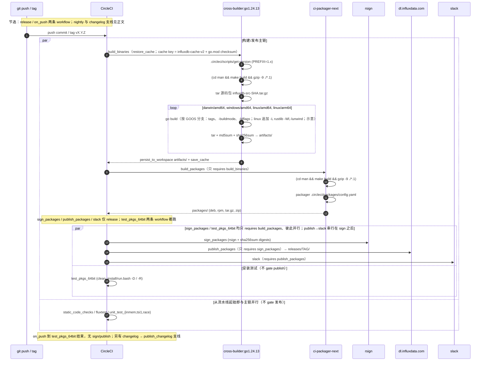

# 版本差异 7: 构建、工具链、可观测性与性能优化总览（v1.8.10 → v1.12.3）

> **基线**
> - OLD（旧）: `v1.8.10` = commit `688e697c51`（2021-10-11）
> - NEW（新）: `v1.12.3` = commit `f3d5cb68ab`（本仓库 `docs/specs/` 的代码基准）
> - 区间: `git rev-list --count v1.8.10..f3d5cb68ab` = **527 commits**；`git diff --shortstat` = **602 files changed, 79,310 insertions(+), 45,239 deletions(-)**。当前工作树只比 `f3d5cb68ab` 多若干 docs 提交（数量随文档演进），代码相同。
> - 本文覆盖: `go.mod` / `go.sum`、`.circleci/*`、`scripts/ci/*`、`releng/*`、`Dockerfile`、`Makefile`、`kit/*`、`pkg/*`、`monitor/*`、`tests/*`、`stress/*`，以及**构建执行 / CI 编排 / 打包 / 发布 / 分发安装**、**测试基础设施（含性能回归缺口）**和**跨子系统性能优化**（compaction、TSI 缓存、purger、query control、array cursor、TSM 文件名缓存等）。各子系统的深度细节请看对应主文档，本文只给机制与 commit。
> - 旧版本证据统一来自 `git show v1.8.10:<path>`；新版本证据来自当前工作树（代码等价于 `f3d5cb68ab`）。

> **小白导读**
> 1. **这三年 InfluxDB 1.x 涨的主要不是功能，是「地基」**：Go 从 1.13 升到 1.24.13，`go.mod` 里的依赖条目从 51 条涨到 181 条，`go.sum` 从 493 行涨到 1684 行。相当于同一栋房子，钢筋标号换了三代，供应商名单翻了 3.5 倍。
> 2. **打包流水线整个换掉了**：旧版是「Python 2.7 脚本 `build.py` + fpm + 手工 Dockerfile」；新版是「cross-builder 容器里约 60 行 bash（`build()` 去注释/空行 57 行）+ `packager` + 一份 YAML 清单」。旧流水线还顺带构建 i386/armhf/armel/static 变体，新版只保留 linux-amd64 / linux-arm64 / darwin-amd64 / windows-amd64。
> 3. **`/debug/vars` 从「只有统计值」变成「能自描述」**：新增 `config`（当前生效配置）、`stats`（compaction 吞吐占用率）和每用户 `userquerybytes`，并把已有的 `cq` 统计扁平化。以前要 `influxd config` 才能看到的参数，现在监控端点自己就能吐出来。
> 4. **性能优化几乎全在「少做事」上**：TSM 文件名不再反复解析（缓存 generation/sequence）、TSI 缓存不再为 map key 反复 `string([]byte)`、purger 不再用一把大锁卡住整个 FileStore、compaction planner 不再反复 mmap + 解码超大文件（>2GB）的首块。
> 5. **测试从「跑一遍看绿不绿」变成「跑一遍 + 验不变量」**：新增 property-based compaction 测试（相邻性不变量）、`CheckedClose`、race 与 tsi1 的显式矩阵。代价是 CI 配置从 225 行涨到 567 行，调试 CI 本身成了一门手艺。
> 6. **有两处「化石」没清**：根目录 `Dockerfile` 还停在 `golang:1.15.10` + `dep ensure`，`appveyor.yml` 还停在 `GOROOT=C:\go112` + `dep`。它们和 `go.mod` 已经完全对不上，属于历史遗留，不要拿它们当构建入口。
> 7. **性能回归基础设施反而退化了**：旧版 1.8 线的 `perf_test`（AWS EC2/terraform/S3）没有进入 1.12.3 线，CI 也不跑 `go test -bench`；所以 §4 只讲机制与调用点，不给“提升 X%”的数字（§3.10.5、§4.8）。

> **文档拆分（2026-11）**：本文已拆为“主文档 + 两篇附录”，**编号不变**；主文档保留每个小节的结论摘要与跳转链接，附录保留原始代码、表格与全部证据。
> - 主文档（本文件）：五分钟速读、§1 结论、§2 变更地图、§3 全部小节摘要、§4 分组摘要、§5 兼容性、§6 代表案例与索引、§7 风险、§8 证据索引。
> - [附录 A：构建、CI、打包、发布与分发](07a_build_release_appendix.md)：§3.1–§3.8、§6.1–§6.9 全文。
> - [附录 B：性能、可观测性与测试](07b_perf_appendix.md)：§3.9–§3.11、§4、§6.10–§6.14 全文。
> - 跨文档的 `07 §3.x` 引用仍指向本文件的同编号标题；需要完整证据时从对应小节进入附录。

## 0. 五分钟速读

- **工具链**：Go 1.13→1.24.0/toolchain 1.24.13；依赖 51→181；Flux 0.196.1、InfluxQL 1.4.1、JWT v4。
- **构建/发布**：拆成构建、CI、打包、发布、分发 5 个模块；cross-builder 镜像 + Rust `libunwind`；产物收窄为 linux amd64/arm64、darwin/windows amd64。
- **性能**：18 项按 compaction/TSI/query/cache/build 分组；另有 7 条是修复/新功能/持久化，不应算“优化”。
- **计数**：planner 的 `level()` 调用次数按旧/新调用点分别重算（文内给公式与下界），不是 benchmark。
- **风险**：旧 `perf_test`/AWS/S3 基础设施被删除且无替代；`Dockerfile`/`appveyor.yml` 仍是旧工具链死代码。

> **事实归属**：各子系统机制见 01–06；构建/CI/发布/性能细节仅本文展开。

## 1. 结论速览

| # | 变更点 | v1.8.10 | v1.12.3 | 影响 | 证据 |
|---|--------|---------|---------|------|------|
| 1 | Go 语言版本（`go` 指令） | `go 1.13` | `go 1.24.0` | 需要 Go ≥ 1.24 才能按 go.mod 语义构建 | `v1.8.10:go.mod:3` / `v1.12.3:go.mod:3` |
| 2 | `toolchain` 指令 | 无（Go 1.21 才引入该指令） | `toolchain go1.24.13` | Go 1.21+ 会自动下载/切换到 1.24.13 | `v1.8.10:go.mod`（全文 57 行无 toolchain） / `v1.12.3:go.mod:5` |
| 3 | `require` 条目总数 | 51（39 直接 + 12 间接） | 181（50 直接 + 131 间接） | 依赖图膨胀 3.5×；供应链与 CVE 面变大 | `v1.8.10:go.mod:5-57` / `v1.12.3:go.mod:7-192` |
| 4 | `go.sum` 行数 | 493 | 1684 | 校验条目 3.4×；**首次 `go mod download` 耗时未测**（§3.10.5/§4.8），缓存命中后无增量。复核：`go mod download -x` 计时、`du -sh $(go env GOMODCACHE)` | `v1.8.10:go.sum`（493 行） / `v1.12.3:go.sum`（1684 行） |
| 5 | InfluxQL 解析库 | `influxql v1.1.1-0.20200828144457-65d3ef77d385` | `influxql v1.4.1` | 语法/AST 行为变化，属于跨版本升级 | `v1.8.10:go.mod:22` / `v1.12.3:go.mod:23` |
| 6 | Flux | `flux v0.65.1` | `flux v0.196.1` | 跨 131 个小版本；带来 arrow v7/v15、AWS/Azure/GCP SDK 等间接依赖 | `v1.8.10:go.mod:21` / `v1.12.3:go.mod:21` |
| 7 | JWT 库 | `dgrijalva/jwt-go/v4 v4.0.0-preview1`（已废弃仓库） | `golang-jwt/jwt/v4 v4.5.2` | 安全修复 + 维护中的上游 | `v1.8.10:go.mod:14` / `v1.12.3:go.mod:17` |
| 8 | 哈希库 | `cespare/xxhash v1.1.0` | `cespare/xxhash/v2 v2.3.0` | v2 提供 `Sum64String`，避免 `string→[]byte` 分配 | `v1.8.10:go.mod:12` / `v1.12.3:go.mod:13` |
| 9 | Prometheus client | `client_golang v1.0.0` | `client_golang v1.19.1` | 指标库 API/默认 collector 行为变化 | `v1.8.10:go.mod:39` / `v1.12.3:go.mod:35` |
| 10 | zap / 日志级别类型 | `zap v1.9.1`；`logger.Config.Level` 是 `zapcore.Level` | `zap v1.16.0`；`Level` 是 `zap.AtomicLevel` | **可在运行期改日志级别**，且能直接与 toml 互转 | `v1.8.10:logger/config.go:10` / `v1.12.3:logger/config.go:10` |
| 11 | CI 执行方式 | `machine` executor，`./test.sh <idx>` 起 4 个并行 Docker 测试容器 | `docker` executor，`quay.io/influxdb/cross-builder:go1.24.13-latest` 直接跑 `gotestsum` | 无嵌套 Docker；缓存层与 Go 版本绑定到镜像 tag | `v1.8.10:.circleci/config.yml:24-40` / `v1.12.3:.circleci/config.yml:10,292-357` |
| 12 | CI 配置体量 | 225 行 | 567 行 | 流水线复杂度 2.5×，维护成本上升 | `v1.8.10:.circleci/config.yml` / `v1.12.3:.circleci/config.yml` |
| 13 | 构建脚本 | Python 2.7 `build.py`（`#!/usr/bin/python2.7 -u`）+ fpm | 内联 bash `build()` / `archive()` + `packager .circleci/packages/config.yaml` | Python 2 依赖彻底移除；打包逻辑 YAML 化 | `v1.8.10:build.py:1,58,97-107` / `v1.12.3:.circleci/config.yml:64-179,193-212` |
| 14 | 构建目标 | linux: amd64/i386/armhf/arm64/armel/static_i386/static_amd64；darwin amd64；windows amd64 | linux: amd64/arm64；darwin amd64；windows amd64 | **i386/armhf/armel 及 static_* 变体不再产出** | `v1.8.10:build.py:97-101` / `v1.12.3:.circleci/config.yml:149-179` |
| 15 | 包格式 | deb / rpm / tar（linux），tar（darwin），zip（windows） | 同一组格式，由 `packager` 生成；新增 `influxdata-archive-keyring` recommends | 安装时可自动带上 APT/YUM 仓库 keyring | `v1.8.10:build.py:103-107` / `v1.12.3:.circleci/packages/config.yaml:93-98` |
| 16 | 发布 S3 路径 | （旧版由 build.py / 手工上传） | `s3://dl.influxdata.com/influxdb/releases/<< pipeline.git.tag >>` | 回到「按版本子目录」布局（#26827） | `v1.12.3:.circleci/config.yml:415-427`（提交 `d8ecd34fa4`） |
| 17 | systemd unit | `scripts/influxdb.service`（21 行） | `.circleci/packages/influxdb/fs/lib/systemd/system/influxdb.service`（**内容逐字相同**，仅位置变化） | 由 RPM/DEB 直接安装 unit，`post-install` 只做 `enable` | `v1.8.10:scripts/influxdb.service:1-21` / `v1.12.3:.circleci/packages/influxdb/fs/lib/systemd/system/influxdb.service:1-21` |
| 18 | systemd 启动脚本 | 直接 `influxd ... &` 后探活 | 先 `influxd config` 解析 `data dir`/`wal-dir`，两个目录都存在就跑 `influx_inspect buildtsi -compact-series-file` 预热 | 每次 start 多一次 `buildtsi`（耗时未测），然后 `influxd &` 探活；**首次查询是否更快未测**，不作为结论；判定式见 §5.2.2 | `v1.8.10:scripts/influxd-systemd-start.sh:1-10` / `v1.12.3:.circleci/packages/influxdb/fs/usr/lib/influxdb/scripts/influxd-systemd-start.sh:40-50` |
| 19 | `/debug/vars` 新增 `config` | 无 | `diags["config"]` → `parseConfigDiagnostics()`，把 `toml.Size`/`toml.Duration` 转成 JSON 友好类型 | 可远程抓生效配置；`config` 只输出 `[data]` 段 17 个键（`tsdb/config.go:288-307`），**含 `dir`/`wal-dir` 绝对路径，不含凭据**；扩展到 `[http]`/`[tls]` 后才会出现证书路径（§7 风险 6） | `v1.8.10:services/httpd/handler.go:1479-1530` / `v1.12.3:services/httpd/handler.go:2356-2382` |
| 20 | `/debug/vars` 新增 `stats` | 无 | `compact-throughput-usage-percentage`（compaction 令牌桶已用百分比） | 可观测 compaction 限流是否打满 | `v1.12.3:monitor/stats.go:21-33`、`monitor/service.go:156-162`、`services/httpd/handler.go:2384-2406` |
| 21 | `/debug/vars` 的 `cq` | 有：`Statistics()` 早就以 `Name:"cq"` 发布，但输出是带 `name/tags/values` 包装的 Statistic | `serveExpvar` 对 `s.Name=="cq"` 只输出 `Values`；另注册 diagnostics 只服务 `SHOW DIAGNOSTICS`，与 `/debug/vars` 无关 | CQ 统计可直接被监控抓取，但采集端要改字段路径 | `v1.8.10:services/continuous_querier/service.go:161-170`、`services/httpd/handler.go:1532-1570` / `v1.12.3:services/httpd/handler.go:2451-2478`、`cmd/influxd/run/server.go:425-427` |
| 22 | 每用户查询字节 | 无 | `userquerybytes` 统计（`user` tag），由 `user-query-bytes-enabled` 开关控制 | 可做按租户计量；默认关闭 | `v1.12.3:services/httpd/config.go:68`、`services/httpd/handler.go:484-511` |
| 23 | TSM 文件合并指标 | 无 | 5 种类型 × 4 个指标（`*_blocks_merge_duration` / `_merge_count` / `_merge_values_count` / `_merge_over4_count`） | 可判断是否该换成树形归并 | `v1.12.3:tsdb/engine/tsm1/file_store.go:163-198` |
| 24 | TSM 文件名解析 | `findGenerations()` 在文件集变化时对每个文件 `ParseFileName(f.Path)`；`LastModified()` 未变则 `:620-625` 早退，但缓存下来的 `tsmGeneration.level()` 每次调用都重新解析 `files[0].Path`，1s tick 的 `PlanLevel`/`Plan`/`PlanOptimize` 会反复调用它 | 缓存到 `TSMReader.generation/sequence`（经 `Stats()` 暴露为 `FileStat`），`level()` 直接读 | planner tick 不再做文件名解析（仅创建/重命名时各一次） | `v1.8.10:tsdb/engine/tsm1/compact.go:616-644` / `v1.12.3:tsdb/engine/tsm1/compact.go:699-724`、`reader.go:450-460,679-680` |
| 25 | TSI 缓存 key 分配 | `c.cache[string(name)]` 等每次转换 | `Put()` 里一次性 `nameStr/keyStr/valueStr`，复用同一份字符串 | 插入路径少 1~3 次分配；`exists` 命中早退时新版反多 3 次 | `v1.8.10:tsdb/index/tsi1/cache.go:60,98-138` / `v1.12.3:tsdb/index/tsi1/cache.go:98-135` |
| 26 | purger 并发 | `sync.RWMutex` + 普通 map，扫描/关闭/删除全程持锁 | `gensyncmap.Map[string, TSMFile]` + 极短临界区 | 不再阻塞 `FileStore` 的提交/查询路径 | `v1.8.10:tsdb/engine/tsm1/file_store.go:1376-1392` / `v1.12.3:tsdb/engine/tsm1/file_store.go:1599-1620` |
| 27 | `stress/` 目录 | 存在（含 `stress/v2` 全套压测客户端） | **整体删除** | `influx_stress` 不再是仓库的一部分 | `v1.8.10:stress/run.go` / `v1.12.3`（`git ls-files stress` 为空，提交 `6b8ec8cfe0`） |
| 28 | `kit/` 目录 | 不存在 | 34 个文件（check/errors/prom/signals/tracing/transport） | 2.x 的通用组件被 1.x 复用 | `v1.8.10`（`git ls-tree v1.8.10 kit` 为空） / `v1.12.3:kit/check/check.go:1`（提交 `78724e5c20`） |
| 29 | 根 `Makefile` | 不存在 | 4 行（`export PKG_CONFIG=./pkg-config.sh` + `go build ./...`） | 只是 Flux 构建的 shim，不是完整构建入口 | `v1.8.10`（无此文件） / `v1.12.3:Makefile:1-4` |
| 30 | 根 `Dockerfile` | `FROM golang:1.13.8` + `dep ensure` | `FROM golang:1.15.10` + `dep ensure`（**仍是 dep，不可用**） | 与 go modules 冲突，不能用于 1.12.3 构建 | `v1.8.10:Dockerfile:1-7` / `v1.12.3:Dockerfile:1-7` |
| 31 | 构建产物 | 5 个命令：`influx`、`influxd`、`influx_stress`、`influx_inspect`、`influx_tools` | 3 个命令：`influx`、`influx_inspect`、`influxd` | `influx_tools` 源码保留但不出制品；`influx_stress` 源码删除；man page 9→8 | `v1.8.10:build.py:89-95` / `.circleci/config.yml:64-69` |
| 32 | PR 语义检查 | 无 | GitHub Actions `semantic.yml`，`uses: ...@main` | 第二套 CI；不属于 CircleCI 发布门禁；可变 workflow ref | `.github/workflows/semantic.yml:1-10`（`8f78c4bb02`） |
| 33 | 性能回归 | `perf_test` + AWS EC2/terraform + S3 结果 | 无替代；CI 不跑 `-bench` | §4 只能给机制，不能给跨版本数字 | `v1.8.10:.circleci/config.yml:111-134`（性能 job）、`:135-225`（AWS 清理）、`scripts/ci/perf_test.sh`；v1.12.3 `scripts/ci` 仅 2 文件 |

## 2. 变更地图

```mermaid
flowchart TB
    %% release/on_push 节选：nightly 与 changelog -> publish_changelog 支线未画；CI 子图实线 = requires 或 job 使用该镜像
    %% sign_packages 与 test_pkgs_64bit 均只 requires build_packages，彼此并行
    %% publish_packages 只 requires sign_packages；static_checks/fluxtest/unit_test 与 build 并行且不 gate 发布
    subgraph SRC["源码与依赖"]
        GM["go.mod<br/>go 1.24.0 / toolchain go1.24.13"]
        GS["go.sum<br/>1684 行<br/>（由 go.mod 生成）"]
        FLUX["influxdata/flux v0.196.1"]
        IQL["influxdata/influxql v1.4.1"]
        XXH["cespare/xxhash/v2 v2.3.0"]
    end

    subgraph CI["CircleCI (.circleci/config.yml)"]
        XB["cross-builder:go1.24.13-latest"]
        BB["build_binaries<br/>build() / archive()"]
        BP["build_packages<br/>packager"]
        SP["sign_packages<br/>rsign"]
        TP["test_pkgs_64bit<br/>releng/packages/spec/clean_install"]
        PUB["publish_packages<br/>s3://.../releases/TAG/"]
        SLACK["slack"]
        UT["unit_test<br/>inmem / tsi1 / race"]
        SC["static_code_checks<br/>checkfmt + generate + go vet"]
        FT["fluxtest"]
    end

    subgraph RUST["Rust / CGO"]
        IR["scripts/ci/install-rust.sh<br/>(仓库内无调用点<br/>仅镜像重建/手动执行时使用)"]
        RL["find_rustlib_path<br/>(cross-builder 镜像提供)"]
    end

    subgraph OBS["可观测性"]
        MON["monitor.Monitor"]
        ST["monitor.stats<br/>CompactThroughputUsage"]
        EXP["httpd.Handler.serveExpvar"]
        TMR["pkg/metrics.Timer.AddSince"]
        FSM["tsm1.FileStore 归并指标<br/>(仅 tracing span，不进 /debug/vars)"]
    end

    subgraph PERF["存储性能路径"]
        FS["tsm1.FileStore"]
        PLAN["DefaultPlanner.findGenerations"]
        TSMREAD["TSMReader.parseAndCacheFileName"]
        PURGE["purger (gensyncmap.Map)"]
        RING["tsm1 cache ring<br/>xxhash.Sum64String"]
        XUSE["xxhash 其余使用点<br/>tsi1 / series_file / bloom / hll / rhh"]
        CTRL["query/control.Controller"]
        SR["services/storage.Store<br/>(storage/reads)"]
        ACR["tsm1 array_cursor Next()<br/>（Flux 路径无 tsm1 metrics group）"]
    end

    GM --> FLUX
    GM --> IQL
    GM --> XXH
    GM -.-> GS
    GS -.->|构建校验| BB
    XB --> BB
    XB -.->|镜像提供| RL
    RL --> BB
    BB --> BP
    BP --> SP
    BP --> TP
    SP --> PUB
    PUB --> SLACK
    XB --> UT
    XB --> SC
    XB --> FT
    MON --> ST
    MON -.->|"Statistics(nil)"| EXP
    ST -.->|compact-throughput usage| EXP
    TMR -.->|merge 计时| FSM
    FS --> TSMREAD
    TSMREAD -.->|ExtStats 缓存 gen/seq| FS
    FS -.->|Stats 汇总 gen/seq| PLAN
    FS --> PURGE
    XXH --> RING
    XXH -.-> XUSE
    CTRL -.->|dependency.Inject（Reader）| SR
    SR --> ACR
```



图例：CI 子图的实线 = CircleCI `requires` 或 job 使用该 cross-builder 镜像（`XB`→`BB`/`UT`/`SC`/`FT`）；其余实线 = 结构/依赖或调用，虚线 = 数据读取/影响。



> 图注：上面的 CI 子图只画 `release`/`on_push` 的构建-打包-签名-发布主链与并行的安装/测试 job；`changelog → publish_changelog` 支线、`nightly` workflow、GitHub Actions `semantic.yml` 没有画进图里，分别见 §3.5（CI 编排）与 §3.7（发布）。

## 3. 逐项差异

> **拆分说明**：本节保留每个小节的编号与 1–2 句结论；原始代码、表格、边界与证据见两篇附录。§3.1–§3.8 全文见 [07a](07a_build_release_appendix.md)，§3.9–§3.11 全文见 [07b](07b_perf_appendix.md)。

### 3.1 Go 版本与 toolchain
`go` 指令从 `1.13` 升到 `1.24.0`，并新增 `toolchain go1.24.13`：前者决定语言语义，后者决定实际工具链；CI 镜像 tag 与 `go.mod` 多数是“CI 先动、go.mod 随后补齐”。演进表与两个踩坑细节见 [07a §3.1](07a_build_release_appendix.md)。

### 3.2 依赖规模与关键依赖
`require` 51→181（直接 39→50、间接 12→131），`go.sum` 493→1684 行；膨胀主要来自 Flux 0.196.1 带入的云 SDK 与同图并存的三代 Arrow。关键依赖表与复核命令见 [07a §3.2](07a_build_release_appendix.md)。

#### 3.2.1 Flux 组件从 `arrow/array` 迁到 `flux/array`
`storage/reads/flux_*` 改用 Flux 自封装的 `flux/array`（`8fae484a66`，v1.10.0 进入），是类型接口迁移而非性能优化；旧 arrow 路径仍被 Flux 其他包使用。

### 3.3 Rust、CGO 与交叉编译
新版 Linux 产物是 static-pie + external linkmode + Rust 静态库，构建依赖 cross-builder 镜像注入的 `find_rustlib_path`/`xcc`；`scripts/ci/install-rust.sh` 在仓库内没有调用点，Rust 版本正常路径由镜像 tag 决定。全文见 [07a §3.3](07a_build_release_appendix.md)。

### 3.4 构建执行：`build()` / `archive()`
`build_binaries` 在 cross-builder 内完成版本注入、man page/源码包、4 目标 × 3 命令编译与归档，并保存 module/cargo/go-build 缓存；缓存键为 `influxdb-cache-v2-<go.mod checksum>`。完整六要素、代码与风险见 [07a §3.4](07a_build_release_appendix.md)。

#### 3.4.1 产物清单：5 个命令 → 3 个命令
`influx`/`influxd`/`influx_inspect` 保留；`influx_tools` 不再出制品（源码仍在），`influx_stress` 源码与产物均删除；man page 9→8。

#### 3.4.2 构建性能相关变化（归入 §4.6）
缓存 v2、去嵌套 Docker、目标组合 9→4、man page 在 build/packages 重复生成一次；CI 不记录 wall time，**没有构建耗时基准**。

### 3.5 CI 编排
3 条 workflow（`release`/`on_push`/`nightly`）：release 走 build→packages→sign→publish→slack，`test_pkgs_64bit` 与静态检查/单测均不 gate 发布；nightly 反而把 6 个检查作为 `build_binaries` 前置。依赖表、门禁差异与代码见 [07a §3.5](07a_build_release_appendix.md)。

#### 3.5.1 静态检查与代码生成闸门
`static_code_checks` = `checkfmt.sh`（goimports）+ `./generate.sh` + `go vet ./...`，专门抓“改了 `.tmpl` 忘记重生成 `.gen.go`”。

#### 3.5.2 第二套 CI：GitHub Actions `semantic.yml`
PR 标题/提交语义检查，复用 `@main` 可变 workflow；不属 CircleCI 发布门禁（§7 风险 11）。

### 3.6 打包
`build_packages` 用按 digest 固定的 `ci-packager-next` 镜像和一份 YAML 清单生成 deb/rpm/tar.gz/zip，包内包含 unit、启动脚本、示例配置与 8 个 man page；新增 `influxdata-archive-keyring` recommends。清单与旧版 fpm 对照见 [07a §3.6](07a_build_release_appendix.md)。

### 3.7 发布
`sign_packages` 用 rsign 签名并生成 digest，`publish_packages` 上传到 `s3://.../releases/<tag>/`，另有 changelog 与 Slack；旧版 CI 没有 tag workflow/S3 上传，签名/上传在 CI 之外完成。全文与两处配置错误见 [07a §3.7](07a_build_release_appendix.md)。

#### 3.7.1 版本号生成：两套脚本，一套在用
`.circleci/scripts/get-version` 与 `config.yaml` 在用；`releng/get-version` 无调用点且 tag 规则更宽（允许 rc），接线前需统一。

### 3.8 分发与安装
systemd unit 内容逐字不变；启动脚本每次 start 先 `influxd config` 解析目录，存在 data/wal 目录就跑 `influx_inspect buildtsi -compact-series-file`；SysV 也加 `setpriv ... buildtsi`。`post-uninstall` 不再删 unit，`logrotate` 删除；`set -e`、无上限探活等启动失败边界见 [07a §3.8](07a_build_release_appendix.md)。

### 3.9 可观测性
新增 `config`（生效配置）、`stats`（compaction 吞吐占用率）、`userquerybytes`（按用户计量）、`cq` 扁平化、`zap.AtomicLevel` 动态日志级别与 file store `merge_*` 指标。逐项机制、语义边界与代码见 [07b §3.9](07b_perf_appendix.md)。

#### 3.9.1 `config`：把生效配置塞进 `/debug/vars`
只输出 `[data]` 段 17 个键（含 `dir`/`wal-dir` 绝对路径、不含凭据）；错误分支可能返回 200 + 截断 JSON。

#### 3.9.2 `stats`：compaction 吞吐占用率
`1 - Tokens/Limit` 是令牌桶瞬时占用，不是平均吞吐；`burst > limit` 时满桶值可为负，默认 48 MiB/s 即会注册。

#### 3.9.3 `cq`：CQ 统计扁平化
`/debug/vars` 对 `Name=="cq"` 只输出 `Values`，采集端需改字段路径；新增注册只影响 `SHOW DIAGNOSTICS`。

#### 3.9.4 `userquerybytes`：按用户计量查询响应字节
按 `user` tag 输出，覆盖 chunked/非 chunked/Prometheus remote read/Flux 四个累加点，默认关闭。

#### 3.9.5 动态日志级别（`zap.AtomicLevel`）
`zapcore.Level` 改为 `zap.AtomicLevel`，`SetLevel()` 立即对所有子 logger 生效；默认仍是 Info。

#### 3.9.6 file store 归并指标
5 类 block × 4 个 `merge_*` 指标只在查询 tracing span 中统计，**不进 `/debug/vars`/`SHOW STATS`**；`>4` 阈值提示树形归并可能更优。

### 3.10 测试基础设施
property-based compaction 不变量、`CheckedClose`、inmem/tsi1/race 矩阵；包安装测试从 3 个功能冒烟退化为仅安装/卸载，性能回归基础设施缺失。全文见 [07b §3.10](07b_perf_appendix.md)。

#### 3.10.1 property-based compaction 测试
`AdjacentFileProperty` 验证 compaction 分组不跳文件；框架落地后立刻抓到自身的排序 bug（`7f56ad35ac`，案例 §6.4）。

#### 3.10.2 `CheckedClose`
统一的 `require.NoError(t, c.Close())` helper，现有 5 个使用点，价值在示范而非覆盖率。

#### 3.10.3 CI 测试矩阵
同一提交跑 inmem/tsi1/race 三套，race 用 `taskset -c 0-7` 限制到 8 核；32bit（i386）覆盖被移除。

#### 3.10.4 包安装测试：3 个功能冒烟脚本 → 只做安装/卸载
旧版在 EC2 验证 auth、默认配置、自签 TLS 能起服务；新版只在 Docker 内 install/uninstall 并断言二进制与 8 个 man page，且失败不阻断发布。

#### 3.10.5 性能基准与回归：旧 perf_test/AWS/S3 → 无替代
旧版 `perf_test` 在 AWS r5.2xlarge 上用 `influxdb-comparisons` 跑写入/查询并写 S3；v1.12.3 无替代，CI 不跑 `-bench`，§4 因此不能给跨版本数字。

### 3.11 目录、共享库与工具
代码生成插件从 gogo 换到官方 protobuf，`kit/` 从 2.x 移植 34 个文件，`stress/`、`releng/raw-binaries` 等基础设施删除；根 `Dockerfile`/`appveyor.yml` 仍是死代码。全文见 [07b §3.11](07b_perf_appendix.md)。

#### 3.11.1 代码生成与工具
`generate.sh` 改用官方 `protoc-gen-go`/`stringer`/`tmpl`；13 个 `.pb.go` 重生成（+9148/−15082），wire 格式不变。

#### 3.11.2 共享库层：`kit/`、`pkg/`、`monitor/`、`tests/`
`kit/` 34 个文件中只有 `platform/errors`、`errors`、`prom`、`tracing` 被 1.x 业务代码消费；`pkg/` 110→125 个文件且无删除。

#### 3.11.3 工具、目录与 `releng/`/`scripts/` 删除
`stress/` 63→0、`releng/` 16→5、`scripts/ci/` 7→2；`influx_tools` 源码保留但不出制品。

## 4. 优化与收益

> **口径**：按“稳态路径工作量 / 可观测指标 / 相对 v1.8.10 有净变化 / 不是修复或持久化”四条判定，18 项拆成 5 组纯优化 + 7 项非优化。**本章只给分组摘要与关键结论**；18 项逐条对照表、机制推导、代码与 commit 证据见 [07b 附录 §4](07b_perf_appendix.md)。没有基准数字的地方明确标“无基准”。

### 4.1 分组、判定标准与总览

四条判定标准：(1) 是否减少稳态写入/查询/规划/删除的 CPU、分配、IO 或锁持有时间；(2) 是否有队列、计数器、tracing span、benchmark 或可复现调用次数可验证；(3) 相对 v1.8.10 是否有净变化（v1.12 新增能力不算）；(4) 修 bug、持久化、资源配额单列。

| 组 | 小节 | 原表行 | 主要机制 | 可观测指标 |
|---|---|---|---|---|
| compaction / TSM | §4.2 | #1、#2、#3、#11（#10 交叉） | 文件名缓存、首块缓存、分组结构、purger 空转短路 | `tsmCompactionsQueue`、`tsmOptimizeCompactions*`、planner CPU、shard 目录大小 |
| TSI / index | §4.3 | #8、#9 | cache key 字符串复用、xxhash v2 `Sum64String` | `go test -bench` 的 allocs/op、heap profile |
| query / storage-read | §4.4 | #12、#16 | array cursor 条件修正、`_fieldKeys` 系统迭代器 | 结果正确性、series 扫描量、查询延迟 |
| cache / lock / allocation / IO | §4.5 | #10、#15、#17（#8/#9 交叉） | purger 缩锁、`EqualFold`、tar 缓冲 | mutex profile、allocs/op、syscall 次数 |
| build / CI | §4.6 | 新增组 | cache v2、去嵌套 Docker、目标收窄 | CI wall time、cache hit、产物数 |
| **非优化项** | §4.7 | #4–#7、#13、#14、#18 | 修复、新功能、持久化 | 正确性/功能/持久化验证 |

> 原表另有两行在 v1.8.10 中已经是现在的代码，无净变化，不列入任何组：“单 shard 组的 meta 查询”（`5d922e9d0e`）与“tag index 缓冲按需增长”（`f646cbc540`）。逐条表与代码见 [07b §4.1](07b_perf_appendix.md)。

### 4.2 compaction / TSM
4 个纯优化：#1 TSM 文件名解析缓存（规划期解析降为 0，仅创建/重命名各一次）、#2 超大世代首块计数缓存（每 reader 首次 `ExtStats()` 解码一次，失败不重试）、#3 `tsmGeneration` 去掉闭包、#11 purger 空输入短路。关键边界：`FirstBlockCount >= DefaultMaxPointsPerBlock` 是 aggressive 块（10000 点）能被识别的前提；`parseFileNameFunc == nil` 时 `Generation=0`，因此新增 `SupportsCompactionPlanning()` 并在 `NewDefaultPlanner` panic。**无 planner benchmark**，§6.5 只给调用点下界（16241 次 `level()` 落点 vs 0 次解析）。全文见 [07b §4.2](07b_perf_appendix.md)。

### 4.3 TSI / index
#8 `TagValueSeriesIDCache.Put` 一次性转换 name/key/value 并共享字符串：插入路径少 1–3 次分配；`exists` 命中早退时新版反多 3 次（`Get` 路径未优化）。#9 xxhash v2 的 `Sum64String` 只在 `tsm1.ring`，TSI 侧收益来自 v1→v2 实现替换，不是消除 `string→[]byte`。没有覆盖 `Put` 的 microbenchmark；§6.10 给 `testing.AllocsPerRun` harness（机制推演，非基准）。全文见 [07b §4.3](07b_perf_appendix.md)。

### 4.4 query / storage-read
#12 `array cursor` 的整块直出优化补上 `c.tsm.pos == 0` 条件，修复 cache+TSM 混合时的重复拷贝；#16 `SHOW FIELD KEY CARDINALITY` 改走 `_fieldKeys` 系统迭代器，避免全量 series 扫描。两者都不改变 HTTP API。全文见 [07b §4.4](07b_perf_appendix.md)。

### 4.5 cache / lock / allocation / IO
#10 purger 用 `gensyncmap.Map`，`mu` 只保护 `running`，删除路径不再阻塞 `FileStore` 主锁；#15 `EqualFold` 在 OSS 树内没有生产调用点，是库函数清理；#17 tar 缓冲**实测不减少 write 次数**——源 `*os.File` 实现 `io.WriterTo`，`io.CopyBuffer` 忽略传入 buffer，10MiB 文件 `bufSize=0` 与 `1MB` 都是 326 次 `Write`（§6.12）。全文见 [07b §4.5](07b_perf_appendix.md)。

### 4.6 build / CI
机制：cache v2（`influxdb-cache-v2-{{ checksum "go.mod" }}`，保存 module/cargo/go-build）、去掉嵌套 Docker、目标从 9 个组合收到 4 个（全矩阵 45→12 次 `go build`；旧 CI 路径 5 次）、man page 在 `build_binaries`/`build_packages` 各生成一次。**无构建耗时基线**，不能声称“快了 X%”；可复核计数见 §6.13。全文见 [07b §4.6](07b_perf_appendix.md)。

### 4.7 非优化项单列（修复 / 新功能 / 持久化）
7 项：compaction 级别回退、低级别文件嵌套、full compaction 不被调度、optimize holdoff 是正确性修复；查询并发/内存上限与写窗口检查是 v1.12 新功能；retention 删除 fsync 是持久化增强（0 → ≤ 分区数次 fsync，删除延迟可能变大）。全文见 [07b §4.7](07b_perf_appendix.md)。

### 4.8 测量方法与缺失基准
**结论：v1.12.3 没有性能回归基础设施**，CI 不跑 `-bench`，旧 `perf_test`/AWS/S3 没有进入 1.12.3 线；§4 所有收益都是机制层面，不能给“提升 X%”。各组可运行的测量方法与缺口见 [07b §4.8](07b_perf_appendix.md)；旧 harness 的完整运行见 §6.14。

## 5. 行为变化与兼容性

### 5.1 会不会坏？逐项判断

| 变更 | 升级会不会坏 | 说明 |
|------|--------------|------|
| Go 1.13 → 1.24 | **会（构建侧）** | 本地必须装 Go ≥ 1.24.0；CI 必须用新 cross-builder 镜像。用旧 Go 编译会直接报 "go.mod requires go >= 1.24.0" |
| `toolchain go1.24.13` | **运行时不会；离线会** | Go 1.21+ 会自动下载 1.24.13；**离线/受限网络且未预置该工具链、也未设 `GOTOOLCHAIN=local` 时失败**。设 `GOTOOLCHAIN=local` 时用本机工具链，只需满足 `go 1.24.0` 指令，`toolchain` 行不再强制 |
| 依赖 51 → 181 | **间接风险（条件）** | **私有代理未放行 `cloud.google.com`、`github.com/Azure`、`github.com/aws` 等域名时 `go mod download` 失败**；`go.sum` 493→1684 行，需下载/校验 181 个 require（131 个间接） |
| `Dockerfile` | **会** | 仍在用 `dep ensure` + `golang:1.15.10`，与新 go.mod 不兼容。**不要用它构建 1.12.3** |
| `appveyor.yml` | **会** | 仍指向 `C:\go112` 与 `dep`；新版 Windows 构建走 CircleCI 的 `xcc windows` |
| 构建目标收窄 | **会** | 如果生产环境用 i386 / armhf / armel / static_i386 / static_amd64 产物，1.12.3 不再提供 |
| deb/rpm 依赖 | **会装，仅告警** | 新增 `influxdata-archive-keyring` 为 **recommends**（不是 requires），无该包时仍可安装，只是 `apt`/`dnf` 会提示 |
| 发布路径 | **运维脚本会坏（条件）** | 新版上传到 `releases/<tag>/`（`:415-427`，`d8ecd34fa4`）。写死根目录 URL `.../releases/influxdb_1.12.3_amd64.deb` 的下载/校验脚本会 404；改为跟随 tag 子目录 |
| systemd unit 位置 | **不会** | 包内路径固定为 `/lib/systemd/system/influxdb.service`，与旧版最终落点一致 |
| 启动时 `buildtsi` | **机制上变慢，未实测** | 每次 `systemctl start` 多一次 `influx_inspect buildtsi -compact-series-file`（`influxd-systemd-start.sh:47-49`）。失败判据是 **`buildtsi` 耗时 + `influxd` 启动时间 > `TimeoutStartUSec`（unit 未设 `TimeoutStartSec`，取 systemd 默认 90s）**；`Type=forking` 失败后按 `Restart=on-failure` 重试。仓库无 series 数–耗时基线；按 §5.2.2 记录 N = 10^4/10^5/10^6 时的 `buildtsi wall` 与 `systemctl start wall`，未测前不写“明显变慢” |
| `/debug/vars` 新增 `config` | **监控侧会坏（条件）** | **仅当**采集端把整个 `/debug/vars` JSON 存成单条记录时体积上涨；按 key 采集不受影响。`config` 只含 `[data]` 17 键、无凭据（§7 风险 6） |
| `/debug/vars` 的 `cq` 扁平化 | **会** | 结构从 `{name,tags,values}` 变成裸 `values` |
| `userquerybytes` | 不会（默认关） | 打开后每个用户多一条 statistic，采集端要能处理动态 tag |
| `merge_*` 指标 | 不会（但无法从 `/debug/vars` 采集） | 纯新增；仅查询启用 tracing 时写入 span（单请求、无跨请求聚合），不进 `/debug/vars`/`SHOW STATS`（§3.9.6） |
| `compact-throughput` 日志键改名 | **会（告警规则）** | `throughput_bytes_per_second` → `compact-throughput`（`82729cf8ff`）。按旧键做 grep/告警的规则会静默失效 |
| `logger.Level` 类型变化 | **运行时不会；源码级会** | toml 里仍是 `level = "info"`；但若代码里有 `cfg.Level == zapcore.InfoLevel` 这样的比较，编译期就会失败（类型不同） |
| `stress/` 删除 | **会** | 依赖 `go run ./stress` 或 `influx_stress` 的流程要另找工具 |
| `pkg/limiter.Rate` 接口扩宽 | **会（编译期）** | 任何在仓库外实现 `limiter.Rate` 的代码需要补 `Tokens()` / `Limit()` |
| 新增 `[data]`/`[coordinator]` 配置键 | 不会（默认值保持旧行为） | `tar-stream-buffer-size`（默认 1 MiB，仅备份/恢复的 tar 流窗口；旧版 `io.CopyN` 无显式 1 MiB 缓冲，属性能相关）、`max-concurrent-deletes`（默认 1）、`ingress-metric-by-measurement-enabled`/`ingress-metric-by-login-enabled`（默认 false）、`log-timedout-queries`（默认 false）。只有显式设置才改变行为；升级评估与配置模板需补列（`v1.12.3:tsdb/config.go:74-75,88-90,138-139,172,197`、`coordinator/config.go:36`、`etc/config.sample.toml:72-73,116,174,200`） |

### 5.2 二进制 / 包体积 / 启动行为

#### 5.2.1 可比较的维度与测量方法

两版的构建方式不同，**不能用同一个构建产物的 `ls -l` 直接比大小**。可比的做法是各自用对应工具链构建出 linux/amd64 的 `influxd`，再比可执行文件与包：

```bash
# v1.8.10：用旧 Dockerfile 构建（Python 2.7 + Go 1.13 环境）
docker build -f Dockerfile_build_ubuntu64 -t influxdb-build-1810 .
# 镜像的 ENTRYPOINT 已是 /root/influxdb/build.py，参数直接传给 build.py：
docker run --rm -v "$PWD":/root/influxdb -w /root/influxdb influxdb-build-1810 \
  --platform linux --arch amd64 --package
# 若要用 python 覆盖入口：docker run --entrypoint python ... influxdb-build-1810 build.py ...
# 单平台/单架构时 single_build=True，outdir 不追加 platform/arch：
ls -l build/influxd
file  build/influxd                             # 默认 internal linkmode
# 只有 --platform all 或 --arch all 时才会出现 build/<platform>/<arch>/influxd

# v1.12.3：用 cross-builder 构建
docker run --rm -v "$PWD":/work -w /work \
  quay.io/influxdb/cross-builder:go1.24.13-latest bash -lc '
    export CGO_ENABLED=1 GOOS=linux GOARCH=amd64 CC="$(xcc linux x86_64)"
    go build -tags="netgo,osusergo,static_build" -buildmode=pie \
      -ldflags="-s -w -linkmode=external -extld=$CC -extldflags \"-fno-PIC -static-pie -Wl,-z,stack-size=8388608 -L$(find_rustlib_path x86_64-unknown-linux-musl) -Wl,-lunwind\"" \
      -o /tmp/influxd ./cmd/influxd'
ls -l /tmp/influxd
file  /tmp/influxd                              # static-pie, external linkmode
```

包体积/内容：

```bash
# NEW：packages/；OLD：单平台在 build/，全矩阵在 build/<platform>/<arch>/
for d in packages build; do
  echo "== $d =="
  dpkg-deb -c "$d"/influxdb_*_amd64.deb | wc -l
  dpkg-deb -c "$d"/influxdb_*_amd64.deb | grep -c '/usr/share/man/man1/.*\.1\.gz'
  rpm -qlp "$d"/influxdb-*.x86_64.rpm | wc -l
  rpm -qlp "$d"/influxdb-*.x86_64.rpm | grep -c '/usr/share/man/man1/.*\.1\.gz'
  du -h "$d"/influxdb_*_amd64.deb "$d"/influxdb-*.x86_64.rpm
done
```

预期结构差异（可由源码直接确认，不需要实测）：新版 `influxd` 是 `static-pie` + external linkmode + Rust `libunwind`，旧版默认 internal linkmode，只有 `static_*` 变体带 `-s`（`v1.8.10:build.py:558-566`）；新版带 `-w -s`，旧版非 static 连 `-s` 都没有。新版包内 8 个 man page，旧版 9 个（多 `influx_stress.1`）；新版 3 个二进制，旧版 5 个（§3.4.1）。**具体字节数本文不填**：需要用上面的命令在两版环境各跑一次，且要记录 `go version`、镜像 digest、`CGO_ENABLED`、`ldflags`。

#### 5.2.2 启动行为与 `buildtsi` 的测量

```bash
# 1) 先确认 systemd 的启动超时（默认 90s）
systemctl show -p TimeoutStartUSec influxdb

# 2) 直接测 buildtsi（不经过 systemd），观察耗时随 series 数的变化
/usr/bin/time -f 'buildtsi wall=%e s' \
  influx_inspect buildtsi -compact-series-file \
    -datadir /var/lib/influxdb/data -waldir /var/lib/influxdb/wal

# 3) 测 systemd 启动总耗时
/usr/bin/time -f 'systemctl start wall=%e s' systemctl start influxdb

# 4) 记录 series 规模（服务起来后；或停服务用 report-db）
influx -execute 'SHOW SERIES CARDINALITY'
# report-db 仅 v1.12.3 提供；v1.8.10 用 reporttsi -db-path（无 -rollup）或 report <shard-dir>
influx_inspect report-db -db-path /var/lib/influxdb/data/<db> -rollup t -exact
```

预期与判定：`buildtsi` 的耗时随 series 数单调增长；当 `systemctl start` 超过 `TimeoutStartUSec`（默认 1min30s）时，`Type=forking` 的 unit 会失败并按 `Restart=on-failure` 重试，形成“重启—超时—再重启”（§7 风险 9）。**没有实测数值**：仓库与 CI 都没有 series 规模–启动时间基线；不要用“明显变慢”代替测量。

#### 5.2.3 其余启动/配置差异

- **二进制体积**：新版 Linux 产物是 `static-pie` + `-linkmode=external` + Rust `libunwind` 静态链入，且 `-w -s` 去符号；旧版 `build.py` 只有 static 分支的 `ldflags` 带 `-s`（`v1.8.10:build.py:558-566`），非 static 连 `-s` 都没有，都没有 `-w`，也没有 external linkmode。两版体积不具备直接可比性，必须按 §5.2.1 实测。
- **包体积**：新版包内 8 个 man page（`config.yaml:51-73` 列出 `influx.1.gz` 到 `influxd-version.1.gz`），旧版 9 个（多一个 `influx_stress.1`，因为 `stress/` 被删）；变化点是改用 `config.yaml` 的 `extras` 显式列出，而不是 `build.py` 的 `package_man_files()`。源码包在 CI 里预先生成 man page（`.circleci/config.yml:44-46`）。
- **启动行为**：
  1. `systemd` 路径下先跑 `buildtsi`（见 §3.8），`Type=forking` 的语义依赖启动脚本自己写 PID 文件，这段逻辑未变。
  2. `influxd config` 的输出内容变了：`http` 段现在会打印 `access-log-status-filters = []`（因为 `NewConfig` 里从 `nil` 改成 `make([]StatusFilter, 0)`，`services/httpd/config.go:96`）。旧版 `nil` slice 会被 TOML 编码器省略。
  3. `influxd config` 总会输出 `[flux-controller]` 段：`Config.FluxController` 是普通 struct 字段、无 `omitempty`，零值也会被编码（默认全 0，即不限制）；`etc/config.sample.toml` 未收录该段。

**待实测清单**（本文明确不填数值）：

| 维度 | 命令 | 当前状态 |
|---|---|---|
| 二进制字节数 | §5.2.1 的 `ls -l`/`file` | 待实测（需两版工具链各跑一次） |
| 包字节数与文件数 | §5.2.1 的 `dpkg-deb -c`/`rpm -qlp`/`du -h` | 待实测 |
| `buildtsi` 耗时 | §5.2.2 的 `time influx_inspect buildtsi ...` | 待实测（按 series 数分层） |
| systemd 启动耗时 | §5.2.2 的 `time systemctl start influxdb` + `TimeoutStartUSec` | 待实测（与 `buildtsi` 同时记录） |
| CI 构建耗时 | CircleCI job wall time | 仓库不记录，待接入 |


## 6. 具体案例

> 本节保留 2 个代表案例的完整正文；其余案例见 [07a §6.1–§6.9](07a_build_release_appendix.md) 与 [07b §6.10–§6.14](07b_perf_appendix.md)。索引中的编号与附录一致。

| 案例 | 主题 | 归属 | 类型 |
|---|---|---|---|
| 6.1 | 在干净 Linux 上构建同一个 `influxd`，两版差在哪 | 07a | 源码/流程对照 |
| 6.2 | 同一 commit 的 tag push / branch push / nightly | 07a | 流水线路径 |
| 6.3 | 一次安装 → 启动 → 卸载的生命周期 | 07a | 包生命周期 |
| 6.4 | 相邻性 property 如何抓到非法 compaction plan | 07a | 测试框架 |
| 6.5 | 一个 `planner tick` 的文件名解析与首块解码 | 07a | 调用计数推导 |
| 6.6 | 同一台机器上 `/debug/vars` 的输出差异 | 07a | 输出形状 |
| 6.7 | 依赖规模的结构差异与测量方法 | 07a | 测量方法 |
| 6.8 | 脱离 cross-builder 构建 linux/amd64 会在哪里失败 | 07a | 工具链 |
| 6.9 | 旧 Go 或离线工具链构建 1.12.3 | 07a | 工具链 |
| 6.10 | TSI cache `Put` 的分配计数 | 07b | 机制推演 |
| 6.11 | purger 的锁等待 | 07b | 机制推演 |
| 6.12 | 备份 tar 的 `write` 次数 | 07b | 实测复现 |
| 6.13 | 构建目标收窄的调用次数 | 07b | 源码计数 |
| 6.14 | 旧 `perf_test` 的一次运行 | 07b | 历史基线 |

### 6.1 案例：在干净 Linux 上构建同一个 `influxd`，两版差在哪

#### v1.8.10 的路径与可核对产物

**输入**：同一棵源码树；OLD `v1.8.10`，NEW `f3d5cb68ab`。OLD 用 `Dockerfile_build_ubuntu64`（ubuntu:focal + ruby/fpm + python2.7 + python3 + gcc），NEW 用 `quay.io/influxdb/cross-builder:go1.24.13-latest`。两个镜像都没有在仓库内固定 digest，本文不填。

```bash
# 旧 CI 入口（不是唯一入口；本地也可直接跑 python build.py）
./test.sh 0
#    ├─ run_test_docker Dockerfile_build_ubuntu64 test_64bit --test --junit-report --package
#    ├─ docker build -f Dockerfile_build_ubuntu64 ...   (ubuntu:focal + ruby + fpm + python2.7（build.py）+ python3 + gcc)
#    └─ 容器内执行：
#         python build.py --test --junit-report --package
#           ├─ go mod download → go fmt ./... → ./generate.sh（仅 amd64）→ go vet ./...
#           ├─ go test ./...，再经 go-junit-report 汇总
#           ├─ 对 supported_builds 里当前 (platform, arch) 执行 go build
#           │    （test.sh 0 不传 --arch/--platform，默认取 get_system_platform()/get_system_arch()，
#           │      即宿主 linux/amd64；不是 supported_builds 的 9 个组合）
#           └─ fpm -s dir -t deb / -t rpm ...
```

关键配置：

```python
# v1.8.10:build.py:89-107
targets = {
    'influx' : './cmd/influx',
    'influxd' : './cmd/influxd',
    'influx_stress' : './cmd/influx_stress',
    'influx_inspect' : './cmd/influx_inspect',
    'influx_tools': './cmd/influx_tools',
}
supported_builds = {
    'darwin': [ "amd64" ],
    'windows': [ "amd64" ],
    'linux': [ "amd64", "i386", "armhf", "arm64", "armel", "static_i386", "static_amd64" ]
}
supported_packages = {
    "darwin": [ "tar" ],
    "linux": [ "deb", "rpm", "tar" ],
    "windows": [ "zip" ],
}
```

**`test.sh 0` 的预期产物（宿主 linux/amd64）**：

| 产物 | 数量/路径 | 依据 |
|---|---|---|
| 二进制 | **5 个**：`build/influx`、`build/influxd`、`build/influx_inspect`、`build/influx_stress`、`build/influx_tools`（`targets` 5 项；`single_build=True` 时 `outdir` 不追加 `platform/arch`） | `v1.8.10:build.py:89-95,817-848` |
| 包 | **3 个**：linux/amd64 的 deb、rpm、tar.gz；非 release 包版本为 `<version>~<short sha>`、iteration 0；tar 名形如 `influxdb-<version>~<sha>_linux_amd64.tar.gz` | `v1.8.10:build.py:103-107,664-761,677-681` |
| 版本注入 | `-X main.version=<version> -X main.branch=<branch> -X main.commit=<commit>`；非 static 分支**没有** `-s/-w` | `v1.8.10:build.py:558-577` |
| 校验和 | 只在日志里打印 MD5（`Packages created: ... (MD5=...)`），**不写** `.md5/.sha256` 文件 | `v1.8.10:build.py:878-881` |

**全矩阵行为**：只有 `python build.py --platform all --arch all` 才走 9 个 `(platform, arch)` 组合（linux 7 + darwin 1 + windows 1），每个组合循环 5 个 target，即 **45 次 `go build`**。不要把它和 `test.sh 0` 的 5 次混在一起。

#### v1.12.3 的路径：先修版本注入，再谈产物

```bash
# 1) 直接用 cross-builder 镜像，不再有嵌套 Docker
docker run --rm -it -v "$PWD":/work -w /work \
  quay.io/influxdb/cross-builder:go1.24.13-latest bash

# 2) 版本号：get-version 把 export 追加到 BASH_ENV，不会写进当前 shell
export BASH_ENV="$(mktemp)"
PREFIX=1.x .circleci/scripts/get-version
# shellcheck disable=SC1090
source "$BASH_ENV"
echo "$VERSION"

# 3) man page 预生成（release 与 on_push 都跑）
(cd man && make build && gzip -9 ./*.1)

# 4) 四种目标各自 build + archive（仅示意循环骨架，真实分支见 .circleci/config.yml:70-179）
export CGO_ENABLED=1
for combo in "darwin amd64 $(xcc darwin)" \
             "windows amd64 $(xcc windows)" \
             "linux amd64 $(xcc linux x86_64)" \
             "linux arm64 $(xcc linux aarch64)"; do
  set -- $combo; export GOOS=$1 GOARCH=$2 CC=$3
  case "$GOOS" in
    darwin)  tags="netgo,osusergo";              buildmode=pie; ldflags="-s -w" ;;
    windows) tags="netgo,osusergo,static_build"; buildmode=exe; ldflags="-s -w" ;;
    linux)   tags="netgo,osusergo,static_build"; buildmode=pie
             [ "$GOARCH" = amd64 ] && rustlib=$(find_rustlib_path x86_64-unknown-linux-musl) \
                                   || rustlib=$(find_rustlib_path aarch64-unknown-linux-musl)
             ldflags="-s -w -linkmode=external -extld=$CC -extldflags \"-fno-PIC -static-pie -Wl,-z,stack-size=8388608 -L$rustlib -Wl,-lunwind\"" ;;
  esac
  # 三条命令都 build；windows 需 .exe 后缀
  for cmd in influx influx_inspect influxd; do
    binary="bins/$GOOS-$GOARCH/$cmd"; [ "$GOOS" = windows ] && binary="$binary.exe"
    go build -tags="$tags" -buildmode="$buildmode" -ldflags="$ldflags \
      -X \"main.version=$VERSION\" -X \"main.branch=${CIRCLE_BRANCH}\" -X \"main.commit=${CIRCLE_SHA1}\"" \
      -o "$binary" "github.com/influxdata/influxdb/cmd/$cmd"
  done
done

# 5) 打包（独立的 job + 独立镜像）
packager .circleci/packages/config.yaml
```

**版本注入的失败路径（可复现）**：

```console
$ env -u BASH_ENV PREFIX=1.x bash .circleci/scripts/get-version
.circleci/scripts/get-version: line 41: BASH_ENV: unbound variable
$ echo $?
1
```

当前 HEAD 没有 tag，所以命中 else 分支的 `:41`；如果 HEAD 有语义化 tag，失败点是 `:33`。CircleCI 里由 runner 注入 `BASH_ENV`，而且 `get-version` 是独立 `run` step，所以 CI 自身不受影响（`.circleci/config.yml:29-32`、`.circleci/scripts/get-version:31-47`）。即使手动设置了 `BASH_ENV`，不 `source` 它也不会得到 `VERSION`——脚本只做追加，不导出到父 shell。

**两种预期版本**：

| HEAD 状态 | `source "$BASH_ENV"` 后 `$VERSION` | 依据 |
|---|---|---|
| 有 `v1.12.3` tag | `1.12.3` | `get-version:31-39` |
| 无 tag | `1.x-$(git rev-parse --short HEAD)` | `get-version:40-47` |

**预期产物清单（4 组合 × 3 command）**：

| 产物 | 数量/路径 | 依据 |
|---|---|---|
| 二进制 | **12 个**：`bins/darwin-amd64/{influx,influx_inspect,influxd}`、`bins/windows-amd64/{...}.exe`、`bins/linux-amd64/{...}`、`bins/linux-arm64/{...}` | `.circleci/config.yml:60-69,112-129,149-179` |
| 归档 | **4 个**：`artifacts/influxdb_bin_darwin_amd64-<sha>.tar.gz`、`..._windows_amd64-...`、`..._linux_amd64-...`、`..._linux_arm64-...`；每个只含 3 个二进制 | `:132-147` |
| 校验和 | **8 个**：每个归档的 `.md5` 与 `.sha256` | `:145-146` |
| 源码包 | **1 个**：`tarball/influxdb-src-<sha>.tar.gz`（含预生成 man page） | `:33-56` |
| 包 | `packages/`，由独立 `build_packages` job 用 packager 镜像产出，见 §6.2 的产物表 | `:193-212`、`.circleci/packages/config.yaml` |

**可核对的二进制属性**：

```bash
file bins/linux-amd64/influxd
# 稳定判据：ELF 64-bit LSB pie executable；readelf -d 无 NEEDED libc（或 ldd 报 not a dynamic executable）
file bins/darwin-amd64/influxd
# 稳定判据：Mach-O 64-bit executable x86_64
file bins/windows-amd64/influx.exe
# 稳定判据：PE32+ executable (console) x86-64
bins/linux-amd64/influxd version
# 预期：InfluxDB 1.12.3 (git: <branch> <commit>)；无 tag 时为 1.x-<short sha>（`git rev-parse --short HEAD`，长度随仓库而定）
go version -m bins/linux-arm64/influxd | grep -E 'main\.(version|branch|commit)'
# 预期：-ldflags 行里含 main.version=1.12.3（或无 tag 的 1.x-<short sha>）、main.branch、main.commit
```

`file` 的具体 `static-pie linked` 字样随 binutils 版本变化，所以只固定格式与“无动态 libc 依赖”这一可验证属性；**本文不填二进制字节数/构建耗时**（§5.2.1 明确待实测）。

**构建次数与产物数量对照**：

| 路径 | `go build` 次数 | 归档 | 校验和 |
|---|---:|---:|---:|
| OLD `test.sh 0`（宿主 linux/amd64） | 1 组合 × 5 target = **5** | 无 tar 归档；3 个包 | 0（只打印 MD5） |
| OLD `build.py --platform all --arch all`（全矩阵） | 9 组合 × 5 target = **45** | 每平台自写 tar/zip | 0 |
| NEW CI（4 组合） | 4 组合 × 3 command = **12** | 4 个 tar.gz | 8 个 |

#### 差异对照

| 步骤 | v1.8.10 | v1.12.3 |
|------|---------|---------|
| 触发 | `./test.sh <idx>`（或直接 `python build.py`） | `.circleci/config.yml` 的 job |
| 隔离层 | 宿主机 → Docker → 容器内再跑脚本 | 直接跑在 job 容器里 |
| 构建语言 | Python 2.7 | Bash |
| Go 版本来源 | 构建镜像 `Dockerfile_build_ubuntu64` 里装 | `cross-container-tag: go1.24.13-latest` + `go.mod` 的 `toolchain` |
| 目标平台 | 7 种 linux 架构 + darwin + windows（全矩阵 9 组合；`test.sh 0` 只构建宿主） | linux amd64/arm64 + darwin amd64 + windows amd64（4 组合） |
| 二进制数 | 5 个/组合（含 `influx_stress`、`influx_tools`） | 3 个/组合（`influx`、`influx_inspect`、`influxd`） |
| CGO | 32bit 环境需要 `-arch=i386` | 全部 `CGO_ENABLED=1`，linux 需要 Rust `libunwind` |
| 链接方式 | 默认 internal linkmode | linux 强制 `-linkmode=external` + `-static-pie` |
| 符号 | 非 static 无 `-s`；static 分支有 `-s` | 全部 `-s -w` |
| 打包 | fpm（`deb`/`rpm`），自写 tar/zip | `packager` 一份 YAML |
| 签名 | build.py 内 `gpg` | 独立 `sign_packages` job + `rsign` |
| 包安装测试 | AWS EC2（terraform + ssh + `apt-get install` deb） | `test_pkgs_64bit`：起 `ubuntu-2204` machine，跑 `releng/packages/spec/clean_install/run.bash -D/-R`（deb/rpm） |

### 6.12 案例：备份 tar 的 `write` 次数（实测复现，非跨版本基准）

**输入**：一个 10 MiB 普通文件；调用 `pkg/tar.StreamRenameFile(fi, "x", "rel", path, tw, bufSize)`，`tw` 写到一个只计数、不落盘的 `io.Writer`。

**harness**（`pkg/tar` 包内临时测试）：

```go
type countWriter struct{ n int }
func (c *countWriter) Write(p []byte) (int, error) { c.n++; return len(p), nil }

for _, bs := range []uint64{0, 1 << 20} {
	f, _ := os.CreateTemp("", "src")
	defer os.Remove(f.Name())
	defer f.Close()
	f.Truncate(10 * 1024 * 1024)
	fi, _ := f.Stat()
	cw := &countWriter{}
	tw := tar.NewWriter(cw)
	err := StreamRenameFile(fi, "x", "rel", f.Name(), tw, bs)
	tw.Close()
	fmt.Printf("bufSize=%d writes=%d err=%v\n", bs, cw.n, err)
}
```

**预期输出（本机 Go 1.26.1 实测）**：

```text
bufSize=0     writes=326
bufSize=1MB   writes=326
```

326 = 320 次 32KiB payload + 6 次 header/trailer/padding。**原因**：`io.CopyBuffer` 在 `src` 实现 `io.WriterTo` 时不使用传入 buffer；`*os.File` 自 Go 1.22 起实现 `io.WriterTo`（Go API `go1.22.txt` 的 `pkg os, method (*File) WriteTo`），所以 1MB buffer 被忽略，回落到 32KB 拷贝。旧版 `io.CopyN` 包了 `LimitReader`（不实现 `WriterTo`），同样走 32KB。**结论**：#17 在本仓库的备份路径上不减少 `write` 次数；`StreamRenameFile` 仍为每个文件分配 1MB（`stream.go:73`）。本文不给跨版本 `strace` 数字，也不声称本机数字等于生产磁盘耗时。

## 7. 仍存在的风险

**模块 × 风险矩阵**（编号对应下方条目）：

| 模块 | 主要风险 | 相关条目 |
|---|---|---|
| 工具链 / 依赖 | 供应链面、离线构建成本、Rust 工具链、死代码误导、代码生成漂移 | 1、2、3、4、13 |
| 构建执行 | 可变镜像、Rust 工具链、目标收窄、死代码 | 2、3、5、8 |
| CI 编排 | 可变镜像/action、安装测试不 gate 发布、覆盖收窄、无性能门禁 | 5、11、14、15 |
| 打包 | 签名镜像/凭据、安装生命周期 | 12、16 |
| 发布 | 发布门禁、S3/rsign 凭据、changelog 未接线 | 5、12 |
| 分发 / 安装 | 启动超时、logrotate/卸载残留 | 9、16 |
| 可观测性 | `/debug/vars` 暴露面、吞吐百分比误读 | 6、7 |
| 测试基础设施 | 包功能冒烟缺失、性能回归缺失 | 14、15 |
| 共享库 / 代码生成 | `kit` 2.x 语义、`.pb.go` 漂移 | 13 |
| 性能优化 | 无基准、无回归门禁 | 15 |

1. **依赖膨胀与供应链面**。131 个间接依赖里包含 4 个云厂商 SDK、3 个 SQL 驱动、Kafka、Snowflake、SAP HANA、Vertica。这些代码大部分不会被链接进 `influxd`，但会进入 `go.sum`、构建缓存和 SBOM。对「必须能离线构建」的环境，需下载/校验 181 个 require（131 个间接，`go.sum` 493→1684 行）；**预热成本未测**，可用 `du -sh $(go env GOMODCACHE)` 与 `go mod download -x` 计时量化，本文不填数值。
2. **CGO + Rust 让构建从「纯 Go」变成「多语言工具链」**。`find_rustlib_path` 没有在仓库里定义（`grep -rn --include=config.yml "find_rustlib_path" .circleci` 只命中 `.circleci/config.yml:94,97`），完全依赖 `quay.io/influxdb/cross-builder` 镜像。任何想脱离该镜像自建 CI 的人都要自己复刻 `xcc`、`find_rustlib_path` 和 musl 交叉工具链——这是 1.12.3 最难自建的部分。
3. **`install-rust.sh` 的版本回落是静默的（仅在使用该脚本/重建镜像时）**。该脚本在 CI 中没有调用点；若手动执行，`RUST_LATEST_VERSION=${FLUX_RUST_VERSION:-1.53}`（`scripts/ci/install-rust.sh:7`）在 `grep 'FROM rust:'` 失败时会回落到 Rust 1.53。由于 `set -ex` 不会因为 grep 无匹配而失败（管道里 `cut` 成功退出），失败是静默的，只会在编译 Rust 依赖时报出难以定位的错误。
4. **`Dockerfile` 与 `appveyor.yml` 是彻底的死代码**。前者 `FROM golang:1.15.10` + `dep ensure`（`Dockerfile:1-5`），后者 `GOROOT: C:\go112` + `dep`（`appveyor.yml:15,27-29`）。新贡献者若照这两个文件构建必然失败，且失败信息（`Gopkg.toml` 不存在、Go 版本过低）与真实原因（应使用 go modules）相距很远。
5. **CI 复杂度与发布门禁**。567 行配置、3 条常驻 workflow、多种执行器（docker / machine / 带 GCS 认证的私有镜像）、`circleci_ip_ranges: true` 的签名 job。任何一处 tag 或镜像 digest 变更（如 `ci-packager-next@sha256:c92ea43...`）都可能在不同 workflow 上表现不一致——`56a3f970e4` 只改 CI 不改 `go.mod` 就是这种不一致的实例。另外 `build_binaries` 的 cross-builder 用的是可变 `-latest` tag（`:10`），只有 packager 镜像按 digest 固定（`:195`），构建环境不可复现；且 `publish_packages` 只 `requires sign_packages`，`test_pkgs_64bit` 是并行 sibling，安装测试失败**不阻塞发布**——发布前需人工确认安装测试为绿，或把 publish 改为同时 requires 两者。
6. **`/debug/vars` 输出 `config` 的信息暴露面**。`config` 段来自 `tsdb.Config.Diagnostics()` 的 17 个键，当前只覆盖 `[data]`，但已包含 `dir`/`wal-dir` 绝对路径；一旦将来扩展到 `[http]`/`[tls]`，`/debug/vars` 就会把 `https-certificate` 等路径甚至凭据类配置吐出来。该端点只在 `AuthEnabled && PprofEnabled && PprofAuthEnabled` 三者同时为真时才注册带 admin 校验的副本（`handler.go:322,357-358`）；默认 `PprofAuthEnabled=false` 时 `ServeHTTP` 直接走 `serveExpvar`（`handler.go:571-572`），**没有认证**。`Route` 的两个 `true` 是 `Gzipped`/`LoggingEnabled`，不是认证。
7. **`compact-throughput-usage-percentage` 的语义容易被误读**。`NewRate` 创建时 `AllowN(now, burstLimit)` 会立刻耗尽初始 burst（`pkg/limiter/writer.go:27`），所以进程刚启动、第一次补充令牌之前，该值接近 100%。把它做成告警阈值会在每次重启时误报。另外公式分母是速率上限而不是 burst，只有 `burst == limit`（默认）时才等于 burst 占用率；`burst > limit` 时满桶值可为负（§3.9.2）。
8. **构建目标收窄是不可逆的**。1.12.3 只产出 linux amd64/arm64、darwin amd64、windows amd64。若下游需要 386/armhf，只能回退到旧版本或自行交叉编译，而自行交叉编译又撞上 §7 风险 2 的 Rust 工具链问题。
9. **启动期 `buildtsi` 失败会让服务起不来**。`influxd-systemd-start.sh` 是 `#!/bin/bash -e`（`:1`），`yes | influx_inspect buildtsi …`（`:47-49`）不在条件位、也没有 `|| true`；脚本没有 `set -o pipefail`，此时管道退出码取**最后一条**命令（`influx_inspect`），失败会触发 `set -e`，脚本以非 0 退出，`influxdb.service`（`Type=forking`、`Restart=on-failure`）报启动失败并按 on-failure 重试。真正需要盯的风险不是“带旧索引上线”，而是**启动时间机制上随 series 数增长（未实测）**；判定式为 `buildtsi wall + influxd start > TimeoutStartUSec`（unit 未设 `TimeoutStartSec`，默认 90s），超过后形成“重启—超时—再重启”。
10. **`query/control` 的配置项没有出现在 `etc/config.sample.toml`**。`grep -n "flux-controller" etc/config.sample.toml` 无结果，但 `cmd/influxd/run/config.go:45` 定义了 `FluxController control.Config` 并 `toml:"flux-controller"`。运维只能靠 `influxd config` 输出或源码猜测参数名。
11. **GitHub Actions `semantic.yml` 复用 `@main` 可变 workflow**。`.github/workflows/semantic.yml:11` 的 `uses: influxdata/validate-semantic-github-messages/.github/workflows/semantic.yml@main` 没有固定 commit/tag；上游改动可以在本仓库没有任何提交的情况下改变 PR 检查结果。缓解：把 `@main` 换成固定 SHA，或把检查迁进本仓库。
12. **发布链路凭据与签名镜像**。`sign_packages` 用 `quay.io/influxdb/rsign:latest`（`.circleci/config.yml:217`）且 `circleci_ip_ranges: true`；`publish_packages`/`publish_changelog` 用 `RELEASE_AWS_*`；packager/slack 用 `CISUPPORT_GCS_AUTHORIZATION`。另外 `sign_packages` 的 `add_ssh_keys` 键名在源码里拼成 `fingerpints`（`:223`），CircleCI 不识别，SSH key 实际未注入。缓解：rsign 固定 digest、审计/轮换凭据、修正键名。
13. **代码生成漂移**。`generate.sh` 用 `go install` 安装 `protoc-gen-go`/`stringer`/`tmpl`，版本由 `go.mod` 解析；`static_code_checks` 会重跑并因 `git status` 非空失败。如果本地与 CI 的 Go/protobuf 工具链不一致，`.pb.go` 可能与源码不同步。缓解：统一用 `toolchain go1.24.13` 与 cross-builder 镜像生成，并在 CI 比对 `git diff`。
14. **测试覆盖收窄**：旧版 3 个包安装后功能冒烟脚本（`auth-enabled`、`default-config`、`self-signed-certs`）在 v1.12.3 没有替代；32bit 测试移除；`clean_install` 只做安装/卸载，不启动服务。缓解：补一个能起 systemd 的 machine executor 用例，或在发布前保留人工清单。
15. **性能回归无门禁**：旧 `perf_test`/AWS/S3 不在 v1.12.3 线；CI 不跑 `-bench`；§4 的所有收益都没有跨版本数字。缓解：恢复容器化 benchmark/perf job，固定数据集与阈值并接入 CI。
16. **安装生命周期回归**：`logrotate` 文件删除（旧版打包到 `/etc/logrotate.d/influxdb`）；`post-uninstall` 不再删 unit（依赖包管理器）；`pre-install` 的配置迁移只在 `/etc/opt/influxdb` 存在时触发；启动 `buildtsi` 随 series 增长。缓解：升级/卸载回归清单中检查 `/etc/logrotate.d/influxdb`、unit 残留、`/etc/default/influxdb`、启动超时。

## 8. 证据索引

### 8.1 工具链与依赖

| 证据 | 路径:行 | 内容 | commit |
|------|---------|------|--------|
| 旧 go 指令 | `v1.8.10:go.mod:3` | `go 1.13` | — |
| 新 go/toolchain | `v1.12.3:go.mod:3,5` | `go 1.24.0` / `toolchain go1.24.13` | `542ce7f684`、`d65673b1f5` |
| 旧 go.sum | `v1.8.10:go.sum` | 493 行 | — |
| 新 go.sum | `v1.12.3:go.sum` | 1684 行 | — |
| influxql 升级 | `v1.12.3:go.mod:23` | `v1.4.1` | `77d6f20894` |
| flux 升级 | `v1.12.3:go.mod:21` | `v0.196.1` | `03b6ed2bed` |
| jwt 迁移 | `v1.12.3:go.mod:17` | `golang-jwt/jwt/v4 v4.5.2` | `f8635640cc` |
| xxhash v2 | `v1.12.3:go.mod:13` | `cespare/xxhash/v2 v2.3.0` | `45a8227ad6` |
| 旧 jwt | `v1.8.10:go.mod:14` | `dgrijalva/jwt-go/v4 v4.0.0-preview1` | — |
| 旧 flux/influxql | `v1.8.10:go.mod:21-22` | `v0.65.1` / `v1.1.1-0.20200828...` | — |
| 旧 protobuf 生成器 | `v1.8.10:generate.sh:3-4` | `protoc-gen-gogofaster` / `protoc-gen-gogo`（gogo v1.3.2 为直接依赖） | — |
| 新 protobuf 生成器 | `v1.12.3:generate.sh:3` | `google.golang.org/protobuf/cmd/protoc-gen-go` | `8b38d0e2bf` |
| 官方 protobuf 依赖 | `v1.12.3:go.mod:57,126` | `google.golang.org/protobuf v1.34.1`（直接）；gogo 降为 indirect | `8b38d0e2bf` |
| protobuf 版本升级 | `v1.12.3:go.mod:57` | v1.33.0 → v1.34.1（`03b6ed2bed` 升级 Flux 时同步） | `dbbe4611c0`、`03b6ed2bed` |
| protoc 版本 | `v1.12.3:services/meta/internal/meta.pb.go:3-4` | v5.26.1（`d4b16dcd98`）→ v5.29.2（`03b6ed2bed`）；当前生成头为 `protoc v5.29.2` | `d4b16dcd98`、`03b6ed2bed` |
| 旧 Flux 数组类型 | `v1.8.10:storage/reads/flux_table.go:7`、`flux_tags_cache.go:7` | `apache/arrow/go/arrow/array` | — |
| 新 Flux 数组类型 | `v1.12.3:storage/flux/table.go:10`、`tags_cache.go:8`、`window.go:10`、`table.gen.go:15` | `influxdata/flux/array` | `8fae484a66` |
| 数组迁移提交 | `git show --stat 8fae484a66` | 11 文件；`storage/flux/*`、`storage/reads/types.tmpldata`、`go.mod`/`go.sum` | `8fae484a66` |

### 8.2 CI 与构建

| 证据 | 路径:行 | 内容 | commit |
|------|---------|------|--------|
| 旧 CI 入口 | `v1.8.10:.circleci/config.yml:24-41` | `parallelism: 4` + `./test.sh ${CIRCLE_NODE_INDEX}` | — |
| 旧测试环境 | `v1.8.10:test.sh:33-34,102-124` | `ENV_COUNT=4`；含 32bit | — |
| 旧构建目标 | `v1.8.10:build.py:97-107` | 7 种 linux 架构 | — |
| 旧打包工具 | `v1.8.10:build.py:1,55-58` | Python 2.7 + fpm | — |
| 新 CI 镜像 tag | `v1.12.3:.circleci/config.yml:10` | `go1.24.13-latest` | `d65673b1f5` |
| 新构建函数 | `v1.12.3:.circleci/config.yml:64-179` | `build()` / `archive()` + 4 个目标 | `3d4f3a2444`、`88c1c31406` |
| rustlib | `v1.12.3:.circleci/config.yml:90-110` | `find_rustlib_path` + `-Wl,-lunwind` | `6a3b02cac4` |
| 新缓存键 | `v1.12.3:.circleci/config.yml:28,186-191` | `influxdb-cache-v2-{{ checksum "go.mod" }}` | `6a3b02cac4` |
| 新测试矩阵 | `v1.12.3:.circleci/config.yml:292-357` | `data`/`race` 参数 + `taskset -c 0-7` | `59e84cc48b` |
| 新 workflow | `v1.12.3:.circleci/config.yml:456-567` | release / on_push / nightly | 多次 |
| 打包清单 | `v1.12.3:.circleci/packages/config.yaml:1-98` | 4 个 source、archive-keyring | `d0c94e9ac3`、`d628f8b374` |
| 发布路径 | `v1.12.3:.circleci/config.yml:415-427` | `releases/<< pipeline.git.tag >>` | `d8ecd34fa4` |
| Rust 安装 | `v1.12.3:scripts/ci/install-rust.sh:5-29` | 从 Flux 反推 Rust 版本 + rustup SHA256 | — |
| 遗留 Dockerfile | `v1.8.10:Dockerfile:1-7` / `v1.12.3:Dockerfile:1-7` | `golang:1.13.8` → `golang:1.15.10`，仍是 `dep` | `d1a5c06596` |
| 遗留 appveyor | `v1.8.10:appveyor.yml:15,27-29` / `v1.12.3:appveyor.yml:15,27-29` | 逐字未变 | — |
| Makefile | `v1.12.3:Makefile:1-4` | 4 行 shim | `7210fa6355` |
| gotestsum | `v1.12.3:.circleci/config.yml:329,352` | 用 `gotestsum` 产出 junit 报告 | `3a739948a6` |
| packager / slack | 镜像 `v1.12.3:.circleci/config.yml:195,430`；packager 命令 `:206` | 打包与通知改用 `ci-packager-next` / `ci-slack` 镜像 | `61f965a4b6` |
| 产物清单（旧） | `v1.8.10:build.py:89-95`；`v1.8.10:.circleci/config.yml:55-59` | 5 个命令（含 `influx_stress`、`influx_tools`）；persist `packages/influx_tools` | — |
| 产物清单（新） | `v1.12.3:.circleci/config.yml:64-69,132-147` | 3 个命令（`influx`、`influx_inspect`、`influxd`） | — |
| man page 数 | `v1.8.10:man/Makefile:5-14` / `v1.12.3:.circleci/packages/config.yaml:51-73` | 9 → 8（去掉 `influx_stress.1`） | — |
| GitHub Actions semantic | `.github/workflows/semantic.yml:1-10` | PR 语义检查，`uses: ...@main` | `8f78c4bb02` |
| release workflow | `v1.12.3:.circleci/config.yml:456-506` | build → package → sign → publish → slack；test 与 sign 并行 | — |
| on_push workflow | `v1.12.3:.circleci/config.yml:507-528` | build → package → test；无 sign/publish | — |
| nightly workflow | `v1.12.3:.circleci/config.yml:529-567` | changelog/static/fluxtest/unit 先跑；build_binaries requires 全部；无 sign/publish | — |
| changelog / publish | `v1.12.3:.circleci/config.yml:369-413` | `changelogger`；S3 `releases/<tag>/CHANGELOG.<tag>.md` / `nightlies/<branch>/CHANGELOG.md`（nightly workflow 未实例化后者） | — |
| sign / publish | `v1.12.3:.circleci/config.yml:214-256,415-427` | `rsign` + digest；S3 `releases/<tag>/` | — |
| 版本脚本（CI） | `v1.12.3:.circleci/scripts/get-version:25-47` | tag → `VERSION`；无 tag → `PREFIX-<short sha>` | — |
| 版本脚本（未接线） | `v1.12.3:releng/get-version:20-100` | `-p`/`-n`；仓库内无调用点 | — |

### 8.3 打包与安装

| 证据 | 路径:行 | 内容 | commit |
|------|---------|------|--------|
| systemd unit（旧） | `v1.8.10:scripts/influxdb.service:1-21` | 内容与新版逐字相同 | — |
| systemd unit（新位置） | `v1.12.3:.circleci/packages/influxdb/fs/lib/systemd/system/influxdb.service:1-21` | — | `7f42c16d85` |
| 启动脚本（旧） | `v1.8.10:scripts/influxd-systemd-start.sh:1-5` | 直接 `influxd &` | — |
| 启动脚本（新） | `v1.12.3:.circleci/packages/influxdb/fs/usr/lib/influxdb/scripts/influxd-systemd-start.sh:40-52` | 先 `buildtsi -compact-series-file` | `44d4b1e73c` 等 |
| post-install | `v1.12.3:.circleci/packages/influxdb/control/post-install:14-18` | `systemctl enable` | `7f42c16d85` |
| pre-install | `v1.12.3:.circleci/packages/influxdb/control/pre-install:5-22` | 建用户 + 迁移 `/etc/opt/influxdb` | — |
| 权限覆盖 | `v1.12.3:.circleci/packages/config.yaml:74-88` | `0755`/`0644` | — |
| rpm 属性 | `v1.12.3:.circleci/packages/config.yaml:89-91` | `750,influxdb,influxdb:/var/lib/influxdb` | — |
| post-uninstall（旧） | `v1.8.10:scripts/post-uninstall.sh:3-6` | `systemctl disable` + `rm -f /lib/systemd/system/influxdb.service` | — |
| post-uninstall（新） | `v1.12.3:.circleci/packages/influxdb/control/post-uninstall:3-5,30-41` | 只 `systemctl disable`；unit 由包管理器删除 | — |
| init.sh（新） | `v1.12.3:.circleci/packages/influxdb/fs/usr/lib/influxdb/scripts/init.sh:154-165` | `setpriv --reuid influxdb ... buildtsi` | `70543bed1d` |
| logrotate（旧） | `v1.8.10:scripts/logrotate:1-8`；`v1.8.10:build.py:37,155-156` | daily/rotate 7/copytruncate，打包到 `/etc/logrotate.d/influxdb` | — |
| logrotate（新） | `grep -rn logrotate .circleci/packages releng` 无结果 | 新包不再包含 logrotate 配置 | — |

### 8.4 可观测性

| 证据 | 路径:行 | 内容 | commit |
|------|---------|------|--------|
| 旧 expvar | `v1.8.10:services/httpd/handler.go:1479-1572` | 无 config/stats 诊断段；cq 已作为带 `{name,tags,values}` 包装的 Statistic 存在 | — |
| 新 expvar 入口 | `v1.12.3:services/httpd/handler.go:2291` | `serveExpvar` | — |
| config 段 | `v1.12.3:services/httpd/handler.go:2356-2382` | `parseConfigDiagnostics` | `269f1b6281` |
| stats 段 | `v1.12.3:services/httpd/handler.go:2384-2406` | `compact-throughput-usage-percentage` | `0e656d6dd5` |
| cq 段 | `v1.12.3:services/httpd/handler.go:2452-2477` | 扁平化 Values | `f75be56eee` |
| cq 注册 | `v1.12.3:cmd/influxd/run/server.go:425-427` | `RegisterDiagnosticsClient("cq", srv)` | `f75be56eee` |
| monitor stats 注册 | `v1.12.3:monitor/service.go:156-162` | `if m.Limiter != nil` | `0e656d6dd5` |
| CompactThroughputUsage | `v1.12.3:monitor/stats.go:21-33` | `1 - Tokens/Limit` | `0e656d6dd5` |
| limiter 接口 | `v1.12.3:pkg/limiter/writer.go:18-23` | `Tokens()` / `Limit()` | `0e656d6dd5` |
| tsdb config 诊断键 | `v1.12.3:tsdb/config.go:304-306` | `compact-throughput` 等 | `269f1b6281` |
| 动态日志级别 | `v1.12.3:logger/config.go:10,18` | `zap.AtomicLevel` | `a743838f9d` |
| 日志级别旧类型 | `v1.8.10:logger/config.go:10,18` | `zapcore.Level` | — |
| 每用户字节 | `v1.12.3:services/httpd/handler.go:483-511` | `userquerybytes` | `4dcc8776c1` |
| 开关 | `v1.12.3:services/httpd/config.go:68` | `user-query-bytes-enabled` | `4dcc8776c1` |
| access-log 默认输出 | `v1.12.3:services/httpd/config.go:96` | `make([]StatusFilter, 0)` | `a2e029fa7f` |
| merge 指标 | `v1.12.3:tsdb/engine/tsm1/file_store.go:163-198` | 30 个注册项，其中 merge 专项 20 个（5 类型 × 4） | `133c290fc2` |
| Timer.AddSince | `v1.12.3:pkg/metrics/timer.go:10,26-27` | `atomic.Int64` + 累加 | `133c290fc2` |
| compact 日志键改名 | `v1.12.3:tsdb/store.go:536-544` | `compact-throughput` | `82729cf8ff` |

### 8.5 测试基础设施

| 证据 | 路径:行 | 内容 | commit |
|------|---------|------|--------|
| property 框架 | `v1.12.3:tsdb/engine/tsm1/compact_property_test.go:11-23` | `CompactionProperty` | `ba2c2b6432` |
| 相邻性规则 | `v1.12.3:tsdb/engine/tsm1/compact_property_test.go:19-23,34-39,92` | `AdjacentFileProperty` | `ba2c2b6432` |
| 相邻性排序修复 | `v1.12.3:tsdb/engine/tsm1/compact_property_test.go` | `slices.SortFunc` | `7f56ad35ac` |
| CheckedClose | `v1.12.3:pkg/testing/helper/helpers.go:10-25` | `defer CheckedClose(t, c)()` | `0f3436d10d` |
| 使用点 | `v1.12.3:services/httpd/service_test.go:53,103,176,205,261` | 5 处 | `0f3436d10d` |
| fluxtest job | `v1.12.3:.circleci/config.yml:359-367` | `./test-flux.sh` | — |
| fluxtest 脚本 | `v1.12.3:test-flux.sh:11-31` | 按 flux 模块版本下载；仅伪版本 `v0.0.0-...-<rev>` 时取 revision | — |
| CI 测试参数化 | `v1.12.3:.circleci/config.yml:292-306` | `INFLUXDB_DATA_INDEX_VERSION` | `59e84cc48b` |
| 旧包安装测试 | `v1.8.10:.circleci/config.yml:61-109`；`v1.8.10:scripts/ci/tests/*` | EC2 + terraform + `apt-get install` deb；跑 3 个功能冒烟脚本 | — |
| 新包安装测试 | `v1.12.3:.circleci/config.yml:258-279`；`releng/packages/spec/clean_install/run.bash:44-70` | Docker 内 install/uninstall；deb（ubuntu latest/rolling）、rpm（centos:7） | — |
| 新安装断言 | `releng/packages/spec/clean_install/_install_uninstall.bash:19-87` | 3 个二进制 + 8 个 man page；不启动服务 | — |
| 旧性能 harness job | `v1.8.10:.circleci/config.yml:111-134` | `perf_test`：`format`/`record_ingest_results`，20m 超时 | — |
| 旧性能脚本 | `v1.8.10:scripts/ci/perf_test.sh:12-73`；`run_perftest.sh:125-320` | r5.2xlarge、S3 `perftest-binaries-influxdb`/`perftest-logs-influxdb`、telegraf → Cloud2 | — |
| 旧性能基础设施 | `v1.8.10:scripts/ci/main.tf:1-90`、`terraform.tfvars:1-6` | AWS EC2/terraform；`git cat-file -e v1.12.3:scripts/ci/perf_test.sh` 失败 | — |
| 性能回归缺口 | `.circleci/config.yml` 无 `perf`/`-bench`；60 个测试文件含 `func Benchmark`（356 个；v1.8.10 56 文件/348 个） | CI 不跑 benchmark；v1.12.3 无性能 harness | — |

### 8.6 性能优化 commit 索引

| commit | 主题 | 主要文件 |
|--------|------|----------|
| `f0d5c73253` | 缓存 TSM generation/sequence | `tsdb/engine/tsm1/{compact,reader,file_store}.go` |
| `2a0353ffd2` | 降低 compaction planning CPU（首块缓存） | `tsdb/engine/tsm1/{engine,reader,file_store,scheduler}.go` |
| `5e9d85c972` | 修复混级 compaction 的级别回退 | `tsdb/engine/tsm1/compact.go` |
| `d1d68d656d` | 处理嵌套低级别文件 | `tsdb/engine/tsm1/compact.go` |
| `95e86be3f4` | 修复 full compaction 不调度 | `tsdb/engine/tsm1/{engine,compact}.go` |
| `0fdb6adcb2` | 修复优化 compaction holdoff 传值 bug | `tsdb/engine/tsm1/engine.go` |
| `31cb61f556` | array cursor 优化条件修正 | `tsdb/engine/tsm1/array_cursor.gen.go(.tmpl)` |
| `f3d5cb68ab` | TSI 缓存减少字符串分配 | `tsdb/index/tsi1/cache.go` |
| `45a8227ad6` | xxhash v2 + 避免 string→[]byte | `tsdb/engine/tsm1/{cache,ring}.go`、`tsdb/index/tsi1/index.go`、`tsdb/series_file.go`、`pkg/{bloom,rhh,estimator/hll}` |
| `d5a48e0662` | purger 降低锁竞争 | `tsdb/engine/tsm1/file_store.go`、`pkg/data/gensyncmap` |
| `e883e8bec3` | purger 空操作短路 | `tsdb/engine/tsm1/file_store.go` |
| `133c290fc2` | file store 归并指标 | `tsdb/engine/tsm1/file_store*.go`、`pkg/metrics/timer.go` |
| `b9ee9e5b44` / `f1aa051787` | flux controller 内存/并发限制与可配置化 | `query/control/*`、`cmd/influxd/run/config.go` |
| `19f65f50b7` | 写窗口检查优化 | `coordinator/points_writer.go` |
| `2529799abb` | `ToLower` → `EqualFold` | 多处 |
| `f5da0f50f4` | `SHOW FIELD KEY CARDINALITY` 走 `_fieldKeys` | `query/statement_rewriter.go`、`tsdb/shard.go` |
| `bac5cedb3c` | tar 流缓冲窗口可配置 | `pkg/tar/stream.go`、`tsdb/config.go`、`tsdb/engine/tsm1/engine.go` |

> 注：`5d922e9d0e`（单 shard 组短路，2020-11）与 `f646cbc540`（tag index 缓冲按需增长，2021-04）都**早于 v1.8.10**，两版代码相同，不属于 v1.8.10→v1.12.3 的优化，故从本索引移除。

---

**交叉引用**：compaction 规划与调度的完整机制见 [04 Background Tasks](../04_background_tasks_spec.md)；TSI 缓存与索引结构见 [02 Index System](../02_index_system_spec.md)；FileStore / KeyCursor / purger 的读写路径见 [16 FileStore + KeyCursor](../16_filestore_keycursor_spec.md)；HTTP 端点与中间件见 [10 HTTP Service](../10_http_service_spec.md)；retention 删除的 fsync 批处理详见 [05 元数据与后台服务](05_meta_background_diff.md)。
