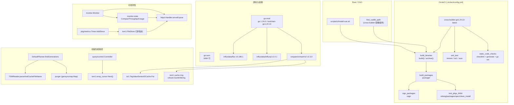
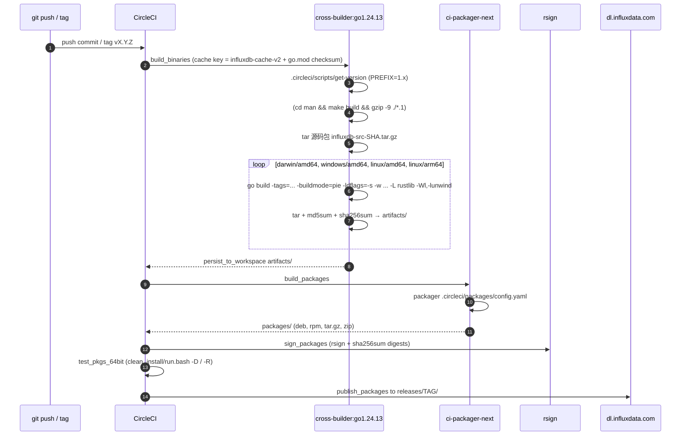

# 版本差异 7: 构建、工具链、可观测性与性能优化总览（v1.8.10 → v1.12.3）

> **基线**
> - OLD（旧）: `v1.8.10` = commit `688e697c51`（2021-10-11）
> - NEW（新）: `v1.12.3` = commit `f3d5cb68ab`（本仓库 `docs/specs/` 的代码基准）
> - 区间: `git rev-list --count v1.8.10..f3d5cb68ab` = **527 commits**；`git diff --shortstat` = **602 files changed, 79,310 insertions(+), 45,239 deletions(-)**。当前工作树只比 `f3d5cb68ab` 多 4 个 docs 提交，代码相同。
> - 本文覆盖: `go.mod` / `go.sum`、`.circleci/*`、`scripts/ci/*`、`releng/*`、`Dockerfile`、`Makefile`、`kit/*`、`pkg/*`、`monitor/*`、`tests/*`、`stress/*`，以及**跨子系统性能优化的汇总**（compaction、TSI 缓存、purger、query control、array cursor、TSM 文件名缓存等）。各子系统的深度细节请看对应主文档，本文只给机制与 commit。
> - 旧版本证据统一来自 `git show v1.8.10:<path>`；新版本证据来自当前工作树（代码等价于 `f3d5cb68ab`）。

> **小白导读**
> 1. **这三年 InfluxDB 1.x 涨的主要不是功能，是「地基」**：Go 从 1.13 升到 1.24.13，`go.mod` 里的依赖条目从 51 条涨到 181 条，`go.sum` 从 493 行涨到 1684 行。相当于同一栋房子，钢筋标号换了三代，供应商名单翻了 3.5 倍。
> 2. **打包流水线整个换掉了**：旧版是「Python 2.7 脚本 `build.py` + fpm + 手工 Dockerfile」；新版是「cross-builder 容器里的 50 行 bash + `packager` + 一份 YAML 清单」。旧流水线还顺带构建 i386/armhf/armel/static 变体，新版只保留 linux-amd64 / linux-arm64 / darwin-amd64 / windows-amd64。
> 3. **`/debug/vars` 从「只有统计值」变成「能自描述」**：新增 `config`（当前生效配置）、`stats`（compaction 吞吐占用率）、`cq`（连续查询扁平化统计）和每用户 `userquerybytes`。以前要 `influxd config` 才能看到的参数，现在监控端点自己就能吐出来。
> 4. **性能优化几乎全在「少做事」上**：TSM 文件名不再反复解析（缓存 generation/sequence）、TSI 缓存不再为 map key 反复 `string([]byte)`、purger 不再用一把大锁卡住整个 FileStore、compaction planner 不再反复 mmap + 解码超大文件（>2GB）的首块。
> 5. **测试从「跑一遍看绿不绿」变成「跑一遍 + 验不变量」**：新增 property-based compaction 测试（相邻性不变量）、`CheckedClose`、race 与 tsi1 的显式矩阵。代价是 CI 配置从 225 行涨到 567 行，调试 CI 本身成了一门手艺。
> 6. **有两处「化石」没清**：根目录 `Dockerfile` 还停在 `golang:1.15.10` + `dep ensure`，`appveyor.yml` 还停在 `GOROOT=C:\go112` + `dep`。它们和 `go.mod` 已经完全对不上，属于历史遗留，不要拿它们当构建入口。

## 1. 结论速览

| # | 变更点 | v1.8.10 | v1.12.3 | 影响 | 证据 |
|---|--------|---------|---------|------|------|
| 1 | Go 语言版本（`go` 指令） | `go 1.13` | `go 1.24.0` | 需要 Go ≥ 1.24 才能按 go.mod 语义构建 | `v1.8.10:go.mod:3` / `v1.12.3:go.mod:3` |
| 2 | `toolchain` 指令 | 无（Go 1.21 才引入该指令） | `toolchain go1.24.13` | Go 1.21+ 会自动下载/切换到 1.24.13 | `v1.8.10:go.mod`（全文 57 行无 toolchain） / `v1.12.3:go.mod:5` |
| 3 | `require` 条目总数 | 51（39 直接 + 12 间接） | 181（50 直接 + 131 间接） | 依赖图膨胀 3.5×；供应链与 CVE 面变大 | `v1.8.10:go.mod:5-57` / `v1.12.3:go.mod:7-192` |
| 4 | `go.sum` 行数 | 493 | 1684 | 校验数据库 3.4×；首次 `go mod download` 更慢 | `v1.8.10:go.sum`（493 行） / `v1.12.3:go.sum`（1684 行） |
| 5 | InfluxQL 解析库 | `influxql v1.1.1-0.20200828144457-65d3ef77d385` | `influxql v1.4.1` | 语法/AST 行为变化，属于跨版本升级 | `v1.8.10:go.mod:22` / `v1.12.3:go.mod:23` |
| 6 | Flux | `flux v0.65.1` | `flux v0.196.1` | 跨 131 个小版本；带来 arrow v7/v15、AWS/Azure/GCP SDK 等间接依赖 | `v1.8.10:go.mod:21` / `v1.12.3:go.mod:21` |
| 7 | JWT 库 | `dgrijalva/jwt-go/v4 v4.0.0-preview1`（已废弃仓库） | `golang-jwt/jwt/v4 v4.5.2` | 安全修复 + 维护中的上游 | `v1.8.10:go.mod:14` / `v1.12.3:go.mod:17` |
| 8 | 哈希库 | `cespare/xxhash v1.1.0` | `cespare/xxhash/v2 v2.3.0` | v2 提供 `Sum64String`，避免 `string→[]byte` 分配 | `v1.8.10:go.mod:12` / `v1.12.3:go.mod:13` |
| 9 | Prometheus client | `client_golang v1.0.0` | `client_golang v1.19.1` | 指标库 API/默认 collector 行为变化 | `v1.8.10:go.mod:39` / `v1.12.3:go.mod:35` |
| 10 | zap / 日志级别类型 | `zap v1.9.1`；`logger.Config.Level` 是 `zapcore.Level` | `zap v1.16.0`；`Level` 是 `zap.AtomicLevel` | **可在运行期改日志级别**，且能直接与 toml 互转 | `v1.8.10:logger/config.go:10` / `v1.12.3:logger/config.go:10` |
| 11 | CI 执行方式 | `machine` executor，`./test.sh <idx>` 起 4 个并行 Docker 测试容器 | `docker` executor，`quay.io/influxdb/cross-builder:go1.24.13-latest` 直接跑 `gotestsum` | 无嵌套 Docker；缓存层与 Go 版本绑定到镜像 tag | `v1.8.10:.circleci/config.yml:24-40` / `v1.12.3:.circleci/config.yml:10,292-357` |
| 12 | CI 配置体量 | 225 行 | 567 行 | 流水线复杂度 2.5×，维护成本上升 | `v1.8.10:.circleci/config.yml` / `v1.12.3:.circleci/config.yml` |
| 13 | 构建脚本 | Python 2.7 `build.py`（`#!/usr/bin/python2.7 -u`）+ fpm | 内联 bash `build()` / `archive()` + `packager .circleci/packages/config.yaml` | Python 2 依赖彻底移除；打包逻辑 YAML 化 | `v1.8.10:build.py:1,58,97-107` / `v1.12.3:.circleci/config.yml:64-179,193-212` |
| 14 | 构建目标 | linux: amd64/i386/armhf/arm64/armel/static_i386/static_amd64；darwin amd64；windows amd64 | linux: amd64/arm64；darwin amd64；windows amd64 | **i386/armhf/armel 及 static_* 变体不再产出** | `v1.8.10:build.py:97-101` / `v1.12.3:.circleci/config.yml:149-179` |
| 15 | 包格式 | deb / rpm / tar（linux），tar（darwin），zip（windows） | 同一组格式，由 `packager` 生成；新增 `influxdata-archive-keyring` recommends | 安装时可自动带上 APT/YUM 仓库 keyring | `v1.8.10:build.py:103-107` / `v1.12.3:.circleci/packages/config.yaml:93-98` |
| 16 | 发布 S3 路径 | （旧版由 build.py / 手工上传） | `s3://dl.influxdata.com/influxdb/releases/<< pipeline.git.tag >>` | 回到「按版本子目录」布局（#26827） | `v1.12.3:.circleci/config.yml:415-427`（提交 `d8ecd34fa4`） |
| 17 | systemd unit | `scripts/influxdb.service`（21 行） | `.circleci/packages/influxdb/fs/lib/systemd/system/influxdb.service`（**内容逐字相同**，仅位置变化） | 由 RPM/DEB 直接安装 unit，`post-install` 只做 `enable` | `v1.8.10:scripts/influxdb.service:1-21` / `v1.12.3:.circleci/packages/influxdb/fs/lib/systemd/system/influxdb.service:1-21` |
| 18 | systemd 启动脚本 | 直接 `influxd ... &` 后探活 | 先 `influxd config` 解析 `data dir`/`wal-dir`，两个目录都存在就跑 `influx_inspect buildtsi -compact-series-file` 预热 | 启动更慢但首次查询更快；见 §7 风险 | `v1.8.10:scripts/influxd-systemd-start.sh:1-10` / `v1.12.3:.circleci/packages/influxdb/fs/usr/lib/influxdb/scripts/influxd-systemd-start.sh:40-50` |
| 19 | `/debug/vars` 新增 `config` | 无 | `diags["config"]` → `parseConfigDiagnostics()`，把 `toml.Size`/`toml.Duration` 转成 JSON 友好类型 | 可远程抓生效配置；**注意配置里可能含敏感项** | `v1.8.10:services/httpd/handler.go:1479-1530` / `v1.12.3:services/httpd/handler.go:2356-2382` |
| 20 | `/debug/vars` 新增 `stats` | 无 | `compact-throughput-usage-percentage`（compaction 令牌桶已用百分比） | 可观测 compaction 限流是否打满 | `v1.12.3:monitor/stats.go:21-33`、`monitor/service.go:156-162`、`services/httpd/handler.go:2384-2406` |
| 21 | `/debug/vars` 的 `cq` | 无（CQ 未注册为 diagnostics client） | 注册 `"cq"` 并把 `Statistic.Values` 扁平输出 | CQ 统计可直接被监控抓取 | `v1.8.10:cmd/influxd/run/server.go`（无 `RegisterDiagnosticsClient("cq"`） / `v1.12.3:cmd/influxd/run/server.go:425-427` |
| 22 | 每用户查询字节 | 无 | `userquerybytes` 统计（`user` tag），由 `user-query-bytes-enabled` 开关控制 | 可做按租户计量；默认关闭 | `v1.12.3:services/httpd/config.go:68`、`services/httpd/handler.go:484-511` |
| 23 | TSM 文件合并指标 | 无 | 5 种类型 × 4 个指标（`*_blocks_merge_duration` / `_merge_count` / `_merge_values_count` / `_merge_over4_count`） | 可判断是否该换成树形归并 | `v1.12.3:tsdb/engine/tsm1/file_store.go:163-198` |
| 24 | TSM 文件名解析 | `findGenerations()` 里对每个文件 `ParseFileName(f.Path)` | `FileStat.Generation/Sequence` 在 `TSMReader` 创建/重命名时解析一次并缓存 | 每秒的 planner tick 不再做字符串解析 | `v1.8.10:tsdb/engine/tsm1/compact.go:631` / `v1.12.3:tsdb/engine/tsm1/compact.go:707`、`reader.go:450-460,679-680` |
| 25 | TSI 缓存 key 分配 | `c.cache[string(name)]` 等每次转换 | `Put()` 里一次性 `nameStr/keyStr/valueStr`，复用同一份字符串 | 每次 Put 少 3~6 次分配 | `v1.8.10:tsdb/index/tsi1/cache.go:60,98-138` / `v1.12.3:tsdb/index/tsi1/cache.go:98-135` |
| 26 | purger 并发 | `sync.RWMutex` + 普通 map，扫描/关闭/删除全程持锁 | `gensyncmap.Map[string, TSMFile]` + 极短临界区 | 不再阻塞 `FileStore` 的提交/查询路径 | `v1.8.10:tsdb/engine/tsm1/file_store.go:1376-1392` / `v1.12.3:tsdb/engine/tsm1/file_store.go:1599-1620` |
| 27 | `stress/` 目录 | 存在（含 `stress/v2` 全套压测客户端） | **整体删除** | `influx_stress` 不再是仓库的一部分 | `v1.8.10:stress/run.go` / `v1.12.3`（`git ls-files stress` 为空，提交 `6b8ec8cfe0`） |
| 28 | `kit/` 目录 | 不存在 | 34 个文件（check/errors/prom/signals/tracing/transport） | 2.x 的通用组件被 1.x 复用 | `v1.8.10`（`git ls-tree v1.8.10 kit` 为空） / `v1.12.3:kit/check/check.go:1`（提交 `78724e5c20`） |
| 29 | 根 `Makefile` | 不存在 | 4 行（`export PKG_CONFIG=./pkg-config.sh` + `go build ./...`） | 只是 Flux 构建的 shim，不是完整构建入口 | `v1.8.10`（无此文件） / `v1.12.3:Makefile:1-4` |
| 30 | 根 `Dockerfile` | `FROM golang:1.13.8` + `dep ensure` | `FROM golang:1.15.10` + `dep ensure`（**仍是 dep，不可用**） | 与 go modules 冲突，不能用于 1.12.3 构建 | `v1.8.10:Dockerfile:1-7` / `v1.12.3:Dockerfile:1-7` |

## 2. 变更地图





## 3. 逐项差异

### 3.1 Go 版本与 toolchain

旧版 `go.mod` 只有一行版本声明，且停在 Go 1.13：

```go
// v1.8.10:go.mod:1-5 — 模块声明
module github.com/influxdata/influxdb

go 1.13

require (
```

新版同时使用 `go` 与 `toolchain` 两条指令：

```go
// v1.12.3:go.mod:1-7 — 模块声明
module github.com/influxdata/influxdb

go 1.24.0

toolchain go1.24.13

require (
```

**为什么要分开写**：`go` 指令决定**语言语义**（例如 Go 1.22 的循环变量作用域、1.24 的泛型别名），`toolchain` 指令决定**实际执行构建的工具链**。把 `go` 固定在 `1.24.0` 而 `toolchain` 指向 `go1.24.13`，意味着：语言特性按 1.24.0 判定，但补丁级安全修复会自动跟进到 1.24.13，避免每个补丁版本都改一次语言版本。

演进路径（均可从 `git show <commit>:go.mod | sed -n '3p'` 复核）：

| 时间 | commit | `go` 指令 | CI 容器 tag |
|------|--------|-----------|-------------|
| 2021-10-11 | `v1.8.10` | `go 1.13` | 无（machine executor + Dockerfile） |
| 2021-11-24 | `08a4a710eb` | `go 1.17` | — |
| 2022-03-31 | `0574163566` | `go 1.18` | `go1.18-0b1bcef254c3...`（带 commit 后缀） |
| 2022-11-28 | `e484c4d871` | `go 1.19` | `go1.19.3-7bc83382e2fd...` |
| 2024-09-05 | `0582cf4148` | `go 1.21` | `go1.21.12-latest` |
| 2024-09-18 | `599e4f7be3` | `go 1.22` | `go1.22.7-latest` |
| 2025-01 | `edf5ff20f6` | `go 1.23` | `go1.23.5-latest` |
| 2025-04-22 | `f8635640cc` | `go 1.23.0` + `toolchain go1.23.8` | `go1.23.8-latest` |
| 2025-09-18 | `0a4c903b47` | `go 1.23.0` + `toolchain go1.23.8` | `go1.23.12-latest` |
| 2025-10-06 | `55b7fb5e1b` | `go 1.23.0` + `toolchain go1.23.12` | `go1.23.12-latest` |
| 2025-10-31 | `542ce7f684` | `go 1.24.0` + `toolchain go1.24.9` | `go1.24.9-latest` |
| 2026-01-06 | `56a3f970e4` | 未改 go.mod（仅换 CI 镜像，仍是 `toolchain go1.24.9`） | `go1.24.11-latest` |
| 2026-01-07 | `1a6880b283` | `go 1.24.0` + `toolchain go1.24.11` | `go1.24.11-latest` |
| 2026-02-09 | `d65673b1f5` | `go 1.24.0` + `toolchain go1.24.13` | `go1.24.13-latest` |

注意两点容易踩的细节：

1. **`f8635640cc` 是第一次引入 `toolchain` 指令**，同一提交里还把 `go 1.23` 改成了 `go 1.23.0`（补零）。Go 1.21+ 对 `go` 指令的格式校验更严格，`go 1.23` 这种写法会被规范化。
2. **CI 镜像 tag 与 `go.mod` 的 `toolchain` 不是严格同步的，但每次都是“CI 先动、go.mod 随后补齐”**：`0a4c903b47` 先把 CI 拉到 1.23.12，10 天后 `55b7fb5e1b` 把 go.mod 的 toolchain 从 1.23.8 补到 1.23.12；`56a3f970e4`（"update go to 1.24.11"）只改 `.circleci/config.yml`、没有动 `go.mod`，次日 `1a6880b283` 才把 go.mod 从 1.24.9 补到 1.24.11；`d65673b1f5` 则是一次性把 CI 与 go.mod 一起升到 1.24.13。也就是说存在过“CI 用 1.24.11 编译、开发者本地仍是 1.24.9”的窗口。

### 3.2 依赖规模与关键依赖

```bash
# 复核命令
git show v1.8.10:go.mod | grep -cE '^\s+[a-zA-Z0-9]'        # 51
grep -cE '^\s+[a-zA-Z0-9]' go.mod                            # 181
git show v1.8.10:go.mod | grep -E '^\s+\S' | grep -vc '// indirect'  # 39 直接
grep -E '^\s+\S' go.mod | grep -vc '// indirect'             # 50 直接
git show v1.8.10:go.sum | wc -l                              # 493
wc -l go.sum                                                 # 1684
```

| 依赖 | v1.8.10 | v1.12.3 | 备注 |
|------|---------|---------|------|
| `github.com/influxdata/flux` | `v0.65.1` | `v0.196.1` | 提交 `03b6ed2bed`；一次提交改动 `go.mod` 146 行、`go.sum` 376 行 |
| `github.com/influxdata/influxql` | `v1.1.1-0.20200828144457-65d3ef77d385` | `v1.4.1` | 路径上经过 `v1.2.0`（`8648298012`）→ `v1.4.0` → `v1.4.1`（`77d6f20894`） |
| `github.com/golang-jwt/jwt/v4` | 无（用 `dgrijalva/jwt-go/v4 v4.0.0-preview1`） | `v4.5.2` | 提交 `f8635640cc`；同提交把 `golang.org/x/net` 拉到 `v0.38.0` |
| `github.com/cespare/xxhash/v2` | `cespare/xxhash v1.1.0` | `v2.3.0` | 提交 `45a8227ad6` |
| `github.com/prometheus/client_golang` | `v1.0.0` | `v1.19.1` | 配套 `client_model v0.6.1` / `common v0.53.0` / `procfs v0.15.0` |
| `go.uber.org/zap` | `v1.9.1` | `v1.16.0` | 见 §3.7 的动态日志级别 |
| `github.com/stretchr/testify` | `v1.7.0` | `v1.9.0` | 配套 `go-cmp v0.4.0 → v0.6.0` |
| `github.com/apache/arrow/go/arrow` | `v0.0.0-20191024131854-af6fa24be0db` | 旧路径升到 `v0.0.0-20211112161151-bc219186db40`（`go.mod:10`）；另间接引入 `arrow/go/v7 v7.0.1`、`arrow/go/v15 v15.0.2` | **同一份依赖图里同时存在三代 arrow** |
| `golang.org/x/oauth2` | 间接伪版本（`go.sum` 里有 6 行） | `v0.27.0`（间接） | 随 Flux 的云存储后端引入；新 `go.mod:182` |
| `github.com/klauspost/compress` | `v1.4.0`（间接） | `v1.17.8`（间接） | 压缩库跨 13 个小版本 |
| `google.golang.org/protobuf` | 无（用 `github.com/gogo/protobuf v1.3.2` + `protoc-gen-gogo/gogofaster`） | `v1.34.1`（直接，`go.mod:57`）；gogo 降为 `go.mod:126` 的 `// indirect` | 生成器改为官方 `protoc-gen-go`，13 个 `.pb.go` 重新生成（+9148/−15082）；wire 兼容，见 §3.9.1 |

**依赖膨胀的来源可以直接归因到两个上游**：

- Flux `v0.65.1 → v0.196.1` 把一整套 SQL/对象存储连接器带了进来：`cloud.google.com/go/bigquery`、`github.com/Azure/azure-sdk-for-go/sdk/storage/azblob`、`github.com/aws/aws-sdk-go-v2/service/s3`、`github.com/influxdata/gosnowflake`、`github.com/SAP/go-hdb`、`github.com/vertica/vertica-sql-go`、`github.com/segmentio/kafka-go`。这些在 `go.mod` 里全是 `// indirect`，但是否被链接进 `influxd` 取决于是否被引用（Go 的 linker 会裁掉未使用的包），而 `go.sum` 与构建缓存仍需完整下载。
- 云 SDK 又各自拖来 `google.golang.org/api v0.183.0`、`google.golang.org/grpc v1.64.1`、`go.opentelemetry.io/otel v1.27.0` 等。这就是 12 个间接依赖 → 131 个间接依赖的主因。

### 3.3 Rust、CGO 与交叉编译

新版 Linux 产物是 **static-pie + external linkmode + Rust 静态库**，因此构建必须能找到 Rust 的 `libunwind`：

```yaml
# v1.12.3:.circleci/config.yml:90-110 — rustlib 与 linker flags
                # rustlib
                if [[ "${GOOS}" == linux ]] ; then
                  case "${GOARCH}" in
                    amd64)
                      rustlib="$(find_rustlib_path x86_64-unknown-linux-musl)"
                      ;;
                    arm64)
                      rustlib="$(find_rustlib_path aarch64-unknown-linux-musl)"
                      ;;
                  esac
                fi

                # linker flags
                case "${GOOS}" in
                  darwin|windows)
                    ldflags='-s -w'
                    ;;
                  linux)
                    ldflags='-s -w -linkmode=external -extld='"${CC}"' -extldflags "-fno-PIC -static-pie -Wl,-z,stack-size=8388608 -L'"${rustlib}"' -Wl,-lunwind"'
                    ;;
                esac
```

这段的 rustlib 与缓存键来自提交 `6a3b02cac4`（"fix: use new cache, add rustlib path (#27234) (#27236)"），同提交把缓存键从 `influxdb-cache-v1-*` 换成 `influxdb-cache-v2-*`；但 `-static-pie` 来自更早的 `a52893479e`（#23642），`-Wl,-z,stack-size=8388608` 来自 `004438e91f`（#23043），`6a3b02cac4` 只加了 rustlib 路径与缓存键。`xcc` 和 `find_rustlib_path` 都是 cross-builder 镜像注入的 shell 函数，**仓库内没有定义**（`grep -rn "find_rustlib_path" .circleci/config.yml` 只命中 `:94`、`:97` 两处调用）。

Rust 工具链版本不是硬编码，而是从 Flux 模块的 `Dockerfile_build` 里反推：

```bash
# v1.12.3:scripts/ci/install-rust.sh:5-7,16-29
flux_dir=$(go list -m -f '{{.Dir}}' github.com/influxdata/flux)
FLUX_RUST_VERSION=$(cat ${flux_dir}/Dockerfile_build | grep 'FROM rust:' | cut -d ' ' -f2 | cut -d ':' -f2)
RUST_LATEST_VERSION=${FLUX_RUST_VERSION:-1.53}
...
RUSTUP_LATEST_VERSION=1.24.2
OUR_RUSTUP_SHA="40229562d4fa60e102646644e473575bae22ff56c3a706898a47d7241c9c031e"
...
echo "${OUR_RUSTUP_SHA} rustup-init.sh" | sha256sum --check -- \
    || { echo "Checksum problem!"; exit 1; }
```

**这意味着 Rust 版本是被 Flux 版本间接钉住的**：升级 Flux 可能悄悄改变 Rust 工具链版本；而 `install-rust.sh` 里 rustup 的 SHA256 是人工审计后硬编码的，两者需要人工同步。`RUST_LATEST_VERSION` 的兜底值是 `1.53`（2021 年 6 月的版本），如果 Flux 的 `Dockerfile_build` 格式变化导致 grep 失败，会静默回落到一个极旧的 Rust。

对比旧版：`v1.8.10` 的构建容器是 `Dockerfile_build_ubuntu64`（`FROM ubuntu:focal` + `ruby` + `fpm` + `python3`），链路上**没有 Rust 相关步骤**，`scripts/ci/` 下也没有 `install-rust.sh`——`git ls-tree v1.8.10 -- scripts/ci/install-rust.sh` 无输出，`git cat-file -e` 对 `v1.8.10` 中的 `scripts/ci/install-rust.sh` 返回非 0（该版本无此文件），与引文一致。

### 3.4 CI 平台与工作流

旧版 CI 的骨架只有 5 个 job（`build_and_test`、`pkg_run_test`、`perf_test`、`aws_destroy_by_date`、`aws_destroy_by_name`），测试和打包全部塞在 `build_and_test` 里：

```yaml
# v1.8.10:.circleci/config.yml:24-41 — 单一测试入口
  build_and_test:
    machine:
      enabled: true
      docker_layer_caching: true
    environment:
      - PARALLELISM: 4 # Input to influxdb/build.py
    parallelism: 4 # How many CircleCI test containers
    steps:
      - attach_workspace:
          at: /tmp/workspace
      - checkout
      - run:
          name: Ensure CircleCI parallelism matches "./test.sh count"
          command: "[ `./test.sh count` -eq $CIRCLE_NODE_TOTAL ]"
      - run:
          name: Execute test
          command: ./test.sh ${CIRCLE_NODE_INDEX}
```

`test.sh` 里 4 个环境是硬编码的（`v1.8.10:test.sh:33-34` 的 `ENV_COUNT=4`）：

| 索引 | 含义 | 实际命令（`v1.8.10:test.sh:102-124`） |
|------|------|--------------------------------------|
| 0 | 64bit + 打包 | `run_test_docker Dockerfile_build_ubuntu64 test_64bit --test --junit-report --package` |
| 1 | 64bit race | `run_test_docker Dockerfile_build_ubuntu64 test_64bit_race --test --junit-report --race` |
| 2 | **32bit** | `run_test_docker Dockerfile_build_ubuntu32 test_32bit --test --junit-report --arch=i386` |
| 3 | tsi | `INFLUXDB_DATA_INDEX_VERSION="tsi1" run_test_docker Dockerfile_build_ubuntu64 ...` |

新版把测试矩阵参数化，并且**去掉了 32bit 环境**：

```yaml
# v1.12.3:.circleci/config.yml:292-306 — 参数化 unit_test
  unit_test:
    docker:
      - image: quay.io/influxdb/cross-builder:<< pipeline.parameters.cross-container-tag >>
    resource_class: xlarge
    parameters:
      data:
        type: string
        default: inmem
      race:
        type: boolean
        default: false
    environment:
      INFLUXDB_DATA_INDEX_VERSION: << parameters.data >>
      GORACE: halt_on_error=1
```

工作流同样是 3 条，但内容换了：旧版是 `on_push` + 两个 AWS 清理 workflow（`aws_destroy_daily` / `aws_destroy_callback`），新版是 `release` / `on_push` / `nightly`，旧版的 `perf_test`、`pkg_run_test` job 与两个 aws 清理 workflow 全部消失：

```yaml
# v1.12.3:.circleci/config.yml:456-528（节选）
workflows:
  version: 2.1
  release:
    when:
      equal: [ << pipeline.parameters.workflow >>, build ]
    jobs:
      - build_binaries: {<<: *release_filter}
      - build_packages: {<<: *release_filter, requires: [build_binaries]}
      - sign_packages:  {<<: *release_filter, requires: [build_packages]}
      - test_pkgs_64bit:{<<: *release_filter, requires: [build_packages]}
      - changelog:      {<<: *release_filter}
      - publish_changelog: {<<: *release_filter, workflow: release, requires: [changelog]}
      - publish_packages:  {<<: *release_filter, requires: [sign_packages]}
      - slack:             {<<: *release_filter, requires: [publish_packages]}
      - static_code_checks: {<<: *release_filter}
      - fluxtest:           {<<: *release_filter}
      - unit_test: {<<: *release_filter, name: unit_test_inmem, data: inmem}
      - unit_test: {<<: *release_filter, name: unit_test_tsi1,  data: tsi1}
      - unit_test: {<<: *release_filter, name: unit_test_race,  race: true}
  on_push:
    when:
      equal: [ << pipeline.parameters.workflow >>, build ]
    jobs:
      - build_binaries
      - build_packages: {requires: [build_binaries]}
      - test_pkgs_64bit: {requires: [build_packages]}
      - static_code_checks
      - fluxtest
      - unit_test: {name: unit_test_inmem, data: inmem}
      - unit_test: {name: unit_test_tsi1,  data: tsi1}
      - unit_test: {name: unit_test_race,  race: true}
```

`static_code_checks` 三件套（`v1.12.3:.circleci/config.yml:281-290`）与旧版 `build.py` 里的 `go vet` 等价，但新增了 `generate.sh` 的**幂等性校验**：

```bash
# v1.12.3:generate.sh:8-21
function check_changes () {
  changes="$(git status --porcelain=v1 2>/dev/null)"
  if [ -n "$changes" ] ; then
    echo $1
    echo "$changes"
    exit 1
  fi
}
check_changes "git is dirty before running generate!"
go generate ./...
check_changes "git is dirty after running generate!"
```

这条机制抓的是「改了 `.tmpl` 忘了重新生成 `.gen.go`」——在 `tsdb/engine/tsm1/*.gen.go` 这么重的代码生成仓库里非常关键。

### 3.5 打包与发布

旧版打包是 Python 2 脚本 + fpm：

```python
# v1.8.10:build.py:1,55-58 — Python 2.7 + fpm
#!/usr/bin/python2.7 -u
...
go_vet_command = "go vet ./..."
optional_prereqs = [ 'fpm', 'rpmbuild', 'gpg' ]

fpm_common_args = "-f -s dir --log error \
--vendor {} \
--url {} \
```

新版是一份 YAML 清单交给 `packager`：

```yaml
# v1.12.3:.circleci/packages/config.yaml:1-27,89-98（节选）
version:
  - match: '^v[0-9]+.[0-9]+.[0-9]+'
    value: '{{env.CIRCLE_TAG[1:]}}'
  - match: '.*'
    value: '1.x-{{env.CIRCLE_SHA1[:8]}}'

sources:
  - binary: /tmp/workspace/artifacts/influxdb_bin_windows_amd64-*.tar.gz
    target: packages/
    arch:   amd64
    plat:   windows
  - binary: /tmp/workspace/artifacts/influxdb_bin_darwin_amd64-*.tar.gz
    ...
  - binary: /tmp/workspace/artifacts/influxdb_bin_linux_amd64-*.tar.gz
    ...
  - binary: /tmp/workspace/artifacts/influxdb_bin_linux_arm64-*.tar.gz
    ...
    # ...（省略 packages/ 头部与 sources 其余条目，见 config.yaml:29-88）
    rpm_attributes:
      - 750,influxdb,influxdb:/var/log/influxdb
      - 750,influxdb,influxdb:/var/lib/influxdb
    source: .circleci/packages/influxdb
    deb:
      recommends:
        - influxdata-archive-keyring
    rpm:
      recommends:
        - influxdata-archive-keyring
```

对应的 commit 链：

| commit | 内容 |
|--------|------|
| `3d4f3a2444` (#26807) | 首次产出 **linux arm64** 制品；把 `go build` 抽成 `build()` + `archive()` 两个函数 |
| `88c1c31406` (#26815) | 打开 **windows / darwin** 构建；按 `GOOS` 选择 `tags` / `buildmode` / `ldflags` |
| `d0c94e9ac3` (#26822) | 把 windows/darwin 的二进制加入 `packages/config.yaml` 的 `sources` |
| `d8ecd34fa4` (#26827) | 发布路径恢复为 `releases/<< pipeline.git.tag >>` 子目录 |
| `d628f8b374` (#26943) | 切到 `ci-packager-next@sha256:c92ea43...` 固定镜像；加入 `influxdata-archive-keyring` recommends；`version` 从 map 改为 list 形式 |
| `7f42c16d85` (#26893) | systemd unit 从 `scripts/` 迁到 `.circleci/packages/influxdb/fs/lib/systemd/system/`，`post-install` 改为只 `systemctl enable` |

`sign_packages` 用 `quay.io/influxdb/rsign` 对所有 `*.deb|*.rpm|*.tar.gz|*.zip` 签名，并生成 digest 文件：

```yaml
# v1.12.3:.circleci/config.yml:227-250（节选）
          for target in /tmp/workspace/packages/*
          do
            case "${target}"
            in
              *.deb|*.rpm|*.tar.gz|*.zip)
                rsign "${target}"
              ;;
            esac

            if [ -f "${target}" ]
            then
              sha256sum "${target}" >> "/tmp/workspace/packages/influxdb.${CIRCLE_TAG}.digests"
              md5sum    "${target}" >"${target}.md5"
              sha256sum "${target}" >"${target}.sha256"
            fi
          done
```

旧版对应能力在 `build.py` 里（`v1.8.10:build.py:599` 附近 `"Generating GPG signature for file: ..."`），逻辑等价但实现语言和密钥管理方式完全不同。

### 3.6 systemd / init / 安装脚本

**unit 文件本身逐字未变**，只是位置变了：

```ini
# v1.8.10:scripts/influxdb.service:8-17
# v1.12.3:.circleci/packages/influxdb/fs/lib/systemd/system/influxdb.service:8-17
[Service]
User=influxdb
Group=influxdb
LimitNOFILE=65536
EnvironmentFile=-/etc/default/influxdb
ExecStart=/usr/lib/influxdb/scripts/influxd-systemd-start.sh
KillMode=control-group
Restart=on-failure
Type=forking
PIDFile=/var/lib/influxdb/influxd.pid
```

**但启动脚本多了一段「预热」**：

```bash
# v1.12.3:.circleci/packages/influxdb/fs/usr/lib/influxdb/scripts/influxd-systemd-start.sh:40-52
DATA_DIR="$( influxd_config data dir     )"
WAL_DIR="$(  influxd_config data wal-dir )"
if [[ ( -d "${DATA_DIR}" ) && ( -d "${WAL_DIR}" ) ]]
then
    # If this daemon is configured to run as root, influx_inspect hangs
    # waiting for confirmation before executing. Supplying "yes" allows
    # the service to continue without interruption.
    yes | /usr/bin/influx_inspect buildtsi -compact-series-file \
        -datadir "${DATA_DIR}"                                  \
        -waldir  "${WAL_DIR}"
fi

/usr/bin/influxd -config "${CONFIG}" ${INFLUXD_OPTS} &
```

旧版没有这一段：

```bash
# v1.8.10:scripts/influxd-systemd-start.sh:1-5
#!/bin/bash -e

/usr/bin/influxd -config /etc/influxdb/influxdb.conf $INFLUXD_OPTS &
PID=$!
echo $PID > /var/lib/influxdb/influxd.pid
```

触发条件是 `influxd config` 解析出的 `data dir` 与 `wal-dir` **两个目录都存在**（`if [[ ( -d "${DATA_DIR}" ) && ( -d "${WAL_DIR}" ) ]]`），不是“配置非空”。语义影响：**每次 `systemctl start influxdb` 都会先跑一次 `influx_inspect buildtsi -compact-series-file`**。好处是 TSI 索引在服务对外可用前已整理完毕，避免上线后第一波查询打在碎片化的 index 上；代价是启动时间与 series 数量正相关，且 `Type=forking` + 前台 `yes |` 管道在有大量 series 时会拉长 unit 的启动超时。相关修复 `70543bed1d`（#26699）把 buildtsi 改成以 `influxdb` 用户运行，`fe1bc357b1`（#26890）修了 host 探测里的判断运算符。

安装脚本方面，`post-install` 的 systemd 分支现在只做两件事：

```bash
# v1.12.3:.circleci/packages/influxdb/control/post-install:14-18
function install_systemd {
    # Service file is now installed directly by RPM - just enable it
    systemctl daemon-reload
    systemctl enable influxdb
}
```

旧版对应的 `scripts/post-install.sh` 需要自己把 unit 文件从包内复制到 `/lib/systemd/system/`；新版由包管理器直接落盘（`perm_overrides` 在 `config.yaml:85-88` 里把 unit 权限固定为 `root:root 0644`）。

### 3.7 可观测性

#### 3.7.1 `config`：把生效配置塞进 `/debug/vars`

旧版 `serveExpvar` 只输出 `system` / `cmdline` / `memstats` / 各服务统计：

```go
// v1.8.10:services/httpd/handler.go:1517-1530
	if val := expvar.Get("cmdline"); val != nil {
		if !first {
			fmt.Fprintln(w, ",")
		}
		first = false
		fmt.Fprintf(w, "\"cmdline\": %s", val)
	}
	if val := expvar.Get("memstats"); val != nil {
		...
		fmt.Fprintf(w, "\"memstats\": %s", val)
	}
```

新版插入 `config` 段，并专门处理 `toml.Size` / `toml.Duration` 这两种不能直接 `json.Marshal` 的类型：

```go
// v1.12.3:services/httpd/handler.go:2356-2382
	if val := diags["config"]; val != nil {
		jv, err := parseConfigDiagnostics(val)
		...
		first = false
		_, err = fmt.Fprintf(w, "\"config\": %s", data)
		...
	}
```

```go
// v1.12.3:services/httpd/handler.go:2701-2726 — parseConfigDiagnostics
func parseConfigDiagnostics(d *diagnostics.Diagnostics) (map[string]interface{}, error) {
	if len(d.Rows) == 0 {
		return nil, fmt.Errorf("no config diagnostic data available")
	}

	m := make(map[string]interface{})
	for i, col := range d.Columns {
		if i >= len(d.Rows[0]) {
			continue
		}

		val := d.Rows[0][i]
		switch v := val.(type) {
		case toml.Size:
			m[col] = uint64(v)
		case toml.Duration:
			m[col] = time.Duration(v).String()
		default:
			m[col] = v
		}
	}

	return m, nil
}
```

**这个 `config` 是 `[data]` 段的配置**（`monitor/service.go:164-166` 注册的是 `m.TSDBConfig`），不是整个 `influxd.conf`。同提交 `269f1b6281` 给 `tsdb.Config.Diagnostics()` 补了三个键：

```go
// v1.12.3:tsdb/config.go:304-306
		"aggressive-points-per-block":            c.AggressivePointsPerBlock,
		"compact-throughput":                     c.CompactThroughput,
		"compact-throughput-burst":               c.CompactThroughputBurst,
```

#### 3.7.2 `stats`：compaction 吞吐占用率

这是一个「新建文件级」的改动。`v1.8.10` 的 `monitor/` 里没有 `stats.go`（`git ls-tree v1.8.10 monitor/` 只有 15 个文件），新版新增：

```go
// v1.12.3:monitor/stats.go:20-33
// CompactThroughputUsage calculates the percentage of burst capacity currently consumed by compaction.
func (s *stats) CompactThroughputUsage() float64 {
	percentage := 100 * (1 - rate.Limit(s.comp.limiter.Tokens())/s.comp.limiter.Limit())
	return float64(percentage)
}

func (s *stats) Diagnostics() (*diagnostics.Diagnostics, error) {
	compactThroughputUsage := s.CompactThroughputUsage()
	compactThroughputUsageTrunc := math.Round(compactThroughputUsage*100.0) / 100.0
	d := map[string]interface{}{
		"compact-throughput-usage-percentage": compactThroughputUsageTrunc,
	}

	return diagnostics.RowFromMap(d), nil
}
```

注册条件与数据来源：

```go
// v1.12.3:monitor/service.go:156-162
	if m.Limiter != nil {
		m.RegisterDiagnosticsClient("stats", &stats{
			comp: compactThroughputStats{
				limiter: m.Limiter,
			},
		})
	}
```

```go
// v1.12.3:cmd/influxd/run/server.go:525（提交 0e656d6dd5）
	s.Monitor.WithCompactThroughputLimiter(s.TSDBStore.EngineOptions.CompactionThroughputLimiter)
```

为了让 `Tokens()`/`Limit()` 可用，`pkg/limiter` 的接口被扩宽：

```go
// v1.12.3:pkg/limiter/writer.go:18-23
type Rate interface {
	WaitN(ctx context.Context, n int) error
	Burst() int
	Tokens() float64
	Limit() rate.Limit
}
```

**注意语义**：`1 - Tokens/Limit` 衡量的是**令牌桶的瞬时占用**，不是「过去一分钟平均吞吐」。`limiter.NewRate` 在创建时会先 `AllowN(now, burstLimit)` 把初始 burst 花掉（`pkg/limiter/writer.go:27`），所以新启动的实例在第一次补充令牌前会读到接近 100%。且当 `compact-throughput` 未配置（无限流）时 `Limiter == nil`，整个 `stats` 诊断项根本不会注册。

#### 3.7.3 `cq`：CQ 统计扁平化

旧版 `cq` 从未被注册成 diagnostics client（`git show v1.8.10:cmd/influxd/run/server.go | grep RegisterDiagnosticsClient` 无 `"cq"`）。新版：

```go
// v1.12.3:cmd/influxd/run/server.go:425-427
	if s.Monitor != nil {
		s.Monitor.RegisterDiagnosticsClient("cq", srv)
	}
```

```go
// v1.12.3:services/httpd/handler.go:2452-2477（节选）
	for _, s := range stats {
		if s.Name == "cq" {
			jv, err := parseCQStatistics(&s.Statistic)
			...
			_, err = fmt.Fprintf(w, "\"cq\": %s", data)
			...
			continue
		}
```

```go
// v1.12.3:services/httpd/handler.go:2728-2734
func parseCQStatistics(s *models.Statistic) (map[string]interface{}, error) {
	if len(s.Values) == 0 {
		return nil, fmt.Errorf("no cq statistics data available")
	}

	return s.Values, nil
}
```

**行为差异**：别的 statistic 走 `json.Marshal(s)`，输出 `{"name":...,"tags":...,"values":{...}}`；`cq` 只输出 `Values` 那一层。如果监控侧有按 `name` 字段解析的通用逻辑，对 `cq` 需要特判。

#### 3.7.4 `userquerybytes`：按用户计量查询响应字节

```go
// v1.12.3:services/httpd/handler.go:483-498
	// Add per-user query bytes as separate statistics (one per user) if enabled
	if h.Config.UserQueryBytesEnabled && !h.queryBytesPerUser.IsEmpty() {
		h.queryBytesPerUser.Range(func(user string, counter *atomic.Int64) bool {
			userTag := user
			if user == "" {
				userTag = StatAnonymousUser
			}
			userTags := models.NewTags(tags).Merge(map[string]string{StatUserTagKey: userTag}).Map()
			stats = append(stats, models.Statistic{
				Name:   "userquerybytes",
				Tags:   userTags,
				Values: map[string]interface{}{statUserQueryRespBytes: counter.Load()},
			})
			return true
		})
	}
```

计数器本体是泛型化的 `sync.Map`：

```go
// v1.12.3:pkg/data/gensyncmap/gensyncmap.go:5-7,29-31
type Map[K comparable, V any] struct {
	m sync.Map
}
...
func (m *Map[K, V]) LoadOrStore(key K, value V) (actual V, loaded bool) {
```

四个累加点（`handler.go:821`、`:913`、`:2094`、`:2259`）分别覆盖 chunked query、非 chunked query、Flux 与 `/api/v2/query` 路径。开关：

```go
// v1.12.3:services/httpd/config.go:68
	UserQueryBytesEnabled    bool              `toml:"user-query-bytes-enabled"`
```

提交 `4dcc8776c1`（#27188）说明它也可以通过 `INFLUXDB_HTTP_USER_QUERY_BYTES_ENABLED` 打开——这走的是 `cmd/influxd/run/config_command.go:46` 的 `config.ApplyEnvOverrides(os.Getenv)` 通用机制，不是专门的读取代码。

#### 3.7.5 动态日志级别（`zap.AtomicLevel`）

```go
// v1.8.10:logger/config.go:8-19
type Config struct {
	Format       string        `toml:"format"`
	Level        zapcore.Level `toml:"level"`
	SuppressLogo bool          `toml:"suppress-logo"`
}

func NewConfig() Config {
	return Config{
		Format: "auto",
		Level:  zapcore.InfoLevel,
	}
}
```

```go
// v1.12.3:logger/config.go:8-19
type Config struct {
	Format       string          `toml:"format"`
	Level        zap.AtomicLevel `toml:"level"`
	SuppressLogo bool            `toml:"suppress-logo"`
}

func NewConfig() Config {
	return Config{
		Format: "auto",
		Level:  zap.NewAtomicLevel(),
	}
}
```

差异不只是类型：`zapcore.Level` 是一个 `int8`，日志级别在 `zap.New(core)` 时被固化进 core；`zap.AtomicLevel` 内部是原子变量，所有从同一个 `Config.Level` 派生出来的 logger 共享同一个级别，**调用 `Level.SetLevel()` 会立刻对所有子 logger 生效**。提交 `a743838f9d`（#26182）还顺带改了 `cmd/influx_inspect/verify/seriesfile/command.go`、`cmd/influx_tools/compact/command.go`、`toml/toml_test.go` 与 `cmd/influxd/run/config_test.go`。

`zap.NewAtomicLevel()` 的默认值是 `InfoLevel`，与旧的 `zapcore.InfoLevel` 一致，所以**默认行为不变**。

#### 3.7.6 file store 归并指标

这是「为未来优化做测量」的典型：先加指标，再决定要不要改算法。

```go
// v1.12.3:tsdb/engine/tsm1/file_store.go:163-173
var (
	TsmGroupMergeTimeSuffix        = "merge_duration"
	TsmGroupMergeCountSuffix       = "merge_count"
	TsmGroupMergeValuesCountSuffix = "merge_values_count"
	TsmGroupMergeOver4CountSuffix  = "merge_over4_count"
	floatBlocksDecodedCounter      = metrics.MustRegisterCounter("float_blocks_decoded", metrics.WithGroup(tsmGroup))
	floatBlocksSizeCounter         = metrics.MustRegisterCounter("float_blocks_size_bytes", metrics.WithGroup(tsmGroup))
	floatBlocksMergeTimer          = metrics.MustRegisterTimer("float_blocks_"+TsmGroupMergeTimeSuffix, metrics.WithGroup(tsmGroup))
	floatBlocksMergeCount          = metrics.MustRegisterCounter("float_blocks_"+TsmGroupMergeCountSuffix, metrics.WithGroup(tsmGroup))
	floatBlocksMergeOver4Count     = metrics.MustRegisterCounter("float_blocks_"+TsmGroupMergeOver4CountSuffix, metrics.WithGroup(tsmGroup))
	floatBlocksMergeValuesCount    = metrics.MustRegisterCounter("float_blocks_"+TsmGroupMergeValuesCountSuffix, metrics.WithGroup(tsmGroup))
```

埋点在生成的 KeyCursor 代码里（`file_store.gen.go.tmpl` 模板 + `.gen.go` 产物），每次 `Read*Block` 统计归并次数与值个数：

```go
// v1.12.3:tsdb/engine/tsm1/file_store.gen.go（ReadFloatBlock 尾部，提交 133c290fc2）
	if c.col != nil {
		c.col.GetTimer(floatBlocksMergeTimer).AddSince(start)
		c.col.GetCounter(floatBlocksMergeCount).Add(mergeCount)
		c.col.GetCounter(floatBlocksMergeValuesCount).Add(int64(mergeValuesCount))
		if mergeCount > 4 {
			// We want to know when there are "many" (over 4) merge operations in a single Read call.
			// If we see this is high, doing a tree merge of blocks may be beneficial compared to the current sequential
			// merge (n^2 versus nlogn in number of values).
			c.col.GetCounter(floatBlocksMergeOver4Count).Add(1)
		}
	}
```

`> 4` 这个阈值直接把「是否值得换成树形归并」这个判断写进了指标语义：当前实现是顺序归并，k 个 block 合并是 O(n·k) 级别；如果 `merge_over4_count` 持续增长，说明大量读请求在付平方级代价。

配套的 `pkg/metrics.Timer` 增加了累加语义（旧版只有 `Update`，是覆盖不是累加）：

```go
// v1.12.3:pkg/metrics/timer.go:26-27
// AddSince adds to the timer's current value the difference between since and the current time.
func (t *Timer) AddSince(since time.Time) { t.val.Add(int64(time.Since(since))) }
```

而且内部字段从 `int64` + `atomic.LoadInt64(&t.val)` 换成了 `atomic.Int64`（`timer.go:10,18,21,30`），消除了「忘记用 atomic 包」的可能。

### 3.8 测试基础设施

#### 3.8.1 property-based compaction 测试

提交 `ba2c2b6432`（#26783）引入了一个**不变量验证框架**，而不是又一组用例：

```go
// v1.12.3:tsdb/engine/tsm1/compact_property_test.go:11-23
// CompactionProperty represents a property that compaction groups should satisfy
type CompactionProperty struct {
	Name        string
	Description string
	Validator   func(allFiles []string, groups []tsm1.CompactionGroup) error
}

// AdjacentFileProperty validates that compaction groups don't create gaps
var AdjacentFileProperty = CompactionProperty{
	Name:        "Adjacency Rule",
	Description: "Files should not have non-adjacent files within the same compaction level - if files A and C are in the same level group, any file B between them should also be in a group at the same level or higher",
	Validator:   validateFileAdjacency,
}
```

这条不变量的物理意义在注释里写得很清楚：

```go
// v1.12.3:tsdb/engine/tsm1/compact_property_test.go:34-39
// The following example will highlight an adjacency violation:
// Given the following list of files [01-01.tsm, 02-02.tsm, 03-03.tsm] let's say we have the following compaction plans created
// Group 1: [01-01.tsm, 03-03.tsm] & Group 2: [02-02.tsm]
// This violates file adjacency as the first compaction group sees [01-01.tsm, X, 03-03.tsm] and the second group: [X, 02-02.tsm, X]
// these are non-contiguous blocks, when the first group performs compaction we will have two files that are out of order compacted together.
// This rule is important to maintain the ordering of files, with improper ordering we cannot determine which point is the newest point when overwrites occur.
// We always want the newest write to win.
```

对回归的价值：compaction planner 在 2025 年被重写了三次（`2a0353ffd2`、`d1d68d656d`、`95e86be3f4`），每次都要动 `plan()` 的分组逻辑。有了「相邻性」这条可机械验证的不变量，改完之后可以批量扫描所有 plan 结果，而不是靠人肉补用例。`7f56ad35ac`（#26816）就是在这个框架里修了「排序后再做相邻性检查」的问题——框架先落地，然后立刻抓到了自己的 bug。

#### 3.8.2 `CheckedClose`

```go
// v1.12.3:pkg/testing/helper/helpers.go:10-25
// CheckedClose returns a function that can be used with a defer to check that a
// Closer's Close method does not return an error.
//
// By using CheckedClose, the following code:
// defer func() { require.NoError(t, c.Close()) }()
// can be replaced by:
// defer CheckedClose(t, c)()
func CheckedClose(t require.TestingT, c io.Closer) func() {
	return func() {
		if h, ok := t.(interface{ Helper() }); ok {
			h.Helper()
		}

		require.NoError(t, c.Close())
	}
}
```

提交 `0f3436d10d`（#27217）。当前使用点集中在 `services/httpd/service_test.go`（5 处）。它的价值更多是**示范性**：`defer f.Close()` 静默吞错是 Go 测试里最常见的漏检模式之一，有了统一 helper 之后新代码有地方抄。

#### 3.8.3 CI 测试矩阵

| 维度 | v1.8.10 | v1.12.3 |
|------|---------|---------|
| 普通测试 | `test.sh 0`（64bit，含 `--package`） | `unit_test` + `INFLUXDB_DATA_INDEX_VERSION=inmem` |
| race | `test.sh 1`，`GORACE=halt_on_error=1` | `unit_test` + `race: true`，`taskset -c 0-7` 限制到 8 核 |
| 32bit | `test.sh 2`（`--arch=i386`） | **无** |
| TSI | `test.sh 3` | `unit_test` + `data: tsi1` |
| Flux 一致性 | 无独立 job | `fluxtest` → `./test-flux.sh`（按 go.mod 的 flux revision 下载测试集） |
| 结果格式 | `go-junit-report`（build.py 内） | `gotestsum --junitfile` + `store_test_results` |

`taskset` 那段注释值得抄一下，它解释了一个诡异的 CI 波动：

```yaml
# v1.12.3:.circleci/config.yml:319-332
                  # "resource_class: xlarge" creates a Docker container with eight
                  # virtual cpu cores. However, applications like "nproc" return
                  # the host machine's core count (which in this case is 36).
                  # When less cores are available than advertised, the tests
                  # sometimes fail.
                  #
                  # We'll manually reduce the number of available cores to what
                  # is specified by the CircleCI documentation:
                  # https://circleci.com/product/features/resource-classes/
                  taskset -c 0-7 \
                    gotestsum \
                      --format=standard-verbose \
                      --junitfile=junit-race-<< parameters.data >>/influxdb.junit.xml \
                      -- -race ./...
```

这套矩阵降低回归风险的方式很直接：**同一个提交要在 inmem 和 tsi1 两种索引实现下都通过**，且 race 版本跑全量包。因为 `tsdb/index/inmem` 与 `tsdb/index/tsi1` 是两套独立实现，只测一种会漏掉另一套的分支。

### 3.9 目录级变化：`kit/`、`pkg/`、`monitor/`、`tests/`、`stress/`

| 目录 | v1.8.10 | v1.12.3 | 变化说明 |
|------|---------|---------|----------|
| `kit/` | 不存在 | 34 个文件 | 提交 `78724e5c20`（#21086）从 2.x 移植：`check`（/health、/ready）、`errors`、`io`、`metric`、`platform`、`prom`、`signals`、`tracing`、`transport/http` |
| `pkg/` | 110 个文件 | 125 个文件 | 新增 `file/file.go`（`MoveFileWithReplacement`）、`tar/untar.go`、`errors/error_capture.go`、`data/gensyncmap`、`testing/helper`、`testing/selfsigned`、`testttp`、`tlsconfig/certconfig.go`、`tlsconfig/configmanager.go`；**无删除** |
| `monitor/` | 15 个文件 | 17 个文件 | 新增 `stats.go` + `stats_test.go`；`service.go` 增加 `TSDBConfig`、`Limiter` 字段 |
| `tests/` | 8 个文件 | 9 个文件 | 新增 `slowproxy_test.go`（提交 `91609fdd3f`，用于复现 restore 竞态） |
| `stress/` | 63 个文件（含 `stress/v2` 全套） | 0 | 提交 `6b8ec8cfe0`（#20892）删除 `influx_stress` 工具 |

`pkg/errors.Capture` 是一个小而关键的语义修正：

```go
// v1.12.3:pkg/errors/error_capture.go:14-21
func Capture(rErr *error, fn func() error) func() {
	return func() {
		err := fn()
		if *rErr == nil {
			*rErr = err
		}
	}
}
```

它保证 `defer errors.Capture(&err, f.Close)()` **不会覆盖已有的主错误**——这是旧版 `defer f.Close()` 模式最常见的「真错误被 Close 错误吃掉」问题的解法。

#### 3.9.1 代码生成：gogo → 官方 `protoc-gen-go`

仓库里所有 `.pb.go` 都由 `generate.sh` 生成，两版安装的插件不同：

```bash
# v1.8.10:generate.sh:3-4 — gogo 插件
go install github.com/gogo/protobuf/protoc-gen-gogofaster
go install github.com/gogo/protobuf/protoc-gen-gogo
```

```bash
# v1.12.3:generate.sh:3 — 官方插件
go install google.golang.org/protobuf/cmd/protoc-gen-go
```

依赖侧同步换血：旧 `go.mod:18` 把 `github.com/gogo/protobuf v1.3.2` 列为**直接**依赖（`protoc-gen-gogo` 来自它）；新 `go.mod:57` 的直接依赖是 `google.golang.org/protobuf v1.34.1`，gogo 在 `go.mod:126` 降为 `// indirect`。`git diff --stat v1.8.10 f3d5cb68ab -- '*.pb.go'` = **13 files, +9148/−15082**：官方生成器产出的代码更薄，wire 格式不变，旧数据与旧客户端不受影响。

生成流程本身没变，仍是“`go generate ./...` + 脏工作区即失败”；`check_changes` 的幂等性校验见 §3.4，两版逐字相同。变的只是插件与依赖。

## 4. 优化与收益

### 4.1 性能优化汇总表

> 说明：下表只描述**机制**，不给基准数字。唯一的量化描述引自 commit message 原文。

| # | 优化点 | 旧（v1.8.10） | 新（v1.12.3） | 机制 | commit | 影响子系统 |
|---|--------|---------------|---------------|------|--------|-----------|
| 1 | TSM 文件名解析 | `findGenerations()` 每次 tick 对每个文件 `ParseFileName(f.Path)` 做字符串切分 | `TSMReader` 在创建/重命名时解析一次，结果存进 `FileStat.Generation/Sequence` | 把 O(files×ticks) 的字符串解析降到 O(files×lifecycle) | `f0d5c73253` (#26905) | tsm1 planner |
| 2 | compaction planner 的 CPU 占用 | 仅在世代 >2GB 时调用 `BlockCount(files[0],1)` 读盘解码（阈值 1000；v1.8.10 没有 aggressive 概念） | `blockCountCache` 缓存 `FirstBlockCount`，失败才回退 | 把「每次规划都解压超大世代首块」变成「每个 reader 一生一次」（aggressive 判定本身是 1.9 线引入） | `2a0353ffd2` (#26432) | tsm1 / engine |
| 3 | compaction 分组结构 | `tsmGeneration` 持有 `parseFileName` 闭包 | 结构体减为 `{id, files}` | 去掉间接调用，planner 更易推理 | `f0d5c73253` | tsm1 |
| 4 | compaction 级别回退 | `maxSequence` 只看最大 generation，混级合并会把 L4 数据写回 L2 | 额外记录每代最小 sequence，推出 `maxInputLevel`，必要时抬升 `maxSequence` | 输出级别不下降，「已压实」的数据不会被重新稀释 | `5e9d85c972` (#27233) | tsm1 compact |
| 5 | 低级别文件嵌套 | planner 假设低级别文件一定排在前面 | 重写 planner 处理「低级别文件出现在高级别之后」 | 改善嵌套低层文件的调度（#26911，1.12 线回归修复；v1.8.10 由 `PlanOptimize` 兜底，见 [04 存储与 Compaction 差异](04_storage_compaction_diff.md) §6.4） | `d1d68d656d` (#26911) | tsm1 planner |
| 6 | full compaction 不被调度 | `PT_SmartOptimize` / `PT_NoOptimize` 特例把文件标成 in-use 却不再释放 | 删除这两个特例，hold-off 全部移到 `Engine.compact` | 修复「磁盘无限增长」（#26670） | `95e86be3f4` | tsm1 engine |
| 7 | 优化 compaction holdoff | `StartOptHoldOff` 按值传参，`optHoldoffStart/Duration` 永远不被修改 | 闭包捕获局部变量，按引用生效 | holdoff 真正生效，级别 5 不再被反复触发 | `0fdb6adcb2` (#26488) | tsm1 engine |
| 8 | TSI 缓存 key 分配 | `Put()` 内 `string(name)`/`string(key)`/`string(value)` 各出现 3~6 次 | 一次性转换并在 evictor 元素与 map key 间共享 | 每次 Put 少多次堆分配 | `f3d5cb68ab` (#27255) | tsi1 |
| 9 | 缓存分区哈希 | `xxhash v1`，key 以 `[]byte` 传递 | `xxhash/v2` + `Sum64String`，并用 `purego` 版本让编译器省掉 `string→[]byte` | commit message 原文：观测到 "converting string keys to byte slices taking between 3-5% of cpu usage" | `45a8227ad6` (#578/#25622) | tsm1 cache ring、tsi1、series_file、bloom、hll、rhh |
| 10 | purger 锁竞争 | `sync.RWMutex`，扫描+Close+Remove 全程持锁 | `gensyncmap.Map` + `mu` 只保护 `running` 标志 | 删除路径不再阻塞 `FileStore` 主锁 | `d5a48e0662` (#27146) | tsm1 file_store |
| 11 | purger 空转 | `add(nil)` 也会拿锁、起 goroutine、打日志 | 开头 `if len(files) == 0 { return }` | 降低无意义操作与日志噪音 | `e883e8bec3` (#26762) | tsm1 file_store |
| 12 | array cursor 优化判定 | `pos == 0 && len(res) >= len(tvals)` | 增加 `c.tsm.pos == 0` 前置条件 | 修复「整块直出」优化在错误位置触发导致的错值 | `31cb61f556` (#26691) | tsm1 array_cursor |
| 13 | 查询并发/内存上限 | 无显式控制器 | `query/control.Config`：`query-concurrency`、`query-initial-memory-bytes`、`query-max-memory-bytes`、`total-max-memory-bytes`、`query-queue-size` | 从「无上限 + OOM」变成「排队 + 配额」 | `b9ee9e5b44`、`f1aa051787` | query/control |
| 14 | 写窗口检查 | v1.8.10 无 RP 写入窗口：循环外算一次 `min`，循环内只做 `p.Time().Before(min)` | `NewWriteWindow(rp)` 每批（`MapShards`）只算一次边界 | 1.9–1.11 的 `withinWriteWindow` 每点两次 `time.Now()` → v1.12.3 每批一次，O(points) 降到 O(1)（相对 1.9–1.11） | `19f65f50b7` (#25558) | coordinator |
| 15 | 大小写不敏感比较 | `strings.ToLower(a) == strings.ToLower(b)` | `strings.EqualFold(a, b)` | 消除两侧临时字符串分配 | `2529799abb` (#18147) | services/meta 等 |
| 16 | `SHOW FIELD KEY CARDINALITY` | 走通用路径 | 走 `_fieldKeys` 系统迭代器 | 避免全量 series 扫描 | `f5da0f50f4` (#23871) | query |
| 17 | 备份 tar 拷贝窗口 | `io.Copy` 默认 32KB 窗口 | `Stream(..., bufSize, ...)` 可配置，默认 1MB | 减少 syscall 次数 | `bac5cedb3c` (#26964) | pkg/tar、tsm1 backup |
| 18 | retention 删除的 fsync | 每条 series 一次 `Flush()` | `DeleteSeriesID(id, NoFlush)` + 每分区一次 `FlushSegments` | 把 N 次 fsync 降到 ≤ `SeriesFilePartitionN` 次 | `1420aaf2bc` (#27114) | tsdb/series_file（详见 05 篇） |

> 说明：原表另有两行在 v1.8.10 中**已经是现在的代码**，对 v1.8.10→v1.12.3 无净变化，故不再列为优化项——“单 shard 组的 meta 查询”（`5d922e9d0e`，2020-11；`v1.8.10:services/meta/data.go:1370-1375` 与 `v1.12.3:services/meta/data.go:1480-1485` 逐字相同）与“tag index 缓冲按需增长”（`f646cbc540`，2021-04；`v1.8.10:models/points.go:650-660` 已有 grow 分支）。

### 4.2 几条机制的展开

**（1）为什么「缓存文件名解析」值得单独一个 PR？**

`DefaultPlanner.findGenerations()` 在每个 shard 的 compaction tick 里被调用。旧版实现：

```go
// v1.8.10:tsdb/engine/tsm1/compact.go:631-640（节选）
	for _, f := range tsmStats {
		gen, _, _ := c.ParseFileName(f.Path)
		...
		group := generations[gen]
```

`ParseFileName` 要做 `filepath.Base` + 按 `-` 和 `.` 切分 + `strconv.Atoi` 两次。对一个有 200 个 TSM 文件的 shard，这是每秒 400 次 `Atoi` 加两次字符串切分——单看不贵，但 1.x 的 shard 数量可能上万，tick 又是每秒一次。新版把结果挂到 `FileStat`：

```go
// v1.12.3:tsdb/engine/tsm1/file_store.go:236-246
type FileStat struct {
	Path             string
	HasTombstone     bool
	Size             uint32
	LastModified     int64
	MinTime, MaxTime int64
	MinKey, MaxKey   []byte
	Generation       int
	Sequence         int
}
```

```go
// v1.12.3:tsdb/engine/tsm1/reader.go:450-460
func (t *TSMReader) parseAndCacheFileName(path string) error {
	if t.parseFileNameFunc != nil {
		var err error
		t.generation, t.sequence, err = t.parseFileNameFunc(path)
		return err
	} else {
		// If parseFileNameFunc is nil, we are in a test or another TSMReader use
		// that does not involve compaction planning, and was not created by the FileStore
		return nil
	}
}
```

**副作用（重要）**：`parseFileNameFunc == nil` 时 `generation/sequence` 保持零值。如果某个测试或工具直接 `NewTSMReader()` 而没传 `WithParseFileNameFunc`，得到的 `FileStat.Generation` 全是 `0`。为此 `fileStore` 接口新增了 `SupportsCompactionPlanning()`，并在 `NewDefaultPlanner` 里直接 panic：

```go
// v1.12.3:tsdb/engine/tsm1/compact.go:182-186
func NewDefaultPlanner(fs fileStore, writeColdDuration time.Duration) *DefaultPlanner {
	if !fs.SupportsCompactionPlanning() {
		// This should only happen due to developer mistakes.
		panic("fileStore must support compaction planning")
	}
```

`cmd/influx_tools/compact/command.go:153-155` 因此显式返回 `false`。

**（2）`FirstBlockCount` 缓存的代价与收益**

```go
// v1.12.3:tsdb/engine/tsm1/reader.go:31-35
type blockCountCache struct {
	valid bool
	count int
	err   error
}
```

v1.8.10 **没有** aggressive points-per-block 判定；它只用 `BlockCount(files[0],1)` 判断“>2GB 且满块则跳过”，阈值是 `DefaultMaxPointsPerBlock`(1000)。首块缓存与 aggressive(10000) 都是 1.9 线 `f04105bede`(#25594) 引入、1.12 继续演进的机制，不是 v1.8.10 的行为。新版把这个值缓存在 `TSMReader` 上，通过 `ExtStats()` 暴露：

```go
// v1.12.3:tsdb/engine/tsm1/reader.go:687-698
func (t *TSMReader) ExtStats() (ExtFileStat, error) {
	extStats := t.Stats().ToExtFileStat()

	var errs []error
	if firstBlockCount, err := t.firstBlockCount(); err == nil {
		extStats.FirstBlockCount = firstBlockCount
	} else {
		errs = append(errs, err)
	}

	return extStats, errors.Join(errs...)
}
```

`errors.Join` 是 Go 1.20 引入的——这也解释了为什么这个改动必须建立在 Go ≥ 1.20 的前提上。

**（3）purger 的「锁外做重活」**

旧版：

```go
// v1.8.10:tsdb/engine/tsm1/file_store.go:1385-1392
func (p *purger) add(files []TSMFile) {
	p.mu.Lock()
	for _, f := range files {
		p.files[f.Path()] = f
	}
	p.mu.Unlock()
	p.purge()
}
```

新版：

```go
// v1.12.3:tsdb/engine/tsm1/file_store.go:1607-1620
func (p *purger) add(files []TSMFile) {
	if len(files) == 0 {
		return
	}

	var fileNames []string
	for _, f := range files {
		fileName := f.Path()
		fileNames = append(fileNames, fileName)
		p.files.Store(fileName, f)
	}

	p.purge(fileNames)
}
```

关键在 `p.files.Store`（`sync.Map` 语义，无全局锁）与 `purge()` 里 `p.mu` 只保护 `running` 标志、goroutine 内部用 `hasFiles()` 在持锁状态下决定是否退出：

```go
// v1.12.3:tsdb/engine/tsm1/file_store.go:1685-1698
func (p *purger) hasFiles() bool {
	p.mu.Lock()
	defer p.mu.Unlock()

	has := false

	// Avoid calling Len() which iterates over the whole map.
	p.files.Range(func(k string, v TSMFile) bool {
		has = true
		return false // stop iteration after finding the first file
	})
	p.running = has
	return has
}
```

注释里「避免调用 `Len()`（会遍历整个 map）」是另一半优化：`sync.Map` 没有 O(1) 的 `Len()`，所以用「找到第一个就停」的 `Range` 代替。

**（4）array cursor 的条件修正**

```go
// v1.8.10:tsdb/engine/tsm1/array_cursor.gen.go.tmpl:107
			if pos == 0 && len(c.res.Timestamps) >= len(tvals.Timestamps){
```

```go
// v1.12.3:tsdb/engine/tsm1/array_cursor.gen.go.tmpl:112
			if pos == 0 && c.tsm.pos == 0 && len(c.res.Timestamps) >= len(tvals.Timestamps){
```

这是「优化条件过宽」的典型：原意是「整个 block 都落在缓冲窗口内，可以跳过归并直接吐 TSM 数据」，但 `pos == 0` 只说明结果侧在起点，不说明 TSM 侧也在起点。`c.tsm.pos == 0` 补上了另一半前提。配套新增 `array_cursor_optimization_bug_test.go`（166 行）专门盯这个场景。

## 5. 行为变化与兼容性

### 5.1 会不会坏？逐项判断

| 变更 | 升级会不会坏 | 说明 |
|------|--------------|------|
| Go 1.13 → 1.24 | **会（构建侧）** | 本地必须装 Go ≥ 1.24.0；CI 必须用新 cross-builder 镜像。用旧 Go 编译会直接报 "go.mod requires go >= 1.24.0" |
| `toolchain go1.24.13` | 一般不会 | Go 1.21+ 会自动下载 1.24.13；离线/受限网络环境需要预置该工具链或设 `GOTOOLCHAIN=local`（此时必须本机就是 1.24.13+） |
| 依赖 51 → 181 | 间接风险 | `go.sum` 变大、`go mod download` 变慢；企业私有代理需要放行 `cloud.google.com`、`github.com/Azure`、`github.com/aws` 等一大批域名 |
| `Dockerfile` | **会** | 仍在用 `dep ensure` + `golang:1.15.10`，与新 go.mod 不兼容。**不要用它构建 1.12.3** |
| `appveyor.yml` | **会** | 仍指向 `C:\go112` 与 `dep`；新版 Windows 构建走 CircleCI 的 `xcc windows` |
| 构建目标收窄 | **会** | 如果生产环境用 i386 / armhf / armel / static_i386 / static_amd64 产物，1.12.3 不再提供 |
| deb/rpm 依赖 | 一般不会 | 新增 `influxdata-archive-keyring` 为 **recommends**（不是 requires），无该包时仍可安装，只是 `apt`/`dnf` 会提示 |
| 发布路径 | 运维脚本可能坏 | 从 `releases/` 根目录改为 `releases/<tag>/`。写死 `.../releases/influxdb_1.12.3_amd64.deb` 的脚本要改 |
| systemd unit 位置 | 一般不会 | 包内路径固定为 `/lib/systemd/system/influxdb.service`，与旧版最终落点一致 |
| 启动时 `buildtsi` | **会（时间）** | 每次 start 多一次 `influx_inspect buildtsi -compact-series-file`。series 很多时启动明显变慢，可能触发 systemd `TimeoutStartSec` |
| `/debug/vars` 新增 `config` | 监控侧可能坏 | 多了一个大对象；如果采集端把整个 JSON 存成一条记录，体积会涨 |
| `/debug/vars` 的 `cq` 扁平化 | **会** | 结构从 `{name,tags,values}` 变成裸 `values` |
| `userquerybytes` | 不会（默认关） | 打开后每个用户多一条 statistic，采集端要能处理动态 tag |
| `merge_*` 指标 | 不会 | 纯新增 |
| `compact-throughput` 日志键改名 | **会（告警规则）** | `throughput_bytes_per_second` → `compact-throughput`（`82729cf8ff`）。按旧键做 grep/告警的规则会静默失效 |
| `logger.Level` 类型变化 | 一般不会 | toml 里仍是 `level = "info"`；但如果代码里有 `cfg.Level == zapcore.InfoLevel` 这样的比较，编译期就会失败（类型不同） |
| `stress/` 删除 | **会** | 依赖 `go run ./stress` 或 `influx_stress` 的流程要另找工具 |
| `pkg/limiter.Rate` 接口扩宽 | **会（编译期）** | 任何在仓库外实现 `limiter.Rate` 的代码需要补 `Tokens()` / `Limit()` |

### 5.2 二进制 / 包体积 / 启动行为

- **二进制体积**：新版 Linux 产物是 `static-pie` + `-linkmode=external` + Rust `libunwind` 静态链入，且 `-w -s` 去符号。旧版 `build.py` 的 `ldflags` 只有 `-s`（`v1.8.10:build.py:560`），没有 `-w`，也没有 external linkmode。因此两版的体积不具备直接可比性——本文不给具体数字，需要实测。
- **包体积**：新版包内 8 个 man page（`config.yaml:51-73` 列出 `influx.1.gz` 到 `influxd-version.1.gz`），旧版 9 个（多一个 `influx_stress.1`，因为 `stress/` 被删）；变化点是改用 `config.yaml` 的 `extras` 显式列出，而不是 `build.py` 的 `package_man_files()`。源码包在 CI 里预先生成 man page（`.circleci/config.yml:44-46`）。
- **启动行为**：
  1. `systemd` 路径下先跑 `buildtsi`（见 §3.6），`Type=forking` 的语义依赖启动脚本自己写 PID 文件，这段逻辑未变。
  2. `influxd config` 的输出内容变了：`http` 段现在会打印 `access-log-status-filters = []`（因为 `NewConfig` 里从 `nil` 改成 `make([]StatusFilter, 0)`，`services/httpd/config.go:96`）。旧版 `nil` slice 会被 TOML 编码器省略。
  3. `influxd config` 还可能多出 `[flux-controller]` 段（`query/control.Config`），取决于该段是否被写入 toml 模板。

## 6. 具体案例

### 6.1 案例：在干净 Linux 上构建同一个 `influxd`，两版差在哪

#### v1.8.10 的路径

```bash
# 1) 唯一入口是 test.sh
./test.sh 0
#    ├─ run_test_docker Dockerfile_build_ubuntu64 test_64bit --test --junit-report --package
#    ├─ docker build -f Dockerfile_build_ubuntu64 ...   (ubuntu:focal + ruby + fpm + python2 + gcc)
#    └─ 容器内执行：
#         python build.py --test --junit-report --package
#           ├─ go vet ./...
#           ├─ 对 supported_builds 里每个 (platform, arch) 执行 go build
#           ├─ go-junit-report 汇总测试结果
#           └─ fpm -s dir -t deb / -t rpm ...
```

关键配置：

```python
# v1.8.10:build.py:97-107
supported_builds = {
    'darwin': [ "amd64" ],
    'windows': [ "amd64" ],
    'linux': [ "amd64", "i386", "armhf", "arm64", "armel", "static_i386", "static_amd64" ]
}

supported_packages = {
    "darwin": [ "tar" ],
    "linux": [ "deb", "rpm", "tar" ],
    "windows": [ "zip" ],
}
```

#### v1.12.3 的路径

```bash
# 1) 直接用 cross-builder 镜像，不再有嵌套 Docker
docker run --rm -it -v "$PWD":/work -w /work \
  quay.io/influxdb/cross-builder:go1.24.13-latest bash

# 2) 版本号
PREFIX=1.x .circleci/scripts/get-version

# 3) man page 预生成（release 与 on_push 都跑）
(cd man && make build && gzip -9 ./*.1)

# 4) 四种目标，逐个 build + archive
#    等价于 .circleci/config.yml:64-179 的 build()/archive()
export CGO_ENABLED=1
for combo in "darwin amd64 $(xcc darwin)" \
             "windows amd64 $(xcc windows)" \
             "linux amd64 $(xcc linux x86_64)" \
             "linux arm64 $(xcc linux aarch64)"; do
  set -- $combo
  export GOOS=$1 GOARCH=$2 CC=$3
  # linux 还要 rustlib
  go build -tags="netgo,osusergo,static_build" -buildmode=pie \
    -ldflags="-s -w -linkmode=external -extld=${CC} \
      -extldflags \"-fno-PIC -static-pie -Wl,-z,stack-size=8388608 -L${rustlib} -Wl,-lunwind\" \
      -X \"main.version=${VERSION}\" -X \"main.branch=${CIRCLE_BRANCH}\" -X \"main.commit=${CIRCLE_SHA1}\"" \
    -o "bins/${GOOS}-${GOARCH}/influxd" "github.com/influxdata/influxdb/cmd/influxd"
done

# 5) 打包（独立的 job + 独立镜像）
packager .circleci/packages/config.yaml
```

#### 差异对照

| 步骤 | v1.8.10 | v1.12.3 |
|------|---------|---------|
| 触发 | `./test.sh <idx>` | `.circleci/config.yml` 的 job |
| 隔离层 | 宿主机 → Docker → 容器内再跑脚本 | 直接跑在 job 容器里 |
| 构建语言 | Python 2.7 | Bash |
| Go 版本来源 | 构建镜像 `Dockerfile_build_ubuntu64` 里装 | `cross-container-tag: go1.24.13-latest` + `go.mod` 的 `toolchain` |
| 目标平台 | 7 种 linux 架构 + darwin + windows | linux amd64/arm64 + darwin amd64 + windows amd64 |
| CGO | 32bit 环境需要 `-arch=i386` | 全部 `CGO_ENABLED=1`，linux 需要 Rust `libunwind` |
| 链接方式 | 默认 internal linkmode | linux 强制 `-linkmode=external` + `-static-pie` |
| 符号 | `-s` | `-s -w` |
| 打包 | fpm（`deb`/`rpm`），自写 tar/zip | `packager` 一份 YAML |
| 签名 | build.py 内 `gpg` | 独立 `sign_packages` job + `rsign` |
| 包安装测试 | 容器内 | `test_pkgs_64bit`：起 `ubuntu-2204` machine，跑 `releng/packages/spec/clean_install/run.bash -D/-R` |

### 6.2 案例：同一台机器上 `/debug/vars` 的输出差异

假设配置里设置了 `compact-throughput = "48m"`，且已有 CQ 在跑。

**v1.8.10** 的顶层键（`services/httpd/handler.go:1479-1572`）：

```json
{
  "system":  { ... },
  "cmdline": [ ... ],
  "memstats": { ... },
  "httpd":   { ... },
  "runtime": { ... }
}
```

**v1.12.3** 的顶层键（`services/httpd/handler.go:2291-2523`）：

```json
{
  "system":  { ... },
  "build":   { ... },
  "cmdline": [ ... ],
  "config":  {
    "compact-throughput": 50331648,
    "compact-throughput-burst": 50331648,
    "aggressive-points-per-block": 10000
  },
  "stats":   { "compact-throughput-usage-percentage": 12.34 },
  "crypto":  { ... },
  "cq":      { "queryFail": 0, "queryOk": 42 },
  "httpd":   { ... },
  "userquerybytes": { ... },
  "memstats": { ... },
  "runtime": { ... }
}
```

要点：`"config"` 只包含 `[data]` 段（`monitor/service.go:164-166` 注册的是 `m.TSDBConfig`），`"stats"` 里的百分比是**令牌桶瞬时占用**，`"cq"` 没有 `name`/`tags` 包装，`userquerybytes` 需要显式开启才会出现。

### 6.3 案例：依赖图结构的一次真实差异

```bash
# 旧版
$ git checkout v1.8.10
$ go list -m all | wc -l
$ go mod download && du -sh "$(go env GOMODCACHE)"

# 新版
$ git checkout v1.12.3
$ go list -m all | wc -l
$ go mod download && du -sh "$(go env GOMODCACHE)"
```

不做实测的前提下，可以确定的是**结构上的差异**：旧版 `go.mod` 只有 12 条 `// indirect`，说明几乎全部依赖都被显式列出（Go 1.13 时代的 `go mod tidy` 行为）；新版有 131 条 `// indirect`，这是 Go 1.17+ 模块图裁剪（module graph pruning）的产物——`go.mod` 只记录到「能保证构建可复现」的粒度，其余交给 `go.sum`。所以「181 条」并不等于「181 个直接依赖」，真正的直接依赖是 50 个。

## 7. 仍存在的风险

1. **依赖膨胀与供应链面**。131 个间接依赖里包含 4 个云厂商 SDK、3 个 SQL 驱动、Kafka、Snowflake、SAP HANA、Vertica。这些代码大部分不会被链接进 `influxd`，但会进入 `go.sum`、构建缓存和 SBOM。对「必须能离线构建」的环境，预热模块缓存的成本显著上升。
2. **CGO + Rust 让构建从「纯 Go」变成「多语言工具链」**。`find_rustlib_path` 没有在仓库里定义（`grep -rn "find_rustlib_path" .` 只命中 `.circleci/config.yml:94,97`），完全依赖 `quay.io/influxdb/cross-builder` 镜像。任何想脱离该镜像自建 CI 的人都要自己复刻 `xcc`、`find_rustlib_path` 和 musl 交叉工具链——这是 1.12.3 最难自建的部分。
3. **`install-rust.sh` 的版本回落是静默的**。`RUST_LATEST_VERSION=${FLUX_RUST_VERSION:-1.53}`（`scripts/ci/install-rust.sh:7`）在 `grep 'FROM rust:'` 失败时会回落到 Rust 1.53。由于 `set -ex` 不会因为 grep 无匹配而失败（管道里 `cut` 成功退出），失败是静默的，只会在编译 Rust 依赖时报出难以定位的错误。
4. **`Dockerfile` 与 `appveyor.yml` 是彻底的死代码**。前者 `FROM golang:1.15.10` + `dep ensure`（`Dockerfile:1-5`），后者 `GOROOT: C:\go112` + `dep`（`appveyor.yml:15,27-29`）。新贡献者若照这两个文件构建必然失败，且失败信息（`Gopkg.toml` 不存在、Go 版本过低）与真实原因（应使用 go modules）相距很远。
5. **CI 复杂度**。567 行配置、3 条常驻 workflow、多种执行器（docker / machine / 带 GCS 认证的私有镜像）、`circleci_ip_ranges: true` 的签名 job。任何一处 tag 或镜像 digest 变更（如 `ci-packager-next@sha256:c92ea43...`）都可能在不同 workflow 上表现不一致——`56a3f970e4` 只改 CI 不改 `go.mod` 就是这种不一致的实例。
6. **`/debug/vars` 输出 `config` 的信息暴露面**。`config` 段来自 `tsdb.Config.Diagnostics()`，当前只覆盖 `[data]`；一旦将来扩展到 `[http]`/`[tls]`，`/debug/vars` 就会把 `https-certificate` 等路径甚至凭据类配置吐出来。该端点虽然要求 admin 权限（`services/httpd/handler.go:357-358` 注册为 `true, true`），但仍是需要盯住的扩张点。
7. **`compact-throughput-usage-percentage` 的语义容易被误读**。`NewRate` 创建时 `AllowN(now, burstLimit)` 会立刻耗尽初始 burst（`pkg/limiter/writer.go:27`），所以进程刚启动、第一次补充令牌之前，该值接近 100%。把它做成告警阈值会在每次重启时误报。
8. **构建目标收窄是不可逆的**。1.12.3 只产出 linux amd64/arm64、darwin amd64、windows amd64。若下游需要 386/armhf，只能回退到旧版本或自行交叉编译，而自行交叉编译又撞上 §7.2 的 Rust 工具链问题。
9. **启动期 `buildtsi` 失败会让服务起不来**。`influxd-systemd-start.sh` 是 `#!/bin/bash -e`（`:1`），`yes | influx_inspect buildtsi …`（`:47-49`）不在条件位、也没有 `|| true`；脚本没有 `set -o pipefail`，此时管道退出码取**最后一条**命令（`influx_inspect`），失败会触发 `set -e`，脚本以非 0 退出，`influxdb.service`（`Type=forking`、`Restart=on-failure`）报启动失败并按 on-failure 重试。真正需要盯的风险不是“带旧索引上线”，而是**启动时间随 series 数增长**，可能撞上 systemd 默认的 `TimeoutStartSec`（90s），形成“重启—超时—再重启”。
10. **`query/control` 的配置项没有出现在 `etc/config.sample.toml`**。`grep -n "flux-controller" etc/config.sample.toml` 无结果，但 `cmd/influxd/run/config.go:45` 定义了 `FluxController control.Config` 并 `toml:"flux-controller"`。运维只能靠 `influxd config` 输出或源码猜测参数名。

## 8. 证据索引

### 8.1 工具链与依赖

| 证据 | 路径:行 | 内容 | commit |
|------|---------|------|--------|
| 旧 go 指令 | `v1.8.10:go.mod:3` | `go 1.13` | — |
| 新 go/toolchain | `v1.12.3:go.mod:3,5` | `go 1.24.0` / `toolchain go1.24.13` | `542ce7f684`、`d65673b1f5` |
| 旧 go.sum | `v1.8.10:go.sum` | 493 行 | — |
| 新 go.sum | `v1.12.3:go.sum` | 1684 行 | — |
| influxql 升级 | `v1.12.3:go.mod:23` | `v1.4.1` | `77d6f20894` |
| flux 升级 | `v1.12.3:go.mod:21` | `v0.196.1` | `03b6ed2bed` |
| jwt 迁移 | `v1.12.3:go.mod:17` | `golang-jwt/jwt/v4 v4.5.2` | `f8635640cc` |
| xxhash v2 | `v1.12.3:go.mod:13` | `cespare/xxhash/v2 v2.3.0` | `45a8227ad6` |
| 旧 jwt | `v1.8.10:go.mod:14` | `dgrijalva/jwt-go/v4 v4.0.0-preview1` | — |
| 旧 flux/influxql | `v1.8.10:go.mod:21-22` | `v0.65.1` / `v1.1.1-0.20200828...` | — |
| 旧 protobuf 生成器 | `v1.8.10:generate.sh:3-4` | `protoc-gen-gogofaster` / `protoc-gen-gogo`（gogo v1.3.2 为直接依赖） | — |
| 新 protobuf 生成器 | `v1.12.3:generate.sh:3` | `google.golang.org/protobuf/cmd/protoc-gen-go` | `8b38d0e2bf` |
| 官方 protobuf 依赖 | `v1.12.3:go.mod:57,126` | `google.golang.org/protobuf v1.34.1`（直接）；gogo 降为 indirect | `8b38d0e2bf` |
| protobuf 版本升级 | `v1.12.3:go.mod:57` | v1.33.0 → v1.34.1；配套 protoc v5.26.1 | `dbbe4611c0`、`d4b16dcd98` |

### 8.2 CI 与构建

| 证据 | 路径:行 | 内容 | commit |
|------|---------|------|--------|
| 旧 CI 入口 | `v1.8.10:.circleci/config.yml:24-41` | `parallelism: 4` + `./test.sh ${CIRCLE_NODE_INDEX}` | — |
| 旧测试环境 | `v1.8.10:test.sh:33-34,102-124` | `ENV_COUNT=4`；含 32bit | — |
| 旧构建目标 | `v1.8.10:build.py:97-107` | 7 种 linux 架构 | — |
| 旧打包工具 | `v1.8.10:build.py:1,55-58` | Python 2.7 + fpm | — |
| 新 CI 镜像 tag | `v1.12.3:.circleci/config.yml:10` | `go1.24.13-latest` | `d65673b1f5` |
| 新构建函数 | `v1.12.3:.circleci/config.yml:64-179` | `build()` / `archive()` + 4 个目标 | `3d4f3a2444`、`88c1c31406` |
| rustlib | `v1.12.3:.circleci/config.yml:90-110` | `find_rustlib_path` + `-Wl,-lunwind` | `6a3b02cac4` |
| 新缓存键 | `v1.12.3:.circleci/config.yml:28,186-191` | `influxdb-cache-v2-{{ checksum "go.mod" }}` | `6a3b02cac4` |
| 新测试矩阵 | `v1.12.3:.circleci/config.yml:292-357` | `data`/`race` 参数 + `taskset -c 0-7` | `59e84cc48b` |
| 新 workflow | `v1.12.3:.circleci/config.yml:456-567` | release / on_push / nightly | 多次 |
| 打包清单 | `v1.12.3:.circleci/packages/config.yaml:1-98` | 4 个 source、archive-keyring | `d0c94e9ac3`、`d628f8b374` |
| 发布路径 | `v1.12.3:.circleci/config.yml:415-427` | `releases/<< pipeline.git.tag >>` | `d8ecd34fa4` |
| Rust 安装 | `v1.12.3:scripts/ci/install-rust.sh:5-29` | 从 Flux 反推 Rust 版本 + rustup SHA256 | — |
| 遗留 Dockerfile | `v1.8.10:Dockerfile:1-7` / `v1.12.3:Dockerfile:1-7` | `golang:1.13.8` → `golang:1.15.10`，仍是 `dep` | `d1a5c06596` |
| 遗留 appveyor | `v1.8.10:appveyor.yml:15,27-29` / `v1.12.3:appveyor.yml:15,27-29` | 逐字未变 | — |
| Makefile | `v1.12.3:Makefile:1-4` | 4 行 shim | `7210fa6355` |
| gotestsum | `v1.12.3:.circleci/config.yml:329,352` | 用 `gotestsum` 产出 junit 报告 | `3a739948a6` |
| packager / slack 镜像 | `v1.12.3:.circleci/config.yml:195,206,430` | 打包与通知改用 `ci-packager-next` / `ci-slack` 镜像 | `61f965a4b6` |

### 8.3 打包与安装

| 证据 | 路径:行 | 内容 | commit |
|------|---------|------|--------|
| systemd unit（旧） | `v1.8.10:scripts/influxdb.service:1-21` | 内容与新版逐字相同 | — |
| systemd unit（新位置） | `v1.12.3:.circleci/packages/influxdb/fs/lib/systemd/system/influxdb.service:1-21` | — | `7f42c16d85` |
| 启动脚本（旧） | `v1.8.10:scripts/influxd-systemd-start.sh:1-5` | 直接 `influxd &` | — |
| 启动脚本（新） | `v1.12.3:.circleci/packages/influxdb/fs/usr/lib/influxdb/scripts/influxd-systemd-start.sh:40-52` | 先 `buildtsi -compact-series-file` | `44d4b1e73c` 等 |
| post-install | `v1.12.3:.circleci/packages/influxdb/control/post-install:14-18` | `systemctl enable` | `7f42c16d85` |
| pre-install | `v1.12.3:.circleci/packages/influxdb/control/pre-install:5-21` | 建用户 + 迁移 `/etc/opt/influxdb` | — |
| 权限覆盖 | `v1.12.3:.circleci/packages/config.yaml:74-88` | `0755`/`0644` | — |
| rpm 属性 | `v1.12.3:.circleci/packages/config.yaml:89-91` | `750,influxdb,influxdb:/var/lib/influxdb` | — |

### 8.4 可观测性

| 证据 | 路径:行 | 内容 | commit |
|------|---------|------|--------|
| 旧 expvar | `v1.8.10:services/httpd/handler.go:1479-1572` | 无 config/stats/cq | — |
| 新 expvar 入口 | `v1.12.3:services/httpd/handler.go:2291` | `serveExpvar` | — |
| config 段 | `v1.12.3:services/httpd/handler.go:2356-2382` | `parseConfigDiagnostics` | `269f1b6281` |
| stats 段 | `v1.12.3:services/httpd/handler.go:2384-2406` | `compact-throughput-usage-percentage` | `0e656d6dd5` |
| cq 段 | `v1.12.3:services/httpd/handler.go:2452-2477` | 扁平化 Values | `f75be56eee` |
| cq 注册 | `v1.12.3:cmd/influxd/run/server.go:425-427` | `RegisterDiagnosticsClient("cq", srv)` | `f75be56eee` |
| monitor stats 注册 | `v1.12.3:monitor/service.go:156-162` | `if m.Limiter != nil` | `0e656d6dd5` |
| CompactThroughputUsage | `v1.12.3:monitor/stats.go:21-33` | `1 - Tokens/Limit` | `0e656d6dd5` |
| limiter 接口 | `v1.12.3:pkg/limiter/writer.go:18-23` | `Tokens()` / `Limit()` | `0e656d6dd5` |
| tsdb config 诊断键 | `v1.12.3:tsdb/config.go:304-306` | `compact-throughput` 等 | `269f1b6281` |
| 动态日志级别 | `v1.12.3:logger/config.go:10,18` | `zap.AtomicLevel` | `a743838f9d` |
| 日志级别旧类型 | `v1.8.10:logger/config.go:10,18` | `zapcore.Level` | — |
| 每用户字节 | `v1.12.3:services/httpd/handler.go:483-511` | `userquerybytes` | `4dcc8776c1` |
| 开关 | `v1.12.3:services/httpd/config.go:68` | `user-query-bytes-enabled` | `4dcc8776c1` |
| access-log 默认输出 | `v1.12.3:services/httpd/config.go:96` | `make([]StatusFilter, 0)` | `a2e029fa7f` |
| merge 指标 | `v1.12.3:tsdb/engine/tsm1/file_store.go:163-198` | 30 个注册项，其中 merge 专项 20 个（5 类型 × 4） | `133c290fc2` |
| Timer.AddSince | `v1.12.3:pkg/metrics/timer.go:10,26-27` | `atomic.Int64` + 累加 | `133c290fc2` |
| compact 日志键改名 | `v1.12.3:tsdb/store.go:536-544` | `compact-throughput` | `82729cf8ff` |

### 8.5 测试基础设施

| 证据 | 路径:行 | 内容 | commit |
|------|---------|------|--------|
| property 框架 | `v1.12.3:tsdb/engine/tsm1/compact_property_test.go:11-23` | `CompactionProperty` | `ba2c2b6432` |
| 相邻性规则 | `v1.12.3:tsdb/engine/tsm1/compact_property_test.go:19-23,34-39,92` | `AdjacentFileProperty` | `ba2c2b6432` |
| 相邻性排序修复 | `v1.12.3:tsdb/engine/tsm1/compact_property_test.go` | `slices.SortFunc` | `7f56ad35ac` |
| CheckedClose | `v1.12.3:pkg/testing/helper/helpers.go:10-25` | `defer CheckedClose(t, c)()` | `0f3436d10d` |
| 使用点 | `v1.12.3:services/httpd/service_test.go:53,103,176,205,261` | 5 处 | `0f3436d10d` |
| fluxtest job | `v1.12.3:.circleci/config.yml:359-367` | `./test-flux.sh` | — |
| fluxtest 脚本 | `v1.12.3:test-flux.sh:11-31` | 按 go.mod 的 flux revision 下载 | — |
| CI 测试参数化 | `v1.12.3:.circleci/config.yml:292-306` | `INFLUXDB_DATA_INDEX_VERSION` | `59e84cc48b` |

### 8.6 性能优化 commit 索引

| commit | 主题 | 主要文件 |
|--------|------|----------|
| `f0d5c73253` | 缓存 TSM generation/sequence | `tsdb/engine/tsm1/{compact,reader,file_store}.go` |
| `2a0353ffd2` | 降低 compaction planning CPU（首块缓存） | `tsdb/engine/tsm1/{engine,reader,file_store,scheduler}.go` |
| `5e9d85c972` | 修复混级 compaction 的级别回退 | `tsdb/engine/tsm1/compact.go` |
| `d1d68d656d` | 处理嵌套低级别文件 | `tsdb/engine/tsm1/compact.go` |
| `95e86be3f4` | 修复 full compaction 不调度 | `tsdb/engine/tsm1/{engine,compact}.go` |
| `0fdb6adcb2` | 修复优化 compaction holdoff 传值 bug | `tsdb/engine/tsm1/engine.go` |
| `31cb61f556` | array cursor 优化条件修正 | `tsdb/engine/tsm1/array_cursor.gen.go(.tmpl)` |
| `f3d5cb68ab` | TSI 缓存减少字符串分配 | `tsdb/index/tsi1/cache.go` |
| `45a8227ad6` | xxhash v2 + 避免 string→[]byte | `tsdb/engine/tsm1/{cache,ring}.go`、`tsdb/index/tsi1/index.go`、`tsdb/series_file.go`、`pkg/{bloom,rhh,estimator/hll}` |
| `d5a48e0662` | purger 降低锁竞争 | `tsdb/engine/tsm1/file_store.go`、`pkg/data/gensyncmap` |
| `e883e8bec3` | purger 空操作短路 | `tsdb/engine/tsm1/file_store.go` |
| `133c290fc2` | file store 归并指标 | `tsdb/engine/tsm1/file_store*.go`、`pkg/metrics/timer.go` |
| `b9ee9e5b44` / `f1aa051787` | flux controller 内存/并发限制与可配置化 | `query/control/*`、`cmd/influxd/run/config.go` |
| `19f65f50b7` | 写窗口检查优化 | `coordinator/points_writer.go` |
| `2529799abb` | `ToLower` → `EqualFold` | 多处 |
| `f5da0f50f4` | `SHOW FIELD KEY CARDINALITY` 走 `_fieldKeys` | `query/statement_rewriter.go`、`tsdb/shard.go` |
| `bac5cedb3c` | tar 流缓冲窗口可配置 | `pkg/tar/stream.go`、`tsdb/config.go`、`tsdb/engine/tsm1/engine.go` |

> 注：`5d922e9d0e`（单 shard 组短路，2020-11）与 `f646cbc540`（tag index 缓冲按需增长，2021-04）都**早于 v1.8.10**，两版代码相同，不属于 v1.8.10→v1.12.3 的优化，故从本索引移除。

---

**交叉引用**：compaction 规划与调度的完整机制见 [04 Background Tasks](../04_background_tasks_spec.md)；TSI 缓存与索引结构见 [02 Index System](../02_index_system_spec.md)；FileStore / KeyCursor / purger 的读写路径见 [16 FileStore + KeyCursor](../16_filestore_keycursor_spec.md)；HTTP 端点与中间件见 [10 HTTP Service](../10_http_service_spec.md)；retention 删除的 fsync 批处理详见 [05 元数据与后台服务](05_meta_background_diff.md)。
