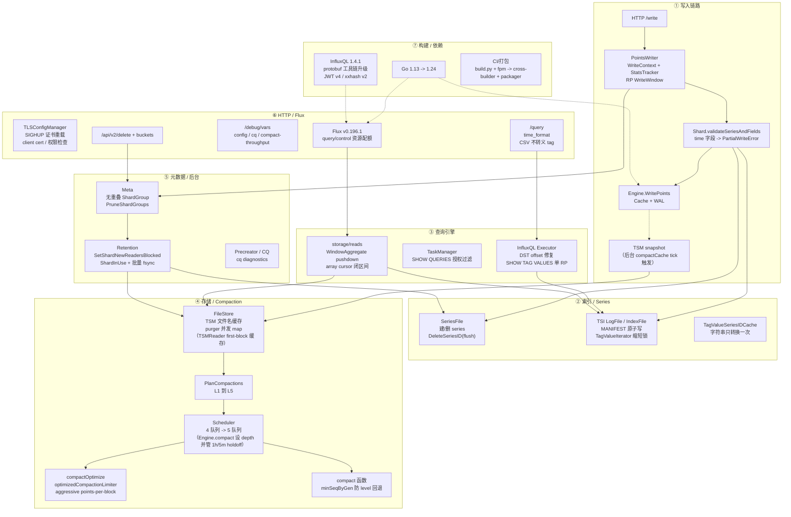

# InfluxDB v1.8.10 → v1.12.3 版本差异总览

> **小白导读**：
> - 这不是一次“只改了几行”的升级。区间内有 **527 个提交、602 个文件、+79,310 / −45,239 行**，存储、索引、查询、HTTP、依赖都被动过。
> - 最大的变化在 **compaction**：v1.8.10 的调度器只建模 4 个队列，optimize 和 full 混在 level 4；v1.12.3 拆成 **L1–L5 五个队列**，L5 optimize 有独立 limiter、独立执行路径和 holdoff。
> - v1.12.3 还修了两个会直接表现为“磁盘一直涨”的调度 bug：**混合 level compaction 把 L4 降回 L2**，以及 **某些情况下 full compaction 根本不排期**。
> - 写入路径有一次 **Go API 级重构**：`context.Context` + 统计回调被换成 `tsdb.WriteContext` + `StatsTracker`；同时新增按 retention policy 配置的写入时间窗口，超窗写入会被拒绝。
> - 查询侧更多是 **安全与正确性修复**：`SHOW QUERIES` 越权、DST 跨边界丢行、`SHOW TAG VALUES` 跨 RP、array cursor 合并重复点。
> - 如果你只想知道“升级会不会坏”，先读 [§5 升级影响清单](#5-升级影响清单)；如果你要核对代码，按 [§7 证据与方法](#7-证据与方法) 的命令逐条复现。

本文是 `docs/specs/v1.8.10-v1.12.3/` 的总览。七篇子文档分别深入写入、索引、查询、存储/compaction、元数据/后台、HTTP/Flux、构建/性能：

| 子文档 | 覆盖范围 |
|---|---|
| [01 写入链路](01_write_path_diff.md) | HTTP 写入、解析后的校验、`WriteContext`、WAL/Cache、字段错误语义、RP 写入窗口 |
| [02 索引与 Series](02_index_series_diff.md) | SeriesFile、TSI LogFile/IndexFile、MANIFEST、TagValueSeriesIDCache、TSI 并发 |
| [03 查询引擎](03_query_engine_diff.md) | InfluxQL iterator、DST、`SHOW TAG VALUES`、`SHOW QUERIES`、array cursor、window aggregate |
| [04 存储与 Compaction](04_storage_compaction_diff.md) | 4→5 级模型、Scheduler、Planner、level 回退、full/optimize、FileStore、purger |
| [05 元数据与后台](05_meta_background_diff.md) | Meta 状态机、shard group、retention、precreator、CQ、shard 生命周期 |
| [06 HTTP 与 Flux](06_http_flux_diff.md) | HTTP 路由、TLS、`/debug/vars`、v2 API、Flux 升级与 storage 读取入口 |
| [07 构建与性能](07_build_perf_diff.md) | Go/Flux/InfluxQL/protobuf 依赖、构建链、测试框架、可观测性 |

---

## 1. 版本身份与基线

### 1.1 两个版本是谁

| 项 | OLD | NEW |
|---|---|---|
| 版本 | **v1.8.10** | **v1.12.3** |
| commit | `688e697c51`（`688e697c51fd5353725da078555adbeff0363d01`） | `f3d5cb68ab`（`f3d5cb68ab25a07d89f76d8c18e52c362cc37bfb`） |
| commit 日期 | 2021-10-11 | 2026-02-27 |
| 与 `docs/specs/` 17 篇主文档的关系 | **不是**主文档基准 | **是**主文档的代码基准 |
| 区间规模 | — | `527 commits`、`602 files`、`+79,310 / −45,239` |

复核命令与输出：

```bash
git show -s --format=%H v1.8.10
# 688e697c51fd5353725da078555adbeff0363d01
# （v1.8.10 是 annotated tag，git rev-parse 会输出 tag 对象；等价写法 git rev-parse 'v1.8.10^{}'）

git rev-parse v1.12.3
# f3d5cb68ab25a07d89f76d8c18e52c362cc37bfb

git rev-list --count v1.8.10..f3d5cb68ab
# 527

git diff --shortstat v1.8.10 f3d5cb68ab
# 602 files changed, 79310 insertions(+), 45239 deletions(-)
```

**与主文档的关系必须说清楚**：`docs/specs/readme.md` 第 5 行明确写着，17 篇主文档以 v1.12.3（commit `f3d5cb68ab`）为基准，不是 v1.8.10。当前工作树在这 6 个 docs 提交之后只改了文档：`git diff --stat f3d5cb68ab HEAD -- '*.go'` 输出为空；`git diff --name-only f3d5cb68ab HEAD` 只有 27 个 docs 路径。因此本组差异文档里所有“新版本行为”都可以直接在当前工作树核对，等价于 `v1.12.3`。

### 1.2 变化集中在哪里

按顶层目录聚合 `git diff --numstat v1.8.10 f3d5cb68ab`（含生成代码，只列主要目录）：

| 目录 | 文件数 | 新增行 | 删除行 | 主要变化 |
|---|---:|---:|---:|---|
| `storage` | 44 | 23,693 | 8,919 | array cursor、window aggregate、Flux storage 读取 |
| `tsdb` | 97 | 13,497 | 5,507 | compaction、FileStore、TSI、SeriesFile、WAL/Cache |
| `services` | 55 | 9,218 | 3,455 | httpd、meta、retention、continuous querier |
| `pkg` | 44 | 5,221 | 1,360 | TLS、file、metrics、limiter |
| `query` | 33 | 5,149 | 684 | InfluxQL iterator、TaskManager、statement rewriter |
| `flux` | 28 | 4,373 | 939 | Flux 升级、window/bare aggregate 规则 |
| `cmd` | 65 | 3,448 | 3,904 | influxd 启动、influx_inspect、influx_tools |

提交标题前缀的粗略构成（`git log --format='%s' v1.8.10..f3d5cb68ab`）：

| 类型 | 数量 | 说明 |
|---|---:|---|
| `fix` | 223 | 正确性、并发、错误处理、兼容性修复 |
| `chore` | 124 | 依赖、日志、重构、清理 |
| `feat` | 103 | 新功能、新配置、新观测项 |
| `build` | 22 | Go/依赖/构建链 |
| `test` | 10 | 测试框架与测试修复 |
| `refactor` | 10 | 结构调整 |
| 其余 | 35 | Merge 30、revert 2、perf 1、improvement 1、docs 1 |

### 1.3 五条结论

1. **存储层变化最大，而且不是“纯优化”**：compaction 的队列模型、level 计算、full/optimize 调度都改了；1.12.2 修 full 调度、1.12.3 修 level 回退（`95e86be3f4`、`5e9d85c972`）；区间内共三个磁盘/压缩调度问题，其中“无界增长”特指 #26670。
2. **写入路径有 Go API 级重构**：`WriteContext` + `StatsTracker` 取代了 `context.Context` 传参；`time` 字段从静默丢弃变成返回 `PartialWriteError`（engine 层也不再跳过，字段可能落盘，见 01 §7.1，待回归）；新增 RP 级 `FUTURE LIMIT` / `PAST LIMIT`。
3. **查询侧的主线是安全与正确性**：`SHOW QUERIES` 越权、DST 丢行、`SHOW TAG VALUES` 跨 RP、array cursor 合并重复点，都是能被用户观察到的行为变化。
4. **运维面明显增强**：TLS 证书 SIGHUP 热重载、`/debug/vars` 增加 config/stats/compact-throughput 诊断；cq 由 {name,tags,values} 改为扁平 values、v2 delete/buckets 新增；**未见 TSM/WAL 磁盘格式版本升级**，TSI MANIFEST 改为原子写，meta protobuf 与 `fields.idx` 都是兼容扩展（后者新增 `fields.idxl` 增量日志）。
5. **构建基线跨度很大**：Go 1.13 → Go 1.24，Flux v0.65.1 → v0.196.1，InfluxQL 伪版本 → v1.4.1；升级前应先过工具链和依赖行为差异。

---

## 2. 全局变更地图

下图把七大块和它们之间的主要依赖画在一起。节点里写的是真实结构体/函数/配置名，不是概念占位符。



**怎么读这张图：**

1. 先看 **④ 存储/Compaction**：这是本次区间里行为变化最集中、最容易影响磁盘和 CPU 的块。`S2`→`S1`→`S3`/`S4`（规划→调度→执行）是新的 5 级调度主链。
2. 再看 **① 写入链路** 与 **② 索引/Series**：写入校验、`WriteContext`、TSI 锁与缓存分配都在这条线上，影响写入延迟和错误语义。
3. 最后看 **③/⑤/⑥/⑦**：查询、后台、HTTP/Flux、构建依赖大多是外围行为或可观测性变化，但 `M2` retention 和 `H1` TLS 会直接影响运维。

---

## 3. 差异分类表

分类是“按变化性质”切的，不是按目录切的；同一个 commit 可能同时出现在两类里（例如 compaction 调度既影响性能也影响正确性）。每行都给代表 commit 和对应子文档。

### 3.1 新功能

| 代表项 | 变化要点（旧 → 新） | 代表 commit | 子文档 |
|---|---|---|---|
| RP 写入时间窗口 | v1.8.10 没有窗口概念；v1.12.3 支持 `FUTURE LIMIT` / `PAST LIMIT`，窗口外的点返回 `PartialWriteError`，并让 `SHOW RETENTION POLICIES` 增加 future/past 两列 | `07c261a21a` | [01](01_write_path_diff.md) |
| Level 5 optimize 独立调度 | 旧版 optimize 复用 level 4 计划，且 `compactFull` 硬编码 `optimize=false`，计划实际按 full 执行；新版拆出 L5、独立 `compactOptimize`（aggressive points-per-block）、独立 limiter 与 holdoff | `f738344a81`、`0fdb6adcb2` | [04](04_storage_compaction_diff.md) |
| TLSConfigManager 与证书热重载 | 旧版启动时 `tls.LoadX509KeyPair` 静态加载；新版管理器支持 SIGHUP 重载、客户端证书、证书/私钥权限检查（TLS 1.3 两版都可配置） | `049b1f7e00`、`aa1775bfc2`、`e3b058616c` | [06](06_http_flux_diff.md) |
| `/query` 的 `time_format` 参数 | 旧版只有 `epoch`；新版支持 `epoch` / `rfc3339`，默认仍是 `epoch` | `b9a0155ca9` | [06](06_http_flux_diff.md) |
| `/debug/vars` 扩展 | 新增 `config`、`stats.compact-throughput-usage-percentage` 等诊断；`cq` 由 Statistic 包装改为扁平 values | `269f1b6281`、`f75be56eee`、`0e656d6dd5` | [06](06_http_flux_diff.md)、[07](07_build_perf_diff.md) |
| `/api/v2/buckets` 部分支持 | 旧版无 buckets CRUD；新版支持 create/delete/list/get/update 的子集 | `ce40acb298` | [06](06_http_flux_diff.md) |
| Window aggregate 下推 | 旧版 storage read 无窗口聚合下推；新版增加 `ReadWindowAggregate`、`WindowAggregate` 与 MeanCount cursor | `a2154f143c`、`599700b41b` | [03](03_query_engine_diff.md) |
| Flux 查询控制器 | 旧版 `flux/control` 是薄壳，基本不限内存/并发；新版 `query/control` 增加并发配额、单查询/总内存配额和队列，配置段为 `[flux-controller]` | `b9ee9e5b44`、`f1aa051787` | [03](03_query_engine_diff.md)、[07](07_build_perf_diff.md) |

### 3.2 行为变更

| 代表项 | 变化要点（旧 → 新） | 代表 commit | 子文档 |
|---|---|---|---|
| 写入 Go API 签名 | 旧版 `Engine.WritePoints(points)` / `WritePointsWithContext(ctx)`、`Store.WriteToShard(shardID, points)`；新版改为 `WritePoints(points, StatsTracker)`、`WriteToShard(WriteContext, ...)` | `dd3baf6d4a`、`6795ec6c01` | [01](01_write_path_diff.md) |
| `time` 字段错误语义 | 旧版静默跳过字段 `time`；新版返回 `PartialWriteError`（`Dropped=0`），点仍写入，但调用方会收到错误；engine 层也不再跳过 `time`（`v1.8.10:tsdb/engine/tsm1/engine.go:1330-1333` → `v1.12.3:tsdb/engine/tsm1/engine.go:1366-1367` 删除），字段可能落盘，与错误文本不一致（01 §7.1，待回归） | `1356a21321` | [01](01_write_path_diff.md) |
| `SHOW TAG VALUES` 的 RP 作用域 | 旧版跨所有 RP 收集；新版按语句中的 RP 限定，多个不同 RP 直接报错；该限制只对 TSI 生效 | `519e23b86a` | [03](03_query_engine_diff.md) |
| `SHOW QUERIES` 授权过滤 | 旧版非管理员能看到其他数据库的查询；新版按 `AuthorizeDatabase(ReadPrivilege, db)` 过滤；列数同时 5→6（+`user`），按固定列解析的脚本会错位 | `2b7164440f` | [03](03_query_engine_diff.md)、[06](06_http_flux_diff.md) |
| array cursor 时间区间 | 底层存储两版都是闭区间；旧版把半开 stop 原样传入，会多返回恰好落在 stop 的点；新版构造 `CursorRequest` 时统一 `end-1`，对 Flux/InfluxQL 仍是 `[start, stop)` | `8edf7a4e2f` | [03](03_query_engine_diff.md) |
| `/api/v2/delete` 语义 | v1.8.10 不存在该端点（v1.10.0 的 `2fe52d8edc` 引入）；区间内修正初版的 nil `Sources`、db/rp 混入 measurement、measurement 引号 | `f365bb7e3a`、`c31e99574f`、`e3e9232de5`、`2fe52d8edc` | [06](06_http_flux_diff.md) |
| CSV 输出转义 | 旧版 CSV formatter 对 tag 做转义；新版 `HashKey(false)`，CSV 中不再出现反斜杠转义 | `2dc3dcb3d1` | [06](06_http_flux_diff.md) |
| 字段长度上限 | 旧版没有字段长度限制；新版 `MaxFieldValueLength = 1048576`，字符串字段超过 1 MiB 返回 `PartialWriteError`，可用 `skip-field-size-validation` 关闭 | `6d22e69ef1` | [01](01_write_path_diff.md) |

### 3.3 性能优化

| 代表项 | 变化要点（旧 → 新） | 代表 commit | 子文档 |
|---|---|---|---|
| TSM 文件名解析缓存 | 旧版 `tsmGeneration.level()` 每次都 `parseFileName`；新版在打开/重命名时缓存 generation/sequence | `f0d5c73253` | [04](04_storage_compaction_diff.md) |
| compaction 规划 CPU 与首 block 缓存 | 旧版规划反复解码 block 统计；`2a0353ffd2` 引入 `firstBlockCount` 缓存与 `PT_SmartOptimize`/`PT_NoOptimize` 特例，`95e86be3f4` 再移除这两个特例（修 #26670） | `2a0353ffd2`、`95e86be3f4` | [04](04_storage_compaction_diff.md) |
| optimize 频率与并发控制 | 旧版每个 tick 都可能规划 optimize；新版用 `lastWrite`、1 小时启动 holdoff、5 分钟间隔和独立 limiter 控制 | `e984a226f2`、`f738344a81` | [04](04_storage_compaction_diff.md) |
| TSI series cache 字符串分配 | 旧版 `Put` 在 exists/元素/map key 处重复 `string(...)`；新版 `Put` 一次转换、复用同一 backing string（`Get` 未变，仍每次转换 3 次） | `f3d5cb68ab` | [02](02_index_series_diff.md) |
| TagValueIterator 锁持有时间 | 旧版 `defer RUnlock` 覆盖整个 iterator 构造；新版查到 `logTagKey` 后立即释放 RLock | `e51acc4882` | [02](02_index_series_diff.md) |
| purger 锁竞争 | 旧版用全局 mutex 管理待删文件；新版 `gensyncmap.Map` + 缩小临界区 | `d5a48e0662` | [04](04_storage_compaction_diff.md) |
| retention 删除 fsync 策略 | v1.8.10 的 `DeleteSeriesID` 只 `Flush()` 缓冲、不 `file.Sync()`；区间内 `b4e781eff6` 给 `SeriesSegment.Flush` 加上 `file.Sync`；新版 `1420aaf2bc` 改为 `NoFlush` + `FlushSegments` 按 partition 批量 fsync | `b4e781eff6`、`1420aaf2bc` | [05](05_meta_background_diff.md) |
| `fields.idx` 增量持久化 | 旧版每次字段变更都重写整个 `fields.idx`；新版把变更追加到 `fields.idxl`，启动/关闭时合并回 `fields.idx` | `80c10c8c04` | [01](01_write_path_diff.md)、[02](02_index_series_diff.md) |

### 3.4 正确性修复

| 代表项 | 变化要点（旧 → 新） | 代表 commit | 子文档 |
|---|---|---|---|
| 混合 level compaction 的 level 回退 | 旧版输出 sequence 只看 max generation，可能把 L4 降成 L2；新版用 `minSeqByGen` + `maxInputLevel` 保证输出 level 不回退 | `5e9d85c972` | [04](04_storage_compaction_diff.md) |
| 嵌套低层文件的规划（1.12 线回归） | 1.12 线把嵌套处理从「遇低层即停」改为 `Plan` 反向扫描；这是 #26911 的回归修复，不是「v1.8.10 漏压 → v1.12.3 修好」 | `d1d68d656d` | [04](04_storage_compaction_diff.md) |
| full compaction 未排期（区间内回归） | v1.8.10 用 `PlanLevel`/`Plan`/`PlanOptimize`；1.12.1 引入的 `PT_SmartOptimize`/`PT_NoOptimize` 特例会让文件被 planner 锁住却不排期，表现为磁盘无界增长；1.12.2 移除特例并把 holdoff 移到 `Engine.compact` | `95e86be3f4` | [04](04_storage_compaction_diff.md) |
| retention 孤儿 shard / 挂起 | 旧版删除失败/未完成也会 prune：14 天后只要 `DeletedAt` 过期就删组，不检查 shard 是否删净，留下孤儿文件；旧版还可能卡在 `Shard.Close`。新版 `PruneShardGroups` 要求无 shard 且已过 `DeletedAt`，并用 `SetShardNewReadersBlocked`/`ShardInUse` 跳过 in-use shard | `7bd3f89d18`、`b4bd607eef` | [05](05_meta_background_diff.md) |
| TSI MANIFEST 与部分打开清理 | 旧版 `ioutil.WriteFile` 直接覆盖 MANIFEST；新版临时文件 + `os.Rename` 原子替换。旧版部分打开失败可能泄漏引用；新版补齐清理与 iterator close | `061cf55f2a`、`d3db48e93d`、`a428043f84` | [02](02_index_series_diff.md) |
| 非法 series key 越界 panic | 旧版对非法 series key 可能 index out of range；新版在 `series_file.go`、`series_cursor.go`、`log_file.go`、`tsdb/index.go`、`tsdb/series_partition.go` 增加边界检查 | `6af0be9234` | [02](02_index_series_diff.md) |
| 删除 series 的锁 | 区间内 `1bc0eb4795` 引入 `seriesKeysLock` 时漏了一条 `RUnlock`，`81b42fd344` 修复；`21ab48416e` 另修 `Store.DeleteSeries` 的读锁泄漏。v1.8.10 本身没有该锁，不存在“旧版泄漏” | `1bc0eb4795`、`81b42fd344`、`21ab48416e` | [02](02_index_series_diff.md)、[05](05_meta_background_diff.md) |
| GROUP BY 跨 DST 边界 | 旧版先把 `end` 做时区换算、再加 offset，秋季回拨时丢行；新版把 `end += Offset` 移到时区计算之前 | `d60741b506` | [03](03_query_engine_diff.md) |
| array cursor 优化重复数据 | 旧版只判断 `pos == 0`，在 cache 与 TSM 混合的第二个 `Next()` 里可能重复拷贝 TSM 点；新版增加 `c.tsm.pos == 0` | `31cb61f556` | [03](03_query_engine_diff.md) |

### 3.5 构建与依赖

| 代表项 | 变化要点（旧 → 新） | 代表 commit | 子文档 |
|---|---|---|---|
| Go 工具链 | `go 1.13` → `go 1.24.0`，最终 `toolchain go1.24.13` | `0574163566`、`e484c4d871`、`542ce7f684`、`d65673b1f5` | [07](07_build_perf_diff.md) |
| Flux | `v0.65.1` → `v0.196.1` | `03b6ed2bed` | [07](07_build_perf_diff.md) |
| InfluxQL | `v1.1.1-0.20200828144457` → `v1.4.1` | `77d6f20894` | [07](07_build_perf_diff.md) |
| protobuf 代码生成 | 生成器从 `protoc-gen-gogo` 切到官方 `protoc-gen-go`（最终 `protoc-gen-go v1.34.1` / `protoc v5.29.2`），重新生成 meta/fields 等 `.pb.go`；wire 格式兼容 | `8b38d0e2bf`、`d4b16dcd98` | [07](07_build_perf_diff.md) |
| JWT 与 x/net | `dgrijalva/jwt-go/v4` → `golang-jwt/jwt/v4 v4.5.2`，x/net 升级 | `f8635640cc` | [07](07_build_perf_diff.md) |
| xxhash | `cespare/xxhash v1.1.0` → `cespare/xxhash/v2 v2.3.0` | `45a8227ad6` | [07](07_build_perf_diff.md) |
| arrow / flux array | 旧版 flux 组件用 `arrow/array`；新版迁移到 `flux/array` | `8fae484a66` | [07](07_build_perf_diff.md) |

### 3.6 测试与可观测性

| 代表项 | 变化要点（旧 → 新） | 代表 commit | 子文档 |
|---|---|---|---|
| compaction 属性测试 | 旧版以表驱动用例为主；新版增加 property-based 框架与随机计划校验 | `ba2c2b6432` | [07](07_build_perf_diff.md) |
| FileStore merge 指标 | 新增每种类型的 `merge_duration`、`merge_count`、`merge_values_count`、`merge_over4_count` | `133c290fc2` | [04](04_storage_compaction_diff.md) |
| compact throughput 诊断 | `/debug/vars` 新增 `stats.compact-throughput-usage-percentage` | `0e656d6dd5` | [06](06_http_flux_diff.md)、[07](07_build_perf_diff.md) |
| `/debug/vars` 的 config/cq | 新增 `config` 诊断；`cq` 输出形状改为扁平 values（`cq` 本身旧版已有） | `269f1b6281`、`f75be56eee` | [06](06_http_flux_diff.md) |
| 查询字节指标 | `SHOW STATS` 增加 per-user `userquerybytes`；`/debug/vars` 增加 `fluxQueryRespBytes` | `4dcc8776c1`、`db523227a2` | [06](06_http_flux_diff.md) |
| access log 默认配置 | `access-log-status-filters` 补进 `influxd config` 默认输出（功能本身旧版已有） | `a2e029fa7f` | [06](06_http_flux_diff.md) |
| `LastModifiedOrErr` | 旧版 `LastModified` 吞掉错误；新版暴露错误供调用方判断 | `bd3eb349a4` | [05](05_meta_background_diff.md) |
| shard/丢点日志 | 新增启动 shard 数量日志、改进 dropped point 日志、减少 phantom shard 噪声 | `3c87f524ed`、`31b41a6a2d`、`c168cc5aca` | [05](05_meta_background_diff.md) |

---

## 4. Top 10 最重要的变化

排序依据是“对磁盘/CPU/数据正确性/升级兼容性的综合影响”，不是提交数量。

### 1. Compaction 从 4 队列模型变成 5 队列模型

**旧**：`scheduler` 的 `defaultWeights` 是 `[4]float64{0.4, 0.3, 0.2, 0.1}`，L4 同时承载 full 和 optimize；并且只有 `len(level4Groups) == 0` 时才会调用 `PlanOptimize()`，而 `compactFull` 硬编码 `optimize=false`，所以这些 optimize 计划实际按 full 执行（`v1.8.10:tsdb/engine/tsm1/scheduler.go:7`、`v1.8.10:tsdb/engine/tsm1/engine.go:2117`、`v1.8.10:tsdb/engine/tsm1/engine.go:2221-2222`）。
**新**：`TotalCompactionLevels = 5`，L5 是真正的 optimize，有独立权重 `0.01`、独立队列、`compactOptimize`（aggressive points-per-block）、`optimizedCompactionLimiter`，以及启动 1 小时/间隔 5 分钟的 holdoff（`v1.12.3:tsdb/engine/tsm1/engine.go:107-113`、`v1.12.3:tsdb/engine/tsm1/scheduler.go:8`、`v1.12.3:tsdb/engine/tsm1/engine.go:2171-2175`、`:2529`）。
**影响**：L5 会真正重写 block、提高 points-per-block，索引更小但单次 compaction 更重；它不再被 full compaction 完全阻塞，但默认只允许 1 个并发 optimize，且启动后 1 小时内不**调度** L5（仍会规划）；更重要的是 L5 只对**冷 shard**生效——shard 至少 `compact-full-write-cold-duration`（默认 4h）无写入才会被 optimize。热 shard 即使过了 1h 也不会回收磁盘，升级后不要指望“重启立刻回收磁盘”。

### 2. 混合 level compaction 的 level 回退修复

**旧**：`compact()` 的 `maxGeneration`/`maxSequence` 循环在 generation 变大时把 `maxSequence` 重置为该 generation 的 sequence；配合 `tsmGeneration.level()` 的 `min(sequence, 4)`，当 L1 文件 generation 更高、L4 文件 generation 更低时，输出 sequence 可能只有 2，L4 数据被降成 L2（`v1.8.10:tsdb/engine/tsm1/compact.go:907-922`、`:182`）。
**新**：先按 generation 记录 `minSeqByGen`，计算 `maxInputLevel = max(min(minSeq, 4))`，再保证 `maxSequence + 1 >= maxInputLevel`（`v1.12.3:tsdb/engine/tsm1/compact.go:976-1011`，commit `5e9d85c972`）。
**影响**：冷写/强制 compaction 混合 L1+L4 时不会再发生 level 回退，避免数据被反复重压和磁盘放大；这是 1.12.3 才有的修复。

### 3. full compaction 在某些情况下不排期的修复

**v1.8.10**：用 `PlanLevel` + `Plan` + 可选 `PlanOptimize`，没有 `PT_*` 特例（`v1.8.10:tsdb/engine/tsm1/engine.go:2110-2121`）。**区间内回归**：1.12.1 引入的 `PT_SmartOptimize`/`PT_NoOptimize` 会让 planner 把文件标记为 in-use 却不释放，部分 TSM 文件永远不进入 full compaction，用户看到的是磁盘持续增长（commit `95e86be3f4` 的提交说明明确写了 “unbounded increase in disk space”）。**v1.12.2**（`95e86be3f4`，1.12 分支 clean backport）：移除这两个 plan type，首 block 缓存（`firstBlockCount`）承担原本的性能目的，optimize holdoff 移到 `Engine.compact`（`v1.12.3:tsdb/engine/tsm1/engine.go:2216-2235`、`v1.12.3:tsdb/engine/tsm1/reader.go:638`）。
**影响**：升级到 1.12.3 后磁盘增长问题应缓解；但仍建议观察 `tsmFullCompactions`、`tsmFullCompactionsActive` 和 shard 目录大小。

### 4. Retention 的孤儿 shard 与挂起修复

**旧**：删除失败/未完成也会 prune——14 天后只要 `DeletedAt` 过期就删组，不检查 shard 是否删净，留下永远不会被 retention 清理的孤儿文件；retention 还可能卡在 `Shard.Close`，导致后续 shard 都不删（commit `7bd3f89d18`、`b4bd607eef`）。
**新**：`PruneShardGroups` 只在 `DeletedAt` 已过且 `len(sgi.Shards) == 0` 时移除；retention 删除前 `SetShardNewReadersBlocked(id, true)`，再用 `ShardInUse(id)` 跳过仍有读者的 shard（`v1.12.3:services/meta/data.go:476`、`v1.12.3:services/retention/service.go:234-251`）。
**影响**：磁盘回收更可靠，retention 不再被单个卡住的 shard 拖死；但“卡住”的 shard 会保留下来并在日志中提示人工处理。

### 5. 写入路径的 API 重构与错误语义变化

**旧**：`Engine.WritePoints(points)` 和 `Engine.WritePointsWithContext(ctx, points)`；`time` 字段被静默跳过；没有 RP 写入窗口（`v1.8.10:tsdb/engine/tsm1/engine.go:1294`、`v1.8.10:tsdb/field_validator.go:23`）。
**新**：`WriteContext{UserId}` + `StatsTracker` 贯穿 `PointsWriter`/`Store`/`Engine`（`6795ec6c01` 引入显式 tracker，`dd3baf6d4a` 引入 WriteContext）；`time` 字段返回 `PartialWriteError`，但 engine 层也不再跳过该字段（字段可能落盘，见 01 §7.1）；RP 可用 `FUTURE LIMIT` / `PAST LIMIT` 拒绝窗口外写入（`v1.12.3:tsdb/store.go:1855`、`v1.12.3:tsdb/field_validator.go:45`、`v1.12.3:coordinator/points_writer.go:211-245`）。
**影响**：嵌入式/企业版调用方必须改签名；普通 HTTP 客户端可能第一次看到 `partial write` 错误；按用户统计的写入指标依赖 `WriteContext.UserId`；另外新增 1 MiB 字段长度上限，超大字符串字段会从成功变成 400。

### 6. TSI 的崩溃恢复、并发与分配优化

**旧**：MANIFEST 直接 `ioutil.WriteFile` 覆盖，写到一半失败会破坏现有清单；部分打开的 TSI 可能泄漏引用；非法 series key 可能 panic；`TagValueSeriesIDCache` 每次查 map 都做 `string(...)`（`v1.8.10:tsdb/index/tsi1/partition.go:1303`、`v1.8.10:tsdb/index/tsi1/cache.go:59-67`、`v1.8.10:tsdb/index/tsi1/log_file.go:414`）。
**新**：MANIFEST 写临时文件后 `os.Rename` 原子替换；部分打开路径补齐清理和 iterator close；series key 增加边界检查；cache 的 `name/key/value` 只转换一次（`v1.12.3:tsdb/index/tsi1/partition.go:1490-1520`、`v1.12.3:tsdb/index/tsi1/cache.go:98-105`）。
**影响**：崩溃恢复更稳，TSI 查询分配更少；`.tsl` 现在按大小或年龄（默认 4h）轮转，并有每小时 `runPeriodicCompaction`，`compact-full-write-cold-duration` 同时控制该年龄、默认 4h（`v1.12.3:tsdb/index/tsi1/index.go:44-48`；每小时 tick 在 `v1.12.3:tsdb/index/tsi1/partition.go:979-1000`）。但 `TagValueIterator` 在释放 RLock 后再遍历 `tagValues`，02 §7.7 已判定为 v1.12.3 的并发回归（可 fatal），建议用 race 复现触发条件（见 §10）。

### 7. 查询正确性与安全修复

**旧**：非管理员执行 `SHOW QUERIES` 可以看到其他数据库的查询；`GROUP BY ... OFFSET` 跨 DST 秋季回拨时丢行；`SHOW TAG VALUES` 跨所有 RP；array cursor 优化在 cache+TSM 混合时可能重复拷贝点（commit `2b7164440f`、`d60741b506`、`519e23b86a`、`31cb61f556`）。
**新**：`executeShowQueriesStatement` 接收 `CoarseAuthorizer` 并按库过滤；`end += Offset` 移到时区计算之前；`SHOW TAG VALUES` 限定单个 RP；array cursor 增加 `c.tsm.pos == 0` 条件（`v1.12.3:query/task_manager.go:136-144`、`v1.12.3:query/iterator.go:860`、`v1.12.3:coordinator/statement_executor.go:1127`、`v1.12.3:tsdb/engine/tsm1/array_cursor.gen.go:113`）。
**影响**：安全漏洞关闭，查询结果更正确；但 `SHOW TAG VALUES` 涉及多个不同 RP 时会从“返回并集”变成“报错”，依赖旧行为的脚本需要改。

### 8. Storage read 的区间语义与窗口聚合下推

**旧**：storage cursor 按 `[start, stop)` 请求，和底层 file store 的 `[start, stop]` 不一致；cursor 错误在部分路径被吞掉；没有 window aggregate 下推（commit `8edf7a4e2f`、`fe6c64b21e`、`a2154f143c`）。
**新**：`CursorRequest.EndTime` 明确为 inclusive，`newMultiShardArrayCursors` 在构造请求时做 `end - 1` 转换；cursor 错误在 tsm1 数组游标/reset 路径已上抛，但 group/filter 的 `Err()` 仍返回 nil（03 §7.1/§7.2）；`ReadWindowAggregate`/`WindowAggregate` 与 MeanCount cursor 支持窗口聚合下推（`v1.12.3:storage/reads/array_cursor.go:81-90`、`v1.12.3:tsdb/cursors/cursor.go:64-71`）。
**影响**：边界点不再因半开/闭区间差异被漏掉或重复；Flux 窗口聚合可以减少读放大。但自定义 cursor 调用方如果仍按 `[start, stop)` 传参，需要检查是否多包含了一个边界点。

### 9. HTTP/TLS 运维能力增强

**旧**：httpd 在启动时 `tls.LoadX509KeyPair`，证书更新必须重启；`/query` 只有 `epoch`；`/debug/vars` 没有 config/stats/compact-throughput；v1.8.10 无 `/api/v2/delete`（v1.10.0 引入，初版语义 bug 已在 1.12.3 修完：nil Sources、不设 db/rp、去引号）（`v1.8.10:services/httpd/service.go:115`）。
**新**：`TLSConfigManager` 支持 SIGHUP 重载、客户端证书、证书/私钥权限检查；`time_format` 支持 `epoch`/`rfc3339`；`/debug/vars` 增加 config/stats，`cq` 改为扁平输出；v2 delete（v1.10.0 新增）在区间内修正为 nil `Sources`、不设 db/rp、去 measurement 引号（`v1.12.3:services/httpd/service.go:162`、`v1.12.3:services/httpd/handler.go:640`、`v1.12.3:services/httpd/handler.go:2356`）。
**影响**：证书轮换无需重启，监控项更全；但 TLS 文件权限检查、`https-insecure-certificate` 修复和多 RP 查询限制都可能改变现有部署行为。

### 10. Flux 控制器与构建基线升级

**旧**：Flux 走 `flux/control` 薄控制器，基本不限制内存/并发；构建基线是 `go 1.13`、Flux `v0.65.1`、InfluxQL `v1.1.1-0.20200828144457`、`dgrijalva/jwt-go/v4`（`v1.8.10:go.mod:3`、`:21`、`:22`）。
**新**：Flux 改走 `query/control`，提供 `[flux-controller]` 的 `query-concurrency`、`query-queue-size`、`query-max-memory-bytes`、`total-max-memory-bytes`、`query-initial-memory-bytes`（默认 0 表示不限制）；构建基线是 `go 1.24.0`/`toolchain go1.24.13`、Flux `v0.196.1`、InfluxQL `v1.4.1`、`golang-jwt/jwt/v4 v4.5.2`、`xxhash/v2 v2.3.0`（`v1.12.3:query/control/controller.go:71-110`、`v1.12.3:go.mod:3-5`、`:21-23`、`:13`、`:17`）。
**影响**：可以显式治理 Flux 查询的并发和内存，但不配置时仍接近旧行为；构建机必须安装 Go 1.24，Flux/InfluxQL 大版本升级会带来函数、解析和结果格式的细节差异。

---

## 5. 升级影响清单

### 5.1 会影响运维/配置/数据格式/API 的变化

| 影响面 | 变化 | 升级动作 / 风险 | 证据 |
|---|---|---|---|
| 配置 | 新增 `max-concurrent-optimized-compactions`，默认/非法值按 1 处理，且不超过 `max-concurrent-compactions` | 如果旧配置没有该项，行为等于 1；需要更高 optimize 并发时显式设置，但不要超过总 compaction 上限 | `v1.12.3:tsdb/config.go:159-162`、`v1.12.3:tsdb/store.go:513-524` |
| 运维 | L5 optimize 需同时满足：启动 holdoff 1h、两次间隔 ≥5m、shard 冷写 ≥4h；holdoff 内仍会规划但不调度 | 重启后磁盘空间不会立刻回收；热 shard 永远不会 optimize，容量告警窗口要相应放宽 | `v1.12.3:tsdb/engine/tsm1/engine.go:2171-2175`、`tsdb/engine/tsm1/compact.go:452`、`tsdb/config.go:38` |
| 运维 | TLS 证书支持 SIGHUP 重载、客户端证书、权限检查；`https-insecure-certificate` 修复 | 证书轮换流程可从“重启”改为“发 SIGHUP”；确认证书/私钥文件权限满足新检查 | `v1.12.3:services/httpd/service.go:162`、commit `aa1775bfc2`、`049b1f7e00`、`ba705ec658` |
| SQL/DDL | `CREATE/ALTER RETENTION POLICY` 支持 `FUTURE LIMIT` / `PAST LIMIT`；`SHOW RETENTION POLICIES` 增加两列 | 新语句需要 InfluxQL v1.4.1；旧客户端如果按固定列数解析 `SHOW RETENTION POLICIES` 会受影响 | `v1.12.3:coordinator/statement_executor.go:852-871`、commit `07c261a21a` |
| 写入 API | 窗口外的点返回 `PartialWriteError`，错误里带 database/RP 与 dropped 数 | 客户端要按 400/partial write 处理；监控 `WriteWindowDropped` | `v1.12.3:coordinator/points_writer.go:211-245`、`:314-350`、`:516-521` |
| 写入校验 | 新增 `MaxFieldValueLength = 1 MiB`，字符串字段超限返回 `PartialWriteError`；`skip-field-size-validation` 可关闭 | 超大字符串字段从成功变 400；检查客户端/导入工具 | `v1.12.3:tsdb/field_validator.go:12-36`、`v1.12.3:tsdb/config.go:120`、commit `6d22e69ef1` |
| HTTP 查询 API | 新增 `time_format=epoch / rfc3339`，默认 `epoch`；CSV 的 tag 不再转义 | 默认行为不变；显式用 `time_format` 的客户端要确认 `epoch` 参数是否被忽略；CSV 解析器要能接受未转义 tag | `v1.12.3:services/httpd/handler.go:640`、`:810`、`v1.12.3:services/httpd/response_writer.go:228` |
| SQL 查询语义 | `SHOW TAG VALUES` 涉及多个不同 RP 时报错；INMEM 索引仍可能跨 RP 返回 | 检查依赖“跨 RP 并集”的脚本；INMEM 用户不要指望该限制生效 | `v1.12.3:coordinator/statement_executor.go:1127-1145`、commit `519e23b86a` |
| SQL 查询语义 | 非管理员 `SHOW QUERIES` 只看到有权限的库 | 监控账号如果非管理员，看到的行数会变少；这是安全修复，不建议回退 | `v1.12.3:query/task_manager.go:136-144`、commit `2b7164440f` |
| 元数据/shard group | `CreateShardGroup` 与已有 group 求差集，保证不重叠；`DropShard` 不再覆盖首次 `DeletedAt` | 同一时间戳可能落到不同 StartTime/EndTime 的 group；依赖固定 shard group 边界的脚本需回归 | `v1.12.3:services/meta/data.go:382`、`:299`、commit `3c811bcd81`、`7bd3f89d18` |
| V2 API | v1.8.10 无 `/api/v2/delete`；v1.10.0 引入，区间内修正 nil `Sources`、db/rp、引号；`/api/v2/buckets` 新增部分 CRUD | 对从 1.8.10 升级的用户是新增能力，不存在“兼容旧 bug”；delete 仍不支持按 field 删除 | commit `f365bb7e3a`、`c31e99574f`、`e3e9232de5`、`2fe52d8edc`、`ce40acb298` |
| 数据格式 | **未见 TSM/WAL 文件格式版本升级**；TSI MANIFEST 内容格式未变，但写入改为临时文件 + rename；meta protobuf 追加 optional 字段 7/8 | 不需要离线重写 TSM；新旧 meta 快照按 protobuf 兼容方式读取；仍建议升级前备份 meta | `v1.12.3:tsdb/engine/tsm1/writer.go:81-82`（magic `0x16D116D1`、version 1，两版相同）；`git diff v1.8.10 f3d5cb68ab -- tsdb/engine/tsm1/encoding.go tsdb/engine/tsm1/wal.go` 是代码整理/WAL 配置生效，非格式变化；MANIFEST 权限收紧为 0644；`v1.12.3:tsdb/index/tsi1/partition.go:1490-1520`；`v1.12.3:services/meta/internal/meta.pb.go:509-521` |
| 字段元数据 | `fields.idx` 仍是 protobuf，但新增 `fields.idxl` 增量日志，启动/关闭时合并回 `fields.idx` | 升级不需要重建；降级到不识别 `.idxl` 的旧版本前先确认合并/备份，否则升级后的字段变更可能不可见 | `v1.12.3:tsdb/shard.go:51`、commit `80c10c8c04` |
| Flux 资源 | 新增 `[flux-controller]`：`query-concurrency`、`query-queue-size`、`query-max-memory-bytes`、`total-max-memory-bytes`、`query-initial-memory-bytes`（`query/control/controller.go:81`）；默认 0 表示不限制 | 不配置时行为接近旧版；配置后 Flux 查询可能排队或被拒绝 | `v1.12.3:query/control/controller.go:71-110`、`v1.12.3:cmd/influxd/run/config.go:45` |
| Go API | `Engine.WritePoints` 增加 `StatsTracker`；`Store.WriteToShard` 改为 `WriteContext`；`SeriesFile.DeleteSeriesID` 增加 `flush bool` 并返回 partition | 嵌入式/企业版/自定义工具需要改编译；不要继续调用已移除的 `WritePointsWithContext`、`WriteToShardWithContext` | `v1.8.10:tsdb/engine/tsm1/engine.go:1294`、`v1.8.10:tsdb/store.go:1412`、`v1.8.10:tsdb/series_file.go:198`；`v1.12.3:tsdb/engine/tsm1/engine.go:1346`、`v1.12.3:tsdb/store.go:1861`、`v1.12.3:tsdb/series_file.go:203` |
| 构建 | Go 1.24、Flux 0.196.1、InfluxQL 1.4.1、protobuf 工具链、JWT v4；产物收窄为 `influx`/`influx_inspect`/`influxd`，架构仅 linux-amd64/arm64、darwin-amd64、windows-amd64 | CI/构建机升级 Go；检查 Flux/InfluxQL 行为差异；不再产出 i386/armhf/armel/static_* 与 influx_tools/influx_stress，使用这些产物的部署需自建或换架构；仓库根 `Dockerfile`/`appveyor.yml` 仍指向旧工具链，不能用于 1.12.3 构建；发布路径为 `releases/<tag>/`，`logger.Level` 类型已变化 | `v1.12.3:go.mod:3-5`、`:21-23`、`:57`；`v1.8.10:go.mod:3`、`:21-22` |
| 监控 | 新增 `/debug/vars` 的 config/stats，新增 merge 指标与查询字节指标；注意 cq 形状变化、`httpd.valuesWrittenOK` 被删除 | 监控采集器可以增加这些 key；注意 `SHOW STATS` 的 per-user 项可能增加基数；旧面板需删 `valuesWrittenOK` | `v1.12.3:services/httpd/handler.go:2356`、commit `133c290fc2`、`4dcc8776c1` |

> 上表之外还需检查 5 类变化：SIGHUP 语义反转（旧版默认终止进程）；订阅 `Subscriber` API 与 `total-buffer-bytes`；`count_hll`/`sum_hll` 与基数近似；WAL 段大小配置生效；systemd 启动 `buildtsi`。监控面板还要补删 `httpd.valuesWrittenOK`。

### 5.2 纯内部优化（通常不需要迁移）

这些变化主要改调度、缓存、锁和内存分配，不改变磁盘格式或 HTTP 契约，但会改变指标语义、IO 曲线与持久化窗口：

- TSM 文件名 generation/sequence 缓存（`f0d5c73253`）与 first-block 缓存（`2a0353ffd2`）。
- 5 级 scheduler、L5 独立 limiter/holdoff（`f738344a81`、`0fdb6adcb2`）。
- purger 并发 map 与缩小锁区（`d5a48e0662`）。
- TSI series cache 字符串复用（`f3d5cb68ab`）、`TagValueIterator` 缩短 RLock（`e51acc4882`）。
- retention fsync 策略（`b4e781eff6`、`1420aaf2bc`）——v1.8.10 删除 series 不 fsync；区间内先变成每次删除 fsync，再改成按 partition 批量 fsync。相对 v1.8.10 是新增持久化保障，相对“每次 fsync”的中间版本则把持久化点后移，见 §10。
- file store merge 指标（`133c290fc2`）、compaction 属性测试（`ba2c2b6432`）。

---

## 6. 推荐阅读路径

### 6.1 只看存储（compaction / TSM / FileStore）

问题：**磁盘为什么涨/不涨？compaction 到底怎么排期？L4/L5 有什么区别？**

1. [04 存储与 Compaction](04_storage_compaction_diff.md)：先看 4→5 级模型、Scheduler、Planner、level 回退与 full 调度修复。
2. [01 写入链路](01_write_path_diff.md)：看 Cache snapshot 如何产生 L1 文件，以及写入错误如何回到客户端。
3. [02 索引与 Series](02_index_series_diff.md)：TSI/SeriesFile 的删除、flush 与 compaction 边界。
4. 主文档：[01 Write Engine](../01_write_engine_spec.md)、[04 Background Tasks](../04_background_tasks_spec.md)、[16 FileStore + KeyCursor](../16_filestore_keycursor_spec.md)、[17 TSM File Format](../17_tsm_file_format_spec.md)。

### 6.2 只看查询（InfluxQL / array cursor / storage reads）

问题：**同一个查询为什么结果变了？是 bug 修复还是语义变化？**

1. [03 查询引擎](03_query_engine_diff.md)：DST、`SHOW TAG VALUES`、`SHOW QUERIES`、array cursor、window aggregate。
2. [02 索引与 Series](02_index_series_diff.md)：TSI 锁、series key 边界、series cache。
3. [06 HTTP 与 Flux](06_http_flux_diff.md)：`/query` 的 `time_format`、CSV 输出、Flux 入口。
4. 主文档：[03 Query Engine](../03_query_engine_spec.md)、[08 Array Cursor](../08_array_cursor_spec.md)、[09 Storage Reads](../09_storage_reads_spec.md)、[11 InfluxQL Execution](../11_influxql_execution_spec.md)。

### 6.3 只看运维/API（retention / TLS / debug / v2 API）

问题：**升级后运维流程要不要改？监控项和 API 有没有变？**

1. [05 元数据与后台](05_meta_background_diff.md)：retention 孤儿 shard/挂起、PruneShardGroups、shard 生命周期、CQ。
2. [06 HTTP 与 Flux](06_http_flux_diff.md)：TLS 热重载、`time_format`、`/debug/vars`、v2 delete/buckets。
3. [07 构建与性能](07_build_perf_diff.md)：Go/Flux/InfluxQL 升级、构建链、观测项。
4. 主文档：[10 HTTP Service](../10_http_service_spec.md)、[12 Background Services](../12_background_services_spec.md)、[07 State Machine](../07_state_machine_spec.md)。

### 6.4 做升级评估（从 1.8.10 升到 1.12.3）

建议按“风险从高到低”读，不要从 01 顺读：

1. 本文 [§5 升级影响清单](#5-升级影响清单)：先确认配置、API、数据格式、Go API 的影响。
2. [04 存储与 Compaction](04_storage_compaction_diff.md)：确认 level 回退、full 调度、L5 holdoff 对磁盘/CPU 的影响。
3. [05 元数据与后台](05_meta_background_diff.md)：确认 retention 行为、孤儿 shard、CQ。
4. [01 写入链路](01_write_path_diff.md)：确认 `WriteContext`、`time` 字段、RP 写入窗口。
5. [06 HTTP 与 Flux](06_http_flux_diff.md)：确认 TLS、`time_format`、v2 API、CSV。
6. [03 查询引擎](03_query_engine_diff.md)：确认 `SHOW TAG VALUES`、`SHOW QUERIES`、DST、cursor 边界。
7. [07 构建与性能](07_build_perf_diff.md)：确认 Go 1.24 与依赖升级。

---

## 7. 证据与方法

### 7.1 复核命令

```bash
# 1. 确认两个基线
git rev-parse 'v1.8.10^{}' v1.12.3

# 2. 看区间规模
git diff --shortstat v1.8.10 f3d5cb68ab

# 3. 看某个子系统的提交
git log --oneline v1.8.10..f3d5cb68ab -- tsdb/engine/tsm1

# 4. 看旧版某段代码（带行号）
git show v1.8.10:tsdb/engine/tsm1/compact.go | nl -ba | sed -n '176,188p'

# 5. 看新版同一段代码（tag 与工作树等价）
git show v1.12.3:tsdb/engine/tsm1/compact.go | nl -ba | sed -n '219,231p'

# 6. 确认工作树只多了 docs 提交
git diff --stat f3d5cb68ab HEAD -- '*.go'
# 输出为空
```

### 7.2 引用约定

- 旧版本：`v1.8.10:path:line`，例如 `v1.8.10:tsdb/engine/tsm1/engine.go:2117`。
- 新版本：`v1.12.3:path:line`，例如 `v1.12.3:tsdb/engine/tsm1/engine.go:2216`。
- commit：用短 SHA，例如 `5e9d85c972`；需要完整信息时用 `git show -s --format='%H %ad %s' --date=short <sha>`。
- 代码块/表格里的行号以 `git show v1.8.10:<path> | nl -ba` 和当前工作树 `nl -ba` 为准。
- 对“没有变化”的结论，必须给出对应的 `git diff` 无输出或 `git log` 无提交作为证据；没有做穷尽审查的领域会标“待核实”。

### 7.3 方法与边界

1. 先用 `git log --oneline v1.8.10..f3d5cb68ab -- <dir>` 找候选提交，再用 `git show --stat` 排除纯文档/纯测试提交。
2. 对每个候选提交，至少核对一处旧代码和一处新代码；只根据 commit message 的结论会标“提交说明依据”。
3. **不做基准测试推断**：本文不写“提升 X%”这类数字，除非 commit/测试里有可复核的数据；没有就只解释机制。
4. 本文是总览，不追求列全 527 个提交；未列出的提交可能是小重构、日志、测试或依赖微调。七篇子文档才是逐项清单。
5. 版本边界：NEW 的代码基准是 `f3d5cb68ab`；当前工作树在其上只有 6 个 docs 提交（`e04d9caa93`、`65e6693067`、`750819baf0`、`523c4bd0d9`、`6861a080d7`、`1ebfb74c0f`），`*.go` 无差异。

---

## 8. 统一术语表

| 术语 | 含义 | v1.8.10 | v1.12.3 | 主要文档 |
|---|---|---|---|---|
| Compaction level | 由 TSM 文件名 sequence 编码的层级，`level = min(sequence, 4)` | 有 L1–L4 概念，optimize 复用 L4 | 有 L1–L5 概念，L5 专指 optimize | [04](04_storage_compaction_diff.md)、[17](../17_tsm_file_format_spec.md) |
| 4 级 vs 5 级 | 调度器建模的队列数量 | `scheduler` 的 `queues/weights` 是 `[4]`，L4 同时放 full + optimize | `TotalCompactionLevels = 5`，L4 full、L5 optimize 分开 | [04](04_storage_compaction_diff.md) |
| generation | TSM 文件名第一段，表示一次创建批次 | 每次 `parseFileName` 从路径解析 | 打开/重命名时缓存到 `ExtFileStat.Generation` | [04](04_storage_compaction_diff.md)、[17](../17_tsm_file_format_spec.md) |
| sequence | TSM 文件名第二段，编码 level | 每次 `parseFileName` 解析 | 缓存到 `ExtFileStat.Sequence`，compaction 输出用 `minSeqByGen` 防回退 | [04](04_storage_compaction_diff.md)、[17](../17_tsm_file_format_spec.md) |
| WriteContext | 写入请求的请求级上下文，目前只含 `UserId` | 不存在；用 `context.Context` + context value 传统计 | `tsdb.WriteContext{UserId}` 贯穿 `PointsWriter`/`Store`/`Engine` | [01](01_write_path_diff.md)、[06](../06_cluster_communication_spec.md) |
| StatsTracker | 写入统计回调集合 | 不存在；统计通过 `context.Context` 的指针传递 | `tsdb.StatsTracker`，支持 `AddedPoints` 等回调 | [01](01_write_path_diff.md) |
| optimizedCompactionLimiter | 限制并发 optimize compaction 的 `limiter.Fixed` | 不存在；optimize 与 full 共用总 limiter | 独立 limiter，默认 1，且不超过总 compaction 并发 | [04](04_storage_compaction_diff.md) |
| L5 optimize | 只重写/重整索引、提高 points-per-block 的 compaction | 作为 L4 optimize 路径规划，但 `compactFull` 硬编码 `optimize=false`，实际按 full 执行 | 独立 L5，`compactOptimize` + `PointsPerBlock` + holdoff | [04](04_storage_compaction_diff.md) |
| Array cursor | storage read 的批量类型化读取抽象 | 底层存储是闭区间，但旧版把半开 stop 原样传入（会多返回 stop 点）；错误可能被吞 | `EndTime` inclusive，构造时统一 `end-1`，对外仍是 `[start, stop)`；tsm1 数组游标已上抛错误，group/filter 的 `Err()` 仍为 nil | [03](03_query_engine_diff.md)、[08](../08_array_cursor_spec.md) |
| TSI | Time Series Index，按 measurement/tag 查 series 的索引 | MANIFEST 非原子写，部分打开清理不完整 | MANIFEST 原子替换、清理补齐、series cache 减少分配 | [02](02_index_series_diff.md)、[14](../14_series_file_deep_dive_spec.md) |
| SeriesFile | series key 到 series ID 的持久化身份系统 | `DeleteSeriesID(id)` 每条只 `Flush()` 缓冲，无 `file.Sync()` | `DeleteSeriesID(id, flush)` + `FlushSegments` 批量 fsync（区间内 `b4e781eff6` 先加 Sync） | [02](02_index_series_diff.md)、[14](../14_series_file_deep_dive_spec.md) |
| fields.idxl | `fields.idx` 的增量变更日志 | 不存在；每次字段变更重写整个 `fields.idx` | 变更追加到 `fields.idxl`，启动/关闭合并回 `fields.idx` | [01](01_write_path_diff.md)、[02](02_index_series_diff.md) |
| MaxFieldValueLength | 单个字段值的长度上限 | 无限制 | 1 MiB；超过返回 `PartialWriteError`，`skip-field-size-validation` 可关闭 | [01](01_write_path_diff.md)、[13](../13_line_protocol_parser_spec.md) |
| Flux 查询控制器 | Flux 查询的并发/内存/队列管理 | `flux/control` 薄壳，基本不限制 | `query/control`，`[flux-controller]` 可配置并发、队列、内存配额 | [03](03_query_engine_diff.md)、[06](06_http_flux_diff.md) |
| PartialWriteError | 部分写入错误，含 `Reason`、`Dropped`、db/rp | 主要用于丢点/类型冲突 | 新增 `time` 字段错误、RP 写入窗口、带 db/rp 的上下文 | [01](01_write_path_diff.md)、[10](../10_http_service_spec.md) |
| RP 写入窗口 | retention policy 允许的时间范围 | 不存在 | `FUTURE LIMIT` / `PAST LIMIT`，由 `WriteWindow.WithinWindow` 判定 | [01](01_write_path_diff.md)、[07](../07_state_machine_spec.md) |
| TLSConfigManager | 管理 TLS 配置与证书热重载的组件 | 不存在；启动时静态 `tls.LoadX509KeyPair` | `pkg/tlsconfig.TLSConfigManager`，支持 SIGHUP、client cert、权限检查；TLS 1.3 两版均可配置 | [06](06_http_flux_diff.md)、[10](../10_http_service_spec.md) |
| CursorRequest | storage cursor 的请求结构 | `StartTime`/`EndTime` 语义未注释，按半开区间使用 | 明确 `StartTime`/`EndTime` 均为 inclusive | [03](03_query_engine_diff.md)、[08](../08_array_cursor_spec.md) |

---

## 9. 具体案例

### 9.1 案例 A：混合 level compaction 为什么把 L4 降成了 L2

**输入**（两个 TSM 文件，文件名格式 `generation-sequence.tsm`）：

| 文件 | generation | sequence | 推导 level |
|---|---:|---:|---:|
| `000000001-000000004.tsm` | 1 | 4 | L4 |
| `000000002-000000001.tsm` | 2 | 1 | L1 |

**旧版推演**（`v1.8.10:tsdb/engine/tsm1/compact.go:907-922` 的 max 逻辑，配合 `:182` 的 `level()`）：

1. 遍历文件，`maxGeneration = 2`；当 generation 从 1 变到 2 时，`maxSequence` 被重置为该 generation 的 sequence，即 1。
2. 输出文件名使用 `maxGeneration=2`、`maxSequence+1=2`，得到 `000000002-000000002.tsm`。
3. 下次 `tsmGeneration.level()` 读到 sequence=2，判定为 **L2**。原本的 L4 数据被“降级”。

**新版推演**（`v1.12.3:tsdb/engine/tsm1/compact.go:976-1011`）：

1. `minSeqByGen = {1: 4, 2: 1}`。
2. `maxInputLevel = max(min(4,4), min(1,4)) = 4`。
3. `maxSequence+1 = 2 < 4`，所以把 `maxSequence` 提升到 3；输出 sequence=4，仍是 **L4**。

**影响**：旧版在冷写/强制 compaction 混合高低 level 文件时会制造 level 回退，后续 planner 可能把这份数据当 L2 再压一遍，造成额外写放大和磁盘占用。新版保证“输出 level 不低于输入最高 level”，但这也意味着输出文件会更大、单次 compaction 更重，CPU/IO 观察项要一起看。

### 9.2 案例 B：RP 写入窗口如何拒绝一个“太老”的点

**DDL**（InfluxQL v1.4.1 语法）：

```sql
CREATE RETENTION POLICY rp ON db DURATION 24h REPLICATION 1
  FUTURE LIMIT 15m PAST LIMIT 10m;
```

> InfluxQL v1.4.1 的 `CREATE RETENTION POLICY` 语法要求 `FUTURE` 在 `PAST` 之前
> （`parser.go:281-296`）；反过来写会报 `found FUTURE, expected ;`。

**写入**：一个时间戳为 `now - 20m` 的点，**同一请求里还有一个窗口内的点**（例如 `now`）。关键点是 `MapShards` 的 `list` 只装本次请求里新创建/取回的 shard group，不预载库里已有的组。

**旧版**：`MapShards` 只检查 `p.Time().Before(min)`（`min = now - rp.Duration`）和 shard group 覆盖范围；`now-20m` 在 24h 内，所以会被接受并写入（`v1.8.10:coordinator/points_writer.go:206-210`）。

**新版**：

1. `NewWriteWindow(rp)` 记录 `before = now - 10m`、`after = now + 15m`（`v1.12.3:coordinator/points_writer.go:211-245`）。
2. `WithinWindow(now-20m)` 发现 `checkBefore && t.Before(before)`，返回 `false, before, WriteWindowLowerBound`。
3. 第一轮 `MapShards` 对 `now-20m` 直接 `continue`、不建组；同请求里的 `now` 建出覆盖该小时的组并 `list.Add`（`v1.12.3:coordinator/points_writer.go:314-321`）。
4. 第二轮 `list.ShardGroupAt(now-20m)` 命中该组，再判一次 `WithinWindow` 失败 → `AddDropped(p, before, WriteWindowLowerBound)`，`WriteWindowDropped=1`（`:337-350`）。
5. `WritePointsPrivileged` 返回 `PartialWriteError`，reason 由 `SummariseDropped()` 生成：`dropped 0 points outside retention policy of duration 24h0m0s and 1 points outside write window (-10m0s) - ...`（`v1.12.3:coordinator/points_writer.go:516-521`）。

> 反例：库里只有这一个点（或空库）时，第一轮不会建组，第二轮 `sg == nil` → `AddDropped(p, min, RetentionPolicyBound)`，即 `RetentionDropped=1`、`WriteWindowDropped=0`，错误文本是 “outside retention policy”，不是 “outside write window”。

**影响**：客户端会收到 400/partial write，必须决定重试、丢弃还是修正时间戳；监控上应同时看 `RetentionDropped` 与 `WriteWindowDropped`（单点/空库会落到前者）。这不是“默认开启”的行为，只有显式设置 `PAST LIMIT` / `FUTURE LIMIT` 才会生效。

### 9.3 案例 C：`time` 字段从“静默消失”到“明确报错”

**输入**：`cpu time=1,value=2`（字段名 `time` 与时间戳字段冲突）。

- 旧版：`defaultFieldValidator.Validate` 遇到 `time` 字段直接 `continue`，返回 `nil`；点仍然写入，客户端完全不知道字段被丢了（`v1.8.10:tsdb/field_validator.go:23-26`）。
- 新版：遇到 `TimeBytes` 时构造 `PartialWriteError{Reason: "invalid field name: ... Field \"time\" has been stripped from point.", Dropped: 0}`；点仍会写入，但 `Shard.WritePoints` 会把该错误返回给 writer（`v1.12.3:tsdb/field_validator.go:45-57`、`v1.12.3:tsdb/shard.go:728-731`）。
- 影响：HTTP 客户端第一次可能看到 `partial write ... dropped=0`；这是“提醒”而不是“整点丢弃”，但足以让严格校验的写入端失败。engine 层同时删除了跳过 `time` 的 `continue`（`v1.8.10:tsdb/engine/tsm1/engine.go:1330-1333` → `v1.12.3:tsdb/engine/tsm1/engine.go:1366-1367`），`Dropped==0` 时该点仍进入待写列表，字段可能以普通字段落盘；不要把“字段已被剥离”当成既成事实，待回归确认。

---

## 10. 仍存在的风险

| 风险 | 证据 | 影响 | 建议 |
|---|---|---|---|
| L5 optimize 可能被饿死或延迟 | `defaultWeights` 中 L5 权重 `0.01`，启动 holdoff 1h、间隔 5m、shard 冷写 ≥4h（`v1.12.3:tsdb/engine/tsm1/scheduler.go:8`、`tsdb/engine/tsm1/engine.go:2171-2175`、`tsdb/engine/tsm1/compact.go:452`、`tsdb/config.go:38`） | 高负载集群上 optimize 可能长期排不到；重启后磁盘回收慢；热 shard 永远不会 optimize | 观察 `tsmOptimizeCompactionQueue`/`tsmOptimizeCompactionsActive`；必要时提高 `max-concurrent-optimized-compactions`，但不要挤占 level compaction |
| retention 仍可能被“卡住”的 shard 阻塞 | `ShardInUse` 为 true 时直接返回 `can not delete an in-use shard`（`v1.12.3:services/retention/service.go:246-251`） | 单个长期读者会让该 shard 永远不删；日志会提示，但不会自动恢复 | 监控 retention 错误日志与 shard 目录；排查长查询/泄漏的 reader |
| `TagValueIterator` 释放 RLock 后遍历共享 map（v1.12.3 并发回归） | `v1.12.3:tsdb/index/tsi1/log_file.go:422-437` 在 `RUnlock` 后调用 `tk.TagValueIterator()`；而 `logTagKey.TagValueIterator()` 会 `range tk.tagValues`，`execSeriesEntry` 又在 `f.mu` 写锁下更新同一 map（`:740-749`、`:1406-1411`） | 查询与写入并发会触发 `fatal error: concurrent map iteration and map write`（runtime 直接退出，`recover` 无效）。02 §3.6/§7.7 已判定这是 v1.12.3 的并发回归并用最小程序复现，本文与 02 结论一致 | 高并发写入 + TSI 查询场景先做 `-race` 回归确认触发条件；等上游把 `range` 移回锁内 |
| retention 的 fsync 持久化窗口 | v1.8.10 的 `SeriesSegment.Flush` 只刷缓冲、不 `file.Sync()`（`v1.8.10:tsdb/series_segment.go:210-216`）；区间内 `b4e781eff6` 加上 `file.Sync()`；`1420aaf2bc` 又改为 `DeleteSeriesID(id, NoFlush)` + `FlushSegments(partitionIDs)`，后者失败只记录日志（`v1.12.3:tsdb/series_segment.go:218-227`、`v1.12.3:tsdb/series_file.go:203-220`、retention 路径 `v1.12.3:services/retention/service.go:254` → `v1.12.3:tsdb/store.go:1083-1114`；`tsdb/engine/tsm1/engine.go:1852-1885` 是另一条 DELETE series 路径） | 相对 v1.8.10 是新增持久化保障；相对“每次删除 fsync”的中间版本，批量策略把持久化点后移，崩溃窗口内未 flush 的删除可能不持久 | 升级后关注删除后的 series 是否短暂“复活”；对删除持久性敏感的场景做掉电测试 |
| TSI cache 仍不是零分配 | `Put` 仍然对 `name/key/value` 各做一次 `string(...)`（`v1.12.3:tsdb/index/tsi1/cache.go:98-105`） | 高基数 tag 查询仍有分配压力，只是避免了重复转换 | 不要把它当成“完全消除分配”；高基数场景继续关注 heap |
| `SHOW TAG VALUES` 的限制只对 TSI 生效 | `SHOW TAG VALUES` 单 RP 限制在 `executeShowTagValues` 中，但 INMEM shard 共享索引（commit `519e23b86a` 说明） | INMEM 用户仍可能看到跨 RP 的 tag value；TSI 用户对多个不同 RP 查询会直接报错 | 升级前确认索引类型；需要跨 RP 并集的脚本改为显式多次查询 |
| CSV 不再转义可能破坏旧解析器 | `HashKey(false)` 只影响 CSV formatter（`v1.12.3:services/httpd/response_writer.go:228`；commit `2dc3dcb3d1`） | tag 值中含逗号/反斜杠时，CSV 列内容与旧版不同 | 用真实 tag 值做回归；解析器按标准 CSV 处理而不是按旧转义格式 |
| `fields.idxl` 的降级风险 | 新版把字段变更追加到 `fields.idxl`，正常关闭时合并回 `fields.idx`（`v1.12.3:tsdb/shard.go:51`、`:1681-1698`；commit `80c10c8c04`） | 旧版本不认识 `.idxl`；如果降级前未正常关闭/合并，升级后的字段变更可能不可见 | 升级/降级前备份 shard 的 `fields.idx`/`fields.idxl`；降级前用新版正常关闭以触发合并 |
| compaction 修复的版本归属：1.12.2 与 1.12.3 各含一个 | `95e86be3f4` 明确说修复的是 “introduced with 1.12.1”；`5e9d85c972` 是 1.12.3 的 backport | **修复归属**：full compaction 未排期修复（`95e86be3f4` #26670）在 v1.12.2 已包含；level 回退修复（`5e9d85c972` #27233）只在 v1.12.3。因此 1.12.1 两个 bug 都在；1.12.2 只剩 level 回退；1.12.3 两者都已修 | 直接升级到 1.12.3（或至少 1.12.2 再评估 level 回退） |

---

## 附：一句话记忆

- **存储**：4 队列变 5 队列，L4 full / L5 optimize 分家；1.12.2/1.12.3 各修了一个“磁盘一直涨/放大”的调度 bug（另有 #26911）；区间内共三个磁盘/压缩调度问题，“无界增长”特指 #26670。
- **写入**：`WriteContext` + `StatsTracker` 取代 context 传参；`time` 字段会报 partial write；RP 可以设置写入窗口。
- **查询**：`SHOW QUERIES` 不再越权、DST 不再丢行、`SHOW TAG VALUES` 只认一个 RP、array cursor 不再重复点。
- **运维**：TLS 可以 SIGHUP 热重载；`/debug/vars` 更全；retention 不再被单个 shard 拖死，但卡住的 shard 仍需人工处理。
- **升级**：先去 Go 1.24 工具链，再按 [§5](#5-升级影响清单) 过配置/API/数据格式，最后用 [§6.4](#64-做升级评估从-1810-升到-1123) 的顺序做回归。
